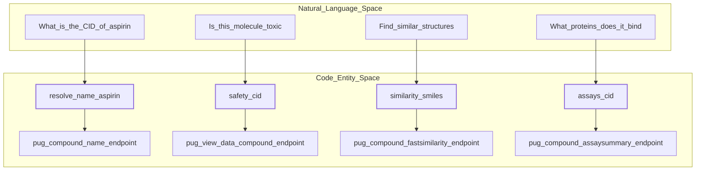
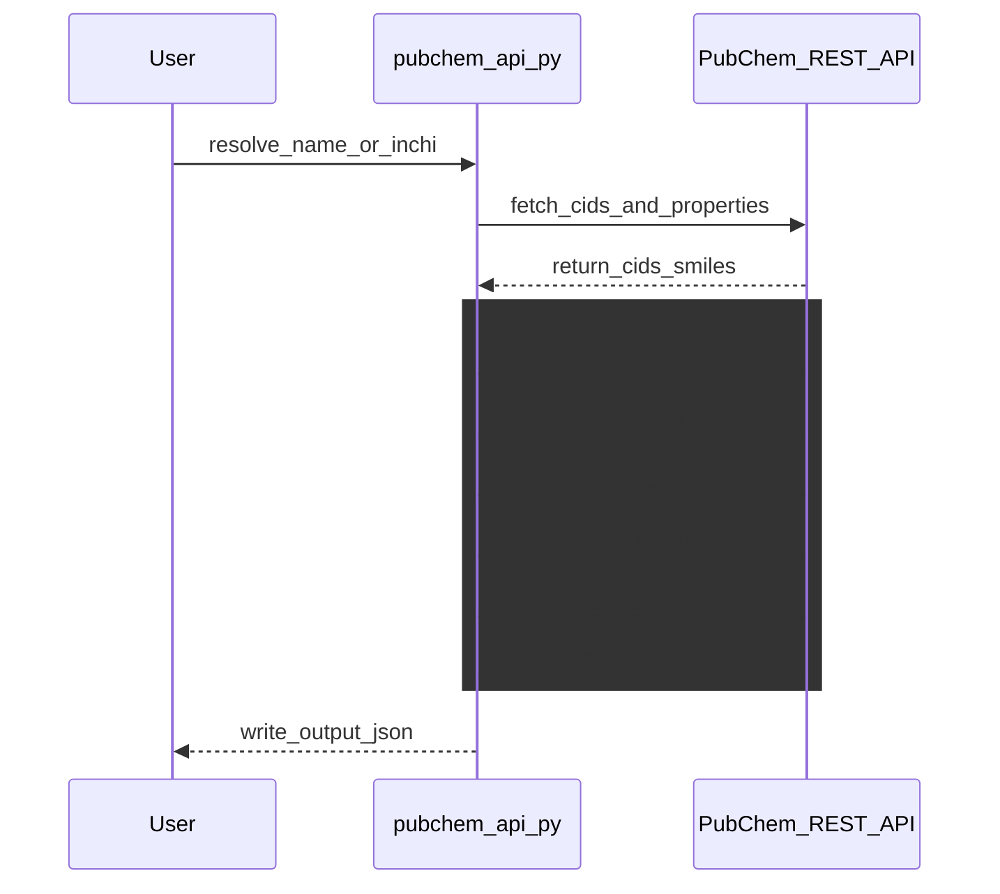

<!-- source: DeepWiki mcp.deepwiki.com · repo google-deepmind/science-skills · page 8.1 PubChem Chemical Database · fetched 2026-10-26 -->

# PubChem Chemical Database

Relevant source files

The following files were used as context for generating this wiki page:

- [skills/pubchem_database/scripts/pubchem_api.py](skills/pubchem_database/scripts/pubchem_api.py)

The PubChem skill provides a programmatic interface to the PubChem database, the world's largest collection of freely accessible chemical information. It enables searching by chemical name, SMILES, InChI, or CID to retrieve physical properties, safety data (GHS), pharmacology, bioassay results, structural similarity searches, and range-based property queries.

## Implementation Overview

The skill is implemented via `pubchem_api.py`, which serves as a command-line wrapper around the PubChem **PUG-REST** and **PUG-View** APIs [skills/pubchem_database/scripts/pubchem_api.py:15-20](). It utilizes the shared `HttpClient` configured with a default rate limit of 5 queries per second (QPS) [skills/pubchem_database/scripts/pubchem_api.py:36-39]().

### Data Flow and Request Handling

The script centralizes all network operations through the `make_request` function, which handles JSON parsing, plain text or CSV extraction, binary data fallback, and standardizes error responses for common HTTP status codes like 400 (Bad Request) and 404 (Not Found) [skills/pubchem_database/scripts/pubchem_api.py:40-59](). Output data is serialized via `write_output` [skills/pubchem_database/scripts/pubchem_api.py:61-73]().

### Component Mapping: Natural Language to Code

The following diagram maps common chemical informatics tasks to their corresponding functions and API endpoints within the codebase.

**Chemical Task to Code Entity Mapping**

Sources: [skills/pubchem_database/scripts/pubchem_api.py:75-182]()

## Key Functions and CLI Commands

### Compound Resolution
The `resolve` function converts human-readable names or InChI strings into machine-friendly identifiers [skills/pubchem_database/scripts/pubchem_api.py:75-84](). It performs lookups for unique PubChem Compound IDs (CIDs) and canonical properties (CanonicalSMILES, IsomericSMILES, InChIKey) [skills/pubchem_database/scripts/pubchem_api.py:86-97]().

### Property and Data Retrieval
The script distinguishes between computed properties (PUG-REST) and curated annotations (PUG-View).

| Function | API Source | Data Retrieved | Code Reference |
| :--- | :--- | :--- | :--- |
| `properties(cid)` | PUG-REST | MW, XLogP, TPSA, Exact Mass, H-Bond counts | [skills/pubchem_database/scripts/pubchem_api.py:100-102]() |
| `synonyms(cid)` | PUG-REST | Alternative names and trade names | [skills/pubchem_database/scripts/pubchem_api.py:105-107]() |
| `safety(cid)` | PUG-View | GHS hazard statements and handling | [skills/pubchem_database/scripts/pubchem_api.py:110-112]() |
| `pharmacology(cid)` | PUG-View | Mechanism of action and therapeutic uses | [skills/pubchem_database/scripts/pubchem_api.py:115-117]() |
| `view(cid, heading)` | PUG-View | Custom headings | [skills/pubchem_database/scripts/pubchem_api.py:120-123]() |
| `xrefs(cid, xref_type)` | PUG-REST | Cross-references to external databases | [skills/pubchem_database/scripts/pubchem_api.py:126-128]() |
| `image(cid)` | PUG-REST | PNG structure rendering URL and markdown | [skills/pubchem_database/scripts/pubchem_api.py:137-140]() |

Sources: [skills/pubchem_database/scripts/pubchem_api.py:100-140]()

### Structure-Based and Range Searching
PubChem supports rapid structural queries and numeric property range searches:
*   **Similarity**: `similarity(smiles)` queries `fastsimilarity_2d` to find related molecules [skills/pubchem_database/scripts/pubchem_api.py:142-145]().
*   **Substructure**: `substructure(smiles)` queries `fastsubstructure` to identify fragment-containing molecules [skills/pubchem_database/scripts/pubchem_api.py:148-151]().
*   **Range Search**: `range_search(feature, min_val, max_val)` queries compounds within a specific property numeric range [skills/pubchem_database/scripts/pubchem_api.py:180-182]().

Sources: [skills/pubchem_database/scripts/pubchem_api.py:142-151](), [skills/pubchem_database/scripts/pubchem_api.py:180-182]()

### BioAssay and Target Interactions
The `assays(cid, active_only)` function retrieves a summary of biological tests [skills/pubchem_database/scripts/pubchem_api.py:154-159](). If `active_only` is true, the `filter_active_assays` helper parses the tabular response to return records where the "Activity Outcome" equals "Active" [skills/pubchem_database/scripts/pubchem_api.py:162-177]().

Sources: [skills/pubchem_database/scripts/pubchem_api.py:154-177]()

## Operational Workflows

The skill defines standardized workflows for complex multi-step chemical profiling tasks.

**Workflow: Comprehensive Chemical Profiling**

Sources: [skills/pubchem_database/scripts/pubchem_api.py:75-182]()

## API Reference and Custom Queries

For advanced use cases, the `query(path)` function allows direct execution of custom PUG-REST paths by stripping leading slashes and appending to `PUBCHEM_BASE_URL` [skills/pubchem_database/scripts/pubchem_api.py:36-38](), [skills/pubchem_database/scripts/pubchem_api.py:131-134]().

CLI argument parsing is handled via `argparse` in `main()`, exposing subcommands including `resolve`, `properties`, `synonyms`, and others [skills/pubchem_database/scripts/pubchem_api.py:185-209]().

Sources: [skills/pubchem_database/scripts/pubchem_api.py:36-38](), [skills/pubchem_database/scripts/pubchem_api.py:131-134](), [skills/pubchem_database/scripts/pubchem_api.py:185-209]()

---

