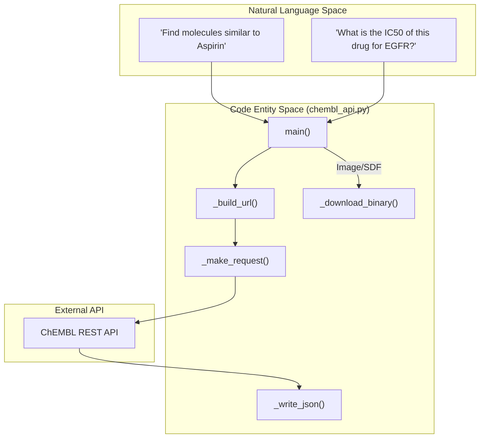
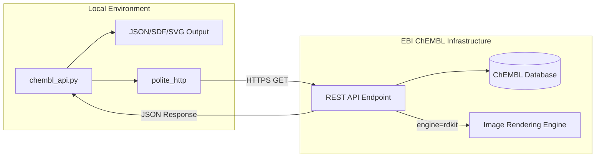

<!-- source: DeepWiki mcp.deepwiki.com · repo google-deepmind/science-skills · page 8.2 ChEMBL Bioactivity Database · fetched 2026-10-26 -->

# ChEMBL Bioactivity Database

Relevant source files

The following files were used as context for generating this wiki page:

- [skills/chembl_database/scripts/chembl_api.py](skills/chembl_database/scripts/chembl_api.py)

The ChEMBL skill provides a comprehensive interface for querying the ChEMBL database, a manually curated database of bioactive molecules with drug-like properties. It enables technical users to retrieve data regarding chemical structures, bioactivity measurements (IC50, Ki), drug targets, mechanisms of action, and clinical indications [skills/chembl_database/SKILL.md:4-7]().

## Implementation Overview

The skill is centered around a single Python CLI, `chembl_api.py`, which interacts with the ChEMBL REST API [skills/chembl_database/scripts/chembl_api.py:15-20](). It utilizes the shared `polite-http` library for robust HTTP communication, including automated rate limiting and exponential backoff for transient errors [skills/chembl_database/scripts/chembl_api.py:22-26](), [skills/chembl_database/scripts/chembl_api.py:40-43]().

### Data Flow and Request Lifecycle

The following diagram illustrates the transition from a Natural Language request to the execution of specific code entities within the ChEMBL skill.

**Natural Language to Code Entity Mapping**

Sources: [skills/chembl_database/scripts/chembl_api.py:140-168](), [skills/chembl_database/scripts/chembl_api.py:202-230]()

## Key Functions and Classes

### HttpClient Integration
The script initializes a global `_CLIENT` instance of `http_client.HttpClient` with a base URL of `https://www.ebi.ac.uk/chembl/api/data` and a rate limit of 5.0 queries per second (QPS) [skills/chembl_database/scripts/chembl_api.py:40-41](). This client handles:
*   **`fetch_json`**: For standard data retrieval and JSON parsing [skills/chembl_database/scripts/chembl_api.py:152-152]().
*   **`fetch_bytes`**: For downloading binary structure files (SDF) and images (SVG/PNG) [skills/chembl_database/scripts/chembl_api.py:184-184]().

### URL Construction (`_build_url`)
The `_build_url` function dynamically constructs ChEMBL API endpoints based on the subcommand and parameters provided [skills/chembl_database/scripts/chembl_api.py:200-208](). It supports single resources, batch fetching via set endpoints, free-text searching, Django-style filtering, and pagination parameters.

### Bioactivity Normalization
A critical feature for comparative analysis is the normalization logic using `UNIT_CONVERSION_TO_NM`, which converts various bioactivity units (µM, mM, pM, etc.) into a uniform nanomolar (nM) value [skills/chembl_database/scripts/chembl_api.py:91-99]().

Sources: [skills/chembl_database/scripts/chembl_api.py:40-43](), [skills/chembl_database/scripts/chembl_api.py:91-99](), [skills/chembl_database/scripts/chembl_api.py:138-166](), [skills/chembl_database/scripts/chembl_api.py:200-208]()

## Core Subcommands and Capabilities

The `chembl_api.py` script exposes several subcommands mapped to specific ChEMBL endpoints.

| Subcommand | ChEMBL Endpoint | Purpose |
| :--- | :--- | :--- |
| `activity` | `activity` | Fetch bioactivity data points (IC50, Ki, EC50) [skills/chembl_database/scripts/chembl_api.py:59-59](). |
| `assay` | `assay` | Retrieve assay descriptions and conditions [skills/chembl_database/scripts/chembl_api.py:61-61](). |
| `chembl_id_lookup` | `chembl_id_lookup` | Resolve any ChEMBL ID to its entity type [skills/chembl_database/scripts/chembl_api.py:67-67](). |
| `document` | `document` | Query literature documents underlying data points [skills/chembl_database/scripts/chembl_api.py:71-71](). |
| `molecule` | `molecule` | Retrieve chemical properties, SMILES, and structures [skills/chembl_database/scripts/chembl_api.py:79-79](). |
| `protein_classification` | `protein_classification` | Browse protein family trees and classifications [skills/chembl_database/scripts/chembl_api.py:82-82](). |
| `target` | `target` | Search for biological targets (proteins, cell lines) [skills/chembl_database/scripts/chembl_api.py:84-84](). |

Sources: [skills/chembl_database/scripts/chembl_api.py:48-89]()

## System Architecture

The following diagram demonstrates how the `chembl_api.py` CLI acts as a bridge between the user's requirements and the ChEMBL infrastructure.

**ChEMBL Skill System Architecture**

Sources: [skills/chembl_database/scripts/chembl_api.py:38-41](), [skills/chembl_database/scripts/chembl_api.py:138-166](), [skills/chembl_database/scripts/chembl_api.py:200-208]()

## Usage Patterns

### Molecule Search and Filtering
Molecules can be retrieved by ChEMBL ID, free-text search, or property filters:
*   **ID Lookup**: `molecule --id CHEMBL25` [skills/chembl_database/SKILL.md:57-58]()
*   **Property Filter**: `molecule --filter molecule_properties__mw_freebase__lte=500` [skills/chembl_database/SKILL.md:66-68]()

### Target and Bioactivity Retrieval
To find bioactivity data for a specific target (e.g., EGFR), users chain target resolution with activity filtering:
1. Find Target ID: `target --search "EGFR"` [skills/chembl_database/SKILL.md:84-85]()
2. Filter Activities: `activity --filter target_chembl_id=CHEMBL203 standard_type=IC50 --normalize` [skills/chembl_database/SKILL.md:100-102]()

### Cross-Referencing
ChEMBL supports resolution of external identifiers through target components and entity lookups via `chembl_id_lookup` [skills/chembl_database/SKILL.md:170-175]().

Sources: [skills/chembl_database/SKILL.md:55-181](), [skills/chembl_database/scripts/chembl_api.py:40-89]()

---

