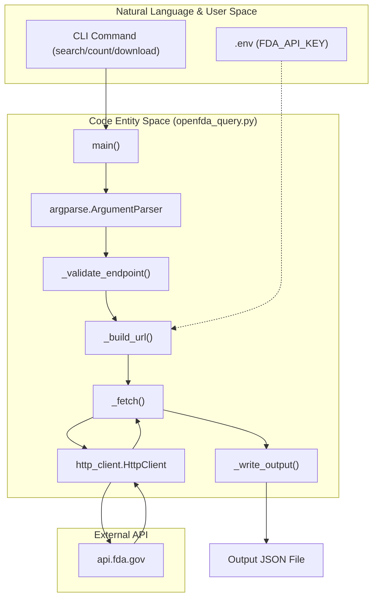
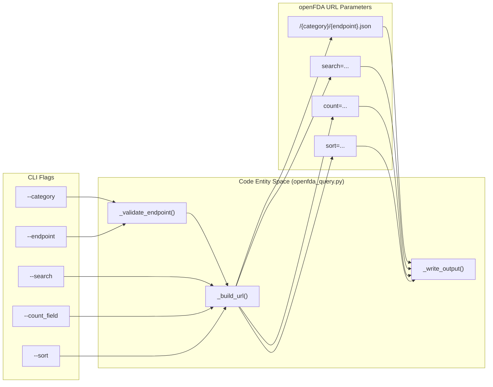

<!-- source: DeepWiki mcp.deepwiki.com · repo google-deepmind/science-skills · page 8.3 openFDA Drug and Device Database · fetched 2026-10-26 -->

# openFDA Drug and Device Database

Relevant source files

The following files were used as context for generating this wiki page:

- [skills/dbsnp_database/scripts/dbsnp_cli.py](skills/dbsnp_database/scripts/dbsnp_cli.py)
- [skills/openfda_database/SKILL.md](skills/openfda_database/SKILL.md)
- [skills/openfda_database/references/recipes.md](skills/openfda_database/references/recipes.md)
- [skills/openfda_database/scripts/openfda_query.py](skills/openfda_database/scripts/openfda_query.py)

The `openfda-database` skill provides a comprehensive programmatic interface to the openFDA API, supporting queries, searches, statistical counts, and large-scale data downloads across 28 distinct endpoints distributed over 8 categories (drugs, devices, food, tobacco, cosmetics, animal and veterinary products, substances, and transparency data) [skills/openfda_database/scripts/openfda_query.py:15-20](), [skills/openfda_database/SKILL.md:4-8]().

## Implementation Overview

The core logic is implemented in `openfda_query.py`, which leverages the shared `polite_http.http_client.HttpClient` configured with a default rate limit of 4.0 QPS [skills/openfda_database/scripts/openfda_query.py:40-43](). The script exposes a command-line interface with three primary subcommands: `search`, `count`, and `download` [skills/openfda_database/scripts/openfda_query.py:21-28](), [skills/openfda_database/SKILL.md:63]().

### Data Flow and System Architecture

The following diagram maps natural language research intents and CLI options to the underlying code entities in `openfda_query.py` and the external openFDA API.

**openFDA Query Data Flow**

Sources: [skills/openfda_database/scripts/openfda_query.py:40-44](), [skills/openfda_database/scripts/openfda_query.py:112-181](), [skills/openfda_database/scripts/openfda_query.py:183-220]()

## API Endpoints and Categories

The system categorizes 28 endpoints across 8 distinct regulatory domains [skills/openfda_database/scripts/openfda_query.py:45-76]().

| Category | Endpoints | Description |
| :--- | :--- | :--- |
| **Drug** | `event`, `label`, `ndc`, `enforcement`, `drugsfda`, `shortages` | FAERS adverse events, SPL labeling, NDC directories, recalls, approvals, shortages. |
| **Device** | `510k`, `classification`, `enforcement`, `event`, `pma`, `recall`, `registrationlisting`, `udi`, `covid19serology` | 510(k) clearances, product classifications, MDR adverse events, PMA approvals, UDI data. |
| **Food** | `enforcement`, `event` | CAERS adverse events and food recalls. |
| **Tobacco** | `problem`, `researchpreventionads`, `researchdigitalads`, `researchsmokefree` | Consumer complaints and research advertisement data. |
| **Other** | `historicaldocument`, `nsde`, `substance`, `unii` | Historical docs, National Drug Code Directory extensions, UNII substances. |
| **Animal and Veterinary** | `event` | Adverse event reports for animal drugs and products. |
| **Cosmetic** | `event` | Adverse event reports involving cosmetic products. |
| **Transparency** | `crl` | Complete Response Letters and regulatory transparency data. |

Sources: [skills/openfda_database/scripts/openfda_query.py:45-76](), [skills/openfda_database/references/recipes.md:3-6]()

## Core Functionality and CLI Commands

### 1. Search Mode (`cmd_search`)
Queries specific endpoints with custom query filters, sorting, and pagination limits [skills/openfda_database/SKILL.md:66-96](). Results and metadata are saved to the designated output file via `_write_output()` [skills/openfda_database/scripts/openfda_query.py:92-105]().

### 2. Count Mode (`cmd_count`)
Aggregates unique values for specified fields within matching datasets (e.g., top adverse reactions or routes of administration) [skills/openfda_database/SKILL.md:98-116](), [skills/openfda_database/references/recipes.md:8-36](). Supports a `--summary N` argument to truncate output to the top $N$ frequent terms.

### 3. Download Mode (`cmd_download`)
Automates multi-page pagination to retrieve large record sets [skills/openfda_database/SKILL.md:118-139](). It enforces an `ALL_RESULTS_SAFETY_CAP` of 25,000 records to prevent runaway downloads and excessive API consumption [skills/openfda_database/scripts/openfda_query.py:78-78]().

**Entity Mapping: CLI Flags to URL Parameters**

Sources: [skills/openfda_database/scripts/openfda_query.py:112-181](), [skills/openfda_database/scripts/openfda_query.py:92-105]()

## Technical Constraints and Terminology

### Exact Matching (`.exact`)
The openFDA API tokenizes text fields by default. For categorical precision—such as querying specific brand names or MedDRA reaction terms—the `.exact` suffix must be appended to field names in `--search` or `--count_field` arguments [skills/openfda_database/SKILL.md:140-160]().

### Authentication and Rate Tiers
API keys are loaded from the environment or `.env` file via `_warn_no_api_key()` and `_build_url()` [skills/openfda_database/scripts/openfda_query.py:81-90](), [skills/openfda_database/scripts/openfda_query.py:167-170]().
*   **Keyless Rate Limit**: 240 requests/minute, 1,000 requests/day [skills/openfda_database/SKILL.md:37-38]().
*   **Authenticated Rate Limit (`FDA_API_KEY`)**: 240 requests/minute, 120,000 requests/day [skills/openfda_database/SKILL.md:38-39]().

### Standardized Regulatory Terminology
Queries frequently interact with established regulatory and medical ontologies:
*   **MedDRA**: Used for standardized adverse event preferred terms (`reactionmeddrapt.exact`) [skills/openfda_database/references/recipes.md:14]().
*   **FAERS / CAERS**: Federal Adverse Event Reporting Systems for drugs and food/cosmetics [skills/openfda_database/references/recipes.md:12](), [skills/openfda_database/references/recipes.md:138]().
*   **SPL**: Structured Product Labeling format used in drug labeling endpoints [skills/openfda_database/references/recipes.md:80]().
*   **NDC**: National Drug Code identifiers for unique drug packaging and products [skills/openfda_database/references/recipes.md:67-77]().

Sources: [skills/openfda_database/SKILL.md:37-49](), [skills/openfda_database/scripts/openfda_query.py:81-90](), [skills/openfda_database/references/recipes.md:14-80]()

## Query Recipes and Common Patterns

Common query workflows are documented in `recipes.md` [skills/openfda_database/references/recipes.md:1-170](). Key patterns include:

- **Adverse Reactions (Top N)**: Aggregating MedDRA preferred terms for specific drug products [skills/openfda_database/references/recipes.md:8-16]().
- **NDC Lookup & Discontinued Fallbacks**: Quoting hyphenated NDCs to prevent boolean `NOT` parsing, with fallback to `drug/label` for discontinued products [skills/openfda_database/references/recipes.md:67-85]().
- **Automated Pagination**: Using `--all_results` with the `download` subcommand under the 25,000-record safety cap [skills/openfda_database/references/recipes.md:162-170]().

Sources: [skills/openfda_database/references/recipes.md:1-170]()

---

