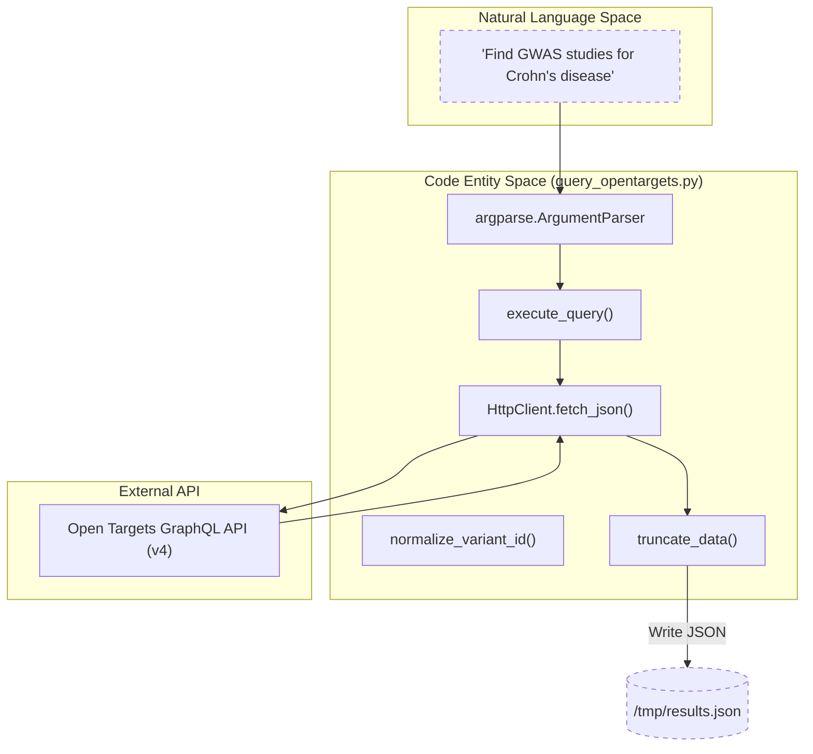
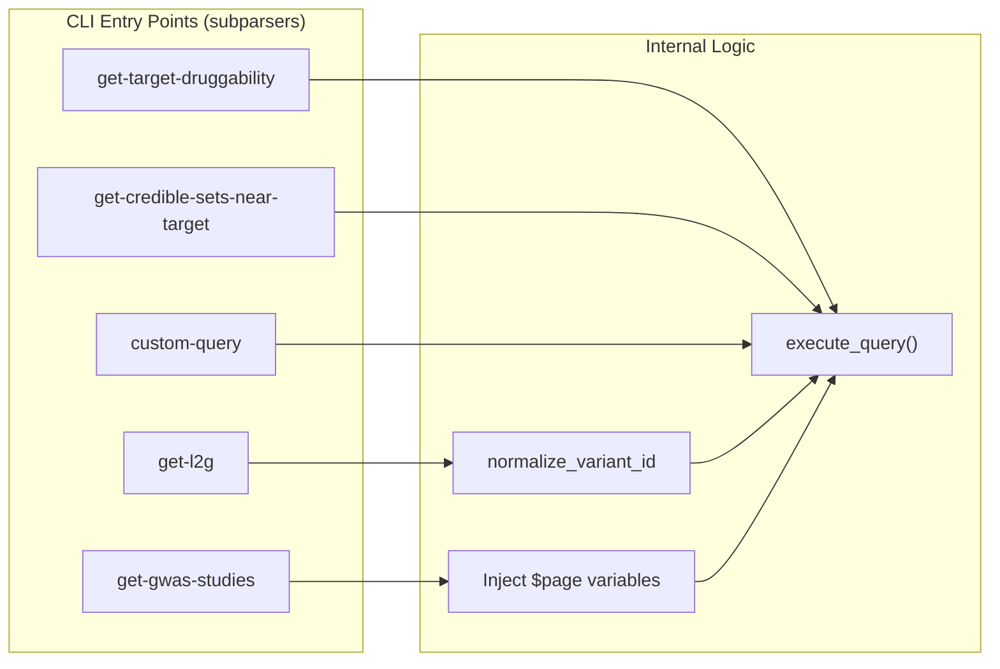

<!-- source: DeepWiki mcp.deepwiki.com · repo google-deepmind/science-skills · page 8.4 Open Targets Platform · fetched 2026-10-26 -->

# Open Targets Platform

Relevant source files

The following files were used as context for generating this wiki page:

- [skills/opentargets_database/SKILL.md](skills/opentargets_database/SKILL.md)
- [skills/opentargets_database/references/OpenTargets_GraphQL_Guide.md](skills/opentargets_database/references/OpenTargets_GraphQL_Guide.md)
- [skills/opentargets_database/scripts/query_opentargets.py](skills/opentargets_database/scripts/query_opentargets.py)

The Open Targets Platform skill provides a programmatic interface to the Open Targets GraphQL API. It aggregates multi-modal evidence from genetics (GWAS/eQTL), biological pathways, animal models, and clinical trials to rank target-disease associations and identify druggable genes for therapeutic discovery [skills/opentargets_database/SKILL.md:1-16]().

## System Architecture

The skill is implemented as a CLI wrapper around the Open Targets GraphQL endpoint. It uses the `science-skills-common` `HttpClient` to manage requests, enforcing a rate limit of 1.0 QPS to ensure fair use [skills/opentargets_database/scripts/query_opentargets.py:37-40]().

### Data Flow and Transformation
The system follows a strict "file-output-first" design. Users provide an `--output` path, and the script writes the processed JSON results to that file [skills/opentargets_database/scripts/query_opentargets.py:154-157]().

**Sources:** [skills/opentargets_database/scripts/query_opentargets.py:31-133](), [skills/opentargets_database/SKILL.md:27-48]()

## Core Entities and ID Formats

The Open Targets Platform relies on specific canonical identifiers. The CLI tool performs some normalization (e.g., stripping `chr` prefixes from variant IDs) but generally requires these formats [skills/opentargets_database/scripts/query_opentargets.py:43-45]():

| Entity | Identifier Type | Example Format |
| :--- | :--- | :--- |
| **Target** | Ensembl Gene ID | `ENSG00000169083` |
| **Disease** | EFO ID | `EFO_0000685` |
| **Drug** | ChEMBL ID | `CHEMBL112` |
| **Variant** | Chromosome_Pos_Ref_Alt | `1_154426264_C_T` |
| **Study** | GWAS Catalog / Project ID | `GCST90204201` |

**Sources:** [skills/opentargets_database/references/OpenTargets_GraphQL_Guide.md:55-124]()

## Key Functions and Logic

### Truncation Logic (`truncate_data`)
Because GraphQL responses can be extremely large (e.g., hundreds of credible sets), the script implements `truncate_data`. This function recursively traverses the JSON response and caps lists at a user-defined `--limit` (default 50) [skills/opentargets_database/scripts/query_opentargets.py:48-84]().

*   **Specific Handling:** It looks for the `rows` and `count` pattern common in Open Targets responses. If `rows` exceeds the limit, it appends a `_truncated` metadata field to inform the user of the partial result [skills/opentargets_database/scripts/query_opentargets.py:72-77]().

### Fine-Mapping and Confidence
The platform assigns "star ratings" based on the fine-mapping method used for credible sets. The CLI retrieves these strings, which map to the following confidence levels [skills/opentargets_database/SKILL.md:156-166]():

*   **4 Stars:** `SuSiE fine-mapped credible set with in-sample LD`
*   **3 Stars:** `SuSiE fine-mapped credible set with out-of-sample LD`
*   **2 Stars:** `PICS fine-mapped credible set extracted from summary stats`

### Locus-to-Gene (L2G) Logic
The `get-l2g` command predicts the most likely causal gene at a locus.
1.  **Variant-only mode:** Returns predictions across all studies where the variant is a lead [skills/opentargets_database/SKILL.md:90-94]().
2.  **Study-filtered mode:** Narrow results to a specific GWAS study using `--study-id` [skills/opentargets_database/SKILL.md:95-98]().

**Sources:** [skills/opentargets_database/scripts/query_opentargets.py:48-84](), [skills/opentargets_database/SKILL.md:87-105](), [skills/opentargets_database/SKILL.md:156-166]()

## Command Implementation

The following table maps CLI commands to their functional purpose within `query_opentargets.py`:

| Command | Function / Logic |
| :--- | :--- |
| `get-gwas-studies` | Fetches studies associated with an `efo_id` [skills/opentargets_database/scripts/query_opentargets.py:161-165]() |
| `get-study-credible-sets` | Retrieves 95% credible sets for a specific `study_id` [skills/opentargets_database/SKILL.md:62-64]() |
| `get-l2g` | Fetches Locus-to-Gene scores for a `variant_id` [skills/opentargets_database/scripts/query_opentargets.py:174-189]() |
| `get-target-druggability` | Returns tractability (small molecule/antibody) and safety data [skills/opentargets_database/scripts/query_opentargets.py:192-198]() |
| `get-credible-sets-near-target` | Performs a genomic window search around an Ensembl ID [skills/opentargets_database/SKILL.md:80-83]() |
| `custom-query` | Executes raw GraphQL with optional `--variables` [skills/opentargets_database/scripts/query_opentargets.py:230-234]() |

**Sources:** [skills/opentargets_database/scripts/query_opentargets.py:134-240](), [skills/opentargets_database/SKILL.md:58-85]()

---

