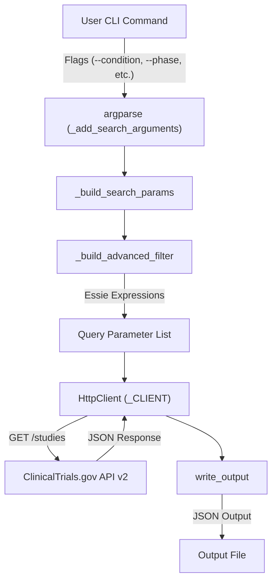
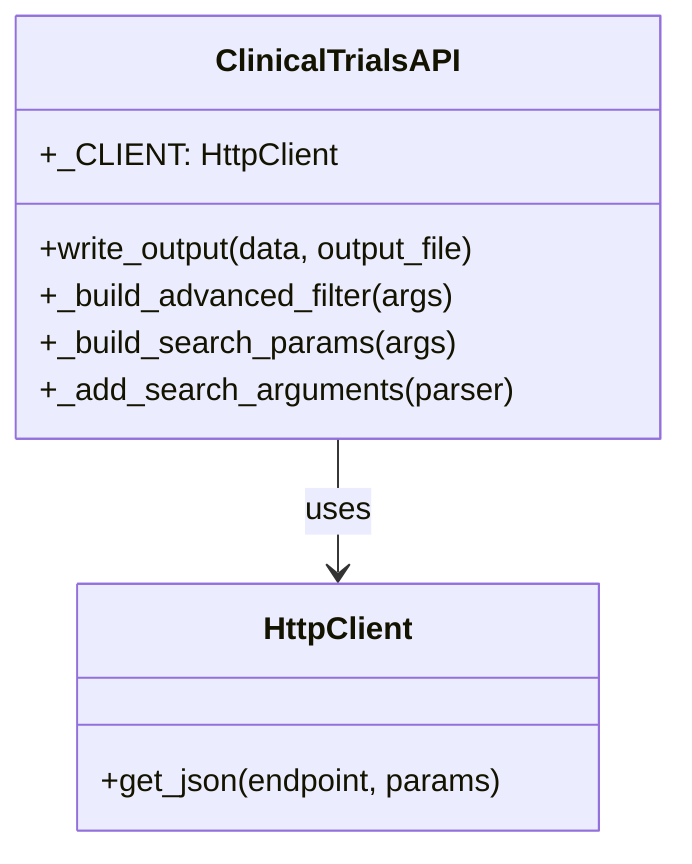

<!-- source: DeepWiki mcp.deepwiki.com · repo google-deepmind/science-skills · page 8.5 ClinicalTrials.gov Database · fetched 2026-10-26 -->

# ClinicalTrials.gov Database

Relevant source files

The following files were used as context for generating this wiki page:

- [skills/clinical_trials_database/scripts/clinical_trials_api.py](skills/clinical_trials_database/scripts/clinical_trials_api.py)

The `clinical-trials-database` skill provides a command-line interface to the ClinicalTrials.gov REST API v2. It allows for searching, filtering, and retrieving detailed records of clinical trials worldwide. The implementation focuses on context efficiency by encouraging field-level selection and managing API rate limits via a shared client.

Sources: [skills/clinical_trials_database/scripts/clinical_trials_api.py:15-20]()

## Overview and Architecture

The skill is built around a single CLI wrapper, `clinical_trials_api.py`, which translates high-level search flags into the specific query and filter parameters required by the ClinicalTrials.gov API v2.

### Data Flow

The following diagram illustrates how user command-line flags are transformed into API query parameters and dispatched via the `HttpClient` to the ClinicalTrials.gov REST endpoint.

**Search Request Transformation**

Sources: [skills/clinical_trials_database/scripts/clinical_trials_api.py:36-38](), [skills/clinical_trials_database/scripts/clinical_trials_api.py:61-129](), [skills/clinical_trials_database/scripts/clinical_trials_api.py:131-211]()

## Implementation Details

### API Client and Rate Limiting
The tool uses a centralized `HttpClient` instance configured with a base URL of `https://clinicaltrials.gov/api/v2/` and a strict rate limit of 1.0 queries per second (QPS) to ensure compliance with ClinicalTrials.gov service constraints.

Sources: [skills/clinical_trials_database/scripts/clinical_trials_api.py:36-38]()

### Search and Filtering
The search implementation supports two classes of parameters:
1.  **Query Parameters**: Influence relevance ranking and text matching (e.g., `query.cond`, `query.intr`, `query.term`, `query.titles`, `query.locn`, `query.id`).
2.  **Filter Parameters**: Perform exact structural matching using the Essie expression engine (e.g., `filter.overallStatus`, `filter.advanced`).

The function `_build_advanced_filter(args)` constructs composite Essie expressions by evaluating flags such as `--phase`, `--age-group`, `--study-type`, `--sponsor`, and `--has-results`, combining them using `AND` operators.

Sources: [skills/clinical_trials_database/scripts/clinical_trials_api.py:61-87](), [skills/clinical_trials_database/scripts/clinical_trials_api.py:90-129]()

### Study Schema Reference
Trial records are organized into hierarchical modules under the `protocolSection` and `resultsSection`. 

| Module | Key Fields | Shorthand Alias (`DEFAULT_STUDY_FIELDS`) |
| :--- | :--- | :--- |
| **Identification** | `nctId`, `briefTitle` | `NCTId`, `BriefTitle` |
| **Status** | `overallStatus`, `startDateStruct` | `OverallStatus`, `StartDate` |
| **Eligibility** | `eligibilityCriteria`, `stdAges` | `EligibilityCriteria`, `StdAge` |
| **Design** | `studyType`, `phases`, `enrollmentInfo` | `StudyType`, `Phase`, `EnrollmentCount` |

Sources: [skills/clinical_trials_database/scripts/clinical_trials_api.py:39-42]()

## Key Functions and Classes

The core components of `clinical_trials_api.py` are structured to support modular parsing, query construction, and output persistence.

| Entity | Role |
| :--- | :--- |
| `_CLIENT` | Centralized `HttpClient` instance managing the `https://clinicaltrials.gov/api/v2/` base URL and rate limiting [skills/clinical_trials_database/scripts/clinical_trials_api.py:36-38](). |
| `_build_advanced_filter` | Converts CLI flags like `--phase` and `--age-group` into `AREA[Field]Value` Essie strings joined by `AND` [skills/clinical_trials_database/scripts/clinical_trials_api.py:61-87](). |
| `_build_search_params` | Aggregates all query, filter, sorting, and pagination options into a list of tuples for URL encoding [skills/clinical_trials_database/scripts/clinical_trials_api.py:90-129](). |
| `write_output` | Serializes data dictionaries into formatted JSON files with error handling [skills/clinical_trials_database/scripts/clinical_trials_api.py:45-59](). |
| `_add_search_arguments` | Registers search and filtering arguments onto the CLI argument parser [skills/clinical_trials_database/scripts/clinical_trials_api.py:131-211](). |

**Code Entity Association**

Sources: [skills/clinical_trials_database/scripts/clinical_trials_api.py:34-211]()

## Usage and Pagination

Large result sets require pagination. The API returns a pagination token (`nextPageToken`) when results exceed the page size limit.

1.  **Initial Search**: Execute searches with `--count-total` to determine result volume.
2.  **Token Extraction**: Extract `nextPageToken` from the response payload.
3.  **Subsequent Requests**: Pass the token via `--page-token` to retrieve the next chunk of records.

### Context Efficiency
To prevent overloading LLM token windows, users should consistently specify the `--fields` parameter or rely on `DEFAULT_STUDY_FIELDS`. Common selection recipes include:
-   **Overview**: `NCTId,BriefTitle,OverallStatus,Phase,ConditionsModule`
-   **Interventions**: `NCTId,BriefTitle,ArmsInterventionsModule`
-   **Eligibility**: `NCTId,BriefTitle,EligibilityModule`

Sources: [skills/clinical_trials_database/scripts/clinical_trials_api.py:39-42]()

---

