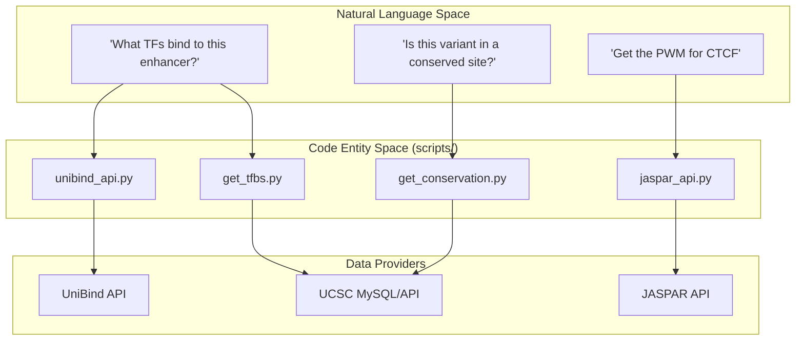
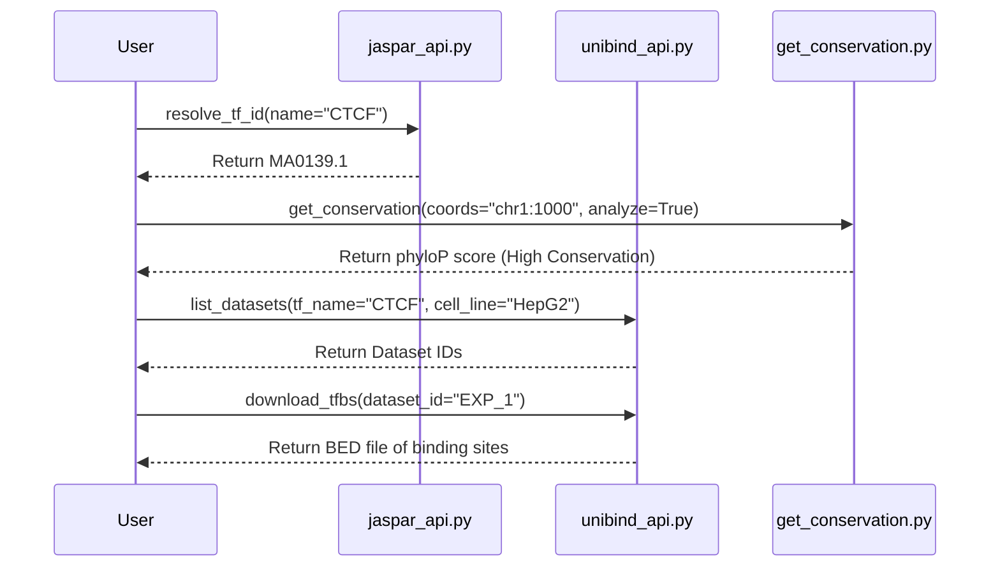

<!-- source: DeepWiki mcp.deepwiki.com · repo google-deepmind/science-skills · page 9 Regulatory Genomics and Transcription Factor Skills · fetched 2026-10-26 -->

# Regulatory Genomics and Transcription Factor Skills

Relevant source files

The following files were used as context for generating this wiki page:

- [skills/jaspar_database/scripts/jaspar_api.py](skills/jaspar_database/scripts/jaspar_api.py)
- [skills/unibind_database/scripts/unibind_api.py](skills/unibind_database/scripts/unibind_api.py)

This section covers skills for analyzing the regulatory landscape of the genome. These tools allow for the retrieval of Transcription Factor (TF) binding profiles, the identification of experimental and predicted binding sites, and the evaluation of evolutionary conservation across genomic regions.

The skills in this section bridge the gap between raw genomic sequences and functional regulation by providing access to the JASPAR, UniBind, and UCSC Genome Browser databases.

## System Overview

The following diagram illustrates how the regulatory genomics skills map Natural Language concepts to specific code entities and external data providers.

### Natural Language to Code Entity Map

Sources: [skills/jaspar_database/scripts/jaspar_api.py:33-35](), [skills/unibind_database/scripts/unibind_api.py:37-38](), [skills/ucsc_conservation_and_tfbs/SKILL.md:46-50]()

## Skill Components

### JASPAR Transcription Factor Binding Profiles
JASPAR is the primary resource for high-quality, non-redundant transcription factor binding profiles. The `jaspar_api.py` script provides methods to resolve gene symbols to JASPAR Matrix IDs, retrieve Position Frequency Matrices (PFMs), and calculate Position Weight Matrices (PWMs) using log-odds scores [skills/jaspar_database/scripts/jaspar_api.py:77-210]().

*   **Key Functionality**: TF name resolution, motif retrieval (MEME, TRANSFAC, PFM formats), and sequence-based profile inference [skills/jaspar_database/scripts/jaspar_api.py:50-126]().
*   **For details, see [JASPAR Transcription Factor Binding Profiles](#9.1).**

### UniBind ChIP-seq Binding Sites
UniBind provides a comprehensive collection of TFBS sets obtained by uniform processing of thousands of ChIP-seq datasets. It offers "Robust" and "Permissive" collections across multiple species [skills/unibind_database/scripts/unibind_api.py:115-165]().

*   **Key Functionality**: Searching datasets by TF or cell line, downloading BED/FASTA files of binding sites, and linking experimental data to JASPAR motifs [skills/unibind_database/scripts/unibind_api.py:167-234]().
*   **For details, see [UniBind ChIP-seq Binding Sites](#9.2).**

### UCSC Conservation and TFBS Tracks
The UCSC Genome Browser skill provides access to evolutionary constraint scores (phyloP and phastCons) and integrated TFBS tracks from major projects like ENCODE and ReMap [skills/ucsc_conservation_and_tfbs/SKILL.md:1-25]().

*   **Key Functionality**: Single-base conservation lookups, regional acceleration analysis, and querying clustered TFBS tracks (e.g., `encRegTfbsClustered`) [skills/ucsc_conservation_and_tfbs/SKILL.md:26-45]().
*   **For details, see [UCSC Conservation and TFBS Tracks](#9.3).**

## Interaction Workflow

The regulatory skills are often used in sequence to interpret the functional impact of genomic variants.

### Workflow: Variant Impact Analysis

Sources: [skills/jaspar_database/scripts/jaspar_api.py:77-85](), [skills/unibind_database/scripts/unibind_api.py:177-234](), [skills/ucsc_conservation_and_tfbs/SKILL.md:112-121]()

## Shared Constraints

| Constraint | JASPAR | UniBind | UCSC |
| :--- | :--- | :--- | :--- |
| **Rate Limit** | 10 QPS [skills/jaspar_database/scripts/jaspar_api.py:34]() | 20 QPS [skills/unibind_database/scripts/unibind_api.py:37]() | Managed by wrapper [skills/ucsc_conservation_and_tfbs/SKILL.md:34-36]() |
| **Window Limit** | 100kb (Auto-chunked) [skills/ucsc_conservation_and_tfbs/SKILL.md:37-40]() | N/A (Dataset-based) | Track-dependent |
| **ID Formats** | Matrix ID (MAxxxx.x) [skills/jaspar_database/scripts/jaspar_api.py:63]() | Dataset ID [skills/unibind_database/scripts/unibind_api.py:230-232]() | Genome Assembly (hg38/hg19) [skills/ucsc_conservation_and_tfbs/SKILL.md:52]() |

Sources: [skills/jaspar_database/scripts/jaspar_api.py:34-63](), [skills/unibind_database/scripts/unibind_api.py:37-232](), [skills/ucsc_conservation_and_tfbs/SKILL.md:34-52]()

---

