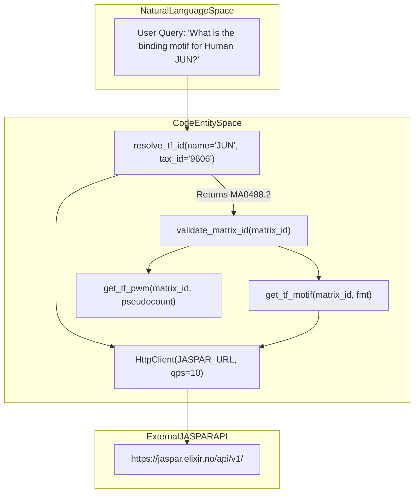
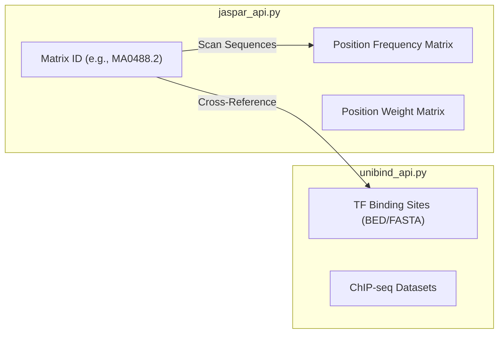

<!-- source: DeepWiki mcp.deepwiki.com · repo google-deepmind/science-skills · page 9.1 JASPAR Transcription Factor Binding Profiles · fetched 2026-10-26 -->

# JASPAR Transcription Factor Binding Profiles

Relevant source files

The following files were used as context for generating this wiki page:

- [skills/jaspar_database/scripts/jaspar_api.py](skills/jaspar_database/scripts/jaspar_api.py)

The JASPAR skill provides a technical interface to the JASPAR database, the definitive open-access repository for transcription factor (TF) binding profiles. The core implementation in `skills/jaspar_database/scripts/jaspar_api.py` enables retrieval of Position Frequency Matrices (PFMs), TF Flexible Models (TFFMs), calculation of Position Weight Matrices (PWMs), sequence-based motif inference, and resolution of gene symbols to stable JASPAR Matrix IDs.

Sources: [skills/jaspar_database/scripts/jaspar_api.py:15-36]()

## System Architecture and Data Flow

The skill is built around the `jaspar_api.py` wrapper, which utilizes the shared `HttpClient` for rate-limited communication with the JASPAR REST API (`https://jaspar.elixir.no/api/v1/`).

### Transcription Factor Resolution Workflow
The following diagram illustrates the process of moving from a natural language gene symbol to a structured JASPAR Matrix ID and its associated binding profile.

**TF Binding Profile Retrieval Flow**

Sources: [skills/jaspar_database/scripts/jaspar_api.py:31-36](), [skills/jaspar_database/scripts/jaspar_api.py:77-83](), [skills/jaspar_database/scripts/jaspar_api.py:135-140]()

## Key Implementation Details

### JASPAR Matrix IDs
The system enforces strict validation of JASPAR Matrix IDs using the regular expression pattern `^MA\d{4}\.\d+$` (e.g., `MA0488.2`). Functions that interact with specific profiles must invoke `validate_matrix_id` to ensure API compatibility.
Sources: [skills/jaspar_database/scripts/jaspar_api.py:61-75]()

### Position Weight Matrix (PWM) Calculation
While the JASPAR API primarily returns Position Frequency Matrices (PFMs) as raw counts, the `get_tf_pwm` function implements a two-step conversion to log-odds scores measured in bits:

1.  **PPM Calculation**: $PPM[b][i] = \frac{PFM[b][i] + pseudocount}{N_i + 4 \times pseudocount}$
2.  **PWM Calculation**: $PWM[b][i] = \log_2\left(\frac{PPM[b][i]}{background}\right)$

The implementation defaults to a per-base pseudocount of `0.8` and a uniform background frequency of `0.25`.
Sources: [skills/jaspar_database/scripts/jaspar_api.py:171-220]()

### Output Formatting and Validation
Console output is constrained via `_print_text`, which truncates responses exceeding 50,000 characters to prevent buffer overflow issues. Valid export formats recognized across queries include `json`, `jsonp`, `jaspar`, `meme`, `transfac`, `pfm`, and `yaml`.
Sources: [skills/jaspar_database/scripts/jaspar_api.py:35-58]()

## Core Functions

| Function | Purpose | Key Parameters |
| :--- | :--- | :--- |
| `resolve_tf_id` | Maps gene symbols to JASPAR Matrix IDs. | `name`, `tax_id` |
| `get_tf_motif` | Fetches PFM in various formats (MEME, JASPAR, etc.). | `matrix_id`, `fmt` |
| `get_tf_pwm` | Computes log-odds scores from PFM data. | `matrix_id`, `pseudocount` |
| `infer_from_sequence` | Predicts TF profiles from protein sequences. | `sequence` |
| `get_tffm` | Retrieves TF Flexible Model (TFFM) details. | `tffm_id` |
| `get_tf_metadata` | Retrieves TF class, family, and metadata. | `matrix_id`, `fmt` |

Sources: [skills/jaspar_database/scripts/jaspar_api.py:77-169]()

## Integration with UniBind

The JASPAR skill serves as a foundational component for regulatory analysis. While JASPAR provides the *potential* binding profiles (the "what"), the `unibind_api.py` skill provides the *actual* experimental binding sites (the "where") identified via ChIP-seq.

**Binding Data Relationship**

Sources: [skills/jaspar_database/scripts/jaspar_api.py:61-108]()

## Operational Constraints

*   **Taxonomy Requirement**: To avoid ambiguous cross-species results, `tax_id` is mandatory for ID resolution (e.g., `9606` for Human, `10090` for Mouse).
*   **Rate Limiting**: The underlying `HttpClient` is instantiated with a rate limit of `qps=10` to respect JASPAR server limits.
*   **Script Dependencies**: Declared via PEP 723 inline script metadata requiring Python `>=3.10` and `polite-http`.

Sources: [skills/jaspar_database/scripts/jaspar_api.py:17-34](), [skills/jaspar_database/scripts/jaspar_api.py:77-81]()

---

