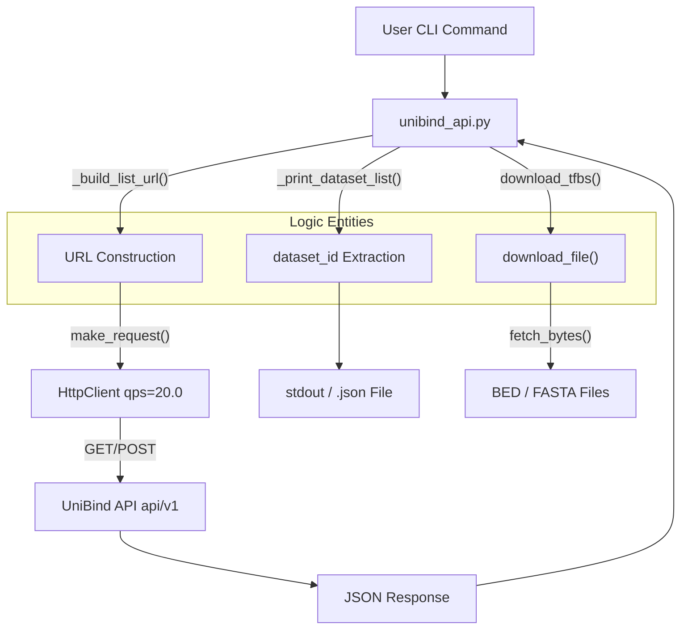
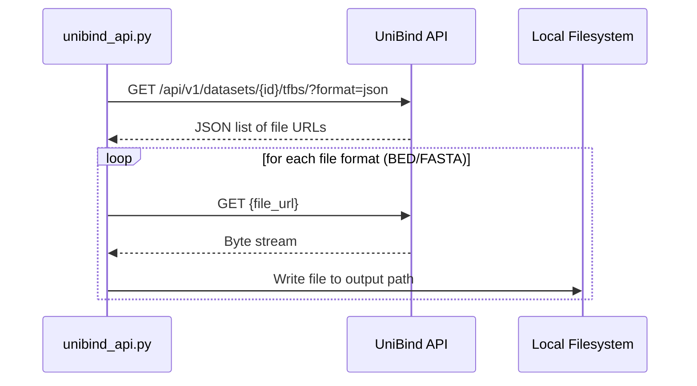

<!-- source: DeepWiki mcp.deepwiki.com · repo google-deepmind/science-skills · page 9.2 UniBind ChIP-seq Binding Sites · fetched 2026-10-26 -->

# UniBind ChIP-seq Binding Sites

Relevant source files

The following files were used as context for generating this wiki page:

- [skills/unibind_database/scripts/unibind_api.py](skills/unibind_database/scripts/unibind_api.py)

The UniBind skill provides a programmatic interface to the UniBind database, a comprehensive resource of direct Transcription Factor (TF)–DNA interactions. UniBind integrates ChIP-seq peaks across 9 species with JASPAR TF binding profiles using the DAMO framework to provide experimentally validated binding sites.

## Overview

The `skills/unibind_database/scripts/unibind_api.py` script acts as a wrapper for the UniBind REST API, facilitating the discovery of datasets, retrieval of metadata, and downloading of binding site coordinates in BED or FASTA formats. It handles rate limiting via the shared `HttpClient` and provides structured JSON output for downstream analysis.

### Key Concepts
*   **Collections**: Data is organized into collections, primarily **Robust** (high-confidence sites) and **Permissive** (broader set of sites) [skills/unibind_database/SKILL.md:93-93]().
*   **Datasets**: Individual experiments identified by a unique `dataset_id` (e.g., `EXP047889.HMLE-Twist-ER_breast_cancer.SMAD3`) [skills/unibind_database/scripts/unibind_api.py:234-234]().
*   **JASPAR Integration**: Binding sites are linked to JASPAR profile matrix IDs, allowing cross-referencing with the `jaspar-database` skill [skills/unibind_database/scripts/unibind_api.py:189-189]().

## System Architecture

The following diagram illustrates the flow from a CLI command to the UniBind API and the subsequent data processing.

### Data Flow and Component Interaction
"The `unibind_api.py` script utilizes `science_skills_common.http_client` to communicate with the UniBind API."

Sources: [skills/unibind_database/scripts/unibind_api.py:37-40](), [skills/unibind_database/scripts/unibind_api.py:81-114](), [skills/unibind_database/scripts/unibind_api.py:201-237]()

## Implementation Details

### API Client Configuration
The skill initializes a global `HttpClient` instance targeting `https://unibind.uio.no/` with a rate limit of 20 queries per second [skills/unibind_database/scripts/unibind_api.py:37-37](). All requests are forced to JSON format by appending `format=json` to the query string if not already present [skills/unibind_database/scripts/unibind_api.py:40-47]().

### Dataset ID Extraction
A critical feature of the dataset listing commands is the automatic extraction of the `dataset_id`. Since the raw API returns a full URL for the dataset, the wrapper parses this URL to provide a clean ID string that can be used directly in downstream commands [skills/unibind_database/scripts/unibind_api.py:227-234]().

### Pagination and Ordering
The API supports pagination with a maximum `page_size` of 1000 items [skills/unibind_database/SKILL.md:53-54](). The `_build_list_url` function handles the injection of `page`, `page_size`, and `order` parameters into the request [skills/unibind_database/scripts/unibind_api.py:79-112]().

### Command Mapping
The CLI provides several subcommands mapping to specific API endpoints:

| Command | API Endpoint | Description |
| :--- | :--- | :--- |
| `list_species` | `api/v1/species/` | Lists the supported species [skills/unibind_database/scripts/unibind_api.py:115-126](). |
| `list_tfs` | `api/v1/tfs/` | Lists available transcription factors [skills/unibind_database/scripts/unibind_api.py:154-165](). |
| `list_datasets` | `api/v1/datasets/` | Lists datasets with complex filters (species, TF, cell line, etc.) [skills/unibind_database/scripts/unibind_api.py:218-234](). |

Sources: [skills/unibind_database/scripts/unibind_api.py:115-165](), [skills/unibind_database/scripts/unibind_api.py:218-234](), [skills/unibind_database/SKILL.md:64-125]()

## Usage and Data Retrieval

### Filtering Datasets
The `list_datasets` command supports a wide array of filters implemented in `_build_dataset_filters` [skills/unibind_database/scripts/unibind_api.py:167-196]():
*   `--species`: e.g., "Homo sapiens"
*   `--tf-name`: e.g., "CTCF"
*   `--cell-line`: e.g., "mESC"
*   `--jaspar-id`: Linkage to JASPAR database profile matrix IDs.
*   `--collection`: "Permissive" or "Robust".

### Downloading Binding Sites
The `download_file` function retrieves the list of available files or coordinate datasets for a given ID and downloads them to a specified destination [skills/unibind_database/scripts/unibind_api.py:71-76]().

Sources: [skills/unibind_database/scripts/unibind_api.py:71-77](), [skills/unibind_database/SKILL.md:118-125]()

## Anti-Patterns
*   **Genomic Intervals**: Do not use UniBind to query specific genomic coordinates; use it to retrieve entire experimental datasets for local intersection [skills/unibind_database/SKILL.md:129-130]().
*   **Motif Models**: Do not use for PFMs (Position Frequency Matrices); use the `jaspar-database` skill instead [skills/unibind_database/SKILL.md:134-135]().
*   **Large Output**: Avoid reading raw JSON from `list_tfs` or `list_cell_lines` directly into LLM context; use `jq` or external parsers to filter necessary fields [skills/unibind_database/SKILL.md:48-50]().

Sources: [skills/unibind_database/SKILL.md:127-140]()

---

