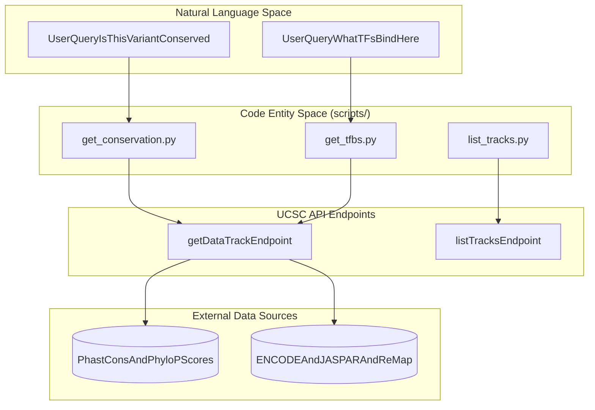
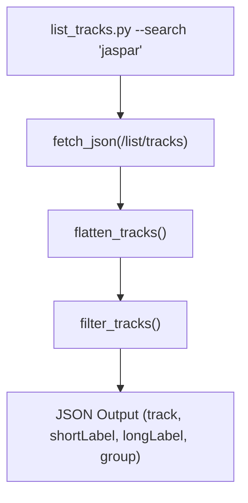

<!-- source: DeepWiki mcp.deepwiki.com · repo google-deepmind/science-skills · page 9.3 UCSC Conservation and TFBS Tracks · fetched 2026-10-26 -->

# UCSC Conservation and TFBS Tracks

Relevant source files

The following files were used as context for generating this wiki page:

- [skills/ucsc_conservation_and_tfbs/scripts/get_conservation.py](skills/ucsc_conservation_and_tfbs/scripts/get_conservation.py)
- [skills/ucsc_conservation_and_tfbs/scripts/get_tfbs.py](skills/ucsc_conservation_and_tfbs/scripts/get_tfbs.py)
- [skills/ucsc_conservation_and_tfbs/scripts/list_tracks.py](skills/ucsc_conservation_and_tfbs/scripts/list_tracks.py)

The UCSC Conservation and TFBS Tracks skill provides a technical interface to the UCSC Genome Browser's REST API. It is designed to retrieve evolutionary constraint scores (phyloP and phastCons) and Transcription Factor Binding Site (TFBS) annotations from major regulatory genomics projects such as ENCODE, JASPAR, and ReMap.

[skills/ucsc_conservation_and_tfbs/scripts/get_conservation.py:15-16]()

## Implementation Overview

The skill is implemented as a set of Python CLI scripts that interact with the UCSC Genome Browser REST API (`https://api.genome.ucsc.edu/`). To ensure stability and compliance with UCSC's usage policies, the skill utilizes a shared `HttpClient` with a strict rate limit of 0.05 Queries Per Second (QPS), effectively enforcing a 20-second delay between requests.

[skills/ucsc_conservation_and_tfbs/scripts/get_conservation.py:31-33]()
[skills/ucsc_conservation_and_tfbs/scripts/get_tfbs.py:31-34]()
[skills/ucsc_conservation_and_tfbs/scripts/list_tracks.py:31-33]()

### System Components and Data Flow

The following diagram illustrates the relationship between the CLI scripts and the UCSC API entities, bridging natural language intents to code entities.

**UCSC Skill Architecture**

Sources: [skills/ucsc_conservation_and_tfbs/scripts/get_conservation.py:31-69](), [skills/ucsc_conservation_and_tfbs/scripts/get_tfbs.py:31-63](), [skills/ucsc_conservation_and_tfbs/scripts/list_tracks.py:31-34]()

## Evolutionary Conservation Scores

The `get_conservation.py` script retrieves scores derived from comparative genomics and alignment collections.

### Conservation Metrics
*   **phyloP**: Measures evolutionary constraint at individual sites. It is the preferred metric for evaluating Single Nucleotide Variants (SNVs).
*   **phastCons**: Identifies functional blocks or "conserved elements" using a Hidden Markov Model (HMM) to smooth scores across windows.

[skills/ucsc_conservation_and_tfbs/scripts/get_conservation.py:15-16]()

### Coordinate Handling
The script handles the conversion between user-facing 1-based coordinates and the UCSC REST API's 0-based half-open format.
*   **Input**: `chr1:100-200` (1-based inclusive).
*   **Processing**: `parse_coordinate` subtracts 1 from the start position.
*   **Output**: `chr1:99-200` (0-based half-open) for the API request.

[skills/ucsc_conservation_and_tfbs/scripts/get_conservation.py:35-60]()

### Alignment Collections
The skill supports multiple evolutionary depths via the `--collection` flag across `hg38` and `hg19` assemblies.

| Genome | Collection | phyloP Track | phastCons Track |
| :--- | :--- | :--- | :--- |
| **hg38** | vertebrate (default) | `phyloP100way` | `phastCons100way` |
| **hg38** | mammal | `phyloP470wayBW` | `phastCons470way` |
| **hg38** | primate | `phyloP30way` | `phastCons30way` |
| **hg19** | vertebrate | `phyloP100way` | `phastCons100way` |
| **hg19** | vertebrate46 | `phyloP46wayAll` | `phastCons46way` |
| **hg19** | mammal | `phyloP46wayPlacental` | `phastCons46wayPlacental` |
| **hg19** | primate | `phyloP46wayPrimates` | `phastCons46wayPrimates` |

[skills/ucsc_conservation_and_tfbs/scripts/get_conservation.py:80-135]()

### Evolutionary Acceleration Analysis
When the `--analyze` flag is used, the script calculates summary statistics for `phyloP` scores in the requested region. It identifies "evolutionary acceleration" (regions evolving faster than neutral drift) using a heuristic: a `mean_phyloP` score < -0.3 or a `min_phyloP` score < -2.0.

[skills/ucsc_conservation_and_tfbs/scripts/get_conservation.py:161-176]()

Sources: [skills/ucsc_conservation_and_tfbs/scripts/get_conservation.py]()

## Transcription Factor Binding Sites (TFBS)

The `get_tfbs.py` script queries TFBS tracks using the UCSC REST API.

### Key Functions and Parameters
*   **`get_tfbs_data`**: Constructs the request to the `/getData/track` endpoint using the `HttpClient` instance. [skills/ucsc_conservation_and_tfbs/scripts/get_tfbs.py:56-63]()
*   **TF Filtering**: The script provides a `--tf-filter` argument to perform case-insensitive substring matching against the `TFName` field in the returned JSON items. [skills/ucsc_conservation_and_tfbs/scripts/get_tfbs.py:90-96](), [skills/ucsc_conservation_and_tfbs/scripts/get_tfbs.py:145-158]()

### Track Discovery
The `list_tracks.py` script allows users to discover available tracks for a genome assembly by querying `/list/tracks`, flattening the nested dictionary structure, and filtering by search terms or groups.

**Track Discovery Logic**

Sources: [skills/ucsc_conservation_and_tfbs/scripts/list_tracks.py:36-100]()

Sources: [skills/ucsc_conservation_and_tfbs/scripts/get_tfbs.py](), [skills/ucsc_conservation_and_tfbs/scripts/list_tracks.py]()

## Technical Reference

### Implementation Constraints
*   **Rate Limiting**: The `HttpClient` is initialized with `qps=0.05` across all scripts (`get_conservation.py`, `get_tfbs.py`, `list_tracks.py`) to prevent IP blocking by UCSC servers. [skills/ucsc_conservation_and_tfbs/scripts/get_conservation.py:32](), [skills/ucsc_conservation_and_tfbs/scripts/get_tfbs.py:33](), [skills/ucsc_conservation_and_tfbs/scripts/list_tracks.py:33]()
*   **Output Requirement**: Scripts such as `get_tfbs.py` and `list_tracks.py` require an `--output` parameter to store large JSON responses. [skills/ucsc_conservation_and_tfbs/scripts/get_tfbs.py:98-101](), [skills/ucsc_conservation_and_tfbs/scripts/list_tracks.py:124-128]()

Sources: [skills/ucsc_conservation_and_tfbs/scripts/get_conservation.py](), [skills/ucsc_conservation_and_tfbs/scripts/get_tfbs.py](), [skills/ucsc_conservation_and_tfbs/scripts/list_tracks.py]()

---

