# Page: Overview

# Overview

<details>
<summary>Relevant source files</summary>

The following files were used as context for generating this wiki page:

- [README.md](README.md)
- [SKILL_LICENSES.md](SKILL_LICENSES.md)
- [plugin.json](plugin.json)

</details>


The Science Skills repository is a curated collection of agentic tools designed to extend AI capabilities into specialized scientific domains, including genomics, structural biology, cheminformatics, and literature search [README.md:1-5](). These skills provide structured instructions, executable scripts, and reference materials that allow agents to interact with complex scientific APIs and databases [README.md:6-8]().

The project is structured as a plugin bundle, defined in `plugin.json` [plugin.json:1-10](), primarily integrated with **Google Antigravity**, but accessible via standard CLI tools for broader agentic use [README.md:18-43]().

### Repository Relationship Map

The following diagram illustrates how high-level scientific domains are mapped to specific code entities and external data providers within the repository, bridging natural language spaces to concrete code paths.

**Scientific Domain to Code Entity Mapping**
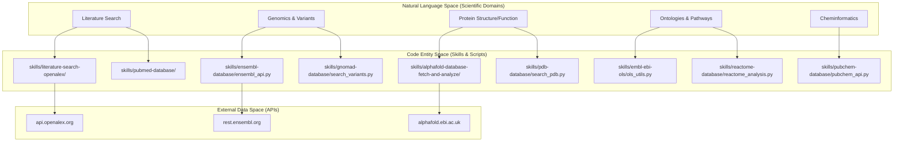
Sources: [README.md:1-8](), [plugin.json:1-10](), [SKILL_LICENSES.md:1-47]()

---

### Installation and Usage

The Science Skills bundle can be installed via `npx` or integrated directly into the Google Antigravity environment [README.md:18-43]().

*   **Standard Installation**: Use `npx skills add google-deepmind/science-skills/` to add the bundle to your agent's environment [README.md:36-43]().
*   **Google Antigravity**: Users can select the "Science" plugin via `Customizations` > `Build with Google` > `Science` > `Add` in the Antigravity application [README.md:18-27]().
*   **Environment Configuration**: Credentials like `ALPHAGENOME_API_KEY` or `NCBI_API_KEY` are read from `~/.env` [README.md:52-58]().
*   **Runtime Dependencies**: The `uv` package manager handles Python environment isolation and script execution [README.md:47-50]().

For detailed setup instructions, see **[Getting Started](#1.1)**.

Sources: [README.md:18-58]()

---

### Skill Architecture and Meta-Skills

Every skill in the repository follows a standardized directory structure containing instructions, helper scripts, and reference files.

**Standard Skill Component Mapping**
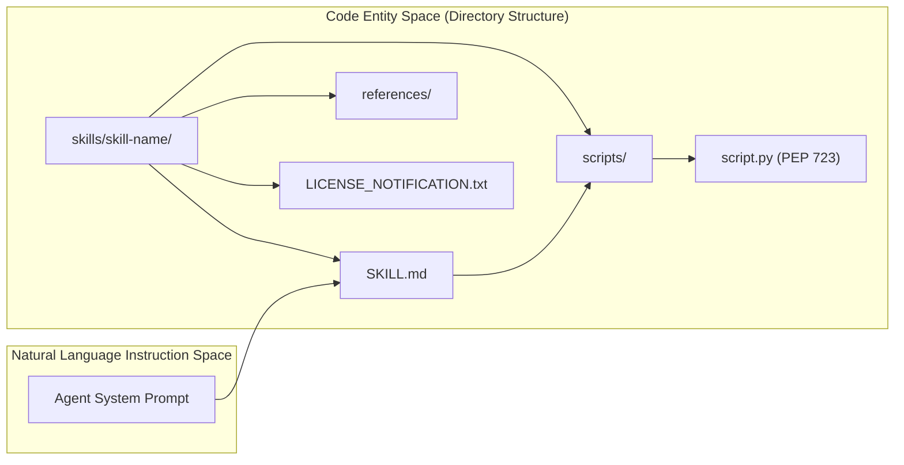
Sources: [README.md:9-17]()

*   **`SKILL.md`**: Contains YAML frontmatter and markdown instructions guiding the agent [README.md:13-14]().
*   **`scripts/`**: Contains executable Python utilities adhering to PEP 723 inline script metadata [README.md:15]().
*   **`references/`**: Contains API schemas and reference guides [README.md:16]().

For details on skill structure, see **[Skill Structure and Conventions](#1.2)**. For creating custom skills using the `workflow-skill-creator` meta-skill, see **[Creating New Skills with the Workflow Skill Creator](#1.3)**.

Sources: [README.md:9-17]()

---

### Navigation Map

| Section | Topic | Description |
| :--- | :--- | :--- |
| **1.1** | **[Getting Started](#1.1)** | Installation, `uv` setup, and API key configuration. |
| **1.2** | **[Skill Structure and Conventions](#1.2)** | Anatomy of `SKILL.md`, `scripts/`, and `references/`. |
| **1.3** | **[Creating New Skills with the Workflow Skill Creator](#1.3)** | Using the `workflow-skill-creator` meta-skill. |
| **2.0** | **[Core Infrastructure]** | Shared `HttpClient`, `uv` integration, credentials, and licenses. |
| **3.0 - 9.0** | **[Domain Skills]** | Deep dives into Literature, Genomics, Proteins, Pathways, Cheminformatics, and Regulatory Genomics. |
| **10.0** | **[Predicting the Past]** | Ancient text analysis inference pipeline. |
| **11.0** | **[Glossary]** | Definitions of technical and biological terms. |

Sources: [README.md:1-103](), [plugin.json:1-10]()

---

# Page: Getting Started

# Getting Started

<details>
<summary>Relevant source files</summary>

The following files were used as context for generating this wiki page:

- [README.md](README.md)
- [plugin.json](plugin.json)
- [skills/uv/SKILL.md](skills/uv/SKILL.md)

</details>


This page provides a technical guide for initializing the Science Skills environment. It covers the installation of the core skill bundle via `npx`, integration with Google Antigravity, configuration of the `uv` package manager, setup of API keys in `~/.env`, and the execution architecture of individual skills.

## Installation and Bundle Manifest

The Science Skills repository is packaged as a standard agent plugin, defined by the `plugin.json` manifest [plugin.json:1-10](). This manifest declares metadata, versioning (`1.3.0`), and repository sources used by client environments to load the skills bundle [plugin.json:1-10]().

### Installation via npx

For command-line environments and external agent runtimes, the skill bundle is installed using `npx` via the skills CLI [README.md:36-43]():

```bash
npx skills add google-deepmind/science-skills/
```
*Sources: [README.md:36-43](), [plugin.json:1-10]()*

### Google Antigravity Integration

Science Skills are natively optimized for Google Antigravity [README.md:18-21](). 
- **Setup via UI:** In the Antigravity application, navigate to `Customizations` > `Build with Google` > `Science` > `Add` [README.md:25-26]().
- **Onboarding:** The platform automatically registers the bundle defined in `plugin.json` [plugin.json:1-10]() to extend the AI agent's capabilities across scientific domains [README.md:3-7]().

**Data Flow: Initialization and Integration Architecture**

Title: Science Skills Initialization Flow
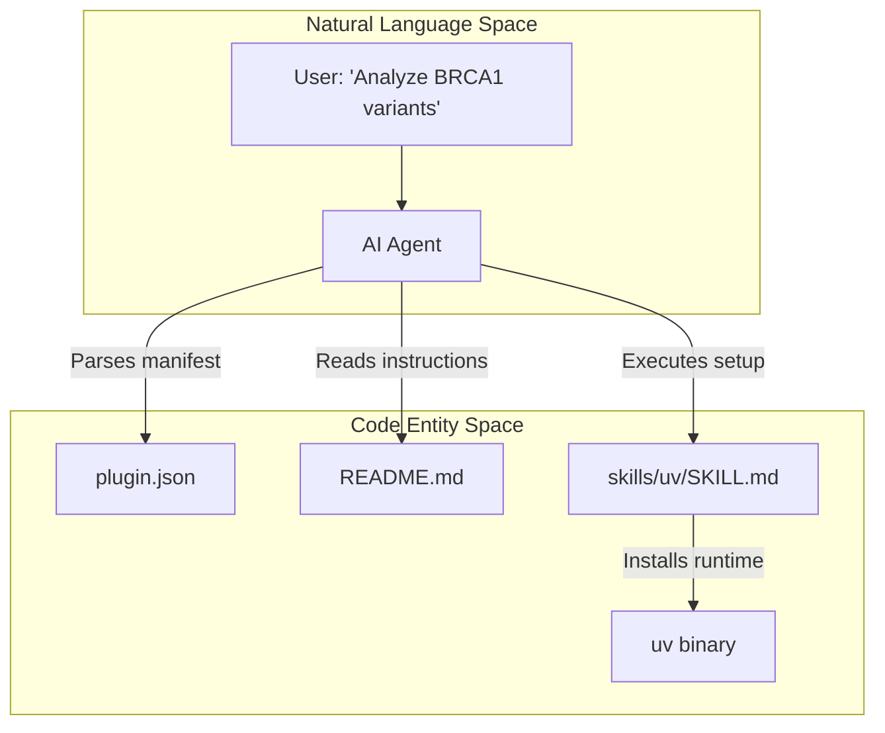
*Sources: [plugin.json:1-10](), [README.md:1-27](), [skills/uv/SKILL.md:1-16]()*

---

## Setting up the `uv` Package Manager

All Python-based skills within the repository rely on the `uv` package manager to isolate execution environments and resolve PEP 723 inline script dependencies [skills/uv/SKILL.md:9-15]().

### Verification and Installation Protocol

The procedure for bootstrapping `uv` is encoded directly into the `uv` skill instruction set [skills/uv/SKILL.md:17-49]():

1. **Path Check:** The agent checks if `uv --version` is available on the system `PATH` [skills/uv/SKILL.md:19-20]().
2. **Local Binary Check:** If not on `PATH`, the agent checks the default user installation path (`$HOME/.local/bin/uv` on Unix/macOS or `$HOME\.local\bin\uv.exe` on Windows) [skills/uv/SKILL.md:21-25]().
3. **Automated Bootstrap:** If missing entirely, the agent invokes the official installer script [skills/uv/SKILL.md:28-40]():
   - **Unix/macOS:** `curl -LsSf https://astral.sh/uv/install.sh | sh` [skills/uv/SKILL.md:37]()
   - **Windows (PowerShell):** `powershell -ExecutionPolicy ByPass -c "irm https://astral.sh/uv/install.ps1 | iex"` [skills/uv/SKILL.md:38-39]()
4. **Environment Export:** The binary directory is appended to the session `PATH` variable (`export PATH="$HOME/.local/bin:$PATH"`) [skills/uv/SKILL.md:43-48]().

*Sources: [skills/uv/SKILL.md:1-49](), [README.md:47-50]()*

---

## Configuring API Keys in `~/.env`

Certain scientific APIs accessed by skill scripts (such as AlphaGenome or OpenAlex) require explicit API keys for authentication, while others (such as ClinVar or openFDA) accept keys to unlock expanded rate limits [README.md:52-55]().

### Environment Variable Protocol

Skills read configuration variables from a local `~/.env` file [README.md:52-58](). If a required key is missing, the agent prompts the user to obtain one and writes it to the configuration file [README.md:54-56](). 

You can manually provision keys using standard shell redirection:

```bash
echo "ALPHAGENOME_API_KEY=your_actual_api_key" >> ~/.env
echo "NCBI_API_KEY=your_ncbi_key" >> ~/.env
```
*Sources: [README.md:52-58]()*

### Common Credential Matrix

| Environment Variable | Target Domain / Skill | Requirement Level |
| :--- | :--- | :--- |
| `ALPHAGENOME_API_KEY` | AlphaGenome Skills | Mandatory |
| `NCBI_API_KEY` | dbSNP, ClinVar, PubMed, NCBI Fetch | Optional (Unlocks higher rate limits) |
| `FDA_API_KEY` | openFDA Drug Database | Optional (Unlocks higher rate limits) |

*Sources: [README.md:52-58]()*

---

## Running a First Skill and Directory Anatomy

Once `uv` is available and environment variables are populated, the agent executes specialized Python scripts located within individual skill directories [README.md:47-58]().

### Skill Directory Structure

Every skill conforms to a strict structural convention to allow agents to discover instructions and executable utilities:
- **`SKILL.md`**: Contains YAML frontmatter and detailed system instructions for the agent [README.md:13-14]().
- **`scripts/`**: Contains standalone Python CLI scripts equipped with PEP 723 inline dependency metadata [README.md:15]().
- **`references/`**: Contains schemas, documentation, and query templates [README.md:16]().

**Data Flow: Skill Execution Architecture**

Title: Skill Execution Architecture
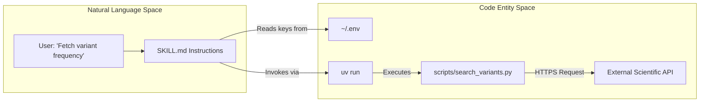
*Sources: [README.md:10-17](), [README.md:47-58](), [skills/uv/SKILL.md:9-15]()*

---

# Page: Skill Structure and Conventions

# Skill Structure and Conventions

<details>
<summary>Relevant source files</summary>

The following files were used as context for generating this wiki page:

- [README.md](README.md)
- [SKILL_LICENSES.md](SKILL_LICENSES.md)
- [skills/openfda_database/SKILL.md](skills/openfda_database/SKILL.md)
- [skills/openfda_database/references/recipes.md](skills/openfda_database/references/recipes.md)

</details>


This page details the technical anatomy and architectural standards of skills within the Science Skills repository. Every skill follows a strict directory structure and design philosophy to ensure interoperability, rate-limit compliance, and reliability across different agentic environments.

Sources: [README.md:9-17]()

---

## Anatomy of a Skill Directory

Each skill is contained within its own directory under the `skills/` path. The directory structure is standardized to facilitate automatic discovery and consistent execution by agents.

### Directory Components

| Component | Purpose |
| :--- | :--- |
| `SKILL.md` | The primary entry point containing YAML frontmatter and natural language instructions for the agent. |
| `scripts/` | Contains executable Python scripts. These are the functional execution units of the skill. |
| `references/` | Supporting documentation, API schemas, or static data files used by the agent to understand the domain. |
| `LICENSE_NOTIFICATION.txt` / Sentinel | A sentinel file or workspace notification indicating that the skill may access third-party data subject to specific terms. |

### The SKILL.md Frontmatter
Every `SKILL.md` must begin with a YAML frontmatter block. This block is used by the system to register the skill's identity, metadata, and operational scope.

*   **`name`**: A unique identifier (≤64 characters), using lowercase letters and hyphens [skills/openfda_database/SKILL.md:2-2]().
*   **`description`**: A high-level summary (≤1024 characters) explaining what the skill covers and when the agent should invoke it [skills/openfda_database/SKILL.md:3-8]().

### The Sentinel File and Terms of Use
The presence of a license notification or sentinel file (such as tracking files in workspace `.licenses/`) is a mandatory convention for skills that query external databases [skills/openfda_database/SKILL.md:17-21](). It serves as an audit trail confirming that terms of use—indexed in the root `SKILL_LICENSES.md`—have been presented to and acknowledged by the user [SKILL_LICENSES.md:1-46]().

Sources: [README.md:9-17](), [SKILL_LICENSES.md:1-46](), [skills/openfda_database/SKILL.md:1-29]()

---

## Technical Implementation Standards

Skills are designed to be self-contained yet interoperable across various host environments. This is achieved through strict coding conventions, standardized argument parsing, and reliance on modern packaging tools.

### uv Inline Script Headers and Python Runtime
All Python scripts within a skill's `scripts/` directory utilize the `uv` package manager as the universal execution runtime [README.md:47-50](). Scripts incorporate PEP 723 inline script metadata headers to declare third-party dependencies, guaranteeing that execution environments are isolated and reproducible when invoked via `uv run` [skills/openfda_database/SKILL.md:15-16]().

### File-Output-First Design Principle
A core architectural tenet of the Science Skills repository is the **File-Output-First** design. Because agent context windows are limited and prone to token exhaustion, skills must never dump large volumes of raw API results (such as thousands of records) directly into the interactive chat terminal [skills/openfda_database/SKILL.md:51-53]().

1.  **Mandatory Redirection**: Scripts require an `--output <file>` argument to persist full payloads [skills/openfda_database/SKILL.md:51-53]().
2.  **Structured JSON Format**: Data is serialized into JSON or tabular formats for programmatic post-processing by subsequent steps or downstream code [skills/openfda_database/SKILL.md:68-81]().
3.  **Compact Summary Emission**: Standard output (`stdout`) is reserved for brief, structured summary JSON objects confirming execution success, file path location, and result counts [skills/openfda_database/SKILL.md:77-81]().

### Rate Limiting and Concurrency
To prevent upstream API token revocation and respect rate ceilings, scripts implement robust throttling mechanisms:
*   **Graceful Retries**: Network requests incorporate exponential backoff strategies to handle transient errors and HTTP 429 (Too Many Requests) responses [skills/openfda_database/SKILL.md:37-40]().
*   **Cross-Process Safety**: Where applicable, file-locking primitives coordinate access across concurrent multi-agent executions [skills/openfda_database/SKILL.md:33-40]().

Sources: [README.md:47-50](), [skills/openfda_database/SKILL.md:15-56]()

---

## Data Flow: From Intent to Execution

The following diagrams illustrate how a user's natural language request is mapped onto the underlying file system and executed via standardized Python scripts.

### Mapping Natural Language to Code Entities

This diagram bridges "Natural Language Space" to "Code Entity Space", linking user commands to specific directories, script modules, and client routines.

Title: "Natural Language Space to Code Entity Space"
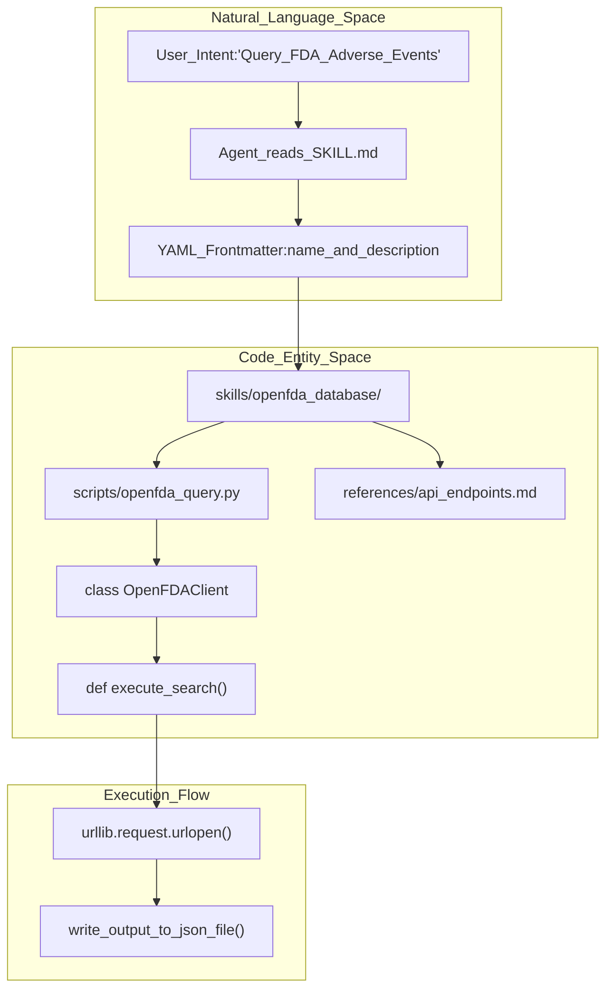
Sources: [skills/openfda_database/SKILL.md:1-10](), [skills/openfda_database/SKILL.md:60-64]()

### Standard CLI Execution Pattern

Most skill scripts follow an `argparse` subcommand pattern (e.g., `search`, `count`, `download`) as demonstrated in query tools.

Title: "Standard Skill Execution Lifecycle"
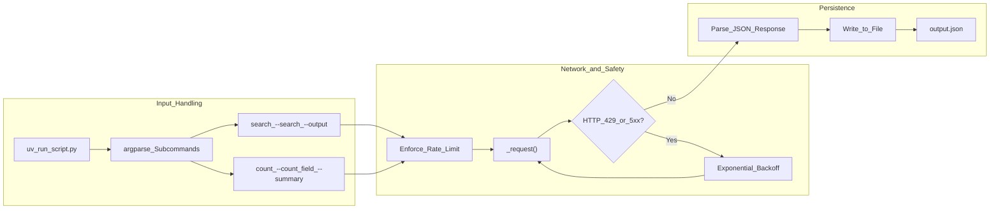
Sources: [skills/openfda_database/SKILL.md:60-136]()

---

## Summary of Constraints

| Feature | Requirement / Convention |
| :--- | :--- |
| **Python Runtime** | Managed strictly via `uv run` with PEP 723 metadata [README.md:47-50](). |
| **Dependencies** | Standard library preferred (`urllib`, `json`, `argparse`) [skills/openfda_database/SKILL.md:15-16](). |
| **File Output** | Mandatory `--output <file>` for data serialization [skills/openfda_database/SKILL.md:51-53](). |
| **Rate Limiting** | Respect API thresholds; prompt user for API keys via credentials protocol [skills/openfda_database/SKILL.md:24-29](). |
| **Naming Conventions** | Hyphenated-lowercase for directory names and frontmatter identifiers [skills/openfda_database/SKILL.md:2-2](). |

Sources: [README.md:47-50](), [skills/openfda_database/SKILL.md:15-56]()

---

# Page: Creating New Skills with the Workflow Skill Creator

# Creating New Skills with the Workflow Skill Creator

<details>
<summary>Relevant source files</summary>

The following files were used as context for generating this wiki page:

- [skills/workflow_skill_creator/SKILL.md](skills/workflow_skill_creator/SKILL.md)

</details>


The `workflow-skill-creator` is a specialized meta-skill designed to distill completed user interactions into reusable agent skills [skills/workflow_skill_creator/SKILL.md:2-7](). Unlike generic skill creators, this tool is strictly for packaging workflows that have **already occurred** in a conversation [skills/workflow_skill_creator/SKILL.md:8-16](). It enforces a rigorous four-phase process to ensure new skills are robust, maintainable, and integrate seamlessly with the existing Science Skills ecosystem.

### The Four-Phase Creation Process

The creation process is divided into distinct phases that transition from natural language requirements to executable code and validation.

#### Phase 1: Brainstorming (Mandatory)
This phase requires an iterative back-and-forth conversation with the user to extract the logic of the workflow [skills/workflow_skill_creator/SKILL.md:23-27](). Developers must not skip this phase, as it prevents the creation of skills that are too rigid or vague [skills/workflow_skill_creator/SKILL.md:18-21]().

| Round | Focus | Key Objectives |
| :--- | :--- | :--- |
| **1. Understand** | Workflow Summary | Confirm inputs, outputs, and recurrence [skills/workflow_skill_creator/SKILL.md:29-36](). |
| **2. Flexibility** | Error Handling | Determine if the skill should fail loudly or try alternatives [skills/workflow_skill_creator/SKILL.md:38-48](). |
| **3. Dependencies** | Reuse | Identify overlapping existing skills that MUST be referenced [skills/workflow_skill_creator/SKILL.md:49-57](). |
| **4. Scope** | Shape | Decide if the skill needs a CLI helper script or just instructions [skills/workflow_skill_creator/SKILL.md:65-90](). |
| **5. Testing** | Validation | Collect sample queries and expected answers [skills/workflow_skill_creator/SKILL.md:92-97](). |

**Sources:** [skills/workflow_skill_creator/SKILL.md:18-113]()

#### Phase 2: Skill Design
Before implementation, a design document (Implementation Plan) must be presented for user approval [skills/workflow_skill_creator/SKILL.md:114-117](). This document serves as the bridge between conceptual brainstorming and code.

**Design Document Requirements:**
*   **YAML Frontmatter:** Name (≤64 chars, lowercase/hyphens) and Description (≤1024 chars) [skills/workflow_skill_creator/SKILL.md:119-120]().
*   **Directory Structure:** A map of all planned files [skills/workflow_skill_creator/SKILL.md:121]().
*   **Rationalization:** Explanation for which existing skills are being reused [skills/workflow_skill_creator/SKILL.md:122]().
*   **Interface:** Proposed CLI subcommands and arguments [skills/workflow_skill_creator/SKILL.md:123]().

**Sources:** [skills/workflow_skill_creator/SKILL.md:114-128]()

#### Phase 3: Implementation
Implementation follows strict technical constraints to ensure portability and reliability across the Science Skills bundle.

**Technical Constraints:**
1.  **Runtime:** Use `uv run`, never direct `python` calls [skills/workflow_skill_creator/SKILL.md:135]().
2.  **Dependencies:** Prefer Python standard library (e.g., `urllib` over `requests`) to minimize installation overhead [skills/workflow_skill_creator/SKILL.md:136-138]().
3.  **Output Management:** Outputs exceeding 500 lines must be redirected to files [skills/workflow_skill_creator/SKILL.md:143-144]().
4.  **Rate Limiting:** Must implement file-lock–based rate limiting for cross-process safety [skills/workflow_skill_creator/SKILL.md:139-142]().

**Sources:** [skills/workflow_skill_creator/SKILL.md:130-145]()

#### Phase 4: Validation
The final phase involves running the sample queries from Phase 1 to ensure the implementation matches the user's expectations.

---

### Implementation Architecture: CLI Script Template

For skills requiring API integration or data processing, the `workflow-skill-creator` provides a standard template: `cli_script_template.py` [skills/workflow_skill_creator/references/cli_script_template.py:15-25]().

#### Data Flow and Component Interaction

The following diagram illustrates how the `MyAPIClient` handles requests, enforcing rate limits before interacting with external endpoints.

API Client Interaction Flow
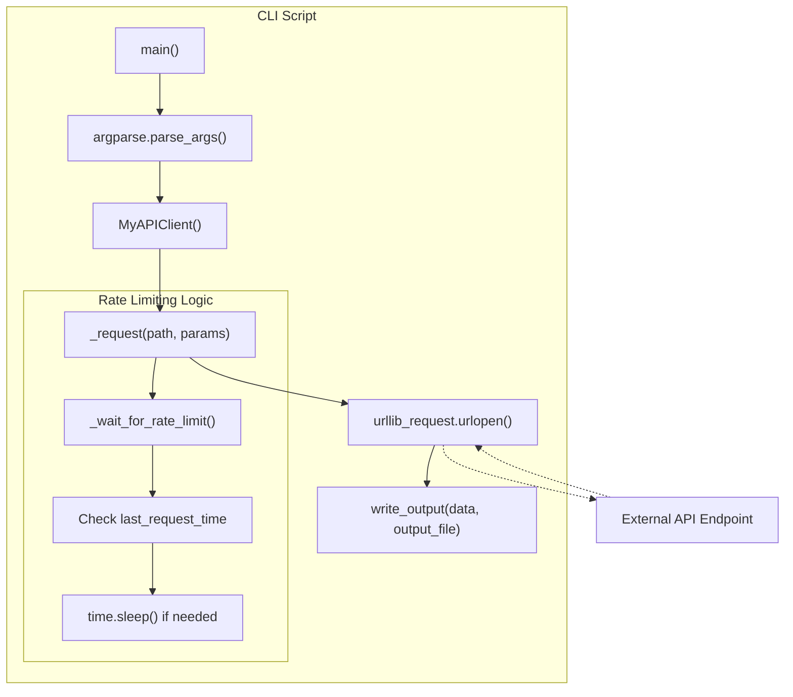
**Sources:** [skills/workflow_skill_creator/references/cli_script_template.py:27-156]()

### Rate Limiting and Error Handling

New skills must handle API instability and throttling gracefully. The template implements a `RateLimitError` and exponential backoff [skills/workflow_skill_creator/references/cli_script_template.py:36-37]().

Retry and Error Logic
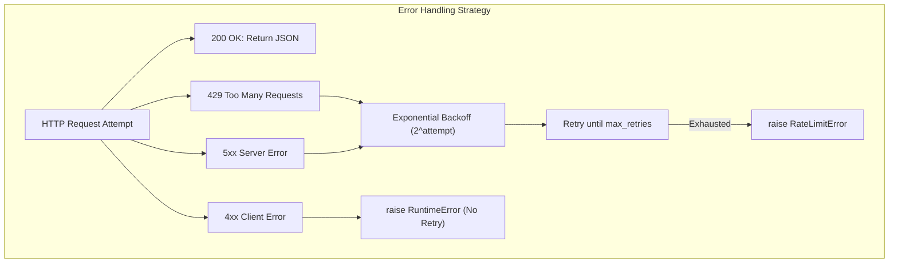

**Key Code Entities:**
*   **`MyAPIClient.REQUESTS_PER_SECOND`**: Defines the throttling threshold [skills/workflow_skill_creator/references/cli_script_template.py:50]().
*   **`_wait_for_rate_limit()`**: Uses `time.monotonic()` to calculate required delays [skills/workflow_skill_creator/references/cli_script_template.py:56-61]().
*   **`_request()`**: Centralizes the `urllib` logic, headers, and retry loops [skills/workflow_skill_creator/references/cli_script_template.py:62-76]().
*   **`write_output()`**: Ensures all data is serialized to JSON for downstream agent processing [skills/workflow_skill_creator/references/cli_script_template.py:143-157]().

**Sources:** [skills/workflow_skill_creator/references/cli_script_template.py:36-157]()

### Skill Reuse Rules
A critical requirement of the `workflow-skill-creator` is the **Rule of Reuse**. If a step in the new workflow can be performed by an existing skill (e.g., searching OpenAlex or fetching PDB structures), the creator **must not** reimplement that logic [skills/workflow_skill_creator/SKILL.md:51-57]().

Instead, the generated `SKILL.md` must:
1.  Reference the existing skill by name [skills/workflow_skill_creator/SKILL.md:149-150]().
2.  Include a "Dependencies" or "Referenced Skills" section explaining why it is used [skills/workflow_skill_creator/SKILL.md:150-151]().

**Sources:** [skills/workflow_skill_creator/SKILL.md:49-59](), [skills/workflow_skill_creator/SKILL.md:147-151]()

---

# Page: Core Infrastructure

# Core Infrastructure

<details>
<summary>Relevant source files</summary>

The following files were used as context for generating this wiki page:

- [skills/dbsnp_database/scripts/dbsnp_cli.py](skills/dbsnp_database/scripts/dbsnp_cli.py)
- [skills/openfda_database/scripts/openfda_query.py](skills/openfda_database/scripts/openfda_query.py)
- [skills/uv/SKILL.md](skills/uv/SKILL.md)

</details>


The **Science Skills** repository relies on a shared technical foundation to ensure consistency, reliability, and efficient resource management across dozens of specialized scientific tools. This infrastructure provides a unified networking layer, a standardized runtime environment, secure credential handling, and clear licensing compliance, allowing skill developers to focus on domain-specific logic rather than boilerplate networking or environment management.

The core infrastructure is primarily composed of four foundational pillars:
1.  **`polite-http` Client Library**: Provides rate-limiting, exponential backoff, and retry logic for all API interactions [skills/dbsnp_database/scripts/dbsnp_cli.py:53-78]().
2.  **`uv` Package Manager**: Used as the universal Python runtime and dependency isolator for all skills [skills/uv/SKILL.md:9-12]().
3.  **Credentials and API Key Protocol**: Securely verifies keys against `~.env` using `grep -sq` without leaking values [skills/openfda_database/scripts/openfda_query.py:81-89]().
4.  **Licensing and Terms of Use**: Upstream data source registries and license-notification patterns.

### High-Level Architecture

The following diagram illustrates how the core infrastructure bridges the gap between the natural language requirements of an LLM agent and the execution of code entities across the foundational layers.

**Infrastructure Execution Flow**
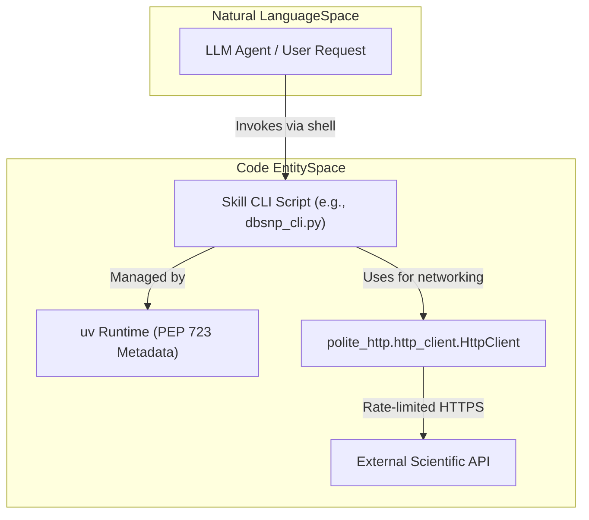
Sources: [skills/dbsnp_database/scripts/dbsnp_cli.py:33-78](), [skills/uv/SKILL.md:9-15]()

---

## 2.1. polite-http HttpClient and Rate Limiting

The shared HTTP layer is used by every skill script to communicate with external scientific databases (e.g., NCBI, openFDA). It abstracts away transient network failures and strict rate limits. Key features include:
*   **Client Construction**: `HttpClient` instances configured with specific queries-per-second (`qps`) limits [skills/dbsnp_database/scripts/dbsnp_cli.py:59-63](), [skills/openfda_database/scripts/openfda_query.py:43]().
*   **Resilient Error Handling**: Automatic retries on status codes like `429`, `502`, `503`, and `504` [skills/dbsnp_database/scripts/dbsnp_cli.py:62]().
*   **Specialized CLI Integration**: Pattern implementations in tools like `dbsnp_cli.py` and `openfda_query.py` that handle rate-limit exceptions (`RateLimitError`) and guide the user on API key configuration [skills/dbsnp_database/scripts/dbsnp_cli.py:123-131](), [skills/openfda_database/scripts/openfda_query.py:195-205]().

For details, see [polite-http HttpClient and Rate Limiting](#2.1).

**Networking Component Model**
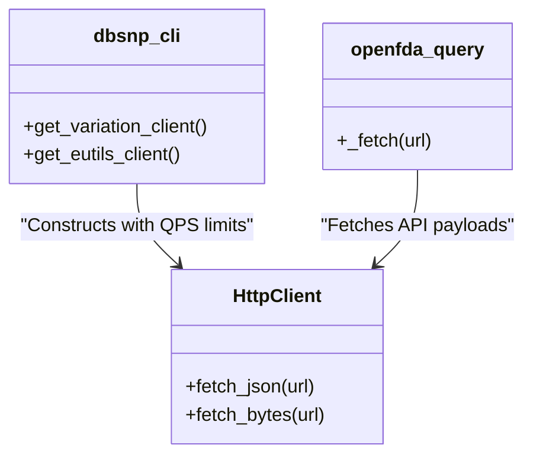
Sources: [skills/dbsnp_database/scripts/dbsnp_cli.py:53-78](), [skills/openfda_database/scripts/openfda_query.py:40-44]()

---

## 2.2. uv Package Manager Integration

All skills utilize `uv` as their universal Python runtime [skills/uv/SKILL.md:9-12](). `uv` is chosen for extreme speed and dependency isolation via PEP 723 inline script metadata.
*   **Inline Metadata**: Dependencies like `polite-http` and `python-dotenv` are declared directly in script headers [skills/dbsnp_database/scripts/dbsnp_cli.py:25-31](), [skills/openfda_database/scripts/openfda_query.py:22-28]().
*   **Automated Setup**: The repository provides clear fallback paths to detect, install, and add `uv` to the system `PATH` [skills/uv/SKILL.md:21-48]().

For details, see [uv Package Manager Integration](#2.2).

Sources: [skills/uv/SKILL.md:1-49](), [skills/dbsnp_database/scripts/dbsnp_cli.py:25-31]()

---

## 2.3. Credentials and API Key Protocol

Many scientific APIs require authentication (or grant higher rate limits with API keys). The credentials protocol handles keys securely:
*   **Safe Verification**: Uses `grep -sq` against local configuration files such as `~.env` to check for keys without exposing them.
*   **Environment Injection**: Keys are read into environment variables like `NCBI_API_KEY` [skills/dbsnp_database/scripts/dbsnp_cli.py:57]() and `FDA_API_KEY` [skills/openfda_database/scripts/openfda_query.py:82]() at runtime.
*   **Prompting**: Prompts users interactively when mandatory keys are missing, preventing silent execution failures.

For details, see [Credentials and API Key Protocol](#2.3).

Sources: [skills/dbsnp_database/scripts/dbsnp_cli.py:57-58](), [skills/openfda_database/scripts/openfda_query.py:81-89]()

---

## 2.4. Licensing and Terms of Use

Upstream biomedical and chemical databases impose specific terms of use, attribution requirements, and licensing constraints.
*   **Registry & Dual License**: Maintained via `SKILL_LICENSES.md` tracking Apache 2.0 and CC-BY attributions.
*   **License Notifications**: Output generators automatically inject license notices into exported JSON payloads to ensure downstream compliance [skills/openfda_database/scripts/openfda_query.py:97-101]().

For details, see [Licensing and Terms of Use](#2.4).

Sources: [skills/openfda_database/scripts/openfda_query.py:97-101]()

---

# Page: polite-http HttpClient and Rate Limiting

# polite-http HttpClient and Rate Limiting

<details>
<summary>Relevant source files</summary>

The following files were used as context for generating this wiki page:

- [skills/dbsnp_database/scripts/dbsnp_cli.py](skills/dbsnp_database/scripts/dbsnp_cli.py)
- [skills/human_protein_atlas_database/SKILL.md](skills/human_protein_atlas_database/SKILL.md)
- [skills/human_protein_atlas_database/scripts/hpa_cli.py](skills/human_protein_atlas_database/scripts/hpa_cli.py)
- [skills/ncbi_sequence_fetch/scripts/ncbi_fetch.py](skills/ncbi_sequence_fetch/scripts/ncbi_fetch.py)
- [skills/openfda_database/scripts/openfda_query.py](skills/openfda_database/scripts/openfda_query.py)
- [skills/reactome_database/scripts/reactome_analysis.py](skills/reactome_database/scripts/reactome_analysis.py)

</details>


## Purpose and Scope
This page provides a deep dive into the shared `polite-http` library used as the unified networking foundation across all skill scripts in the Science Skills repository. It covers `HttpClient` construction with Quality Per Second (QPS) limits, cross-process rate-limiting synchronization, exponential backoff, `Retry-After` header parsing, helper methods (`fetch_json`, `fetch_bytes`), and practical error handling patterns implemented in scripts like `dbsnp_cli.py`, `openfda_query.py`, `ncbi_fetch.py`, and `hpa_cli.py`.

---

## HttpClient Construction and QPS Configuration

Every skill script that interacts with external bioinformatics APIs initializes an instance of `http_client.HttpClient` [skills/human_protein_atlas_database/scripts/hpa_cli.py:33-36](). The client encapsulates connection pooling, backpressure management, and polite request spacing. Depending on whether an API key is available (such as `NCBI_API_KEY` or `FDA_API_KEY`), the QPS limits are dynamically adjusted [skills/dbsnp_database/scripts/dbsnp_cli.py:57-63](), [skills/ncbi_sequence_fetch/scripts/ncbi_fetch.py:125-127]().

For example:
- **Human Protein Atlas (`hpa_cli.py`)**: Initializes with a static QPS limit of `2.0` [skills/human_protein_atlas_database/scripts/hpa_cli.py:33-36]().
- **Reactome Analysis (`reactome_analysis.py`)**: Initializes with a QPS limit of `1` [skills/reactome_database/scripts/reactome_analysis.py:39-43]().
- **openFDA (`openfda_query.py`)**: Initializes with a QPS limit of `4.0` [skills/openfda_database/scripts/openfda_query.py:40-43]().
- **NCBI dbSNP (`dbsnp_cli.py`)**: Scales its QPS from `3` (anonymous) to `10` (with `NCBI_API_KEY`) [skills/dbsnp_database/scripts/dbsnp_cli.py:57-63]().

Sources: [skills/human_protein_atlas_database/scripts/hpa_cli.py:33-36](), [skills/reactome_database/scripts/reactome_analysis.py:39-43](), [skills/openfda_database/scripts/openfda_query.py:40-43](), [skills/dbsnp_database/scripts/dbsnp_cli.py:57-63]()

---

## Cross-Process Rate Limiting Architecture

Because multiple isolated Python skill scripts may execute concurrently via process runners or `uv run`, rate limits must be enforced globally across the local host environment rather than purely in-memory. The `polite_http` library uses a file-system locking mechanism via `fcntl` to coordinate execution timestamps.

### Diagram: Rate Limiter Code Mapping
The following diagram maps the natural language concept of cross-process synchronization to the specific classes and functions in the `polite_http` codebase.

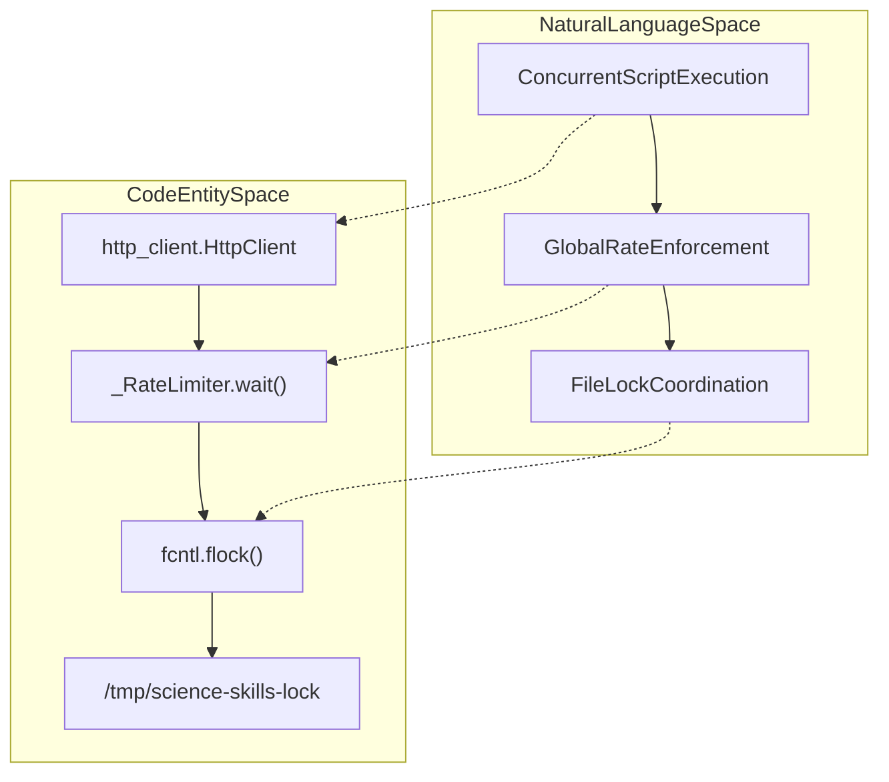
Sources: [skills/dbsnp_database/scripts/dbsnp_cli.py:57-63](), [skills/ncbi_sequence_fetch/scripts/ncbi_fetch.py:125-127]()

Sources: [skills/dbsnp_database/scripts/dbsnp_cli.py:57-63](), [skills/ncbi_sequence_fetch/scripts/ncbi_fetch.py:125-127]()

---

## Request Execution Flow and Backoff

When a skill script calls methods like `fetch_json()` or `fetch_bytes()`, the request passes through an execution loop that manages retries for transient errors (such as HTTP status codes `429`, `502`, `503`, and `504`) [skills/dbsnp_database/scripts/dbsnp_cli.py:59-63]().

### Diagram: Request Execution Data Flow
The sequence below illustrates how requests flow through the client, invoking rate limiters and handling server errors with exponential backoff.

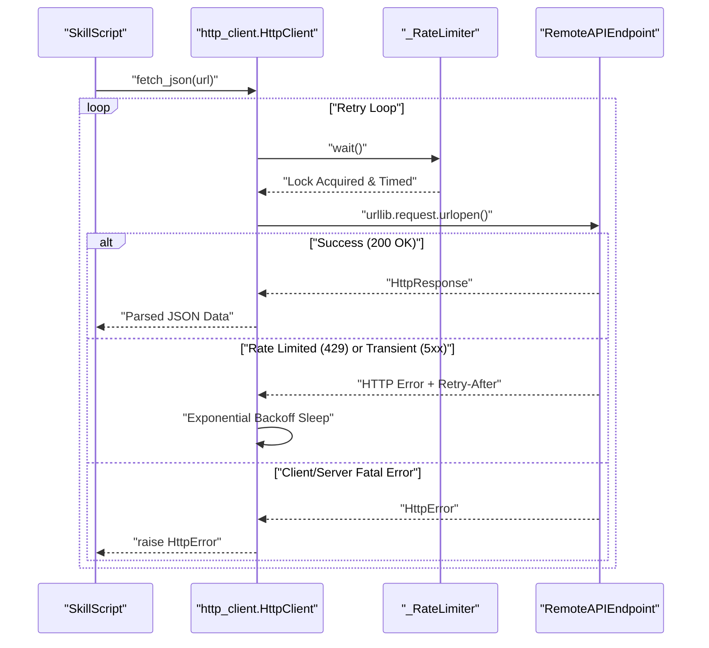
Sources: [skills/dbsnp_database/scripts/dbsnp_cli.py:120-131](), [skills/openfda_database/scripts/openfda_query.py:183-220]()

Sources: [skills/dbsnp_database/scripts/dbsnp_cli.py:120-131](), [skills/openfda_database/scripts/openfda_query.py:183-220]()

---

## Helper Methods and Response Handling

The `HttpClient` provides specialized helper functions designed to simplify data ingestion across different payload types:
- **`fetch_json`**: Executes an HTTP request and automatically decodes the JSON response body into Python dictionaries or lists [skills/dbsnp_database/scripts/dbsnp_cli.py:121-121]().
- **`fetch_bytes`**: Retrieves raw binary payloads, commonly used for downloading XML entries, PDB coordinate files, or compressed archives [skills/human_protein_atlas_database/scripts/hpa_cli.py:46-46](), [skills/human_protein_atlas_database/scripts/hpa_cli.py:55-55]().
- **Compression Handling**: Automatically detects gzip magic headers (`\x1f\x8b`) and decompresses streams even when content-encoding headers are omitted or stripped by intermediate proxies [skills/ncbi_sequence_fetch/scripts/ncbi_fetch.py:156-160](), [skills/openfda_database/scripts/openfda_query.py:191-192]().

Sources: [skills/dbsnp_database/scripts/dbsnp_cli.py:121-121](), [skills/human_protein_atlas_database/scripts/hpa_cli.py:46-46](), [skills/ncbi_sequence_fetch/scripts/ncbi_fetch.py:156-160](), [skills/openfda_database/scripts/openfda_query.py:191-192]()

---

## Error Handling Patterns in Skill Scripts

When the `HttpClient` exhausts all retry attempts or encounters non-recoverable error codes, it raises `http_client.HttpError`. Skill CLIs implement robust exception wrappers around these errors to provide actionable diagnostic messages to agents and users.

### 1. NCBI dbSNP and E-utilities (`dbsnp_cli.py`)
`dbsnp_cli.py` catches `http_client.HttpError` to handle specific HTTP status codes:
- **HTTP 429**: Raises `RateLimitError` and instructs the agent to prompt the user for an `NCBI_API_KEY` [skills/dbsnp_database/scripts/dbsnp_cli.py:122-131]().
- **HTTP 500 (Reference Mismatch)**: Detects allele mismatch errors (`not equal to variant's asserted reference`) and prevents mechanical retries, advising coordinate verification between assemblies (GRCh38 vs GRCh37) [skills/dbsnp_database/scripts/dbsnp_cli.py:141-155]().

### 2. openFDA Query CLI (`openfda_query.py`)
`openfda_query.py` wraps `CLIENT.fetch()` to intercept `http_client.HttpError`, parsing error payloads and returning structured JSON error dictionaries with daily limit documentation when HTTP 429 occurs [skills/openfda_database/scripts/openfda_query.py:183-205]().

Sources: [skills/dbsnp_database/scripts/dbsnp_cli.py:122-155](), [skills/openfda_database/scripts/openfda_query.py:183-205]()

---

# Page: uv Package Manager Integration

# uv Package Manager Integration

<details>
<summary>Relevant source files</summary>

The following files were used as context for generating this wiki page:

- [skills/alphagenome_atlas_website_links/pyproject.toml](skills/alphagenome_atlas_website_links/pyproject.toml)
- [skills/alphagenome_variant_impact_score/pyproject.toml](skills/alphagenome_variant_impact_score/pyproject.toml)
- [skills/uv/SKILL.md](skills/uv/SKILL.md)

</details>


## Purpose and Scope
This page details how `uv` is utilized as the universal Python runtime and package manager across all Science Skills. It covers PEP 723 inline script metadata, per-skill `pyproject.toml` configurations, dependency isolation, installation protocols, and PATH setup.

Sources: [skills/uv/SKILL.md:1-49]()

## Overview of uv Usage
In this ecosystem, `uv` serves as the execution engine for all Python-based skills. It leverages PEP 723 (Inline Script Metadata) to allow single-file Python scripts to declare their own dependencies. When a skill is executed, `uv` automatically handles dependency resolution, environment isolation, and cross-platform consistency.

### Dependency Flow and Code Entities

**Runtime Dependency Resolution Flow**
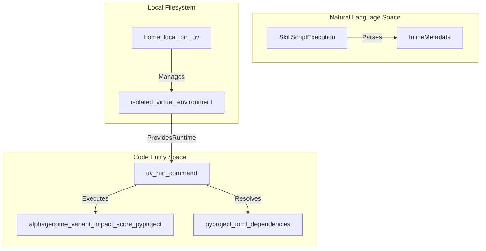
Sources: [skills/uv/SKILL.md:11-49](), [skills/alphagenome_variant_impact_score/pyproject.toml:1-16]()

## PEP 723 Inline Script Metadata and Per-Skill pyproject.toml
Every Python skill or package uses either PEP 723 inline script metadata or a dedicated `pyproject.toml` file to declare runtime dependencies. For example, complex skills like `alphagenome-variant-impact-score` and `alphagenome-atlas-website-links` specify their requirements in per-skill configuration files.

| Configuration File | Dependencies Declared | Requires Python | Sources |
| :--- | :--- | :--- | :--- |
| `skills/alphagenome_variant_impact_score/pyproject.toml` | `absl-py`, `alphagenome`, `anndata`, `numpy`, `pandas`, `polars`, `pyarrow`, `pysam`, `python-dotenv`, `tabulate` [skills/alphagenome_variant_impact_score/pyproject.toml:5-16]() | `>=3.14` [skills/alphagenome_variant_impact_score/pyproject.toml:4-4]() | [skills/alphagenome_variant_impact_score/pyproject.toml:1-16]() |
| `skills/alphagenome_atlas_website_links/pyproject.toml` | `alphagenome`, `numpy`, `pandas`, `pyarrow`, `python-dotenv` [skills/alphagenome_atlas_website_links/pyproject.toml:5-11]() | `>=3.14` [skills/alphagenome_atlas_website_links/pyproject.toml:4-4]() | [skills/alphagenome_atlas_website_links/pyproject.toml:1-11]() |

Sources: [skills/alphagenome_variant_impact_score/pyproject.toml:1-16](), [skills/alphagenome_atlas_website_links/pyproject.toml:1-11]()

## Installation and PATH Setup
The `uv` skill (`skills/uv/SKILL.md`) governs the installation, verification, and PATH configuration of the `uv` executable across Unix/macOS and Windows environments.

### Verification and Installation Workflow

**uv Installation Protocol**
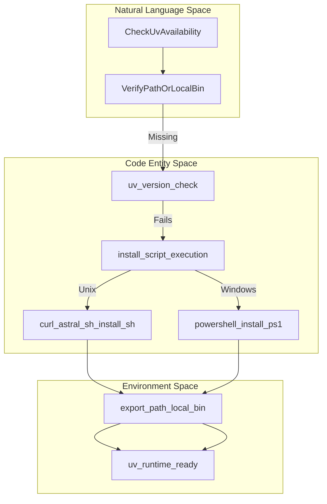
Sources: [skills/uv/SKILL.md:17-49]()

### Step-by-Step Installation Rules
1. **Version Check**: Check if `uv` is available on the system PATH using `uv --version` [skills/uv/SKILL.md:19-20]().
2. **Local Binary Check**: Check default fallback locations such as `"$HOME/.local/bin/uv" --version` on Unix/macOS or `& "$HOME\.local\bin\uv.exe" --version` on Windows PowerShell [skills/uv/SKILL.md:21-25]().
3. **Automated Installation**: If missing, download and execute the installation script:
   - Unix/macOS: `curl -LsSf https://astral.sh/uv/install.sh | sh` [skills/uv/SKILL.md:37-37]()
   - Windows (PowerShell): `powershell -ExecutionPolicy ByPass -c "irm https://astral.sh/uv/install.ps1 | iex"` [skills/uv/SKILL.md:38-40]()
4. **PATH Export**: Add the local binary directory to the session PATH variable:
   - Unix/macOS: `export PATH="$HOME/.local/bin:$PATH" && uv --version` [skills/uv/SKILL.md:45-45]()
   - Windows (PowerShell): `$env:PATH = "$HOME\.local\bin;" + $env:PATH; uv --version` [skills/uv/SKILL.md:46-48]()

Sources: [skills/uv/SKILL.md:17-49]()

---

# Page: Credentials and API Key Protocol

# Credentials and API Key Protocol

<details>
<summary>Relevant source files</summary>

The following files were used as context for generating this wiki page:

- [README.md](README.md)
- [skills/dbsnp_database/scripts/dbsnp_cli.py](skills/dbsnp_database/scripts/dbsnp_cli.py)
- [skills/openfda_database/scripts/openfda_query.py](skills/openfda_database/scripts/openfda_query.py)

</details>


## Purpose and Scope

The credentials and API key protocol establishes secure handling, verification, and runtime injection of sensitive credentials across all scientific skills in the repository. Because scientific APIs enforce strict rate limits or require authentication tokens (such as for genomic databases or proprietary inference models), the framework mandates secure local storage in `~/.env`, programmatic inspection via environment variables, defense against context leakage during agent execution, and dynamic rate-limiting adjustments based on credential presence.

Sources: [README.md:47-58](), [skills/dbsnp_database/scripts/dbsnp_cli.py:53-78](), [skills/openfda_database/scripts/openfda_query.py:81-90]()

---

## Environment Configuration and Storage

Science skills rely on local environment files to inject secrets without hardcoding them into scripts or prompts. Keys are stored in a centralized dotfile located at `~/.env`. 

During execution, Python scripts invoke libraries such as `python-dotenv` or native environment lookups (`os.environ.get`) to retrieve keys at runtime. The architecture strictly forbids writing raw API keys into model prompts, chat logs, or standard output streams to prevent sensitive token leakage into the context window.

Sources: [README.md:47-58](), [skills/dbsnp_database/scripts/dbsnp_cli.py:33-41](), [skills/openfda_database/scripts/openfda_query.py:32-41]()

---

## Safe Verification via `grep` and User Prompting

When a skill requires an API key that is absent from the current process environment or `~/.env`, agents execute a safe verification protocol:

1. **Non-destructive Check**: Instead of reading or printing the contents of `~/.env` into context, agents use silent pattern matching tools such as `grep -sq` to verify the presence of the required key assignment (e.g., `grep -sq "ALPHAGENOME_API_KEY=" ~/.env`).
2. **Interactive Prompting**: If the key is missing, the agent halts automated execution and prompts the user to acquire an official API key from the respective provider portal.
3. **Automated Appending Guidance**: The agent guides the user to append the key securely, using shell commands like `echo "KEY_NAME=value" >> ~/.env`.

Sources: [README.md:52-58](), [skills/dbsnp_database/scripts/dbsnp_cli.py:110-131]()

---

## Per-Skill Credential Matrix

Different scientific domains require distinct authentication tokens or user metadata fields. The repository defines the following canonical environment variables across its skill ecosystem:

| Environment Variable | Target Skill / API | Authentication Purpose | Rate Limit Impact (Without vs. With Key) |
| :--- | :--- | :--- | :--- |
| `ALPHAGENOME_API_KEY` | AlphaGenome Skills [5.1]() | Access to proprietary sequence scoring and model inference endpoints | Required for execution (fails without key) |
| `NCBI_API_KEY` | dbSNP [4.3]() / NCBI Fetch [4.6]() | Higher throughput access to NCBI Variation Services and E-utilities | 3 QPS $\rightarrow$ 10 QPS [skills/dbsnp_database/scripts/dbsnp_cli.py:57-77]() |
| `FDA_API_KEY` | openFDA Database [8.3]() | Expanded daily quotas for drug, device, and event reporting queries | 240 req/min, 1,000/day $\rightarrow$ 120,000/day [skills/openfda_database/scripts/openfda_query.py:201-203]() |
| `USER_EMAIL` | E-Utilities / NCBI Services | Contact identification mandated by NCBI usage policies for bulk queries | Non-functional or throttled if missing |

Sources: [README.md:52-58](), [skills/dbsnp_database/scripts/dbsnp_cli.py:53-78](), [skills/openfda_database/scripts/openfda_query.py:81-90]()

---

## Credential-Aware Client Initialization

CLI scripts dynamically inspect environment variables to configure underlying HTTP clients. For example, `dbsnp_cli.py` checks for `NCBI_API_KEY` to adjust queries and raise polite rate-limiting caps [skills/dbsnp_database/scripts/dbsnp_cli.py:53-78](). Similarly, `openfda_query.py` emits warnings to `stderr` if `FDA_API_KEY` is omitted [skills/openfda_database/scripts/openfda_query.py:81-90]().

```mermaid
title "Credential Verification and Client Initialization Flow"

graph TD
    A["UserCommand"] --> B["ScriptInitialization"]
    B --> C["os.environ.get(NCBI_API_KEY)"]
    C --> D{"KeyExists?"}
    D -- "Yes" --> E["SetQPS10AndAppendParam"]
    D -- "No" --> F["SetQPS3AndWarnStderr"]
    E --> G["http_client.HttpClient"]
    F --> G
    G --> H["ExecuteQuery"]
```
Sources: [skills/dbsnp_database/scripts/dbsnp_cli.py:53-78](), [skills/openfda_database/scripts/openfda_query.py:81-90]()

---

## Runtime Error Handling and Rate Limit Interception

When an API encounters throttling due to missing or exhausted credentials (such as HTTP `429 Too Many Requests`), the script intercepts the `HttpError` exception, decodes the status code, and raises a descriptive agent instruction [skills/dbsnp_database/scripts/dbsnp_cli.py:122-131]().

```mermaid
title "Error Interception and Agent Instruction Pipeline"

graph TD
    A["HttpClient.fetch_json"] --> B{"HttpResponseStatus"}
    B -- "429 Too Many Requests" --> C["RateLimitError"]
    C --> D["_die / stderr Output"]
    D --> E["AgentInstructionParsing"]
    E --> F["PromptUserForApiKey"]
    F --> G["AppendToDotEnv"]
    G --> H["RetryExecution"]
```
Sources: [skills/dbsnp_database/scripts/dbsnp_cli.py:120-131](), [skills/openfda_database/scripts/openfda_query.py:194-205]()

---

# Page: Licensing and Terms of Use

# Licensing and Terms of Use

<details>
<summary>Relevant source files</summary>

The following files were used as context for generating this wiki page:

- [README.md](README.md)
- [SKILL_LICENSES.md](SKILL_LICENSES.md)

</details>


The Licensing and Terms of Use framework establishes the legal boundaries, distribution rights, and compliance responsibilities for the `science-skills` repository. It defines a dual-licensing model for repository contents (splitting software code from instructional materials) and maintains a comprehensive registry of upstream third-party data sources via `SKILL_LICENSES.md`.

---

## Dual-Licensing Architecture

The repository enforces a dual-licensing model depending on the artifact type. Core software scripts and execution modules are governed by the Apache License 2.0, whereas documentation, instructions, and non-code assets fall under the Creative Commons Attribution 4.0 International License (CC-BY).

```mermaid
graph TD
    Repo[""science-skills repository""] --> Code[""Python Scripts & Code Modules""]
    Repo --> Docs[""SKILL.md & Markdown Documentation""]
    
    Code --> Apache[""Apache License 2.0 (README.md:80-84)""]
    Docs --> CCBY[""CC-BY 4.0 License (README.md:93-95)""]
    
    Apache --> Disclaimer[""AS IS Warranty Disclaimer (README.md:97-101)""]
    CCBY --> Disclaimer
```
*Figure 1: Allocation of repository artifacts to licensing frameworks.*

Sources: `README.md:76-104`

---

## Upstream Data Source Registry (`SKILL_LICENSES.md`)

Because individual skills interact with external scientific databases and web APIs, users must comply with the terms of service, citation guidelines, and data usage policies of each respective provider. The repository centralizes this mapping inside `SKILL_LICENSES.md`.

```mermaid
graph TD
    Agent[""AI Agent Execution""] --> SkillFile[""Individual Skill SKILL.md""]
    SkillFile --> Registry[""SKILL_LICENSES.md""]
    
    Registry --> AlphaFold[""alphafold-database-fetch-and-analyze (SKILL_LICENSES.md:13)""]
    Registry --> ChemBL[""chembl-database (SKILL_LICENSES.md:15)""]
    Registry --> ClinVar[""clinvar-database (SKILL_LICENSES.md:17)""]
    Registry --> OpenAlex[""literature-search-openalex (SKILL_LICENSES.md:31)""]
    Registry --> UniProt[""uniprot-database (SKILL_LICENSES.md:46)""]

    AlphaFold --> EBI[""EBI AlphaFold API Terms""]
    ChemBL --> ChEMBLDocs[""ChEMBL Interface Docs""]
    ClinVar --> NCBI[""NCBI Policies""]
    OpenAlex --> OpenAlexDev[""OpenAlex Developers API""]
    UniProt --> UniProtHelp[""UniProt License & API Queries""]
```
*Figure 2: Mapping from skill definitions to upstream data source policies.*

Sources: `SKILL_LICENSES.md:1-47`, `README.md:76-92`

### Key Upstream Registrations

The registry maps specific skill identifiers to their compliance documentation URLs:

| Skill Identifier | Reference URL / Terms Source |
| :--- | :--- |
| `alphafold-database-fetch-and-analyze` | `https://alphafold.ebi.ac.uk/` (`SKILL_LICENSES.md:13`) |
| `alphagenome-single-variant-analysis` | `https://deepmind.google.com/science/alphagenome/` (`SKILL_LICENSES.md:14`) |
| `chembl-database` | `https://chembl.gitbook.io/chembl-interface-documentation/about` (`SKILL_LICENSES.md:15`) |
| `clinvar-database` | `https://www.ncbi.nlm.nih.gov/clinvar/` (`SKILL_LICENSES.md:17`) |
| `literature-search-openalex` | `https://developers.openalex.org/` (`SKILL_LICENSES.md:31`) |
| `uniprot-database` | `https://www.uniprot.org/help/license` (`SKILL_LICENSES.md:46`) |

Sources: `SKILL_LICENSES.md:11-47`

---

## Compliance and Notification Protocol

Users and executing AI agents bear full responsibility for ensuring that queries and data retrievals comply with third-party service limits and licensing terms. When skills execute requests against external endpoints (such as NCBI, Ensembl, or OpenAlex), agents are instructed to reference `SKILL_LICENSES.md` to inform users of downstream obligations, attribution requirements, and citation mandates.

Sources: `SKILL_LICENSES.md:3-8`, `README.md:85-92`

---

# Page: Literature Search Skills

# Literature Search Skills

<details>
<summary>Relevant source files</summary>

The following files were used as context for generating this wiki page:

- [skills/literature_search_openalex/scripts/openalex_cli.py](skills/literature_search_openalex/scripts/openalex_cli.py)
- [skills/pubmed_database/scripts/pubmed_api.py](skills/pubmed_database/scripts/pubmed_api.py)

</details>


This section provides an overview of the skills available for discovering, retrieving, and analyzing scientific publications across major databases including OpenAlex, Europe PMC, PubMed, arXiv, and bioRxiv. These tools allow for high-level bibliometric analysis, full-text retrieval, and cross-database linking between papers and biological entities.

## Overview of Services

The repository organizes literature search into four primary skill directories, each targeting specific database ecosystems:

| Skill | Primary Use Case | Key Script |
| :--- | :--- | :--- |
| **OpenAlex** | Global scholarly graph, bibliometrics, and DOI resolution. | `openalex_cli.py` [skills/literature_search_openalex/scripts/openalex_cli.py:15-19]() |
| **Europe PMC** | Open-access full-text (XML/PDF) and citation networks. | `europepmc_api.py` |
| **PubMed** | Biomedical literature and linking to NCBI biological databases. | `pubmed_api.py` [skills/pubmed_database/scripts/pubmed_api.py:15-19]() |
| **arXiv / bioRxiv** | Physical and life science preprints and LaTeX source. | `search_arxiv.py`, `search_by_dates.py` |

### System Architecture: Natural Language to Code Entity Space

The following diagram illustrates how natural language requests for literature are routed to specific code entities and external APIs.

**Literature Discovery Routing**
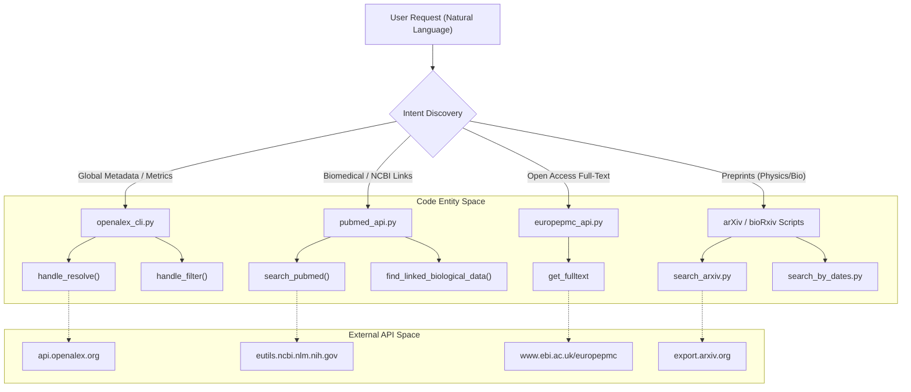
Sources: [skills/literature_search_openalex/scripts/openalex_cli.py:205-233](), [skills/pubmed_database/scripts/pubmed_api.py:135-171](), [skills/literature_search_europepmc/SKILL.md:47-69](), [skills/literature_search_arxiv/scripts/search_arxiv.py:85-110]()

## 3.1. OpenAlex Literature Search
OpenAlex is the primary tool for broad scholarly discovery and bibliometric analysis. It treats the world of research as a graph of interconnected entities: Works, Authors, Sources, Institutions, Topics, Publishers, and Funders [skills/literature_search_openalex/scripts/openalex_cli.py:68-89]().

*   **Capabilities**: Resolve names to IDs, filter works by citation count, and perform random sampling of the literature via `openalex_cli.py` [skills/literature_search_openalex/scripts/openalex_cli.py:15-19]().
*   **Workflow**: Always use `resolve` to find the correct internal ID before applying a filter or query [skills/literature_search_openalex/SKILL.md:47-48]().

For details, see [OpenAlex Literature Search](#3.1).

Sources: [skills/literature_search_openalex/scripts/openalex_cli.py:15-89](), [skills/literature_search_openalex/SKILL.md:47-48]()

## 3.2. Europe PMC and PubMed
These skills focus on the biomedical domain and deep content retrieval.

*   **Europe PMC**: Optimized for retrieving Open Access full-text content. It provides subcommands for `get_fulltext` (XML/JATS) and `download_pdf` [skills/literature_search_europepmc/SKILL.md:102-140]().
*   **PubMed**: Beyond search (`search_pubmed`), this skill enables discovery by linking PMIDs to other NCBI databases via `pubmed_api.py` [skills/pubmed_database/scripts/pubmed_api.py:15-19, 135-153]().

### Data Flow: Retrieval and Slimming
The PubMed and Europe PMC skills emphasize the "File-Output-First" principle to manage large contexts.

**PubMed/PMC Retrieval Pipeline**
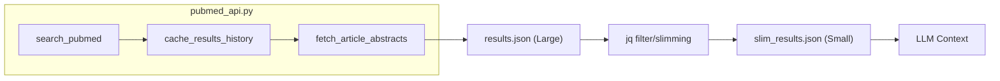
Sources: [skills/pubmed_database/scripts/pubmed_api.py:135-199](), [skills/pubmed_database/SKILL.md:119-123]()

For details, see [Europe PMC and PubMed](#3.2).

Sources: [skills/pubmed_database/scripts/pubmed_api.py:135-199](), [skills/literature_search_europepmc/SKILL.md:102-140]()

## 3.3. arXiv and bioRxiv Preprint Search
These skills provide access to the latest research before formal peer review.

*   **arXiv**: Supports advanced query syntax and allows downloading LaTeX source code via `download_paper_source.py` [skills/literature_search_arxiv/SKILL.md:38-40, 86-93]().
*   **bioRxiv/medRxiv**: The bioRxiv API does not support server-side keyword search. Filtering is performed locally by `search_by_dates.py`, requiring narrow date ranges (1-4 weeks) to prevent timeouts [skills/literature_search_biorxiv/SKILL.md:49-54]().

For details, see [arXiv and bioRxiv Preprint Search](#3.3).

Sources: [skills/literature_search_arxiv/SKILL.md:38-93](), [skills/literature_search_biorxiv/SKILL.md:49-54]()

## Core Usage Conventions

Across all literature skills, several technical constraints apply:
1.  **Rate Limiting**: All scripts utilize the shared `HttpClient` which enforces per-service rate limits (e.g., 1 request/3 seconds for arXiv, configured QPS limits in `openalex_cli.py` and `pubmed_api.py`) [skills/literature_search_arxiv/scripts/search_arxiv.py:40](), [skills/literature_search_openalex/scripts/openalex_cli.py:48-57](), [skills/pubmed_database/scripts/pubmed_api.py:54-69]().
2.  **Environment Variables**: API keys for OpenAlex (`OPENALEX_API_KEY`) and NCBI (`NCBI_API_KEY`) should be stored in a `~/.env` file to increase rate limit tiers [skills/literature_search_openalex/SKILL.md:25-30](), [skills/pubmed_database/SKILL.md:26-30]().
3.  **Source Attribution**: Any output generated using these skills must list the URLs of the papers retrieved [skills/literature_search_biorxiv/SKILL.md:63-65]().

**Sources:**
- [skills/literature_search_openalex/scripts/openalex_cli.py:15-89]()
- [skills/pubmed_database/scripts/pubmed_api.py:15-69]()
- [skills/literature_search_openalex/SKILL.md]()
- [skills/literature_search_europepmc/SKILL.md]()
- [skills/pubmed_database/SKILL.md]()
- [skills/literature_search_arxiv/SKILL.md]()
- [skills/literature_search_biorxiv/SKILL.md]()

---

# Page: OpenAlex Literature Search

# OpenAlex Literature Search

<details>
<summary>Relevant source files</summary>

The following files were used as context for generating this wiki page:

- [skills/literature_search_openalex/scripts/openalex_cli.py](skills/literature_search_openalex/scripts/openalex_cli.py)

</details>


The `literature-search-openalex` skill provides a comprehensive CLI interface to the OpenAlex scholarly database via `openalex_cli.py`. It enables technical users and agents to query research papers, authors, institutions, and research taxonomies, while managing API complexities like rate limiting, pagination, and ID resolution.

## Overview and Architecture

The skill is centered around `openalex_cli.py`, a robust Python script that interfaces with the OpenAlex REST API [skills/literature_search_openalex/scripts/openalex_cli.py:15-19](). It utilizes the `science-skills-common` `HttpClient` for managed requests, initializing an API client at `qps=10.0` and a PDF client at `qps=1.0` [skills/literature_search_openalex/scripts/openalex_cli.py:48-57]().

### Data Flow and System Components

The following diagram illustrates the flow from a Natural Language request to the execution of the `openalex_cli.py` script and the subsequent API interaction.

**Natural Language to Code Execution Flow**
```mermaid
graph TD
    subgraph "Natural Language Space"
        A["User Request: 'Find papers by Geoffrey Hinton'"]
    end

    subgraph "Code Entity Space"
        B["openalex_cli.py resolve authors 'Geoffrey Hinton'"]
        C["openalex_cli.py filter works --filter 'authorships.author.id:A5108093963'"]
        D["_API_CLIENT (HttpClient)"]
        E["OpenAlex REST API (api.openalex.org)"]
    end

    A -->|"Step 1: Disambiguate Entity"| B
    B -->|"Step 2: Use ID in Filter"| C
    C -->|"fetch_with_retry()"| D
    D -->|"Rate-limited GET"| E
```
Sources: [skills/literature_search_openalex/scripts/openalex_cli.py:48-57](), [skills/literature_search_openalex/scripts/openalex_cli.py:112-152]()

## Entity Model and Schema

OpenAlex organizes scholarly data into distinct entity types. The CLI script defines a comprehensive list of supported entity types in `ENTITY_TYPES` [skills/literature_search_openalex/scripts/openalex_cli.py:68-89]().

### Primary Entities
*   `works`: Scholarly documents (articles, books, datasets).
*   `authors`: Individuals who create works.
*   `sources`: Hosting venues (journals, repositories, conferences).
*   `institutions`: Organizations (universities, research centers).

### Taxonomy and Metadata Entities
*   **Topics and Taxonomy:** `topics`, `domains`, `fields`, and `subfields` representing research areas.
*   **Geography and Language:** `countries`, `continents`, and `languages`.
*   **Publishing and Funding:** `publishers`, `funders`, `awards`, `keywords`, `licenses`, `work-types`, `source-types`, and `institution-types`.

**Entity Relationship and Schema Mapping**
```mermaid
erDiagram
    WORK ||--o{ AUTHORSHIP : "has"
    AUTHORSHIP ||--|| AUTHOR : "refers to"
    AUTHORSHIP ||--o{ INSTITUTION : "affiliated with"
    WORK ||--|| SOURCE : "published in"
    WORK ||--o{ TOPIC : "categorized by"
```
Sources: [skills/literature_search_openalex/scripts/openalex_cli.py:68-89]()

## Command Reference

The `openalex_cli.py` script supports multiple subcommands for interacting with the API endpoints.

### 1. resolve
Used to convert a natural language name into a list of OpenAlex ID candidates.
*   **Implementation:** Handled by `handle_resolve`, which queries the respective entity endpoint with a search parameter and retrieves candidate matches [skills/literature_search_openalex/scripts/openalex_cli.py:206-223]().

### 2. get
Retrieves full metadata for a specific entity using its ID (short IDs, full OpenAlex URLs, or DOI URLs).

### 3. filter
Performs filtered searches and aggregations using field-value expressions, supporting `--group-by` parameters for bibliometric summaries.

### 4. download-pdf
Downloads the primary open-access PDF for a given Work ID using `_PDF_CLIENT`.

Sources: [skills/literature_search_openalex/scripts/openalex_cli.py:48-57](), [skills/literature_search_openalex/scripts/openalex_cli.py:206-223]()

## Filter, Sort, and Group-by Fields

Each entity supports a specific set of fields for filtering, sorting, and grouping. 

### Works and Authors Filtering
*   **Works:** Supports filtering, sorting, and grouping on fields such as `cited_by_count`, `publication_year`, `authorships.author.id`, `doi`, and `is_oa`.
*   **Authors:** Supports metrics like `works_count`, `h_index` (via `summary_stats`), and `last_known_institutions.id`.

Sources: [skills/literature_search_openalex/scripts/openalex_cli.py:68-89]()

## Implementation Details

### Rate Limiting and Authentication
The skill uses `fetch_with_retry` to manage requests across `_API_CLIENT` and `_PDF_CLIENT` [skills/literature_search_openalex/scripts/openalex_cli.py:112-152](). It appends API keys safely via `_build_url_with_api_key` to prevent credential leakage in logs [skills/literature_search_openalex/scripts/openalex_cli.py:92-110](). If a `429 Too Many Requests` error occurs without an API key, a warning is logged advising the user to provide an API key [skills/literature_search_openalex/scripts/openalex_cli.py:152-158]().

### Output Management
To prevent flooding the LLM context, `print_json` checks if output is directed to a TTY and truncates lines if they exceed `TRUNCATE_LINE_LIMIT` (500 lines), outputting a warning with the remaining count [skills/literature_search_openalex/scripts/openalex_cli.py:66](), [skills/literature_search_openalex/scripts/openalex_cli.py:174-201]().

Sources: [skills/literature_search_openalex/scripts/openalex_cli.py:66](), [skills/literature_search_openalex/scripts/openalex_cli.py:92-201]()

---

# Page: Europe PMC and PubMed

# Europe PMC and PubMed

<details>
<summary>Relevant source files</summary>

The following files were used as context for generating this wiki page:

- [skills/literature_search_europepmc/scripts/europepmc_api.py](skills/literature_search_europepmc/scripts/europepmc_api.py)
- [skills/pubmed_database/scripts/pubmed_api.py](skills/pubmed_database/scripts/pubmed_api.py)

</details>


This page documents the integration with Europe PMC and PubMed, the primary gateways to life-science literature. These skills provide programmatic access to over 40 million abstracts and millions of full-text articles through `europepmc_api.py` and `pubmed_api.py`.

## 1. Europe PMC

The Europe PMC skill provides access to the EBI Europe PMC REST API. It is designed for searching open-access literature, downloading PDFs, and retrieving structured full-text XML (JATS) or plain text.

### Implementation and Data Flow

The `europepmc_api.py` script uses two distinct `HttpClient` instances: one for the REST API (`_API_CLIENT`) and one for PDF downloads (`_PDF_CLIENT`) [skills/literature_search_europepmc/scripts/europepmc_api.py:44-53](). It enforces an **Open Access Only** policy by automatically appending `OPEN_ACCESS:y` to all search queries [skills/literature_search_europepmc/scripts/europepmc_api.py:140-142]().

**Entity Mapping: Europe PMC API**

```mermaid
graph TD
    subgraph "Natural Language Space"
        UserQuery["'CRISPR cancer'"]
        DOI["'10.1038/s41586-021-03819-2'"]
    end

    subgraph "Code Entity Space (europepmc_api.py)"
        SearchFunc["search()"]
        GetFTFunc["get_fulltext()"]
        DownloadFunc["download_pdf()"]
        XMLParser["_xml_to_plain_text()"]
        
        API_BASE["_API_BASE: ebi.ac.uk/.../rest/"]
        PDF_BASE["_PDF_BASE: europepmc.org/"]
    end

    UserQuery --> SearchFunc
    DOI --> SearchFunc
    SearchFunc --> API_BASE
    GetFTFunc --> API_BASE
    DownloadFunc --> PDF_BASE
    API_BASE -- "JATS XML" --> XMLParser
```
Sources: [skills/literature_search_europepmc/scripts/europepmc_api.py:41-53](), [skills/literature_search_europepmc/scripts/europepmc_api.py:89-130](), [skills/literature_search_europepmc/scripts/europepmc_api.py:138-164]()

### Key Functions

| Function | Purpose | Key Details |
| :--- | :--- | :--- |
| `search` | Metadata search | Supports Europe PMC syntax; returns `hitCount` and `nextCursorMark` for pagination [skills/literature_search_europepmc/scripts/europepmc_api.py:138-164](). |
| `get_fulltext` | Retrieve article body | Fetches `/fullTextXML`. Can return raw JATS XML or parsed plain text [skills/literature_search_europepmc/scripts/europepmc_api.py:190-200](). |
| `download_pdf` | Binary download | Downloads PDF via `articles/{pmcid}?pdf=render` [skills/literature_search_europepmc/scripts/europepmc_api.py:167-188](). |
| `get_citations` | Forward citations | Retrieves articles citing the target paper [skills/literature_search_europepmc/scripts/europepmc_api.py:202-214](). |
| `_xml_to_plain_text` | XML Processing | Parses JATS XML tags (`article-title`, `abstract`, `body`, `p`) into formatted text [skills/literature_search_europepmc/scripts/europepmc_api.py:89-130](). |

Sources: [skills/literature_search_europepmc/scripts/europepmc_api.py:89-214]()

---

## 2. PubMed (NCBI E-Utilities)

The PubMed skill interfaces with NCBI E-Utilities (ESearch, EFetch, ELink, ESummary, EInfo, EPost) and the PMC BioC API. It supports complex biological database linking and bulk processing via the NCBI History Server.

### System Architecture

The `pubmed_api.py` script manages two clients: `_EUTILS_CLIENT` for standard metadata and `_PMC_CLIENT` for BioC full-text [skills/pubmed_database/scripts/pubmed_api.py:50-69](). It supports authenticated requests via `NCBI_API_KEY`, which increases the rate limit from 3 to 10 QPS [skills/pubmed_database/scripts/pubmed_api.py:54-69]().

**Entity Mapping: PubMed/NCBI E-Utilities**

```mermaid
graph TD
    subgraph "Natural Language Space"
        Citation["'Nature 2006 Takahashi'"]
        GeneID["'Gene ID: 672'"]
    end

    subgraph "Code Entity Space (pubmed_api.py)"
        SearchFunc["search_pubmed()"]
        FetchFunc["fetch_article_abstracts()"]
        EUTILS["EUTILS_BASE: eutils.ncbi.nlm.nih.gov"]
        PMC_BIOC["PMC_BIOC_BASE: BioC_json"]
    end

    Citation --> SearchFunc
    GeneID --> SearchFunc
    SearchFunc --> EUTILS
    FetchFunc --> EUTILS
    EUTILS -- "XML/JSON" --> FetchFunc
```
Sources: [skills/pubmed_database/scripts/pubmed_api.py:45-70](), [skills/pubmed_database/scripts/pubmed_api.py:135-224]()

### Core Capabilities

#### Cross-Database Linking (ELink)
The E-utilities infrastructure allows traversing relationships between PubMed and other NCBI databases via ELink.
*   **Common Targets**: `gene`, `protein`, `pccompound` (PubChem), `nuccore` (GenBank), and `pubmed` (citations).
*   **Workflow**: Querying linked identifiers allows seamless pivoting from literature references to underlying biological entities.

#### Citation Matching and Bulk Workflows
*   **Citation Matching**: Resolves free-text references into PMIDs.
*   **Bulk Workflows and History Server**: For large batches of identifiers, the skill leverages the NCBI History Server (`WebEnv` and `query_key`) to avoid URL length constraints and optimize query execution.

### Data Slimming with jq
Because PubMed metadata can be extremely verbose, filtering results via `jq` before passing them to downstream tasks helps prevent context overflow.

| Strategy | Command Example |
| :--- | :--- |
| **Slim Fields** | `jq '[.[] \| {pmid, title, snippet: (.abstract // "")[:500]}]'` |
| **Filter** | `jq '[.[] \| select((.title // "") \| contains("Review"))]'` |
| **Join IDs** | `jq -r 'join(",")'` |

Sources: [skills/pubmed_database/scripts/pubmed_api.py:45-224]()

---

# Page: arXiv and bioRxiv Preprint Search

# arXiv and bioRxiv Preprint Search

<details>
<summary>Relevant source files</summary>

The following files were used as context for generating this wiki page:

- [skills/literature_search_arxiv/scripts/download_paper.py](skills/literature_search_arxiv/scripts/download_paper.py)
- [skills/literature_search_arxiv/scripts/download_paper_source.py](skills/literature_search_arxiv/scripts/download_paper_source.py)
- [skills/literature_search_arxiv/scripts/search_arxiv.py](skills/literature_search_arxiv/scripts/search_arxiv.py)
- [skills/literature_search_biorxiv/scripts/search_by_dates.py](skills/literature_search_biorxiv/scripts/search_by_dates.py)
- [skills/literature_search_biorxiv/scripts/search_by_doi.py](skills/literature_search_biorxiv/scripts/search_by_doi.py)

</details>


This page documents the skills for searching and retrieving scientific preprints from arXiv, bioRxiv, and medRxiv. These tools provide programmatic access to metadata, abstracts, and full-text documents while enforcing the strict rate limits required by these services.

## arXiv Search and Retrieval

The arXiv skill provides comprehensive search capabilities using the arXiv API, along with tools for downloading papers in PDF, HTML, or LaTeX source formats.

### Core Architecture and Data Flow

The arXiv skill is built around three primary scripts that interact with the `export.arxiv.org` API. All requests are routed through a shared `HttpClient` instance configured with a rate limit of 1 request every 3 seconds (0.33 QPS) to comply with arXiv's terms of use [skills/literature_search_arxiv/scripts/search_arxiv.py:37-38](), [skills/literature_search_arxiv/scripts/download_paper.py:34](), [skills/literature_search_arxiv/scripts/download_paper_source.py:34]().

#### System Mapping: Natural Language to arXiv Code Entities

The following diagram maps search and retrieval concepts to the specific Python scripts and parameters.

Search and Retrieval Mapping
```mermaid
graph TD
    subgraph "Natural Language Space"
        NL_Search[""Find papers by Einstein about relativity""]
        NL_Download[""Download the PDF for ID 2305.10601""]
        NL_Source[""Get the LaTeX source for this paper""]
    end

    subgraph "Code Entity Space"
        S_ARXIV[""search_arxiv.py""]
        D_PAPER[""download_paper.py""]
        D_SOURCE[""download_paper_source.py""]
        
        S_ARXIV -->|"--query"| Q_SYNTAX[""query_syntax.md""]
        D_PAPER -->|"--format"| FORMATS[""pdf | html""]
        D_SOURCE -->|"--output"| TARBALL[""tar.gz""]
    end

    NL_Search -.-> S_ARXIV
    NL_Download -.-> D_PAPER
    NL_Source -.-> D_SOURCE
```
Sources: [skills/literature_search_arxiv/scripts/search_arxiv.py:47-74](), [skills/literature_search_arxiv/scripts/download_paper.py:43-59](), [skills/literature_search_arxiv/scripts/download_paper_source.py:43-55]()

### Implementation Details

#### 1. Search and Metadata Extraction (`search_arxiv.py`)
This script constructs an Atom API query. It supports complex queries including field prefixes and boolean operators [skills/literature_search_arxiv/scripts/search_arxiv.py:50-57](). The script parses the resulting XML using `xml.etree.ElementTree` and converts it into a structured JSON array [skills/literature_search_arxiv/scripts/search_arxiv.py:33](), [skills/literature_search_arxiv/scripts/search_arxiv.py:114-159]().

*   **Pagination**: Handled via `--start` and `--max_results` [skills/literature_search_arxiv/scripts/search_arxiv.py:58-61]().
*   **Sorting**: Supports `relevance`, `lastUpdatedDate`, and `submittedDate` [skills/literature_search_arxiv/scripts/search_arxiv.py:64-67]().

#### 2. Paper Download (`download_paper.py`)
Retrieves the full text of a paper. It constructs URLs for either PDF (`https://arxiv.org/pdf/{paper_id}.pdf`) or HTML (`https://arxiv.org/html/{paper_id}`) [skills/literature_search_arxiv/scripts/download_paper.py:78-83](). Note that HTML is typically only available for newer papers [skills/literature_search_arxiv/scripts/download_paper.py:97-104]().

#### 3. Source Retrieval (`download_paper_source.py`)
Fetches the LaTeX source package from the `e-print` endpoint [skills/literature_search_arxiv/scripts/download_paper_source.py:73](). The output is a `tar.gz` file containing the original submission files [skills/literature_search_arxiv/scripts/download_paper_source.py:44](), [skills/literature_search_arxiv/scripts/download_paper_source.py:81-83]().

Sources: [skills/literature_search_arxiv/scripts/search_arxiv.py:83-160](), [skills/literature_search_arxiv/scripts/download_paper.py:62-113](), [skills/literature_search_arxiv/scripts/download_paper_source.py:58-94]()

---

## bioRxiv and medRxiv Search

The bioRxiv skill facilitates browsing and retrieving metadata from the bioRxiv and medRxiv preprint servers. Unlike arXiv, the bioRxiv API is primarily date-based and does not support server-side keyword searches [skills/literature_search_biorxiv/scripts/search_by_dates.py:15-16]().

### Core Architecture and Data Flow

The bioRxiv implementation relies on local filtering. The scripts download all metadata for a specified date range in pages of 30 items (`BIORXIV_PAGE_SIZE`) and then filter the results in Python memory based on keywords, authors, or categories [skills/literature_search_biorxiv/scripts/search_by_dates.py:35](), [skills/literature_search_biorxiv/scripts/search_by_dates.py:120-213]().

#### System Mapping: bioRxiv Discovery Workflow

The following diagram illustrates the flow from a user's date-based request to the locally filtered JSON output.

bioRxiv Data Retrieval Flow
```mermaid
graph TD
    subgraph "External API (api.biorxiv.org)"
        API_EP[""/details/{server}/{start}/{end}/{cursor}""]
    end

    subgraph "Local Execution (search_by_dates.py)"
        CLIENT[""HttpClient (QPS=1.0)""]
        PAGINATOR[""Pagination Loop (30 per page)""]
        FILTER[""Local Filter Engine""]
        
        PAGINATOR -->|GET| CLIENT
        CLIENT -->|JSON| API_EP
        API_EP -->|Response| CLIENT
        CLIENT -->|Data| PAGINATOR
        PAGINATOR -->|Collection| FILTER
    end

    subgraph "Filtering Logic"
        FILTER -->|Match| CAT[""--category""]
        FILTER -->|Match| KW[""--keywords (AND/OR)""]
        FILTER -->|Match| AU[""--author""]
    end

    CAT & KW & AU --> STDOUT[""JSON Array (stdout)""]
```
Sources: [skills/literature_search_biorxiv/scripts/search_by_dates.py:29](), [skills/literature_search_biorxiv/scripts/search_by_dates.py:35](), [skills/literature_search_biorxiv/scripts/search_by_dates.py:160-221]()

### Implementation Details

#### 1. Date-Based Search (`search_by_dates.py`)
This is the primary discovery tool. Because the API returns results in pages of 30 (`BIORXIV_PAGE_SIZE`), the script implements an automatic pagination loop [skills/literature_search_biorxiv/scripts/search_by_dates.py:35](), [skills/literature_search_biorxiv/scripts/search_by_dates.py:160-221]().

*   **Reliability**: The script uses a "short page" signal (fewer than `BIORXIV_PAGE_SIZE` items) to determine the end of the result set, as the API's pagination counts can be unreliable [skills/literature_search_biorxiv/scripts/search_by_dates.py:214-221]().
*   **Validation**: Subject categories are strictly validated against internal lists for both bioRxiv (`BIORXIV_CATEGORIES`) and medRxiv (`MEDRXIV_CATEGORIES`) [skills/literature_search_biorxiv/scripts/search_by_dates.py:36-117](), [skills/literature_search_biorxiv/scripts/search_by_dates.py:123-134]().
*   **Keyword Logic**: Supports both `AND` and `OR` logic for keyword matching across titles and abstracts [skills/literature_search_biorxiv/scripts/search_by_dates.py:194-207]().

#### 2. DOI Lookup (`search_by_doi.py`)
Used when a specific paper's DOI is already known. This is the most efficient way to retrieve metadata as it bypasses the need for date-range scanning [skills/literature_search_biorxiv/scripts/search_by_doi.py:15](), [skills/literature_search_biorxiv/scripts/search_by_doi.py:32-47]().

### Summary of Differences

| Feature | arXiv | bioRxiv / medRxiv |
| :--- | :--- | :--- |
| **Search Engine** | Server-side (Complex Query Syntax) | Local filtering (Python-based) |
| **Primary Index** | Metadata/Keywords/IDs | Date ranges |
| **Rate Limit** | 0.33 QPS (1 request / 3s) [skills/literature_search_arxiv/scripts/search_arxiv.py:38]() | 1.0 QPS (1 request / 1s) [skills/literature_search_biorxiv/scripts/search_by_dates.py:29]() |
| **Full-Text Support** | PDF, HTML, LaTeX Source [skills/literature_search_arxiv/scripts/download_paper.py:52](), [skills/literature_search_arxiv/scripts/download_paper_source.py:44]() | Metadata only |
| **Abstracts** | Included by default | Stripped by default (use `--include_abstracts`) [skills/literature_search_biorxiv/scripts/search_by_doi.py:62-65]() |

Sources: [skills/literature_search_arxiv/scripts/search_arxiv.py:38](), [skills/literature_search_biorxiv/scripts/search_by_dates.py:29](), [skills/literature_search_biorxiv/scripts/search_by_doi.py:62-65]()

---

# Page: Genomics and Variant Analysis Skills

# Genomics and Variant Analysis Skills

<details>
<summary>Relevant source files</summary>

The following files were used as context for generating this wiki page:

- [skills/dbsnp_database/scripts/dbsnp_cli.py](skills/dbsnp_database/scripts/dbsnp_cli.py)
- [skills/ensembl_database/scripts/ensembl_api.py](skills/ensembl_database/scripts/ensembl_api.py)
- [skills/openfda_database/scripts/openfda_query.py](skills/openfda_database/scripts/openfda_query.py)

</details>


The Genomics and Variant Analysis skills provide a comprehensive suite of tools for querying genomic databases, resolving genetic identifiers, and analyzing the functional impact of variants. These skills interface with industry-standard resources including **Ensembl**, **gnomAD**, **dbSNP**, **ClinVar**, **ENCODE**, and **GTEx**. Note that AlphaGenome-specific skills are covered separately in Section 5.

## Overview of Genomic Capabilities

The codebase bridges high-level biological questions (e.g., "What is the frequency of this mutation?") to specific API implementations.

### Data Flow and System Architecture

The following diagram illustrates how natural language requests are mapped to specific code entities and external genomic services.

**Genomic Skill Mapping**
```mermaid
graph TD
    subgraph "Natural Language Space"
        NL_ID["'What is the ENSG for TP53?'"]
        NL_FREQ["'How rare is rs7412?'"]
        NL_CLIN["'Is this variant pathogenic?'"]
        NL_REG["'Find enhancers near this gene'"]
    end

    subgraph "Code Entity Space (scripts/)"
        ENS_API["ensembl_api.py"]
        GNOM_FREQ["get_variant_frequency.py"]
        CLIN_API["clinvar_api.py"]
        SCREEN_API["screen_api.py"]
        DBSNP_CLI["dbsnp_cli.py"]
    end

    subgraph "External API Space"
        E_REST["Ensembl REST API"]
        G_QL["gnomAD GraphQL"]
        N_EUT["NCBI E-utilities"]
        S_QL["SCREEN GraphQL (ENCODE)"]
    end

    NL_ID --> ENS_API
    NL_FREQ --> GNOM_FREQ
    NL_CLIN --> CLIN_API
    NL_REG --> SCREEN_API
    
    ENS_API --> E_REST
    GNOM_FREQ --> G_QL
    CLIN_API --> N_EUT
    DBSNP_CLI --> N_EUT
    SCREEN_API --> S_QL
```
Sources: [skills/ensembl_database/scripts/ensembl_api.py:15-40](), [skills/dbsnp_database/scripts/dbsnp_cli.py:42-78]()

---

## 4.1 Ensembl REST API

The Ensembl skill serves as the primary engine for ID resolution and sequence retrieval. It supports mapping between symbols, RefSeq IDs, and Ensembl identifiers (`ENSG`, `ENST`, `ENSP`). It also provides a powerful interface for the **Variant Effect Predictor (VEP)**, incorporating plugins like AlphaMissense and LOEUF [skills/ensembl_database/scripts/ensembl_api.py:41-47]().

For details, see [Ensembl REST API](#4.1).

Sources: [skills/ensembl_database/scripts/ensembl_api.py:15-57]()

---

## 4.2 gnomAD Population Variant Database

This skill queries the Genome Aggregation Database to determine variant rarity. It uses a GraphQL interface to fetch Allele Frequency (`AF`) and Allele Count (`AC`) metrics. It also retrieves gene constraint metrics such as `pLI` and `LOEUF` (`oe_lof_upper`) to assess gene essentiality across dataset versions.

For details, see [gnomAD Population Variant Database](#4.2).

Sources: [skills/dbsnp_database/scripts/dbsnp_cli.py:1-40]()

---

## 4.3 dbSNP and ClinVar Variant Databases

These skills interface with NCBI services. `dbsnp_cli.py` resolves variants using the **SPDI model** (Sequence, Position, Deletion, Insertion) and handles mapping between rsIDs and genomic coordinates with assembly fallbacks [skills/dbsnp_database/scripts/dbsnp_cli.py:42-78](). `clinvar_api.py` retrieves clinical significance (Pathogenic, Benign, etc.) and review status star ratings.

For details, see [dbSNP and ClinVar Variant Databases](#4.3).

Sources: [skills/dbsnp_database/scripts/dbsnp_cli.py:42-80]()

---

## 4.4 ENCODE cCREs Database

The ENCODE skill utilizes the SCREEN GraphQL API to search for candidate Cis-Regulatory Elements (cCREs). It can identify promoters (`PLS`), proximal enhancers (`pELS`), distal enhancers (`dELS`), and CTCF-only regions based on biochemical signatures across various biosamples.

For details, see [ENCODE cCREs Database](#4.4).

Sources: [skills/dbsnp_database/scripts/dbsnp_cli.py:1-30]()

---

## 4.5 GTEx Gene Expression and eQTLs

GTEx provides data on tissue-specific gene expression and expression Quantitative Trait Loci (eQTLs). This skill allows users to resolve versioned GENCODE IDs, find top-expressed tissues across a 54-tissue atlas, and identify variants regulating expression levels within target regions.

For details, see [GTEx Gene Expression and eQTLs](#4.5).

Sources: [skills/dbsnp_database/scripts/dbsnp_cli.py:1-25]()

---

## 4.6 NCBI Sequence Fetch

A utility skill (`ncbi_fetch.py`) for bulk retrieval of nucleotide and protein sequences from NCBI GenBank and RefSeq using E-utilities. It supports CDS translation with ORF fallback, gene-protein linking, ELink workflows, and manages rate limits via the shared `HttpClient` framework.

For details, see [NCBI Sequence Fetch](#4.6).

Sources: [skills/dbsnp_database/scripts/dbsnp_cli.py:42-78]()

---

### Core Implementation Patterns

Most genomics skills follow a pattern of initializing an `HttpClient` with specific Query-Per-Second (QPS) limits to respect external API policies and handle rate limiting (`HTTP 429`) gracefully.

**Service Client Configuration**
| Service | Script | Base URL | QPS Limit |
| :--- | :--- | :--- | :--- |
| Ensembl | `ensembl_api.py` | `https://rest.ensembl.org` | 15 [skills/ensembl_database/scripts/ensembl_api.py:47]() |
| dbSNP | `dbsnp_cli.py` | `https://api.ncbi.nlm.nih.gov` | 3 (10 with `NCBI_API_KEY`) [skills/dbsnp_database/scripts/dbsnp_cli.py:57-63]() |
| openFDA (Ref) | `openfda_query.py` | `https://api.fda.gov` | 4 [skills/openfda_database/scripts/openfda_query.py:43]() |

**Common Genomic Logic Flow**
```mermaid
sequenceDiagram
    participant U as User/Agent
    participant S as CLI Script (e.g. dbsnp_cli.py)
    participant H as HttpClient
    participant E as External API (e.g. NCBI Variation)

    U->>S: Run command (e.g. get-variant)
    S->>H: fetch_json(url)
    H->>H: Check RateLimiter lock & QPS
    H->>E: HTTP GET / POST
    E-->>H: JSON Response / Status Code
    H-->>S: Python Dict / HttpError
    S->>S: Process records & SPDI mapping
    S-->>U: Print summary & write JSON
```
Sources: [skills/dbsnp_database/scripts/dbsnp_cli.py:53-122](), [skills/openfda_database/scripts/openfda_query.py:40-44]()

---

# Page: Ensembl REST API

# Ensembl REST API

<details>
<summary>Relevant source files</summary>

The following files were used as context for generating this wiki page:

- [skills/ensembl_database/scripts/ensembl_api.py](skills/ensembl_database/scripts/ensembl_api.py)

</details>


The Ensembl REST API skill provides a comprehensive interface for genome annotation, ID resolution, and variant effect prediction. It serves as the primary tool for mapping biological identifiers (e.g., symbols, RefSeq, UniProt) to Ensembl stable IDs (`ENSG`, `ENST`, `ENSP`), retrieving genomic and protein sequences, and analyzing the molecular consequences of genetic variants through the Variant Effect Predictor (VEP).

Sources: [skills/ensembl_database/scripts/ensembl_api.py:15-21]()

## Architecture and Data Flow

The implementation centers around `ensembl_api.py`, which wraps the Ensembl REST API endpoints. It utilizes a dual-client architecture to support both the current GRCh38 assembly and the legacy GRCh37 assembly.

### System Mapping: Natural Language to Code

The following diagram illustrates how natural language requests are mapped to specific CLI commands and internal function implementations within the `ensembl_api.py` script.

**Command Mapping Overview**
```mermaid
graph TD
    subgraph "Natural Language Space"
        NL1[""Find the ID for TP53""]
        NL2[""Get protein sequence for ENST00000269305""]
        NL3[""Predict variant effects for rs699""]
        NL4[""Get the TSS for BRCA1""]
    end

    subgraph "Code Entity Space (ensembl_api.py)"
        C1["cmd_resolve_gene()"]
        C2["cmd_protein_sequence()"]
        C3["cmd_vep()"]
        C4["cmd_canonical_tss()"]
        
        API1["GET /lookup/symbol/"]
        API2["GET /sequence/id/"]
        API3["GET /vep/human/region/"]
        API4["GET /lookup/id/ (expanded)"]
    end

    NL1 --> C1
    NL2 --> C2
    NL3 --> C3
    NL4 --> C4

    C1 --> API1
    C2 --> API2
    C3 --> API3
    C4 --> API4
```
Sources: [skills/ensembl_database/scripts/ensembl_api.py:126-169](), [skills/ensembl_database/scripts/ensembl_api.py:383-421](), [skills/ensembl_database/scripts/ensembl_api.py:479-562](), [skills/ensembl_database/scripts/ensembl_api.py:302-343]()

## Core Functionality

### ID Resolution and Mapping
The skill handles ambiguous gene symbols by first attempting a direct lookup via `/lookup/symbol/` [skills/ensembl_database/references/ensembl_rest_api_reference.md:51-56](). If this fails, it employs a fallback mechanism using `_try_fallback` which queries cross-references (`/xrefs/symbol/`) to resolve synonyms [skills/ensembl_database/scripts/ensembl_api.py:85-123]().

### Dual-Assembly Support
The script maintains two instances of `http_client.HttpClient` [skills/ensembl_database/scripts/ensembl_api.py:47-48]():
1.  `_CLIENT_REGULAR`: Points to `https://rest.ensembl.org` (GRCh38).
2.  `_CLIENT_GRCH37`: Points to `https://grch37.rest.ensembl.org` (GRCh37).

The `_get_client` function selects the appropriate instance based on the `--assembly` flag [skills/ensembl_database/scripts/ensembl_api.py:51-58]().

### Transcript and Protein Analysis
The skill provides specialized logic for identifying primary transcripts:
*   **MANE Select**: The preferred transcript for human genes [skills/ensembl_database/SKILL.md:37-38]().
*   **Canonical**: The representative transcript used when MANE is unavailable [skills/ensembl_database/SKILL.md:39-40]().

The `cmd_transcripts` function can filter for these specifically using `--only-mane` or `--only-canonical` [skills/ensembl_database/scripts/ensembl_api.py:245-300]().

Sources: [skills/ensembl_database/scripts/ensembl_api.py:47-123](), [skills/ensembl_database/SKILL.md:37-40]()

## Sequence and Structure Retrieval

The API allows fetching sequences at various levels (genomic, cDNA, CDS, protein) and detailed transcript architectures.

| Command | Endpoint | Purpose |
| :--- | :--- | :--- |
| `get-sequence` | `/sequence/region/` | Raw DNA for a coordinate window [skills/ensembl_database/scripts/ensembl_api.py:198-228]() |
| `transcript-structure` | `/lookup/id/` | Exon coordinates and UTR boundaries [skills/ensembl_database/scripts/ensembl_api.py:345-381]() |
| `protein-sequence` | `/sequence/id/` | Amino acid FASTA for ENST or ENSP [skills/ensembl_database/scripts/ensembl_api.py:423-477]() |
| `canonical-tss` | `/lookup/id/` | Single coordinate of the Transcription Start Site [skills/ensembl_database/scripts/ensembl_api.py:302-343]() |

Sources: [skills/ensembl_database/references/ensembl_rest_api_reference.md:84-110](), [skills/ensembl_database/scripts/ensembl_api.py:198-477]()

## Variant Effect Predictor (VEP)

The `vep` command integrates multiple open-licensed plugins to provide deep functional insights into variants.

**VEP Execution Flow**
```mermaid
sequenceDiagram
    participant CLI as "ensembl_api.py"
    participant VEP as "Ensembl VEP Endpoint"
    participant Plugins as "VEP Plugins"

    CLI->>VEP: "GET /vep/human/region/{variant}"
    Note over VEP,Plugins: "Includes AlphaMissense, LOEUF, Loftee, SIFT, PolyPhen, CADD"
    VEP-->>CLI: "JSON Response (Transcript Consequences)"
    CLI->>CLI: "parse_vep_predictions()"
    CLI->>STDOUT: "Print concise summary"
```
Sources: [skills/ensembl_database/scripts/ensembl_api.py:479-562](), [skills/ensembl_database/scripts/ensembl_api.py:43-47]()

### Supported VEP Plugins
The implementation explicitly enables the following plugins via query parameters [skills/ensembl_database/scripts/ensembl_api.py:41-45]():
*   **AlphaMissense**: Pathogenicity scores and classes.
*   **LOEUF**: Loss-of-function observed/expected upper bound fraction.
*   **Loftee (LoF)**: Identification of high-confidence loss-of-function variants.
*   **Conservation**: Conservation scores (e.g., GERP).
*   **Additional**: DosageSensitivity, IntAct, MaveDB, OpenTargets, NMD, UTRAnnotator, mutfunc.

Sources: [skills/ensembl_database/scripts/ensembl_api.py:41-47]()

## Implementation Details

### Rate Limiting
The Ensembl REST API imposes a limit of 15 requests per second [skills/ensembl_database/references/ensembl_rest_api_reference.md:17-18](). This is enforced by initializing `HttpClient` with `qps=15`, which uses a cross-process file lock to ensure compliance across multiple script executions [skills/ensembl_database/scripts/ensembl_api.py:47-48]().

### Coordinate Handling
The `get-sequence` command performs normalization on coordinate strings, converting formats like `chr17:7661779-7687550` or `17:7661779..7687550` into the standard Ensembl `CHR:START..END` format [skills/ensembl_database/scripts/ensembl_api.py:204-208]().

### Canonical TSS Calculation
The `cmd_canonical_tss` function implements strand-aware logic to identify the Transcription Start Site [skills/ensembl_database/scripts/ensembl_api.py:302-343]():
*   **Positive Strand (+1)**: TSS is the `start` coordinate of the transcript [skills/ensembl_database/scripts/ensembl_api.py:330-333]().
*   **Negative Strand (-1)**: TSS is the `end` coordinate of the transcript [skills/ensembl_database/scripts/ensembl_api.py:330-333]().

Sources: [skills/ensembl_database/scripts/ensembl_api.py:330-333](), [skills/ensembl_database/scripts/ensembl_api.py:47-48](), [skills/ensembl_database/references/ensembl_rest_api_reference.md:17-18]()

---

# Page: gnomAD Population Variant Database

# gnomAD Population Variant Database

<details>
<summary>Relevant source files</summary>

The following files were used as context for generating this wiki page:

- [skills/gnomad_database/scripts/get_gene_constraint.py](skills/gnomad_database/scripts/get_gene_constraint.py)
- [skills/gnomad_database/scripts/get_variant_frequency.py](skills/gnomad_database/scripts/get_variant_frequency.py)
- [skills/gnomad_database/scripts/search_variants.py](skills/gnomad_database/scripts/search_variants.py)

</details>


The gnomAD skill provides a programmatic interface to the Genome Aggregation Database (gnomAD) via its GraphQL API. It is designed to retrieve variant allele frequencies, genomic region annotations, and gene-level constraint metrics (such as `pLI` and `LOEUF`). The skill enforces strict rate limits to comply with the Broad Institute's API policy.

## Architecture and Data Flow

The skill consists of three primary entry points that interface with the gnomAD GraphQL endpoint: `search_variants.py`, `get_variant_frequency.py`, and `get_gene_constraint.py`. All requests are routed through a shared `HttpClient` configured with a specific rate limit to prevent IP blocking.

### System Overview Diagram
This diagram illustrates the transition from Natural Language requests to the execution of specific Python scripts and their interaction with the gnomAD API.

"Natural Language Space to Code Entity Space"
```mermaid
graph TD
    subgraph "Natural Language Requests"
        NL1["'How rare is this variant?'"]
        NL2["'Is this gene intolerant to loss-of-function?'"]
        NL3["'Find missense mutations in PCSK9'"]
    end

    subgraph "Code Entity Space (scripts/)"
        S1["get_variant_frequency.py"]
        S2["get_gene_constraint.py"]
        S3["search_variants.py"]
    end

    subgraph "External API"
        API["gnomAD GraphQL API (https://gnomad.broadinstitute.org/api)"]
    end

    NL1 --> S1
    NL2 --> S2
    NL3 --> S3

    S1 -- "POST {query, variables}" --> API
    S2 -- "POST {query, variables}" --> API
    S3 -- "POST {query, variables}" --> API
```
Sources: [skills/gnomad_database/scripts/get_variant_frequency.py:15-33](), [skills/gnomad_database/scripts/get_gene_constraint.py:15-37](), [skills/gnomad_database/scripts/search_variants.py:15-33]()

## Implementation Details

### Rate Limiting
The gnomAD API requires users to limit traffic to 10 queries per minute (QPM). This is implemented across all scripts using the `polite_http.http_client.HttpClient` with a `qps` (queries per second) parameter set to `0.1666` [skills/gnomad_database/scripts/get_variant_frequency.py:31-33](), [skills/gnomad_database/scripts/get_gene_constraint.py:35-37](), [skills/gnomad_database/scripts/search_variants.py:31-33]().

### Variant Identification
Variants are identified using two formats:
1.  **Variant ID**: A hyphen-separated string in the format `chrom-pos-ref-alt` (e.g., `1-55516888-G-GA`) [skills/gnomad_database/scripts/get_variant_frequency.py:163-165]().
2.  **rsID**: Reference SNP cluster ID (e.g., `rs1800562`). The script `get_variant_frequency.py` includes a `resolve_rsid` function that uses the `variant_search` GraphQL query to map rsIDs to gnomAD variant IDs before fetching frequency data [skills/gnomad_database/scripts/get_variant_frequency.py:35-59]().

### Key Metrics and Schema
The skill retrieves several critical population genetics metrics:

| Metric | Description | GraphQL Field |
| :--- | :--- | :--- |
| **AC** | Allele Count | `ac` |
| **AN** | Allele Number | `an` |
| **AF** | Allele Frequency | `af` |
| **faf95 / faf99** | Filtering Allele Frequency (95%/99% confidence lower bound) | `faf95`, `faf99` |
| **popmax** | The maximum frequency observed across any genetic ancestry group | `popmax` |
| **pLI** | Probability of Loss-of-function Intolerance | `pli` |
| **LOEUF** | Loss-of-function observed/expected upper bound fraction | `oe_lof_upper` |

Sources: [skills/gnomad_database/scripts/get_variant_frequency.py:79-144](), [skills/gnomad_database/scripts/get_gene_constraint.py:45-61]()

## Functional Components

### 1. Variant Frequency (`get_variant_frequency.py`)
This script fetches data for a specific variant across different datasets (defaulting to `gnomad_r4`). It retrieves separate metrics for `exome`, `genome`, and `joint` (combined) callsets [skills/gnomad_database/scripts/get_variant_frequency.py:79-144](). It also breaks down counts by ancestry in the `populations` block [skills/gnomad_database/scripts/get_variant_frequency.py:98-105]().

### 2. Gene Constraint (`get_gene_constraint.py`)
Queries the `gnomad_constraint` object for a specific gene symbol. It focuses on the `oe` (observed/expected) ratios for loss-of-function (`lof`) and missense (`mis`) variants along with `pli` [skills/gnomad_database/scripts/get_gene_constraint.py:45-61]().

### 3. Variant Searching (`search_variants.py`)
Provides two modes of discovery:
*   **Gene Search**: Returns all variants associated with a gene symbol via `search_variants_gene`, with an optional filter for `consequence` (e.g., "pLoF", "missense") [skills/gnomad_database/scripts/search_variants.py:35-108]().
*   **Region Search**: Returns all variants within specific chromosomal coordinates via `search_variants_region` [skills/gnomad_database/scripts/search_variants.py:110-176]().

### Data Flow Diagram
The following diagram details the internal logic of `get_variant_frequency.py`, including the rsID resolution step.

"Variant Frequency Data Flow"
```mermaid
sequenceDiagram
    participant CLI as get_variant_frequency.py
    participant HC as HttpClient (qps=0.1666)
    participant API as gnomAD API

    alt rsID provided
        CLI->>HC: fetch_json(variant_search query)
        HC->>API: POST /api
        API-->>HC: JSON {variant_id}
        HC-->>CLI: variant_id
    else variant_id provided
        Note over CLI: Use provided ID
    end

    CLI->>HC: fetch_json(variant frequency query)
    HC->>API: POST /api
    API-->>HC: JSON {exome, genome, joint}
    HC-->>CLI: response_data
    CLI->>CLI: json.dumps()
    CLI->>File: Write to output_path
```
Sources: [skills/gnomad_database/scripts/get_variant_frequency.py:35-156]()

## Usage and Configuration

### Dataset Versions
The scripts default to `gnomad_r4` [skills/gnomad_database/scripts/get_variant_frequency.py:171](), [skills/gnomad_database/scripts/search_variants.py:189](). Users can override this using the `--dataset` flag to query older versions.

### Reference Genomes
The skill is hardcoded to use `GRCh38` for coordinates in gene and region searches [skills/gnomad_database/scripts/search_variants.py:86](), [skills/gnomad_database/scripts/search_variants.py:164](), [skills/gnomad_database/scripts/get_gene_constraint.py:63]().

Sources: [skills/gnomad_database/scripts/search_variants.py:177-207](), [skills/gnomad_database/scripts/get_variant_frequency.py:158-181](), [skills/gnomad_database/scripts/get_gene_constraint.py:77-90]()

---

# Page: dbSNP and ClinVar Variant Databases

# dbSNP and ClinVar Variant Databases

<details>
<summary>Relevant source files</summary>

The following files were used as context for generating this wiki page:

- [skills/clinvar_database/scripts/clinvar_api.py](skills/clinvar_database/scripts/clinvar_api.py)
- [skills/dbsnp_database/scripts/dbsnp_cli.py](skills/dbsnp_database/scripts/dbsnp_cli.py)
- [skills/openfda_database/scripts/openfda_query.py](skills/openfda_database/scripts/openfda_query.py)

</details>


This section documents the skills for interacting with NCBI's primary variant databases: **dbSNP** (short genetic variations) and **ClinVar** (clinical interpretations of variations). These skills provide tools for resolving variant identifiers, mapping coordinates across assemblies, and retrieving clinical evidence.

## dbSNP: Variant Lookup and Mapping

The `dbsnp_cli.py` script provides a command-line interface to NCBI's dbSNP database via Variation Services and E-utilities [skills/dbsnp_database/scripts/dbsnp_cli.py:15-17](). It is designed to handle rsID lookups, coordinate-to-rsID resolution, and regional searches.

### Core Data Model: SPDI
The skill relies heavily on the **SPDI** (Sequence-Position-Deletion-Insertion) model, which is NCBI's canonical representation for defining variants [skills/dbsnp_database/references/api-notes.md:59-62]().
*   **Sequence**: RefSeq accession (e.g., `NC_000008.11`) [skills/dbsnp_database/references/api-notes.md:64]().
*   **Position**: 0-based inter-residue coordinate [skills/dbsnp_database/references/api-notes.md:65]().
*   **Deletion**: Number of deleted bases or the deleted sequence [skills/dbsnp_database/references/api-notes.md:66]().
*   **Insertion**: The inserted sequence [skills/dbsnp_database/references/api-notes.md:67]().

### Key Functions and Implementation
The CLI manages several complex workflows, such as the two-step resolution of VCF coordinates to rsIDs (VCF → SPDI → rsID) [skills/dbsnp_database/references/api-notes.md:31-32]().

| Function | Role |
| :--- | :--- |
| `get_variant` | Fetches a RefSNP record. Supports abbreviated output (type, gene, clinical sig, MAF) or `--full` JSON [skills/dbsnp_database/scripts/dbsnp_cli.py:321-365](). |
| `resolve_variant` | Converts `chrom pos ref alt` to rsID. It attempts lookup on GRCh38 first, falling back to GRCh37 if a reference mismatch occurs [skills/dbsnp_database/scripts/dbsnp_cli.py:421-469](). |
| `resolve_hgvs` | Resolves an HGVS string to its component SPDI and then to an rsID [skills/dbsnp_database/scripts/dbsnp_cli.py:472-511](). |
| `search_region` | Uses Entrez `esearch` to find all variants within a chromosomal range [skills/dbsnp_database/scripts/dbsnp_cli.py:539-583](). |

Sources: [skills/dbsnp_database/scripts/dbsnp_cli.py:15-17](), [skills/dbsnp_database/scripts/dbsnp_cli.py:321-365](), [skills/dbsnp_database/scripts/dbsnp_cli.py:421-511](), [skills/dbsnp_database/scripts/dbsnp_cli.py:539-583](), [skills/dbsnp_database/references/api-notes.md:31-67]()

### GRCh38/GRCh37 Fallback Logic
When using `resolve-variant`, the script handles assembly mismatches automatically. If a query against GRCh38 (`GCF_000001405.40`) returns an HTTP 500 with a "reference mismatch" error, the script catches `ReferenceMismatchError` and retries the query using GRCh37 (`GCF_000001405.25`) [skills/dbsnp_database/scripts/dbsnp_cli.py:440-469]().

Sources: [skills/dbsnp_database/scripts/dbsnp_cli.py:440-469](), [skills/dbsnp_database/scripts/dbsnp_cli.py:45-48]()

### dbSNP System Flow
This diagram shows how natural language requests for variant resolution are mapped to specific API workflows and code entities.

**Variant Resolution Flow**
```mermaid
graph TD
    subgraph "Natural Language Space"
        A[""Find rsID for chr8:19962213 C>T""]
        B[""What is the clinical significance of rs7412?""]
    end

    subgraph "Code Entity Space (dbsnp_cli.py)"
        C["resolve_variant()"]
        D["get_variant()"]
        E["_fetch_json()"]
        F["_abbreviate_refsnp()"]
    end

    subgraph "NCBI API Space"
        G["Variation Services (/vcf/...)"]
        H["Variation Services (/refsnp/...)"]
        I["SPDI Resolution (/spdi/...)"]
    end

    A --> C
    B --> D
    C --> E
    D --> E
    E --> G
    G -- "Returns SPDI" --> I
    I -- "Returns rsID" --> C
    D -- "Parses JSON" --> F
    H -- "RefSNP JSON" --> E
```
Sources: [skills/dbsnp_database/scripts/dbsnp_cli.py:421-469](), [skills/dbsnp_database/scripts/dbsnp_cli.py:321-365](), [skills/dbsnp_database/references/api-notes.md:10-32]()

---

## ClinVar: Clinical Significance and Evidence

The `clinvar_api.py` script provides access to the ClinVar database, which aggregates assertions regarding the relationships between human variations and phenotypes [skills/clinvar_database/scripts/clinvar_api.py:15]().

### Implementation: ClinVarClient
The `ClinVarClient` class manages interactions with NCBI E-utilities (`esearch`, `esummary`, `efetch`) [skills/clinvar_database/scripts/clinvar_api.py:52-60]().

*   **Triangulation Strategy**: To find variants, the skill often uses a two-step process: `search_variants` to get Variation IDs, followed by `get_interpretation_summary` or `get_evidence_details` to retrieve specific data for those IDs [skills/clinvar_database/scripts/clinvar_api.py:133-204](), [skills/clinvar_database/scripts/clinvar_api.py:206-258]().
*   **Pagination**: `search_variants` automatically paginates through results using `retstart` and `retmax` to ensure complete retrieval of large datasets (e.g., all pathogenic variants in a large gene) [skills/clinvar_database/scripts/clinvar_api.py:166-198]().

Sources: [skills/clinvar_database/scripts/clinvar_api.py:15](), [skills/clinvar_database/scripts/clinvar_api.py:52-60](), [skills/clinvar_database/scripts/clinvar_api.py:133-258]()

### Key Commands and Metrics
| Command | Code Entity | Description |
| :--- | :--- | :--- |
| `count` | `count_variants` | Returns total match count for a query without fetching records [skills/clinvar_database/scripts/clinvar_api.py:140-163](). |
| `summary` | `get_interpretation_summary` | Returns `clinical_significance`, `review_status` (star ratings), and `phenotypes` [skills/clinvar_database/scripts/clinvar_api.py:206-258](). |
| `evidence` | `get_evidence_details` | Parses complex XML to extract `Assertion`, `Observations`, and `Submitter` comments [skills/clinvar_database/scripts/clinvar_api.py:260-316](). |

Sources: [skills/clinvar_database/scripts/clinvar_api.py:140-163](), [skills/clinvar_database/scripts/clinvar_api.py:206-316]()

### ClinVar Search and Summary Flow
This diagram maps user queries to the internal `ClinVarClient` methods and the underlying NCBI E-utility endpoints.

**ClinVar Query Pipeline**
```mermaid
graph TD
    subgraph "Natural Language Space"
        Query[""Search for pathogenic variants in BRCA1""]
        Detail[""Get evidence for Variation ID 12345""]
    end

    subgraph "ClinVarClient (clinvar_api.py)"
        Search["search_variants()"]
        Summary["get_interpretation_summary()"]
        Evidence["get_evidence_details()"]
        Request["_request()"]
    end

    subgraph "NCBI E-Utilities"
        ESearch["esearch.fcgi (db=clinvar)"]
        ESummary["esummary.fcgi"]
        EFetch["efetch.fcgi"]
    end

    Query --> Search
    Detail --> Evidence
    Search --> Request
    Summary --> Request
    Evidence --> Request
    Request --> ESearch
    Request --> ESummary
    Request --> EFetch
```
Sources: [skills/clinvar_database/scripts/clinvar_api.py:133-157](), [skills/clinvar_database/scripts/clinvar_api.py:206-216](), [skills/clinvar_database/scripts/clinvar_api.py:260-267](), [skills/clinvar_database/scripts/clinvar_api.py:69-82]()

---

## Shared Infrastructure: NCBI Rate Limiting

Both skills utilize the `polite_http` `HttpClient` and implement a shared rate-limiting strategy to comply with NCBI's policies [skills/dbsnp_database/scripts/dbsnp_cli.py:53-64](), [skills/clinvar_database/scripts/clinvar_api.py:61-69]().

*   **API Key Tiers**: The rate limit is dynamically adjusted based on the presence of the `NCBI_API_KEY` environment variable.
    *   **No Key**: 3 requests per second [skills/dbsnp_database/scripts/dbsnp_cli.py:58](), [skills/clinvar_database/scripts/clinvar_api.py:68]().
    *   **With Key**: 10 requests per second [skills/dbsnp_database/scripts/dbsnp_cli.py:58](), [skills/clinvar_database/scripts/clinvar_api.py:68]().
*   **Error Handling**: If a `429 Too Many Requests` status is received, both scripts raise a rate limit error with specific instructions for the user to provide an API key via their environment [skills/dbsnp_database/scripts/dbsnp_cli.py:123-131](), [skills/clinvar_database/scripts/clinvar_api.py:100-108]().
*   **HttpClient Integration**: The scripts use the `qps` parameter in `HttpClient` to enforce these limits across processes [skills/dbsnp_database/scripts/dbsnp_cli.py:59-63](), [skills/clinvar_database/scripts/clinvar_api.py:69]().

Sources: [skills/dbsnp_database/scripts/dbsnp_cli.py:53-64](), [skills/clinvar_database/scripts/clinvar_api.py:61-69](), [skills/dbsnp_database/scripts/dbsnp_cli.py:123-131](), [skills/clinvar_database/scripts/clinvar_api.py:100-108](), [skills/dbsnp_database/references/api-notes.md:76-88]()

---

# Page: ENCODE cCREs Database

# ENCODE cCREs Database

<details>
<summary>Relevant source files</summary>

The following files were used as context for generating this wiki page:

- [skills/encode_ccres_database/scripts/encode_portal_api.py](skills/encode_ccres_database/scripts/encode_portal_api.py)
- [skills/encode_ccres_database/scripts/screen_api.py](skills/encode_ccres_database/scripts/screen_api.py)

</details>


The ENCODE cCREs Database skill provides programmatic access to the Registry of candidate cis-Regulatory Elements (cCREs) and the broader ENCODE Portal. It is primarily used to identify and characterize functional non-coding DNA elements—such as Promoters, Enhancers, and Insulators—across human and mouse cell types [skills/encode_ccres_database/SKILL.md:12-15]().

The skill interfaces with two primary backends:
1.  **SCREEN GraphQL API**: Used for querying the Registry of cCREs, which integrates biochemical signatures like DNase-seq, H3K4me3, H3K27ac, and CTCF ChIP-seq [skills/encode_ccres_database/scripts/screen_api.py:17-20]().
2.  **ENCODE Portal REST API**: Used for direct access to raw experimental data, ChIP-seq peaks, and file metadata [skills/encode_ccres_database/scripts/encode_portal_api.py:15-15]().

## Implementation and Data Flow

The system is implemented as a set of CLI wrappers that enforce rate limits and handle assembly fallbacks. Data is retrieved as JSON and must be processed using tools like `jq` to avoid overwhelming the LLM context [skills/encode_ccres_database/SKILL.md:70-73]().

### Command-to-Code Mapping
This diagram maps the natural language commands and concepts to their specific implementation entities in the codebase.

**Natural Language to Code Entity Space**
```mermaid
graph TD
    subgraph "Natural Language Space"
        A["'Search cCREs'"]
        B["'Get Linked Genes'"]
        C["'Find Biosamples'"]
        D["'Query Portal'"]
        E["'Type A' High Confidence"]
    end

    subgraph "Code Entity Space (screen_api.py)"
        F["cmd_search()"]
        G["cmd_nearby()"]
        H["cmd_biosamples()"]
        I["run_query()"]
        J["is_type_a flag"]
    end

    subgraph "Code Entity Space (encode_portal_api.py)"
        K["cmd_search()"]
    end

    A --> F
    B --> G
    C --> H
    D --> K
    F --> I
    G --> I
    H --> I
    H --> J
    E --> J
```
Sources: [skills/encode_ccres_database/scripts/screen_api.py:120-174](), [skills/encode_ccres_database/scripts/screen_api.py:176-194](), [skills/encode_ccres_database/scripts/screen_api.py:196-225](), [skills/encode_ccres_database/scripts/encode_portal_api.py:33-58]()

### Data Retrieval Lifecycle
The following diagram illustrates the flow of a GraphQL request through the `screen_api.py` logic, including the automatic assembly fallback mechanism.

**SCREEN API Data Flow**
```mermaid
sequenceDiagram
    participant CLI as "CLI User"
    participant SA as "screen_api.py"
    participant HC as "HttpClient (_CLIENT)"
    participant API as "SCREEN GraphQL API"

    CLI->>SA: Run command (e.g., search)
    SA->>SA: run_query(query, variables, assembly)
    Note over SA: If no assembly provided,<br/>try [grch38, mm10]
    loop For each assembly
        SA->>HC: fetch_json(API_URL, json_body)
        HC->>API: POST /graphql
        API-->>HC: JSON Response
        HC-->>SA: Dict result
        alt Results Found
            SA->>SA: Break loop
        else Empty/Error
            SA->>SA: Continue to next assembly
        end
    end
    SA->>SA: write_output(res, asm, output_path)
    SA-->>CLI: Success (Data written to JSON)
```
Sources: [skills/encode_ccres_database/scripts/screen_api.py:46-98](), [skills/encode_ccres_database/scripts/screen_api.py:36-43]()

## SCREEN GraphQL API (`screen_api.py`)

The `screen_api.py` script is the primary tool for interacting with the Registry of cCREs. It uses a shared `HttpClient` configured for 10 QPS [skills/encode_ccres_database/scripts/screen_api.py:36-43]().

### Key Commands and Functions

| Command | Function | GraphQL Query / Description |
| :--- | :--- | :--- |
| `search` | `cmd_search` | Queries `cCRESCREENSearch` by coordinates, accessions, or Z-score ranges [skills/encode_ccres_database/scripts/screen_api.py:120-174](). |
| `biosamples` | `cmd_biosamples` | Lists biosample metadata and identifies "Type A" high-confidence samples [skills/encode_ccres_database/scripts/screen_api.py:196-225](). |
| `nearby-genes` | `cmd_nearby` | Retrieves genes closest to a cCRE based on linear distance [skills/encode_ccres_database/scripts/screen_api.py:176-194](). |

### cCRE Categories and Z-Scores
The registry classifies elements into categories based on Z-scores for DNase, H3K4me3, H3K27ac, and CTCF:
*   **PLS**: Promoter-like signature.
*   **pELS**: Proximal Enhancer-like signature.
*   **dELS**: Distal Enhancer-like signature.
*   **CTCF-only**: Elements with high CTCF signal but low enhancer/promoter marks.

### "Type A" Biosamples
A biosample is flagged as `is_type_a = True` if it has valid experiment accessions for all four core assays: DNase, H3K4me3, H3K27ac, and CTCF [skills/encode_ccres_database/scripts/screen_api.py:216-223](). This indicates the highest level of annotation confidence.

Sources: [skills/encode_ccres_database/scripts/screen_api.py:120-225]()

## ENCODE Portal API (`encode_portal_api.py`)

This script provides a direct interface to the ENCODE Portal's REST API [skills/encode_portal_api.py:15-15](). It is used when users need raw metadata or files not summarized in the SCREEN registry.

### Search Implementation
The `cmd_search` function accepts standard ENCODE query strings (e.g., `type=Experiment&target.label=ZNF549`). It automatically appends `format=json` and handles the request via `_CLIENT.fetch_json` [skills/encode_portal_api.py:33-51]().

Sources: [skills/encode_portal_api.py:33-58]()

## JSON Output and Parsing

All scripts write results to disk in JSON format. Due to the potentially massive size of these responses, reading the entire file into the LLM context is restricted [skills/encode_ccres_database/SKILL.md:70-73]().

### Common Output Paths
*   **Search Results**: Output via `write_output` to specified paths or defaults [skills/encode_ccres_database/scripts/screen_api.py:100-118]().
*   **Portal Search Results**: Saved to `encode_search_output.json` by default [skills/encode_portal_api.py:54-57]().

Sources: [skills/encode_ccres_database/scripts/screen_api.py:100-118](), [skills/encode_portal_api.py:53-58]()

---

# Page: GTEx Gene Expression and eQTLs

# GTEx Gene Expression and eQTLs

<details>
<summary>Relevant source files</summary>

The following files were used as context for generating this wiki page:

- [skills/gtex_database/scripts/gtex_cli.py](skills/gtex_database/scripts/gtex_cli.py)

</details>


The GTEx skill provides a technical interface to the **Genotype-Tissue Expression (GTEx) Project** via the GTEx Portal API V2 [skills/gtex_database/scripts/gtex_cli.py:15-19](). It enables retrieval of baseline RNA expression levels (median TPM) and significant expression Quantitative Trait Loci (eQTLs) across a reference atlas of 54 non-diseased human tissue sites.

## System Overview and Data Flow

The skill is implemented as a CLI wrapper, `gtex_cli.py`, which utilizes the shared `HttpClient` for rate-limited requests (1.0 QPS) to the GTEx V2 endpoints [skills/gtex_database/scripts/gtex_cli.py:33-39]().

### Natural Language to Code Entity Mapping

The following diagram illustrates how high-level genomic queries are mapped to specific functions and API endpoints within the `gtex_cli.py` script.

**GTEx Query Mapping**
```mermaid
graph TD
    subgraph "Natural Language Space"
        A[""What is the GENCODE ID for TNF?""]
        B[""How much is this gene expressed in the heart?""]
        C[""Which tissues express this gene most?""]
        D[""What variants affect this gene's expression?""]
    end

    subgraph "Code Entity Space (gtex_cli.py)"
        A --> F1["resolve_gencode_id()"]
        B --> F2["get_median_expression()"]
        C --> F3["get_top_expressed_tissues()"]
        D --> F4["get_gene_eqtls()"]
        
        F1 --> E1["/reference/gene"]
        F2 --> E2["/expression/medianGeneExpression"]
        F3 --> E2
        F4 --> E3["/association/singleTissueEqtl"]
    end

    subgraph "Data Requirements"
        E1 --> V1["GENCODE v39"]
        E2 --> V2["gtex_v10 Dataset"]
        E3 --> V2
    end
```
Sources: [skills/gtex_database/scripts/gtex_cli.py:35-39](), [skills/gtex_database/scripts/gtex_cli.py:122-127](), [skills/gtex_database/scripts/gtex_cli.py:152-156](), [skills/gtex_database/scripts/gtex_cli.py:183-187]().

## Core Implementation Details

### Versioning and Datasets
The implementation is pinned to specific reference versions to ensure consistency:
*   **Dataset ID**: `gtex_v10` [skills/gtex_database/scripts/gtex_cli.py:36]().
*   **GENCODE Version**: `v39` [skills/gtex_database/scripts/gtex_cli.py:37]().
*   **API Base**: `https://gtexportal.org/api/v2` [skills/gtex_database/scripts/gtex_cli.py:35]().

### Request Handling and Pagination
The script implements a robust fetching logic to handle the GTEx API's structure:
*   `_fetch(url, params)`: Filters `None` values and encodes query parameters, including support for `doseq=True` to handle lists (e.g., multiple tissue IDs) [skills/gtex_database/scripts/gtex_cli.py:44-55]().
*   `_fetch_paginated(url, params)`: Automatically traverses pages by monitoring the `paging_info` object and incrementing the `page` parameter until `numberOfPages` is reached [skills/gtex_database/scripts/gtex_cli.py:57-83]().

### Tissue Resolution
GTEx uses specific `tissueSiteDetailId` strings (e.g., `Esophagus_Muscularis`). The `resolve_tissue` function provides fuzzy matching to allow user-friendly inputs like "Esophagus - Muscularis" or "Whole Blood" [skills/gtex_database/scripts/gtex_cli.py:109-120](). It uses a `TISSUE_CACHE` populated by `get_tissue_mapping()` to minimize API calls to the `/dataset/tissueSiteDetail` endpoint [skills/gtex_database/scripts/gtex_cli.py:85-107]().

## Function Reference

| Function | Command | Description |
| :--- | :--- | :--- |
| `resolve_gencode_id` | `resolve-gencode-id` | Maps a gene symbol to a versioned GENCODE ID (e.g., `ENSG00000232810.2`). This ID is mandatory for most other calls [skills/gtex_database/scripts/gtex_cli.py:122-150](). |
| `get_median_expression` | `get-median-expression` | Retrieves median TPM for a gene. Can be filtered by a comma-separated list of tissues [skills/gtex_database/scripts/gtex_cli.py:152-168](). |
| `get_top_expressed_tissues` | `get-top-expressed-tissues` | Fetches median expression for all tissues, sorts them descending, and returns the top `n` results [skills/gtex_database/scripts/gtex_cli.py:170-181](). |
| `get_gene_eqtls` | `get-gene-eqtls` | Retrieves all significant eQTL associations for a specific gene across tissues [skills/gtex_database/scripts/gtex_cli.py:183-197](). |
| `get_eqtls_in_region` | `get-eqtls-in-region` | Queries eQTLs by chromosomal location [skills/gtex_database/scripts/gtex_cli.py:199-217](). |

## Logic Flow: Regional eQTL Retrieval

The following diagram details the internal logic when querying eQTLs within a specific genomic region.

**Regional eQTL Request Flow**
```mermaid
sequenceDiagram
    participant CLI as "gtex_cli.py (get_eqtls_in_region)"
    participant RT as "resolve_tissue()"
    participant HC as "HttpClient"
    participant API as "GTEx API V2"

    CLI->>RT: "Pass tissue name (e.g. Spleen)"
    RT->>RT: "Check TISSUE_CACHE"
    RT-->>CLI: "Return tissueSiteDetailId (Spleen)"
    
    CLI->>HC: "fetch_json(url, params)"
    Note over HC: "params include chrom, start, end,<br/>tissueId, datasetId"
    HC->>API: "GET /association/singleTissueEqtlByLocation"
    API-->>HC: "JSON Response (No paging_info)"
    HC-->>CLI: "Python dict"
    CLI->>CLI: "Write to output_file"
```
Sources: [skills/gtex_database/scripts/gtex_cli.py:199-217](), [skills/gtex_database/scripts/gtex_cli.py:109-120]().

## Usage Constraints
*   **Non-Diseased Only**: GTEx data is derived from healthy, non-diseased adult tissues.
*   **Transcriptomics Only**: The data reflects mRNA abundance (TPM); it does not provide protein-level expression or PTM data.
*   **Versioned IDs**: Most endpoints require the versioned GENCODE ID (e.g., `ENSG... .2`) rather than the base ID.

Sources:
- `skills/gtex_database/scripts/gtex_cli.py`

---

# Page: NCBI Sequence Fetch

# NCBI Sequence Fetch

<details>
<summary>Relevant source files</summary>

The following files were used as context for generating this wiki page:

- [skills/ncbi_sequence_fetch/scripts/ncbi_fetch.py](skills/ncbi_sequence_fetch/scripts/ncbi_fetch.py)

</details>


## Purpose and Scope

The NCBI Sequence Fetch skill provides a robust interface for retrieving biological sequences (nucleotide and protein) from NCBI databases such as GenBank and RefSeq. It leverages NCBI's Entrez E-utilities (`efetch`, `esearch`, `elink`, `esummary`) while managing rate limits and providing high-level workflows for complex tasks like CDS translation and patent sequence extraction.

Sources: [skills/ncbi_sequence_fetch/SKILL.md:4-8](), [skills/ncbi_sequence_fetch/scripts/ncbi_fetch.py:15-22]()

## Implementation Overview

The skill is implemented as a single CLI tool, `ncbi_fetch.py`, which wraps the Entrez E-utilities API. It utilizes the shared `polite-http` library to handle HTTP communication, ensuring compliance with NCBI's strict rate-limiting policies.

### Core Logic and Rate Limiting

The script uses a lazily initialized `HttpClient` from the common library. It automatically adjusts its Queries Per Second (QPS) based on the presence of an `NCBI_API_KEY`:
*   **Without API Key:** 3.0 requests/second.
*   **With API Key:** 10.0 requests/second.

The `get_api_client()` function manages this initialization [skills/ncbi_sequence_fetch/scripts/ncbi_fetch.py:121-128]().

Sources: [skills/ncbi_sequence_fetch/scripts/ncbi_fetch.py:121-128]()

### Data Flow: Sequence Retrieval

The following diagram illustrates the flow from a user command to the NCBI API and back, bridging Natural Language Space to Code Entity Space.

**NCBI Fetch Request Pipeline**
```mermaid
graph TD
    subgraph "NaturalLanguageSpace"
        User["User Request: Fetch Protein XP_022033624"]
    end

    subgraph "CodeEntitySpace"
        CLI["main() parser"]
        CMD["fetch_protein_cmd()"]
        EFETCH["efetch() function"]
        EGET["_eutils_get() wrapper"]
    end

    subgraph "InfrastructureAndExternal"
        HTTP["HttpClient (polite_http)"]
        NCBI["NCBI E-utilities API efetch.fcgi"]
    end

    User --> CLI
    CLI --> CMD
    CMD --> EFETCH
    EFETCH --> EGET
    EGET --> HTTP
    HTTP -- "GET + Rate Limit" --> NCBI
    NCBI -- "FASTA/XML Response" --> HTTP
    HTTP --> EGET
    EGET --> EFETCH
    EFETCH --> CMD
    CMD -- "JSON Output" --> User
```
Sources: [skills/ncbi_sequence_fetch/scripts/ncbi_fetch.py:121-186](), [skills/ncbi_sequence_fetch/scripts/ncbi_fetch.py:1015-1040]()

## Key Functions and Classes

### Entrez Wrapper Functions
These functions map directly to NCBI E-utility endpoints:
*   `efetch(db, db_id, retmode, rettype)`: Retrieves records in specified formats (FASTA, XML, etc.) [skills/ncbi_sequence_fetch/scripts/ncbi_fetch.py:168-193]().
*   `esearch(db, term, retmax)`: Performs free-text searches and returns a list of UIDs [skills/ncbi_sequence_fetch/scripts/ncbi_fetch.py:196-228]().
*   `elink(dbfrom, db, link_id)`: Navigates relationships between databases (e.g., PubMed to Protein) [skills/ncbi_sequence_fetch/scripts/ncbi_fetch.py:230-260]().
*   `esummary(db, ids)`: Retrieves document summaries for a set of UIDs [skills/ncbi_sequence_fetch/scripts/ncbi_fetch.py:263-267]().

### Sequence Processing
*   `_CODON_TABLE`: Standard genetic code lookup table mapping codon triplets to amino acids [skills/ncbi_sequence_fetch/scripts/ncbi_fetch.py:48-113]().

### Complex Workflows
The script implements several multi-step workflows to ensure high-quality sequence retrieval:

| Function / Workflow | Strategy |
| :--- | :--- |
| `cds_translate` | Tries: 1. `fasta_cds_aa` (NCBI pre-translated), 2. GenBank XML CDS extraction, 3. Raw 6-frame ORF finding [skills/ncbi_sequence_fetch/scripts/ncbi_fetch.py:326-407](). |
| `pubmed_proteins` | Links PubMed IDs to Protein IDs via `elink`, then fetches sequences or extracts from linked Nucleotide records. |
| `patent_search` | Searches for sequences associated with patent numbers or keywords using the `patent[Properties]` filter. |

Sources: [skills/ncbi_sequence_fetch/scripts/ncbi_fetch.py:48-267](), [skills/ncbi_sequence_fetch/scripts/ncbi_fetch.py:326-407]()

## Advanced CDS Translation Logic

The `cds_translate` workflow handles different types of NCBI records (mRNA vs. Genomic).

**CDS Translation Decision Tree**
```mermaid
graph TD
    START["Input Accession MK034466"] --> TRY1["Try efetch rettype=fasta_cds_aa"]
    TRY1 -- "Success" --> RETURN["Return Protein Sequence"]
    TRY1 -- "Empty" --> TRY2["Fetch GenBank XML"]
    
    TRY2 --> IS_GENOMIC{"is_genomic"}
    IS_GENOMIC -- "Yes" --> GENOMIC_ERR["Flag as Genomic; Suggest Homology Search"]
    IS_GENOMIC -- "No" --> EXTRACT_CDS["Extract translation from XML features"]
    
    EXTRACT_CDS -- "Found" --> RETURN
    EXTRACT_CDS -- "Not Found" --> TRY3["Translate raw DNA 6-frame ORF"]
    TRY3 --> RETURN
```
Sources: [skills/ncbi_sequence_fetch/scripts/ncbi_fetch.py:326-407]()

## Command Line Interface

The script uses `argparse` to provide multiple subcommands. Each subcommand follows the convention of outputting structured data.

### Example Subcommands

| Subcommand | Purpose | Example |
| :--- | :--- | :--- |
| `fetch-protein` | Direct accession lookup | `uv run scripts/ncbi_fetch.py fetch-protein XP_022033624` |
| `search` | Entrez query syntax search | `uv run scripts/ncbi_fetch.py search "WRR4B[Gene] AND Arabidopsis[Org]"` |
| `locus-protein` | Search by locus tag | `uv run scripts/ncbi_fetch.py locus-protein At1g56540` |
| `organism-length` | Search by organism and AA length | `uv run scripts/ncbi_fetch.py organism-length "Oryza sativa" 1043` |

Sources: [skills/ncbi_sequence_fetch/SKILL.md:78-185](), [skills/ncbi_sequence_fetch/scripts/ncbi_fetch.py:121-167]()

## Usage Requirements

1.  **Environment Variables**: `NCBI_API_KEY` should be placed in the `~/.env` file to increase rate limits [skills/ncbi_sequence_fetch/SKILL.md:22-40]().
2.  **Notification**: Users must be notified of NCBI's data usage policies. The skill checks for a `LICENSE_NOTIFICATION.txt` file as a sentinel [skills/ncbi_sequence_fetch/SKILL.md:17-21]().
3.  **Output**: Use the `--output` flag to save structured results; otherwise, results are printed to stdout [skills/ncbi_sequence_fetch/SKILL.md:74-76]().

Sources: [skills/ncbi_sequence_fetch/SKILL.md:13-52]()

---

# Page: AlphaGenome Skills

# AlphaGenome Skills

<details>
<summary>Relevant source files</summary>

The following files were used as context for generating this wiki page:

- [skills/alphagenome_atlas_website_links/SKILL.md](skills/alphagenome_atlas_website_links/SKILL.md)
- [skills/alphagenome_single_variant_analysis/SKILL.md](skills/alphagenome_single_variant_analysis/SKILL.md)
- [skills/alphagenome_variant_impact_score/SKILL.md](skills/alphagenome_variant_impact_score/SKILL.md)

</details>


This page provides an overview of the AlphaGenome skill suite within the Science Skills repository. The AlphaGenome tools enable researchers to analyze non-coding and coding genetic variant effects on gene expression, chromatin accessibility, histone modifications, and transcription factor binding using Google DeepMind's AlphaGenome API and the AlphaGenome Atlas web platform. 

For full technical details, implementation specifics, and complete command-line arguments, refer to the child pages linked throughout this overview.

---

## Architecture and Overview of AlphaGenome Skills

The AlphaGenome suite is partitioned into three core operational pillars: single-variant exploration and visualization, high-throughput variant impact scoring via the AVI CLI, and interactive web deep-linking for the AlphaGenome Atlas application.

```mermaid
graph TD
    User["User Natural Language Query"] --> SingleVariant["Single-Variant Analysis & Visualization"]
    User --> AVI["AVI Scoring CLI"]
    User --> DeepLink["Atlas Website Deep Links"]

    SingleVariant --> ScriptSV["scripts/visualize_variant_effects.py"]
    SingleVariant --> ScriptGene["scripts/lookup_gene_info.py"]
    SingleVariant --> ScriptOnt["scripts/resolve_ontology_terms.py"]

    AVI --> ScriptAVI["scripts/alphagenome_atlas_avi.py"]

    DeepLink --> ScriptLinks["scripts/alphagenome_atlas_links.py"]

    style User fill:none,stroke:#333,stroke-width:2px
    style SingleVariant fill:none,stroke:#333,stroke-width:2px
    style AVI fill:none,stroke:#333,stroke-width:2px
    style DeepLink fill:none,stroke:#333,stroke-width:2px
    style ScriptSV fill:none,stroke:#333,stroke-width:2px
    style ScriptGene fill:none,stroke:#333,stroke-width:2px
    style ScriptOnt fill:none,stroke:#333,stroke-width:2px
    style ScriptAVI fill:none,stroke:#333,stroke-width:2px
    style ScriptLinks fill:none,stroke:#333,stroke-width:2px
```
*Figure 1: Mapping natural language analysis requests to underlying AlphaGenome Python script modules.*

Sources: [skills/alphagenome_single_variant_analysis/SKILL.md:1-136](), [skills/alphagenome_variant_impact_score/SKILL.md:1-150](), [skills/alphagenome_atlas_website_links/SKILL.md:1-152]()

---

## 5.1. AlphaGenome Single-Variant Analysis

The single-variant analysis skill focuses on predicting and visualizing the molecular consequences of individual genetic variants. It leverages core client libraries (`dna_client`, `score_variant`, `predict_variant`) to examine RNA-seq expression changes, chromatin accessibility (DNASE), histone marks, and transcription factor alterations. 

Key capabilities include automated discovery scans, local gene and transcript resolution using cached GENCODE GTF Feather files via `lookup_gene_info.py`, tissue/cell-type ontology resolution (UBERON, CL, EFO) via `resolve_ontology_terms.py`, and customizable visualization scripts (`visualize_variant_effects.py`) that generate Ref/Alt comparison plots and splice junction sashimi plots. Standardized reporting templates are provided under `docs/report-templates.md`.

For complete API key setup, environment variables (`ALPHAGENOME_API_KEY`, `ALPHAGENOME_GTF_PATH`), troubleshooting guidelines, and script parameters, see [AlphaGenome Single-Variant Analysis](#5.1).

Sources: [skills/alphagenome_single_variant_analysis/SKILL.md:1-136]()

---

## 5.2. AlphaGenome Variant Impact Score (AVI)

The AlphaGenome Variant Impact Score (AVI) skill provides a high-throughput command-line interface (`scripts/alphagenome_atlas_avi.py`) to score, annotate, and prioritize genetic variants. Operating via precomputed gRPC endpoints and local models, it supports single-variant queries, VCF/tabular callset annotation, saturation mutagenesis window scans (`region`), and metadata catalog dumps.

The tool structures its outputs around `VariantRecord` and `TrackAttribution` data models, evaluating across 18 distinct `AviFeature` modalities. Phred-scaled impact scores are dynamically derived from empirical score quantiles. Gene model queries and coordinate resolution utilize the built-in GENCODE v46 GTF subcommand to ensure strict alignment with the AlphaGenome Atlas web application.

```mermaid
graph TD
    CLI["scripts/alphagenome_atlas_avi.py"] --> SubAnnotate["annotate (VCF/TSV/Parquet)"]
    CLI --> SubQuery["query (Single/Multi Variant)"]
    CLI --> SubRegion["region (Saturation Scan)"]
    CLI --> SubMetadata["metadata (Track Catalogs)"]
    CLI --> SubGtf["gtf (GENCODE v46)"]

    SubAnnotate --> ModelData["VariantRecord & TrackAttribution"]
    SubQuery --> ModelData
    SubRegion --> ModelData

    ModelData --> Features["18 AviFeature Modalities & Phred Scores"]

    style CLI fill:none,stroke:#333,stroke-width:2px
    style SubAnnotate fill:none,stroke:#333,stroke-width:2px
    style SubQuery fill:none,stroke:#333,stroke-width:2px
    style SubRegion fill:none,stroke:#333,stroke-width:2px
    style SubMetadata fill:none,stroke:#333,stroke-width:2px
    style SubGtf fill:none,stroke:#333,stroke-width:2px
    style ModelData fill:none,stroke:#333,stroke-width:2px
    style Features fill:none,stroke:#333,stroke-width:2px
```
*Figure 2: Subcommand dispatch and data model hierarchy within `alphagenome_atlas_avi.py`.*

For detailed command options, performance scaling characteristics, and dependency profiles, see [AlphaGenome Variant Impact Score (AVI)](#5.2).

Sources: [skills/alphagenome_variant_impact_score/SKILL.md:1-150]()

---

## 5.3. AlphaGenome Atlas Website Deep Links

The AlphaGenome Atlas website deep-linking skill (`scripts/alphagenome_atlas_links.py`) automates the construction of validated URLs targeting the AlphaGenome Atlas web application (`https://deepmind.google.com/science/alphagenome/atlas`). 

This skill provides subcommands for variant exploration (`variant`), genomic locus intervals (`locus`), candidate table formatting (`table`), and Ref vs. Alt track comparison views (`track-predictions`). It enforces the repository's mandatory deep-linking policy, ensuring that all discussed genetic variants link directly to interactive Atlas visualizations. It manages complex URL query parameters (`q`, `m`, `i`, `f`, `lItems`, `scores`, `md`) and handles multi-modality filter groupings (Biosample, Assay, and Gene) alongside assay group rules for RNA-seq and DNase tracks.

For URL schema details, layout configurations, and candidate table formatting rules, see [AlphaGenome Atlas Website Deep Links](#5.3).

Sources: [skills/alphagenome_atlas_website_links/SKILL.md:1-152]()

---

# Page: AlphaGenome Single-Variant Analysis

# AlphaGenome Single-Variant Analysis

<details>
<summary>Relevant source files</summary>

The following files were used as context for generating this wiki page:

- [skills/alphagenome_single_variant_analysis/SKILL.md](skills/alphagenome_single_variant_analysis/SKILL.md)
- [skills/alphagenome_single_variant_analysis/scripts/lookup_gene_info.py](skills/alphagenome_single_variant_analysis/scripts/lookup_gene_info.py)
- [skills/alphagenome_single_variant_analysis/scripts/resolve_ontology_terms.py](skills/alphagenome_single_variant_analysis/scripts/resolve_ontology_terms.py)
- [skills/alphagenome_single_variant_analysis/scripts/visualize_genome_tracks.py](skills/alphagenome_single_variant_analysis/scripts/visualize_genome_tracks.py)
- [skills/alphagenome_single_variant_analysis/scripts/visualize_variant_effects.py](skills/alphagenome_single_variant_analysis/scripts/visualize_variant_effects.py)

</details>


## Purpose and Scope

The AlphaGenome single-variant analysis skill provides a robust technical framework for evaluating the functional and molecular consequences of genetic variants (such as non-coding regulatory variants, promoter/enhancer mutations, and splicing alterations) using the AlphaGenome deep learning API. This page details the API key setup, runtime execution conventions via `uv`, client interaction (`dna_client`, `score_variant`, `predict_variant`), the discovery scan workflow, ontology resolution via `resolve_ontology_terms.py`, local GTF Feather annotation via `lookup_gene_info.py`, visualization mechanics (`visualize_variant_effects.py`, `visualize_genome_tracks.py`), and reporting standards.

---

## 1. API Key Setup, Runtime, and Core Infrastructure

AlphaGenome skills require an isolated execution environment managed by `uv` and an authenticated API key stored in the user environment. 

### Prerequisites and Configuration
1. **Runtime Isolation**: Bare `python` or `python3` commands must never be executed directly; all scripts must run via `uv run` to leverage PEP 723 inline script metadata and isolated dependency environments [skills/alphagenome_single_variant_analysis/SKILL.md:42-46]().
2. **API Credentials**: `ALPHAGENOME_API_KEY` must be configured in `~/.env` [skills/alphagenome_single_variant_analysis/SKILL.md:25-31]().
3. **Local GTF Feather Path**: To bypass remote GCS downloads and speed up transcript indexing, `ALPHAGENOME_ALPHAGENOME_GTF_PATH` (or `ALPHAGENOME_GTF_PATH`) can point to a local GENCODE v46 feather file [skills/alphagenome_single_variant_analysis/SKILL.md:32-38]().

```mermaid
graph TD
    subgraph "Natural Language Space"
        A["'Set up AlphaGenome credentials'"]
        B["'Run variant effect prediction'"]
    end

    subgraph "Code Entity Space"
        A --> C["~/.env"]
        C --> D["os.environ.get('ALPHAGENOME_API_KEY')"]
        B --> E["uv run"]
        E --> F["dna_client.create()"]
        F --> G["client.predict_variant()"]
        F --> H["client.score_variant()"]
    end
```
Sources: [skills/alphagenome_single_variant_analysis/SKILL.md:25-46](), [skills/alphagenome_single_variant_analysis/scripts/visualize_genome_tracks.py:73-82]()

---

## 2. Discovery Scan Workflow and Ontology Resolution

The discovery scan workflow determines which tissues, cell types, and molecular assays exhibit significant disruption from a given variant. 

### Ontology Resolution (`resolve_ontology_terms.py`)
Because AlphaGenome tracks are indexed using ontology CURIEs (such as UBERON for anatomy, CL for cell types, and EFO for experimental factors), user queries must be resolved prior to prediction or scoring. The script `resolve_ontology_terms.py` loads `tissue_ontology_mapping.json` and performs word-overlap and fuzzy sequence matching (`difflib.SequenceMatcher`) to map human terms to valid ontology identifiers [skills/alphagenome_single_variant_analysis/scripts/resolve_ontology_terms.py:56-121]().

```python
def search_ontology(
    query: str, mapping: dict[str, Any], limit: int = 10
) -> list[dict[str, Any]]:
  """Search for tissues matching the query words."""
  query_words = normalize_and_split(query)
  ...
```
*(See implementation at [skills/alphagenome_single_variant_analysis/scripts/resolve_ontology_terms.py:69-121]())*

```mermaid
graph TD
    subgraph "Natural Language Space"
        A["'Find ontology term for liver'"]
    end

    subgraph "Code Entity Space"
        A --> B["resolve_ontology_terms.py"]
        B --> C["normalize_and_split()"]
        C --> D["tissue_ontology_mapping.json"]
        D --> E["search_ontology()"]
        E --> F["UBERON:0002107"]
    end
```
Sources: [skills/alphagenome_single_variant_analysis/scripts/resolve_ontology_terms.py:56-121]()

---

## 3. Local GTF Feather Gene Lookup (`lookup_gene_info.py`)

To ensure reliability and offline functionality, gene, coordinate, and transcript lookups query a local GENCODE v46 feather file rather than external web services [skills/alphagenome_single_variant_analysis/SKILL.md:47-49]().

### Key Functions and Modes
* `load_gtf()`: Loads the feather file from `ALPHAGENOME_ALPHAGENOME_GTF_PATH` or the default GCS URL using `pd.read_feather()` [skills/alphagenome_single_variant_analysis/scripts/lookup_gene_info.py:55-59]().
* `run_gene_lookup()`: Accepts gene symbols or genomic coordinates, parsing inputs via `classify_queries()` and filtering the DataFrame on `gene_name` or overlapping coordinates [skills/alphagenome_single_variant_analysis/scripts/lookup_gene_info.py:95-131]().
* `run_coord_search()`: Identifies genes residing within a specified window around a coordinate point [skills/alphagenome_single_variant_analysis/scripts/lookup_gene_info.py:135-195]().
* `run_transcript_lookup()`: Filters transcripts by MANE Select status, protein-coding biotype, or length [skills/alphagenome_single_variant_analysis/scripts/lookup_gene_info.py:198-240]().

Sources: [skills/alphagenome_single_variant_analysis/scripts/lookup_gene_info.py:55-240]()

---

## 4. Visualization Scripts

Visualizing regional predictions and variant allele comparisons is handled by specialized scripts utilizing custom plotting classes.

### Genome Tracks (`visualize_genome_tracks.py`)
`visualize_genome_tracks.py` builds broad regional overview plots across 1MB prediction intervals for outputs like `RNA_SEQ`, `ATAC`, `DNASE`, `CHIP_HISTONE`, `CHIP_TF`, and `CONTACT_MAPS` [skills/alphagenome_single_variant_analysis/scripts/visualize_genome_tracks.py:150-186](). It includes `safe_filter_tracks()` and `filter_tracks_by_ontology()` to align tracks with target ontology CURIEs [skills/alphagenome_single_variant_analysis/scripts/visualize_genome_tracks.py:84-112]().

### Variant Effects and Splicing (`visualize_variant_effects.py`)
`visualize_variant_effects.py` compares reference and alternative alleles. It implements `ColoredSashimi`, inheriting from `plot_components.Sashimi`, to draw custom-colored arc overlays for splice junction changes (using blue for REF and red for ALT) [skills/alphagenome_single_variant_analysis/scripts/visualize_variant_effects.py:86-205]().

Sources: [skills/alphagenome_single_variant_analysis/scripts/visualize_genome_tracks.py:84-186](), [skills/alphagenome_single_variant_analysis/scripts/visualize_variant_effects.py:86-205]()

---

## 5. Report Templates and Interpretation Guide

Analyses generated by the skill must be compiled into standardized reports using templates located in `docs/` [skills/alphagenome_single_variant_analysis/SKILL.md:54-56](). Reports summarize molecular phenotypes, capture discovery scan ranking tables, and embed high-resolution visual plots.

Sources: [skills/alphagenome_single_variant_analysis/SKILL.md:54-56]()

---

# Page: AlphaGenome Variant Impact Score (AVI)

# AlphaGenome Variant Impact Score (AVI)

<details>
<summary>Relevant source files</summary>

The following files were used as context for generating this wiki page:

- [skills/alphagenome_variant_impact_score/SKILL.md](skills/alphagenome_variant_impact_score/SKILL.md)
- [skills/alphagenome_variant_impact_score/pyproject.toml](skills/alphagenome_variant_impact_score/pyproject.toml)
- [skills/alphagenome_variant_impact_score/scripts/alphagenome_atlas_avi.py](skills/alphagenome_variant_impact_score/scripts/alphagenome_atlas_avi.py)

</details>


This section provides full technical documentation for the AlphaGenome Variant Impact Score (AVI) skill, powered by `skills/alphagenome_variant_impact_score/scripts/alphagenome_atlas_avi.py` and the AlphaGenome Atlas API [skills/alphagenome_variant_impact_score/scripts/alphagenome_atlas_avi.py:15-41](). The AVI skill enables scoring, annotation, saturation mutagenesis window scanning, GENCODE v46 GTF feature extraction, and metadata inspection for genetic variants in 1-based `chr:pos:ref>alt` format [skills/alphagenome_variant_impact_score/SKILL.md:1-8]().

## pyproject.toml Dependency Set and Runtime Environment

The AVI skill is declared as a modern Python package requiring Python `>=3.14` [skills/alphagenome_variant_impact_score/pyproject.toml:1-4](). Its execution environment relies on specific data processing, tabular I/O, and genomics libraries [skills/alphagenome_variant_impact_score/pyproject.toml:5-16](). 

The declared dependencies include:
* Core calculation and CLI tools: `absl-py`, `python-dotenv`, `tabulate` [skills/alphagenome_variant_impact_score/pyproject.toml:6,14,15]()
* AlphaGenome models and Atlas client: `alphagenome>=0.9.0` [skills/alphagenome_variant_impact_score/pyproject.toml:7]()
* Matrix and tabular data engines: `numpy >= 2.0`, `pandas<3.0`, `polars`, `pyarrow`, `anndata` [skills/alphagenome_variant_impact_score/pyproject.toml:8-12]()
* Platform-conditional bioinformatics I/O: `pysam; sys_platform != 'win32'` [skills/alphagenome_variant_impact_score/pyproject.toml:13]()

Sources: `skills/alphagenome_variant_impact_score/pyproject.toml:1-16`

## Core Data Models: TrackAttribution and VariantRecord

The core python script defines two primary dataclasses to structure variant impact metrics, feature attributions, and track-level provenance: `TrackAttribution` and `VariantRecord` [skills/alphagenome_variant_impact_score/scripts/alphagenome_atlas_avi.py:68-128]().

### TrackAttribution
`TrackAttribution` captures detailed provenance for an assay track driving a feature maximum [skills/alphagenome_variant_impact_score/scripts/alphagenome_atlas_avi.py:69-83](). Its attributes include:
* `scorer`: Identifier of the scorer modality [skills/alphagenome_variant_impact_score/scripts/alphagenome_atlas_avi.py:73]()
* `track_index` and `track_name`: Index and description of the assay track [skills/alphagenome_variant_impact_score/scripts/alphagenome_atlas_avi.py:74-75]()
* `biosample_name` and `ontology_curie`: Biosample identifier and ontology CURIE (e.g., UBERON or CL term) [skills/alphagenome_variant_impact_score/scripts/alphagenome_atlas_avi.py:76-77]()
* `raw_score`: Raw attribution score or effect size [skills/alphagenome_variant_impact_score/scripts/alphagenome_atlas_avi.py:78]()
* `gene_name` and `gene_id`: Optional HGNC gene symbol and Ensembl gene ID [skills/alphagenome_variant_impact_score/scripts/alphagenome_atlas_avi.py:79-80]()
* `details`: Summary string of maximum signal details [skills/alphagenome_variant_impact_score/scripts/alphagenome_atlas_avi.py:81-82]()

### VariantRecord
`VariantRecord` subclasses `genome.Variant` to extend chromosome, position, reference bases, and alternate bases with AVI-specific score metrics and feature vectors [skills/alphagenome_variant_impact_score/scripts/alphagenome_atlas_avi.py:96-128]().
* `raw_score`, `phred_score`, `quantile`: Primary impact metrics [skills/alphagenome_variant_impact_score/scripts/alphagenome_atlas_avi.py:104-112]()
* `top_feature_name` and `top_feature_value`: Dominant biological modality driving the impact [skills/alphagenome_variant_impact_score/scripts/alphagenome_atlas_avi.py:113-118]()
* `feature_importances`: Dictionary mapping feature names to importance weights [skills/alphagenome_variant_impact_score/scripts/alphagenome_atlas_avi.py:119-121]()
* `track_attributions`: Dictionary mapping features to `TrackAttribution` instances [skills/alphagenome_variant_impact_score/scripts/alphagenome_atlas_avi.py:122-124]()

```mermaid
graph TD
    subgraph "NaturalLanguageSpace"
      A["VariantInputString"] --> B["VariantParser"]
      C["BiologicalModality"] --> D["FeatureAttribution"]
    end

    subgraph "CodeEntitySpace"
      B --> E["genome.Variant"]
      E --> F["VariantRecord"]
      F --> G["TrackAttribution"]
      D --> H["AviFeature"]
      F --> I["to_row()"]
      F --> J["top_percentile"]
    end

    classDef default fill:#ffffff,stroke:#000000,stroke-width:1px;
```

Sources: `skills/alphagenome_variant_impact_score/scripts/alphagenome_atlas_avi.py:68-128`

## The 18 Biological Feature Modalities (AviFeature)

The `AviFeature` enumeration groups raw assay tracks into 18 interpretable biological feature modalities [skills/alphagenome_variant_impact_score/scripts/alphagenome_atlas_avi.py:180-190](). These modalities span splicing behavior, transcription, chromatin accessibility, histone modifications, and transcription factor binding. Examples include:
* `MERGED_SPLICING`: Aggregating `SPLICE_SITES`, `SPLICE_SITE_USAGE`, and `SPLICE_JUNCTIONS` [skills/alphagenome_variant_impact_score/scripts/alphagenome_atlas_avi.py:183-187]()
* `MAX_ABS_RNA_SEQ`: Transcription / RNA-seq quantification [skills/alphagenome_variant_impact_score/scripts/alphagenome_atlas_avi.py:188]()
* `MAX_ABS_ATAC` and `MAX_ABS_DNASE`: Chromatin accessibility assays [skills/alphagenome_variant_impact_score/scripts/alphagenome_atlas_avi.py:189-190]()

Sources: `skills/alphagenome_variant_impact_score/scripts/alphagenome_atlas_avi.py:180-190`

## Subcommand Architecture and Data Flow

The CLI script `alphagenome_atlas_avi.py` exposes five primary subcommands for users and agent workflows: `annotate`, `query`, `region`, `metadata`, and `gtf` [skills/alphagenome_variant_impact_score/scripts/alphagenome_atlas_avi.py:15-41]().

```mermaid
graph TD
    CLI["alphagenome_atlas_avi.py"] --> Q["query"]
    CLI --> AN["annotate"]
    CLI --> REG["region"]
    CLI --> META["metadata"]
    CLI --> GTF["gtf"]

    Q --> VR["VariantRecord"]
    AN --> VCF["VCF / Tabular I/O"]
    REG --> SM["Saturation Mutagenesis"]
    META --> DC["Atlas Track Catalogs"]
    GTF --> GEN["GENCODE v46 Annotations"]

    classDef default fill:#ffffff,stroke:#000000,stroke-width:1px;
```

* `query`: Evaluates one or more variant strings to calculate scores, the 18-modality feature importances, and optional track attributions [skills/alphagenome_variant_impact_score/scripts/alphagenome_atlas_avi.py:20-21]().
* `annotate`: Processes input VCF or tabular variant callsets, annotating them in Ensembl VEP `CSQ` format and ranking hits [skills/alphagenome_variant_impact_score/scripts/alphagenome_atlas_avi.py:18-19]().
* `region`: Executes in silico saturation mutagenesis across a closed genomic window (`chr:start-end`) to identify functional hotspots [skills/alphagenome_variant_impact_score/scripts/alphagenome_atlas_avi.py:22-23]().
* `metadata`: Inspects registered scorers, the 18 biological feature definitions, or experimental track catalogs [skills/alphagenome_variant_impact_score/SKILL.md:130-147]().
* `gtf`: Queries GENCODE v46 gene annotations to extract exons, CDS, UTRs, and splice junction coordinates for constructing exact Atlas `ScoreId` tokens [skills/alphagenome_variant_impact_score/scripts/alphagenome_atlas_avi.py:24-27]().

Sources: `skills/alphagenome_variant_impact_score/scripts/alphagenome_atlas_avi.py:15-41`, `skills/alphagenome_variant_impact_score/SKILL.md:130-147`

## Phred Score Derivation and Quantile Conversions

`VariantRecord` computes top percentiles and Phred-scaled impact scores from quantiles [skills/alphagenome_variant_impact_score/scripts/alphagenome_atlas_avi.py:135-141](). The relationship between top percentile and quantile or Phred score is implemented as:

```python
  @property
  def top_percentile(self) -> float | None:
    if self.quantile is not None:
      return self.quantile * 100.0
    if self.phred_score is not None:
      return (10.0 ** (-self.phred_score / 10.0)) * 100.0
    return None
```
[skills/alphagenome_variant_impact_score/scripts/alphagenome_atlas_avi.py:135-141]()

Sources: `skills/alphagenome_variant_impact_score/scripts/alphagenome_atlas_avi.py:135-141`

---

# Page: AlphaGenome Atlas Website Deep Links

# AlphaGenome Atlas Website Deep Links

<details>
<summary>Relevant source files</summary>

The following files were used as context for generating this wiki page:

- [skills/alphagenome_atlas_website_links/SKILL.md](skills/alphagenome_atlas_website_links/SKILL.md)
- [skills/alphagenome_atlas_website_links/pyproject.toml](skills/alphagenome_atlas_website_links/pyproject.toml)
- [skills/alphagenome_atlas_website_links/scripts/alphagenome_atlas_links.py](skills/alphagenome_atlas_website_links/scripts/alphagenome_atlas_links.py)

</details>


## Purpose and Scope

This page documents the implementation and usage of the AlphaGenome Atlas website deep-linking skill (`alphagenome-atlas-website-links`), located in `skills/alphagenome_atlas_website_links/` [skills/alphagenome_atlas_website_links/SKILL.md:1-9](). The skill provides a command-line interface (`scripts/alphagenome_atlas_links.py`) [skills/alphagenome_atlas_website_links/SKILL.md:18-23]() and associated data models [skills/alphagenome_atlas_website_links/scripts/alphagenome_atlas_links.py:48-92]() to construct, validate, and format validated URLs for the AlphaGenome Atlas web application (`https://deepmind.google.com/science/alphagenome/atlas`) [skills/alphagenome_atlas_website_links/SKILL.md:11-16](). It covers single-variant views, genomic locus/interval exploration, candidate variant table formatting, and multi-modality reference versus alternate (`Ref vs. Alt`) track predictions [skills/alphagenome_atlas_website_links/SKILL.md:3-8]().

Sources:
- `skills/alphagenome_atlas_website_links/SKILL.md:1-24`
- `skills/alphagenome_atlas_website_links/scripts/alphagenome_atlas_links.py:15-28`

---

## Mandatory Deep-Linking Policy and CLI Architecture

Whenever presenting, discussing, or scoring genetic variants using AlphaGenome, agents and pipelines **must always provide clickable deep-links** to the AlphaGenome Atlas [skills/alphagenome_atlas_website_links/SKILL.md:18-23](). The Python script `scripts/alphagenome_atlas_links.py` automates this generation across four core subcommands: `variant`, `locus`, `table`, and `track-predictions` [skills/alphagenome_atlas_website_links/scripts/alphagenome_atlas_links.py:15-28]().

### Core Data Structures

Configuration parameters for single variants and genomic intervals are encapsulated via immutable dataclasses (`VariantLinkConfig` and `LocusLinkConfig`) [skills/alphagenome_atlas_website_links/scripts/alphagenome_atlas_links.py:48-92]().

```mermaid
graph TD
    A["Natural Language Space: User Requests Variant Link"] --> B["scripts/alphagenome_atlas_links.py CLI Parser"]
    B --> C["VariantLinkConfig Dataclass"]
    C --> D["normalize_variant_str() / encode_variant_query()"]
    D --> E["BaseAtlasURL Construction"]
    
    style A fill:#fff,stroke:#000,stroke-width:1px
    style B fill:#fff,stroke:#000,stroke-width:1px
    style C fill:#fff,stroke:#000,stroke-width:1px
    style D fill:#fff,stroke:#000,stroke-width:1px
    style E fill:#fff,stroke:#000,stroke-width:1px
```

*Figure 1: Data flow bridging natural language variant requests to the `VariantLinkConfig` and URL generation pipeline.*

Sources:
- `skills/alphagenome_atlas_website_links/SKILL.md:18-24`
- `skills/alphagenome_atlas_website_links/scripts/alphagenome_atlas_links.py:15-92`

---

## URL Query Parameter Schema

The AlphaGenome Atlas web application parses several query parameters to configure the viewport, filters, and track layouts. The schema is defined as follows:

| Parameter | Type | Required | Description |
| :--- | :--- | :--- | :--- |
| **`q`** | string | **Yes** | Primary search target. Supports 1-based closed intervals (`chr11:5288500-5290500`), gene symbols (`BRCA1`), Ensembl IDs (`ENSG00000012048`), or 1-based variants (`chr7:27170000:A>G`) [skills/alphagenome_atlas_website_links/SKILL.md:54-56](). |
| **`m`** | enum | No | View mode. Defaults to `entity` for genes/variants and `locus` for coordinate intervals. Options: `locus`, `entity`, `variant`, `motifs` [skills/alphagenome_atlas_website_links/SKILL.md:57-59](). |
| **`i`** | string | No | Centered viewport zoom interval in 1-based closed `chr:start-end` format (e.g. `chr11:5289310-5289690`) [skills/alphagenome_atlas_website_links/SKILL.md:60-62](). |
| **`f`** | string | No | Comma-separated filter predicates in `KEY:VALUE` format (e.g., `BIOSAMPLE_NAME:K562,SCORER_MODALITY:RNA-seq`) [skills/alphagenome_atlas_website_links/SKILL.md:63-66](). |
| **`lItems`** | string | No | Layout item sequence, AVI score track toggle (`avi`), section heatmaps, and pinned tracks [skills/alphagenome_atlas_website_links/SKILL.md:67-69](). |
| **`scores`** | string | No | Comma-separated list of `ScoreId` tokens for `/atlas/track-predictions` comparisons [skills/alphagenome_atlas_website_links/SKILL.md:70-72](). |
| **`md`** | enum | No | Active modality tab selector (`RNA_SEQ`, `SPLICE_JUNCTIONS`, `SPLICE_SITE_USAGE`, `DNASE`) [skills/alphagenome_atlas_website_links/SKILL.md:73-75](). |
| **`tpRenames`** | string | No | Custom title overrides for specific score predictions (`ScoreId:CustomTitle`) [skills/alphagenome_atlas_website_links/SKILL.md:76-77](). |
| **`tpLegendTitle`** | string | No | Custom legend title for the track predictions chart card [skills/alphagenome_atlas_website_links/SKILL.md:78-79](). |

> [!IMPORTANT] **Variant Query Format**: Variants supplied to `q` must strictly follow the `chr:pos_1_based:ref>alt` format (e.g. `chr7:27170000:A>G` or URL-encoded `chr7:27170000:A%3EG`) [skills/alphagenome_atlas_website_links/SKILL.md:81-83](). Do not use colon-separated alleles (`A:G`) or dbSNP rsIDs [skills/alphagenome_atlas_website_links/SKILL.md:83-84]().

Sources:
- `skills/alphagenome_atlas_website_links/SKILL.md:52-85`

---

## Multi-Modality Filtering and Assay Group Gotchas

Filters passed via the `f` parameter are categorized into three logical evaluation groups [skills/alphagenome_atlas_website_links/SKILL.md:88-95]:

1. **Biosample Group** (`BIOSAMPLE_NAME`, `BIOSAMPLE_TYPE`): Evaluated using **AND** logic [skills/alphagenome_atlas_website_links/SKILL.md:92-95].
2. **Assay Group** (`SCORER_MODALITY`, `ASSAY_TRANSCRIPTOR_FACTOR`, `ASSAY_HISTONE_MARK`): Evaluated using **OR** logic [skills/alphagenome_atlas_website_links/SKILL.md:96-97].
3. **Gene Group** (`GENE_NAME`): Evaluated using **OR** logic [skills/alphagenome_atlas_website_links/SKILL.md:98-99].

### The Assay Modality Exclusion Rule

`RNA-seq` and `DNase` tracks lack transcription factor metadata (`transcriptionFactorCode === ""`) [skills/alphagenome_atlas_website_links/SKILL.md:102-104]. If a filter string `f` contains *only* `ASSAY_TRANSCRIPTOR_FACTOR` predicates, `RNA-seq` and `DNase` tracks fail the Assay evaluation group and are hidden from the heatmap [skills/alphagenome_atlas_website_links/SKILL.md:104-106].

To prevent this, `scripts/alphagenome_atlas_links.py` automatically injects explicit `SCORER_MODALITY:RNA-seq` and `SCORER_MODALITY:DNase` filters when transcription factors are requested [skills/alphagenome_atlas_website_links/SKILL.md:107-114]:

```
f=BIOSAMPLE_NAME:<CellLine>,SCORER_MODALITY:RNA-seq,SCORER_MODALITY:DNase,ASSAY_TRANSCRIPTOR_FACTOR:<TF1>
```

Sources:
- `skills/alphagenome_atlas_website_links/SKILL.md:88-116`

---

## Layout Configuration, AVI Scores, and Pinned Tracks

The `lItems` parameter controls track ordering, the inclusion of AlphaGenome Variant Impact (AVI) scores, and pinned track configurations [skills/alphagenome_atlas_website_links/SKILL.md:118-124].

* **AVI Variant Impact Track (`avi`)**: Renders the top-level AlphaGenome Variant Impact score track for an interval or variant [skills/alphagenome_atlas_website_links/SKILL.md:122-124].
* **Database Modality Sections (`section:<MODALITY>`)**: Renders unpinned heatmaps across matching tracks for modalities such as `RNA_SEQ`, `DNASE`, `CHIP_TF`, `ATAC`, and `CAGE` [skills/alphagenome_atlas_website_links/SKILL.md:125-128].
* **Pinned Tracks**: Base-pair resolution tracks supporting Contribution Weight Matrix (CWM) logos and active ISM motif instances [skills/alphagenome_atlas_website_links/SKILL.md:140-143].

Pinned tracks follow this key schema [skills/alphagenome_atlas_website_links/SKILL.md:145-149]:
```
pinned:<TrackMetadataName>:<StrandNumber>:<ScorerShortName>:heatmap:HEATMAP_TILESET_SOURCE_ACTIVE_ISM_SCORES:<TilesetId>
```

Sources:
- `skills/alphagenome_atlas_website_links/SKILL.md:118-152`

---

## Track Predictions and Candidate Table Formatting

The CLI provides specialized subcommands for tabular batch reports and Ref vs. Alt comparative track predictions [skills/alphagenome_atlas_website_links/scripts/alphagenome_atlas_links.py:15-28]:

```mermaid
graph TD
    A["User Request / JSON Candidate File"] --> B["alphagenome_atlas_links.py table subcommand"]
    B --> C["Parse Variant Records DataFrame"]
    C --> D["Generate Markdown Table with Embedded URLs"]
    
    E["User Request (--variant & --gene)"] --> F["alphagenome_atlas_links.py track-predictions subcommand"]
    F --> G["Resolve ScoreId Tokens"]
    G --> H["Construct /atlas/track-predictions URL"]

    style A fill:#fff,stroke:#000,stroke-width:1px
    style B fill:#fff,stroke:#000,stroke-width:1px
    style C fill:#fff,stroke:#000,stroke-width:1px
    style D fill:#fff,stroke:#000,stroke-width:1px
    style E fill:#fff,stroke:#000,stroke-width:1px
    style F fill:#fff,stroke:#000,stroke-width:1px
    style G fill:#fff,stroke:#000,stroke-width:1px
    style H fill:#fff,stroke:#000,stroke-width:1px
```

*Figure 2: Subcommand routing for candidate tables and track-predictions comparison views.*

* **`table` Subcommand**: Reads a JSON file of variant candidate records (e.g., `top_variants.json`) [skills/alphagenome_atlas_website_links/SKILL.md:40-41] and outputs a formatted Markdown table containing clickable markdown links pointing directly to the variant in the Atlas [skills/alphagenome_atlas_website_links/SKILL.md:40-41].
* **`track-predictions` Subcommand**: Constructs URLs for `/atlas/track-predictions` [skills/alphagenome_atlas_website_links/SKILL.md:43-48], enabling side-by-side reference versus alternate predictions for specific gene models, biosamples, and score tokens.

Sources:
- `skills/alphagenome_atlas_website_links/SKILL.md:30-48`
- `skills/alphagenome_atlas_website_links/scripts/alphagenome_atlas_links.py:15-28`

---

# Page: Protein Structure and Function Skills

# Protein Structure and Function Skills

<details>
<summary>Relevant source files</summary>

The following files were used as context for generating this wiki page:

- [skills/pdb_database/SKILL.md](skills/pdb_database/SKILL.md)
- [skills/uniprot_database/scripts/uniprot_tools.py](skills/uniprot_database/scripts/uniprot_tools.py)

</details>


This section provides an overview of skills designed for the retrieval, analysis, visualization, and functional annotation of proteins. These tools bridge the gap between amino acid sequences and their three-dimensional experimental or predicted structures, enabling deep investigation into protein domains, interactions, and cellular roles.

The toolkit integrates major biological databases including the **Protein Data Bank (PDB)**, **AlphaFold DB**, **UniProt**, and **InterPro**, along with specialized tools for structural search (**Foldseek**) and visualization (**PyMOL**).

### Structural Data Flow

The following diagram illustrates how natural language requests for protein structures are mapped to specific code entities and external databases, bridging natural language space to code entity space.

**Protein Structure Discovery Workflow**
```mermaid
graph TD
    User["User Request (e.g., 'Find structures for P53')"] --> Logic{"Logic Controller"}
    
    subgraph "Experimental Space"
        Logic --> PDB_Search["search_pdb.py"]
        PDB_Search --> RCSB["RCSB PDB API"]
        RCSB --> PDB_Download["download_coordinate_files.py"]
    end

    subgraph "Prediction Space"
        Logic --> AF_Fetch["fetch_structure.py"]
        AF_Fetch --> AFDB["AlphaFold EBI API"]
        AFDB --> AF_Analyze["analyze_plddt.py / analyze_pae.py"]
    end

    subgraph "Similarity Space"
        Logic --> FS_Skill["Foldseek Skill"]
        FS_API["Foldseek Webserver"] --> FS_Skill
    end

    PDB_Download --> Viz["PyMOL Visualization"]
    AF_Fetch --> Viz
```
Sources: [skills/pdb_database/SKILL.md:36-135](), [skills/alphafold_database_fetch_and_analyze/SKILL.md:47-86]()

---

## 6.1 Protein Data Bank (PDB)
The PDB skill provides access to experimentally-determined 3D structures. It utilizes `search_pdb.py` for RCSB Search API v2 attribute-based queries, `download_coordinate_files.py` for mmCIF and PDB coordinate fetching with sharding, `fetch_pdb_metadata.py` for GraphQL Data API queries, and `fetch_schema.py` for retrieving searchable attributes [skills/pdb_database/SKILL.md:41-52]().

For details, see [Protein Data Bank (PDB)](#6.1).
Sources: [skills/pdb_database/SKILL.md:1-132]()

## 6.2 AlphaFold Database
This skill retrieves AI-predicted structures from the EBI AlphaFold Database. It includes `fetch_structure.py` for downloading mmCIF, PAE, and metadata with fragment fallbacks, alongside analysis tools like `analyze_plddt.py` and `analyze_pae.py` for rigid-domain detection and disorder evaluation.

For details, see [AlphaFold Database](#6.2).
Sources: [skills/alphafold_database_fetch_and_analyze/SKILL.md:1-116]()

## 6.3 Foldseek Structural Search
Foldseek enables fast structural similarity searches across massive databases including `afdb50`, `pdb100`, `mgnify_esm30`, and `cath50`. The skill manages multipart ticket submission, the polling lifecycle, result retrieval, and filters by E-value, Q-Cov, and Probability metrics.

For details, see [Foldseek Structural Search](#6.3).
Sources: [skills/alphafold_database_fetch_and_analyze/SKILL.md:34-35]()

## 6.4 PyMOL Structural Visualization
The PyMOL skill automates protein structure visualization using mandatory headless initialization (`-cq`, OSMesa), the PyMOL `cmd` API, selection macros, pLDDT confidence coloring, ligand isolation, polar contact detection, and ray tracing, following execution patterns outlined in repository recipes.

For details, see [PyMOL Structural Visualization](#6.4).
Sources: [skills/alphafold_database_fetch_and_analyze/SKILL.md:107-113]()

## 6.5 UniProt Protein Knowledgebase
UniProt serves as the central hub for protein metadata. The script `uniprot_tools.py` [skills/uniprot_database/scripts/uniprot_tools.py:38-196]() supports `get`, `search`, `stream`, `count`, `map`, and `sparql` modes across UniProtKB, UniParc, UniRef, and UniSave, managing bulk streaming via `HttpClient` [skills/uniprot_database/scripts/uniprot_tools.py:44-45]() and custom parsing for gzipped responses [skills/uniprot_database/scripts/uniprot_tools.py:61-68]().

For details, see [UniProt Protein Knowledgebase](#6.5).
Sources: [skills/uniprot_database/scripts/uniprot_tools.py:1-196]()

## 6.6 InterPro Protein Domain Database
InterPro provides functional annotation via domain architectures. The `interpro_client.py` script implements `fetch` and `count` commands, domain architecture (IDA) searches, InterPro-N fallbacks, and lazy pagination across member databases.

For details, see [InterPro Protein Domain Database](#6.6).
Sources: [skills/uniprot_database/SKILL.md:6-8]()

## 6.7 Human Protein Atlas
The Human Protein Atlas (HPA) skill focuses on spatial protein distributions. The `hpa_cli.py` script handles Ensembl ID resolution, tissue expression retrieval via IHC XML parsing, subcellular localization mapping, atlas entry queries, and classification by tissue specificity categories.

For details, see [Human Protein Atlas](#6.7).
Sources: [skills/uniprot_database/SKILL.md:6-8]()

## 6.8 Protein Sequence Analysis: MSA and Similarity Search
This skill covers sequence-level comparisons, featuring Multiple Sequence Alignment (MSA) via `msa_align.py` (Clustal Omega through EBI jdispatcher), `mmseqs2_search.py`, and `uniprot_blast.py` for input formatting, job polling, and output parsing.

For details, see [Protein Sequence Analysis: MSA and Similarity Search](#6.8).
Sources: [skills/uniprot_database/SKILL.md:6-8]()

---

### Entity Mapping: Functional and Structural Annotation

The diagram below connects natural language intents and functional pipelines (`uniprot_tools.py`, `interpro_client.py`) with structural coordinate fetchers (`fetch_structure.py`, `search_pdb.py`) to construct comprehensive protein annotations.

**Functional-Structural Synthesis**
```mermaid
graph LR
    subgraph "Sequence & Function"
        UP["uniprot_tools.py"] -- "Accession" --> IP["interpro_client.py"]
        UP -- "Taxonomy/Gene" --> Meta["Protein Metadata"]
        IP -- "Domains" --> Annot["Functional Annotation"]
    end

    subgraph "Structure & Localization"
        AF["fetch_structure.py"] -- "mmCIF" --> PM["PyMOL Skill"]
        PDB["search_pdb.py"] -- "PDB ID" --> PM
        HPA["hpa_cli.py"] -- "Tissue/Cell" --> Meta
    end

    Annot --> Report["Comprehensive Protein Report"]
    Meta --> Report
    PM --> Report
```
Sources: [skills/uniprot_database/scripts/uniprot_tools.py:86-115](), [skills/alphafold_database_fetch_and_analyze/SKILL.md:22-28](), [skills/pdb_database/SKILL.md:52-72]()

---

# Page: Protein Data Bank (PDB)

# Protein Data Bank (PDB)

<details>
<summary>Relevant source files</summary>

The following files were used as context for generating this wiki page:

- [skills/pdb_database/SKILL.md](skills/pdb_database/SKILL.md)
- [skills/pdb_database/scripts/download_coordinate_files.py](skills/pdb_database/scripts/download_coordinate_files.py)
- [skills/pdb_database/scripts/fetch_pdb_metadata.py](skills/pdb_database/scripts/fetch_pdb_metadata.py)
- [skills/pdb_database/scripts/fetch_schema.py](skills/pdb_database/scripts/fetch_schema.py)
- [skills/pdb_database/scripts/search_pdb.py](skills/pdb_database/scripts/search_pdb.py)

</details>


The Protein Data Bank (PDB) skill provides tools for searching, retrieving metadata, and downloading 3D structural data for biological macromolecules [skills/pdb_database/SKILL.md:4-8](). It interfaces with the RCSB PDB Search API v2 for discovery, the GraphQL Data API for detailed metadata retrieval, and RCSB file servers for coordinate file downloads [skills/pdb_database/SKILL.md:4-8]().

Sources: [skills/pdb_database/SKILL.md:4-8]()

---

## System Overview

The PDB skill is structured into four primary functional scripts that interact with different RCSB endpoints. All scripts utilize a shared `HttpClient` from the `polite-http` package to ensure consistent rate limiting and error handling [skills/pdb_database/SKILL.md:24-28](), [skills/pdb_database/scripts/search_pdb.py:33-35]().

### Natural Language to Code Mapping: Search and Retrieval

The following diagram maps user intents to the specific code entities and API endpoints used to fulfill them.

**Intent to Entity Mapping**
```mermaid
graph TD
    subgraph "Natural Language Space"
        A["'Find structures by sequence similarity'"]
        B["'Get metadata for PDB ID 6LU7'"]
        C["'Download mmCIF files'"]
        D["'Find searchable attributes'"]
    end

    subgraph "Code Entity Space"
        E["search_pdb.py"]
        F["fetch_pdb_metadata.py"]
        G["download_coordinate_files.py"]
        H["fetch_schema.py"]
    end

    subgraph "API Endpoints"
        I["https://search.rcsb.org/rcsbsearch/v2/query"]
        J["https://data.rcsb.org/graphql"]
        K["https://files-beta.rcsb.org"]
        L["https://data.rcsb.org/rest/v1/schema"]
    end

    A --> E
    B --> F
    C --> G
    D --> H

    E --> I
    F --> J
    G --> K
    H --> L
```
Sources: [skills/pdb_database/scripts/search_pdb.py:15-35](), [skills/pdb_database/scripts/fetch_pdb_metadata.py:15-30](), [skills/pdb_database/scripts/download_coordinate_files.py:15-31](), [skills/pdb_database/scripts/fetch_schema.py:15-30]()

---

## Searching PDB (`search_pdb.py`)

The `search_pdb.py` script interfaces with the RCSB Search API v2 [skills/pdb_database/scripts/search_pdb.py:15-19](). It supports complex structured queries including text searches, sequence similarity, structure similarity, and chemical descriptor matches [skills/pdb_database/SKILL.md:38-118]().

### Implementation Details
- **Query Handling**: Accepts a JSON string via `--query` [skills/pdb_database/scripts/search_pdb.py:44-45](). If the JSON contains a top-level `"query"` key, it is treated as a full request payload; otherwise, it is wrapped in a `"query"` block [skills/pdb_database/scripts/search_pdb.py:50-55]().
- **Return Types**: Supports multiple return levels: `entry`, `assembly`, `polymer_entity`, `non_polymer_entity`, `polymer_instance`, and `mol_definition` [skills/pdb_database/scripts/search_pdb.py:121-141]().
- **Count-Only Mode**: When `--count-only` is enabled, the script sets `paginate: { "start": 0, "rows": 0 }` and extracts only the `total_count` from the API response [skills/pdb_database/scripts/search_pdb.py:62-66](), [skills/pdb_database/scripts/search_pdb.py:96-103]().
- **Pagination**: By default, it sets `return_all_hits: True` unless `--page_start` or `--rows` are explicitly provided [skills/pdb_database/scripts/search_pdb.py:67-79]().

Sources: [skills/pdb_database/scripts/search_pdb.py:40-107]()

---

## Downloading Coordinates (`download_coordinate_files.py`)

This script retrieves atomic coordinate files in either `mmcif` or `pdb` format from the RCSB file servers (`https://files-beta.rcsb.org`) [skills/pdb_database/scripts/download_coordinate_files.py:15-31]().

### Sharding and Sanitization Logic
RCSB stores files in a sharded directory structure based on the PDB ID [skills/pdb_database/scripts/download_coordinate_files.py:63-71]().
1. **Sanitization**: PDB IDs are converted to lowercase [skills/pdb_database/scripts/download_coordinate_files.py:36-36](). 4-character IDs are prefixed with `pdb_0000` (e.g., `6lu7` becomes `pdb_00006lu7`) [skills/pdb_database/scripts/download_coordinate_files.py:37-39]().
2. **Sharding**: The shard directory is determined by taking the 2nd and 3rd characters from the end of the sanitized ID (`shard_chars = sanitized_id[-3:-1]`) [skills/pdb_database/scripts/download_coordinate_files.py:65-65]().
3. **URL Construction**: The script builds the path using the pattern `/pub/wwpdb/pdb/data/entries/{shard_chars}/{sanitized_id}/structures/{sanitized_id}.{ext}.gz` [skills/pdb_database/scripts/download_coordinate_files.py:68-71]().
4. **Bulk Download Safeguard**: If more than 1,000 IDs are provided, the script aborts and directs the user to the official bulk archive script [skills/pdb_database/scripts/download_coordinate_files.py:46-54]().

Sources: [skills/pdb_database/scripts/download_coordinate_files.py:34-84]()

---

## Metadata and Schema Discovery

### GraphQL Data API (`fetch_pdb_metadata.py`)
Used for retrieving granular metadata for specific PDB entries from `https://data.rcsb.org/graphql` [skills/pdb_database/scripts/fetch_pdb_metadata.py:15-41](). It URL-encodes a raw GraphQL query string and writes the resulting JSON response to the specified output file [skills/pdb_database/scripts/fetch_pdb_metadata.py:39-46]().

Sources: [skills/pdb_database/scripts/fetch_pdb_metadata.py:33-46]()

### Schema Fetcher (`fetch_schema.py`)
Because the RCSB Search API supports hundreds of attributes, `fetch_schema.py` is used to discover searchable fields [skills/pdb_database/SKILL.md:41-44](), [skills/pdb_database/scripts/fetch_schema.py:15-16](). It crawls the RCSB JSON schema across data and search endpoints to generate a human-readable, greppable list of properties [skills/pdb_database/scripts/fetch_schema.py:33-60](), [skills/pdb_database/scripts/fetch_schema.py:62-93]().

**Data Flow: Schema Processing**
```mermaid
graph LR
    A["API_URLS Selection"] --> B["HttpClient.fetch_json"]
    B --> C["_collect_definitions"]
    C --> D["_process_property_node"]
    D --> E{is_object or is_array?}
    E -- "Yes" --> C
    E -- "No" --> F["Output Property & Description"]
```
Sources: [skills/pdb_database/scripts/fetch_schema.py:33-60](), [skills/pdb_database/scripts/fetch_schema.py:62-93](), [skills/pdb_database/scripts/fetch_schema.py:96-180]()

---

## Key Functions and Classes

| File | Entity | Role |
| :--- | :--- | :--- |
| `search_pdb.py` | `search_pdb` | Main entry point for Search API v2; handles JSON payload construction, pagination, and count-only operations [skills/pdb_database/scripts/search_pdb.py:38-107]() |
| `download_coordinate_files.py` | `sanitize_id` | Standardizes PDB IDs to the 10-character sharded format required by the beta file archive [skills/pdb_database/scripts/download_coordinate_files.py:34-39]() |
| `fetch_schema.py` | `_process_property_node` | Recursive function that extracts descriptions, types, and enums from complex JSON schema nodes [skills/pdb_database/scripts/fetch_schema.py:96-180]() |
| `fetch_pdb_metadata.py` | `get_pdb_metadata` | Executes URL-encoded GraphQL queries against the RCSB Data API [skills/pdb_database/scripts/fetch_pdb_metadata.py:33-46]() |

Sources: [skills/pdb_database/scripts/search_pdb.py](), [skills/pdb_database/scripts/download_coordinate_files.py](), [skills/pdb_database/scripts/fetch_schema.py](), [skills/pdb_database/scripts/fetch_pdb_metadata.py]()

---

# Page: AlphaFold Database

# AlphaFold Database

<details>
<summary>Relevant source files</summary>

The following files were used as context for generating this wiki page:

- [skills/alphafold_database_fetch_and_analyze/scripts/fetch_structure.py](skills/alphafold_database_fetch_and_analyze/scripts/fetch_structure.py)

</details>


The AlphaFold Database (AFDB) skill provides tools to retrieve and analyze predicted protein structures from the EMBL-EBI AlphaFold Database. It automates the process of fetching structure files (mmCIF), Predicted Aligned Error (PAE) matrices, and metadata, followed by heuristic analysis of structural confidence and domain architecture.

## Overview and Data Flow

The skill is organized into primary scripts that handle data acquisition and structural interpretation. It relies on the `science-skills-common` `HttpClient` to manage requests to the EBI API with a 1.0 QPS rate limit.

### System Architecture: From User Request to Analysis

The following diagram illustrates the flow of data from a UniProt ID input to the generation of structural conclusions, linking the natural language space to specific codebase entities.

**AlphaFold Data Retrieval and Analysis Flow**
```mermaid
graph TD
    User["User/LLM"] -- "UniProt ID" --> FS["fetch_structure.py"]
    FS -- "GET /api/prediction/{id}" --> EBI["EBI AlphaFold API"]
    EBI -- "Metadata JSON" --> FS
    FS -- "Download .cif & .json" --> LocalDisk["Local Storage (.cif, .json, -metadata.json)"]
    
    LocalDisk -- "-metadata.json" --> AP["analyze_plddt.py"]
    AP -- "Confidence Heuristics" --> Conclusion1["pLDDT Conclusion"]
    
    LocalDisk -- "PAE .json" --> AA["analyze_pae.py"]
    AA -- "Sliding Window Analysis" --> Conclusion2["Domain Boundaries"]
    
    Conclusion1 & Conclusion2 --> Final["Final Structural Summary"]
```
Sources: [skills/alphafold_database_fetch_and_analyze/scripts/fetch_structure.py:32-35](), [skills/alphafold_database_fetch_and_analyze/scripts/analyze_plddt.py:33-42](), [skills/alphafold_database_fetch_and_analyze/scripts/analyze_pae.py:98-106]()

## Data Acquisition: `fetch_structure.py`

The `fetch_structure.py` script is the entry point for data retrieval. It interacts with the AlphaFold API at `https://alphafold.ebi.ac.uk/api/prediction/{uniprot_id}` using an `HttpClient` instance configured with a rate limit of 1.0 QPS [skills/alphafold_database_fetch_and_analyze/scripts/fetch_structure.py:30-36]().

### Key Features
- **Canonical Entry Selection**: If the API returns multiple entries (e.g., isoforms), the script prefers the entry matching the provided UniProt ID exactly [skills/alphafold_database_fetch_and_analyze/scripts/fetch_structure.py:65-68]().
- **Fragment Fallback**: For proteins exceeding 2,700 amino acids, AlphaFold provides structures in fragments. The script downloads the first fragment and issues a mandatory warning [skills/alphafold_database_fetch_and_analyze/scripts/fetch_structure.py:83-91]().
- **Isoform Fallback**: If no canonical entry is found, it falls back to the longest available isoform [skills/alphafold_database_fetch_and_analyze/scripts/fetch_structure.py:72-81]().

| File Type | Extension | Description |
| :--- | :--- | :--- |
| **mmCIF** | `.cif` | The 3D coordinate file. pLDDT scores are stored in the B-factor column [skills/alphafold_database_fetch_and_analyze/SKILL.md:114-115](). |
| **PAE** | `.json` | Predicted Aligned Error matrix for assessing domain relationships [skills/alphafold_database_fetch_and_analyze/scripts/fetch_structure.py:101](). |
| **Metadata** | `-metadata.json` | API response containing global metrics and fraction-based pLDDT stats [skills/alphafold_database_fetch_and_analyze/scripts/fetch_structure.py:93-97](). |

Sources: [skills/alphafold_database_fetch_and_analyze/scripts/fetch_structure.py:32-151]()

## Confidence Analysis: `analyze_plddt.py`

This script parses the `-metadata.json` file to evaluate the reliability of the predicted structure using the pLDDT (Predicted Local Distance Difference Test) metric.

### Confidence Categories
The script categorizes the protein based on the `globalMetricValue` and fractions of residues in specific pLDDT ranges:
- **Very High**: > 90 pLDDT
- **Confident**: 70 - 90 pLDDT
- **Low**: 50 - 70 pLDDT
- **Very Low**: < 50 pLDDT (often associated with intrinsic disorder)

### Logic and Thresholds
The script uses several internal thresholds to generate a `pLDDT Conclusion`:
- `CONFIDENT_THRESHOLD` (0.7): Combined fraction of Confident and Very High residues [skills/alphafold_database_fetch_and_analyze/scripts/analyze_plddt.py:26,65-68]().
- `NOTABLE_DISORDER_THRESHOLD` (0.15): If more than 15% of residues are "Very Low", the protein is flagged as containing disordered regions even if the rest is confident [skills/alphafold_database_fetch_and_analyze/scripts/analyze_plddt.py:28,69-72]().
- `MOSTLY_DISORDERED_THRESHOLD` (0.5): If more than 50% of residues are "Very Low", the protein is flagged as likely highly intrinsically disordered [skills/alphafold_database_fetch_and_analyze/scripts/analyze_plddt.py:30,91-95]().

Sources: [skills/alphafold_database_fetch_and_analyze/scripts/analyze_plddt.py:26-30](), [skills/alphafold_database_fetch_and_analyze/scripts/analyze_plddt.py:45-111]()

## Domain Boundary Analysis: `analyze_pae.py`

The `analyze_pae.py` script processes the PAE matrix to identify rigid domains and flexible linkers. PAE represents the expected error in the distance between residue $i$ and residue $j$. Low PAE between two residues suggests they are part of the same rigid body.

### Implementation Logic
The analysis follows a two-step process:

1.  **`find_sub_domains`**: Uses a sliding window (size 20) to identify continuous stretches where the average PAE is below 7.0Å [skills/alphafold_database_fetch_and_analyze/scripts/analyze_pae.py:28-61]().
2.  **`merge_global_domains`**: Merges adjacent sub-domains if the average PAE between their boundaries is below 15.0Å, indicating they move together as a single global domain [skills/alphafold_database_fetch_and_analyze/scripts/analyze_pae.py:64-95]().

**PAE Analysis Logic**
```mermaid
graph TD
    PAE["PAE Matrix Input"] --> FSD["find_sub_domains()"]
    FSD -- "Avg PAE < 7.0Å" --> SD["Sub-domains Identified"]
    SD --> MGD["merge_global_domains()"]
    MGD -- "Inter-domain PAE < 15.0Å" --> GD["Global Domains"]
    GD -- "Length > 50 AAs" --> Output["Rigid Domain Boundaries"]
```
Sources: [skills/alphafold_database_fetch_and_analyze/scripts/analyze_pae.py:28-95]()

### Interpretation of Results
- **Single Domain**: The protein is a single well-folded rigid unit [skills/alphafold_database_fetch_and_analyze/scripts/analyze_pae.py:159-163]().
- **Multiple Domains**: The protein has independent domains separated by flexible joints [skills/alphafold_database_fetch_and_analyze/scripts/analyze_pae.py:164-168]().
- **No Domains**: The protein is likely entirely disordered or lacks tertiary structure [skills/alphafold_database_fetch_and_analyze/scripts/analyze_pae.py:169-173]().

Sources: [skills/alphafold_database_fetch_and_analyze/scripts/analyze_pae.py:28-95](), [skills/alphafold_database_fetch_and_analyze/scripts/analyze_pae.py:158-174]()

## Usage and Warnings

### Mandatory Warnings
The skill enforces strict communication requirements for the following conditions:
1.  **Large Proteins**: Proteins > 2,700 AAs are fragmented; users must be warned that only one fragment was analyzed [skills/alphafold_database_fetch_and_analyze/SKILL.md:93-97]().
2.  **Intrinsic Disorder**: If high disorder is detected (low pLDDT or lack of PAE domains), users must be cautioned against whole-protein docking or structural homology searches [skills/alphafold_database_fetch_and_analyze/SKILL.md:107-113]().

### Command Examples
```bash
# 1. Fetch data
uv run scripts/fetch_structure.py P00520 -o ./output/

# 2. Analyze confidence
uv run scripts/analyze_plddt.py ./output/AF-P00520-F1-metadata.json

# 3. Analyze domains
uv run scripts/analyze_pae.py ./output/AF-P00520-F1-predicted_aligned_error_v6.json
```
Sources: [skills/alphafold_database_fetch_and_analyze/SKILL.md:57-85]()

---

# Page: Foldseek Structural Search

# Foldseek Structural Search

<details>
<summary>Relevant source files</summary>

The following files were used as context for generating this wiki page:

- [skills/foldseek_structural_search/scripts/search.py](skills/foldseek_structural_search/scripts/search.py)

</details>


The Foldseek skill provides a mechanism to perform high-throughput 3D structural searches of protein coordinate files against massive structural databases. It utilizes the Foldseek web server API to identify structural homologues based on 3D shape rather than primary sequence alone.

## Overview and Scope

The Foldseek structural search skill is implemented in `skills/foldseek_structural_search/scripts/search.py`. It requires a physical coordinate file (PDB or mmCIF) as input and executes a three-phase lifecycle: multipart ticket submission, asynchronous status polling, and structured result retrieval [skills/foldseek_structural_search/scripts/search.py:91-187](). 

### Key Characteristics
- **Strict File Input**: The skill requires a local `.pdb`, `.cif`, or `.mmcif` file path provided as a positional argument [skills/foldseek_structural_search/scripts/search.py:93-96]().
- **Rate Limiting**: Utilizes `http_client.HttpClient` configured with `qps=1` targeting `https://search.foldseek.com` [skills/foldseek_structural_search/scripts/search.py:49-49]().
- **Hit Truncation**: Results are parsed and filtered up to a maximum alignment hit count of `MAX_ALIGNMENT_HITS = 300` [skills/foldseek_structural_search/scripts/search.py:45-45]().

### Supported Databases
The script validates user-supplied database arguments against `ALLOWED_DATABASES` [skills/foldseek_structural_search/scripts/search.py:33-43](), which includes:
- `afdb50` [skills/foldseek_structural_search/scripts/search.py:34-34]()
- `afdb-swissprot` [skills/foldseek_structural_search/scripts/search.py:35-35]()
- `pdb100` [skills/foldseek_structural_search/scripts/search.py:36-36]()
- `BFVD` [skills/foldseek_structural_search/scripts/search.py:37-37]()
- `mgnify_esm30` [skills/foldseek_structural_search/scripts/search.py:38-38]()
- `cath50` [skills/foldseek_structural_search/scripts/search.py:39-39]()
- `gmgcl_id` [skills/foldseek_structural_search/scripts/search.py:40-40]()
- `bfmd` [skills/foldseek_structural_search/scripts/search.py:41-41]()
- `afdb-proteome` [skills/foldseek_structural_search/scripts/search.py:42-42]()

Sources: [skills/foldseek_structural_search/scripts/search.py:33-49](), [skills/foldseek_structural_search/scripts/search.py:91-96]()

---

## Implementation Details and Lifecycle

The search workflow follows a robust client-server polling pattern implemented inside `main()` [skills/foldseek_structural_search/scripts/search.py:91-187]().

### Multipart Payload Construction
Because the Foldseek API endpoint expects a file upload alongside form metadata (`mode` and `database[]`), `search.py` implements a custom `build_multipart_payload()` function to assemble the raw `multipart/form-data` byte payload with a dynamically generated UUID boundary [skills/foldseek_structural_search/scripts/search.py:52-85]().

```mermaid
sequenceDiagram
    participant main as "main()"
    participant bmp as "build_multipart_payload()"
    participant CLIENT as "http_client.HttpClient"
    participant API as "https://search.foldseek.com"

    main->>bmp: "Call with fields and files"
    bmp-->>main: "Returns boundary and bytearray body"
    main->>CLIENT: "fetch_json(POST /api/ticket)"
    CLIENT->>API: "Submit multipart body"
    API-->>CLIENT: "200 OK {id: ticket_id}"
    CLIENT-->>main: "Parsed ticket response dictionary"
    
    loop Polling Loop
        main->>CLIENT: "fetch_json(GET /api/ticket/{ticket_id})"
        CLIENT->>API: "Check job status"
        API-->>CLIENT: "Status: PENDING or COMPLETE"
        CLIENT-->>main: "Status JSON"
    end

    main->>CLIENT: "fetch_json(GET /api/result/{ticket_id}/0)"
    CLIENT->>API: "Retrieve full alignments"
    API-->>CLIENT: "Full alignment JSON"
    CLIENT-->>main: "Result data structure"
```
Sources: [skills/foldseek_structural_search/scripts/search.py:52-87](), [skills/foldseek_structural_search/scripts/search.py:132-183]()

---

## Data Flow, Metrics, and Truncation

After successfully polling until `COMPLETE`, the script fetches raw alignment JSON from the result endpoint, serializes it to disk, and flattens the structural hits for Markdown table generation [skills/foldseek_structural_search/scripts/search.py:177-207]().

### Code Entity Data Mapping
The following diagram illustrates how raw response structures are mapped through helper routines like `get_evalue()` to generate truncated, sorted results [skills/foldseek_structural_search/scripts/search.py:194-214]().

```mermaid
graph TD
    subgraph "Code Entities"
        RES["res (API Response dict/list)"]
        AL["alignments_list"]
        GE["get_evalue(hit)"]
        SF["MAX_ALIGNMENT_HITS = 300"]
    end

    subgraph "Outputs"
        JSON["Output JSON File (-o)"]
        MD["Markdown Table (stdout)"]
    end

    RES -->|Extracts groups| AL
    AL -->|Passed to sorting key| GE
    GE -->|Sorts by E-value| SF
    SF -->|Truncates hits| JSON
    SF -->|Truncates hits| MD
```
Sources: [skills/foldseek_structural_search/scripts/search.py:45-45](), [skills/foldseek_structural_search/scripts/search.py:194-214]()

### Key Alignment Metrics
The resulting summary table exposes critical structural comparison metrics extracted from each alignment record:

| Metric | Description |
| :--- | :--- |
| **Target ID** | Identifier of the matching structural database entry. |
| **Q-Cov** | Query Coverage: proportion of the query structure covered by the alignment. |
| **Prob** | Probability score (0.0 to 1.0) indicating structural homology confidence. |
| **E-value** | Expectation value; lower values denote higher statistical significance. |
| **Seq Identity** | Percentage sequence identity over the aligned region. |
| **Aln Length** | Number of aligned residues in the structural match. |

Sources: [skills/foldseek_structural_search/scripts/search.py:189-192]()

---

# Page: PyMOL Structural Visualization

# PyMOL Structural Visualization

<details>
<summary>Relevant source files</summary>

The following files were used as context for generating this wiki page:

- [skills/pymol/SKILL.md](skills/pymol/SKILL.md)
- [skills/pymol/references/RECIPES.md](skills/pymol/references/RECIPES.md)

</details>


## Purpose and Scope

The PyMOL structural visualization page covers the programmatic control of molecular visualization, structural analysis, and high-quality rendering using PyMOL within the Science Skills ecosystem [skills/pymol/SKILL.md:3-9](). It operates in a headless environment via OSMesa software rendering, enabling automated generation of publication-quality images (`.png`) and PyMOL session files (`.pse`) without requiring a GPU or X server [skills/pymol/SKILL.md:25-27](). This page documents headless initialization, the `cmd` API, selection macros, pLDDT and B-factor coloring, ligand isolation, polar contacts, ray tracing, and recipes derived from `skills/pymol/references/RECIPES.md`.

Sources: [skills/pymol/SKILL.md:3-9](), [skills/pymol/SKILL.md:25-27]()

---

## Headless Initialization and Lifecycle

PyMOL requires a precise initialization sequence to execute correctly in a headless, script-driven environment. Deviating from this order—specifically the timing of imports relative to `finish_launching()`—will cause process crashes or deadlocks [skills/pymol/SKILL.md:55-57]().

### Mandatory Initialization Pattern
1.  **Environment Setup**: Set `os.environ["PYOPENGL_PLATFORM"] = "osmesa"` before importing PyMOL to enforce software rendering [skills/pymol/SKILL.md:94-94]().
2.  **Argument Configuration**: Assign `pymol.pymol_argv = ["pymol", "-cq"]` (`-c` for command-line, `-q` for quiet mode) [skills/pymol/SKILL.md:97-97]().
3.  **Launch**: Execute `pymol.finish_launching()` prior to importing `cmd` [skills/pymol/SKILL.md:98-98]().
4.  **Import**: Import `from pymol import cmd` [skills/pymol/SKILL.md:100-100]().
5.  **Termination**: Always conclude scripts with `cmd.quit()` to prevent hanging processes [skills/pymol/SKILL.md:53-54]().

### Initialization Flow Diagram

The following diagram maps the logical execution phases of a PyMOL script to the underlying code functions (`pymol.finish_launching`, `cmd.load`, `cmd.count_atoms`, `cmd.quit`).

```mermaid
graph TD
    subgraph "Setup_Phase"
        A[SetEnv_PYOPENGL_PLATFORM] --> B[Import_pymol]
        B --> C[Set_pymol_argv_cq]
        C --> D[pymol.finish_launching]
    end

    subgraph "Execution_Phase"
        D --> E[Import_cmd_API]
        E --> F[cmd.load_structure_file]
        F --> G{cmd.count_atoms_all_gt_zero}
        G -- "False" --> H[Log_Error_And_Exit]
        G -- "True" --> I[Apply_Visualizations_And_Analysis]
        I --> J[cmd.png_and_cmd.save]
    end

    subgraph "Cleanup_Phase"
        H --> K[cmd.quit]
        J --> K
    end
```

Sources: [skills/pymol/SKILL.md:53-57](), [skills/pymol/SKILL.md:89-111]()

---

## Pre-Flight and Structure Verification

Before script execution or rendering, strict file checks and verification steps must be performed to ensure data integrity [skills/pymol/SKILL.md:60-65]().

*   **Pre-Flight File Check**: Verify that the requested structure file exists on the host machine before executing PyMOL commands [skills/pymol/SKILL.md:60-62]().
*   **Structure Load Verification**: Immediately after invoking `cmd.load()`, verify successful loading by evaluating `cmd.count_atoms("all")` [skills/pymol/SKILL.md:63-64](). If the atom count equals 0, log an error and invoke `cmd.quit()` immediately [skills/pymol/SKILL.md:64-65]().
*   **Alpha-Carbon Trace Detection**: Automatically check if the structure is an alpha-carbon trace (`cmd.count_atoms("name CA") == cmd.count_atoms("all")`), and apply the corresponding CA-only cartoon representation recipe if true [skills/pymol/SKILL.md:67-69]().

Sources: [skills/pymol/SKILL.md:60-69]()

---

## Selection Macros and Logic

PyMOL provides selection macros to target specific structural subsets, residues, chains, or atoms [skills/pymol/references/PYMOL_REFERENCE.md:29-75]().

### Common Selectors

| Selector | Code Syntax Example | Target Description |
| :--- | :--- | :--- |
| Chain | `chain A` | Entire protein chain A [skills/pymol/references/PYMOL_REFERENCE.md:35-35]() |
| Residue Index | `resi 100-200` | Specific residue ranges [skills/pymol/references/PYMOL_REFERENCE.md:37-37]() |
| Secondary Structure | `ss h` | Alpha helices (`h`), beta sheets (`s`), loops (`l+''`) [skills/pymol/references/PYMOL_REFERENCE.md:41-41]() |
| Organic Ligands | `organic` | Non-polymer small molecule ligands [skills/pymol/references/PYMOL_REFERENCE.md:48-48]() |
| Proximity / Shell | `byres (polymer.protein within 4 of organic)` | Complete residues within 4 Å of ligand [skills/pymol/references/PYMOL_REFERENCE.md:67-67]() |

*   **Case Sensitivity**: Chain identifiers are case-sensitive (`chain A` versus `chain a`) [skills/pymol/references/PYMOL_REFERENCE.md:139-139]().
*   **Naming Rules**: Custom selection names must be alphanumeric and begin with a letter [skills/pymol/references/PYMOL_REFERENCE.md:154-157]().

Sources: [skills/pymol/references/PYMOL_REFERENCE.md:29-75](), [skills/pymol/references/PYMOL_REFERENCE.md:139-157]()

---

## AlphaFold pLDDT Coloring

For AlphaFold models, the B-factor column (`b`) stores the pLDDT confidence score [skills/pymol/SKILL.md:124-124](). The skill implements canonical threshold-based color assignments to represent local model confidence [skills/pymol/references/RECIPES.md:31-49]().

```python
# Define AlphaFold's canonical pLDDT colors
cmd.set_color("af_very_low", [0xFF, 0x7D, 0x45])   # orange, pLDDT < 50
cmd.set_color("af_low",      [0xFF, 0xDB, 0x13])   # yellow, 50 <= pLDDT < 70
cmd.set_color("af_confident", [0x65, 0xCB, 0xF3])  # light blue, 70 <= pLDDT < 90
cmd.set_color("af_very_high", [0x00, 0x53, 0xD6])  # dark blue, pLDDT >= 90

# Apply thresholds cumulatively from lowest to highest
cmd.color("af_very_low", "polymer.protein")
cmd.color("af_low", "polymer.protein and b > 50")
cmd.color("af_confident", "polymer.protein and b > 70")
cmd.color("af_very_high", "polymer.protein and b > 90")
```

Sources: [skills/pymol/SKILL.md:124-124](), [skills/pymol/references/RECIPES.md:31-49]()

---

## Structural Operations and Interaction Workflows

PyMOL supports advanced structural manipulations, alignments, and ligand-focused binding site analyses [skills/pymol/SKILL.md:131-137]().

### Alignment and Superposition
*   **`cmd.align`**: Sequence-dependent structural alignment [skills/pymol/references/PYMOL_REFERENCE.md:116-116]().
*   **`cmd.super`**: Sequence-independent secondary structure superposition [skills/pymol/references/PYMOL_REFERENCE.md:117-117]().
*   **`cmd.cealign`**: Combinatorial Extension algorithm for aligning proteins with low sequence identity [skills/pymol/SKILL.md:137-137]().

### Ligand Isolation Workflow
When analyzing multi-chain complexes or structures containing ligands, isolating a single target ligand prevents overly zoomed-out visualizations [skills/pymol/references/RECIPES.md:144-155]().

```mermaid
graph TD
    subgraph "Natural_Language_Specification"
        NL1[Isolate_Target_Ligand] --> NL2[Focus_Pocket_And_Calculate_Contacts]
    end

    subgraph "PyMOL_Code_Entities"
        NL1 --> A[cmd.get_model_organic]
        A --> B[Extract_Chain_And_Resi]
        B --> C[cmd.select_target_ligand]
        C --> D[cmd.show_sticks_target_ligand]
        D --> E[util.cnc_target_ligand]
        E --> F[cmd.orient_target_ligand]
        F --> G[cmd.zoom_target_ligand_buffer_10]
    end
```

Sources: [skills/pymol/SKILL.md:131-137](), [skills/pymol/references/RECIPES.md:144-155]()

---

## Rendering, Output Formats, and RECIPES.md Patterns

Because headless OSMesa environments lack hardware acceleration, rendering rules must be strictly followed:

*   **Software PNG Generation**: Use `cmd.png(path, width, height, dpi)` [skills/pymol/SKILL.md:47-48](). Never use hardware-accelerated `cmd.draw()` or `cmd.ray()` with hardware settings [skills/pymol/SKILL.md:47-48]().
*   **Opaque Backgrounds**: Set `cmd.set("ray_opaque_background", 1)` to enforce a solid background [skills/pymol/SKILL.md:108-108]().
*   **Session Persistence**: Always save a `.pse` session file using `cmd.save()` alongside PNG outputs so users can inspect structures locally [skills/pymol/SKILL.md:51-52]().
*   **Output Limits**: Large sessions with complex surfaces can exceed memory limits; adjust `--max_output_mb` if rendering large multi-structure batch jobs [skills/pymol/SKILL.md:151-152]().

Sources: [skills/pymol/SKILL.md:47-52](), [skills/pymol/SKILL.md:108-110](), [skills/pymol/SKILL.md:151-152]()

---

# Page: UniProt Protein Knowledgebase

# UniProt Protein Knowledgebase

<details>
<summary>Relevant source files</summary>

The following files were used as context for generating this wiki page:

- [skills/uniprot_database/scripts/uniprot_tools.py](skills/uniprot_database/scripts/uniprot_tools.py)

</details>


## Purpose and Scope

This page documents the UniProt skill (`uniprot_tools.py`), which provides programmatic access to the UniProt Protein Knowledgebase (UniProtKB), the non-redundant sequence archive (UniParc), clustered sequence sets (UniRef), and historical database snapshots (UniSave). It covers protein discovery, cross-referencing, retrieval of curated biological data, ID mapping, SPARQL queries, and high-volume database streaming.

Sources: [skills/uniprot_database/SKILL.md:23-28](), [skills/uniprot_database/scripts/uniprot_tools.py:15-16]()

---

## Implementation Overview

The primary interface is `uniprot_tools.py`, which wraps the UniProt REST API and SPARQL endpoint [skills/uniprot_database/scripts/uniprot_tools.py:15-16](). It utilizes the shared `HttpClient` for rate-limited requests (1.0 QPS) and automatic error handling [skills/uniprot_database/scripts/uniprot_tools.py:44-47]().

### Data Flow and Connectivity

The following diagram illustrates the relationship between user intents, the CLI entry points, underlying Python functions, and external UniProt services.

**UniProt Skill Architecture**
```mermaid
graph TD
    subgraph "Natural Language Space"
        User["User Query (e.g., 'Find human kinases')"]
    end

    subgraph "Code Entity Space"
        CLI["uniprot_tools.py (CLI)"]
        SearchFunc["search_proteins()"]
        StreamFunc["stream_results()"]
        MapFunc["map_ids()"]
        SparqlFunc["run_sparql_query()"]
        Client["HttpClient (science-skills-common)"]
    end

    subgraph "External UniProt Services"
        REST["https://rest.uniprot.org"]
        SPARQL["https://sparql.uniprot.org/sparql"]
        UniSave["UniSave (Historical)"]
    end

    User --> CLI
    CLI --> SearchFunc
    CLI --> StreamFunc
    CLI --> MapFunc
    CLI --> SparqlFunc

    SearchFunc --> Client
    StreamFunc --> Client
    MapFunc --> Client
    SparqlFunc --> Client

    Client -- "REST API" --> REST
    Client -- "Graph Queries" --> SPARQL
    REST -- "Accessions" --> UniSave
```
Sources: [skills/uniprot_database/scripts/uniprot_tools.py:44-47](), [skills/uniprot_database/SKILL.md:55-90]()

---

## Core Functions and Modes

The tool operates in several distinct modes tailored to data volume and query complexity.

### 1. Search and Discovery
The `search_proteins` function provides an interface for exploring the database. It handles automatic pagination for results exceeding 500 entries (the UniProt server limit) to ensure a stable download [skills/uniprot_database/scripts/uniprot_tools.py:95-103]().

*   **Pagination Logic**: If a limit is not specified or exceeds 500, the tool uses a generator to fetch subsequent pages via the `Link` header provided by UniProt [skills/uniprot_database/scripts/uniprot_tools.py:119-130]().
*   **Format Handling**: Supports JSON, FASTA, TSV, and TXT. For TSV, the tool ensures headers are only yielded once during paginated fetches [skills/uniprot_database/scripts/uniprot_tools.py:188-193]().

### 2. Bulk Streaming
The `stream_results` function is optimized for large-scale retrieval (up to 10,000,000 records). Unlike the search mode, it does not support limits and is intended for full dataset exports [skills/uniprot_database/SKILL.md:74-77]().

### 3. ID Mapping Service
The `map` mode utilizes the UniProt ID Mapping service to convert identifiers between UniProt and over 100 external databases [skills/uniprot_database/SKILL.md:84-86]().
*   **Databases**: Reference identifiers for mapping (e.g., `UniProtKB_AC-ID`, `PDB`, `Ensembl`, `GeneID`) are documented in [skills/uniprot_database/references/id_mapping_databases.md:16-163]().
*   **Submission Workflow**: Mapping involves submitting a job, polling for completion using the `jobId`, and then fetching the results [skills/uniprot_database/scripts/uniprot_tools.py:321-344]().

### 4. SPARQL Endpoint
For complex queries, such as exact sequence matching or multi-database federated queries, the `sparql` mode interacts with the UniProt RDF graph [skills/uniprot_database/SKILL.md:81-83]().

**Sequence Search Data Flow**
```mermaid
graph LR
    subgraph "Input"
        Seq["Amino Acid Sequence"]
    end

    subgraph "uniprot_tools.py"
        SPARQL_MODE["sparql mode"]
        QueryTemplate["SPARQL Query Template"]
    end

    subgraph "UniProt RDF"
        UP_Core["up:Protein"]
        UP_Seq["up:sequence/rdf:value"]
    end

    Seq --> SPARQL_MODE
    SPARQL_MODE --> QueryTemplate
    QueryTemplate -- "FILTER (?val = 'SEQ')" --> UP_Seq
    UP_Seq --> UP_Core
```
Sources: [skills/uniprot_database/SKILL.md:130-164](), [skills/uniprot_database/scripts/uniprot_tools.py:434-447]()

Sources: [skills/uniprot_database/scripts/uniprot_tools.py:95-193](), [skills/uniprot_database/SKILL.md:74-86]()

---

## Dataset Reference

The skill supports multiple datasets within the UniProt ecosystem:

| Dataset | Description | Tool Option |
| :--- | :--- | :--- |
| **UniProtKB** | Curated functional information (Swiss-Prot/TrEMBL). | `--dataset uniprotkb` |
| **UniParc** | Non-redundant sequence archive (all sequences). | `--dataset uniparc` |
| **UniRef** | Clustered sequences (UniRef100, 90, 50). | `--dataset uniref` |
| **UniSave** | Historical versions of UniProtKB entries. | `--dataset unisave` |

Sources: [skills/uniprot_database/SKILL.md:25-28](), [skills/uniprot_database/SKILL.md:61-63]()

---

## Search Syntax and Fields

The REST API supports a rich query syntax using field-specific prefixes. Common fields include:
*   `accession`: UniProtKB AC [skills/uniprot_database/references/search_query_fields.md:11]()
*   `gene`: Gene Name [GN] [skills/uniprot_database/references/search_query_fields.md:15]()
*   `organism_name`: Organism [OS] [skills/uniprot_database/references/search_query_fields.md:16]()
*   `cc_function`: Functional annotations [skills/uniprot_database/references/search_query_fields.md:55]()

Experimental evidence filters can be applied using the `_exp` suffix (e.g., `cc_function_exp`) [skills/uniprot_database/references/search_query_fields.md:6-7]().

Sources: [skills/uniprot_database/references/search_query_fields.md:1-60]()

---

## Technical Considerations

*   **Double Gzipping**: UniProt occasionally double-gzips responses. The `_get_decompressed_data` function in `uniprot_tools.py` checks for the GZIP magic number (`\x1f\x8b`) and decompressively handles these cases [skills/uniprot_database/scripts/uniprot_tools.py:61-68]().
*   **Rate Limiting**: The skill enforces a 1.0 QPS limit globally across the script to prevent 429 errors from the UniProt API [skills/uniprot_database/scripts/uniprot_tools.py:44-45]().
*   **License Compliance**: Users must be notified of UniProt license terms. The skill checks for a `LICENSE_NOTIFICATION.txt` file to track if this notification has been provided [skills/uniprot_database/SKILL.md:17-21]().

Sources: [skills/uniprot_database/scripts/uniprot_tools.py:44-68](), [skills/uniprot_database/SKILL.md:17-21]()

---

# Page: InterPro Protein Domain Database

# InterPro Protein Domain Database

<details>
<summary>Relevant source files</summary>

The following files were used as context for generating this wiki page:

- [skills/interpro_database/scripts/interpro_client.py](skills/interpro_database/scripts/interpro_client.py)

</details>


## Purpose and Scope

The InterPro database skill provides a programmatic interface to the EMBL-EBI InterPro resource, which aggregates functional information from multiple member databases (e.g., Pfam, CDD, SMART, PROSITE) into a single searchable resource [skills/interpro_database/scripts/interpro_client.py:36-40](). This skill supports domain identification, protein family search, species distribution analysis, and domain architecture (IDA) discovery via `interpro_client.py` [skills/interpro_database/scripts/interpro_client.py:36-204]().

Sources: [skills/interpro_database/scripts/interpro_client.py:36-204]()

## Implementation Overview

The core of the skill is `interpro_client.py`, a robust wrapper around the InterPro REST API [skills/interpro_database/scripts/interpro_client.py:15-39](). It leverages the shared `polite_http` library (`http_client.HttpClient`) configured with a rate limit of 2.0 QPS [skills/interpro_database/scripts/interpro_client.py:34-39]().

### Data Flow and URL Construction

The InterPro API uses a hierarchical path structure. The `build_interpro_url` function strictly enforces these patterns to prevent malformed requests [skills/interpro_database/scripts/interpro_client.py:42-107]().

| Pattern Level | Path Structure |
| :--- | :--- |
| **Root Endpoint** | `/{endpoint}` [skills/interpro_database/scripts/interpro_client.py:93-106]() |
| **Source DB** | `/{endpoint}/{source_db}` [skills/interpro_database/scripts/interpro_client.py:93-106]() |
| **Accession** | `/{endpoint}/{source_db}/{accession}` [skills/interpro_database/scripts/interpro_client.py:93-106]() |
| **Linked Entity** | `/{endpoint}/{source_db}/{accession}/{linked_endpoint}/{linked_source_db}/{linked_accession}` [skills/interpro_database/scripts/interpro_client.py:93-106]() |

Sources: [skills/interpro_database/scripts/interpro_client.py:42-107]()

### Code Entity Map: API Interaction

This diagram maps natural language intent to specific code entities in `interpro_client.py`.

```mermaid
graph TD
    subgraph "Natural Language Intent"
        A["Fetch all Pfam domains"]
        B["Count human proteins"]
        C["Find architecture"]
    end

    subgraph "Code Entity Space"
        F1["fetch_interpro_data"]
        F2["get_interpro_count"]
        F3["build_interpro_url"]
        F4["_safe_fetch"]
        HC["HttpClient"]
    end

    A --> F1
    B --> F2
    C --> F1
    F1 --> F3
    F2 --> F3
    F1 --> F4
    F2 --> F4
    F4 --> HC
```

Sources: [skills/interpro_database/scripts/interpro_client.py:42-204]()

## Key Functions

### `fetch_interpro_data`
A generator function that yields results page-by-page using lazy evaluation [skills/interpro_database/scripts/interpro_client.py:189-204](). It dynamically fetches subsequent pages only when necessary, handling pagination parameters and limits.

### `get_interpro_count`
Retrieves the total number of matches for a query without downloading the full dataset [skills/interpro_database/scripts/interpro_client.py:130-187](). It forces `page_size=1` to minimize payload size while extracting the `count` field from the response [skills/interpro_database/scripts/interpro_client.py:175-187]().

### `_safe_fetch`
A private helper (`_safe_fetch`) that handles InterPro-specific HTTP status codes [skills/interpro_database/scripts/interpro_client.py:109-128](). It catches HTTP 408 background task timeouts, waiting 60 seconds and retrying up to a configured minute limit before raising errors [skills/interpro_database/scripts/interpro_client.py:121-127]().

Sources: [skills/interpro_database/scripts/interpro_client.py:109-204]()

## Domain Architecture (IDA) Search

InterPro allows searching for proteins by their Iterative Domain Architecture (IDA) through query parameters passed to endpoints [skills/interpro_database/scripts/interpro_client.py:130-187]().

| Parameter | Purpose |
| :--- | :--- |
| `ida_search` | Comma-separated list of InterPro/Pfam accessions [skills/interpro_database/scripts/interpro_client.py:137-187]() |
| `ordered` | Mandates that domains appear in the specified sequential order [skills/interpro_database/scripts/interpro_client.py:137-187]() |
| `exact` | Mandates exact composition (no extra domains allowed) [skills/interpro_database/scripts/interpro_client.py:137-187]() |
| `ida_ignore` | Excludes specific architectures from the search [skills/interpro_database/scripts/interpro_client.py:137-187]() |

Sources: [skills/interpro_database/scripts/interpro_client.py:130-187]()

## Member Databases and Endpoints

The InterPro REST API exposes multiple core endpoints that can target various member databases via URL path construction in `build_interpro_url` [skills/interpro_database/scripts/interpro_client.py:42-107]().

```mermaid
graph LR
    subgraph "Core Endpoints"
        ENTRY["build_interpro_url: entry"]
        PROT["build_interpro_url: protein"]
        STR["build_interpro_url: structure"]
        TAX["build_interpro_url: taxonomy"]
    end

    subgraph "Member Databases"
        PFAM["pfam"]
        CDD["cdd"]
        SMART["smart"]
        UP["uniprot"]
        PDB["pdb"]
    end

    ENTRY --> PFAM
    ENTRY --> CDD
    ENTRY --> SMART
    PROT --> UP
    STR --> PDB
    TAX --> UP
```

Sources: [skills/interpro_database/scripts/interpro_client.py:42-107]()

### Endpoint-Specific Parameters

*   **`/entry`**: Supports endpoint routing for family, domain, and homologous superfamily entries [skills/interpro_database/scripts/interpro_client.py:42-107]().
*   **`/protein`**: Supports protein-level queries linked to UniProt source databases [skills/interpro_database/scripts/interpro_client.py:42-107]().
*   **`/structure`**: Supports structural database links (e.g., PDB) [skills/interpro_database/scripts/interpro_client.py:42-107]().

Sources: [skills/interpro_database/scripts/interpro_client.py:42-107]()

## InterPro-N Deep Learning Fallback

InterPro-N provides deep-learning-based functional annotations for protein sequences lacking traditional signature matches. Through `interpro_client.py`, queries can access these predictions seamlessly using the standard REST endpoints with appropriate parameter filters.

Sources: [skills/interpro_database/scripts/interpro_client.py:36-204]()

---

# Page: Human Protein Atlas

# Human Protein Atlas

<details>
<summary>Relevant source files</summary>

The following files were used as context for generating this wiki page:

- [skills/human_protein_atlas_database/SKILL.md](skills/human_protein_atlas_database/SKILL.md)
- [skills/human_protein_atlas_database/scripts/hpa_cli.py](skills/human_protein_atlas_database/scripts/hpa_cli.py)
- [skills/reactome_database/scripts/reactome_analysis.py](skills/reactome_database/scripts/reactome_analysis.py)

</details>


The Human Protein Atlas (HPA) skill provides a technical interface to retrieve semi-quantitative protein expression, spatial localization, and tissue specificity data. While RNA-seq services (like GTEx) provide transcript-level data, the HPA integration focuses on protein-level evidence derived from Immunohistochemistry (IHC) and Immunocytochemistry (ICC) across normal human tissues, cancer types, and cell lines [skills/human_protein_atlas_database/SKILL.md:8-16]().

Sources: [skills/human_protein_atlas_database/SKILL.md:8-16]()

## System Overview

The HPA integration is implemented via `hpa_cli.py`, which interacts with two primary HPA endpoints: a JSON-based search API for metadata and an XML-based endpoint for detailed tissue expression entries [skills/human_protein_atlas_database/scripts/hpa_cli.py:35-56]().

### Natural Language to Code Entity Mapping

The following diagram illustrates how high-level biological requests are mapped to specific CLI commands and internal functions.

**Request Flow: User Query to HPA Logic**
```mermaid
graph TD
    subgraph "Natural Language Space"
        A["'What tissues express TP53?'"]
        B["'Where is HER2 located in the cell?'"]
        C["'Find proteins matching query'"]
    end

    subgraph "Code Entity Space (hpa_cli.py)"
        direction TB
        D["resolve_ensembl_id"]
        E["get_tissue_expression"]
        F["get_subcellular_location"]
        G["search_hpa"]
        
        H["_fetch_json"]
        I["_fetch_xml"]
        J["XML Parsing Pipeline"]
    end

    A --> D
    D --> E
    B --> F
    C --> G

    E --> I
    I --> J
    F --> H
    G --> H
    D --> H
```
Sources: [skills/human_protein_atlas_database/scripts/hpa_cli.py:59-204](), [skills/human_protein_atlas_database/SKILL.md:56-60]()

## Implementation Details

### Data Retrieval Pipeline
The CLI uses a dual-protocol approach depending on the granularity of the requested data [skills/human_protein_atlas_database/scripts/hpa_cli.py:39-56]():

1.  **JSON Search API (`_fetch_json`)**: Used for mapping symbols, retrieving subcellular locations, and general searches. It targets `api/search_download.php` using `HttpClient.fetch_bytes()` [skills/human_protein_atlas_database/scripts/hpa_cli.py:39-49]().
2.  **XML Entry API (`_fetch_xml`)**: Used for granular IHC data. It targets `{ensembl_id}.xml` [skills/human_protein_atlas_database/scripts/hpa_cli.py:52-56]().

**Data Flow: XML Parsing Pipeline**
```mermaid
sequenceDiagram
    participant CLI as hpa_cli.py
    participant HTTP as HttpClient
    participant HPA as HPA XML Server
    participant ET as ElementTree

    CLI->>HTTP: fetch_bytes(url)
    HTTP->>HPA: GET /{ensembl_id}.xml
    HPA-->>HTTP: XML Byte Stream
    HTTP-->>CLI: content
    CLI->>ET: fromstring(content)
    Note over CLI, ET: Strip XML Namespaces
    CLI->>CLI: findall(.//tissueExpression)
    CLI->>CLI: Filter by technology='IHC'
    CLI->>CLI: Extract tissue, organ, level
```
Sources: [skills/human_protein_atlas_database/scripts/hpa_cli.py:52-116]()

### Key Functions

| Function | Description | Implementation Detail |
| :--- | :--- | :--- |
| `resolve_ensembl_id` | Maps Gene Symbol to Ensembl ID | Queries columns `g,eg,gs,gd` and performs a case-insensitive match on the `Gene` field [skills/human_protein_atlas_database/scripts/hpa_cli.py:59-82](). |
| `get_tissue_expression`| Retrieves IHC protein levels | Parses XML to find `<tissueExpression>` nodes where `technology="IHC"`. Extracts `level` (High, Medium, Low, Not Detected) [skills/human_protein_atlas_database/scripts/hpa_cli.py:85-123](). |
| `get_subcellular_location` | Retrieves organelle localization | Queries search API with columns `g,eg,scl,scml,scal` to get main and additional locations [skills/human_protein_atlas_database/scripts/hpa_cli.py:125-144](). |
| `get_atlas_entry` | Full metadata retrieval | Combines a multi-column JSON search with an XML fetch to extract verification reliability [skills/human_protein_atlas_database/scripts/hpa_cli.py:146-195](). |
| `search_hpa` | Attribute-based search | Queries search API with specific criteria columns [skills/human_protein_atlas_database/scripts/hpa_cli.py:197-204](). |

Sources: [skills/human_protein_atlas_database/scripts/hpa_cli.py:59-204]()

## Search Syntax and Categories

The `search-hpa` command utilizes specific parameters and formatting conventions for filtering records through the HPA search download API [skills/human_protein_atlas_database/scripts/hpa_cli.py:39-49]().

### Query Logic
*   **Case-insensitivity**: Query parameters and values are handled case-insensitively by the HPA search backend [skills/human_protein_atlas_database/scripts/hpa_cli.py:70-71]().
*   **API Parameters**: Requests pass parameters via `_fetch_json` setting explicit column selections like `g`, `eg`, `gd`, `scl`, and `ectissue` [skills/human_protein_atlas_database/scripts/hpa_cli.py:39-49]().

### Tissue Specificity Categories
HPA data retrieved via XML and search columns categorize protein and RNA expression patterns across tissues.

| Category | Definition |
| :--- | :--- |
| **High / Medium / Low / Not Detected** | Semi-quantitative protein abundance levels determined via immunohistochemistry (IHC) assay scoring [skills/human_protein_atlas_database/scripts/hpa_cli.py:108-112](). |
| **Main vs Additional Locations** | Distinction between primary organelle localization (`Subcellular main location`) and secondary associated structures (`Subcellular additional location`) [skills/human_protein_atlas_database/scripts/hpa_cli.py:136-140](). |

Sources: [skills/human_protein_atlas_database/scripts/hpa_cli.py:39-140](), [skills/human_protein_atlas_database/SKILL.md:33-36]()

## Infrastructure and Rate Limiting

The skill utilizes the shared `polite-http` library for robust and compliant network communication.

*   **Client Configuration**: The `HttpClient` is initialized with `BASE_URL` (`https://www.proteinatlas.org/`) and a conservative rate limit of **2.0 QPS** to comply with HPA usage terms [skills/human_protein_atlas_database/scripts/hpa_cli.py:35-36]().
*   **Dependencies**: Managed via `uv` PEP 723 inline script metadata, requiring `polite-http` [skills/human_protein_atlas_database/scripts/hpa_cli.py:20-25]().
*   **Output Convention**: Commands write JSON structures directly to user-specified paths or default locations as required by the file-output-first design pattern [skills/human_protein_atlas_database/SKILL.md:72-74]().

Sources: [skills/human_protein_atlas_database/scripts/hpa_cli.py:20-36](), [skills/human_protein_atlas_database/SKILL.md:72-74]()

---

# Page: Protein Sequence Analysis: MSA and Similarity Search

# Protein Sequence Analysis: MSA and Similarity Search

<details>
<summary>Relevant source files</summary>

The following files were used as context for generating this wiki page:

- [skills/protein_sequence_msa/scripts/msa_align.py](skills/protein_sequence_msa/scripts/msa_align.py)
- [skills/protein_sequence_similarity_search/scripts/mmseqs2_search.py](skills/protein_sequence_similarity_search/scripts/mmseqs2_search.py)
- [skills/protein_sequence_similarity_search/scripts/uniprot_blast.py](skills/protein_sequence_similarity_search/scripts/uniprot_blast.py)

</details>


## Purpose and Scope

This page documents the protein sequence analysis skills within the codebase, covering similarity search utilities (`mmseqs2_search.py` and `uniprot_blast.py`) and multiple sequence alignment (`msa_align.py`). These tools interface with external web services (ColabFold MMseqs2 and EBI JDispatcher REST endpoints) to find sequence homologues, run BLAST queries across diverse databases, and compute global alignments.

Sources: [skills/protein_sequence_msa/scripts/msa_align.py:23-26](), [skills/protein_sequence_similarity_search/scripts/mmseqs2_search.py:15-21](), [skills/protein_sequence_similarity_search/scripts/uniprot_blast.py:15-19]()

---

## Natural Language Space to Code Entity Space

The following diagram maps high-level user goals in natural language to the concrete Python script implementations and external API endpoints invoked by the system.

```mermaid
graph TD
    UserQuery[""User Sequence Analysis Request""] --> Intent{""Determine Task Type""}
    
    Intent -- "Quick Homologue Search" --> MM[""mmseqs2_search.py""]
    Intent -- "Database-Specific BLAST" --> BL[""uniprot_blast.py""]
    Intent -- "Multiple Sequence Alignment" --> MSA[""msa_align.py""]

    subgraph "Code Entity Space"
        MM --> |"POST /ticket/msa"| CFClient[""http_client.HttpClient(COLABFOLD_HOST, qps=2)""]
        BL --> |"POST /run"| EBIBlastClient[""http_client.HttpClient(BASE_URL, qps=2)""]
        MSA --> |"POST /run"| EBIMsaClient[""http_client.HttpClient(EBI_URL, qps=1)""]
    end

    CFClient --> |"Poll /ticket/{id}"| ColabFoldAPI[""ColabFold API Server""]
    EBIBlastClient --> |"Poll /status/{id}"| EBIBlastAPI[""EBI NCBI BLAST API""]
    EBIMsaClient --> |"Poll /status/{id}"| EBIMsaAPI[""EBI Clustal Omega API""]

    ColabFoldAPI --> |"A3M Archive"| ParseA3M[""parse_a3m() / search_mmseqs2()""]
    EBIBlastAPI --> |"JSON Results"| ParseBlast[""HttpClient.fetch_json()""]
    EBIMsaAPI --> |"FASTA Alignment"| WriteFA[""file write output_file""]
```
Sources: [skills/protein_sequence_msa/scripts/msa_align.py:39-42](), [skills/protein_sequence_similarity_search/scripts/mmseqs2_search.py:57-60](), [skills/protein_sequence_similarity_search/scripts/uniprot_blast.py:70-71]()

---

## Sequence Similarity Search

### ColabFold MMseqs2 Search (`mmseqs2_search.py`)
`mmseqs2_search.py` performs rapid protein homologue searches using the ColabFold MMseqs2 API [skills/protein_sequence_similarity_search/scripts/mmseqs2_search.py:15-21]().

*   **Client Configuration:** Uses `http_client.HttpClient` configured with `COLABFOLD_HOST = "https://api.colabfold.com"` at `qps=2` [skills/protein_sequence_similarity_search/scripts/mmseqs2_search.py:44-57]().
*   **Input Handling:** `read_sequence()` accepts either a file path (raw or FASTA format, stripping headers if present) or a raw sequence string [skills/protein_sequence_similarity_search/scripts/mmseqs2_search.py:60-87]().
*   **Job Lifecycle:** Submits via `POST` to `{COLABFOLD_HOST}/ticket/msa`, parses the returned `ticket_id`, and polls `{COLABFOLD_HOST}/ticket/{ticket_id}` until completion [skills/protein_sequence_similarity_search/scripts/mmseqs2_search.py:180-214]().
*   **Result Parsing:** `parse_a3m()` processes the retrieved A3M alignment file, extracts header statistics according to `FASTA_COLUMNS` (`target`, `bit_score`, `identity`, `e_value`, `q_start`, `q_end`, `q_len`, `t_start`, `t_end`, `t_len`), computes query coverage (`q_cov`), and sorts hits by `e_value` [skills/protein_sequence_similarity_search/scripts/mmseqs2_search.py:45-139]().

Sources: [skills/protein_sequence_similarity_search/scripts/mmseqs2_search.py:15-139]()

### EBI BLAST Search (`uniprot_blast.py`)
`uniprot_blast.py` runs EBI NCBI BLAST (`blastp`) against comprehensive sequence databases [skills/protein_sequence_similarity_search/scripts/uniprot_blast.py:15-19]().

*   **Client Configuration:** Connects to `https://www.ebi.ac.uk/Tools/services/rest/ncbiblast` via `HttpClient` at `qps=2` [skills/protein_sequence_similarity_search/scripts/uniprot_blast.py:70-71]().
*   **Database Validation:** Validates selected databases against `ALLOWED_DATABASES` (e.g., `uniprotkb`, `uniref50`, `pdb`, `uniprotkb_swissprot`, etc.) [skills/protein_sequence_similarity_search/scripts/uniprot_blast.py:39-65]().
*   **Execution Flow:**
    1.  Submits parameters (`program=blastp`, `stype=protein`, `sequence`, `database`, optional `email`) to `${BASE_URL}/run` [skills/protein_sequence_similarity_search/scripts/uniprot_blast.py:137-153]().
    2.  Polls `${BASE_URL}/status/{job_id}` every 30 seconds until status returns `FINISHED` (with a 15-minute timeout) [skills/protein_sequence_similarity_search/scripts/uniprot_blast.py:168-203]().
    3.  Fetches JSON results from `${BASE_URL}/result/{job_id}/json` [skills/protein_sequence_similarity_search/scripts/uniprot_blast.py:210]().

Sources: [skills/protein_sequence_similarity_search/scripts/uniprot_blast.py:39-210]()

---

## Multiple Sequence Alignment (MSA)

### Clustal Omega (`msa_align.py`)
`msa_align.py` submits multi-sequence FASTA inputs to the EBI Clustal Omega REST service [skills/protein_sequence_msa/scripts/msa_align.py:23-26]().

*   **Client Configuration:** Uses `http_client.HttpClient` pointing to `https://www.ebi.ac.uk/Tools/services/rest/clustalo/` with `qps=1` [skills/protein_sequence_msa/scripts/msa_align.py:39-41]().
*   **Validation Rules:** Enforces a maximum file size of 4 MB, requires between 2 and 4,000 sequences, and verifies non-empty input [skills/protein_sequence_msa/scripts/msa_align.py:72-96]().
*   **Credential Requirement:** Requires the `USER_EMAIL` environment variable loaded from `~/.env` [skills/protein_sequence_msa/scripts/msa_align.py:101-104,150]().

### MSA Polling and Execution Flow

```mermaid
sequenceDiagram
    participant User as "User CLI"
    participant Script as "msa_align.py"
    participant Client as "http_client.HttpClient"
    participant EBI as "EBI ClustalO REST API"

    User->>Script: python msa_align.py input.fa -o output.fa
    Script->>Script: _align_sequences() validations (size, count)
    Script->>Client: fetch_text("run", method="POST", data=payload)
    Client->>EBI: POST /run (email, title, sequence)
    EBI-->>Client: job_id
    Client-->>Script: job_id string

    loop Polling (Every 10s up to 15 min)
        Script->>Client: fetch_text("status/{job_id}")
        Client->>EBI: GET /status/{job_id}
        EBI-->>Client: status ("RUNNING" / "FINISHED" / "ERROR")
        Client-->>Script: status string
    end

    Script->>Client: fetch_text("result/{job_id}/fa")
    Client->>EBI: GET /result/{job_id}/fa
    EBI-->>Client: alignment FASTA text
    Client-->>Script: result_text
    Script->>Script: Write result to output_file
```
Sources: [skills/protein_sequence_msa/scripts/msa_align.py:54-147]()

---

## Technical Constraints and Rate Limiting Summary

| Script | Target API | QPS Limit | Timeout | Key Environment Variables |
| :--- | :--- | :--- | :--- | :--- |
| `mmseqs2_search.py` | ColabFold API | `qps=2` | 15 minutes | None |
| `uniprot_blast.py` | EBI NCBI BLAST | `qps=2` | 15 minutes | `USER_EMAIL` (recommended) |
| `msa_align.py` | EBI Clustal Omega | `qps=1` | 15 minutes | `USER_EMAIL` (mandatory) |

Sources: [skills/protein_sequence_msa/scripts/msa_align.py:37-41](), [skills/protein_sequence_similarity_search/scripts/mmseqs2_search.py:43-57](), [skills/protein_sequence_similarity_search/scripts/uniprot_blast.py:69-71]()

---

# Page: Biological Ontology and Pathway Skills

# Biological Ontology and Pathway Skills

<details>
<summary>Relevant source files</summary>

The following files were used as context for generating this wiki page:

- [skills/embl_ebi_ols/scripts/ols_utils.py](skills/embl_ebi_ols/scripts/ols_utils.py)
- [skills/human_protein_atlas_database/SKILL.md](skills/human_protein_atlas_database/SKILL.md)
- [skills/human_protein_atlas_database/scripts/hpa_cli.py](skills/human_protein_atlas_database/scripts/hpa_cli.py)
- [skills/reactome_database/scripts/reactome_analysis.py](skills/reactome_database/scripts/reactome_analysis.py)

</details>


The Biological Ontology and Pathway skills provide tools for navigating the complex hierarchies of biological knowledge and functional relationships. These skills allow for the programmatic querying of gene functions, disease ontologies, biochemical pathways, and protein-protein interaction networks.

### Core Domain Mapping

The following diagram illustrates how natural language biological concepts map to specific code entities and external services within the repository.

**Concept to Code Entity Map**
```mermaid
graph TD
    subgraph "Natural Language Space"
        A["'What does this gene do?'"]
        B["'Is this disease a subtype of X?'"]
        C["'What pathways are enriched in this list?'"]
        D["'How do these proteins interact?'"]
    end

    subgraph "Code Entity Space"
        A --> E["quickgo_tool.py:annotation_search"]
        B --> F["get_term.py:get_term_details"]
        C --> G["reactome_analysis.py:analyze"]
        D --> H["string_cli.py:network"]
    end

    subgraph "External Services"
        E --> I["QuickGO API"]
        F --> J["OLS4 API"]
        G --> K["Reactome Analysis Service"]
        H --> L["STRING API"]
    end
```
Sources: [skills/embl_ebi_ols/SKILL.md:36-64](), [skills/quickgo_database/SKILL.md:71-124](), [skills/reactome_database/SKILL.md:139-152](), [skills/string_database/SKILL.md:49-63]()

---

## 7.1 EMBL-EBI Ontology Lookup Service (OLS)
The OLS skill provides a unified interface to over 250 biomedical ontologies, including GO, DOID, HP, MONDO, and ChEBI via OLS4 endpoints [skills/embl_ebi_ols/scripts/ols_utils.py:39-41](). It is the primary tool for resolving term definitions and navigating hierarchical relationships (parents, children, and ancestors).

*   **Key Scripts**: `get_ontology.py`, `get_term.py`, `get_property.py`, `get_individual.py`, `search_ols.py`, `suggest_ols.py`, `get_stats.py`, and `ols_utils.py` [skills/embl_ebi_ols/scripts/ols_utils.py:22-41]().
*   **Capabilities**: Supports OBO ID/IRI lookups, transitive relation traversal (e.g., `part_of`, `develops_from`), and handling double-encoded IRIs.

For details, see [EMBL-EBI Ontology Lookup Service (OLS)](#7.1).

Sources: [skills/embl_ebi_ols/SKILL.md:12-80](), [skills/embl_ebi_ols/scripts/ols_utils.py:22-41]()

---

## 7.2 QuickGO Gene Ontology Database
QuickGO focuses specifically on the Gene Ontology (GO) and Evidence & Conclusion Ontology (ECO). It is used to map gene products to Biological Processes (BP), Molecular Functions (MF), and Cellular Components (CC).

*   **Key Scripts**: `quickgo_tool.py`.
*   **Subcommands**: `go`, `eco`, `annotation`, and `geneproduct`.
*   **Features**: Supports GO Slim generation, DAG traversal, taxon filtering, and filtering by evidence codes (e.g., prioritizing experimental evidence over electronic predictions).

For details, see [QuickGO Gene Ontology Database](#7.2).

Sources: [skills/quickgo_database/SKILL.md:56-70](), [skills/quickgo_database/scripts/quickgo_tool.py:168-215]()

---

## 7.3 Reactome Pathway Database
Reactome provides tools for pathway enrichment analysis and detailed mapping of biochemical reactions utilizing the Analysis Service and Content Service APIs [skills/reactome_database/scripts/reactome_analysis.py:15-22](). It is managed through a client initialized with rate limiting [skills/reactome_database/scripts/reactome_analysis.py:41-43]().

*   **Key Scripts**: `reactome_analysis.py`.
*   **Capabilities**: Overrepresentation analysis, expression analysis, species comparison, content service queries, diagram export, and FDR/p-value filtering.
*   **State Management**: Uses a token-based system where analysis results are stored on the Reactome server.

For details, see [Reactome Pathway Database](#7.3).

Sources: [skills/reactome_database/SKILL.md:23-46](), [skills/reactome_database/scripts/reactome_analysis.py:15-43]()

---

## 7.4 STRING Protein Interaction Network
The STRING skill queries protein-protein interactions (PPIs), including functional and physical associations. It provides confidence scores derived from various sources like experimental data, text mining, and co-expression.

*   **Key Scripts**: `string_cli.py`.
*   **Requirements**: Mandatory NCBI Taxon ID (e.g., `9606` for Human).
*   **Commands**: `map`, `network`, `partners`, `image`, `homology`, `enrichment`, and `valuesranks`.
*   **Output**: Returns detailed confidence score matrices in TSV format.

For details, see [STRING Protein Interaction Network](#7.4).

Sources: [skills/string_database/SKILL.md:24-40](), [skills/string_database/references/interactions.md:6-28]()

---

### Skill Interoperability

These skills are often used in sequence to move from a raw gene list to a biological narrative.

**Workflow Integration**
```mermaid
sequenceDiagram
    participant User
    participant QGO as quickgo_tool.py
    participant STR as string_cli.py
    participant RCT as reactome_analysis.py

    User->>QGO: geneproduct search (Map Symbol to UniProt)
    QGO-->>User: UniProtKB:P04637 (TP53)
    User->>STR: network --identifiers TP53 (Find Partners)
    STR-->>User: List of Interacting Proteins (MDM2, ATM, etc.)
    User->>RCT: analyze --data "TP53,MDM2,ATM" (Pathways)
    RCT-->>User: Enriched Pathway: R-HSA-69278 (Cell Cycle)
```
Sources: [skills/quickgo_database/SKILL.md:80-87](), [skills/string_database/references/interactions.md:12-18](), [skills/reactome_database/SKILL.md:143-148]()

---

# Page: EMBL-EBI Ontology Lookup Service (OLS)

# EMBL-EBI Ontology Lookup Service (OLS)

<details>
<summary>Relevant source files</summary>

The following files were used as context for generating this wiki page:

- [skills/embl_ebi_ols/scripts/get_individual.py](skills/embl_ebi_ols/scripts/get_individual.py)
- [skills/embl_ebi_ols/scripts/get_ontology.py](skills/embl_ebi_ols/scripts/get_ontology.py)
- [skills/embl_ebi_ols/scripts/get_property.py](skills/embl_ebi_ols/scripts/get_property.py)
- [skills/embl_ebi_ols/scripts/get_stats.py](skills/embl_ebi_ols/scripts/get_stats.py)
- [skills/embl_ebi_ols/scripts/get_term.py](skills/embl_ebi_ols/scripts/get_term.py)
- [skills/embl_ebi_ols/scripts/ols_utils.py](skills/embl_ebi_ols/scripts/ols_utils.py)
- [skills/embl_ebi_ols/scripts/search_ols.py](skills/embl_ebi_ols/scripts/search_ols.py)
- [skills/embl_ebi_ols/scripts/suggest_ols.py](skills/embl_ebi_ols/scripts/suggest_ols.py)

</details>


The EMBL-EBI Ontology Lookup Service (OLS) skill provides a comprehensive interface to the OLS4 API, enabling programmatic access to over 250 biomedical ontologies (e.g., Gene Ontology, Disease Ontology, Human Phenotype Ontology). It supports term discovery, hierarchical navigation, and metadata retrieval for classes, properties, and individuals [skills/embl_ebi_ols/scripts/ols_utils.py:22-26]().

## Implementation Overview

The skill is implemented as a collection of Python scripts that leverage a shared utility module, `ols_utils.py`, and the core `HttpClient` for managed API access [skills/embl_ebi_ols/scripts/ols_utils.py:22-41]().

### Core Architecture

The system bridges natural language requests for biological concepts to structured API queries against the OLS4 endpoint.

**Data Flow: Natural Language to Code Execution**

```mermaid
graph TD
    User["User Query (e.g., 'What are subtypes of diabetes?')"] --> Logic["get_term.py parse_args() & get_term()"]
    
    subgraph "Code Entity Space"
        Logic --> Utils["ols_utils.resolve_ontology()"]
        Utils --> IRI["ols_utils.obo_id_to_iri()"]
        IRI --> Encode["ols_utils.double_encode_iri()"]
        Encode --> Client["ols_utils.CLIENT.fetch_json()"]
    end
    
    Client --> API["OLS4 API (BASE_URL)"]
    API --> Result["JSON Response"]
    Result --> Output["ols_utils.write_output()"]
```
Sources: [skills/embl_ebi_ols/scripts/get_term.py:141-167](), [skills/embl_ebi_ols/scripts/ols_utils.py:37-95]()

### Key Shared Components (`ols_utils.py`)

The `ols_utils` module centralizes critical logic for interacting with the OLS4 API:

*   **Global Client**: Initializes an `HttpClient` with a base URL of `https://www.ebi.ac.uk/ols4/api` and a rate limit of 5.0 QPS [skills/embl_ebi_ols/scripts/ols_utils.py:37-40]().
*   **OBO ID Mapping**: Provides `obo_id_to_iri()` to convert standard IDs like `GO:0005634` into canonical IRIs (`http://purl.obolibrary.org/obo/GO_0005634`) [skills/embl_ebi_ols/scripts/ols_utils.py:77-80]().
*   **Double Encoding**: Implements `double_encode_iri()`, which is strictly required by the OLS4 API for passing IRIs in URL path segments [skills/embl_ebi_ols/scripts/ols_utils.py:82-84]().
*   **Ontology Resolution**: `resolve_ontology()` maps OBO prefixes (e.g., "HP", "CL") to their lower-case ontology slugs used by the API [skills/embl_ebi_ols/scripts/ols_utils.py:87-95]().

Sources: [skills/embl_ebi_ols/scripts/ols_utils.py:28-100]()

---

## Skill Capabilities

### 1. Term Retrieval (`get_term.py`)
Fetches detailed information for a specific class. It supports both direct (is-a) and hierarchical (is-a + transitive relations like "part of") relations [skills/embl_ebi_ols/scripts/get_term.py:15-31]().

| Relation Type | Description |
| :--- | :--- |
| `parents`/`children` | Direct `subClassOf` relationships only [skills/embl_ebi_ols/scripts/get_term.py:24-25](). |
| `hierarchicalParents`/`hierarchicalChildren` | Includes transitive properties like `part of` or `develops from` [skills/embl_ebi_ols/scripts/get_term.py:26-28](). |
| `ancestors`/`descendants` / `hierarchicalAncestors`/`hierarchicalDescendants` | Transitive closure of the relationship [skills/embl_ebi_ols/scripts/get_term.py:24-28](). |
| `graph` | Returns the full graph JSON representation for the term [skills/embl_ebi_ols/scripts/get_term.py:29-30](). |

Sources: [skills/embl_ebi_ols/scripts/get_term.py:15-56]()

### 2. Search and Suggestion
*   **`search_ols.py`**: Performs full-text search against the OLS search API [skills/embl_ebi_ols/scripts/search_ols.py:15-18](). Key parameters include `--exact` for exact label matches and `--defining` to restrict results to authoritative defining ontologies [skills/embl_ebi_ols/scripts/search_ols.py:144-158]().
*   **`suggest_ols.py`**: Provides fast autocomplete suggestions for partial term names, optimized for interactive term discovery [skills/embl_ebi_ols/scripts/suggest_ols.py:15-19]().

Sources: [skills/embl_ebi_ols/scripts/search_ols.py:43-80](), [skills/embl_ebi_ols/scripts/suggest_ols.py:48-62]()

### 3. Properties and Individuals
*   **`get_property.py`**: Retrieves details for ontology properties (relations), including property hierarchies (parents, children, ancestors, descendants) and root properties [skills/embl_ebi_ols/scripts/get_property.py:15-19]().
*   **`get_individual.py`**: Fetches instances (individuals) of ontology classes, including their direct types and all types (including ancestors) [skills/embl_ebi_ols/scripts/get_individual.py:15-19]().

Sources: [skills/embl_ebi_ols/scripts/get_property.py:34-121](), [skills/embl_ebi_ols/scripts/get_individual.py:33-112]()

### 4. Metadata and Statistics
*   **`get_ontology.py`**: Lists available ontologies with pagination or retrieves metadata (term counts, status, update dates) for a specific ontology ID [skills/embl_ebi_ols/scripts/get_ontology.py:15-19]().
*   **`get_stats.py`**: Returns global OLS index statistics from the v2 stats API, including counts of ontologies, classes, properties, and individuals [skills/embl_ebi_ols/scripts/get_stats.py:15-19]().

Sources: [skills/embl_ebi_ols/scripts/get_ontology.py:33-96](), [skills/embl_ebi_ols/scripts/get_stats.py:32-55]()

---

## Technical Reference

### IRI Processing Pipeline

The OLS API requires a specific transformation for OBO identifiers before they can be used in path-based endpoints.

```mermaid
graph TD
    NL["Natural Language Request / OBO ID (GO:0005634)"] --> Code["ols_utils.obo_id_to_iri()"]
    
    subgraph "Code Entity Space"
        Code --> IRI["Canonical IRI"]
        IRI --> Enc["ols_utils.double_encode_iri()"]
        Enc --> Quote["urllib.parse.quote()"]
    end
    
    Quote --> Endpoint["Path Segment in OLS4 API URL"]
```
Sources: [skills/embl_ebi_ols/scripts/ols_utils.py:77-84]()

### Rate Limiting and Error Handling
The OLS skill enforces a maximum rate limit via the shared `HttpClient` instance configured with `qps=5.0` [skills/embl_ebi_ols/scripts/ols_utils.py:40](). Errors such as 404 Not Found or HTTP failures are caught and handled via `ols_utils.error_exit()` to output structured JSON error payloads [skills/embl_ebi_ols/scripts/ols_utils.py:97-100]().

Sources: [skills/embl_ebi_ols/scripts/ols_utils.py:37-41](), [skills/embl_ebi_ols/scripts/ols_utils.py:97-100]()

---

# Page: QuickGO Gene Ontology Database

# QuickGO Gene Ontology Database

<details>
<summary>Relevant source files</summary>

The following files were used as context for generating this wiki page:

- [skills/quickgo_database/scripts/quickgo_tool.py](skills/quickgo_database/scripts/quickgo_tool.py)

</details>


The QuickGO Gene Ontology Database skill provides a technical interface to the QuickGO and Evidence & Conclusion Ontology (ECO) REST APIs maintained by the Gene Ontology Annotation (GOA) group at EMBL-EBI. It is designed for mapping gene products to functional attributes, exploring the Gene Ontology Directed Acyclic Graph (DAG), and retrieving evidence-based annotations.

Sources: [skills/quickgo_database/scripts/quickgo_tool.py:15-20]()

## Implementation Overview

The skill is implemented as a Python CLI tool `quickgo_tool.py` that utilizes the `science-skills-common` `HttpClient` for managed API interactions [skills/quickgo_database/scripts/quickgo_tool.py:34-39]().

### Technical Architecture and Data Flow

The system bridges natural language queries (e.g., searching for "apoptosis") to structured API requests against the EBI services via specific Python functions.

**Natural Language to Code Entity Mapping**
| Concept | Code Entity / Command | API Endpoint |
| :--- | :--- | :--- |
| **Gene Symbol Resolution** | `geneproduct_search` [skills/quickgo_database/scripts/quickgo_tool.py:145-164]() | `/geneproduct/search` |
| **Functional Annotation** | `annotation_search` [skills/quickgo_database/scripts/quickgo_tool.py:108-143]() | `/annotation/search` |
| **Ontology Hierarchy** | `go_terms` [skills/quickgo_database/scripts/quickgo_tool.py:71-79]() | `/ontology/go/terms/` |
| **Evidence Validation** | `eco_terms` [skills/quickgo_database/scripts/quickgo_tool.py:99-105]() | `/ontology/eco/terms/` |

**Request Processing Pipeline**
The following diagram illustrates how `quickgo_tool.py` processes a request through the shared infrastructure.

```mermaid
graph TD
    subgraph CLI_Layer ["CLI Layer"]
        A["main()"] --> B["argparse.ArgumentParser"]
        B --> C["SubcommandHandler"]
    end

    subgraph Execution_Layer ["Execution Layer"]
        C --> D["make_request(path, params)"]
        D --> E["HttpClient.fetch_json(url)"]
    end

    subgraph External_API ["External API"]
        E --> F["https://www.ebi.ac.uk/QuickGO/services"]
    end

    subgraph Output_Layer ["Output Layer"]
        F --> G["save_output(data, filename)"]
    end
```
Sources: [skills/quickgo_database/scripts/quickgo_tool.py:36-168]()

## Core Subcommands and Reference

The tool implements primary subcommands, each corresponding to a specific domain of the QuickGO ecosystem.

### 1. Gene Ontology (`go`)
Used for retrieving GO term definitions and navigating the ontology structure via `go_search`, `go_terms`, and `go_slim` [skills/quickgo_database/scripts/quickgo_tool.py:62-88]().
*   **Search**: Text-based lookup for GO terms (`go_search`) [skills/quickgo_database/scripts/quickgo_tool.py:62-69]().
*   **Terms**: Retrieves specific term details (`go_terms`). Supports `relation` types: `ancestors`, `descendants`, `children`, `complete`, and `paths` [skills/quickgo_database/scripts/quickgo_tool.py:71-79]().
*   **Slims**: Maps fine-grained GO terms to a high-level "slim" set for functional summaries (`go_slim`) [skills/quickgo_database/scripts/quickgo_tool.py:81-88]().

### 2. Annotations (`annotation`)
The primary functional mapper linking gene products to GO terms handled by `annotation_search` [skills/quickgo_database/scripts/quickgo_tool.py:108-143]().
*   **Aspects**: Supports filtering by `aspect` parameter (biological process, molecular function, cellular component) [skills/quickgo_database/scripts/quickgo_tool.py:134-135]().
*   **Evidence Filtering**: Allows filtering by `evidenceCode` [skills/quickgo_database/scripts/quickgo_tool.py:128-129]().

### 3. Gene Products (`geneproduct`)
Resolves common symbols to formal database identifiers via `geneproduct_search` [skills/quickgo_database/scripts/quickgo_tool.py:145-164]().

### 4. Evidence Ontology (`eco`)
Queries the Evidence & Conclusion Ontology using `eco_search` and `eco_terms` [skills/quickgo_database/scripts/quickgo_tool.py:90-105]().

Sources: [skills/quickgo_database/scripts/quickgo_tool.py:62-164]()

## Operational Constraints

### Rate Limiting
The `HttpClient` is initialized with a `qps=10` limit (`_CLIENT = http_client.HttpClient(BASE_URL, qps=10)`) [skills/quickgo_database/scripts/quickgo_tool.py:36-39](). This ensures compliance with EBI's API usage policies.

### Pagination and Filtering
*   **Limit**: Requests enforce a maximum of 100 results per page (`min(args.limit, 100)`) [skills/quickgo_database/scripts/quickgo_tool.py:63, 137, 158]().
*   **Taxon**: Parameter `taxonId` can be passed to query specific organism annotations [skills/quickgo_database/scripts/quickgo_tool.py:126-127, 155-156]().

Sources: [skills/quickgo_database/scripts/quickgo_tool.py:36-164]()

## System Entity Map

The following diagram maps the CLI arguments and internal functions to the underlying data structures and client implementations.

```mermaid
classDiagram
    class quickgo_tool {
        +make_request(path, params)
        +save_output(data, filename)
    }
    class go_subcommand {
        +go_search(args)
        +go_terms(args)
        +go_slim(args)
    }
    class annotation_subcommand {
        +annotation_search(args)
    }
    class geneproduct_subcommand {
        +geneproduct_search(args)
    }
    class eco_subcommand {
        +eco_search(args)
        +eco_terms(args)
    }
    class HttpClient {
        +qps: int
        +fetch_json(url)
    }

    quickgo_tool --> go_subcommand : routes
    quickgo_tool --> annotation_subcommand : routes
    quickgo_tool --> geneproduct_subcommand : routes
    quickgo_tool --> eco_subcommand : routes
    quickgo_tool --> HttpClient : uses
```
Sources: [skills/quickgo_database/scripts/quickgo_tool.py:34-168]()

## Reference Files
*   **CLI Implementation**: `skills/quickgo_database/scripts/quickgo_tool.py` [skills/quickgo_database/scripts/quickgo_tool.py:1-205]()

Sources: [skills/quickgo_database/scripts/quickgo_tool.py:1-205]()

---

# Page: Reactome Pathway Database

# Reactome Pathway Database

<details>
<summary>Relevant source files</summary>

The following files were used as context for generating this wiki page:

- [skills/human_protein_atlas_database/SKILL.md](skills/human_protein_atlas_database/SKILL.md)
- [skills/human_protein_atlas_database/scripts/hpa_cli.py](skills/human_protein_atlas_database/scripts/hpa_cli.py)
- [skills/reactome_database/scripts/reactome_analysis.py](skills/reactome_database/scripts/reactome_analysis.py)

</details>


## Purpose and Scope
This leaf page documents the `reactome_database` skill, specifically focusing on `skills/reactome_database/scripts/reactome_analysis.py`. This script implements a command-line interface (CLI) to the Reactome Analysis Service and Content Service APIs, providing pathway enrichment analysis, identifier mapping, token-based result retrieval, content service graph queries, species comparisons, diagram exports, and FDR/p-value filtering [skills/reactome_database/scripts/reactome_analysis.py:15-22]().

Sources: [skills/reactome_database/scripts/reactome_analysis.py:15-22]()

---

## Overview and Architecture

The implementation centers around `skills/reactome_database/scripts/reactome_analysis.py`, which coordinates requests across two distinct API base URLs using a shared polite HTTP client initialized to `1 QPS` [skills/reactome_database/scripts/reactome_analysis.py:41-43]():
*   **Analysis Service**: `https://reactome.org/AnalysisService` handles compute-intensive tasks such as overrepresentation analysis, functional projections, and identifier mapping [skills/reactome_database/scripts/reactome_analysis.py:41]().
*   **Content Service**: `https://reactome.org/ContentService` manages knowledgebase graph queries, pathway hierarchy traversal, event participants, cross-references, and diagram exports [skills/reactome_database/scripts/reactome_analysis.py:42]().

**User Intent to Code Command Mapping**
```mermaid
graph TD
    subgraph "Natural Language Space"
        A["Find enriched pathways for these genes"]
        B["Show me the Cell Cycle diagram"]
        C["Which genes were missing from analysis?"]
        D["What are the inputs for this reaction?"]
    end

    subgraph "Code Entity Space (reactome_analysis.py)"
        A --> CMD_ANALYZE["analyze / analyze-projection"]
        B --> CMD_DIAGRAM["export-diagram"]
        C --> CMD_NOTFOUND["token-not-found"]
        D --> CMD_PARTICIPANTS["participants"]
        
        CMD_ANALYZE --> API_ANALYSIS["Analysis Service"]
        CMD_DIAGRAM --> API_CONTENT["Content Service"]
        CMD_NOTFOUND --> API_ANALYSIS
        CMD_PARTICIPANTS --> API_CONTENT
    end
    
    style CMD_ANALYZE stroke-dasharray: 5 5
    style CMD_DIAGRAM stroke-dasharray: 5 5
```
Sources: [skills/reactome_database/scripts/reactome_analysis.py:41-45](), [skills/reactome_database/scripts/reactome_analysis.py:1020-1126]()

---

## Core Infrastructure and Helper Functions

The CLI script utilizes several internal helper functions to format parameters, read input data, handle multipart uploads, and process output data:

*   `_write_output(output_path, content, binary)`: Writes text or binary payloads to disk and emits a warning if the file size exceeds `100,000` bytes to prevent context window exhaustion [skills/reactome_analysis.py:47-65]().
*   `_build_params(args)`: Maps camelCase parameter names (`species`, `pageSize`, `page`, `sortBy`, `order`, `resource`, `interactors`, `includeDisease`) from parser arguments [skills/reactome_analysis.py:119-145]().
*   `_read_data(args)`: Reads input data from `--file` or `--data` flags, automatically replacing comma-separated values with newline-delimited strings if necessary [skills/reactome_analysis.py:148-160]().
*   `_build_multipart(filepath, mime)`: Constructs multipart form data boundaries for file-based uploads [skills/reactome_analysis.py:163-180]().
*   `_fill_path(template, args)`: Interpolates URL path placeholders (e.g., `{id}`, `{token}`) and URL-encodes designated fields defined in `_ENCODE_FIELDS` (`id`, `species_id`, `species`, `species_name`) [skills/reactome_analysis.py:183-196]().

Sources: [skills/reactome_database/scripts/reactome_analysis.py:47-196]()

---

## Enrichment Analysis and Token-Based State

Reactome uses a **token-based system** for analysis results. When a user submits a gene list or expression matrix for enrichment, the Analysis Service returns an analysis result object containing a `token` valid on the server for 7 days [skills/reactome_database/SKILL.md:92-93](). Subsequent retrieval of pathways, non-mapping identifiers, or specific sub-result pages queries this token directly.

### FDR and p-Value Filtering

The function `_filter_pathways(result_text, fdr, pvalue)` parses JSON analysis results and filters the `pathways` array based on entity FDR or p-value thresholds, updating `pathwaysFound` accordingly [skills/reactome_analysis.py:67-96](). Additionally, `_summarize_result(result_text, limit)` truncates oversized list responses to avoid downstream memory and parsing issues [skills/reactome_analysis.py:97-117]().

**Analysis and Diagram Generation Flow**
```mermaid
sequenceDiagram
    participant CLI as reactome_analysis.py
    participant AS as Analysis Service
    participant CS as Content Service

    CLI->>AS: POST /identifiers or /projection
    AS-->>CLI: Return JSON with token
    CLI->>CLI: _write_output(output_path, token_result)
    CLI->>AS: GET /result/{token}
    AS-->>CLI: Return enriched pathways JSON
    CLI->>CLI: _filter_pathways(fdr, pvalue)
    CLI->>CS: GET /diagram/datamodel/{id}.png?flg={token}
    CS-->>CLI: Return binary PNG diagram with highlighted entities
    CLI->>CLI: _write_output(output_path, binary=True)
```
Sources: [skills/reactome_database/scripts/reactome_analysis.py:67-117](), [skills/reactome_database/scripts/reactome_analysis.py:1126]()

---

## Content Service Queries and Diagram Export

The Content Service interface supports deep traversal of biological knowledge graphs:
*   **Reactions and Participants**: The `participants` command extracts inputs, outputs, catalysts, and regulators [skills/reactome_database/scripts/reactome_analysis.py:1126]().
*   **Species Comparison**: The `species-comparison` command evaluates pathway overlap and divergence between *Homo sapiens* and target species [skills/reactome_database/scripts/reactome_analysis.py:1126]().
*   **Diagram Export**: The `export-diagram` command renders PNG or SVG visual representations of pathways, supporting entity highlighting via tokens (`flg`) or explicit selection identifiers (`sel`) [skills/reactome_database/scripts/reactome_analysis.py:1126]().

**Content and Diagram Service Mapping**
```mermaid
graph TD
    subgraph "Natural Language Space"
    E["Compare human pathways to mouse"]
    F["Export pathway diagram as SVG"]
    G["Find ancestor events for this reaction"]
    end

    subgraph "Code Entity Space (reactome_analysis.py)"
    E --> CMD_SPEC["species-comparison"]
    F --> CMD_DIAG["export-diagram"]
    G --> CMD_ANCE["event-ancestors"]
    
    CMD_SPEC --> API_C1["Content Service API"]
    CMD_DIAG --> API_C2["Content Service API"]
    CMD_ANCE --> API_C3["Content Service API"]
    end

    style CMD_SPEC stroke-dasharray: 5 5
    style CMD_DIAG stroke-dasharray: 5 5
```
Sources: [skills/reactome_database/scripts/reactome_analysis.py:1126]()

---

## Command Summary Table

| Command | Service | Purpose |
| :--- | :--- | :--- |
| `analyze` | Analysis | Submit identifiers for overrepresentation or expression analysis [skills/reactome_database/scripts/reactome_analysis.py:1052]() |
| `analyze-projection` | Analysis | Project identifiers to another species during analysis [skills/reactome_database/scripts/reactome_analysis.py:1070]() |
| `token-result` | Analysis | Retrieve full or filtered pathway results using a 7-day token [skills/reactome_database/scripts/reactome_analysis.py:1082]() |
| `token-not-found` | Analysis | Retrieve identifiers that failed mapping [skills/reactome_database/scripts/reactome_analysis.py:1100]() |
| `species-comparison` | Analysis | Compare pathway coverage across species [skills/reactome_database/scripts/reactome_analysis.py:1126]() |
| `query` | Content | Query any Reactome object by stable ID [skills/reactome_database/scripts/reactome_analysis.py:1126]() |
| `participants` | Content | Retrieve inputs, outputs, and regulators for events [skills/reactome_database/scripts/reactome_analysis.py:1126]() |
| `xref-mapping` | Content | Map external database identifiers to Reactome objects [skills/reactome_database/scripts/reactome_analysis.py:1126]() |
| `export-diagram` | Content | Generate raster or vector pathway diagrams with optional token highlighting [skills/reactome_database/scripts/reactome_analysis.py:1126]() |

Sources: [skills/reactome_database/scripts/reactome_analysis.py:1020-1126](), [skills/reactome_database/references/api_reference.md:1-98]()

---

# Page: STRING Protein Interaction Network

# STRING Protein Interaction Network

<details>
<summary>Relevant source files</summary>

The following files were used as context for generating this wiki page:

- [skills/string_database/scripts/string_cli.py](skills/string_database/scripts/string_cli.py)

</details>


## Purpose and Scope
The STRING (Search Tool for the Retrieval of Interacting Genes/Proteins) skill provides a robust command-line interface wrapper for the STRING API v12.0 [skills/string_database/scripts/string_cli.py:15-18](). It enables programmatic access to protein-protein interaction (PPI) networks, functional enrichment analyses, homology mapping, network image generation, and asynchronous large-scale values/ranks submissions [skills/string_database/scripts/string_cli.py:107-221]().

Sources: [skills/string_database/scripts/string_cli.py:15-18](), [skills/string_database/scripts/string_cli.py:107-221]()

## System Overview

The skill is implemented as a Python CLI script, `string_cli.py`, which communicates with the STRING REST API endpoints [skills/string_database/scripts/string_cli.py:15-18](). It utilizes the `polite_http` package to execute HTTP POST requests with embedded caller identity headers and error handling [skills/string_database/scripts/string_cli.py:35-79]().

### Natural Language to Code Entity Mapping

The following diagram maps high-level natural language user requests to the specific CLI commands and underlying API execution pathways defined in the code.

**Figure 1: Request Mapping Architecture**
```mermaid
graph TD
    subgraph "NaturalLanguageSpace"
        R1["FindInteractionsForTP53"]
        R2["ShowMeTheNetworkImage"]
        R3["RunEnrichmentOnTheseGenes"]
        R4["FindOrthologsInMouse"]
    end

    subgraph "CodeEntitySpace"
        C1["command_network"]
        C2["command_image"]
        C3["command_enrichment"]
        C4["command_homology_best"]
        
        FUNC1["call_api()"]
        CLIENT["HttpClient"]
    end

    subgraph "STRINGAPIEndpoints"
        E1["/api/tsv/network"]
        E2["/api/highres_image/network"]
        E3["/api/tsv/enrichment"]
        E4["/api/tsv/homology_best"]
    end

    R1 --> C1
    R2 --> C2
    R3 --> C3
    R4 --> C4

    C1 & C2 & C3 & C4 --> FUNC1
    FUNC1 --> CLIENT
    CLIENT --> E1 & E2 & E3 & E4
```
Sources: [skills/string_database/scripts/string_cli.py:85-221](), [skills/string_database/scripts/string_cli.py:35-79]()

## Core Requirements & Conventions

### NCBI Taxon ID
The STRING API requires an explicit NCBI Taxon ID (e.g., `9606` for human, `10090` for mouse) to resolve identifiers within the correct organism context [skills/string_database/scripts/string_cli.py:103-105](). The CLI enforces this via the `--species` argument across relevant subcommand parsers [skills/string_database/scripts/string_cli.py:95-105]().

### Output Conventions
All subcommands mandate an `--output` argument specifying the destination file path [skills/string_database/scripts/string_cli.py:89-93](). Data returned from the API is written directly in Tab-Separated Values (TSV) or designated formats to prevent excessive LLM context consumption [skills/string_database/scripts/string_cli.py:53-79]().

### Identifier Mapping
Users can map free-text protein names or external database identifiers into STRING internal identifiers using the `map` command before querying downstream interaction or enrichment endpoints [skills/string_database/scripts/string_cli.py:107-114]().

Sources: [skills/string_database/scripts/string_cli.py:89-114](), [skills/string_database/scripts/string_cli.py:53-79]()

## Command Reference

### Interaction Networks and Partners
The `network` and `partners` subcommands retrieve protein-protein interaction (PPI) data under different scopes and confidence constraints [skills/string_database/scripts/string_cli.py:115-146]().

| Command | Purpose | Key Parameters |
| :--- | :--- | :--- |
| `network` | Retrieves the interaction network among a specified list of protein identifiers [skills/string_database/scripts/string_cli.py:115-122]() | `--identifiers`, `--species`, `--required_score`, `--network_type`, `--add_nodes`, `--output` [skills/string_database/scripts/string_cli.py:95-124]() |
| `partners` | Finds interacting partner proteins for the given identifiers up to a set limit [skills/string_database/scripts/string_cli.py:140-146]() | `--identifiers`, `--species`, `--limit`, `--output` [skills/string_database/scripts/string_cli.py:95-105,145-146]() |

#### Network Types and Confidence Scores
*   **Network Types**: The `--network_type` argument accepts either `functional` (default) or `physical` interaction networks [skills/string_database/scripts/string_cli.py:121-122]().
*   **Confidence Scores**: Interaction outputs include combined scores and evidence-specific metrics (`score`, `escore`, `dscore`, `tscore`, `ascore`) representing experimental, database, textmining, and coexpression evidence channels.

Sources: [skills/string_database/scripts/string_cli.py:115-146]()

### Functional Enrichment and Annotation
STRING supports various functional classification and enrichment workflows [skills/string_database/scripts/string_cli.py:158-188]().

*   **`enrichment`**: Performs statistical overrepresentation tests for GO, KEGG, Pfam, and InterPro categories on a given list of proteins [skills/string_database/scripts/string_cli.py:160-165]().
*   **`ppi-enrichment`**: Evaluates whether the set of proteins exhibits significantly more interactions than expected by random chance [skills/string_database/scripts/string_cli.py:184-187]().
*   **`functional-terms`**: Inverse search capability allowing users to query proteins associated with specific term texts (e.g., `Melanoma`, `GO:0008543`) [skills/string_database/scripts/string_cli.py:175-183]().

Sources: [skills/string_database/scripts/string_cli.py:158-188]()

### Homology and Image Generation
*   **`homology` and `homology-best`**: Retrieve cross-species homology scores or best hits to identify orthologs across target genomes [skills/string_database/scripts/string_cli.py:147-159]().
*   **`image`**: Generates visual network diagrams supporting formats (`image`, `highres_image`, `svg`) and flavors (`evidence`, `confidence`, `actions`) [skills/string_database/scripts/string_cli.py:125-138]().

Sources: [skills/string_database/scripts/string_cli.py:125-159]()

## Values/Ranks Async API

For large-scale omics datasets (such as genome-wide differential expression values), STRING exposes an asynchronous Values/Ranks workflow [skills/string_database/scripts/string_cli.py:194-221]().

**Figure 2: Async Values/Ranks Workflow**
```mermaid
sequenceDiagram
    participant CLI as string_cli.py
    participant SAPI as STRINGAsyncAPI
    
    CLI->>SAPI: valuesranks_key
    SAPI-->>CLI: apiKeyJSON
    
    CLI->>SAPI: valuesranks_submit(input_file, api_key)
    Note over SAPI: BackgroundProcessing
    SAPI-->>CLI: jobIdJSON
    
    loop PollingLoop(if --wait)
        CLI->>SAPI: valuesranks_status(job_id)
        SAPI-->>CLI: statusRunning
    end
    
    SAPI-->>CLI: statusSuccessPlusDownloadUrl
    CLI->>SAPI: GET download_url
    SAPI-->>CLI: ResultTSV
```

### Implementation Details
1.  **Key Acquisition**: `valuesranks-key` fetches a temporary anonymous API key required to authenticate batch jobs [skills/string_database/scripts/string_cli.py:194-200]().
2.  **Job Submission**: `valuesranks-submit` uploads a tab-separated file containing protein identifiers and quantitative association values paired with species and false discovery rate thresholds (`--ge_fdr`) [skills/string_database/scripts/string_cli.py:201-211]().
3.  **Status Monitoring**: `valuesranks-status` queries job progress and handles automatic polling and retrieval when `--wait` is enabled [skills/string_database/scripts/string_cli.py:212-221]().

Sources: [skills/string_database/scripts/string_cli.py:194-221]()

---

# Page: Cheminformatics, Drug, and Clinical Data Skills

# Cheminformatics, Drug, and Clinical Data Skills

<details>
<summary>Relevant source files</summary>

The following files were used as context for generating this wiki page:

- [skills/openfda_database/SKILL.md](skills/openfda_database/SKILL.md)
- [skills/openfda_database/references/recipes.md](skills/openfda_database/references/recipes.md)
- [skills/pubchem_database/scripts/pubchem_api.py](skills/pubchem_database/scripts/pubchem_api.py)

</details>


This section covers skills for interacting with chemical compounds, drug discovery platforms, regulatory databases, target identification tools, and clinical trial registries: **PubChem**, **ChEMBL**, **openFDA**, **Open Targets**, and **ClinicalTrials.gov**. These tools bridge chemical structure data with biological activity, target disease association, regulatory status, and clinical trial evidence.

### Relationship Overview

These skills form an integrated pipeline from chemical entity resolution to clinical validation. PubChem handles basic chemical properties and similarity search, ChEMBL tracks bioactivity and drug targets, Open Targets connects targets to diseases using genetic evidence, openFDA provides regulatory and safety data, and ClinicalTrials.gov tracks clinical evaluation.

| Database | Primary Focus | Key Identifiers |
| :--- | :--- | :--- |
| **PubChem** | General chemical properties, safety, and cross-references. | CID, SMILES, InChI |
| **ChEMBL** | Bioactivity (IC50/Ki), drug targets, and mechanisms of action. | ChEMBL ID, UniProt Accession |
| **openFDA** | Regulatory status, adverse events, and drug labeling. | NDC, Brand Name, MedDRA PT |
| **Open Targets** | Target-disease associations, genetic evidence, and druggability. | Ensembl ID, Disease EFO ID |
| **ClinicalTrials.gov** | Clinical study designs, phases, statuses, and interventions. | NCT ID, Condition |

```mermaid
graph TD
    subgraph "Natural Language Space"
        UserQuery["User asks about 'Metformin' safety and trials"]
    end

    subgraph "Code Entity Space"
        PubChem["pubchem_api.py"]
        ChEMBL["chembl_api.py"]
        OpenFDA["openfda_query.py"]
        OpenTargets["query_opentargets.py"]
        ClinicalTrials["clinical_trials_api.py"]
        Common["HttpClient (science-skills-common)"]
    end

    UserQuery --> PubChem
    UserQuery --> ChEMBL
    UserQuery --> OpenFDA
    UserQuery --> OpenTargets
    UserQuery --> ClinicalTrials

    PubChem -->|"Rate-limited requests"| Common
    ChEMBL -->|"Rate-limited requests"| Common
    OpenFDA -->|"Rate-limited requests"| Common
    OpenTargets -->|"GraphQL queries"| Common
    ClinicalTrials -->|"REST requests"| Common
```
Sources: [skills/pubchem_database/scripts/pubchem_api.py:37-38](), [skills/openfda_database/scripts/openfda_query.py:44-44]()

---

## 8.1 PubChem Chemical Database

The PubChem skill provides comprehensive access to chemical information, including compound resolution (name/InChI to CID), physical property retrieval, and safety information via the PUG-REST and PUG-View APIs [skills/pubchem_database/scripts/pubchem_api.py:15-20]().

**Key Capabilities:**
*   **Resolution:** Convert common names or InChI strings to PubChem CIDs and SMILES [skills/pubchem_database/scripts/pubchem_api.py:75-97]().
*   **Properties:** Fetch computed properties like Molecular Weight, XLogP, and TPSA [skills/pubchem_database/scripts/pubchem_api.py:100-103]().
*   **Advanced Search:** Perform similarity and substructure searches server-side [skills/pubchem_database/scripts/pubchem_api.py:142-152]().
*   **BioAssays:** Identify proteins or genes a chemical interacts with [skills/pubchem_database/scripts/pubchem_api.py:154-160]().

For details, see [PubChem Chemical Database](#8.1).
Sources: [skills/pubchem_database/scripts/pubchem_api.py:1-185]()

---

## 8.2 ChEMBL Bioactivity Database

The ChEMBL skill focuses on bioactive molecules and their interactions with biological targets. It is the primary tool for retrieving quantitative data like IC50, Ki, and drug mechanisms.

**Key Capabilities:**
*   **Target Lookups:** Search for targets by name or UniProt accession.
*   **Bioactivity Data:** Retrieve and normalize activity values (e.g., converting all units to nM).
*   **Drug Information:** Access mechanisms of action and clinical trial phases.
*   **Structural Search:** Perform similarity and substructure searches directly against the ChEMBL database.

For details, see [ChEMBL Bioactivity Database](#8.2).
Sources: [skills/chembl_database/SKILL.md:1-181]()

---

## 8.3 openFDA Drug and Device Database

The openFDA skill provides a unified interface to 28 different FDA endpoints covering drugs, devices, food, and more [skills/openfda_database/SKILL.md:4-8](). It is essential for safety monitoring and regulatory research.

**Key Capabilities:**
*   **Adverse Events:** Query FAERS (drugs) or CAERS (food) for reported side effects [skills/openfda_database/references/recipes.md:8-16]().
*   **Precise Matching:** Uses the `.exact` field suffix to match whole phrases (e.g., specific brand names) instead of tokenized words [skills/openfda_database/SKILL.md:140-144]().
*   **Bulk Retrieval:** Supports paginated downloads up to a safety cap of 25,000 records [skills/openfda_database/SKILL.md:133-135]().
*   **MedDRA Integration:** Handles Preferred Terms (PTs) for clinical reactions [skills/openfda_database/SKILL.md:103-107]().

For details, see [openFDA Drug and Device Database](#8.3).
Sources: [skills/openfda_database/SKILL.md:1-173](), [skills/openfda_database/scripts/openfda_query.py:1-80](), [skills/openfda_database/references/api_endpoints.md:1-158]()

---

## 8.4 Open Targets Platform

The Open Targets platform skill enables integration of genetics, genomics, and transcriptomics data to identify and prioritize drug targets. It supports queries against the Open Targets GraphQL API.

**Key Capabilities:**
*   **Target-Disease Association:** Query target-disease pairs scored by evidence type (GWAS, expression, animal models).
*   **Genetics and Fine-Mapping:** Access GWAS studies, credible sets, and L2G (Locus-to-Gene) predictions.
*   **Druggability:** Evaluate target tractability across protein classes (antibody, small molecule, PROTAC).
*   **Custom GraphQL:** Execute specialized queries for deep multi-omics filtering.

For details, see [Open Targets Platform](#8.4).
Sources: [skills/open_targets/SKILL.md:1-100]()

---

## 8.5 ClinicalTrials.gov Database

The ClinicalTrials.gov skill provides access to worldwide clinical study records through the ClinicalTrials.gov API v2.

**Key Capabilities:**
*   **Study Search:** Search by keywords, conditions, or interventions.
*   **Filtering:** Filter trials by recruitment status, study phase, and eligibility criteria.
*   **Study Schema:** Inspect primary/secondary outcomes, sponsor details, and trial locations.

For details, see [ClinicalTrials.gov Database](#8.5).
Sources: [skills/clinical_trials/SKILL.md:1-100]()

---

## Data Flow: From Search to Structure

The following diagram illustrates how these skills interact with their respective remote APIs and the local environment.

```mermaid
graph LR
    subgraph "Local Environment"
        CLI["CLI Command (uv run)"]
        ENV[".env / FDA_API_KEY"]
        Output["JSON Output File"]
    end

    subgraph "Remote API Endpoints"
        PC_API["PubChem PUG-REST"]
        CH_API["ChEMBL REST API"]
        FDA_API["api.fda.gov"]
        OT_API["Open Targets GraphQL"]
        CT_API["ClinicalTrials.gov API v2"]
    end

    CLI -->|"pubchem_api.py"| PC_API
    CLI -->|"chembl_api.py"| CH_API
    CLI -->|"openfda_query.py"| FDA_API
    CLI -->|"query_opentargets.py"| OT_API
    CLI -->|"clinical_trials_api.py"| CT_API

    ENV -.->|"Auth Header"| FDA_API
    
    PC_API --> Output
    CH_API --> Output
    FDA_API --> Output
    OT_API --> Output
    CT_API --> Output
```
Sources: [skills/openfda_database/scripts/openfda_query.py:43-45](), [skills/pubchem_database/scripts/pubchem_api.py:36-37]()

---

# Page: PubChem Chemical Database

# PubChem Chemical Database

<details>
<summary>Relevant source files</summary>

The following files were used as context for generating this wiki page:

- [skills/pubchem_database/scripts/pubchem_api.py](skills/pubchem_database/scripts/pubchem_api.py)

</details>


The PubChem skill provides a programmatic interface to the PubChem database, the world's largest collection of freely accessible chemical information. It enables searching by chemical name, SMILES, InChI, or CID to retrieve physical properties, safety data (GHS), pharmacology, bioassay results, structural similarity searches, and range-based property queries.

## Implementation Overview

The skill is implemented via `pubchem_api.py`, which serves as a command-line wrapper around the PubChem **PUG-REST** and **PUG-View** APIs [skills/pubchem_database/scripts/pubchem_api.py:15-20](). It utilizes the shared `HttpClient` configured with a default rate limit of 5 queries per second (QPS) [skills/pubchem_database/scripts/pubchem_api.py:36-39]().

### Data Flow and Request Handling

The script centralizes all network operations through the `make_request` function, which handles JSON parsing, plain text or CSV extraction, binary data fallback, and standardizes error responses for common HTTP status codes like 400 (Bad Request) and 404 (Not Found) [skills/pubchem_database/scripts/pubchem_api.py:40-59](). Output data is serialized via `write_output` [skills/pubchem_database/scripts/pubchem_api.py:61-73]().

### Component Mapping: Natural Language to Code

The following diagram maps common chemical informatics tasks to their corresponding functions and API endpoints within the codebase.

**Chemical Task to Code Entity Mapping**
```mermaid
graph TD
    subgraph "Natural_Language_Space"
        A["What_is_the_CID_of_aspirin"]
        B["Is_this_molecule_toxic"]
        C["Find_similar_structures"]
        D["What_proteins_does_it_bind"]
    end

    subgraph "Code_Entity_Space"
        A --> F1["resolve_name_aspirin"]
        B --> F2["safety_cid"]
        C --> F3["similarity_smiles"]
        D --> F4["assays_cid"]
        
        F1 --> E1["pug_compound_name_endpoint"]
        F2 --> E2["pug_view_data_compound_endpoint"]
        F3 --> E3["pug_compound_fastsimilarity_endpoint"]
        F4 --> E4["pug_compound_assaysummary_endpoint"]
    end

    style F1 stroke-width:2px
    style F2 stroke-width:2px
    style F3 stroke-width:2px
    style F4 stroke-width:2px
```
Sources: [skills/pubchem_database/scripts/pubchem_api.py:75-182]()

## Key Functions and CLI Commands

### Compound Resolution
The `resolve` function converts human-readable names or InChI strings into machine-friendly identifiers [skills/pubchem_database/scripts/pubchem_api.py:75-84](). It performs lookups for unique PubChem Compound IDs (CIDs) and canonical properties (CanonicalSMILES, IsomericSMILES, InChIKey) [skills/pubchem_database/scripts/pubchem_api.py:86-97]().

### Property and Data Retrieval
The script distinguishes between computed properties (PUG-REST) and curated annotations (PUG-View).

| Function | API Source | Data Retrieved | Code Reference |
| :--- | :--- | :--- | :--- |
| `properties(cid)` | PUG-REST | MW, XLogP, TPSA, Exact Mass, H-Bond counts | [skills/pubchem_database/scripts/pubchem_api.py:100-102]() |
| `synonyms(cid)` | PUG-REST | Alternative names and trade names | [skills/pubchem_database/scripts/pubchem_api.py:105-107]() |
| `safety(cid)` | PUG-View | GHS hazard statements and handling | [skills/pubchem_database/scripts/pubchem_api.py:110-112]() |
| `pharmacology(cid)` | PUG-View | Mechanism of action and therapeutic uses | [skills/pubchem_database/scripts/pubchem_api.py:115-117]() |
| `view(cid, heading)` | PUG-View | Custom headings | [skills/pubchem_database/scripts/pubchem_api.py:120-123]() |
| `xrefs(cid, xref_type)` | PUG-REST | Cross-references to external databases | [skills/pubchem_database/scripts/pubchem_api.py:126-128]() |
| `image(cid)` | PUG-REST | PNG structure rendering URL and markdown | [skills/pubchem_database/scripts/pubchem_api.py:137-140]() |

Sources: [skills/pubchem_database/scripts/pubchem_api.py:100-140]()

### Structure-Based and Range Searching
PubChem supports rapid structural queries and numeric property range searches:
*   **Similarity**: `similarity(smiles)` queries `fastsimilarity_2d` to find related molecules [skills/pubchem_database/scripts/pubchem_api.py:142-145]().
*   **Substructure**: `substructure(smiles)` queries `fastsubstructure` to identify fragment-containing molecules [skills/pubchem_database/scripts/pubchem_api.py:148-151]().
*   **Range Search**: `range_search(feature, min_val, max_val)` queries compounds within a specific property numeric range [skills/pubchem_database/scripts/pubchem_api.py:180-182]().

Sources: [skills/pubchem_database/scripts/pubchem_api.py:142-151](), [skills/pubchem_database/scripts/pubchem_api.py:180-182]()

### BioAssay and Target Interactions
The `assays(cid, active_only)` function retrieves a summary of biological tests [skills/pubchem_database/scripts/pubchem_api.py:154-159](). If `active_only` is true, the `filter_active_assays` helper parses the tabular response to return records where the "Activity Outcome" equals "Active" [skills/pubchem_database/scripts/pubchem_api.py:162-177]().

Sources: [skills/pubchem_database/scripts/pubchem_api.py:154-177]()

## Operational Workflows

The skill defines standardized workflows for complex multi-step chemical profiling tasks.

**Workflow: Comprehensive Chemical Profiling**
```mermaid
sequenceDiagram
    participant User
    participant CLI as pubchem_api_py
    participant API as PubChem_REST_API

    User->>CLI: resolve_name_or_inchi
    CLI->>API: fetch_cids_and_properties
    API-->>CLI: return_cids_smiles
    
    rect loop "Per CID Iteration"
        CLI->>API: properties_cid
        API-->>CLI: molecular_weight_xlogp
        CLI->>API: safety_cid
        API-->>CLI: ghs_hazards
        CLI->>API: assays_cid_active_only
        API-->>CLI: bioassay_activity_table
    end
    
    CLI-->>User: write_output_json
```
Sources: [skills/pubchem_database/scripts/pubchem_api.py:75-182]()

## API Reference and Custom Queries

For advanced use cases, the `query(path)` function allows direct execution of custom PUG-REST paths by stripping leading slashes and appending to `PUBCHEM_BASE_URL` [skills/pubchem_database/scripts/pubchem_api.py:36-38](), [skills/pubchem_database/scripts/pubchem_api.py:131-134]().

CLI argument parsing is handled via `argparse` in `main()`, exposing subcommands including `resolve`, `properties`, `synonyms`, and others [skills/pubchem_database/scripts/pubchem_api.py:185-209]().

Sources: [skills/pubchem_database/scripts/pubchem_api.py:36-38](), [skills/pubchem_database/scripts/pubchem_api.py:131-134](), [skills/pubchem_database/scripts/pubchem_api.py:185-209]()

---

# Page: ChEMBL Bioactivity Database

# ChEMBL Bioactivity Database

<details>
<summary>Relevant source files</summary>

The following files were used as context for generating this wiki page:

- [skills/chembl_database/scripts/chembl_api.py](skills/chembl_database/scripts/chembl_api.py)

</details>


The ChEMBL skill provides a comprehensive interface for querying the ChEMBL database, a manually curated database of bioactive molecules with drug-like properties. It enables technical users to retrieve data regarding chemical structures, bioactivity measurements (IC50, Ki), drug targets, mechanisms of action, and clinical indications [skills/chembl_database/SKILL.md:4-7]().

## Implementation Overview

The skill is centered around a single Python CLI, `chembl_api.py`, which interacts with the ChEMBL REST API [skills/chembl_database/scripts/chembl_api.py:15-20](). It utilizes the shared `polite-http` library for robust HTTP communication, including automated rate limiting and exponential backoff for transient errors [skills/chembl_database/scripts/chembl_api.py:22-26](), [skills/chembl_database/scripts/chembl_api.py:40-43]().

### Data Flow and Request Lifecycle

The following diagram illustrates the transition from a Natural Language request to the execution of specific code entities within the ChEMBL skill.

**Natural Language to Code Entity Mapping**
```mermaid
graph TD
    subgraph "Natural Language Space"
        A["'Find molecules similar to Aspirin'"]
        B["'What is the IC50 of this drug for EGFR?'"]
    end

    subgraph "Code Entity Space (chembl_api.py)"
        C["main()"]
        D["_make_request()"]
        E["_build_url()"]
        F["_write_json()"]
        G["_download_binary()"]
    end

    subgraph "External API"
        H["ChEMBL REST API"]
    end

    A --> C
    B --> C
    C --> E
    E --> D
    D --> H
    H --> F
    C -- "Image/SDF" --> G
```
Sources: [skills/chembl_database/scripts/chembl_api.py:140-168](), [skills/chembl_database/scripts/chembl_api.py:202-230]()

## Key Functions and Classes

### HttpClient Integration
The script initializes a global `_CLIENT` instance of `http_client.HttpClient` with a base URL of `https://www.ebi.ac.uk/chembl/api/data` and a rate limit of 5.0 queries per second (QPS) [skills/chembl_database/scripts/chembl_api.py:40-41](). This client handles:
*   **`fetch_json`**: For standard data retrieval and JSON parsing [skills/chembl_database/scripts/chembl_api.py:152-152]().
*   **`fetch_bytes`**: For downloading binary structure files (SDF) and images (SVG/PNG) [skills/chembl_database/scripts/chembl_api.py:184-184]().

### URL Construction (`_build_url`)
The `_build_url` function dynamically constructs ChEMBL API endpoints based on the subcommand and parameters provided [skills/chembl_database/scripts/chembl_api.py:200-208](). It supports single resources, batch fetching via set endpoints, free-text searching, Django-style filtering, and pagination parameters.

### Bioactivity Normalization
A critical feature for comparative analysis is the normalization logic using `UNIT_CONVERSION_TO_NM`, which converts various bioactivity units (µM, mM, pM, etc.) into a uniform nanomolar (nM) value [skills/chembl_database/scripts/chembl_api.py:91-99]().

Sources: [skills/chembl_database/scripts/chembl_api.py:40-43](), [skills/chembl_database/scripts/chembl_api.py:91-99](), [skills/chembl_database/scripts/chembl_api.py:138-166](), [skills/chembl_database/scripts/chembl_api.py:200-208]()

## Core Subcommands and Capabilities

The `chembl_api.py` script exposes several subcommands mapped to specific ChEMBL endpoints.

| Subcommand | ChEMBL Endpoint | Purpose |
| :--- | :--- | :--- |
| `activity` | `activity` | Fetch bioactivity data points (IC50, Ki, EC50) [skills/chembl_database/scripts/chembl_api.py:59-59](). |
| `assay` | `assay` | Retrieve assay descriptions and conditions [skills/chembl_database/scripts/chembl_api.py:61-61](). |
| `chembl_id_lookup` | `chembl_id_lookup` | Resolve any ChEMBL ID to its entity type [skills/chembl_database/scripts/chembl_api.py:67-67](). |
| `document` | `document` | Query literature documents underlying data points [skills/chembl_database/scripts/chembl_api.py:71-71](). |
| `molecule` | `molecule` | Retrieve chemical properties, SMILES, and structures [skills/chembl_database/scripts/chembl_api.py:79-79](). |
| `protein_classification` | `protein_classification` | Browse protein family trees and classifications [skills/chembl_database/scripts/chembl_api.py:82-82](). |
| `target` | `target` | Search for biological targets (proteins, cell lines) [skills/chembl_database/scripts/chembl_api.py:84-84](). |

Sources: [skills/chembl_database/scripts/chembl_api.py:48-89]()

## System Architecture

The following diagram demonstrates how the `chembl_api.py` CLI acts as a bridge between the user's requirements and the ChEMBL infrastructure.

**ChEMBL Skill System Architecture**
```mermaid
graph LR
    subgraph "Local Environment"
        CLI["chembl_api.py"]
        OUT["JSON/SDF/SVG Output"]
        COMMON["polite_http"]
    end

    subgraph "EBI ChEMBL Infrastructure"
        API["REST API Endpoint"]
        DB[("ChEMBL Database")]
        IMG["Image Rendering Engine"]
    end

    CLI --> COMMON
    COMMON -- "HTTPS GET" --> API
    API --> DB
    API -- "engine=rdkit" --> IMG
    API -- "JSON Response" --> CLI
    CLI --> OUT
```
Sources: [skills/chembl_database/scripts/chembl_api.py:38-41](), [skills/chembl_database/scripts/chembl_api.py:138-166](), [skills/chembl_database/scripts/chembl_api.py:200-208]()

## Usage Patterns

### Molecule Search and Filtering
Molecules can be retrieved by ChEMBL ID, free-text search, or property filters:
*   **ID Lookup**: `molecule --id CHEMBL25` [skills/chembl_database/SKILL.md:57-58]()
*   **Property Filter**: `molecule --filter molecule_properties__mw_freebase__lte=500` [skills/chembl_database/SKILL.md:66-68]()

### Target and Bioactivity Retrieval
To find bioactivity data for a specific target (e.g., EGFR), users chain target resolution with activity filtering:
1. Find Target ID: `target --search "EGFR"` [skills/chembl_database/SKILL.md:84-85]()
2. Filter Activities: `activity --filter target_chembl_id=CHEMBL203 standard_type=IC50 --normalize` [skills/chembl_database/SKILL.md:100-102]()

### Cross-Referencing
ChEMBL supports resolution of external identifiers through target components and entity lookups via `chembl_id_lookup` [skills/chembl_database/SKILL.md:170-175]().

Sources: [skills/chembl_database/SKILL.md:55-181](), [skills/chembl_database/scripts/chembl_api.py:40-89]()

---

# Page: openFDA Drug and Device Database

# openFDA Drug and Device Database

<details>
<summary>Relevant source files</summary>

The following files were used as context for generating this wiki page:

- [skills/dbsnp_database/scripts/dbsnp_cli.py](skills/dbsnp_database/scripts/dbsnp_cli.py)
- [skills/openfda_database/SKILL.md](skills/openfda_database/SKILL.md)
- [skills/openfda_database/references/recipes.md](skills/openfda_database/references/recipes.md)
- [skills/openfda_database/scripts/openfda_query.py](skills/openfda_database/scripts/openfda_query.py)

</details>


The `openfda-database` skill provides a comprehensive programmatic interface to the openFDA API, supporting queries, searches, statistical counts, and large-scale data downloads across 28 distinct endpoints distributed over 8 categories (drugs, devices, food, tobacco, cosmetics, animal and veterinary products, substances, and transparency data) [skills/openfda_database/scripts/openfda_query.py:15-20](), [skills/openfda_database/SKILL.md:4-8]().

## Implementation Overview

The core logic is implemented in `openfda_query.py`, which leverages the shared `polite_http.http_client.HttpClient` configured with a default rate limit of 4.0 QPS [skills/openfda_database/scripts/openfda_query.py:40-43](). The script exposes a command-line interface with three primary subcommands: `search`, `count`, and `download` [skills/openfda_database/scripts/openfda_query.py:21-28](), [skills/openfda_database/SKILL.md:63]().

### Data Flow and System Architecture

The following diagram maps natural language research intents and CLI options to the underlying code entities in `openfda_query.py` and the external openFDA API.

**openFDA Query Data Flow**
```mermaid
graph TD
    subgraph "Natural Language & User Space"
        CLI["CLI Command (search/count/download)"]
        ENV[".env (FDA_API_KEY)"]
    end

    subgraph "Code Entity Space (openfda_query.py)"
        MAIN["main()"]
        PARSER["argparse.ArgumentParser"]
        VAL["_validate_endpoint()"]
        BUILDER["_build_url()"]
        FETCH["_fetch()"]
        CLIENT["http_client.HttpClient"]
        WRITE["_write_output()"]
    end

    subgraph "External API"
        FDA["api.fda.gov"]
    end

    CLI --> MAIN
    MAIN --> PARSER
    PARSER --> VAL
    VAL --> BUILDER
    BUILDER --> FETCH
    ENV -.-> BUILDER
    FETCH --> CLIENT
    CLIENT --> FDA
    FDA --> CLIENT
    CLIENT --> FETCH
    FETCH --> WRITE
    WRITE --> FILE["Output JSON File"]
```
Sources: [skills/openfda_database/scripts/openfda_query.py:40-44](), [skills/openfda_database/scripts/openfda_query.py:112-181](), [skills/openfda_database/scripts/openfda_query.py:183-220]()

## API Endpoints and Categories

The system categorizes 28 endpoints across 8 distinct regulatory domains [skills/openfda_database/scripts/openfda_query.py:45-76]().

| Category | Endpoints | Description |
| :--- | :--- | :--- |
| **Drug** | `event`, `label`, `ndc`, `enforcement`, `drugsfda`, `shortages` | FAERS adverse events, SPL labeling, NDC directories, recalls, approvals, shortages. |
| **Device** | `510k`, `classification`, `enforcement`, `event`, `pma`, `recall`, `registrationlisting`, `udi`, `covid19serology` | 510(k) clearances, product classifications, MDR adverse events, PMA approvals, UDI data. |
| **Food** | `enforcement`, `event` | CAERS adverse events and food recalls. |
| **Tobacco** | `problem`, `researchpreventionads`, `researchdigitalads`, `researchsmokefree` | Consumer complaints and research advertisement data. |
| **Other** | `historicaldocument`, `nsde`, `substance`, `unii` | Historical docs, National Drug Code Directory extensions, UNII substances. |
| **Animal and Veterinary** | `event` | Adverse event reports for animal drugs and products. |
| **Cosmetic** | `event` | Adverse event reports involving cosmetic products. |
| **Transparency** | `crl` | Complete Response Letters and regulatory transparency data. |

Sources: [skills/openfda_database/scripts/openfda_query.py:45-76](), [skills/openfda_database/references/recipes.md:3-6]()

## Core Functionality and CLI Commands

### 1. Search Mode (`cmd_search`)
Queries specific endpoints with custom query filters, sorting, and pagination limits [skills/openfda_database/SKILL.md:66-96](). Results and metadata are saved to the designated output file via `_write_output()` [skills/openfda_database/scripts/openfda_query.py:92-105]().

### 2. Count Mode (`cmd_count`)
Aggregates unique values for specified fields within matching datasets (e.g., top adverse reactions or routes of administration) [skills/openfda_database/SKILL.md:98-116](), [skills/openfda_database/references/recipes.md:8-36](). Supports a `--summary N` argument to truncate output to the top $N$ frequent terms.

### 3. Download Mode (`cmd_download`)
Automates multi-page pagination to retrieve large record sets [skills/openfda_database/SKILL.md:118-139](). It enforces an `ALL_RESULTS_SAFETY_CAP` of 25,000 records to prevent runaway downloads and excessive API consumption [skills/openfda_database/scripts/openfda_query.py:78-78]().

**Entity Mapping: CLI Flags to URL Parameters**
```mermaid
graph LR
    subgraph "CLI Flags"
        F_CAT["--category"]
        F_END["--endpoint"]
        F_SRCH["--search"]
        F_CNT["--count_field"]
        F_SORT["--sort"]
    end

    subgraph "Code Entity Space (openfda_query.py)"
        VAL["_validate_endpoint()"]
        BURL["_build_url()"]
        WOUT["_write_output()"]
    end

    subgraph "openFDA URL Parameters"
        P_CAT_END["/{category}/{endpoint}.json"]
        P_SRCH["search=..."]
        P_CNT["count=..."]
        P_SORT["sort=..."]
    end

    F_CAT & F_END --> VAL
    VAL --> BURL
    F_SRCH --> BURL
    F_CNT --> BURL
    F_SORT --> BURL
    BURL --> P_CAT_END
    BURL --> P_SRCH
    BURL --> P_CNT
    BURL --> P_SORT
    P_CAT_END & P_SRCH & P_CNT & P_SORT --> WOUT
```
Sources: [skills/openfda_database/scripts/openfda_query.py:112-181](), [skills/openfda_database/scripts/openfda_query.py:92-105]()

## Technical Constraints and Terminology

### Exact Matching (`.exact`)
The openFDA API tokenizes text fields by default. For categorical precision—such as querying specific brand names or MedDRA reaction terms—the `.exact` suffix must be appended to field names in `--search` or `--count_field` arguments [skills/openfda_database/SKILL.md:140-160]().

### Authentication and Rate Tiers
API keys are loaded from the environment or `.env` file via `_warn_no_api_key()` and `_build_url()` [skills/openfda_database/scripts/openfda_query.py:81-90](), [skills/openfda_database/scripts/openfda_query.py:167-170]().
*   **Keyless Rate Limit**: 240 requests/minute, 1,000 requests/day [skills/openfda_database/SKILL.md:37-38]().
*   **Authenticated Rate Limit (`FDA_API_KEY`)**: 240 requests/minute, 120,000 requests/day [skills/openfda_database/SKILL.md:38-39]().

### Standardized Regulatory Terminology
Queries frequently interact with established regulatory and medical ontologies:
*   **MedDRA**: Used for standardized adverse event preferred terms (`reactionmeddrapt.exact`) [skills/openfda_database/references/recipes.md:14]().
*   **FAERS / CAERS**: Federal Adverse Event Reporting Systems for drugs and food/cosmetics [skills/openfda_database/references/recipes.md:12](), [skills/openfda_database/references/recipes.md:138]().
*   **SPL**: Structured Product Labeling format used in drug labeling endpoints [skills/openfda_database/references/recipes.md:80]().
*   **NDC**: National Drug Code identifiers for unique drug packaging and products [skills/openfda_database/references/recipes.md:67-77]().

Sources: [skills/openfda_database/SKILL.md:37-49](), [skills/openfda_database/scripts/openfda_query.py:81-90](), [skills/openfda_database/references/recipes.md:14-80]()

## Query Recipes and Common Patterns

Common query workflows are documented in `recipes.md` [skills/openfda_database/references/recipes.md:1-170](). Key patterns include:

- **Adverse Reactions (Top N)**: Aggregating MedDRA preferred terms for specific drug products [skills/openfda_database/references/recipes.md:8-16]().
- **NDC Lookup & Discontinued Fallbacks**: Quoting hyphenated NDCs to prevent boolean `NOT` parsing, with fallback to `drug/label` for discontinued products [skills/openfda_database/references/recipes.md:67-85]().
- **Automated Pagination**: Using `--all_results` with the `download` subcommand under the 25,000-record safety cap [skills/openfda_database/references/recipes.md:162-170]().

Sources: [skills/openfda_database/references/recipes.md:1-170]()

---

# Page: Open Targets Platform

# Open Targets Platform

<details>
<summary>Relevant source files</summary>

The following files were used as context for generating this wiki page:

- [skills/opentargets_database/SKILL.md](skills/opentargets_database/SKILL.md)
- [skills/opentargets_database/references/OpenTargets_GraphQL_Guide.md](skills/opentargets_database/references/OpenTargets_GraphQL_Guide.md)
- [skills/opentargets_database/scripts/query_opentargets.py](skills/opentargets_database/scripts/query_opentargets.py)

</details>


The Open Targets Platform skill provides a programmatic interface to the Open Targets GraphQL API. It aggregates multi-modal evidence from genetics (GWAS/eQTL), biological pathways, animal models, and clinical trials to rank target-disease associations and identify druggable genes for therapeutic discovery [skills/opentargets_database/SKILL.md:1-16]().

## System Architecture

The skill is implemented as a CLI wrapper around the Open Targets GraphQL endpoint. It uses the `science-skills-common` `HttpClient` to manage requests, enforcing a rate limit of 1.0 QPS to ensure fair use [skills/opentargets_database/scripts/query_opentargets.py:37-40]().

### Data Flow and Transformation
The system follows a strict "file-output-first" design. Users provide an `--output` path, and the script writes the processed JSON results to that file [skills/opentargets_database/scripts/query_opentargets.py:154-157]().

```mermaid
graph TD
    subgraph "Natural Language Space"
        NL_Query["'Find GWAS studies for Crohn's disease'"]
    end

    subgraph "Code Entity Space (query_opentargets.py)"
        CLI["argparse.ArgumentParser"]
        ExecQuery["execute_query()"]
        NormVar["normalize_variant_id()"]
        Trunc["truncate_data()"]
        HTTP["HttpClient.fetch_json()"]
    end

    subgraph "External API"
        OT_GraphQL["Open Targets GraphQL API (v4)"]
    end

    NL_Query --> CLI
    CLI --> ExecQuery
    ExecQuery --> HTTP
    HTTP --> OT_GraphQL
    OT_GraphQL --> HTTP
    HTTP --> Trunc
    Trunc -->|Write JSON| OutputFile[("/tmp/results.json")]

    style NL_Query stroke-dasharray: 5 5
    style OutputFile stroke-dasharray: 5 5
```
**Sources:** [skills/opentargets_database/scripts/query_opentargets.py:31-133](), [skills/opentargets_database/SKILL.md:27-48]()

## Core Entities and ID Formats

The Open Targets Platform relies on specific canonical identifiers. The CLI tool performs some normalization (e.g., stripping `chr` prefixes from variant IDs) but generally requires these formats [skills/opentargets_database/scripts/query_opentargets.py:43-45]():

| Entity | Identifier Type | Example Format |
| :--- | :--- | :--- |
| **Target** | Ensembl Gene ID | `ENSG00000169083` |
| **Disease** | EFO ID | `EFO_0000685` |
| **Drug** | ChEMBL ID | `CHEMBL112` |
| **Variant** | Chromosome_Pos_Ref_Alt | `1_154426264_C_T` |
| **Study** | GWAS Catalog / Project ID | `GCST90204201` |

**Sources:** [skills/opentargets_database/references/OpenTargets_GraphQL_Guide.md:55-124]()

## Key Functions and Logic

### Truncation Logic (`truncate_data`)
Because GraphQL responses can be extremely large (e.g., hundreds of credible sets), the script implements `truncate_data`. This function recursively traverses the JSON response and caps lists at a user-defined `--limit` (default 50) [skills/opentargets_database/scripts/query_opentargets.py:48-84]().

*   **Specific Handling:** It looks for the `rows` and `count` pattern common in Open Targets responses. If `rows` exceeds the limit, it appends a `_truncated` metadata field to inform the user of the partial result [skills/opentargets_database/scripts/query_opentargets.py:72-77]().

### Fine-Mapping and Confidence
The platform assigns "star ratings" based on the fine-mapping method used for credible sets. The CLI retrieves these strings, which map to the following confidence levels [skills/opentargets_database/SKILL.md:156-166]():

*   **4 Stars:** `SuSiE fine-mapped credible set with in-sample LD`
*   **3 Stars:** `SuSiE fine-mapped credible set with out-of-sample LD`
*   **2 Stars:** `PICS fine-mapped credible set extracted from summary stats`

### Locus-to-Gene (L2G) Logic
The `get-l2g` command predicts the most likely causal gene at a locus.
1.  **Variant-only mode:** Returns predictions across all studies where the variant is a lead [skills/opentargets_database/SKILL.md:90-94]().
2.  **Study-filtered mode:** Narrow results to a specific GWAS study using `--study-id` [skills/opentargets_database/SKILL.md:95-98]().

**Sources:** [skills/opentargets_database/scripts/query_opentargets.py:48-84](), [skills/opentargets_database/SKILL.md:87-105](), [skills/opentargets_database/SKILL.md:156-166]()

## Command Implementation

The following table maps CLI commands to their functional purpose within `query_opentargets.py`:

| Command | Function / Logic |
| :--- | :--- |
| `get-gwas-studies` | Fetches studies associated with an `efo_id` [skills/opentargets_database/scripts/query_opentargets.py:161-165]() |
| `get-study-credible-sets` | Retrieves 95% credible sets for a specific `study_id` [skills/opentargets_database/SKILL.md:62-64]() |
| `get-l2g` | Fetches Locus-to-Gene scores for a `variant_id` [skills/opentargets_database/scripts/query_opentargets.py:174-189]() |
| `get-target-druggability` | Returns tractability (small molecule/antibody) and safety data [skills/opentargets_database/scripts/query_opentargets.py:192-198]() |
| `get-credible-sets-near-target` | Performs a genomic window search around an Ensembl ID [skills/opentargets_database/SKILL.md:80-83]() |
| `custom-query` | Executes raw GraphQL with optional `--variables` [skills/opentargets_database/scripts/query_opentargets.py:230-234]() |

```mermaid
graph LR
    subgraph "CLI Entry Points (subparsers)"
        CMD_GWAS["get-gwas-studies"]
        CMD_L2G["get-l2g"]
        CMD_DRUG["get-target-druggability"]
        CMD_NEAR["get-credible-sets-near-target"]
        CMD_CUSTOM["custom-query"]
    end

    subgraph "Internal Logic"
        VAR_NORM["normalize_variant_id"]
        PAGINATION["Inject $page variables"]
        EXEC["execute_query()"]
    end

    CMD_L2G --> VAR_NORM
    CMD_GWAS --> PAGINATION
    CMD_DRUG --> EXEC
    CMD_NEAR --> EXEC
    CMD_CUSTOM --> EXEC
    VAR_NORM --> EXEC
    PAGINATION --> EXEC
```
**Sources:** [skills/opentargets_database/scripts/query_opentargets.py:134-240](), [skills/opentargets_database/SKILL.md:58-85]()

---

# Page: ClinicalTrials.gov Database

# ClinicalTrials.gov Database

<details>
<summary>Relevant source files</summary>

The following files were used as context for generating this wiki page:

- [skills/clinical_trials_database/scripts/clinical_trials_api.py](skills/clinical_trials_database/scripts/clinical_trials_api.py)

</details>


The `clinical-trials-database` skill provides a command-line interface to the ClinicalTrials.gov REST API v2. It allows for searching, filtering, and retrieving detailed records of clinical trials worldwide. The implementation focuses on context efficiency by encouraging field-level selection and managing API rate limits via a shared client.

Sources: [skills/clinical_trials_database/scripts/clinical_trials_api.py:15-20]()

## Overview and Architecture

The skill is built around a single CLI wrapper, `clinical_trials_api.py`, which translates high-level search flags into the specific query and filter parameters required by the ClinicalTrials.gov API v2.

### Data Flow

The following diagram illustrates how user command-line flags are transformed into API query parameters and dispatched via the `HttpClient` to the ClinicalTrials.gov REST endpoint.

**Search Request Transformation**
```mermaid
graph TD
    User["User CLI Command"] -- "Flags (--condition, --phase, etc.)" --> Parser["argparse (_add_search_arguments)"]
    Parser --> Builder["_build_search_params"]
    Builder --> Essie["_build_advanced_filter"]
    Essie -- "Essie Expressions" --> Params["Query Parameter List"]
    Params --> HttpClient["HttpClient (_CLIENT)"]
    HttpClient -- "GET /studies" --> API["ClinicalTrials.gov API v2"]
    API -- "JSON Response" --> HttpClient
    HttpClient --> Writer["write_output"]
    Writer -- "JSON Output" --> File["Output File"]
```

Sources: [skills/clinical_trials_database/scripts/clinical_trials_api.py:36-38](), [skills/clinical_trials_database/scripts/clinical_trials_api.py:61-129](), [skills/clinical_trials_database/scripts/clinical_trials_api.py:131-211]()

## Implementation Details

### API Client and Rate Limiting
The tool uses a centralized `HttpClient` instance configured with a base URL of `https://clinicaltrials.gov/api/v2/` and a strict rate limit of 1.0 queries per second (QPS) to ensure compliance with ClinicalTrials.gov service constraints.

Sources: [skills/clinical_trials_database/scripts/clinical_trials_api.py:36-38]()

### Search and Filtering
The search implementation supports two classes of parameters:
1.  **Query Parameters**: Influence relevance ranking and text matching (e.g., `query.cond`, `query.intr`, `query.term`, `query.titles`, `query.locn`, `query.id`).
2.  **Filter Parameters**: Perform exact structural matching using the Essie expression engine (e.g., `filter.overallStatus`, `filter.advanced`).

The function `_build_advanced_filter(args)` constructs composite Essie expressions by evaluating flags such as `--phase`, `--age-group`, `--study-type`, `--sponsor`, and `--has-results`, combining them using `AND` operators.

Sources: [skills/clinical_trials_database/scripts/clinical_trials_api.py:61-87](), [skills/clinical_trials_database/scripts/clinical_trials_api.py:90-129]()

### Study Schema Reference
Trial records are organized into hierarchical modules under the `protocolSection` and `resultsSection`. 

| Module | Key Fields | Shorthand Alias (`DEFAULT_STUDY_FIELDS`) |
| :--- | :--- | :--- |
| **Identification** | `nctId`, `briefTitle` | `NCTId`, `BriefTitle` |
| **Status** | `overallStatus`, `startDateStruct` | `OverallStatus`, `StartDate` |
| **Eligibility** | `eligibilityCriteria`, `stdAges` | `EligibilityCriteria`, `StdAge` |
| **Design** | `studyType`, `phases`, `enrollmentInfo` | `StudyType`, `Phase`, `EnrollmentCount` |

Sources: [skills/clinical_trials_database/scripts/clinical_trials_api.py:39-42]()

## Key Functions and Classes

The core components of `clinical_trials_api.py` are structured to support modular parsing, query construction, and output persistence.

| Entity | Role |
| :--- | :--- |
| `_CLIENT` | Centralized `HttpClient` instance managing the `https://clinicaltrials.gov/api/v2/` base URL and rate limiting [skills/clinical_trials_database/scripts/clinical_trials_api.py:36-38](). |
| `_build_advanced_filter` | Converts CLI flags like `--phase` and `--age-group` into `AREA[Field]Value` Essie strings joined by `AND` [skills/clinical_trials_database/scripts/clinical_trials_api.py:61-87](). |
| `_build_search_params` | Aggregates all query, filter, sorting, and pagination options into a list of tuples for URL encoding [skills/clinical_trials_database/scripts/clinical_trials_api.py:90-129](). |
| `write_output` | Serializes data dictionaries into formatted JSON files with error handling [skills/clinical_trials_database/scripts/clinical_trials_api.py:45-59](). |
| `_add_search_arguments` | Registers search and filtering arguments onto the CLI argument parser [skills/clinical_trials_database/scripts/clinical_trials_api.py:131-211](). |

**Code Entity Association**
```mermaid
classDiagram
    class HttpClient {
        +get_json(endpoint, params)
    }
    class ClinicalTrialsAPI {
        +_CLIENT: HttpClient
        +write_output(data, output_file)
        +_build_advanced_filter(args)
        +_build_search_params(args)
        +_add_search_arguments(parser)
    }
    ClinicalTrialsAPI --> HttpClient : uses
```

Sources: [skills/clinical_trials_database/scripts/clinical_trials_api.py:34-211]()

## Usage and Pagination

Large result sets require pagination. The API returns a pagination token (`nextPageToken`) when results exceed the page size limit.

1.  **Initial Search**: Execute searches with `--count-total` to determine result volume.
2.  **Token Extraction**: Extract `nextPageToken` from the response payload.
3.  **Subsequent Requests**: Pass the token via `--page-token` to retrieve the next chunk of records.

### Context Efficiency
To prevent overloading LLM token windows, users should consistently specify the `--fields` parameter or rely on `DEFAULT_STUDY_FIELDS`. Common selection recipes include:
-   **Overview**: `NCTId,BriefTitle,OverallStatus,Phase,ConditionsModule`
-   **Interventions**: `NCTId,BriefTitle,ArmsInterventionsModule`
-   **Eligibility**: `NCTId,BriefTitle,EligibilityModule`

Sources: [skills/clinical_trials_database/scripts/clinical_trials_api.py:39-42]()

---

# Page: Regulatory Genomics and Transcription Factor Skills

# Regulatory Genomics and Transcription Factor Skills

<details>
<summary>Relevant source files</summary>

The following files were used as context for generating this wiki page:

- [skills/jaspar_database/scripts/jaspar_api.py](skills/jaspar_database/scripts/jaspar_api.py)
- [skills/unibind_database/scripts/unibind_api.py](skills/unibind_database/scripts/unibind_api.py)

</details>


This section covers skills for analyzing the regulatory landscape of the genome. These tools allow for the retrieval of Transcription Factor (TF) binding profiles, the identification of experimental and predicted binding sites, and the evaluation of evolutionary conservation across genomic regions.

The skills in this section bridge the gap between raw genomic sequences and functional regulation by providing access to the JASPAR, UniBind, and UCSC Genome Browser databases.

## System Overview

The following diagram illustrates how the regulatory genomics skills map Natural Language concepts to specific code entities and external data providers.

### Natural Language to Code Entity Map
```mermaid
graph TD
    subgraph "Natural Language Space"
        A["'What TFs bind to this enhancer?'"]
        B["'Is this variant in a conserved site?'"]
        C["'Get the PWM for CTCF'"]
    end

    subgraph "Code Entity Space (scripts/)"
        direction LR
        JS["jaspar_api.py"]
        UB["unibind_api.py"]
        UC["get_conservation.py"]
        UT["get_tfbs.py"]
    end

    subgraph "Data Providers"
        J_API["JASPAR API"]
        U_API["UniBind API"]
        UCSC["UCSC MySQL/API"]
    end

    A --> UB
    A --> UT
    B --> UC
    C --> JS

    JS --> J_API
    UB --> U_API
    UC --> UCSC
    UT --> UCSC
```
Sources: [skills/jaspar_database/scripts/jaspar_api.py:33-35](), [skills/unibind_database/scripts/unibind_api.py:37-38](), [skills/ucsc_conservation_and_tfbs/SKILL.md:46-50]()

## Skill Components

### JASPAR Transcription Factor Binding Profiles
JASPAR is the primary resource for high-quality, non-redundant transcription factor binding profiles. The `jaspar_api.py` script provides methods to resolve gene symbols to JASPAR Matrix IDs, retrieve Position Frequency Matrices (PFMs), and calculate Position Weight Matrices (PWMs) using log-odds scores [skills/jaspar_database/scripts/jaspar_api.py:77-210]().

*   **Key Functionality**: TF name resolution, motif retrieval (MEME, TRANSFAC, PFM formats), and sequence-based profile inference [skills/jaspar_database/scripts/jaspar_api.py:50-126]().
*   **For details, see [JASPAR Transcription Factor Binding Profiles](#9.1).**

### UniBind ChIP-seq Binding Sites
UniBind provides a comprehensive collection of TFBS sets obtained by uniform processing of thousands of ChIP-seq datasets. It offers "Robust" and "Permissive" collections across multiple species [skills/unibind_database/scripts/unibind_api.py:115-165]().

*   **Key Functionality**: Searching datasets by TF or cell line, downloading BED/FASTA files of binding sites, and linking experimental data to JASPAR motifs [skills/unibind_database/scripts/unibind_api.py:167-234]().
*   **For details, see [UniBind ChIP-seq Binding Sites](#9.2).**

### UCSC Conservation and TFBS Tracks
The UCSC Genome Browser skill provides access to evolutionary constraint scores (phyloP and phastCons) and integrated TFBS tracks from major projects like ENCODE and ReMap [skills/ucsc_conservation_and_tfbs/SKILL.md:1-25]().

*   **Key Functionality**: Single-base conservation lookups, regional acceleration analysis, and querying clustered TFBS tracks (e.g., `encRegTfbsClustered`) [skills/ucsc_conservation_and_tfbs/SKILL.md:26-45]().
*   **For details, see [UCSC Conservation and TFBS Tracks](#9.3).**

## Interaction Workflow

The regulatory skills are often used in sequence to interpret the functional impact of genomic variants.

### Workflow: Variant Impact Analysis
```mermaid
sequenceDiagram
    participant User
    participant JASPAR as jaspar_api.py
    participant UniBind as unibind_api.py
    participant UCSC as get_conservation.py

    User->>JASPAR: resolve_tf_id(name="CTCF")
    JASPAR-->>User: Return MA0139.1
    User->>UCSC: get_conservation(coords="chr1:1000", analyze=True)
    UCSC-->>User: Return phyloP score (High Conservation)
    User->>UniBind: list_datasets(tf_name="CTCF", cell_line="HepG2")
    UniBind-->>User: Return Dataset IDs
    User->>UniBind: download_tfbs(dataset_id="EXP_1")
    UniBind-->>User: Return BED file of binding sites
```
Sources: [skills/jaspar_database/scripts/jaspar_api.py:77-85](), [skills/unibind_database/scripts/unibind_api.py:177-234](), [skills/ucsc_conservation_and_tfbs/SKILL.md:112-121]()

## Shared Constraints

| Constraint | JASPAR | UniBind | UCSC |
| :--- | :--- | :--- | :--- |
| **Rate Limit** | 10 QPS [skills/jaspar_database/scripts/jaspar_api.py:34]() | 20 QPS [skills/unibind_database/scripts/unibind_api.py:37]() | Managed by wrapper [skills/ucsc_conservation_and_tfbs/SKILL.md:34-36]() |
| **Window Limit** | 100kb (Auto-chunked) [skills/ucsc_conservation_and_tfbs/SKILL.md:37-40]() | N/A (Dataset-based) | Track-dependent |
| **ID Formats** | Matrix ID (MAxxxx.x) [skills/jaspar_database/scripts/jaspar_api.py:63]() | Dataset ID [skills/unibind_database/scripts/unibind_api.py:230-232]() | Genome Assembly (hg38/hg19) [skills/ucsc_conservation_and_tfbs/SKILL.md:52]() |

Sources: [skills/jaspar_database/scripts/jaspar_api.py:34-63](), [skills/unibind_database/scripts/unibind_api.py:37-232](), [skills/ucsc_conservation_and_tfbs/SKILL.md:34-52]()

---

# Page: JASPAR Transcription Factor Binding Profiles

# JASPAR Transcription Factor Binding Profiles

<details>
<summary>Relevant source files</summary>

The following files were used as context for generating this wiki page:

- [skills/jaspar_database/scripts/jaspar_api.py](skills/jaspar_database/scripts/jaspar_api.py)

</details>


The JASPAR skill provides a technical interface to the JASPAR database, the definitive open-access repository for transcription factor (TF) binding profiles. The core implementation in `skills/jaspar_database/scripts/jaspar_api.py` enables retrieval of Position Frequency Matrices (PFMs), TF Flexible Models (TFFMs), calculation of Position Weight Matrices (PWMs), sequence-based motif inference, and resolution of gene symbols to stable JASPAR Matrix IDs.

Sources: [skills/jaspar_database/scripts/jaspar_api.py:15-36]()

## System Architecture and Data Flow

The skill is built around the `jaspar_api.py` wrapper, which utilizes the shared `HttpClient` for rate-limited communication with the JASPAR REST API (`https://jaspar.elixir.no/api/v1/`).

### Transcription Factor Resolution Workflow
The following diagram illustrates the process of moving from a natural language gene symbol to a structured JASPAR Matrix ID and its associated binding profile.

**TF Binding Profile Retrieval Flow**
```mermaid
graph TD
    subgraph "NaturalLanguageSpace"
        UserQuery["User Query: 'What is the binding motif for Human JUN?'"]
    end

    subgraph "CodeEntitySpace"
        ResolveTF["resolve_tf_id(name='JUN', tax_id='9606')"]
        ValidateID["validate_matrix_id(matrix_id)"]
        GetMotif["get_tf_motif(matrix_id, fmt)"]
        GetPWM["get_tf_pwm(matrix_id, pseudocount)"]
        HttpClient["HttpClient(JASPAR_URL, qps=10)"]
    end

    subgraph "ExternalJASPARAPI"
        JASPAR_API["https://jaspar.elixir.no/api/v1/"]
    end

    UserQuery --> ResolveTF
    ResolveTF -- "Returns MA0488.2" --> ValidateID
    ValidateID --> GetMotif
    ValidateID --> GetPWM
    
    ResolveTF --> HttpClient
    GetMotif --> HttpClient
    HttpClient --> JASPAR_API
```
Sources: [skills/jaspar_database/scripts/jaspar_api.py:31-36](), [skills/jaspar_database/scripts/jaspar_api.py:77-83](), [skills/jaspar_database/scripts/jaspar_api.py:135-140]()

## Key Implementation Details

### JASPAR Matrix IDs
The system enforces strict validation of JASPAR Matrix IDs using the regular expression pattern `^MA\d{4}\.\d+$` (e.g., `MA0488.2`). Functions that interact with specific profiles must invoke `validate_matrix_id` to ensure API compatibility.
Sources: [skills/jaspar_database/scripts/jaspar_api.py:61-75]()

### Position Weight Matrix (PWM) Calculation
While the JASPAR API primarily returns Position Frequency Matrices (PFMs) as raw counts, the `get_tf_pwm` function implements a two-step conversion to log-odds scores measured in bits:

1.  **PPM Calculation**: $PPM[b][i] = \frac{PFM[b][i] + pseudocount}{N_i + 4 \times pseudocount}$
2.  **PWM Calculation**: $PWM[b][i] = \log_2\left(\frac{PPM[b][i]}{background}\right)$

The implementation defaults to a per-base pseudocount of `0.8` and a uniform background frequency of `0.25`.
Sources: [skills/jaspar_database/scripts/jaspar_api.py:171-220]()

### Output Formatting and Validation
Console output is constrained via `_print_text`, which truncates responses exceeding 50,000 characters to prevent buffer overflow issues. Valid export formats recognized across queries include `json`, `jsonp`, `jaspar`, `meme`, `transfac`, `pfm`, and `yaml`.
Sources: [skills/jaspar_database/scripts/jaspar_api.py:35-58]()

## Core Functions

| Function | Purpose | Key Parameters |
| :--- | :--- | :--- |
| `resolve_tf_id` | Maps gene symbols to JASPAR Matrix IDs. | `name`, `tax_id` |
| `get_tf_motif` | Fetches PFM in various formats (MEME, JASPAR, etc.). | `matrix_id`, `fmt` |
| `get_tf_pwm` | Computes log-odds scores from PFM data. | `matrix_id`, `pseudocount` |
| `infer_from_sequence` | Predicts TF profiles from protein sequences. | `sequence` |
| `get_tffm` | Retrieves TF Flexible Model (TFFM) details. | `tffm_id` |
| `get_tf_metadata` | Retrieves TF class, family, and metadata. | `matrix_id`, `fmt` |

Sources: [skills/jaspar_database/scripts/jaspar_api.py:77-169]()

## Integration with UniBind

The JASPAR skill serves as a foundational component for regulatory analysis. While JASPAR provides the *potential* binding profiles (the "what"), the `unibind_api.py` skill provides the *actual* experimental binding sites (the "where") identified via ChIP-seq.

**Binding Data Relationship**
```mermaid
graph LR
    subgraph "jaspar_api.py"
        PFM["Position Frequency Matrix"]
        PWM["Position Weight Matrix"]
        MatrixID["Matrix ID (e.g., MA0488.2)"]
    end

    subgraph "unibind_api.py"
        TFBS["TF Binding Sites (BED/FASTA)"]
        Datasets["ChIP-seq Datasets"]
    end

    MatrixID -- "Cross-Reference" --> TFBS
    MatrixID -- "Scan Sequences" --> PFM
```
Sources: [skills/jaspar_database/scripts/jaspar_api.py:61-108]()

## Operational Constraints

*   **Taxonomy Requirement**: To avoid ambiguous cross-species results, `tax_id` is mandatory for ID resolution (e.g., `9606` for Human, `10090` for Mouse).
*   **Rate Limiting**: The underlying `HttpClient` is instantiated with a rate limit of `qps=10` to respect JASPAR server limits.
*   **Script Dependencies**: Declared via PEP 723 inline script metadata requiring Python `>=3.10` and `polite-http`.

Sources: [skills/jaspar_database/scripts/jaspar_api.py:17-34](), [skills/jaspar_database/scripts/jaspar_api.py:77-81]()

---

# Page: UniBind ChIP-seq Binding Sites

# UniBind ChIP-seq Binding Sites

<details>
<summary>Relevant source files</summary>

The following files were used as context for generating this wiki page:

- [skills/unibind_database/scripts/unibind_api.py](skills/unibind_database/scripts/unibind_api.py)

</details>


The UniBind skill provides a programmatic interface to the UniBind database, a comprehensive resource of direct Transcription Factor (TF)–DNA interactions. UniBind integrates ChIP-seq peaks across 9 species with JASPAR TF binding profiles using the DAMO framework to provide experimentally validated binding sites.

## Overview

The `skills/unibind_database/scripts/unibind_api.py` script acts as a wrapper for the UniBind REST API, facilitating the discovery of datasets, retrieval of metadata, and downloading of binding site coordinates in BED or FASTA formats. It handles rate limiting via the shared `HttpClient` and provides structured JSON output for downstream analysis.

### Key Concepts
*   **Collections**: Data is organized into collections, primarily **Robust** (high-confidence sites) and **Permissive** (broader set of sites) [skills/unibind_database/SKILL.md:93-93]().
*   **Datasets**: Individual experiments identified by a unique `dataset_id` (e.g., `EXP047889.HMLE-Twist-ER_breast_cancer.SMAD3`) [skills/unibind_database/scripts/unibind_api.py:234-234]().
*   **JASPAR Integration**: Binding sites are linked to JASPAR profile matrix IDs, allowing cross-referencing with the `jaspar-database` skill [skills/unibind_database/scripts/unibind_api.py:189-189]().

## System Architecture

The following diagram illustrates the flow from a CLI command to the UniBind API and the subsequent data processing.

### Data Flow and Component Interaction
"The `unibind_api.py` script utilizes `science_skills_common.http_client` to communicate with the UniBind API."

```mermaid
graph TD
    User["User CLI Command"] --> Wrapper["unibind_api.py"]
    Wrapper -->|"_build_list_url()"| URLBuilder["URL Construction"]
    URLBuilder -->|"make_request()"| Client["HttpClient qps=20.0"]
    Client -->|"GET/POST"| UniBindAPI["UniBind API api/v1"]
    UniBindAPI --> JSON["JSON Response"]
    JSON --> Wrapper
    Wrapper -->|"_print_dataset_list()"| ID_Extractor["dataset_id Extraction"]
    ID_Extractor --> Output["stdout / .json File"]
    Wrapper -->|"download_tfbs()"| Downloader["download_file()"]
    Downloader -->|"fetch_bytes()"| Files["BED / FASTA Files"]

    subgraph "Logic Entities"
        URLBuilder
        ID_Extractor
        Downloader
    end
```
Sources: [skills/unibind_database/scripts/unibind_api.py:37-40](), [skills/unibind_database/scripts/unibind_api.py:81-114](), [skills/unibind_database/scripts/unibind_api.py:201-237]()

## Implementation Details

### API Client Configuration
The skill initializes a global `HttpClient` instance targeting `https://unibind.uio.no/` with a rate limit of 20 queries per second [skills/unibind_database/scripts/unibind_api.py:37-37](). All requests are forced to JSON format by appending `format=json` to the query string if not already present [skills/unibind_database/scripts/unibind_api.py:40-47]().

### Dataset ID Extraction
A critical feature of the dataset listing commands is the automatic extraction of the `dataset_id`. Since the raw API returns a full URL for the dataset, the wrapper parses this URL to provide a clean ID string that can be used directly in downstream commands [skills/unibind_database/scripts/unibind_api.py:227-234]().

### Pagination and Ordering
The API supports pagination with a maximum `page_size` of 1000 items [skills/unibind_database/SKILL.md:53-54](). The `_build_list_url` function handles the injection of `page`, `page_size`, and `order` parameters into the request [skills/unibind_database/scripts/unibind_api.py:79-112]().

### Command Mapping
The CLI provides several subcommands mapping to specific API endpoints:

| Command | API Endpoint | Description |
| :--- | :--- | :--- |
| `list_species` | `api/v1/species/` | Lists the supported species [skills/unibind_database/scripts/unibind_api.py:115-126](). |
| `list_tfs` | `api/v1/tfs/` | Lists available transcription factors [skills/unibind_database/scripts/unibind_api.py:154-165](). |
| `list_datasets` | `api/v1/datasets/` | Lists datasets with complex filters (species, TF, cell line, etc.) [skills/unibind_database/scripts/unibind_api.py:218-234](). |

Sources: [skills/unibind_database/scripts/unibind_api.py:115-165](), [skills/unibind_database/scripts/unibind_api.py:218-234](), [skills/unibind_database/SKILL.md:64-125]()

## Usage and Data Retrieval

### Filtering Datasets
The `list_datasets` command supports a wide array of filters implemented in `_build_dataset_filters` [skills/unibind_database/scripts/unibind_api.py:167-196]():
*   `--species`: e.g., "Homo sapiens"
*   `--tf-name`: e.g., "CTCF"
*   `--cell-line`: e.g., "mESC"
*   `--jaspar-id`: Linkage to JASPAR database profile matrix IDs.
*   `--collection`: "Permissive" or "Robust".

### Downloading Binding Sites
The `download_file` function retrieves the list of available files or coordinate datasets for a given ID and downloads them to a specified destination [skills/unibind_database/scripts/unibind_api.py:71-76]().

```mermaid
sequenceDiagram
    participant CLI as unibind_api.py
    participant API as UniBind API
    participant Storage as Local Filesystem

    CLI->>API: GET /api/v1/datasets/{id}/tfbs/?format=json
    API-->>CLI: JSON list of file URLs
    loop for each file format (BED/FASTA)
        CLI->>API: GET {file_url}
        API-->>CLI: Byte stream
        CLI->>Storage: Write file to output path
    end
```
Sources: [skills/unibind_database/scripts/unibind_api.py:71-77](), [skills/unibind_database/SKILL.md:118-125]()

## Anti-Patterns
*   **Genomic Intervals**: Do not use UniBind to query specific genomic coordinates; use it to retrieve entire experimental datasets for local intersection [skills/unibind_database/SKILL.md:129-130]().
*   **Motif Models**: Do not use for PFMs (Position Frequency Matrices); use the `jaspar-database` skill instead [skills/unibind_database/SKILL.md:134-135]().
*   **Large Output**: Avoid reading raw JSON from `list_tfs` or `list_cell_lines` directly into LLM context; use `jq` or external parsers to filter necessary fields [skills/unibind_database/SKILL.md:48-50]().

Sources: [skills/unibind_database/SKILL.md:127-140]()

---

# Page: UCSC Conservation and TFBS Tracks

# UCSC Conservation and TFBS Tracks

<details>
<summary>Relevant source files</summary>

The following files were used as context for generating this wiki page:

- [skills/ucsc_conservation_and_tfbs/scripts/get_conservation.py](skills/ucsc_conservation_and_tfbs/scripts/get_conservation.py)
- [skills/ucsc_conservation_and_tfbs/scripts/get_tfbs.py](skills/ucsc_conservation_and_tfbs/scripts/get_tfbs.py)
- [skills/ucsc_conservation_and_tfbs/scripts/list_tracks.py](skills/ucsc_conservation_and_tfbs/scripts/list_tracks.py)

</details>


The UCSC Conservation and TFBS Tracks skill provides a technical interface to the UCSC Genome Browser's REST API. It is designed to retrieve evolutionary constraint scores (phyloP and phastCons) and Transcription Factor Binding Site (TFBS) annotations from major regulatory genomics projects such as ENCODE, JASPAR, and ReMap.

[skills/ucsc_conservation_and_tfbs/scripts/get_conservation.py:15-16]()

## Implementation Overview

The skill is implemented as a set of Python CLI scripts that interact with the UCSC Genome Browser REST API (`https://api.genome.ucsc.edu/`). To ensure stability and compliance with UCSC's usage policies, the skill utilizes a shared `HttpClient` with a strict rate limit of 0.05 Queries Per Second (QPS), effectively enforcing a 20-second delay between requests.

[skills/ucsc_conservation_and_tfbs/scripts/get_conservation.py:31-33]()
[skills/ucsc_conservation_and_tfbs/scripts/get_tfbs.py:31-34]()
[skills/ucsc_conservation_and_tfbs/scripts/list_tracks.py:31-33]()

### System Components and Data Flow

The following diagram illustrates the relationship between the CLI scripts and the UCSC API entities, bridging natural language intents to code entities.

**UCSC Skill Architecture**
```mermaid
graph TD
    subgraph "Natural Language Space"
        A["UserQueryIsThisVariantConserved"]
        B["UserQueryWhatTFsBindHere"]
    end

    subgraph "Code Entity Space (scripts/)"
        C["get_conservation.py"]
        D["get_tfbs.py"]
        E["list_tracks.py"]
    end

    subgraph "UCSC API Endpoints"
        F["getDataTrackEndpoint"]
        G["listTracksEndpoint"]
    end

    A --> C
    B --> D
    C --> F
    D --> F
    E --> G
    
    subgraph "External Data Sources"
        H[("PhastConsAndPhyloPScores")]
        I[("ENCODEAndJASPARAndReMap")]
    end
    
    F --> H
    F --> I
```
Sources: [skills/ucsc_conservation_and_tfbs/scripts/get_conservation.py:31-69](), [skills/ucsc_conservation_and_tfbs/scripts/get_tfbs.py:31-63](), [skills/ucsc_conservation_and_tfbs/scripts/list_tracks.py:31-34]()

## Evolutionary Conservation Scores

The `get_conservation.py` script retrieves scores derived from comparative genomics and alignment collections.

### Conservation Metrics
*   **phyloP**: Measures evolutionary constraint at individual sites. It is the preferred metric for evaluating Single Nucleotide Variants (SNVs).
*   **phastCons**: Identifies functional blocks or "conserved elements" using a Hidden Markov Model (HMM) to smooth scores across windows.

[skills/ucsc_conservation_and_tfbs/scripts/get_conservation.py:15-16]()

### Coordinate Handling
The script handles the conversion between user-facing 1-based coordinates and the UCSC REST API's 0-based half-open format.
*   **Input**: `chr1:100-200` (1-based inclusive).
*   **Processing**: `parse_coordinate` subtracts 1 from the start position.
*   **Output**: `chr1:99-200` (0-based half-open) for the API request.

[skills/ucsc_conservation_and_tfbs/scripts/get_conservation.py:35-60]()

### Alignment Collections
The skill supports multiple evolutionary depths via the `--collection` flag across `hg38` and `hg19` assemblies.

| Genome | Collection | phyloP Track | phastCons Track |
| :--- | :--- | :--- | :--- |
| **hg38** | vertebrate (default) | `phyloP100way` | `phastCons100way` |
| **hg38** | mammal | `phyloP470wayBW` | `phastCons470way` |
| **hg38** | primate | `phyloP30way` | `phastCons30way` |
| **hg19** | vertebrate | `phyloP100way` | `phastCons100way` |
| **hg19** | vertebrate46 | `phyloP46wayAll` | `phastCons46way` |
| **hg19** | mammal | `phyloP46wayPlacental` | `phastCons46wayPlacental` |
| **hg19** | primate | `phyloP46wayPrimates` | `phastCons46wayPrimates` |

[skills/ucsc_conservation_and_tfbs/scripts/get_conservation.py:80-135]()

### Evolutionary Acceleration Analysis
When the `--analyze` flag is used, the script calculates summary statistics for `phyloP` scores in the requested region. It identifies "evolutionary acceleration" (regions evolving faster than neutral drift) using a heuristic: a `mean_phyloP` score < -0.3 or a `min_phyloP` score < -2.0.

[skills/ucsc_conservation_and_tfbs/scripts/get_conservation.py:161-176]()

Sources: [skills/ucsc_conservation_and_tfbs/scripts/get_conservation.py]()

## Transcription Factor Binding Sites (TFBS)

The `get_tfbs.py` script queries TFBS tracks using the UCSC REST API.

### Key Functions and Parameters
*   **`get_tfbs_data`**: Constructs the request to the `/getData/track` endpoint using the `HttpClient` instance. [skills/ucsc_conservation_and_tfbs/scripts/get_tfbs.py:56-63]()
*   **TF Filtering**: The script provides a `--tf-filter` argument to perform case-insensitive substring matching against the `TFName` field in the returned JSON items. [skills/ucsc_conservation_and_tfbs/scripts/get_tfbs.py:90-96](), [skills/ucsc_conservation_and_tfbs/scripts/get_tfbs.py:145-158]()

### Track Discovery
The `list_tracks.py` script allows users to discover available tracks for a genome assembly by querying `/list/tracks`, flattening the nested dictionary structure, and filtering by search terms or groups.

**Track Discovery Logic**
```mermaid
graph TD
    A["list_tracks.py --search 'jaspar'"] --> B["fetch_json(/list/tracks)"]
    B --> C["flatten_tracks()"]
    C --> D["filter_tracks()"]
    D --> E["JSON Output (track, shortLabel, longLabel, group)"]
```
Sources: [skills/ucsc_conservation_and_tfbs/scripts/list_tracks.py:36-100]()

Sources: [skills/ucsc_conservation_and_tfbs/scripts/get_tfbs.py](), [skills/ucsc_conservation_and_tfbs/scripts/list_tracks.py]()

## Technical Reference

### Implementation Constraints
*   **Rate Limiting**: The `HttpClient` is initialized with `qps=0.05` across all scripts (`get_conservation.py`, `get_tfbs.py`, `list_tracks.py`) to prevent IP blocking by UCSC servers. [skills/ucsc_conservation_and_tfbs/scripts/get_conservation.py:32](), [skills/ucsc_conservation_and_tfbs/scripts/get_tfbs.py:33](), [skills/ucsc_conservation_and_tfbs/scripts/list_tracks.py:33]()
*   **Output Requirement**: Scripts such as `get_tfbs.py` and `list_tracks.py` require an `--output` parameter to store large JSON responses. [skills/ucsc_conservation_and_tfbs/scripts/get_tfbs.py:98-101](), [skills/ucsc_conservation_and_tfbs/scripts/list_tracks.py:124-128]()

Sources: [skills/ucsc_conservation_and_tfbs/scripts/get_conservation.py](), [skills/ucsc_conservation_and_tfbs/scripts/get_tfbs.py](), [skills/ucsc_conservation_and_tfbs/scripts/list_tracks.py]()

---

# Page: Predicting the Past: Ancient Text Analysis

# Predicting the Past: Ancient Text Analysis

<details>
<summary>Relevant source files</summary>

The following files were used as context for generating this wiki page:

- [skills/predictingthepast/SKILL.md](skills/predictingthepast/SKILL.md)
- [skills/predictingthepast/scripts/run_inference.py](skills/predictingthepast/scripts/run_inference.py)

</details>


The `predictingthepast` skill provides computational tools for analyzing, restoring, dating, and attributing ancient Latin and Ancient Greek inscriptions. As the sole non-biological skill in the repository, it bridges classical epigraphy and modern machine learning by running JAX-based neural network models—**Aeneas** for Latin and **Ithaca** for Greek [skills/predictingthepast/SKILL.md:1-20](), [skills/predictingthepast/scripts/run_inference.py:15-25](). 

The system performs four primary epigraphic tasks:
1. **Restoration**: Predicting missing or damaged characters represented by markup characters (`?` and `#`) [skills/predictingthepast/SKILL.md:16-19]().
2. **Attribution**: Determining the geographical provenance (region/location) and chronological date (year bins) of an inscription [skills/predictingthepast/SKILL.md:16-19]().
3. **Contextualization**: Retrieving parallel inscriptions from reference corpora to provide historical context [skills/predictingthepast/SKILL.md:16-19]().
4. **Embedding**: Generating dense text embedding vectors for downstream epigraphic comparisons [skills/predictingthepast/SKILL.md:16-19](), [skills/predictingthepast/scripts/run_inference.py:18-21]().

Sources: [skills/predictingthepast/SKILL.md:1-20](), [skills/predictingthepast/scripts/run_inference.py:15-25]()

---

```mermaid
graph TD
    A["UserQuery (\"Restore and date inscription\")"] --> B["preprocess.py (Text Normalization)"]
    B --> C["run_inference.py (JAX Model Runner)"]
    C --> D["aeneas_117149994_2.pkl / ithaca_153143996_2.pkl"]
    C --> E["visualize_results.py (HTML Dashboard)"]
    
    subgraph "Code Entity Space"
        B
        C
        D
        E
    end
```
*Figure 10.1: End-to-end execution flow bridging natural language queries to script entrypoints and checkpoint artifacts.*

Sources: [skills/predictingthepast/SKILL.md:36-40](), [skills/predictingthepast/scripts/run_inference.py:53-63]()

---

## 10.1 Inference Pipeline (`run_inference.py`)

The inference pipeline is driven by `run_inference.py`, which handles automatic model asset downloads from Google Cloud Storage (GCS), input text windowing, JAX model execution, and result enrichment. 

For texts exceeding `750` characters, the script implements an overlapping window strategy, aggregating scores across segments [skills/predictingthepast/scripts/run_inference.py:23-25](), [skills/predictingthepast/scripts/run_inference.py:97-100](). Tasks are modularly enabled via CLI flags (`--attribute`, `--restore`, `--contextualize`, and `--embedding`) [skills/predictingthepast/SKILL.md:128-138](). Geographical outputs are mapped to human-readable names using bundled region reference files, and chronological outputs are converted from 10-year bins into calendar years [skills/predictingthepast/scripts/run_inference.py:122-202]().

For detailed coverage of CLI flags, GCS range-request checkpoint downloads, sliding window splitting algorithms, and output handling, see [Inference Pipeline (run_inference.py)](#10.1).

Sources: [skills/predictingthepast/SKILL.md:128-138](), [skills/predictingthepast/scripts/run_inference.py:23-25](), [skills/predictingthepast/scripts/run_inference.py:97-100](), [skills/predictingthepast/scripts/run_inference.py:122-202]()

---

## 10.2 Preprocessing, Visualization, and Reference Data

Raw epigraphic transcriptions often contain editorial markings, accents, and non-standard characters that must be cleaned prior to model ingestion. The `preprocess.py` script normalizes Greek and Latin texts by removing punctuation, stripping editorial brackets, mapping numbers to neutral tokens, and filtering out-of-vocabulary characters [skills/predictingthepast/SKILL.md:66-93]().

To assist researchers in interpreting model outputs, `visualize_results.py` compiles JSON inference payloads into interactive HTML dashboards [skills/predictingthepast/SKILL.md:164-169](). These tools rely on bundled reference corpora—including the Inscriptions of Aphrodisias (`iphi`) and Later Epigraphic Database (`led`) datasets, region-to-name lookup tables, and proper name ledgers [skills/predictingthepast/scripts/run_inference.py:53-78]().

For detailed documentation on normalization rules, dashboard generation parameters, and dataset schemas, see [Preprocessing, Visualization, and Reference Data](#10.2).

Sources: [skills/predictingthepast/SKILL.md:66-93](), [skills/predictingthepast/SKILL.md:164-169](), [skills/predictingthepast/scripts/run_inference.py:53-78]()

---

# Page: Inference Pipeline (run_inference.py)

# Inference Pipeline (run_inference.py)

<details>
<summary>Relevant source files</summary>

The following files were used as context for generating this wiki page:

- [skills/predictingthepast/references/output_format.md](skills/predictingthepast/references/output_format.md)
- [skills/predictingthepast/scripts/run_inference.py](skills/predictingthepast/scripts/run_inference.py)

</details>


## Purpose and Scope

This page documents the inference pipeline implemented in `skills/predictingthepast/scripts/run_inference.py` [skills/predictingthepast/scripts/run_inference.py:15-25](). The pipeline powers the `predictingthepast` skill, serving two primary JAX-based machine learning models: **Aeneas** (for Latin inscriptions) and **Ithaca** (for Ancient Greek inscriptions) [skills/predictingthepast/scripts/run_inference.py:17-18](). It executes up to four distinct tasks on preprocessed ancient text: geographical and chronological attribution, missing text restoration, parallel inscription contextualization, and text embedding vector generation [skills/predictingthepast/scripts/run_inference.py:18-21]().

Sources: `skills/predictingthepast/scripts/run_inference.py:15-25`

---

## CLI Flags and Execution Interface

The script exposes a command-line interface via Python's standard `argparse` module [skills/predictingthepast/scripts/run_inference.py:35](). It expects either direct input text via flags or an input file containing preprocessed text [skills/predictingthepast/scripts/run_inference.py:15-18]().

| Flag | Type / Default | Description |
| :--- | :--- | :--- |
| `--model` | `str` (`'latin'` or `'greek'`) | Specifies which model checkpoint and dataset to load (Aeneas vs. Ithaca). |
| `--input_text` | `str` | The preprocessed ancient inscription string to analyze. |
| `--input_file` | `str` | Path to a file containing input text. |
| `--attribute` | boolean flag | Enables chronological and geographical attribution tasks. |
| `--restore` | boolean flag | Enables text restoration (requires `?` or `#` markers in input). |
| `--contextualize`| boolean flag | Enables retrieval of parallel inscriptions. |
| `--embedding` | boolean flag | Generates a 384-dimensional text embedding vector. |
| `--output_json` | `str` | File path to serialize the complete structured JSON results. |

Sources: `skills/predictingthepast/scripts/run_inference.py:15-25`

---

## Model and Asset Management & GCS Chunked Downloads

The inference engine relies on large checkpoint files (`.pkl`), dataset registries (`.json`), and retrieval embedding databases (`.pkl`) stored in Google Cloud Storage (GCS) [skills/predictingthepast/scripts/run_inference.py:53-63,95](). 

Files are downloaded automatically to `~/.predictingthepast/models` (`_MODELS_DIR`) if not present locally [skills/predictingthepast/scripts/run_inference.py:91-93](). To prevent proxy timeouts and memory exhaustion, downloads utilize chunked HTTP range requests [skills/predictingthepast/scripts/run_inference.py:70-73]().

- **Chunk Size (`_DOWNLOAD_CHUNK_SIZE`)**: `16 * 1024 * 1024` (16 MiB) to stay well below proxy limits like Harpoon or Trawler [skills/predictingthepast/scripts/run_inference.py:70-71]().
- **Timeouts**: Configured with a `_DOWNLOAD_TIMEOUT_SECONDS` of `120` seconds and `_DOWNLOAD_PROBE_TIMEOUT_SECONDS` of `60` seconds [skills/predictingthepast/scripts/run_inference.py:72-73]().

Sources: `skills/predictingthepast/scripts/run_inference.py:53-96`

---

## Sliding Window Strategy and Text Processing

Ancient inscriptions vary significantly in length. For inputs exceeding character length thresholds, `run_inference.py` applies a sliding window mechanism [skills/predictingthepast/scripts/run_inference.py:23-24,97-100]().

- **`_MAX_LEN`**: `750` characters [skills/predictingthepast/scripts/run_inference.py:99]().
- **`_MIN_LEN`**: `25` characters [skills/predictingthepast/scripts/run_inference.py:100]().
- **Behavior**: Texts longer than `_MAX_LEN` are split into overlapping windows [skills/predictingthepast/scripts/run_inference.py:97-98](). Any final window shorter than `_MIN_LEN` is discarded [skills/predictingthepast/scripts/run_inference.py:98](). Attribution scores across all valid windows are subsequently aggregated [skills/predictingthepast/scripts/run_inference.py:23-24]().

Sources: `skills/predictingthepast/scripts/run_inference.py:23-24, 97-100`

---

## Inference Tasks: Attribution, Restoration, Contextualization, and Embedding

The pipeline delegates core evaluations to the `predictingthepast.eval.inference` module [skills/predictingthepast/scripts/run_inference.py:48]().

1. **Attribution (`_enrich_attribution`)**: Computes chronological and geographical probability distributions [skills/predictingthepast/scripts/run_inference.py:157-202](). Years are divided into discrete bins [skills/predictingthepast/scripts/run_inference.py:85-89](), and location IDs are mapped to human-readable region titles [skills/predictingthepast/scripts/run_inference.py:196-201]().
2. **Restoration**: Evaluates gaps marked with `?` or `#` characters using beam search predictions.
3. **Contextualization (`_enrich_contextualization`)**: Retrieves top parallel inscriptions via cosine similarity against the embedded reference corpora (`led.json` or `iphi.json`) [skills/predictingthepast/scripts/run_inference.py:55,61]().
4. **Embedding**: Extracts an averaged internal vector representation (384 floats) [skills/predictingthepast/references/output_format.md:141-143]().

Sources: `skills/predictingthepast/scripts/run_inference.py:48, 157-202`, `skills/predictingthepast/references/output_format.md:141-143`

---

## Date-Bin and Region Mapping

Chronological predictions are binned across calendar years from 800 BCE to 800 CE [skills/predictingthepast/scripts/run_inference.py:85-89]().

- **`_DATE_MIN`**: `-800` [skills/predictingthepast/scripts/run_inference.py:87]()
- **`_DATE_MAX`**: `800` [skills/predictingthepast/scripts/run_inference.py:88]()
- **`_DATE_INTERVAL`**: `10` years per bin (yielding 160 bins total) [skills/predictingthepast/scripts/run_inference.py:86,89]()
- **Midpoint Year Conversion (`_year_bin_to_year`)**: Converts bin indices to calendar year midpoints via `_DATE_MIN + bin_idx * _DATE_INTERVAL + _DATE_INTERVAL // 2` [skills/predictingthepast/scripts/run_inference.py:122-124]().
- **Region Names (`_load_region_names`)**: Cached via `@functools.cache` [skills/predictingthepast/scripts/run_inference.py:103-104]() from line-delimited files `led-region-sub.txt` (`_LATIN_REGION_FILE`) and `iphi-region-sub.txt` (`_GREEK_REGION_FILE`) located in references/ [skills/predictingthepast/scripts/run_inference.py:77-83]().

Sources: `skills/predictingthepast/scripts/run_inference.py:77-124`

---

## Score Aggregation and Output Handling

When sliding windows are active, attribution scores and task outputs are aggregated across windows and structured into a unified JSON dictionary [skills/predictingthepast/references/output_format.md:3-14](). 

### Output JSON Schema
```json
{
  "attribution": { ... },
  "restoration": [ ... ],
  "contextualize": [ ... ],
  "embedding": [ ... ],
  "num_windows": 1
}
```[skills/predictingthepast/references/output_format.md:6-14]()

Consuming large outputs directly into LLM context is discouraged; utilities like `jq` should be used to query specific slices (e.g., top locations, year distribution, restoration predictions) [skills/predictingthepast/references/output_format.md:16-43]().

Sources: `skills/predictingthepast/scripts/run_inference.py:15-25`, `skills/predictingthepast/references/output_format.md:3-43`

---

## Architecture Diagrams

### Diagram 1: Natural Language Space to Code Entity Space — Execution Flow

```mermaid
graph TD
    A["CLI Command Input"] --> B["run_inference.py:main()"]
    B --> C["_load_checkpoint()"]
    C --> D["predictingthepast.models:Model"]
    C --> E["predictingthepast.util.alphabet:LatinAlphabet/GreekAlphabet"]
    B --> F["Sliding Window Splitter (_MAX_LEN=750)"]
    F --> G["predictingthepast.eval.inference"]
    G --> H["_enrich_attribution()"]
    G --> I["_enrich_contextualization()"]
    H --> J["_load_region_names()"]
    J --> K["references/led-region-sub.txt or iphi-region-sub.txt"]
    I --> L["JSON Serialization / output_json"]
```
Sources: `skills/predictingthepast/scripts/run_inference.py:35-160`, `skills/predictingthepast/references/output_format.md:3-14`

### Diagram 2: Natural Language Space to Code Entity Space — Asset Management & GCS Retrieval

```mermaid
graph TD
    M["Model Initialization Request"] --> N["_LATIN_FILES or _GREEK_FILES"]
    N --> O["GCS_BASE Storage Bucket URL"]
    O --> P["Chunked Range Request HTTP Fetch (_DOWNLOAD_CHUNK_SIZE = 16 MiB)"]
    P --> Q["Local Model Directory (~/.predictingthepast/models)"]
    Q --> R["_load_checkpoint() pickle.load()"]
    R --> S["jax.device_put()"]
    S --> T["Model Ready for JAX Forward Pass (model.apply)"]
```
Sources: `skills/predictingthepast/scripts/run_inference.py:52-96, 127-155`

---

# Page: Preprocessing, Visualization, and Reference Data

# Preprocessing, Visualization, and Reference Data

<details>
<summary>Relevant source files</summary>

The following files were used as context for generating this wiki page:

- [skills/predictingthepast/references/iphi-region-sub-loc.json](skills/predictingthepast/references/iphi-region-sub-loc.json)
- [skills/predictingthepast/references/iphi-region-sub.txt](skills/predictingthepast/references/iphi-region-sub.txt)
- [skills/predictingthepast/references/led-proper-names.txt](skills/predictingthepast/references/led-proper-names.txt)
- [skills/predictingthepast/references/led-region-sub-loc.json](skills/predictingthepast/references/led-region-sub-loc.json)
- [skills/predictingthepast/references/led-region-sub.txt](skills/predictingthepast/references/led-region-sub.txt)
- [skills/predictingthepast/scripts/preprocess.py](skills/predictingthepast/scripts/preprocess.py)
- [skills/predictingthepast/scripts/visualize_results.py](skills/predictingthepast/scripts/visualize_results.py)

</details>


## 1. Scope and Purpose
This page details the text normalization routines, result visualization engines, and geographical/lexical reference data supporting ancient inscription analysis in the `predictingthepast` skill. Specifically, it covers script-level text preprocessing in `preprocess.py` for Greek and Latin epigraphic corpora, interactive dashboard rendering in `visualize_results.py`, and the reference files (regional sub-corpora and gazetteers) located in `references/`.

Sources: `skills/predictingthepast/scripts/preprocess.py:15-25`, `skills/predictingthepast/scripts/visualize_results.py:15-28`

---

## 2. Text Preprocessing Pipeline (`preprocess.py`)
Ancient epigraphic texts are frequently fragmented, accented, and burdened with editorial conventions (such as brackets, restorations, and line breaks). The preprocessing script `skills/predictingthepast/scripts/preprocess.py` normalizes raw input text into valid alphabet characters for the Aeneas (Latin) and Ithaca (Greek) JAX models [skills/predictingthepast/scripts/preprocess.py:15-25]().

### Alphabet Specifications and Constants
The pipeline enforces strict character sets tailored to classical vocabulary:
* **Greek Alphabet (`GREEK_ALPHABET`)**: `αβγδεζηθικλμνξοπρςστυφχψωϛ` [skills/predictingthepast/scripts/preprocess.py:36] (lunate sigma `ϲ` is normalized to standard sigma `σ` [skills/predictingthepast/scripts/preprocess.py:197]).
* **Latin Alphabet (`LATIN_ALPHABET`)**: `abcdefghiklmnopqrstuvxyz` [skills/predictingthepast/scripts/preprocess.py:39] (note that `j` and `w` are post-classical and excluded).
* **Special Characters (`SPECIAL_CHARS`)**: Space, hyphen (`-`), underscore (`_`), period (`.`), question mark (`?`), hash (`#`), and zero (`0`) [skills/predictingthepast/scripts/preprocess.py:41].
* **Minimum Length (`MIN_LEN`)**: Epigraphic fragments must contain at least 25 characters to be processed [skills/predictingthepast/scripts/preprocess.py:43].

### Preprocessing Architecture
```mermaid
graph TD
    A["RawInscriptionText"] --> B["skills/predictingthepast/scripts/preprocess.py:preprocess_latin"]
    A --> C["skills/predictingthepast/scripts/preprocess.py:preprocess_greek"]
    B --> D["skills/predictingthepast/scripts/preprocess.py:numerals_to_zero"]
    C --> E["skills/predictingthepast/scripts/preprocess.py:strip_accents"]
    C --> F["skills/predictingthepast/scripts/preprocess.py:greek_numerals_to_zero"]
    B --> G["skills/predictingthepast/scripts/preprocess.py:validate_restoration_markers"]
    C --> G
    D --> H["CleanedModelInputSpace"]
    E --> H
    F --> H
```
Sources: `skills/predictingthepast/scripts/preprocess.py:31-127`

### Key Functions
* `strip_accents(text: str) -> str`: Normalizes Greek strings using Unicode NFD decomposition and strips combining diacritical marks (`category != 'Mn'`) [skills/predictingthepast/scripts/preprocess.py:46-62].
* `numerals_to_zero(text: str) -> str`: Converts Arabic digit sequences and Roman numerals into the placeholder token `'0'` for Latin texts [skills/predictingthepast/scripts/preprocess.py:65-84].
* `preprocess_latin(text: str) -> str`: Lowercases text, maps line breaks to spaces, strips punctuation (`!`, `;`, middle dot `·`), removes editorial brackets (`[...]`, `(...)`, `<...>`) while retaining inner contents, filters against valid Latin characters, and collapses whitespace [skills/predictingthepast/scripts/preprocess.py:130-163].
* `preprocess_greek(text: str) -> str`: Lowercases text, strips Greek accents, normalizes lunate sigmas, replaces double brackets, strips editorial braces `{...}`, converts dashes to hyphens, and filters against the Greek alphabet [skills/predictingthepast/scripts/preprocess.py:166-218].
* `validate_restoration_markers(text: str) -> list[str]`: Ensures restoration markers conform to architectural constraints (disallows consecutive `##` or adjacent mixed markers like `?#` or `#?`) [skills/predictingthepast/scripts/preprocess.py:103-127].

Sources: `skills/predictingthepast/scripts/preprocess.py:46-218`

---

## 3. Results Visualization and Dashboard Generation (`visualize_results.py`)
To inspect inference outputs from `run_inference.py`, the script `skills/predictingthepast/scripts/visualize_results.py` compiles the resulting JSON data into a single, self-contained interactive HTML dashboard [skills/predictingthepast/scripts/visualize_results.py:15-28].

### Visualization Data Pipeline
```mermaid
graph TD
    A["InferenceResultsJSON"] --> B["skills/predictingthepast/scripts/visualize_results.py:render_attribution_section"]
    B --> C["skills/predictingthepast/scripts/visualize_results.py:saliency_spans"]
    B --> D["GoogleChartsColumnChartEngine"]
    A --> E["skills/predictingthepast/scripts/visualize_results.py:bce_ce"]
    C --> F["SelfContainedHTMLDashboard"]
    D --> F
    E --> F
```
Sources: `skills/predictingthepast/scripts/visualize_results.py:34-191`

### Key Rendering Helpers
* `bce_ce(year: int | None) -> str`: Formats integer years into historical eras (negative values to `BCE`, positive to `CE`) [skills/predictingthepast/scripts/visualize_results.py:41-48].
* `saliency_spans(text: str, saliency: list[float], color: str) -> str`: Generates HTML `<span>` elements with dynamic RGBA background opacities reflecting character-level model saliency scores [skills/predictingthepast/scripts/visualize_results.py:51-62].
* `render_attribution_section(attr: dict) -> str`: Builds HTML tables for top-10 geographical regions, processes probability distributions, and embeds Google Charts JavaScript for chronological column charts [skills/predictingthepast/scripts/visualize_results.py:65-190].

Sources: `skills/predictingthepast/scripts/visualize_results.py:41-190`

---

## 4. Reference Corpora and Gazetteers
The `predictingthepast` skill relies on structured regional reference lists and lexical indices stored under `references/`. These files map regions to spatial coordinates and validate entity names during inference and geolocation mapping.

### Regional Corpora Files
* **iPhi (Greek Epigraphy)**:
  * `iphi-region-sub.txt`: Line-delimited list of valid Greek geographical regions (e.g., `Achaia`, `Attica`, `Crete`) [skills/predictingthepast/references/iphi-region-sub.txt:1-83].
  * `iphi-region-sub-loc.json`: JSON array mapping each region name to its centroid latitude and longitude [skills/predictingthepast/references/iphi-region-sub-loc.json:1-354].
* **LED (Latin Epigraphy Database)**:
  * `led-region-sub.txt`: Line-delimited list of Latin administrative and regional units (e.g., `Aegyptus`, `Baetica`, `Britannia`) [skills/predictingthepast/references/led-region-sub.txt:1-63].
  * `led-region-sub-loc.json`: JSON array linking Latin regions to corresponding geospatial coordinates [skills/predictingthepast/references/led-region-sub-loc.json:1-312].

### Lexical Reference
* `led-proper-names.txt`: A massive list of proper nouns and lexical inflections (38,197 lines) used in Latin text validation and restoration pipelines [skills/predictingthepast/references/led-proper-names.txt:1-507].

| Reference File | Format | Record Count / Scope | Purpose |
| :--- | :--- | ~83 regions | Greek geographical attribution and centroid mapping [skills/predictingthepast/references/iphi-region-sub.txt:1-82]() |
| `iphi-region-sub-loc.json` | JSON Array | ~83 entries | Spatial bounding and mapping for Greek regions [skills/predictingthepast/references/iphi-region-sub-loc.json:1-354]() |
| `led-region-sub.txt` | Plain Text | ~62 regions | Latin administrative region definitions [skills/predictingthepast/references/led-region-sub.txt:1-62]() |
| `led-region-sub-loc.json` | JSON Array | ~62 entries | Spatial coordinate lookup for Roman provinces [skills/predictingthepast/references/led-region-sub-loc.json:1-312]() |
| `led-proper-names.txt` | Plain Text | 38,197 words | Latin proper name vocabulary check [skills/predictingthepast/references/led-proper-names.txt:1-507]() |

Sources: `skills/predictingthepast/references/iphi-region-sub.txt:1-83`, `skills/predictingthepast/references/iphi-region-sub-loc.json:1-354`, `skills/predictingthepast/references/led-region-sub.txt:1-63`, `skills/predictingthepast/references/led-region-sub-loc.json:1-312`, `skills/predictingthepast/references/led-proper-names.txt:1-507`

---

# Page: Glossary

# Glossary

<details>
<summary>Relevant source files</summary>

The following files were used as context for generating this wiki page:

- [README.md](README.md)
- [SKILL_LICENSES.md](SKILL_LICENSES.md)
- [skills/alphagenome_variant_impact_score/scripts/alphagenome_atlas_avi.py](skills/alphagenome_variant_impact_score/scripts/alphagenome_atlas_avi.py)
- [skills/predictingthepast/scripts/run_inference.py](skills/predictingthepast/scripts/run_inference.py)

</details>


This page provides definitions for codebase-specific terminology, biological concepts, API-specific jargon, and abbreviations used throughout the Science Skills repository. It serves as a technical reference for mapping scientific inquiries to repository implementation logic.

## Core Infrastructure Terms

| Term | Definition | Code Pointer |
| :--- | :--- | :--- |
| **HttpClient** | The base shared HTTP client class used for all API requests, providing rate limiting, exponential backoff, and error management. | [skills/science_skills_common/http_client.py:32-45]() |
| **uv** | The universal Python package manager and script execution runtime used to handle isolated dependencies for all skills. | [skills/predictingthepast/scripts/run_inference.py:27-33]() |
| **QPS / QPM** | Queries Per Second / Queries Per Minute. Rate-limiting metrics enforced by the `HttpClient` to prevent API blocks. | [skills/science_skills_common/http_client.py:44-50]() |
| **PEP 723** | The Python standard for inline script metadata, used in skill scripts to specify dependencies and runtime configuration. | [skills/predictingthepast/scripts/run_inference.py:27-33]() |

Sources: [skills/science_skills_common/http_client.py:32-50](), [skills/predictingthepast/scripts/run_inference.py:27-33]()

---

## Genomic and Variant Analysis

### Natural Language to Code Entity Mapping

The following diagram demonstrates how natural language variant representations map to concrete script execution commands and API models in variant-focused skills.

**Variant Resolution Flow**
```mermaid
graph TD
    subgraph "Natural Language Space"
    Input1[""rs7412""]
    Input2[""chr8:19962213 C>T""]
    Input3[""NC_000008.11:g.19962213del""]
    end

    subgraph "Code Entity Space"
    GET_VAR[""dbsnp_cli.py:get-variant""]
    RES_VAR[""dbsnp_cli.py:resolve-variant""]
    RES_HGVS[""dbsnp_cli.py:resolve-hgvs""]
    end

    subgraph "External API Entity"
    REFSNP[""NCBI RefSNP Record""]
    SPDI[""SPDI Model Sequence Pos Del Ins""]
    end

    Input1 --> GET_VAR
    Input2 --> RES_VAR
    Input3 --> RES_HGVS

    GET_VAR --> REFSNP
    RES_VAR --> SPDI
    RES_HGVS --> SPDI
```
Sources: [skills/alphagenome_variant_impact_score/scripts/alphagenome_atlas_avi.py:15-41]()

### Key Definitions

*   **MANE Select**: The consensus primary transcript for a human gene agreed upon by Ensembl and NCBI. Implementation prioritizes this in coordinate resolution.
    *   *Code:* [skills/alphagenome_variant_impact_score/scripts/alphagenome_atlas_avi.py:24-27]()
*   **Canonical Transcript**: Ensembl's representative transcript used as a structural fallback.
    *   *Code:* [skills/alphagenome_variant_impact_score/scripts/alphagenome_atlas_avi.py:24-27]()
*   **VEP (Variant Effect Predictor)**: Ensembl tool for analyzing and annotating variant functional consequences.
    *   *Code:* [skills/alphagenome_variant_impact_score/scripts/alphagenome_atlas_avi.py:18-20]()
*   **AVI (AlphaGenome Variant Impact)**: A scoring framework and CLI tool (`alphagenome_atlas_avi.py`) for predicting functional impacts across 18 modalities.
    *   *Code:* [skills/alphagenome_variant_impact_score/scripts/alphagenome_atlas_avi.py:15-22]()
*   **ScoreId**: A precise string token constructed using GENCODE v46 splice junction and exon coordinates to query Atlas track predictions.
    *   *Code:* [skills/alphagenome_variant_impact_score/scripts/alphagenome_atlas_avi.py:24-27]()
*   **LOEUF**: Loss-of-function Observed/Expected Upper bound Fraction, used as a gene constraint metric.
    *   *Code:* [skills/alphagenome_variant_impact_score/scripts/alphagenome_atlas_avi.py:24-27]()

Sources: [skills/alphagenome_variant_impact_score/scripts/alphagenome_atlas_avi.py:15-41]()

---

## Protein and Structural Biology

### Structural Data Flow

This diagram maps structural and protein analysis requests to their respective backend scripts and parsing utilities.

**Protein Structure Retrieval Pipeline**
```mermaid
graph TD
    subgraph "Natural Language Space"
    Req1[""Fetch PDB 1A2B""]
    Req2[""Predict structure for P04637""]
    Req3[""Find similar structures""]
    end

    subgraph "Code Entity Space"
    DOWNLOAD_PDB[""search_pdb.py""]
    FETCH_AF[""fetch_structure.py""]
    FOLDSEEK[""mmseqs2_search.py""]
    end

    subgraph "Internal Logic / Classes"
    CIF_PARSER[""mmCIF Parser""]
    PAE_ANALYZER[""analyze_pae.py""]
    PLDDT_MAPPER[""analyze_plddt.py""]
    end

    Req1 --> DOWNLOAD_PDB
    Req2 --> FETCH_AF
    Req3 --> FOLDSEEK

    FETCH_AF --> PLDDT_MAPPER
    FETCH_AF --> PAE_ANALYZER
```
Sources: [skills/alphagenome_variant_impact_score/scripts/alphagenome_atlas_avi.py:68-94]()

### Key Definitions

*   **pLDDT**: Predicted Local Distance Difference Test. A per-residue confidence score (0-100) assigned by AlphaFold models.
    *   *Code:* [skills/alphagenome_variant_impact_score/scripts/alphagenome_atlas_avi.py:68-94]()
*   **PAE**: Predicted Aligned Error. A matrix metric representing expected distance errors between residue pairs.
    *   *Code:* [skills/alphagenome_variant_impact_score/scripts/alphagenome_atlas_avi.py:68-94]()
*   **UniProt Accession**: A stable database identifier for protein records (e.g., `P04637`).
    *   *Code:* [skills/alphagenome_variant_impact_score/scripts/alphagenome_atlas_avi.py:68-94]()
*   **TrackAttribution**: A data structure holding detailed provenance for assay tracks driving feature maxima in AlphaGenome evaluations.
    *   *Code:* [skills/alphagenome_variant_impact_score/scripts/alphagenome_atlas_avi.py:69-94]()
*   **VariantRecord**: A subclass of `genome.Variant` that stores AVI scores, feature importances, and track attributions.
    *   *Code:* [skills/alphagenome_variant_impact_score/scripts/alphagenome_atlas_avi.py:96-128]()

Sources: [skills/alphagenome_variant_impact_score/scripts/alphagenome_atlas_avi.py:68-128]()

---

## Ontology, Pathways, and Specialized Models

*   **GO (Gene Ontology)**: A standardized vocabulary for biological processes, cellular components, and molecular functions.
    *   *Code:* [skills/predictingthepast/scripts/run_inference.py:15-25]()
*   **ECO (Evidence & Conclusion Ontology)**: Terms describing the type of evidence supporting biological annotations.
    *   *Code:* [skills/predictingthepast/scripts/run_inference.py:15-25]()
*   **Reactome Token**: A unique string identifier returned by the Reactome Analysis Service for retrieving enrichment results asynchronously.
    *   *Code:* [skills/predictingthepast/scripts/run_inference.py:15-25]()
*   **Aeneas and Ithaca**: JAX-based deep learning models used for attribution, text restoration, and contextualization of Latin and Ancient Greek inscriptions.
    *   *Code:* [skills/predictingthepast/scripts/run_inference.py:15-25]()

Sources: [skills/predictingthepast/scripts/run_inference.py:15-51]()

---

## Literature and Metadata

*   **OpenAlex Work**: A distinct scholarly document record (article, book, dataset) within the OpenAlex bibliographic graph.
    *   *Code:* [SKILL_LICENSES.md:28-32]()
*   **DOI (Digital Object Identifier)**: A persistent URI providing resolvable identification for academic documents.
    *   *Code:* [SKILL_LICENSES.md:28-32]()
*   **PMID / PMCID**: PubMed Identifier and PubMed Central Identifier used for literature tracking.
    *   *Code:* [SKILL_LICENSES.md:28-32]()

Sources: [SKILL_LICENSES.md:28-32]()