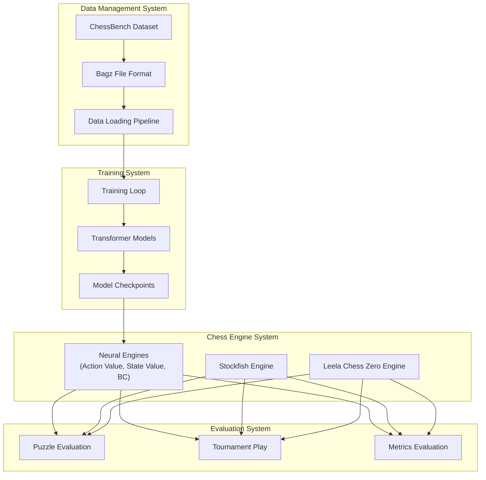
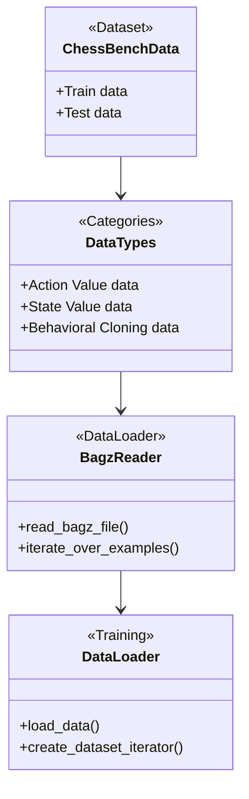
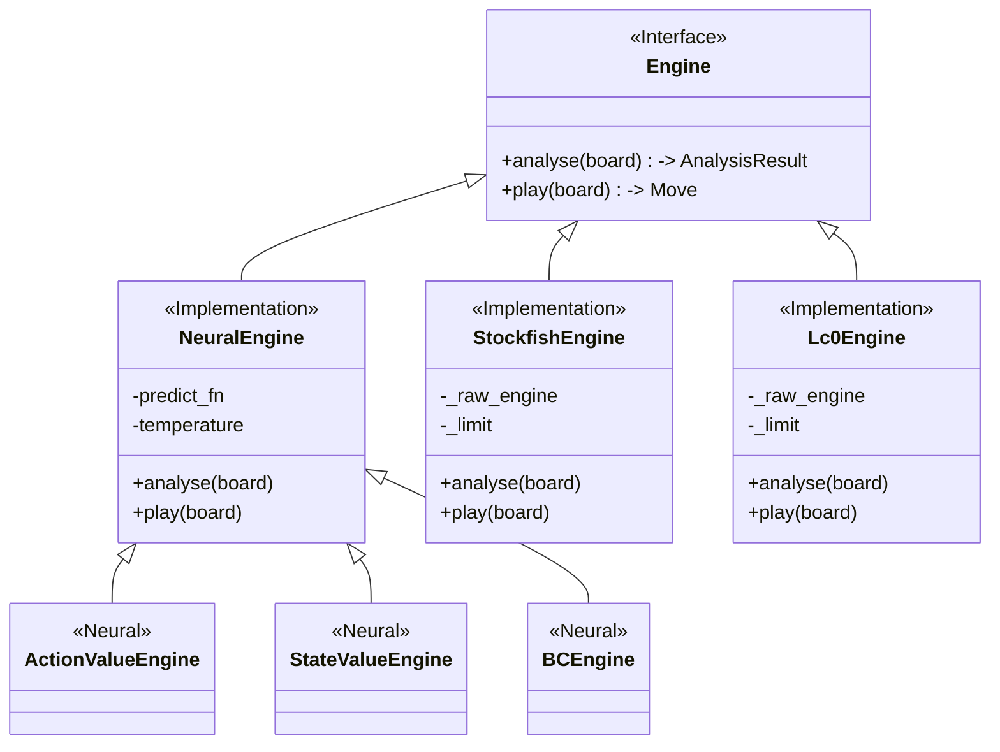
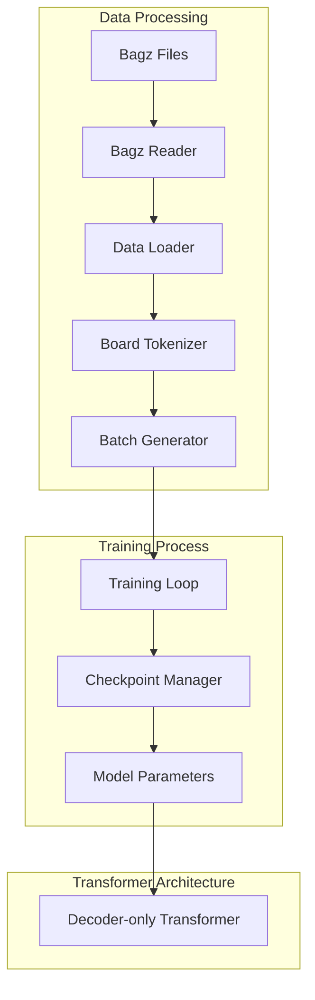

<!-- source: DeepWiki mcp.deepwiki.com · repo google-deepmind/searchless_chess · page 1 Overview · fetched 2026-10-26 -->

# Overview

Relevant source files

The following files were used as context for generating this wiki page:

- [README.md](README.md)

## Purpose and Scope

This document provides an introduction to the `searchless_chess` repository, which implements a system for training and evaluating transformer-based chess engines that perform planning without traditional search algorithms. This repository contains the implementation of the NeurIPS 2024 paper "Amortized Planning with Large-Scale Transformers: A Case Study on Chess".

Unlike traditional chess engines that use tree search algorithms, this project explores how large-scale transformer models can learn to play chess effectively through amortized planning - essentially learning to predict good moves directly without explicit search. For detailed information about the training system, see [Training System](#3), and for the chess engines implementation, see [Chess Engines](#5).

Sources: [README.md:8-16]()

## System Architecture Overview

The `searchless_chess` system consists of several interconnected components that work together to train, evaluate, and deploy transformer-based chess engines.

Sources: [README.md:19-66](), [src/engines/engine.py](), [src/training.py](), [src/bagz.py]()

## Key Components

### Data Management

The project is built around ChessBench, a large-scale benchmark dataset containing 10 million chess games with legal move and value annotations (15 billion data points) provided by Stockfish 16. This data is stored in a custom `.bag` format for efficient loading and processing.

The data is organized into three main types:
- **Action Value**: Data for predicting the value of specific moves
- **State Value**: Data for predicting the value of board positions
- **Behavioral Cloning**: Data for imitating expert play

Sources: [src/bagz.py](), [src/data_loader.py](), [README.md:149-166]()

### Transformer Models

The project trains transformer models of varying sizes to play chess:

1. **Small model**: 9 million parameters
2. **Medium model**: 136 million parameters  
3. **Large model**: 270 million parameters

These are decoder-only transformer models trained on three different prediction targets:
- **Action Value**: Predicting the value of each possible move
- **State Value**: Predicting the value of a board position
- **Behavioral Cloning**: Imitating expert moves

Sources: [src/transformer.py](), [README.md:12-14](), [src/config.py]()

### Chess Engine System

The repository implements a unified interface for different chess engines, allowing for consistent evaluation and comparison.

Sources: [src/engines/engine.py](), [src/engines/neural_engines.py](), [src/engines/stockfish_engine.py](), [src/engines/lc0_engine.py]()

### Evaluation System

The system provides multiple ways to evaluate chess engines:

1. **Puzzle Evaluation**: Tests engine performance on chess puzzles
2. **Tournament Play**: Computes Elo ratings by running games between different engines
3. **Metrics Evaluation**: Computes metrics like Kendall's tau to measure prediction quality

The evaluation allows for comparing the transformer-based engines against traditional engines like Stockfish and Leela Chess Zero, both with and without search.

Sources: [src/puzzles.py](), [src/tournament.py](), [src/metrics_evaluator.py]()

## Training Approach

The transformer models are trained using supervised learning on the ChessBench dataset. The training pipeline includes:

1. Data loading from Bagz files
2. Board state tokenization
3. Training loop with distributed JAX computation
4. Checkpoint management for model parameters

Sources: [src/training.py](), [src/training_utils.py](), [src/tokenizer.py]()

## Research Findings

The key findings from this research include:

1. Large transformer models (270M parameters) can learn to play chess at a grandmaster level without traditional search algorithms
2. The best models achieve a Lichess blitz Elo of 2895 against humans
3. Transformer size has a significant impact on performance
4. Action-value prediction outperforms state-value prediction and behavioral cloning
5. While transformers can effectively approximate search-based algorithms through supervised learning, perfect distillation remains challenging

Sources: [README.md:13-16]()

## Repository Structure

The repository is organized as follows:

| Directory/File | Purpose |
|----------------|---------|
| `src/engines/` | Chess engine implementations |
| `src/transformer.py` | Decoder-only transformer implementation |
| `src/bagz.py` | Readers for custom .bag data files |
| `src/training.py` | Training loop implementation |
| `src/puzzles.py` | Puzzle evaluation script |
| `src/tournament.py` | Elo tournament script |
| `data/` | ChessBench dataset (train/test splits) |
| `checkpoints/` | Pre-trained model checkpoints |
| `BayesElo/` | Elo computation tool |
| `Stockfish/` | Stockfish chess engine integration |
| `lc0/` | Leela Chess Zero integration |

Sources: [README.md:19-66]()

## Getting Started

For detailed installation instructions and usage examples, see [Getting Started](#7). In brief, the system requires:

1. Python 3.10 environment
2. JAX (with CUDA support for GPU acceleration)
3. External dependencies: Stockfish, Leela Chess Zero, BayesElo
4. Downloading the ChessBench dataset and model checkpoints

The repository includes scripts for training models, evaluating puzzle accuracy, running tournaments, and analyzing model behavior.

Sources: [README.md:69-248]()

---

