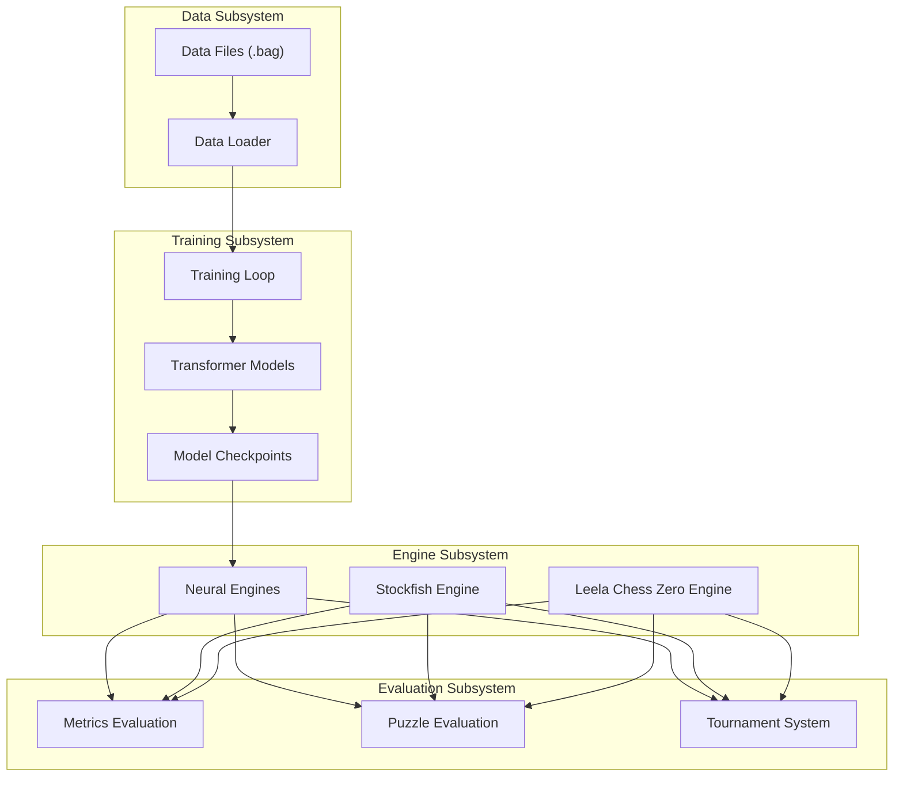
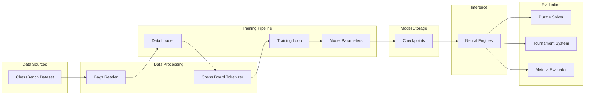
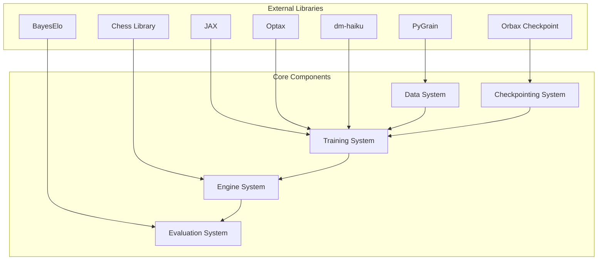
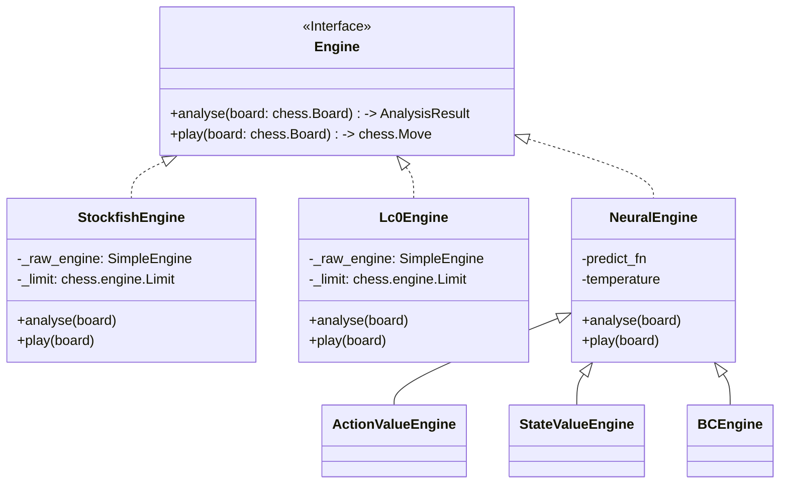
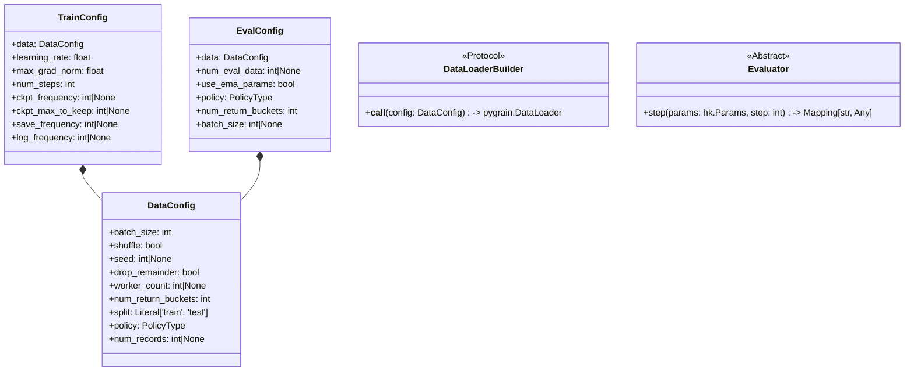

<!-- source: DeepWiki mcp.deepwiki.com · repo google-deepmind/searchless_chess · page 2 System Architecture · fetched 2026-10-26 -->

# System Architecture

<details>
<summary>Relevant source files</summary>

The following files were used as context for generating this wiki page:

- [README.md](README.md)
- [src/config.py](src/config.py)
- [src/constants.py](src/constants.py)

</details>


## Purpose and Scope

This document provides a high-level overview of the SearchLess Chess system architecture, explaining how different components interact to enable transformer-based chess playing without traditional search algorithms. It covers the major subsystems, data flows, and component dependencies.

For details about specific components, please refer to their dedicated pages:
- [Training System](#3)
- [Data Management](#4)
- [Chess Engines](#5)
- [Evaluation System](#6)

## System Overview

The SearchLess Chess system is composed of several interconnected components that work together to train, evaluate, and deploy transformer-based chess engines.

### High-Level Component Diagram



Sources: [README.md:19-66]()

## Data Flow Architecture

The SearchLess Chess system processes data through several stages, from raw chess positions to trained models and evaluation results.



Sources: [src/bagz.py](), [src/data_loader.py](), [src/tokenizer.py](), [src/training.py](), [README.md:180-241]()

## Component Dependencies

The system relies on several external libraries and frameworks for its core functionality:



Sources: [README.md:68-146]()

## Key Interfaces

The system defines several important interfaces to enable modular design and interoperability between components.

### Engine Interface



Sources: [src/engines/engine.py](), [src/engines/neural_engines.py](), [src/engines/stockfish_engine.py](), [src/engines/lc0_engine.py]()

### Data and Configuration Interfaces

The system uses structured configurations to define data loading and training parameters:



Sources: [src/config.py:16-91](), [src/constants.py:54-82]()

## Data Representation

The system uses different data types to represent chess positions and related information:

| Data Type | Structure | Purpose |
|-----------|-----------|---------|
| `ActionValueData` | `(fen: str, move: str, win_prob: float)` | Stores a position, move, and win probability |
| `StateValueData` | `(fen: str, win_prob: float)` | Stores a position and its value |
| `BehavioralCloningData` | `(fen: str, move: str)` | Stores a position and expert move |
| `Sequences` | `UInt32[Array, 'B T']` | Tokenized board representations |
| `Predictions` | `Float32[Array, '*B']` or `Float32[Array, '*B T F']` | Model predictions |

Sources: [src/constants.py:30-119]()

## System Workflow

1. **Data Preparation**: The ChessBench dataset is processed into `.bag` files for efficient loading during training
2. **Model Training**: Transformer models of various sizes (9M, 136M, 270M parameters) are trained on the processed data
3. **Model Checkpointing**: Trained models are saved as checkpoints for later use
4. **Engine Creation**: Neural engines are created using the trained models, implementing the common Engine interface
5. **Evaluation**: The neural engines are evaluated against traditional engines (Stockfish, Leela Chess Zero) through puzzle accuracy, tournament play, and metrics computation

Sources: [README.md:180-241]()

## Directory Structure

The repository is organized as follows:

```
.
|
├── BayesElo                        - Elo computation (need to be installed)
|
├── checkpoints                     - Model checkpoints (need to be downloaded)
|   ├── 136M
|   ├── 270M
|   └── 9M
|
├── data                            - Datasets (need to be downloaded)
|   ├── eco_openings.csv
|   ├── test
|   ├── train
|   └── puzzles.csv
|
├── lc0                             - Leela Chess Zero (needs to be installed)
|
├── src
|   ├── engines
|   |   ├── constants.py            - Engine constants
|   |   ├── engine.py               - Engine interface
|   |   ├── lc0_engine.py           - Leela Chess Zero engine
|   |   ├── neural_engines.py       - Neural engines
|   |   └── stockfish_engine.py     - Stockfish engine
|   |
|   ├── bagz.py                     - Readers for our .bag data files
|   ├── config.py                   - Experiment configurations
|   ├── constants.py                - Constants, interfaces, and types
|   ├── data_loader.py              - Data loader
|   ├── metrics_evaluator.py        - Metrics (e.g., Kendall's tau) evaluator
|   ├── puzzles.py                  - Puzzle evaluation script
|   ├── searchless_chess.ipynb      - Model analysis notebook
|   ├── tokenizer.py                - Chess board tokenization
|   ├── tournament.py               - Elo tournament script
|   ├── train.py                    - Example training + evaluation script
|   ├── training.py                 - Training loop
|   ├── training_utils.py           - Training utility functions
|   ├── transformer.py              - Decoder-only Transformer
|   └── utils.py                    - Utility functions
|
├── Stockfish                       - Stockfish (needs to be installed)
```

Sources: [README.md:19-66]()

---

