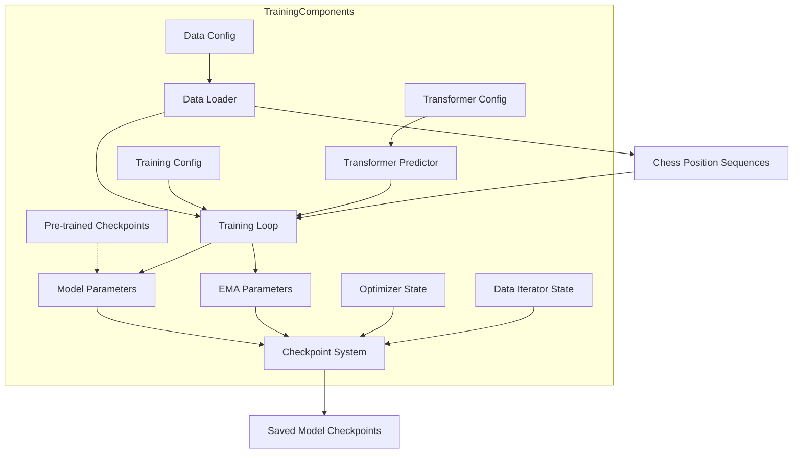
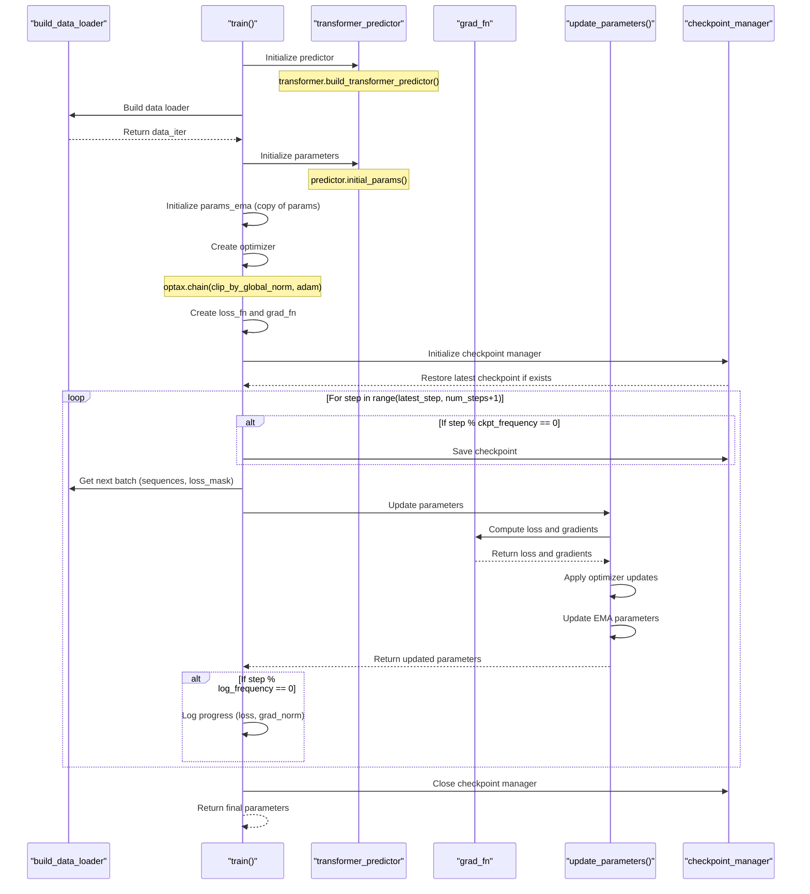
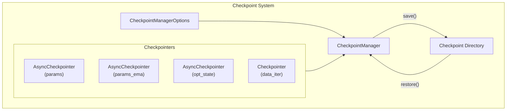
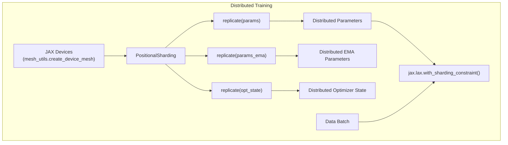

<!-- source: DeepWiki mcp.deepwiki.com · repo google-deepmind/searchless_chess · page 3 Training System · fetched 2026-10-26 -->

# Training System

<details>
<summary>Relevant source files</summary>

The following files were used as context for generating this wiki page:

- [src/training.py](src/training.py)
- [src/training_utils.py](src/training_utils.py)

</details>


## Purpose and Scope

The Training System is responsible for training the transformer-based chess models in the SearchLess Chess project. It implements the complete training pipeline, including parameter initialization, loss computation, gradient updates, and checkpointing. This document explains the training loop implementation and parameter management for the transformer models.

For details about the transformer architecture itself, see [Transformer Models](#3.1).
For information about data loading, see [Data Management](#4).

## Training System Overview

The training system integrates multiple components to efficiently train large transformer models for chess position evaluation. It supports distributed training across multiple devices using JAX's parallelization capabilities.

### Training System Architecture



Sources: [src/training.py:16-161](), [src/training_utils.py:16-269]()

## Training Loop Implementation

The core of the training system is the training loop, implemented in the `train` function. This function orchestrates the entire training process, from initialization to final parameter output.

### Training Loop Flow



Sources: [src/training.py:36-161]()

### Parameter Update Process

The parameter update process is handled by the `update_parameters` function, which:

1. Computes the loss and gradients using the provided gradient function
2. Updates the parameters using the optimizer
3. Updates the exponential moving average (EMA) of parameters
4. Returns the updated parameters and metrics

This function is JIT-compiled for efficiency and designed to work with JAX's parallelization.

Sources: [src/training_utils.py:103-139]()

## Configuration Parameters

The training system is configured through several configuration objects:

| Configuration | Purpose | Key Parameters |
|---------------|---------|----------------|
| `TrainConfig` | Controls training loop behavior | `num_steps`, `learning_rate`, `max_grad_norm`, `log_frequency`, `ckpt_frequency` |
| `TransformerConfig` | Defines transformer model architecture | Model size, attention heads, embedding dimensions |
| `DataConfig` | Controls data loading process | `seed`, batch size, sequence length |

### Example Training Configuration Flow

```mermaid
flowchart LR
    subgraph "Configuration Flow"
        TrainConfig["TrainConfig"] --> train["train()"]
        PredictorConfig["TransformerConfig"] --> train
        DataLoaderBuilder["build_data_loader"] --> train
        train --> "Trained Parameters"
    end
```

Sources: [src/training.py:36-41]()

## Checkpointing System

The training system includes a robust checkpointing mechanism that allows for saving and restoring the complete training state, including:

- Model parameters
- EMA parameters
- Optimizer state
- Data iterator state

This enables training to resume from exactly where it left off in case of interruptions.

### Checkpoint Management

The checkpoint system uses Orbax for efficient checkpoint handling:



Sources: [src/training_utils.py:142-225]()

## Distributed Training

The training system supports distributed training across multiple devices and potentially multiple hosts. This is implemented using JAX's distributed computing capabilities.

### Device Sharding



The training system uses JAX's `PositionalSharding` to distribute model parameters, optimizer state, and computation across available devices. This enables efficient training of large models by parallelizing the work.

Sources: [src/training.py:84-89](), [src/training_utils.py:33-57]()

## Loss Function

The loss function is created using `make_loss_fn`, which generates a function that computes the negative log likelihood of the target sequences:

1. The predictor outputs conditional probabilities for each position
2. The true conditional probabilities are extracted using the target sequences
3. Loss is masked according to the provided loss mask
4. The mean loss is computed across the batch

Sources: [src/training_utils.py:60-90]()

## Training Workflow

Here's how the entire training system fits together:

1. Initialize the predictor based on the transformer configuration
2. Initialize model parameters, optimizer, and EMA parameters
3. Create sharding for distributed training and replicate parameters
4. Restore from latest checkpoint if available
5. For each training step:
   - Save checkpoint if needed
   - Get the next batch of data
   - Compute loss and gradients
   - Update parameters and EMA
   - Log progress if needed
6. Return the final trained parameters

This workflow enables efficient, resumable training of large transformer models for chess position evaluation.

Sources: [src/training.py:36-161]()

---

