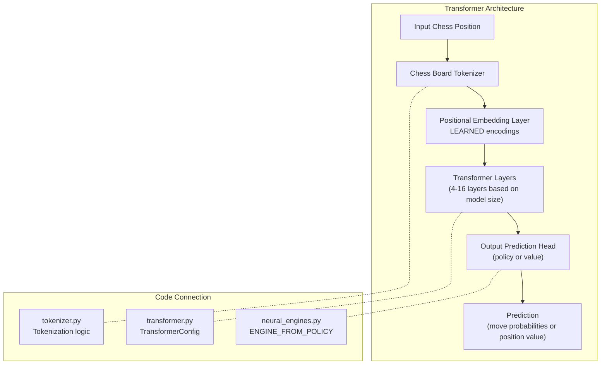
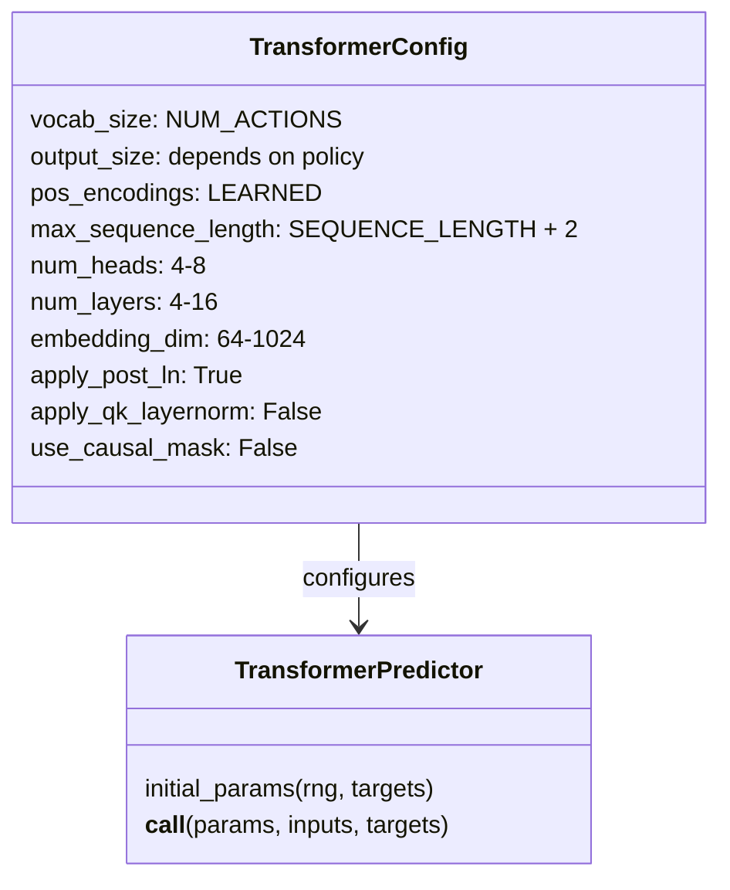
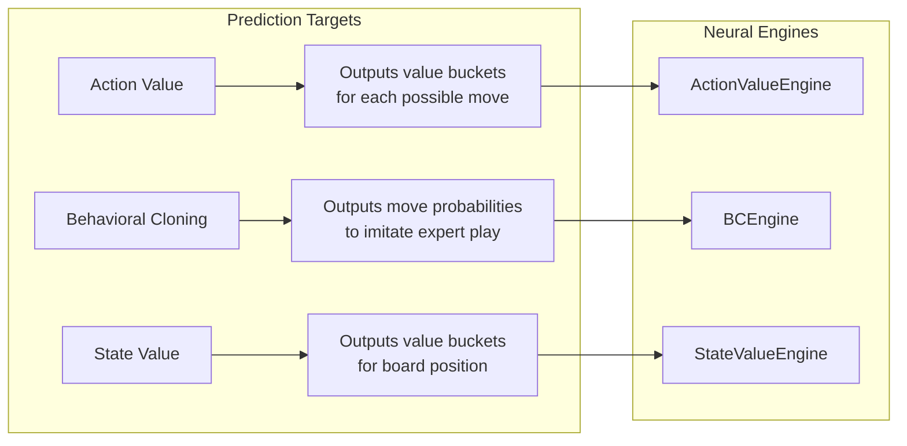
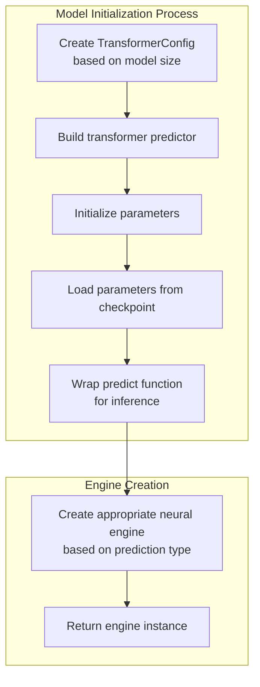
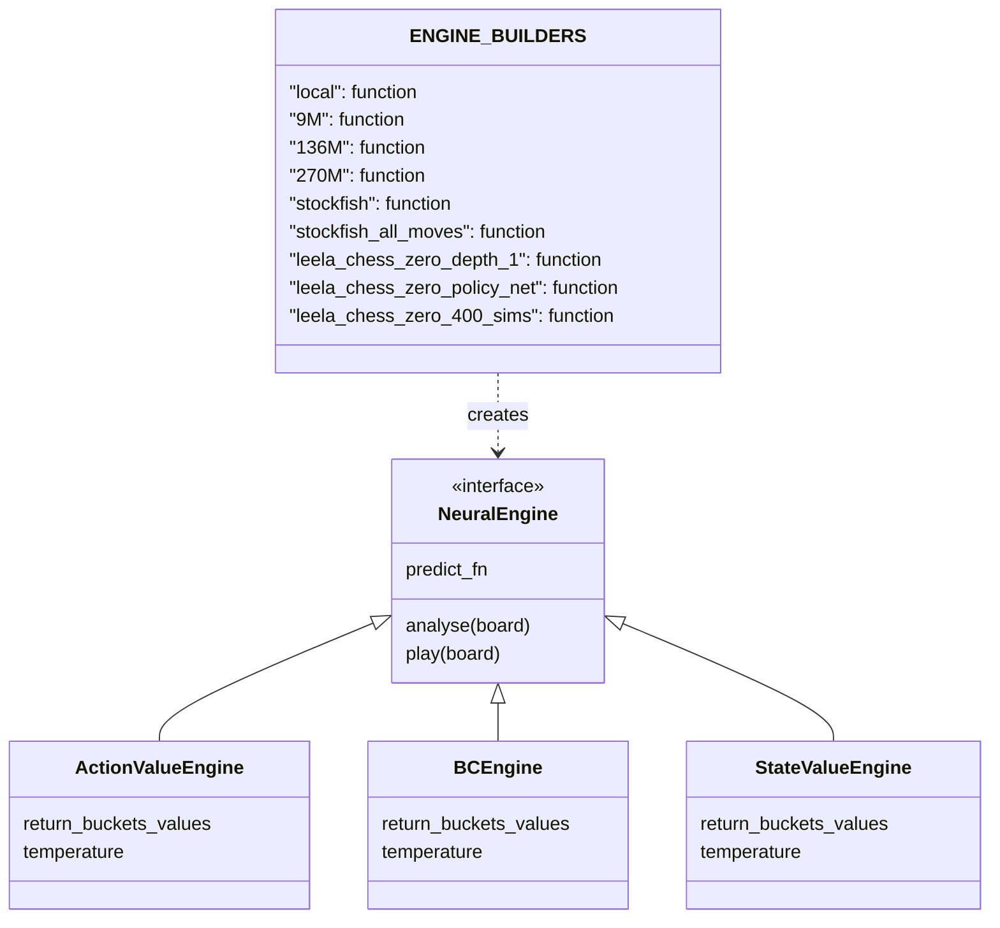

<!-- source: DeepWiki mcp.deepwiki.com · repo google-deepmind/searchless_chess · page 3.1 Transformer Models · fetched 2026-10-26 -->

# Transformer Models

Relevant source files

The following files were used as context for generating this wiki page:

- [README.md](README.md)
- [src/engines/constants.py](src/engines/constants.py)

## Purpose and Scope

This document outlines the transformer models used in the searchless_chess project for chess position evaluation and move prediction. The transformers are decoder-only architectures trained to predict various targets including action-values, state-values, and behavioral cloning. This page focuses specifically on the model architecture, configurations, and variants. For information about training these models, see [Training System](#3), and for how they're used in chess engines, see [Neural Engines](#5.1).

Sources: [README.md:8-16]()

## Architecture Overview

The searchless_chess project uses decoder-only transformer models to process chess board positions. These transformers are configured to learn from chess positions without requiring traditional search algorithms.

The architecture is implemented as a decoder-only transformer that takes tokenized chess positions as input and outputs either move probabilities (for behavioral cloning) or value predictions (for action-value or state-value). The configuration for all transformer models is defined through the `TransformerConfig` class in the transformer module.

Sources: [src/engines/constants.py:76-87](), [README.md:10-16]()

## Model Configuration

The transformer models share the same basic architecture but differ in size and capacity. All models use:

- Learned positional encodings
- No causal masking (since chess position evaluation doesn't require causality)
- Post-layer normalization
- Equal number of heads across all attention layers in a given model

The transformer configuration is instantiated with parameters that reflect the model size and prediction type. The output size varies depending on whether the model is predicting action values (128 buckets), behavioral cloning (number of possible actions), or state values (128 buckets).

Sources: [src/engines/constants.py:76-87]()

## Model Variants

The project uses three primary model sizes for evaluation, plus a smaller local model for development. The main differentiation between models is their parameter count, which is controlled by varying the number of layers and embedding dimensions.

| Model Name | Parameters | Layers | Embedding Dim | Heads | Policy Type | Checkpoint Step |
|------------|------------|--------|---------------|-------|-------------|----------------|
| 9M         | 9 million  | 8      | 256           | 8     | action_value| 6,400,000      |
| 136M       | 136 million| 8      | 1024          | 8     | action_value| 6,400,000      |
| 270M       | 270 million| 16     | 1024          | 8     | action_value| 6,400,000      |
| local      | ~400k      | 4      | 64            | 4     | action_value| varies         |

The larger models (136M and 270M) offer better performance but require more computational resources for training and inference. The local model is primarily intended for development and experimentation.

Sources: [src/engines/constants.py:42-62](), [src/engines/constants.py:115-125]()

## Prediction Targets

The transformer models can be trained with three different prediction targets:

1. **Action Value** (default): Predicts the expected outcome value for each possible move, bucketed into 128 discrete value ranges. This allows the model to evaluate which moves are most promising.

2. **Behavioral Cloning**: Predicts the probability distribution over legal moves that an expert (like Stockfish) would play. This is a pure imitation learning approach.

3. **State Value**: Predicts the expected outcome value of the current board position, bucketed into 128 discrete value ranges. This evaluates the position without specifically scoring individual moves.

All variants in the repository are primarily trained on the action-value task, as this proved most effective for chess play.

Sources: [src/engines/constants.py:68-74](), [README.md:12-13]()

## Model Initialization and Loading

Models are initialized with the appropriate configuration and then loaded from checkpoints for inference. The code uses JAX and Haiku for model implementation and parameter management.

The model loading process:
1. Creates the appropriate `TransformerConfig` based on the model size
2. Builds a transformer predictor using the configuration
3. Initializes parameters with a random key
4. Loads the trained parameters from checkpoints
5. Wraps the prediction function for inference
6. Creates the appropriate neural engine based on the prediction type

Sources: [src/engines/constants.py:36-112]()

## Integration with the Engine System

The transformer models are integrated into the chess engine system through the `ENGINE_BUILDERS` dictionary, which provides factory functions for creating different types of engines.

When a neural engine is requested, the `_build_neural_engine` function configures and loads the appropriate transformer model based on the specified size, and then wraps it in the appropriate engine type determined by the prediction target.

Sources: [src/engines/constants.py:115-141]()

## Performance Characteristics

The transformer models exhibit varying levels of performance depending on their size:

- **9M model**: Provides baseline performance with reasonable computational requirements
- **136M model**: Offers significantly better prediction accuracy and playing strength
- **270M model**: Provides the best performance, solving challenging chess puzzles and achieving a Lichess blitz Elo of 2895 against humans (grandmaster level)

Despite performing no explicit search, the largest transformer models achieve remarkably strong chess play by effectively learning to approximate Stockfish's search-based evaluation through supervised learning.

Sources: [README.md:10-16]()

---

