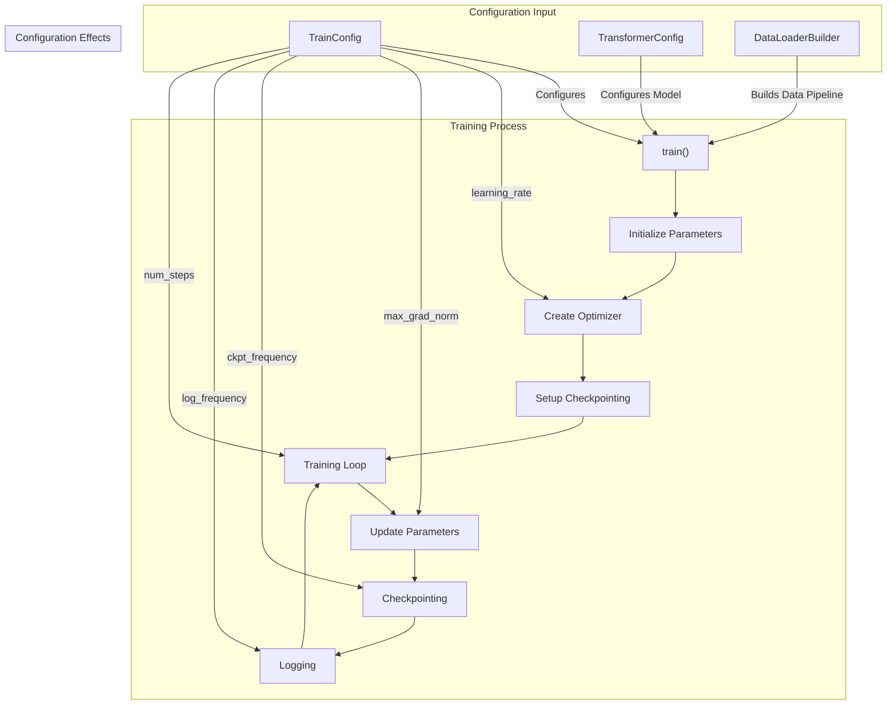
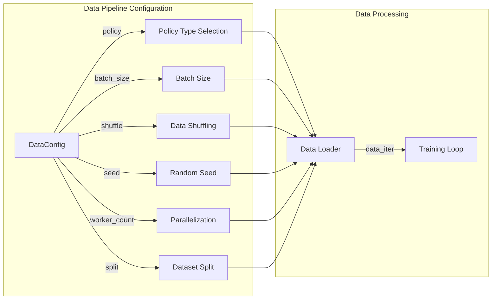
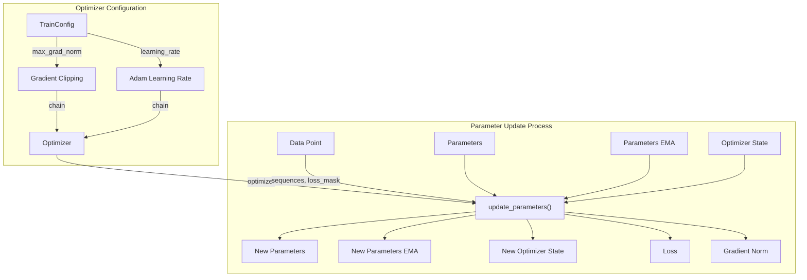
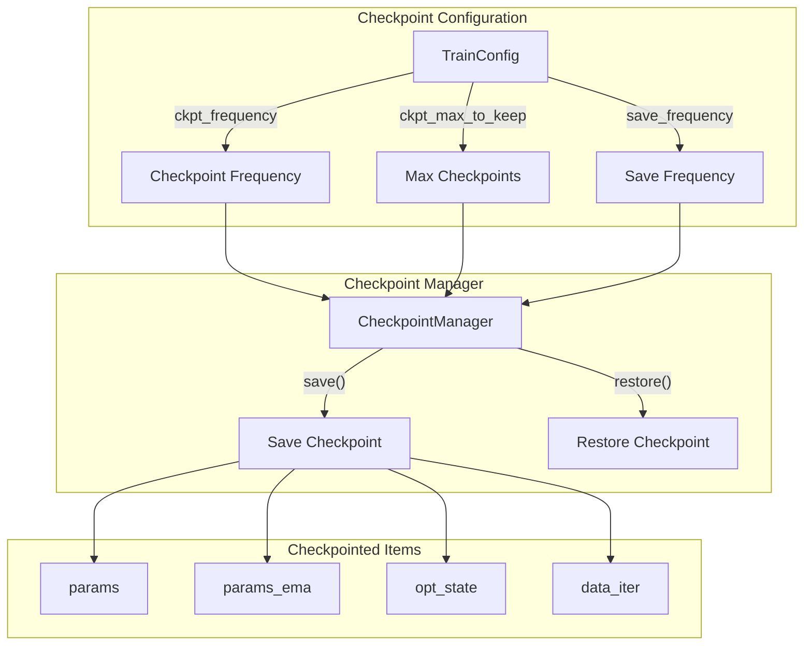
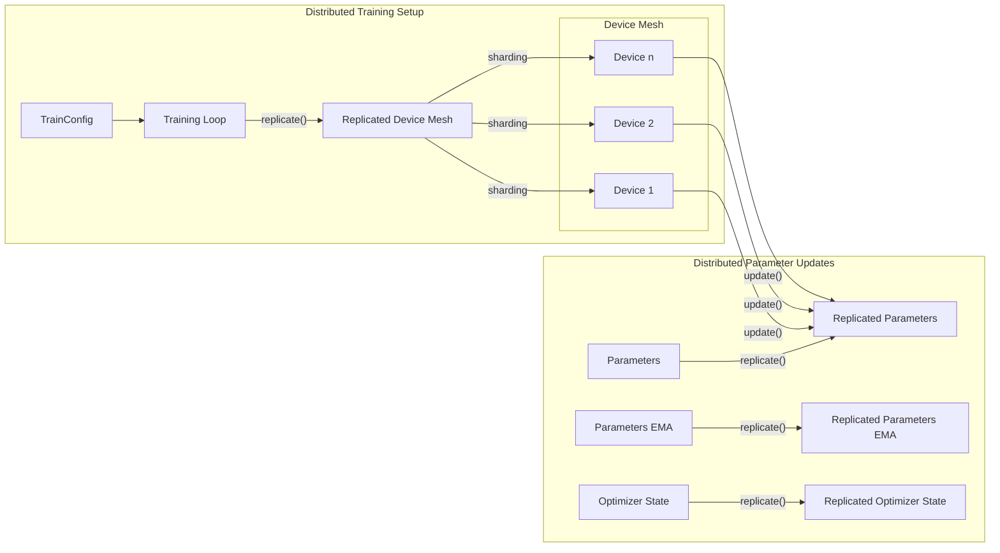

<!-- source: DeepWiki mcp.deepwiki.com · repo google-deepmind/searchless_chess · page 3.2 Training Configuration · fetched 2026-10-26 -->

# Training Configuration

<details>
<summary>Relevant source files</summary>

The following files were used as context for generating this wiki page:

- [src/config.py](src/config.py)
- [src/training.py](src/training.py)
- [src/training_utils.py](src/training_utils.py)

</details>


This page details how to configure the training process for transformer models in the searchless_chess system, including hyperparameters and data settings. For information about the transformer models themselves, see [Transformer Models](#3.1). For details about pre-trained checkpoints, see [Pre-trained Checkpoints](#3.3).

The searchless_chess training system uses a configuration-based approach to control all aspects of model training. This document explains the available configuration options, their effects on the training process, and how to set them up for different training scenarios.

## Configuration Structure

The training configuration system uses dataclasses to define structured configurations for different aspects of the training process.

```mermaid
classDiagram
    class "DataConfig" {
        batch_size: int
        shuffle: bool
        seed: int
        drop_remainder: bool
        worker_count: int
        num_return_buckets: int
        split: Literal['train', 'test']
        policy: PolicyType
        num_records: int
    }
    
    class "TrainConfig" {
        data: DataConfig
        learning_rate: float
        max_grad_norm: float
        num_steps: int
        ckpt_frequency: int
        ckpt_max_to_keep: int
        save_frequency: int
        log_frequency: int
    }
    
    class "PolicyType" {
        <<Literal>>
        action_value
        state_value
        behavioral_cloning
    }
    
    TrainConfig --> DataConfig : "contains"
    DataConfig --> PolicyType : "uses"
```

Sources: [src/config.py:16-92]()

## Training Configuration Parameters

The `TrainConfig` dataclass defines the parameters for configuring the training process. Here's a detailed explanation of each parameter:

| Parameter | Type | Description |
|-----------|------|-------------|
| data | DataConfig | Configuration for the data generation pipeline |
| learning_rate | float | Learning rate for the Adam optimizer |
| max_grad_norm | float | Maximum gradient norm for gradient clipping (default: 1.0) |
| num_steps | int | Total number of training steps to perform |
| ckpt_frequency | int or None | Steps interval between checkpoint saves (None disables checkpointing) |
| ckpt_max_to_keep | int or None | Maximum number of checkpoints to keep (default: 1) |
| save_frequency | int or None | Steps interval for permanent checkpoint saves (None means all are temporary) |
| log_frequency | int or None | Steps interval for logging training progress (None disables logging) |

Sources: [src/config.py:51-73]()

The training configuration is passed to the `train` function, which is the main entry point for training:



Sources: [src/training.py:36-41](), [src/training.py:66-69](), [src/training.py:123-156]()

## Data Configuration Parameters

The `DataConfig` dataclass defines the parameters for configuring the data pipeline. Here's a detailed explanation of each parameter:

| Parameter | Type | Description |
|-----------|------|-------------|
| batch_size | int | Size of training batches |
| shuffle | bool | Whether to shuffle the dataset (default: False) |
| seed | int or None | Random seed for shuffling and transformations (default: 0) |
| drop_remainder | bool | Whether to drop partial batches (default: False) |
| worker_count | int or None | Number of child processes for parallelizing data transformations (default: 0) |
| num_return_buckets | int | Number of return buckets for value prediction |
| split | Literal['train', 'test'] | Dataset split to use |
| policy | PolicyType | The policy used to create the dataset ('action_value', 'state_value', or 'behavioral_cloning') |
| num_records | int or None | Maximum number of records to read from the dataset (default: None, meaning all records) |

Sources: [src/config.py:26-49]()

In the training process, the data configuration controls how data is loaded and processed before being fed to the model:



Sources: [src/training.py:53-54](), [src/config.py:26-49]()

## Training Loop and Optimization

The training loop uses the configuration to determine how long to train and how to update model parameters:

1. **Optimizer Configuration**: The system uses Optax to create an optimizer chain with gradient clipping and Adam optimization
2. **Parameter Updates**: Parameters are updated using the `update_parameters` function which applies gradients
3. **EMA Parameters**: An exponential moving average of parameters is maintained for evaluation

Here's how the optimizer is configured and how parameters are updated:



Sources: [src/training.py:66-69](), [src/training_utils.py:103-139]()

## Checkpointing System

The training system includes a comprehensive checkpointing mechanism that can save and restore training state:



Sources: [src/training.py:94-105](), [src/training.py:124-135](), [src/training_utils.py:142-225]()

The checkpoint system uses Orbax to handle the checkpoint operations:

1. `get_checkpoint_manager` creates a checkpoint manager with the specified options
2. `save` stores the current state at the specified checkpoint frequency
3. `restore_checkpoint` can load a previous checkpoint to resume training
4. The system can be configured to keep a specified number of checkpoints and permanently save checkpoints at a certain frequency

Sources: [src/training_utils.py:142-269]()

## Policy Types

The system supports three different policy types that can be configured in the training process:

| Policy Type | Description |
|-------------|-------------|
| action_value | Training a model to predict the value of actions (moves) |
| state_value | Training a model to predict the value of board positions |
| behavioral_cloning | Training a model to imitate expert play through direct move prediction |

The policy type is specified in the `DataConfig` and affects how the data is processed and the loss function is computed.

Sources: [src/config.py:22-23]()

## Example Configuration

Below is an example of how to configure a training run for an action value model:

```python
from searchless_chess.src.config import DataConfig, TrainConfig
from searchless_chess.src.transformer import TransformerConfig

# Configure data loading
data_config = DataConfig(
    batch_size=128,
    shuffle=True,
    seed=42,
    worker_count=8,
    num_return_buckets=51,
    split='train',
    policy='action_value',
)

# Configure training
train_config = TrainConfig(
    data=data_config,
    learning_rate=1e-4,
    max_grad_norm=1.0,
    num_steps=100000,
    ckpt_frequency=1000,
    ckpt_max_to_keep=5,
    save_frequency=10000,
    log_frequency=100,
)

# Configure model architecture (complementary to train_config)
predictor_config = TransformerConfig(
    vocab_size=...,
    # other transformer parameters
    seed=42,
)
```

The configuration can then be passed to the `train` function along with a data loader builder to start training:

```python
from searchless_chess.src.training import train
from searchless_chess.src import data_loader

# Get a data loader builder
build_data_loader = data_loader.get_data_loader_builder()

# Train the model
params = train(
    train_config=train_config,
    predictor_config=predictor_config,
    build_data_loader=build_data_loader,
)
```

Sources: [src/training.py:36-161](), [src/config.py:26-73]()

## Distributed Training Configuration

The training system supports distributed training across multiple devices using JAX's distributed computing features:



Sources: [src/training.py:84-89](), [src/training_utils.py:33-57]()

Key aspects of distributed training configuration:

1. The system detects available devices using JAX and distributes computation across them
2. Parameters, optimizer state, and data are replicated across devices using `replicate()` function
3. The training process includes sharding constraints to ensure efficient parallel computation
4. Process-specific seed modifications ensure different data is trained on across processes

Sources: [src/training.py:42-47](), [src/training.py:53](), [src/training.py:138-139]()

---

