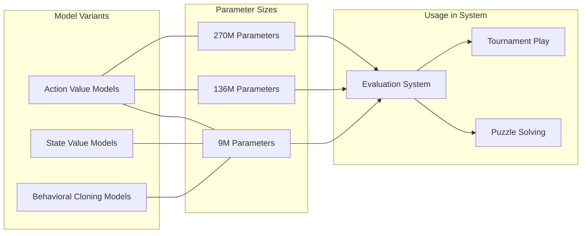
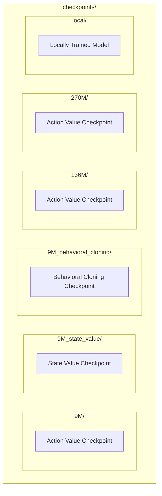
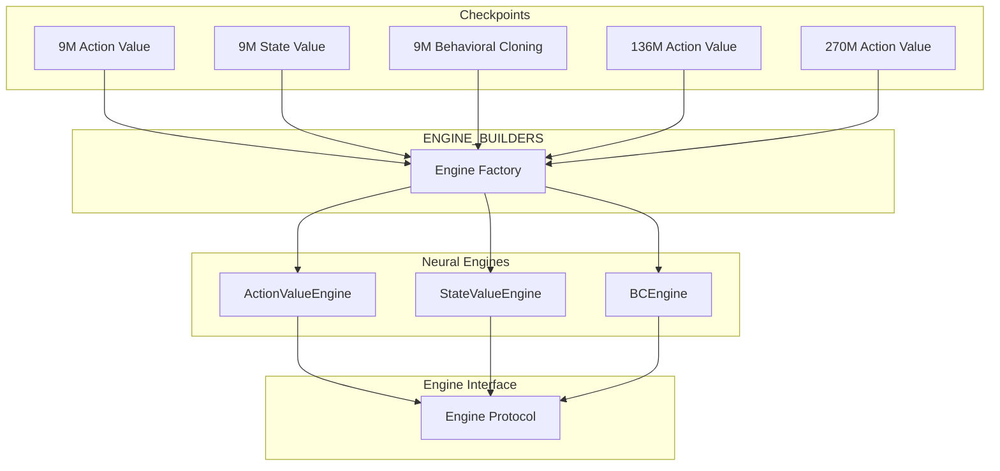

<!-- source: DeepWiki mcp.deepwiki.com · repo google-deepmind/searchless_chess · page 3.3 Pre-trained Checkpoints · fetched 2026-10-26 -->

# Pre-trained Checkpoints

<details>
<summary>Relevant source files</summary>

The following files were used as context for generating this wiki page:

- [README.md](README.md)
- [checkpoints/download.sh](checkpoints/download.sh)

</details>


## Purpose and Scope

This document describes the pre-trained transformer model checkpoints provided with the SearchLess Chess system, detailing available model sizes and variants, how to download them, their structure, and how to use them in various parts of the system. For information about training your own models from scratch, see [Training System](#3) and [Training Configuration](#3.2).

Sources: [README.md:26-29]()

## Available Pre-trained Models

The SearchLess Chess project provides several pre-trained transformer models with different parameter sizes and training objectives:

| Model Size | Parameter Count | Variants Available |
|------------|----------------|-------------------|
| 9M | 9 million | Action Value, State Value, Behavioral Cloning |
| 136M | 136 million | Action Value |
| 270M | 270 million | Action Value |

- **Action Value Models**: Predict the value of each legal move (default variant)
- **State Value Models**: Predict the value of a given chess position
- **Behavioral Cloning Models**: Imitate expert moves directly

The larger models (136M and 270M) are only available with action value prediction, which was found to be the most effective training objective in the paper.

Sources: [README.md:212-215](), [checkpoints/download.sh:20-25]()

## Model Architecture Overview



Sources: [README.md:212-215]()

## Downloading Pre-trained Checkpoints

The pre-trained model checkpoints must be downloaded separately as they're not included in the repository due to their size. To download all checkpoints, use the provided download script:

```bash
cd checkpoints
./download.sh
cd ..
```

This script downloads the following checkpoint files:
- `9M.zip`: The 9 million parameter action value model
- `9M_state_value.zip`: The 9 million parameter state value model
- `9M_behavioral_cloning.zip`: The 9 million parameter behavioral cloning model
- `136M.zip`: The 136 million parameter action value model
- `270M.zip`: The 270 million parameter action value model

After downloading, the script automatically extracts the files to create the proper directory structure in the `checkpoints` folder.

Sources: [README.md:169-178](), [checkpoints/download.sh:1-37]()

## Checkpoint Storage Structure



Sources: [README.md:26-29](), [README.md:198]()

## Using Pre-trained Checkpoints

The pre-trained models can be used for various tasks within the SearchLess Chess system:

### Puzzle Evaluation

To evaluate a model's performance on chess puzzles:

```bash
cd src
python puzzles.py --num_puzzles 10 --agent=270M
```

The `--agent` parameter can be set to:
- `9M`: The 9 million parameter action value model
- `136M`: The 136 million parameter action value model
- `270M`: The 270 million parameter action value model
- `local`: A locally trained model (if available)

The puzzle evaluation system measures how well the model solves chess puzzles, providing metrics on accuracy and performance.

Sources: [README.md:200-215]()

### Tournament Evaluation

Pre-trained models can be used in tournament play to compute Elo ratings:

```bash
cd src
python tournament.py --num_games=200
```

This will run a tournament between different engines, including the pre-trained models, and generate a PGN file that can be used to compute Elo ratings using BayesElo.

Sources: [README.md:218-241]()

### Model Analysis

For detailed analysis of model behavior:

```bash
jupyter notebook
# Open src/searchless_chess.ipynb in your browser
```

The notebook allows you to investigate model predictions, such as computing win percentages for legal moves and visualizing the model's decision-making process.

Sources: [README.md:243-248]()

## Integration with Neural Engines



The pre-trained model checkpoints are loaded by the engine factory system to create neural engines that implement the common chess engine interface. This allows the models to be used interchangeably with traditional chess engines like Stockfish and Leela Chess Zero for evaluation purposes.

Sources: [README.md:39-45]()

## Checkpoint License Information

The model weights in the pre-trained checkpoints are licensed under Creative Commons Attribution 4.0 (CC-BY). This means you can use, share, and adapt the models for any purpose, even commercially, as long as you give appropriate credit.

Sources: [README.md:282-284]()

## Performance Characteristics

The performance of the pre-trained models varies by size and training objective:

| Model | Parameter Count | Best For | Relative Strength |
|-------|----------------|----------|------------------|
| 9M Action Value | 9 million | Quick evaluation, baseline | Lowest |
| 9M State Value | 9 million | Position evaluation | Moderate |
| 9M Behavioral Cloning | 9 million | Move imitation | Moderate |
| 136M Action Value | 136 million | Strong play | High |
| 270M Action Value | 270 million | Strongest play | Highest |

The 270M parameter model achieves the best performance on chess puzzles and tournament play, approaching grandmaster-level play despite performing no explicit search.

Sources: [README.md:10-16]()

---

