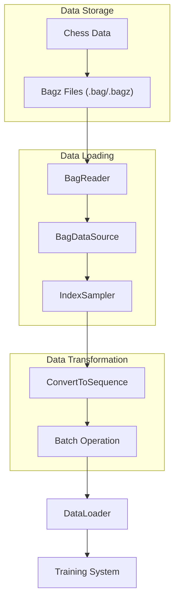
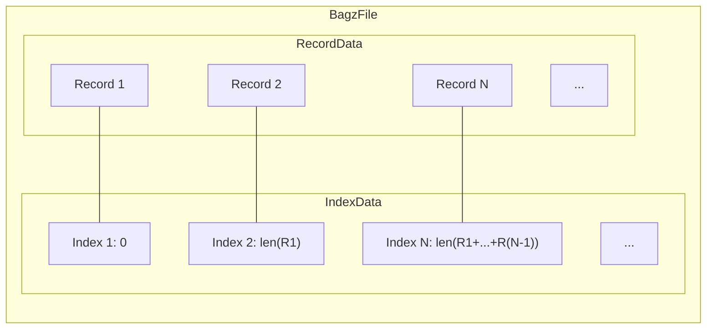
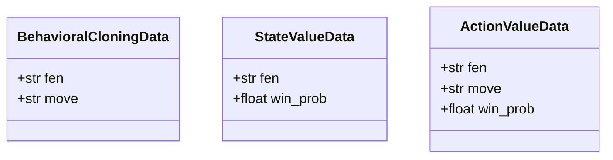
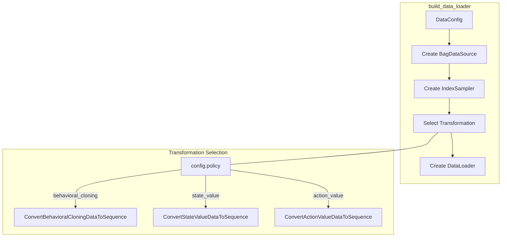
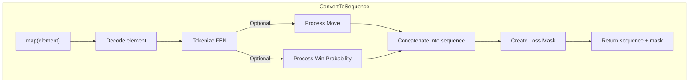

<!-- source: DeepWiki mcp.deepwiki.com · repo google-deepmind/searchless_chess · page 4 Data Management · fetched 2026-10-26 -->

# Data Management

<details>
<summary>Relevant source files</summary>

The following files were used as context for generating this wiki page:

- [src/bagz.py](src/bagz.py)
- [src/constants.py](src/constants.py)
- [src/data_loader.py](src/data_loader.py)

</details>


This document describes the data management system in the SearchLess Chess codebase, focusing on how chess data is stored, loaded, and processed for training transformer models. For information about the training process itself, see [Training System](#3).

## Overview

The data management system consists of several key components:

1. **Bagz File Format**: A custom file format for efficient storage and retrieval of chess data
2. **Data Types**: Structured chess data for different training objectives
3. **Data Loading Pipeline**: PyGrain-based data loading infrastructure
4. **Data Transformations**: Conversion of chess data into token sequences for transformer models



Sources: [src/bagz.py](), [src/data_loader.py]()

## Data Organization

The system organizes chess data in a specific directory structure, with separate files for different data types and splits:

```
data/
├── train/
│   ├── behavioral_cloning_data.bag
│   ├── action_value_data.bag
│   └── state_value_data.bag
└── test/
    ├── behavioral_cloning_data.bag
    ├── action_value_data.bag
    └── state_value_data.bag
```

Data files are referenced in code as shown below:

```python
data_source = bagz.BagDataSource(
    os.path.join(
        os.getcwd(),
        f'../data/{config.split}/{config.policy}_data.bag',
    ),
)
```

Sources: [src/data_loader.py:134-138]()

## Bagz File Format

The Bagz file format provides efficient storage and retrieval of data records with fast index-based lookup and optional compression using zstandard.

### File Structure



The Bagz implementation consists of these key classes:

- **BagFileReader**: Reads a single Bagz file [src/bagz.py:37-110]()
- **BagShardReader**: Reads sharded Bagz files [src/bagz.py:112-155]()
- **BagReader**: Unified interface for both file types [src/bagz.py:158-200]()
- **BagWriter**: Writes data to Bagz files [src/bagz.py:203-261]()
- **BagDataSource**: PyGrain-compatible data source [src/bagz.py:263-292]()

The format supports both combined storage (records and indices in one file) and separate storage (records and indices in separate files).

Sources: [src/bagz.py:16-292]()

## Data Types

The system uses three main types of chess data, each serving a different training objective:



1. **Behavioral Cloning Data**: Used to train models to imitate expert moves
   - `fen`: Chess position in FEN notation
   - `move`: Chess move in algebraic notation

2. **State Value Data**: Used to train models to evaluate chess positions
   - `fen`: Chess position in FEN notation
   - `win_prob`: Probability of winning from that position

3. **Action Value Data**: Used to train models to evaluate specific moves
   - `fen`: Chess position in FEN notation
   - `move`: Chess move in algebraic notation
   - `win_prob`: Probability of winning after making that move

The system defines Apache Beam coders for serializing and deserializing these data types:

```python
CODERS = {
    'fen': coders.StrUtf8Coder(),
    'move': coders.StrUtf8Coder(),
    'count': coders.BigIntegerCoder(),
    'win_prob': coders.FloatCoder(),
}
CODERS['state_value'] = coders.TupleCoder((CODERS['fen'], CODERS['win_prob']))
CODERS['action_value'] = coders.TupleCoder((CODERS['fen'], CODERS['move'], CODERS['win_prob']))
CODERS['behavioral_cloning'] = coders.TupleCoder((CODERS['fen'], CODERS['move']))
```

Sources: [src/constants.py:85-119]()

## Data Loading Pipeline

The data loading pipeline utilizes PyGrain for efficient data processing. The `build_data_loader` function creates a complete data loading pipeline:



Key parameters in the data loading pipeline:
- **Data source**: Points to the appropriate .bag file
- **Sampler options**: Control shuffling, sharding, and record selection
- **Policy type**: Determines which transformation to apply
- **Worker count**: Controls parallel processing

Sources: [src/data_loader.py:132-170]()

## Data Transformations

The data transformations convert raw chess data into token sequences suitable for training transformer models. All transformations inherit from the abstract `ConvertToSequence` class.



### Sequence Conversion Process

1. **FEN Tokenization**: Chess positions in FEN notation are tokenized into integer arrays using `tokenizer.tokenize`
2. **Move Conversion**: Chess moves are converted to action IDs using the `MOVE_TO_ACTION` mapping
3. **Win Probability Quantization**: Win probabilities are mapped to discrete buckets
4. **Concatenation**: These components are concatenated into a single integer sequence
5. **Loss Mask Creation**: A boolean mask indicates which positions to compute loss for during training

Each transformation produces sequences of different lengths:
- **Behavioral Cloning**: `tokenizer.SEQUENCE_LENGTH + 1` (position + move)
- **State Value**: `tokenizer.SEQUENCE_LENGTH + 1` (position + value)
- **Action Value**: `tokenizer.SEQUENCE_LENGTH + 2` (position + move + value)

Sources: [src/data_loader.py:50-121]()

## Integration with Training

The data loader provides batches of data to the training system in the form of:
1. **Sequences**: Integer arrays representing tokenized positions, moves, and/or values
2. **Loss Masks**: Boolean arrays indicating which positions to compute loss for

These batches feed directly into the training loop, where transformer models learn to predict the appropriate outputs based on the input sequences.

For details on how this data is used in training, see [Training System](#3).

Sources: [src/data_loader.py]()

---

