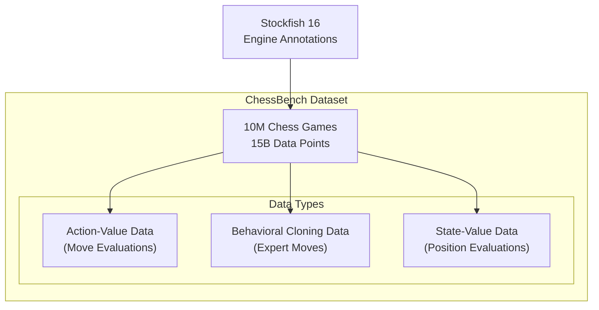
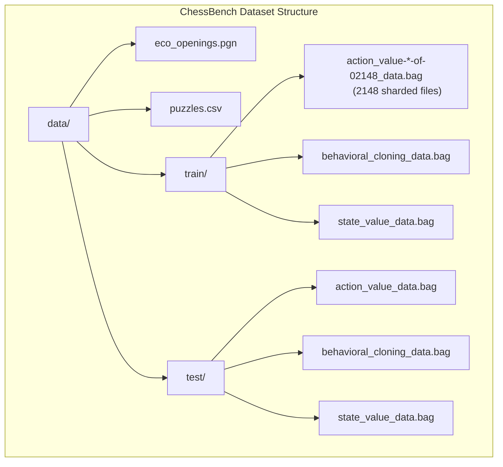
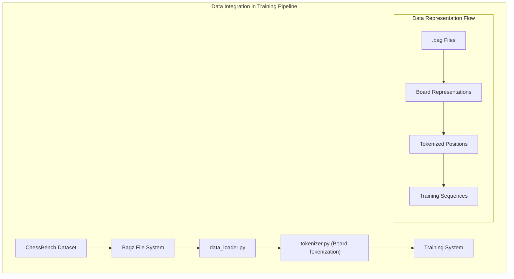
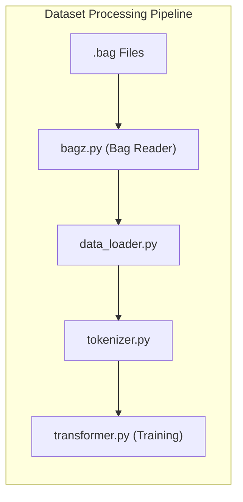
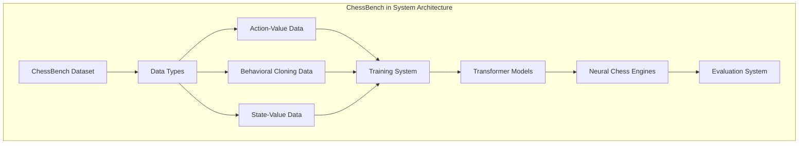

<!-- source: DeepWiki mcp.deepwiki.com · repo google-deepmind/searchless_chess · page 4.1 ChessBench Dataset · fetched 2026-10-26 -->

# ChessBench Dataset

<details>
<summary>Relevant source files</summary>

The following files were used as context for generating this wiki page:

- [README.md](README.md)
- [data/download.sh](data/download.sh)

</details>


## Purpose and Scope

This document describes the ChessBench dataset, a large-scale chess benchmark used for training transformer-based chess models in the searchless_chess project. It covers dataset structure, content, and access instructions. For information about the data loading pipeline that processes this dataset, see [Data Management](#4), and for details about the custom Bagz file format used to store the dataset, see [Bagz File Format](#4.2).

## Dataset Overview

ChessBench is a comprehensive chess dataset containing 10 million chess games with legal move and value annotations, totaling approximately 15 billion data points. These annotations are provided by Stockfish 16, the state-of-the-art chess engine at the time of dataset creation. The dataset serves as the foundation for training transformer models to play chess without traditional search algorithms.



Sources: [README.md:10-16]()

## Dataset Structure

The ChessBench dataset is organized into train and test splits, with multiple file types for different learning targets.

### Organization



Sources: [data/download.sh:20-38](), [README.md:31-35]()

### Dataset Size

The ChessBench dataset is quite large, with the training portion requiring significant storage space:

| Split | Data Type | Size |
|-------|-----------|------|
| Train | Action-Value | 1.1 TB (2148 sharded files) |
| Train | Behavioral Cloning | 34 GB |
| Train | State-Value | 36 GB |
| Test | Action-Value | 141 MB |
| Test | Behavioral Cloning | 4.1 MB |
| Test | State-Value | 4.4 MB |
| Test | Puzzles | 4.5 MB |

Sources: [README.md:160-167]()

## Dataset Content

The ChessBench dataset contains three primary types of data, each serving a different purpose in the training process:

### Action-Value Data

Action-value data contains evaluations for each legal move in a given chess position. These evaluations are provided by Stockfish 16 and represent how good each move is expected to be. This data is used to train models that can evaluate the value of possible chess moves.

### Behavioral Cloning Data

Behavioral cloning data contains expert moves selected by Stockfish 16. This data is used to train models to imitate expert play through supervised learning.

### State-Value Data

State-value data contains evaluations of entire board positions. These evaluations indicate how favorable a position is overall. This data is used to train models that can evaluate chess positions.

### Puzzles

In addition to the main dataset, ChessBench includes a collection of chess puzzles stored in `puzzles.csv`. These puzzles are used for evaluating trained models' ability to find the best move in tactical situations.



Sources: [README.md:47-53]()

## Accessing the Dataset

The ChessBench dataset can be downloaded using the provided script:

```bash
cd data
./download.sh
```

Alternatively, individual components can be downloaded from the following URLs:

| Split | Data Type | Download Link |
|-------|-----------|--------------|
| Train | Action-Value | https://storage.googleapis.com/searchless_chess/data/train/action_value-00000-of-02148_data.bag (first shard of 2148) |
| Train | Behavioral Cloning | https://storage.googleapis.com/searchless_chess/data/train/behavioral_cloning_data.bag |
| Train | State-Value | https://storage.googleapis.com/searchless_chess/data/train/state_value_data.bag |
| Test | Action-Value | https://storage.googleapis.com/searchless_chess/data/test/action_value_data.bag |
| Test | Behavioral Cloning | https://storage.googleapis.com/searchless_chess/data/test/behavioral_cloning_data.bag |
| Test | State-Value | https://storage.googleapis.com/searchless_chess/data/test/state_value_data.bag |
| Test | Puzzles | https://storage.googleapis.com/searchless_chess/data/puzzles.csv |

Note that the complete training dataset requires approximately 1.2 TB of disk space, with the action-value data accounting for the majority (1.1 TB).

Sources: [README.md:149-167](), [data/download.sh:1-39]()

## Dataset File Format and Processing

The ChessBench dataset is stored in a custom `.bag` file format designed for efficient storage and access of structured chess data. These files are read using the `bagz.py` module, which provides readers for extracting and processing the data.



Sources: [README.md:47-53]()

## Dataset License

The ChessBench dataset has a mixed licensing structure:
- Some portions are in the public domain via Creative Commons CC0 license from lichess.org
- The remainder is licensed under Creative Commons Attribution 4.0 (CC-BY)

Sources: [README.md:286-291]()

## Integration with Training System

In the searchless_chess system, the ChessBench dataset is a critical component that feeds into the training pipeline. The dataset is used to train transformer models of various sizes (9M, 136M, and 270M parameters) to predict action values, state values, or imitate expert moves through behavioral cloning.



Sources: [README.md:8-16]()

---

