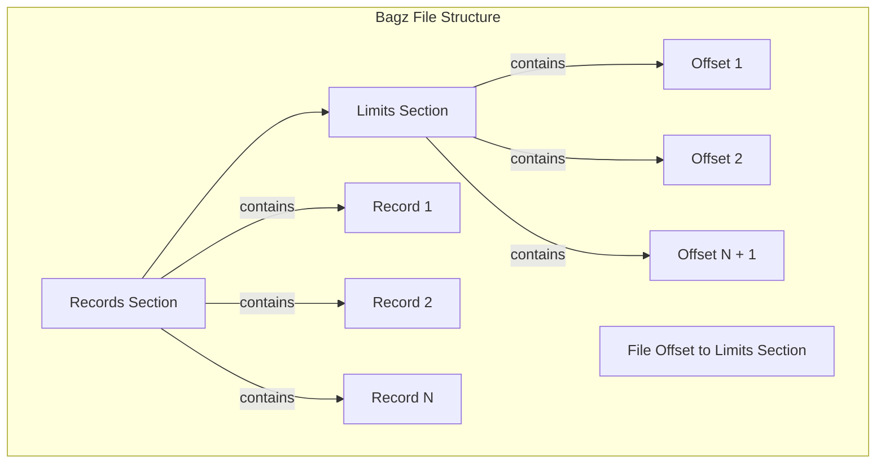
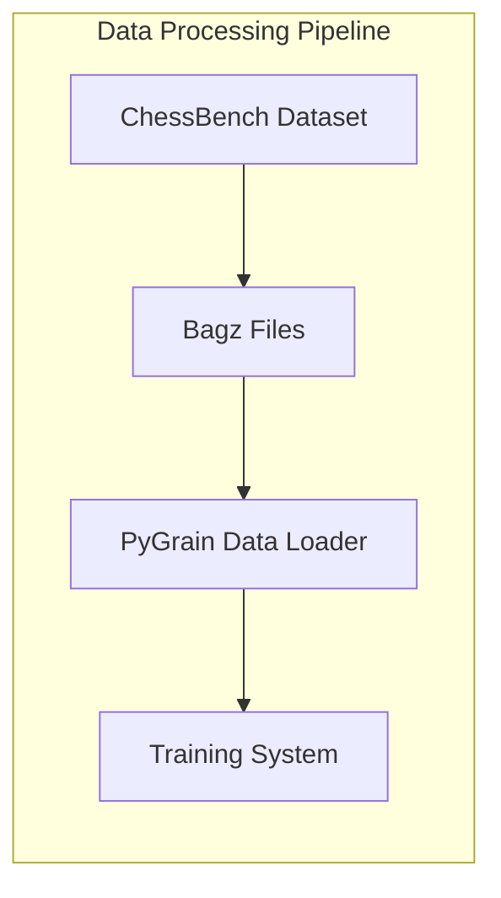

<!-- source: DeepWiki mcp.deepwiki.com · repo google-deepmind/searchless_chess · page 4.2 Bagz File Format · fetched 2026-10-26 -->

# Bagz File Format

<details>
<summary>Relevant source files</summary>

The following files were used as context for generating this wiki page:

- [src/bagz.py](src/bagz.py)

</details>


## Introduction

The Bagz file format is a specialized storage format used in the SearchLess Chess project for efficiently storing and accessing training data. It is designed to store sequences of string records (typically serialized protocol buffers) with support for fast index-based lookups. The format is particularly optimized for handling large datasets required for training transformer-based chess models.

For information about the overall data management system, see [Data Management](#4).

Sources: [src/bagz.py:16-20]()

## File Format Structure

The Bagz file format consists of two main components:

1. **Records Section**: Contains the actual record data, stored sequentially
2. **Limits Section**: Contains the byte offsets of each record, allowing fast access

In the default configuration, these two sections are stored in a single file, with the limits section appended to the end. Optionally, the limits can be stored in a separate file for specialized use cases.



The file structure works as follows:
- Each record is stored sequentially in the file
- The limits section contains 8-byte (64-bit) integers that mark the ending offset of each record
- For a single file, the final 8 bytes contain the starting offset of the limits section
- To access record `i`, the reader reads offsets `i` and `i+1` from the limits section and extracts the bytes between those offsets from the records section

Sources: [src/bagz.py:77-93](), [src/bagz.py:99-109](), [src/bagz.py:250-260]()

## File Types

The Bagz format supports two types of files:

1. **Single Files**: A single file containing all records and limits
2. **Sharded Files**: Multiple files where data is split across shards

Sharding is particularly useful for large datasets that exceed comfortable file size limits or for distributing data processing across multiple workers.

### Sharding Naming Convention

Sharded Bagz files follow a specific naming convention:
- The base filename includes a pattern `@N` where `N` is the total number of shards
- Each individual shard is named using the pattern `-XXXXX-of-YYYYY` where:
  - `XXXXX` is the zero-padded shard index (starting from 00000)
  - `YYYYY` is the zero-padded total number of shards

For example, a base name `data@100.bagz` would result in files like:
- `data-00000-of-00100.bagz`
- `data-00001-of-00100.bagz`
- ...
- `data-00099-of-00100.bagz`

Sources: [src/bagz.py:112-155](), [src/bagz.py:178-186]()

## Reading Bagz Files

The library provides a hierarchy of reader classes:

```mermaid
classDiagram
    class "Sequence[bytes]" {
        <<Protocol>>
        +__len__() int
        +__getitem__(index) bytes
    }
    
    class "BagReader" {
        -_reader
        +__init__(filename, separate_limits, decompress)
        +__len__() int
        +__getitem__(index) bytes
    }
    
    class "BagFileReader" {
        -_records
        -_limits
        -_num_records
        -_limits_start
        -_process
        +__init__(filename, separate_limits, decompress)
        +__len__() int
        +__getitem__(index) bytes
    }
    
    class "BagShardReader" {
        -_bags
        -_accum
        +__init__(filename, separate_limits, decompress)
        +__len__() int
        +__getitem__(index) bytes
    }
    
    "Sequence[bytes]" <|.. "BagFileReader"
    "Sequence[bytes]" <|.. "BagShardReader"
    "Sequence[bytes]" <|.. "BagReader"
    "BagReader" o-- "BagFileReader"
    "BagReader" o-- "BagShardReader"
    "BagShardReader" o-- "BagFileReader"
```

### Usage Example

To read from Bagz files, use the `BagReader` class which automatically handles both single files and sharded files:

```python
from src.bagz import BagReader

# Read from a single file
reader = BagReader("data.bagz")
record = reader[0]  # Get first record

# Read from sharded files
sharded_reader = BagReader("data@100.bagz")
record = sharded_reader[42]  # Get 43rd record across all shards
```

The `BagReader` acts as a facade over `BagFileReader` and `BagShardReader`, automatically selecting the appropriate implementation based on the filename pattern.

Sources: [src/bagz.py:37-109](), [src/bagz.py:112-155](), [src/bagz.py:158-200]()

## Writing Bagz Files

The library provides a `BagWriter` class for creating Bagz files:

```mermaid
classDiagram
    class "BagWriter" {
        -_records
        -_limits
        -_separate_limits
        -_process
        +__init__(filename, separate_limits, compress, compression_level)
        +write(data)
        +flush()
        +close()
        +__enter__()
        +__exit__()
    }
```

### Usage Example

```python
from src.bagz import BagWriter

# Create a new Bagz file
with BagWriter("output.bagz") as writer:
    writer.write(b"Record 1")
    writer.write(b"Record 2")
    writer.write(b"Record 3")
    # File is automatically closed when exiting the context
```

When the file is closed, the writer automatically:
1. Completes the record section
2. Either appends the limits section to the record file (default)
3. Or keeps the limits in a separate file (if `separate_limits=True`)

Sources: [src/bagz.py:203-260]()

## Integration with PyGrain

The Bagz format includes a PyGrain-compatible data source interface through the `BagDataSource` class. [PyGrain](https://github.com/google/grain) is a data processing library for training machine learning models.

```mermaid
classDiagram
    class "BagDataSource" {
        -_path
        -_reader
        -_num_records
        +__init__(path)
        +__len__() int
        +__getitem__(record_key) bytes
        +__getstate__()
        +__setstate__(state)
        +__repr__() str
    }
    
    class "BagReader" {
        +__len__() int
        +__getitem__(index) bytes
    }
    
    "BagDataSource" o-- "BagReader"
```

The `BagDataSource` class wraps a `BagReader` and implements the necessary interface for PyGrain to use Bagz files as data sources in training pipelines.

Sources: [src/bagz.py:263-292]()

## Compression

The Bagz format supports compression of records using the Zstandard library. Compression can be controlled through:

1. **File extension**: Files with `.bagz` extension are automatically compressed/decompressed unless overridden
2. **Explicit flags**: `compress`/`decompress` parameters in the reader and writer constructors
3. **Compression level**: The `compression_level` parameter in the writer (higher values = better compression but slower)

Compression is particularly useful for storing large datasets more efficiently, especially when records contain redundant data.

Sources: [src/bagz.py:54-58](), [src/bagz.py:223-226]()

## Usage in SearchLess Chess

In the SearchLess Chess project, the Bagz format is a crucial component of the data processing pipeline, sitting between the ChessBench dataset and the training system:



The Bagz files store different types of chess training data:
- Action Value data (for move evaluation)
- Behavioral Cloning data (for move imitation)
- State Value data (for position evaluation)

This storage format provides efficient random access to examples during training while supporting the large scale necessary for training transformer models.

Sources: [src/bagz.py:16-20]()

## Performance Considerations

The Bagz format is optimized for:

1. **Fast random access**: Using memory-mapped files and indexed offsets
2. **Efficient storage**: Optional compression with configurable levels
3. **Large datasets**: Support for sharding across multiple files
4. **Parallel processing**: Each shard can be processed independently

These characteristics make it well-suited for machine learning training workflows where efficient access to large datasets is critical.

Sources: [src/bagz.py:37-49](), [src/bagz.py:112-129]()

## Technical Implementation Details

### Memory Mapping

The Bagz reader uses memory mapping (`mmap`) to efficiently access file contents without loading the entire file into memory. This provides better performance for large files and reduces memory usage.

### Binary Format

The limits section uses 8-byte (64-bit) little-endian integers (`<q` format in `struct.pack`/`struct.unpack`) to store offsets, allowing for files up to 2^63 bytes in size.

### Error Handling

The implementation includes various checks to ensure file integrity:
- Validation of file size (must be at least 8 bytes for the index)
- Proper handling of empty files
- Index range checking during record access

Sources: [src/bagz.py:60-93](), [src/bagz.py:99-109]()

---

