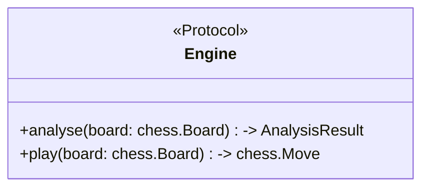
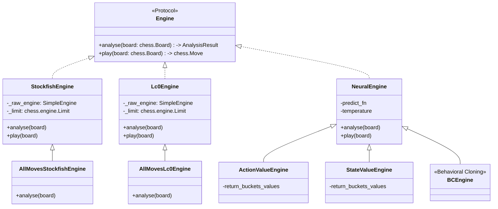
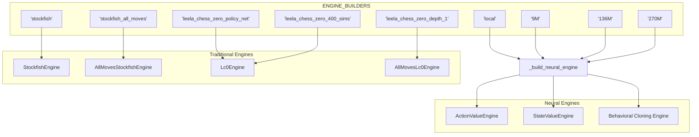
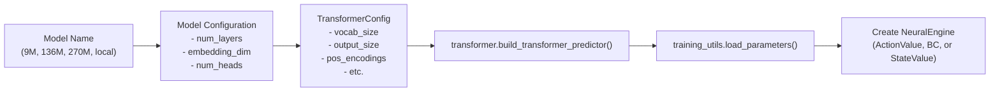

<!-- source: DeepWiki mcp.deepwiki.com · repo google-deepmind/searchless_chess · page 5 Chess Engines · fetched 2026-10-26 -->

# Chess Engines

Relevant source files

The following files were used as context for generating this wiki page:

- [src/engines/constants.py](src/engines/constants.py)
- [src/engines/engine.py](src/engines/engine.py)

This page documents the chess engine system in the searchless_chess project. It describes the engine interface, the various types of engines implemented (including neural-based and traditional engines), and how these engines are constructed and configured. For information about the neural engine architectures specifically, see [Neural Engines](#5.1).

## Engine Interface

The searchless_chess project defines a consistent protocol for all chess engines, enabling interchangeability between different engine implementations. This interface provides two key methods that all engines must implement:

The `Engine` protocol requires:
- `analyse()`: Returns detailed analysis results from the engine for a given position
- `play()`: Returns the best move for a given position according to the engine

The protocol also defines an `AnalysisResult` type, which is a mapping containing various analysis outputs from the engine.

Sources: [src/engines/engine.py:33-39]()

## Engine Hierarchy

The codebase implements several engine types that conform to this protocol, including neural network-based engines and wrappers for traditional chess engines:

Sources: [src/engines/constants.py:105-141]()

## Engine Types

### Neural Engines

The neural engines use transformer models to predict chess moves without traditional search algorithms. These engines come in three flavors based on their prediction targets:

1. **Action Value Engines**: Predict the value of possible moves
2. **State Value Engines**: Predict the value of board positions
3. **Behavioral Cloning Engines**: Imitate expert play

The project includes pre-trained models of different sizes:

| Model | Parameters | Layers | Embedding Dimension | Attention Heads |
|-------|------------|--------|---------------------|-----------------|
| 9M    | 9 million  | 8      | 256                 | 8               |
| 136M  | 136 million| 8      | 1024                | 8               |
| 270M  | 270 million| 16     | 1024                | 8               |
| local | Small test | 4      | 64                  | 4               |

Sources: [src/engines/constants.py:42-58](), [src/engines/constants.py:76-87]()

### Traditional Engines

The system integrates with two popular traditional chess engines:

#### Stockfish

Stockfish is a powerful open-source chess engine that uses alpha-beta pruning and other search techniques. The system provides two Stockfish variants:

- **StockfishEngine**: Returns only the best move for a position
- **AllMovesStockfishEngine**: Analyzes all legal moves in a position

Sources: [src/engines/constants.py:126-131]()

#### Leela Chess Zero (Lc0)

Leela Chess Zero is a neural network-based chess engine that uses Monte Carlo Tree Search (MCTS). The system offers several Lc0 configurations:

- **Lc0Engine with nodes=1**: Uses only the policy network without search
- **Lc0Engine with nodes=400**: Performs 400 simulations using MCTS
- **AllMovesLc0Engine**: Analyzes all legal moves using the Lc0 policy network

Sources: [src/engines/constants.py:132-140]()

## Engine Construction

The system uses a factory pattern to instantiate various engine types. The `ENGINE_BUILDERS` dictionary maps engine names to factory functions that create engine instances:

Sources: [src/engines/constants.py:115-141]()

### Neural Engine Construction Process

The `_build_neural_engine` function constructs neural engines based on model size and policy type:

The neural engines use a transformer-based predictor with appropriate parameters loaded from checkpoints. Model parameters are selected based on the model name, with different model sizes providing a trade-off between performance and computational requirements.

Sources: [src/engines/constants.py:36-112]()

## Using Chess Engines

To use an engine from the system, you can instantiate it from the `ENGINE_BUILDERS` dictionary:

1. Select an engine type from the available options
2. Create an instance using the corresponding builder function
3. Use the `analyse()` method to evaluate a position
4. Use the `play()` method to get the best move

Neural engines can process board positions directly, while the traditional engine wrappers manage the communication with external engine processes.

The engines provide a unified interface that makes it easy to swap different implementations for evaluation or comparison purposes. This enables testing the relative performance of the transformer-based searchless approach against traditional search-based engines.

Sources: [src/engines/engine.py:33-39](), [src/engines/constants.py:115-141]()

---

