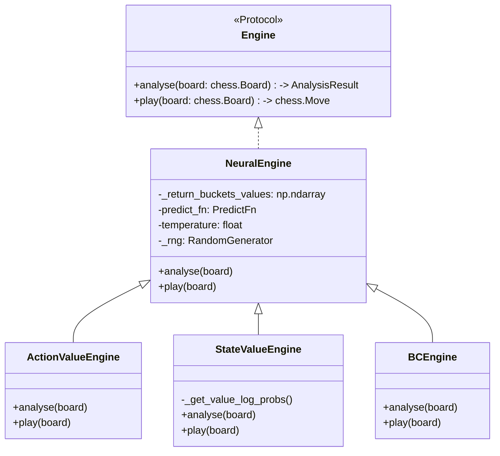
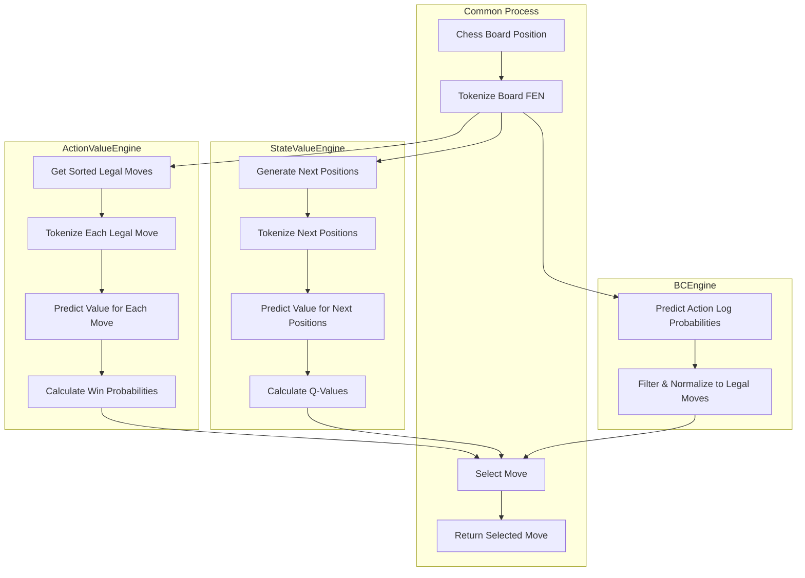
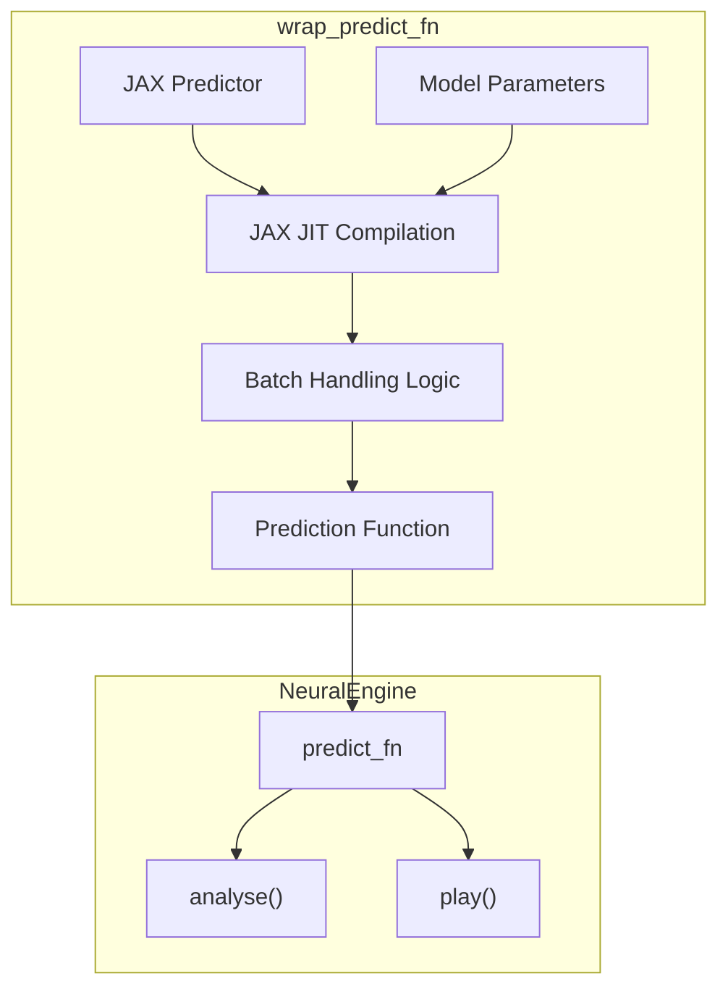
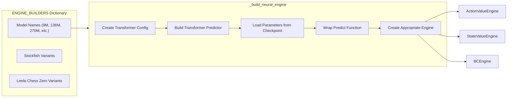

<!-- source: DeepWiki mcp.deepwiki.com · repo google-deepmind/searchless_chess · page 5.1 Neural Engines · fetched 2026-10-26 -->

# Neural Engines

<details>
<summary>Relevant source files</summary>

The following files were used as context for generating this wiki page:

- [src/engines/constants.py](src/engines/constants.py)
- [src/engines/neural_engines.py](src/engines/neural_engines.py)

</details>


## Purpose and Overview

Neural Engines are the core components of the SearchLess Chess system that enable chess playing without traditional tree search algorithms. They use trained transformer models to evaluate chess positions and select moves through amortized planning. Unlike traditional chess engines like Stockfish or Leela Chess Zero (see [Stockfish Integration](#5.2) and [Leela Chess Zero Integration](#5.3)), Neural Engines rely solely on the pattern recognition capabilities of large transformer models.

This document describes the different types of Neural Engines available in the system, their architecture, and how they function to select moves in a chess game.

Sources: [src/engines/neural_engines.py:16-17](), [src/engines/neural_engines.py:36-41]()

## Neural Engine Architecture

Neural Engines implement the standard Engine interface but use neural networks for decision-making. All Neural Engines inherit from the base `NeuralEngine` class and are specialized based on the policy they implement.



**Neural Engine Class Hierarchy**

Sources: [src/engines/neural_engines.py:36-54](), [src/engines/neural_engines.py:70-104](), [src/engines/neural_engines.py:106-155](), [src/engines/neural_engines.py:158-189]()

## Neural Engine Types

The system implements three types of neural engines, each using a different approach to evaluate positions and select moves:

| Engine Type | Policy | Description | Prediction Target |
|-------------|--------|-------------|------------------|
| ActionValueEngine | action_value | Predicts the value of each legal move | P(r \| s, a) - probability of returns given state and action |
| StateValueEngine | state_value | Predicts the value of the position, then evaluates moves by looking one step ahead | P(r \| s) - probability of returns given state |
| BCEngine | behavioral_cloning | Directly imitates expert play by predicting move probabilities | P(a \| s) - probability of actions given state |

Sources: [src/engines/neural_engines.py:70-189](), [src/engines/neural_engines.py:230-234]()

## Neural Engine Decision Flow

Each type of neural engine follows a different process to select a move:



**Neural Engine Decision Flow**

Sources: [src/engines/neural_engines.py:73-103](), [src/engines/neural_engines.py:109-155](), [src/engines/neural_engines.py:161-189]()

## Decision-Making Process Details

### ActionValueEngine

The `ActionValueEngine` predicts the value of each legal move directly:

1. Tokenizes the current board position
2. Gets all legal moves and tokenizes each one
3. Combines board and move tokens to create inputs for the model
4. For each (board, move) pair, predicts a probability distribution over return buckets
5. Computes expected value for each move by taking the inner product with return bucket values
6. Either selects the highest-value move (deterministic) or samples based on temperature

Sources: [src/engines/neural_engines.py:73-103]()

### StateValueEngine

The `StateValueEngine` performs a one-step lookahead:

1. Tokenizes the current board position
2. Predicts value distribution for the current position
3. For each legal move:
   - Makes the move on a copy of the board
   - Tokenizes the resulting position
   - Predicts value distribution for that position
4. Computes expected values for each resulting position
5. Selects the move leading to the best position

Sources: [src/engines/neural_engines.py:109-155]()

### BCEngine

The `BCEngine` directly predicts move probabilities:

1. Tokenizes the current board position
2. Predicts log probabilities for all possible moves
3. Filters to only legal moves and renormalizes
4. Either selects the highest-probability move or samples based on temperature

Sources: [src/engines/neural_engines.py:161-189]()

## Prediction Function Wrapping

Neural engines use a wrapped prediction function that efficiently handles batching:



**Prediction Function Wrapping**

Sources: [src/engines/neural_engines.py:192-227]()

## Available Pre-trained Models

The system includes several pre-trained models that can be used with the neural engines:

| Model Name | Parameters | Layers | Embedding Dim | Heads | Default Policy | Checkpoint Step |
|------------|------------|--------|---------------|-------|----------------|----------------|
| 9M | 9 million | 8 | 256 | 8 | action_value | 6,400,000 |
| 136M | 136 million | 8 | 1024 | 8 | action_value | 6,400,000 |
| 270M | 270 million | 16 | 1024 | 8 | action_value | 6,400,000 |
| local | Small test model | 4 | 64 | 4 | action_value | Latest |

Sources: [src/engines/constants.py:42-64](), [src/engines/constants.py:115-125]()

## Engine Creation Process

The engine creation process is streamlined through the `ENGINE_BUILDERS` dictionary, which maps engine names to builder functions:



**Engine Creation Process**

Sources: [src/engines/constants.py:36-114](), [src/engines/constants.py:115-141]()

## Implementation Details

### Return Bucket Values

The system uses a bucketing approach to represent the return (or win probability) values:

1. Return values are divided into buckets (default: 128)
2. The model predicts a probability distribution over these buckets
3. The expected return is calculated by taking the inner product of these probabilities with the bucket values

Sources: [src/engines/constants.py:102-104](), [src/engines/neural_engines.py:95-96]()

### Temperature Sampling

All neural engines support temperature-based move selection:

1. With temperature = 0 (or None): Select the highest-value move deterministically
2. With temperature > 0: Sample moves proportionally to their softmax-transformed values
   - Higher temperature → more exploration/randomness
   - Lower temperature → more exploitation/determinism

Sources: [src/engines/neural_engines.py:98-103](), [src/engines/neural_engines.py:150-155](), [src/engines/neural_engines.py:182-189]()

## Usage Example

Neural engines are typically created through the `ENGINE_BUILDERS` dictionary, which provides pre-configured builders for different model sizes:

```python
from searchless_chess.src.engines.constants import ENGINE_BUILDERS

# Create a neural engine using the 9M parameter model
engine_9m = ENGINE_BUILDERS['9M']()

# Create a neural engine using the 136M parameter model
engine_136m = ENGINE_BUILDERS['136M']()

# Use the engine to analyze a position
board = chess.Board()
analysis = engine_136m.analyse(board)

# Use the engine to play a move
move = engine_136m.play(board)
```

Sources: [src/engines/constants.py:115-125]()

---

