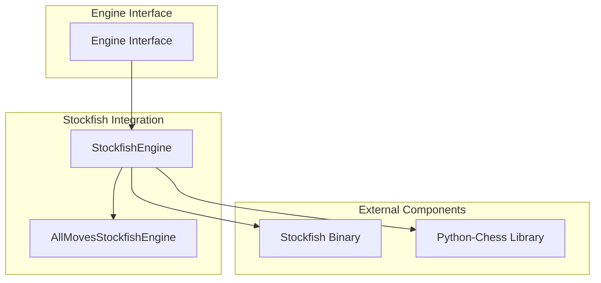
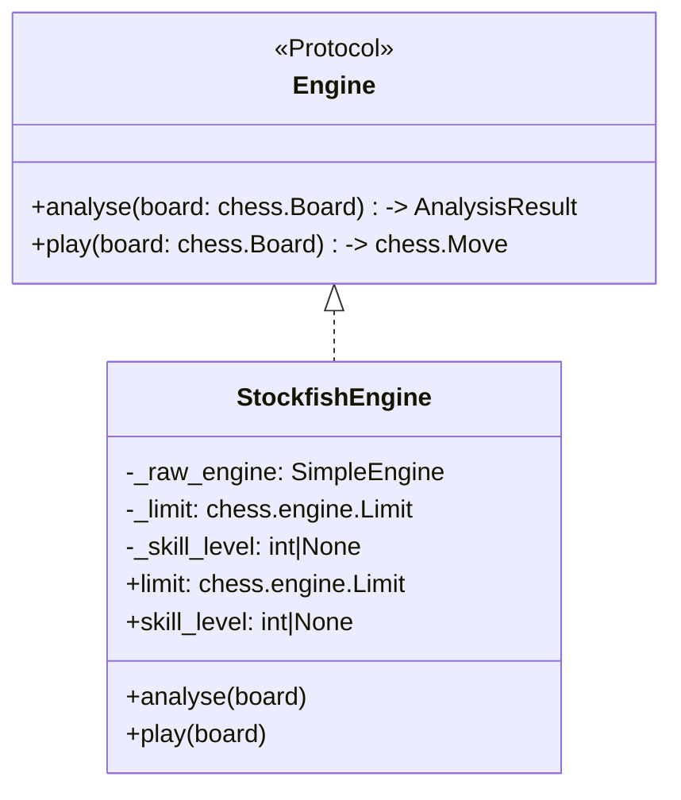
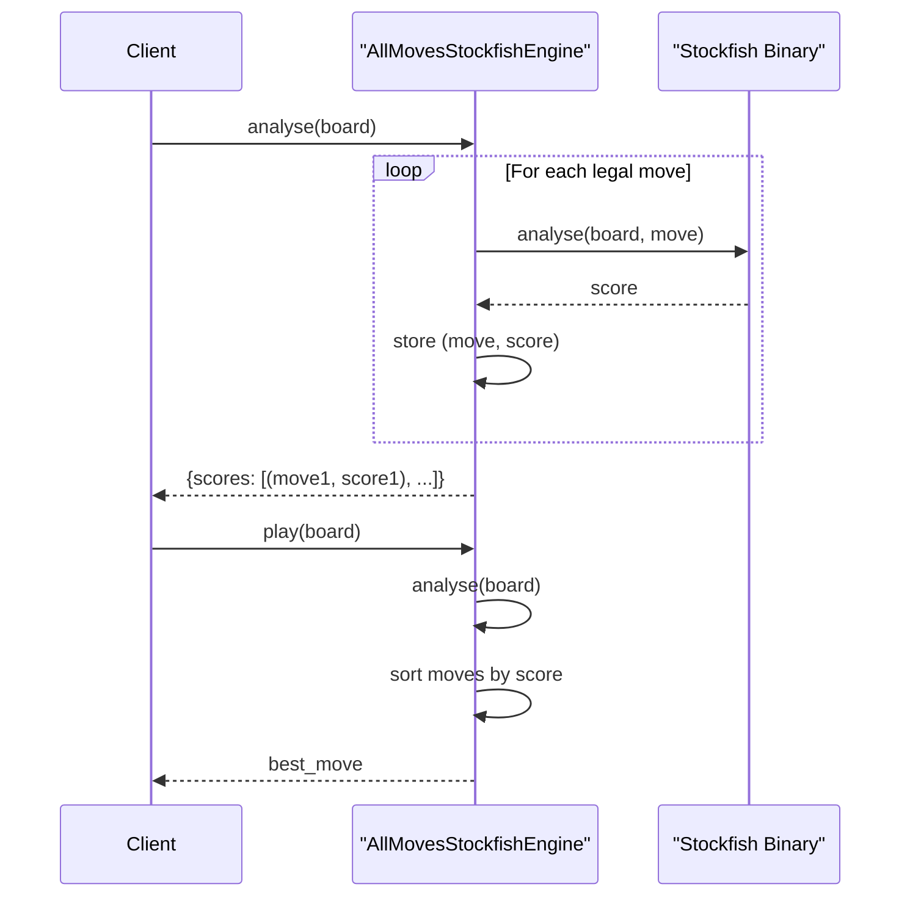
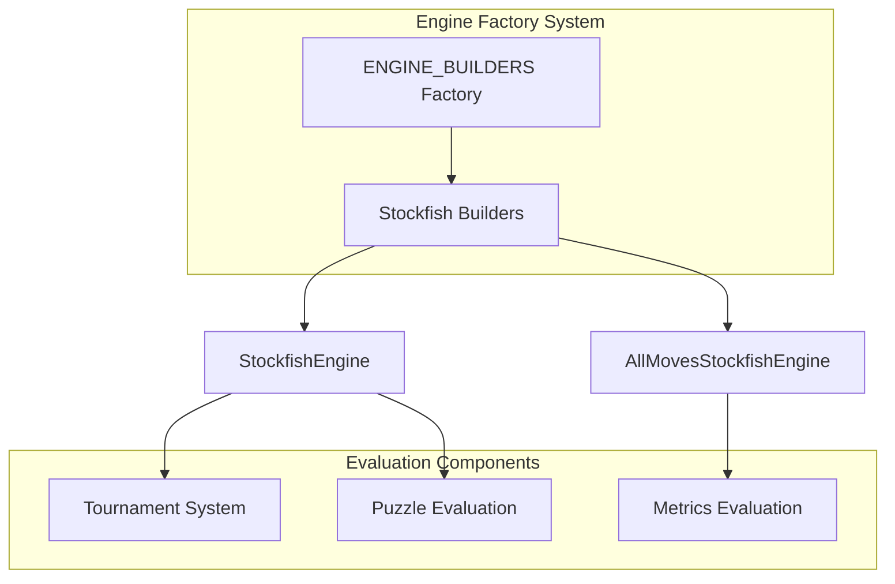

<!-- source: DeepWiki mcp.deepwiki.com · repo google-deepmind/searchless_chess · page 5.2 Stockfish Integration · fetched 2026-10-26 -->

# Stockfish Integration

<details>
<summary>Relevant source files</summary>

The following files were used as context for generating this wiki page:

- [src/engines/stockfish_engine.py](src/engines/stockfish_engine.py)

</details>


This document details the integration of the Stockfish chess engine within the SearchLess Chess project. It explains how Stockfish is wrapped to provide a consistent interface with other engines in the system, the different Stockfish variants available, and how to configure them. For information about other chess engines, see [Neural Engines](#5.1) or [Leela Chess Zero Integration](#5.3).

## Overview

The SearchLess Chess project includes integration with Stockfish, a powerful open-source chess engine, to provide traditional search-based gameplay for comparison and evaluation purposes. Stockfish serves as a baseline against which the transformer-based neural engines can be evaluated.



Sources: [src/engines/stockfish_engine.py](). This diagram shows how the Stockfish integration fits into the engine interface hierarchy.

## StockfishEngine Class

The `StockfishEngine` class provides a wrapper around the Stockfish chess engine, implementing the common `Engine` interface used throughout the system.

### Implementation Details

The `StockfishEngine` class:
- Wraps the Stockfish engine using the Python-Chess library's `SimpleEngine` interface
- Accepts a `chess.engine.Limit` parameter to control search depth or time
- Provides methods to analyze positions and determine the best move
- Supports configuring Stockfish's skill level



Sources: [src/engines/stockfish_engine.py:25-65]()

### Key Properties and Methods

- **Initialization**: The engine is initialized with a `chess.engine.Limit` object that controls search parameters
- **Skill Level**: The engine supports setting a skill level (0-20) to adjust playing strength
- **analyse()**: Returns detailed analysis results from Stockfish for a given board position
- **play()**: Returns the best move from Stockfish for a given board position

## AllMovesStockfishEngine Class

The `AllMovesStockfishEngine` is a specialized variant of `StockfishEngine` that evaluates each legal move individually. This approach provides more detailed information about all possible moves rather than just focusing on the best move.

### Implementation Details

The `AllMovesStockfishEngine` class:
- Inherits from `StockfishEngine`
- Overrides the `analyse()` method to evaluate each legal move separately
- Overrides the `play()` method to select the move with the highest score from the individual evaluations



Sources: [src/engines/stockfish_engine.py:68-88]()

## Setup and Configuration

To use the Stockfish integration, you must have the Stockfish binary installed. By default, the system looks for the Stockfish binary at `../Stockfish/src/stockfish` relative to the current working directory.

### Search Limits

The `chess.engine.Limit` object used to initialize a Stockfish engine can be configured with various parameters:

| Parameter | Description |
|-----------|-------------|
| `time` | Total thinking time in seconds |
| `depth` | Search depth in plies |
| `nodes` | Maximum number of nodes to search |
| `mate` | Search for mate in specified number of moves |
| `white_clock` | White's remaining time in seconds |
| `black_clock` | Black's remaining time in seconds |
| `white_inc` | White's increment per move in seconds |
| `black_inc` | Black's increment per move in seconds |
| `remaining_moves` | Number of moves to the next time control |

### Skill Level Configuration

Stockfish's playing strength can be adjusted using the `skill_level` property:

```python
# Example configuration
engine = StockfishEngine(chess.engine.Limit(time=0.1))
engine.skill_level = 10  # Set to intermediate strength (range 0-20)
```

## Usage Examples

### Basic Usage

```python
# Import required modules
import chess
import chess.engine
from searchless_chess.src.engines.stockfish_engine import StockfishEngine

# Create a board and an engine
board = chess.Board()
engine = StockfishEngine(chess.engine.Limit(time=0.1))

# Get the best move
move = engine.play(board)

# Get analysis for the current position
analysis = engine.analyse(board)
```

### Using AllMovesStockfishEngine

```python
from searchless_chess.src.engines.stockfish_engine import AllMovesStockfishEngine

# Create an engine that evaluates all moves
engine = AllMovesStockfishEngine(chess.engine.Limit(depth=15))

# Get scores for all legal moves
analysis = engine.analyse(board)
move_scores = analysis['scores']  # List of (move, score) tuples
```

## Integration with Evaluation System

The Stockfish engine implementations serve as baseline comparison models in the evaluation system. They're used in:

1. Tournament play against neural engines to establish Elo ratings
2. Puzzle solving evaluations
3. Move quality metrics (like Kendall's tau) to evaluate neural engines



Sources: [src/engines/stockfish_engine.py]()

## Technical Considerations

- The Stockfish engine process is automatically closed when the `StockfishEngine` instance is deleted, via the `__del__` method
- If Stockfish cannot find a best move, the `play()` method raises a `ValueError`
- The `AllMovesStockfishEngine` uses an ordered list of legal moves for consistent evaluation results

## Conclusion

The Stockfish integration provides a robust baseline for evaluating the neural engines in the SearchLess Chess project. By implementing the common `Engine` interface, Stockfish can be seamlessly integrated into the evaluation and tournament systems alongside the transformer-based neural engines.

---

