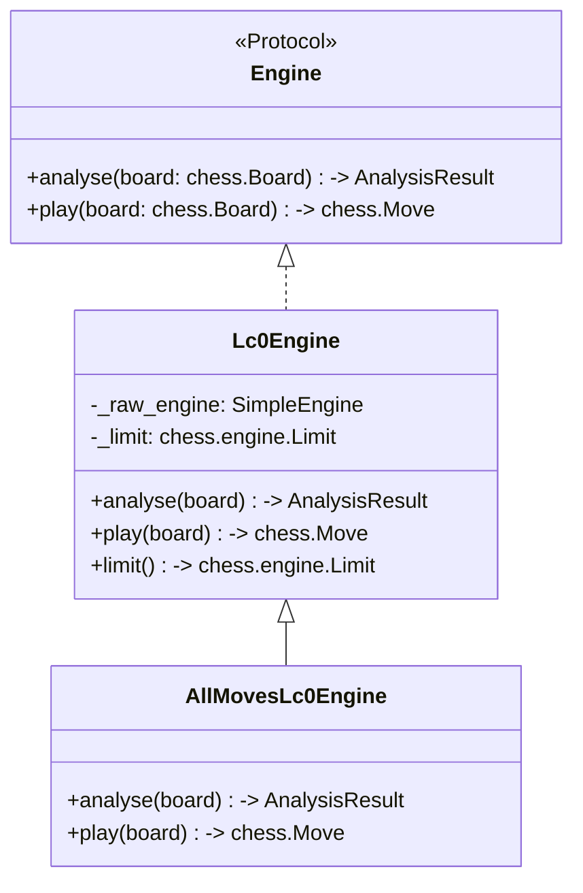
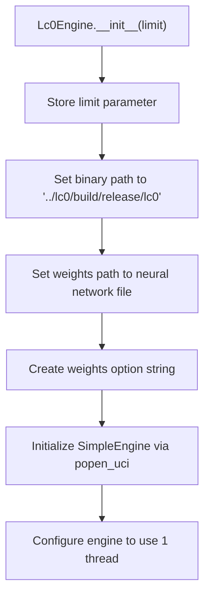
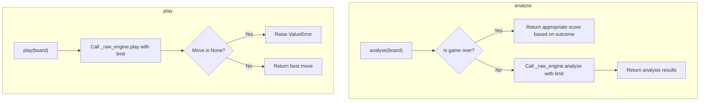
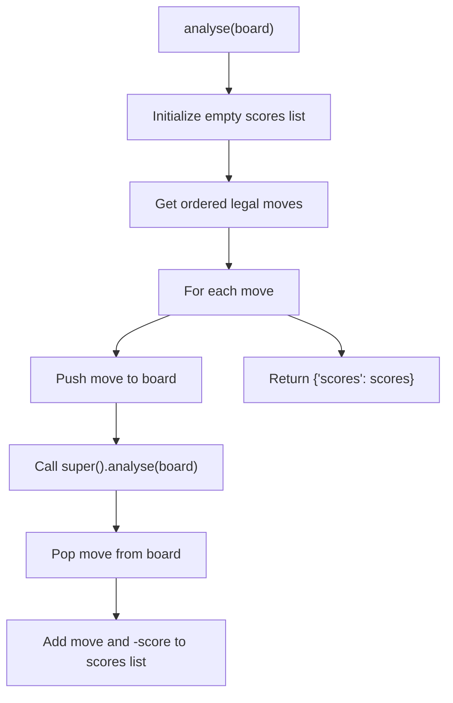
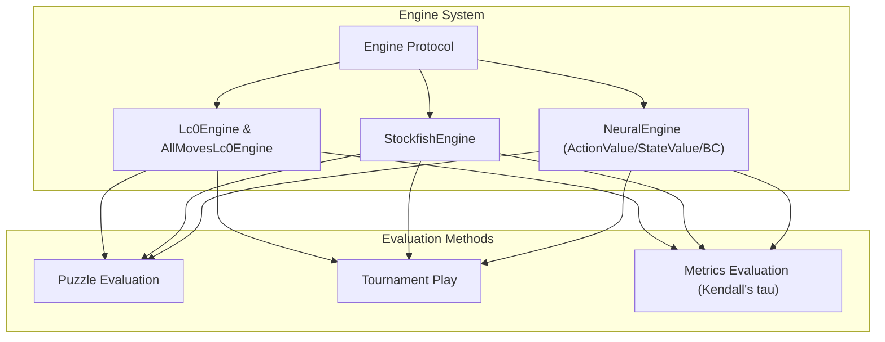

<!-- source: DeepWiki mcp.deepwiki.com · repo google-deepmind/searchless_chess · page 5.3 Leela Chess Zero Integration · fetched 2026-10-26 -->

# Leela Chess Zero Integration

Relevant source files

The following files were used as context for generating this wiki page:

- [src/engines/lc0_engine.py](src/engines/lc0_engine.py)

## Purpose and Scope

This document details the integration of Leela Chess Zero (Lc0) into the searchless_chess framework. It covers the implementation of classes that wrap Lc0 functionality, allowing it to be used as a chess engine for analysis and comparison purposes. Lc0 serves as an important benchmark since it's a neural network-based engine that uses Monte Carlo Tree Search, in contrast to the project's focus on transformer-based engines without traditional search.

For information about neural network-based engines implemented in this project, see [Neural Engines](#5.1). For information about Stockfish integration, see [Stockfish Integration](#5.2).

## Engine Implementation

The Lc0 integration consists of two main classes that implement the `Engine` protocol:
- `Lc0Engine`: Provides core integration with Leela Chess Zero
- `AllMovesLc0Engine`: Extends `Lc0Engine` to evaluate all legal moves individually

Sources: [src/engines/lc0_engine.py:25-78](), [src/engines/lc0_engine.py:80-98]()

## Lc0Engine Class

### Initialization

The `Lc0Engine` class requires a `chess.engine.Limit` object during initialization, which controls time allocation for analysis. It has specific requirements:

- **CUDA Requirement**: Only works with Nvidia GPUs as noted in the class documentation
- **Binary Path**: Expects the Lc0 binary at `../lc0/build/release/lc0`
- **Weights File**: Uses a specific neural network weights file: `768x15x24h-t82-swa-7464000.pb`

Sources: [src/engines/lc0_engine.py:31-49]()

### Analysis and Move Selection

The `Lc0Engine` implements two core methods required by the `Engine` protocol:

- **analyse(board)**: Returns analysis results for a given position
  - Handles game-over positions specially
  - Otherwise delegates to the underlying engine with the configured time limit

- **play(board)**: Returns the best move for a given position
  - Delegates to the underlying engine with the configured time limit
  - Validates that a move was found, raising an error if none is returned

Sources: [src/engines/lc0_engine.py:58-77]()

## AllMovesLc0Engine Class

The `AllMovesLc0Engine` extends `Lc0Engine` to provide a more thorough analysis by evaluating each legal move individually. This approach gives more granular information about move quality compared to the standard approach.

### Analysis Method

The specialized `analyse` method:

1. Gets all legal moves in the position in a standardized order
2. For each move:
   - Makes the move on the board
   - Analyzes the resulting position using the parent `Lc0Engine.analyse` method
   - Undoes the move
   - Stores the move along with the negative of the score (from opponent's perspective)
3. Returns a dictionary containing all moves and their scores

Sources: [src/engines/lc0_engine.py:83-92]()

### Play Method

The `play` method leverages the `analyse` method's results:

1. Obtains scores for all legal moves via `analyse`
2. Sorts moves by score in descending order
3. Returns the move with the highest score

Sources: [src/engines/lc0_engine.py:94-98]()

## Configuration Options

### Time Control Parameters

The following table lists common parameters for the `chess.engine.Limit` object used to configure the engine:

| Parameter | Description | Example Value |
|-----------|-------------|---------------|
| `time` | Time in seconds for the entire move | 10.0 |
| `depth` | Search depth limit | 20 |
| `nodes` | Node count limit | 1000000 |
| `white_clock` | Time remaining for white in seconds | 60.0 |
| `black_clock` | Time remaining for black in seconds | 60.0 |
| `white_inc` | White increment per move in seconds | 1.0 |
| `black_inc` | Black increment per move in seconds | 1.0 |

Sources: [src/engines/lc0_engine.py:31-35]()

## Integration with the Evaluation System

The Lc0 engines are integrated into the overall evaluation framework, enabling comparison with other engine types:

Sources: [src/engines/lc0_engine.py]()

## Limitations and Requirements

- **GPU Support**: Currently only works with CUDA (Nvidia GPUs)
- **Single-threaded Operation**: Configured to use only one thread by default
- **Fixed Neural Network**: Uses a specific neural network weights file
- **Dependencies**: Requires a pre-compiled Lc0 binary and neural network weights file in specific locations

## Comparison with Other Engine Types

| Feature | Lc0Engine | StockfishEngine | NeuralEngine |
|---------|-----------|----------------|--------------|
| Backend | Leela Chess Zero | Stockfish | Custom Transformers |
| Search Method | Monte Carlo Tree Search | Alpha-Beta Search | No search (direct prediction) |
| Neural Network | Yes (external) | No (handcrafted evaluation) | Yes (internal) |
| GPU Support | CUDA only | CPU only | TPU/GPU/CPU |
| Variants | Standard, AllMoves | Standard, AllMoves | ActionValue, StateValue, BC |

Sources: [src/engines/lc0_engine.py]()

## Summary

The Leela Chess Zero integration provides a critical benchmark for comparing the project's transformer-based, searchless engines against a state-of-the-art neural network chess engine that uses traditional search techniques. By implementing the common `Engine` protocol, Lc0 can be seamlessly used in all evaluation frameworks alongside other engine types.

---

