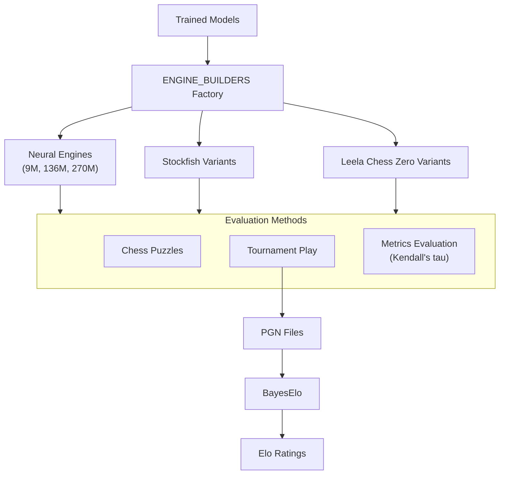
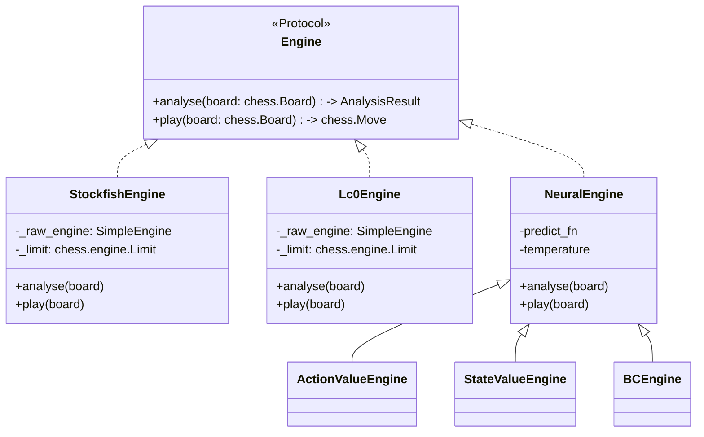
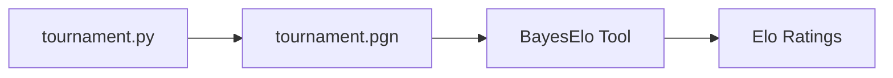
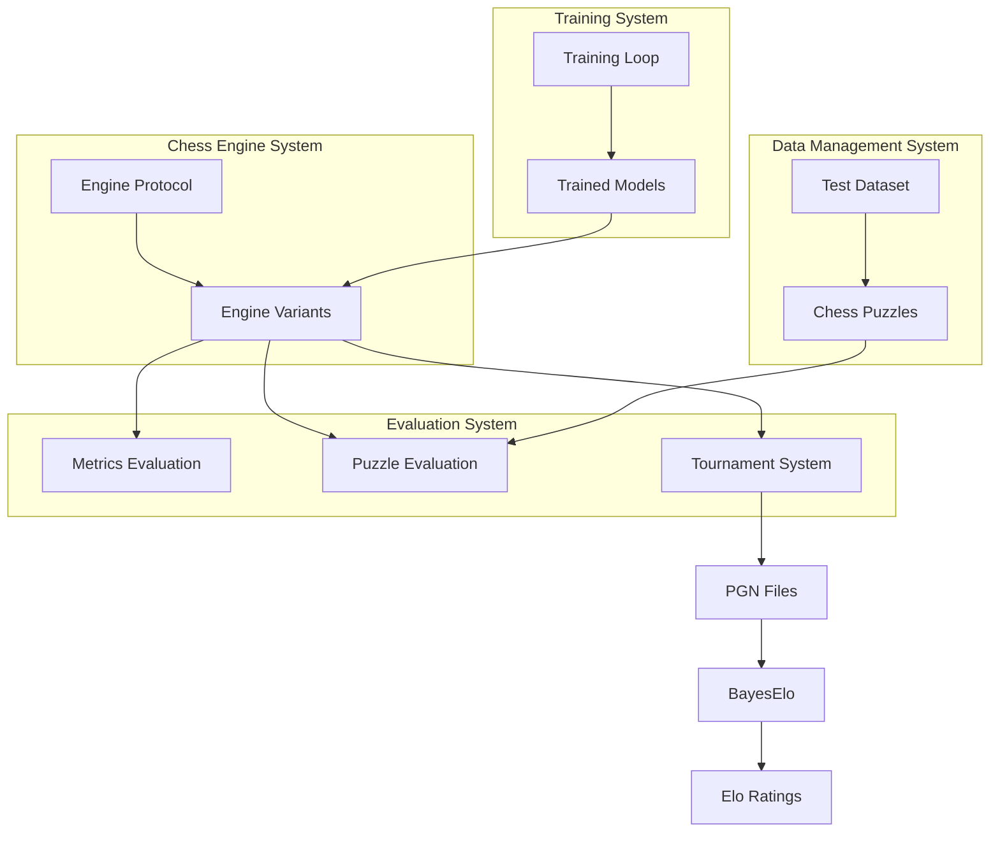

<!-- source: DeepWiki mcp.deepwiki.com · repo google-deepmind/searchless_chess · page 6 Evaluation System · fetched 2026-10-26 -->

# Evaluation System

<details>
<summary>Relevant source files</summary>

The following files were used as context for generating this wiki page:

- [README.md](README.md)
- [src/constants.py](src/constants.py)

</details>


The Evaluation System provides methods for assessing the performance of chess engines in the SearchLess Chess project. This system is responsible for comparing neural transformer-based models with traditional chess engines like Stockfish and Leela Chess Zero. The evaluation approaches include metrics computation, chess puzzle solving, and tournament play to determine relative strength through Elo ratings.

## Overview



Sources: [README.md:142-241]()

## Engine Types and Factory

The Evaluation System works with multiple engine types through a factory pattern. The `ENGINE_BUILDERS` factory creates standardized engine interfaces for different model implementations:



Sources: [README.md:4-16](), [src/engines/engine.py]() (inferred)

### Supported Engine Types

The evaluation system supports the following engine types:

1. **Neural Engines**: Transformer-based models of different sizes:
   - 9M parameters 
   - 136M parameters
   - 270M parameters

2. **Stockfish Variants**:
   - Standard Stockfish
   - Stockfish All Moves

3. **Leela Chess Zero Variants**:
   - Leela Chess Zero Policy Net (no search)
   - Leela Chess Zero Depth 1
   - Leela Chess Zero 400 Simulations

Sources: [README.md:210-215]()

## Evaluation Methods

The Evaluation System utilizes three main methods to assess chess engine performance:

### 1. Metrics Evaluation

The metrics evaluator computes statistical measures to assess how well the model predicts expert moves and position evaluations. The primary metric used is Kendall's tau correlation coefficient, which measures the ordinal association between the model's move rankings and expert (Stockfish) move rankings.

The metrics evaluator is implemented in `metrics_evaluator.py` and conforms to the `Evaluator` interface defined in the constants module:

```python
class Evaluator(abc.ABC):
  """Defines the interface of the evaluator that evaluates a predictor."""

  @abc.abstractmethod
  def step(self, params: hk.Params, step: int) -> Mapping[str, Any]:
    """Returns the results of evaluating the predictor with `params`."""
```

Sources: [src/constants.py:60-66](), [README.md:52]()

### 2. Puzzle Evaluation

Puzzle evaluation tests an engine's tactical and strategic abilities by presenting it with chess puzzles that have known correct solutions. The system measures the accuracy of the engine's suggested moves against these known solutions.

The puzzle evaluation system:
- Uses puzzles from the `puzzles.csv` file
- Allows evaluation of all engine types (neural, Stockfish, and Leela Chess Zero)
- Reports puzzle solving accuracy

To run puzzle evaluation:

```bash
python puzzles.py --num_puzzles 10 --agent=agent_name
```

Where `agent_name` can be:
- `local`: A locally trained model
- `9M`, `136M`, or `270M`: Pre-trained models of different sizes
- `stockfish` or `stockfish_all_moves`: Stockfish variants
- `leela_chess_zero_depth_1`, `leela_chess_zero_policy_net`, or `leela_chess_zero_400_sims`: Leela Chess Zero variants

Sources: [README.md:200-215](), [README.md:53]()

### 3. Tournament System

The tournament system evaluates relative engine strength by having them play against each other in a round-robin format. Results are stored in PGN files, which are then processed by BayesElo to compute Elo ratings.



To run a tournament:

```bash
python tournament.py --num_games=200
```

This generates a PGN file that can be analyzed with BayesElo:

```bash
./bayeselo
ResultSet>readpgn ../data/tournament.pgn
ResultSet>elo
ResultSet-EloRating>mm
ResultSet-EloRating>exactdist
ResultSet-EloRating>ratings
```

Sources: [README.md:218-241](), [README.md:56]()

## Integration with Other Systems

The Evaluation System integrates with other components of the SearchLess Chess project:



Sources: [README.md:19-66]()

## Using the Evaluation System

### Prerequisites

Before using the evaluation system, ensure:
1. The required dependencies are installed
2. Stockfish is installed and compiled
3. Leela Chess Zero is installed with the required network weights
4. BayesElo is installed for Elo rating computation
5. The Python environment is properly set up:

```bash
conda activate searchless_chess
export PYTHONPATH=$(pwd)/..
```

Sources: [README.md:69-146](), [README.md:182-187]()

### Evaluator Configuration

The evaluation system uses the `EvaluatorBuilder` interface to create evaluators for different prediction models:

```python
class EvaluatorBuilder(Protocol):
  def __call__(
      self,
      predictor: Predictor,
      config: config_lib.EvalConfig,
  ) -> Evaluator:
    """Returns an evaluator for the `predictor` and `config`."""
```

This allows consistent evaluation of different predictor models against the same evaluation criteria.

Sources: [src/constants.py:68-82]()

### Analyzing Results

For in-depth analysis of model behavior:

1. Start a Jupyter notebook server:
   ```bash
   jupyter notebook
   ```

2. Open the `searchless_chess.ipynb` notebook to analyze move predictions, win probabilities, and other metrics for different chess positions.

Sources: [README.md:243-248]()

## Related Pages

- For details on the Chess Engine System used by the evaluator, see [Chess Engines](#5)
- For information on the Training System that produces the models being evaluated, see [Training System](#3)
- For details on the Puzzle Evaluation component, see [Puzzle Evaluation](#6.1)
- For more information on the Tournament System, see [Tournament System](#6.2)

---

