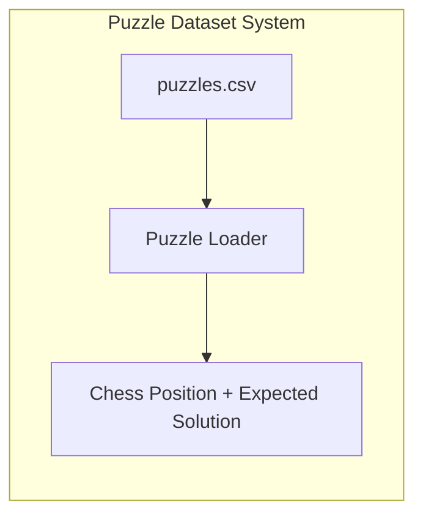
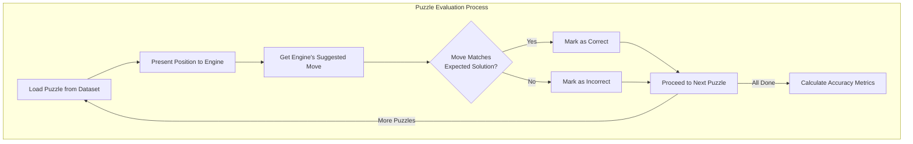
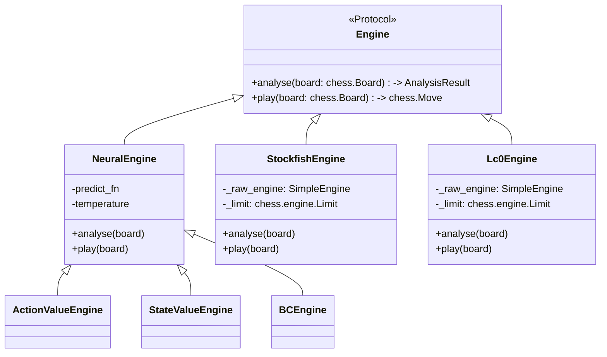
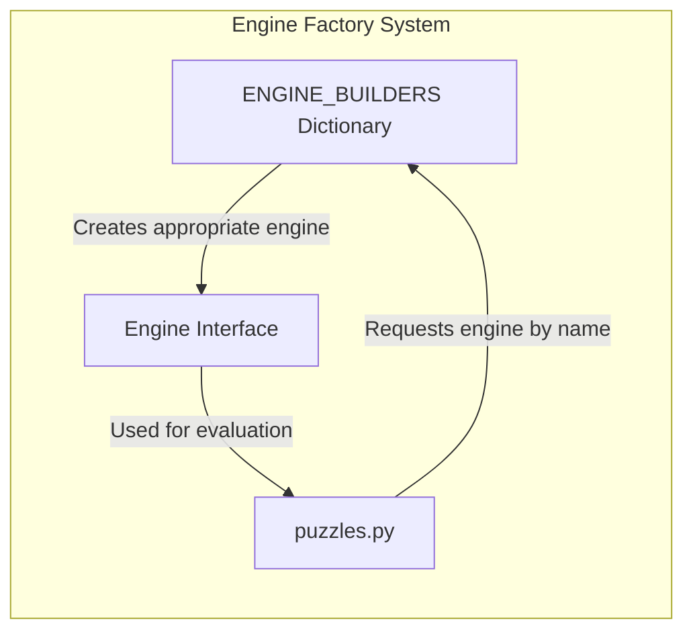
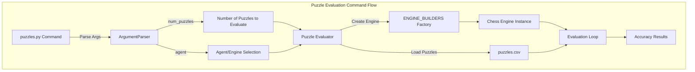

<!-- source: DeepWiki mcp.deepwiki.com · repo google-deepmind/searchless_chess · page 6.1 Puzzle Evaluation · fetched 2026-10-26 -->

# Puzzle Evaluation

<details>
<summary>Relevant source files</summary>

The following files were used as context for generating this wiki page:

- [README.md](README.md)

</details>


## Purpose and Scope

This document describes the puzzle evaluation system in the SearchLess Chess project, which is used to assess the performance of different chess engines by measuring their ability to solve chess puzzles. Chess puzzles represent tactical and strategic challenges where an engine must find the best move in a given position. This system provides a standardized method for comparing the tactical strength of different engines, including the transformer-based neural engines trained in this project, as well as traditional engines like Stockfish and Leela Chess Zero.

For information about the overall evaluation system, including tournament play and metrics evaluation, see [Evaluation System](#6).

## Puzzle Dataset

The puzzle evaluation system uses a dataset of chess puzzles stored in `data/puzzles.csv`. This 4.5MB file contains positions with known best moves, serving as test cases for evaluating engine performance.



Sources: [README.md:34-36](), [README.md:166-167]()

## Evaluation Process

The puzzle evaluation process follows a systematic approach to test how well an engine can solve tactical challenges.



The evaluation process involves:

1. Loading puzzles from the dataset
2. Presenting each puzzle position to the chess engine
3. Collecting the engine's suggested move
4. Checking if the suggested move matches the expected solution
5. Calculating metrics such as accuracy (percentage of correctly solved puzzles)

Sources: [src/puzzles.py]()

## Supported Engines

The puzzle evaluation system is designed to work with multiple types of chess engines, allowing for comparative analysis across different approaches.



Supported engines include:

| Engine Type | Variants | Description |
|-------------|----------|-------------|
| Neural Models | `local`, `9M`, `136M`, `270M` | Transformer-based models with different parameter sizes |
| Stockfish | `stockfish`, `stockfish_all_moves` | Traditional alpha-beta search engine with different configurations |
| Leela Chess Zero | `leela_chess_zero_depth_1`, `leela_chess_zero_policy_net`, `leela_chess_zero_400_sims` | Neural MCTS-based engine with different settings |

Sources: [README.md:210-215](), [src/engines/engine.py](), [src/engines/neural_engines.py](), [src/engines/stockfish_engine.py](), [src/engines/lc0_engine.py]()

## Engine Factory System

The puzzle evaluation system uses an engine factory pattern to create and configure the different types of chess engines.



The system maintains a registry of engine builders that can instantiate different engine types based on command-line arguments.

Sources: [src/engines/constants.py](), [src/puzzles.py]()

## Running Puzzle Evaluations

To evaluate an engine's performance on chess puzzles, use the `puzzles.py` script with appropriate parameters.

Example command:
```bash
python puzzles.py --num_puzzles 10 --agent=270M
```

Key parameters:
- `--num_puzzles`: Number of puzzles to evaluate (default: all puzzles)
- `--agent`: The chess engine to evaluate (e.g., `local`, `9M`, `136M`, `270M`, `stockfish`, etc.)



Sources: [README.md:202-208](), [src/puzzles.py]()

## Interpreting Results

The puzzle evaluation script outputs the engine's performance, including metrics such as:

1. Number of puzzles solved correctly
2. Overall accuracy percentage
3. Time taken to evaluate all puzzles

These metrics allow for direct comparison of different engines' tactical abilities. Higher accuracy indicates better tactical performance of the engine.

| Result Type | Description |
|-------------|-------------|
| Accuracy % | Percentage of puzzles solved correctly |
| Solved Count | Number of puzzles with correct solution |
| Total Time | Total time taken to evaluate all puzzles |

The puzzle evaluation results can be used to:
1. Compare the tactical strength of different engine types (neural vs. traditional)
2. Evaluate the impact of model size on tactical performance
3. Assess how well the transformer models have learned chess tactics without explicit search

Sources: [src/puzzles.py](), [README.md:202-208]()

## Relation to Research Goals

Puzzle evaluation serves as a critical assessment tool in the project's research on amortized planning with transformers. It helps answer key questions:

1. Can transformer models learn to solve complex tactical problems without explicit search?
2. How does model size affect tactical capability?
3. How do neural models compare to traditional search-based engines in tactical scenarios?

The puzzle evaluation results in the paper show that larger transformer models (270M parameters) can solve chess puzzles with surprising accuracy, demonstrating non-trivial generalization capabilities despite performing no explicit search.

Sources: [README.md:8-16]()

---

