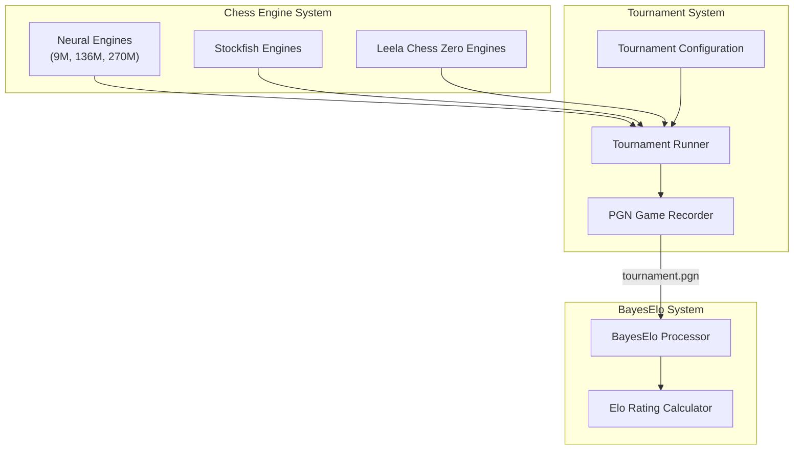
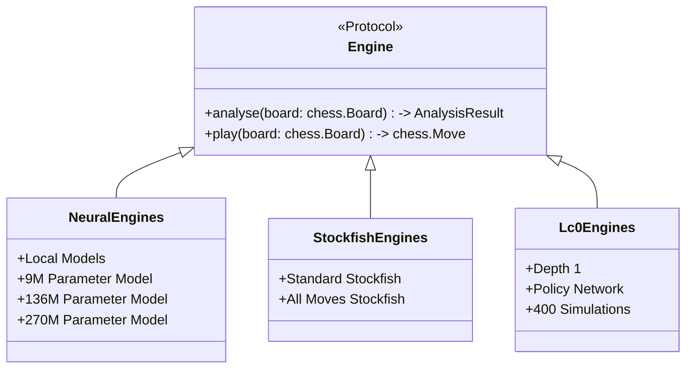
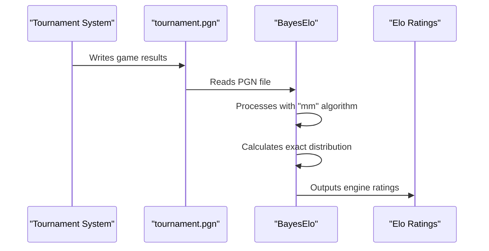
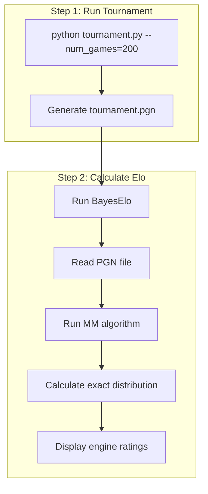
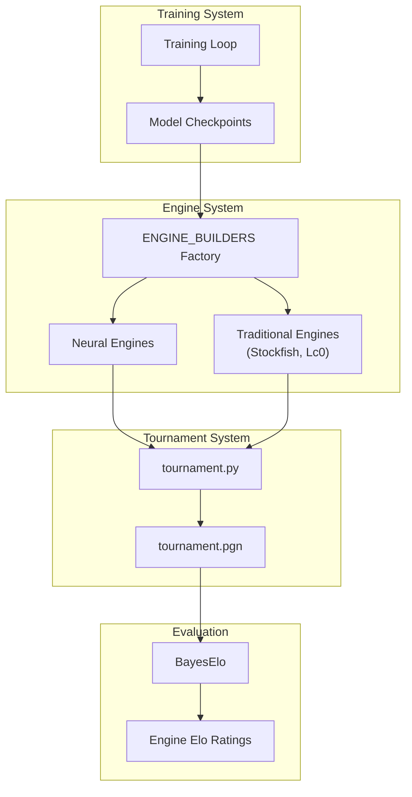

<!-- source: DeepWiki mcp.deepwiki.com · repo google-deepmind/searchless_chess · page 6.2 Tournament System · fetched 2026-10-26 -->

# Tournament System

<details>
<summary>Relevant source files</summary>

The following files were used as context for generating this wiki page:

- [README.md](README.md)

</details>


## Purpose and Scope

The Tournament System in searchless_chess is designed to evaluate and compare the performance of different chess engines through competitive play. It orchestrates matches between various engines, records game results in PGN format, and facilitates the calculation of Elo ratings through BayesElo integration. This document explains how to use the tournament system, its architecture, and how it connects to other components of the evaluation framework.

For information about evaluating engines using chess puzzles instead of competitive play, see [Puzzle Evaluation](#6.1).

Sources: [README.md:218-241]()

## Tournament System Architecture

The Tournament System sits at the end of the evaluation pipeline, taking trained models and different chess engines as input, and producing comparative performance metrics in the form of Elo ratings.



Sources: [README.md:218-241]()

## Tournament Implementation

The tournament implementation is in the `tournament.py` script, which handles match scheduling, game execution, and result recording. The system creates pairings between different engine implementations and manages the execution of chess games.

### Supported Engines

The tournament system can evaluate several types of engines:



Sources: [README.md:210-216]()

## Tournament Workflow

The tournament system follows this general workflow:

1. Configure the tournament parameters (number of games, time control, etc.)
2. Initialize the chess engines to be evaluated
3. Schedule and play games between different engine pairs
4. Record game results in PGN format
5. Process the PGN file with BayesElo to calculate Elo ratings

```mermaid
flowchart LR
    Start["Start Tournament"] --> Config["Configure Tournament Parameters"]
    Config --> InitEngines["Initialize Chess Engines"]
    InitEngines --> ScheduleGames["Schedule Games"]
    ScheduleGames --> PlayGames["Play Games"]
    PlayGames --> RecordResults["Record Results in PGN"]
    RecordResults --> ProcessBayesElo["Process with BayesElo"]
    ProcessBayesElo --> CalculateRatings["Calculate Elo Ratings"]
    CalculateRatings --> End["End Tournament"]
```



Sources: [README.md:218-241]()

## Tournament Configuration

The tournament can be configured with several parameters through command-line arguments. The primary parameter is the number of games to play, which can be set using the `--num_games` flag.

| Parameter | Description | Default Value |
|-----------|-------------|---------------|
| `num_games` | Number of games to play in the tournament | N/A |
| Other parameters | Time controls, engine selection, etc. | Varies |

Sources: [README.md:224]()

## PGN Generation

The tournament system records all games in PGN (Portable Game Notation) format, which is the standard for chess game recording. The PGN file contains information about the players (engines), moves played, and game results.

The PGN file is saved to `../data/tournament.pgn` relative to the script's execution directory.

Sources: [README.md:230]()

## BayesElo Integration

After the tournament completes, the system integrates with BayesElo for Elo rating calculation. BayesElo is a statistical program that estimates the strength of chess players based on game results.

### Using BayesElo

The BayesElo process involves:

1. Reading the PGN file generated by the tournament
2. Running the maximum likelihood algorithm (`mm`)
3. Calculating the exact probability distribution (`exactdist`)
4. Outputting the ratings for each engine



Sources: [README.md:226-239]()

## Running a Tournament

To run a tournament, execute the `tournament.py` script with the desired parameters:

1. Navigate to the source directory:
   ```
   cd src
   ```

2. Run the tournament script with the desired number of games:
   ```
   python tournament.py --num_games=200
   ```

3. After the tournament completes, use BayesElo to calculate ratings:
   ```
   cd ../BayesElo
   ./bayeselo
   ```

4. In the BayesElo prompt, load and process the PGN file:
   ```
   ResultSet>readpgn ../data/tournament.pgn
   ResultSet>elo
   ResultSet-EloRating>mm
   ResultSet-EloRating>exactdist
   ResultSet-EloRating>ratings
   ```

Sources: [README.md:218-241]()

## Tournament Example Workflow

Here's a complete example workflow for running a tournament and calculating Elo ratings:



Sources: [README.md:218-241]()

## Integration with Other Systems

The Tournament System integrates with other components of the searchless_chess framework:



Sources: [README.md:218-241]()

## Conclusion

The Tournament System provides a robust framework for evaluating chess engines by pitting them against each other and calculating Elo ratings. This system is crucial for benchmarking the performance of neural engines against traditional engines like Stockfish and Leela Chess Zero, allowing for quantitative comparisons of engine strength.

---

