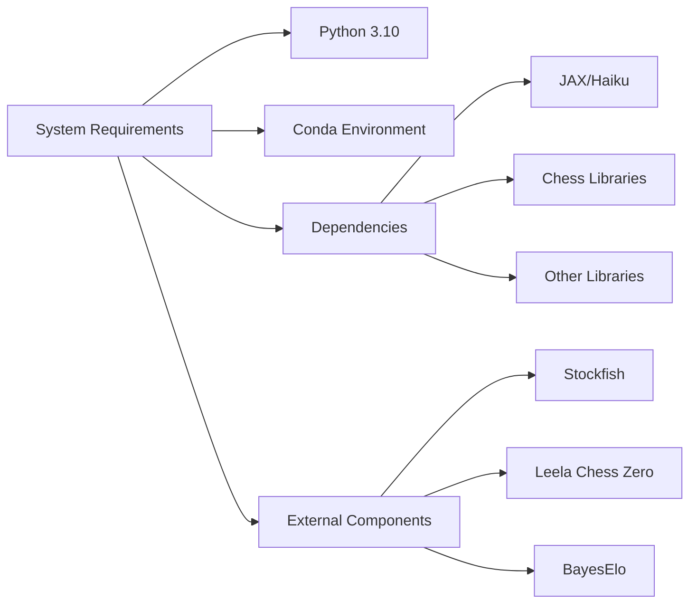
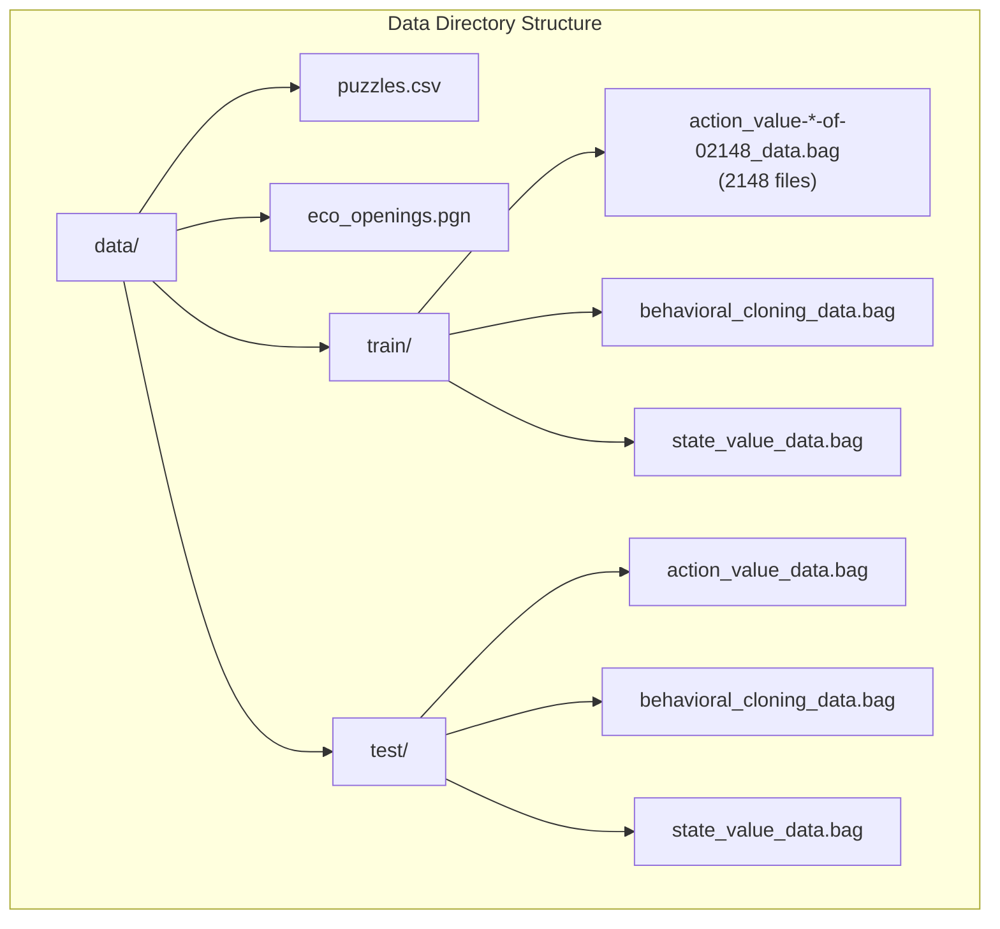
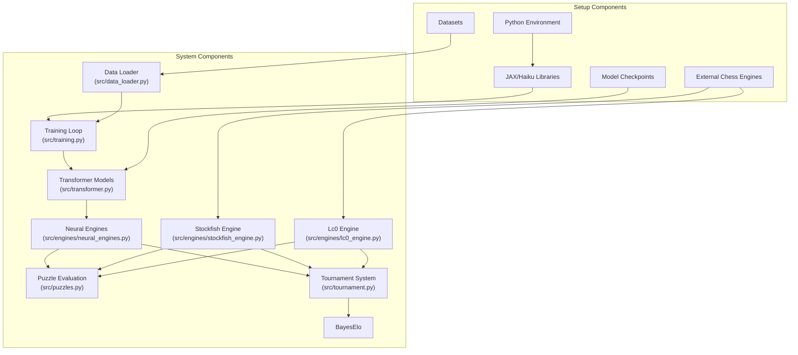

<!-- source: DeepWiki mcp.deepwiki.com · repo google-deepmind/searchless_chess · page 7 Getting Started · fetched 2026-10-26 -->

# Getting Started

<details>
<summary>Relevant source files</summary>

The following files were used as context for generating this wiki page:

- [README.md](README.md)
- [checkpoints/download.sh](checkpoints/download.sh)
- [data/download.sh](data/download.sh)
- [requirements.txt](requirements.txt)

</details>


This page provides step-by-step instructions for setting up and running the SearchLess Chess project. It covers environment setup, installation of external dependencies, downloading datasets and checkpoints, and basic usage instructions. For details on the system architecture, see [System Architecture](#2), or for specific components like the training system, see [Training System](#3).

## System Requirements

### Python Environment
- Python 3.10
- Conda environment (recommended)
- GPU with CUDA support (highly recommended for training)



Sources: [README.md:78-102]()

## Installation Process

### 1. Clone the Repository
```bash
git clone https://github.com/google-deepmind/searchless_chess.git
cd searchless_chess
```

### 2. Create and Activate Conda Environment
```bash
conda create --name searchless_chess python=3.10
conda activate searchless_chess
conda install pip
```

### 3. Install Dependencies
```bash
pip install -r requirements.txt
```

For GPU support (recommended for training):
```bash
pip install --upgrade "jax[cuda12_pip]" -f https://storage.googleapis.com/jax-releases/jax_cuda_releases.html
```
Note: The CUDA version must match your installed CUDA version.

Sources: [README.md:69-102](), [requirements.txt:1-16]()

### 4. Install External Components

#### Stockfish
```bash
git clone https://github.com/official-stockfish/Stockfish.git
cd Stockfish/src
make -j profile-build ARCH=x86-64-avx2
cd ../..
```

#### Leela Chess Zero
```bash
git clone -b release/0.30 --recurse-submodules https://github.com/LeelaChessZero/lc0.git
```
Follow the build instructions at the [Lc0 GitHub repository](https://github.com/LeelaChessZero/lc0).

Download the large network model:
```bash
cd lc0/build/release
wget https://storage.lczero.org/files/768x15x24h-t82-swa-7464000.pb.gz
gzip -d 768x15x24h-t82-swa-7464000.pb.gz
cd ../../..
```

#### BayesElo
```bash
wget https://www.remi-coulom.fr/Bayesian-Elo/bayeselo.tar.bz2
tar -xvjf bayeselo.tar.bz2
cd BayesElo
make bayeselo
cd ..
```

Sources: [README.md:104-146]()

## Data and Model Setup

### 1. Download Datasets
The simplest way to download all datasets:
```bash
cd data
./download.sh
cd ..
```

This script will download:
- Train data (action value, behavioral cloning, state value)
- Test data (action value, behavioral cloning, state value)
- Puzzles dataset
- Opening ECO dataset



Sources: [README.md:149-167](), [data/download.sh:1-39]()

### 2. Download Model Checkpoints
To download pre-trained model checkpoints:
```bash
cd checkpoints
./download.sh
cd ..
```

This script downloads and extracts:
- 9M parameter model (action value, state value, behavioral cloning variants)
- 136M parameter model
- 270M parameter model

Sources: [README.md:170-179](), [checkpoints/download.sh:1-37]()

## Basic Usage

Before running any code, set up your environment:
```bash
conda activate searchless_chess
export PYTHONPATH=$(pwd)/..
```

### Training a Model
To train a model locally:
```bash
cd src
python train.py
cd ..
```
The model checkpoints will be saved to `checkpoints/local`.

### Evaluating on Puzzles
To evaluate a model's puzzle-solving accuracy:
```bash
cd src
python puzzles.py --num_puzzles 10 --agent=local
cd ..
```

Available agents:
- Locally trained model: `local`
- Pre-trained models: `9M`, `136M`, and `270M`
- Stockfish engines: `stockfish` and `stockfish_all_moves`
- Lc0 engines: `leela_chess_zero_depth_1`, `leela_chess_zero_policy_net`, and `leela_chess_zero_400_sims`

### Running Tournaments and Computing Elo
To run a tournament between different agents:
```bash
cd src
python tournament.py --num_games=200
```

To compute Elo ratings from the tournament results:
```bash
cd ../BayesElo
./bayeselo
ResultSet>readpgn ../data/tournament.pgn
ResultSet>elo
ResultSet-EloRating>mm
ResultSet-EloRating>exactdist
ResultSet-EloRating>ratings
cd ..
```

### Analysis Notebook
To explore model behavior in depth:
```bash
jupyter notebook
```
Then open `src/searchless_chess.ipynb` in your browser.

Sources: [README.md:180-251]()

## System Component Interaction

The following diagram shows how the components you've installed interact with each other in the SearchLess Chess system:



Sources: [README.md:19-66]()

## Troubleshooting Common Issues

| Issue | Solution |
|-------|----------|
| CUDA version mismatch | Ensure the JAX CUDA version matches your system's CUDA installation |
| Missing dependencies | Check that all packages in `requirements.txt` are installed |
| Stockfish/Lc0 not found | Verify path to the engine executables |
| Out of memory during training | Reduce batch size or use a smaller model |
| Tournament errors | Ensure all engines are properly installed and accessible |

Sources: [README.md:96-102]()

## Next Steps

After successfully setting up your environment, you might want to explore:

- [Training System](#3) for details on how the training loop works
- [Transformer Models](#3.1) for information about model architecture
- [Chess Engines](#5) for an overview of the different engine implementations
- [Evaluation System](#6) for methods to evaluate and compare chess engines