# Page: Overview

# Overview

<details>
<summary>Relevant source files</summary>

The following files were used as context for generating this wiki page:

- [README.md](README.md)

</details>


## Purpose and Scope

This document provides an introduction to the `searchless_chess` repository, which implements a system for training and evaluating transformer-based chess engines that perform planning without traditional search algorithms. This repository contains the implementation of the NeurIPS 2024 paper "Amortized Planning with Large-Scale Transformers: A Case Study on Chess".

Unlike traditional chess engines that use tree search algorithms, this project explores how large-scale transformer models can learn to play chess effectively through amortized planning - essentially learning to predict good moves directly without explicit search. For detailed information about the training system, see [Training System](#3), and for the chess engines implementation, see [Chess Engines](#5).

Sources: [README.md:8-16]()

## System Architecture Overview

The `searchless_chess` system consists of several interconnected components that work together to train, evaluate, and deploy transformer-based chess engines.

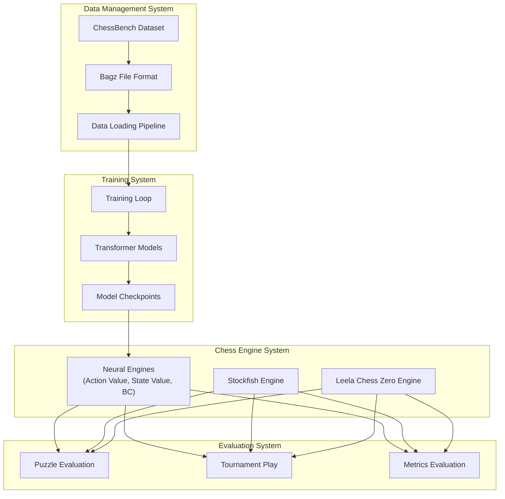

Sources: [README.md:19-66](), [src/engines/engine.py](), [src/training.py](), [src/bagz.py]()

## Key Components

### Data Management

The project is built around ChessBench, a large-scale benchmark dataset containing 10 million chess games with legal move and value annotations (15 billion data points) provided by Stockfish 16. This data is stored in a custom `.bag` format for efficient loading and processing.

The data is organized into three main types:
- **Action Value**: Data for predicting the value of specific moves
- **State Value**: Data for predicting the value of board positions
- **Behavioral Cloning**: Data for imitating expert play

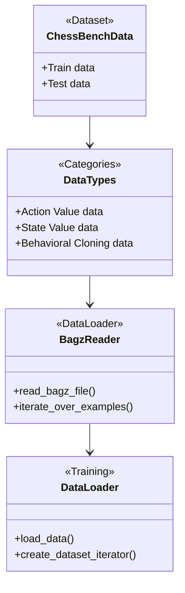

Sources: [src/bagz.py](), [src/data_loader.py](), [README.md:149-166]()

### Transformer Models

The project trains transformer models of varying sizes to play chess:

1. **Small model**: 9 million parameters
2. **Medium model**: 136 million parameters  
3. **Large model**: 270 million parameters

These are decoder-only transformer models trained on three different prediction targets:
- **Action Value**: Predicting the value of each possible move
- **State Value**: Predicting the value of a board position
- **Behavioral Cloning**: Imitating expert moves

Sources: [src/transformer.py](), [README.md:12-14](), [src/config.py]()

### Chess Engine System

The repository implements a unified interface for different chess engines, allowing for consistent evaluation and comparison.

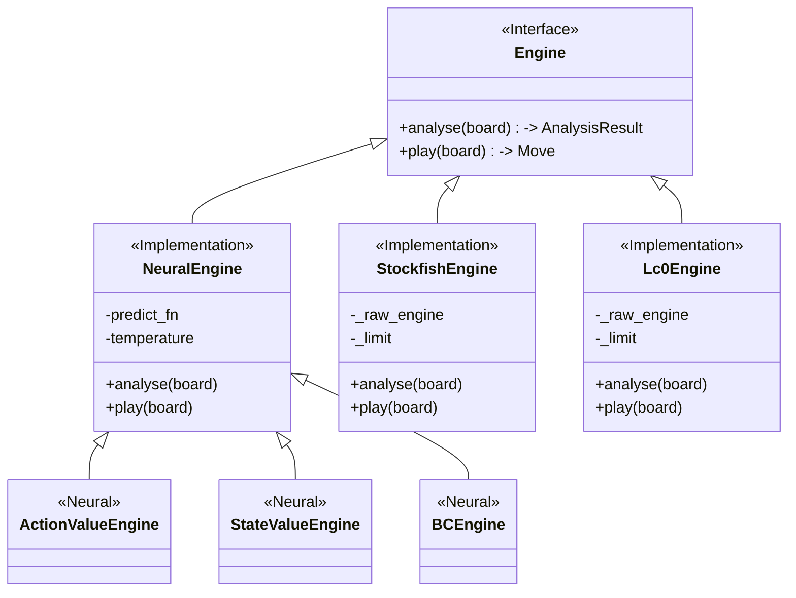

Sources: [src/engines/engine.py](), [src/engines/neural_engines.py](), [src/engines/stockfish_engine.py](), [src/engines/lc0_engine.py]()

### Evaluation System

The system provides multiple ways to evaluate chess engines:

1. **Puzzle Evaluation**: Tests engine performance on chess puzzles
2. **Tournament Play**: Computes Elo ratings by running games between different engines
3. **Metrics Evaluation**: Computes metrics like Kendall's tau to measure prediction quality

The evaluation allows for comparing the transformer-based engines against traditional engines like Stockfish and Leela Chess Zero, both with and without search.

Sources: [src/puzzles.py](), [src/tournament.py](), [src/metrics_evaluator.py]()

## Training Approach

The transformer models are trained using supervised learning on the ChessBench dataset. The training pipeline includes:

1. Data loading from Bagz files
2. Board state tokenization
3. Training loop with distributed JAX computation
4. Checkpoint management for model parameters

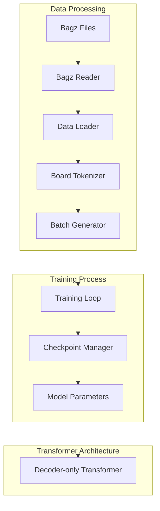

Sources: [src/training.py](), [src/training_utils.py](), [src/tokenizer.py]()

## Research Findings

The key findings from this research include:

1. Large transformer models (270M parameters) can learn to play chess at a grandmaster level without traditional search algorithms
2. The best models achieve a Lichess blitz Elo of 2895 against humans
3. Transformer size has a significant impact on performance
4. Action-value prediction outperforms state-value prediction and behavioral cloning
5. While transformers can effectively approximate search-based algorithms through supervised learning, perfect distillation remains challenging

Sources: [README.md:13-16]()

## Repository Structure

The repository is organized as follows:

| Directory/File | Purpose |
|----------------|---------|
| `src/engines/` | Chess engine implementations |
| `src/transformer.py` | Decoder-only transformer implementation |
| `src/bagz.py` | Readers for custom .bag data files |
| `src/training.py` | Training loop implementation |
| `src/puzzles.py` | Puzzle evaluation script |
| `src/tournament.py` | Elo tournament script |
| `data/` | ChessBench dataset (train/test splits) |
| `checkpoints/` | Pre-trained model checkpoints |
| `BayesElo/` | Elo computation tool |
| `Stockfish/` | Stockfish chess engine integration |
| `lc0/` | Leela Chess Zero integration |

Sources: [README.md:19-66]()

## Getting Started

For detailed installation instructions and usage examples, see [Getting Started](#7). In brief, the system requires:

1. Python 3.10 environment
2. JAX (with CUDA support for GPU acceleration)
3. External dependencies: Stockfish, Leela Chess Zero, BayesElo
4. Downloading the ChessBench dataset and model checkpoints

The repository includes scripts for training models, evaluating puzzle accuracy, running tournaments, and analyzing model behavior.

Sources: [README.md:69-248]()

---

# Page: System Architecture

# System Architecture

<details>
<summary>Relevant source files</summary>

The following files were used as context for generating this wiki page:

- [README.md](README.md)
- [src/config.py](src/config.py)
- [src/constants.py](src/constants.py)

</details>


## Purpose and Scope

This document provides a high-level overview of the SearchLess Chess system architecture, explaining how different components interact to enable transformer-based chess playing without traditional search algorithms. It covers the major subsystems, data flows, and component dependencies.

For details about specific components, please refer to their dedicated pages:
- [Training System](#3)
- [Data Management](#4)
- [Chess Engines](#5)
- [Evaluation System](#6)

## System Overview

The SearchLess Chess system is composed of several interconnected components that work together to train, evaluate, and deploy transformer-based chess engines.

### High-Level Component Diagram

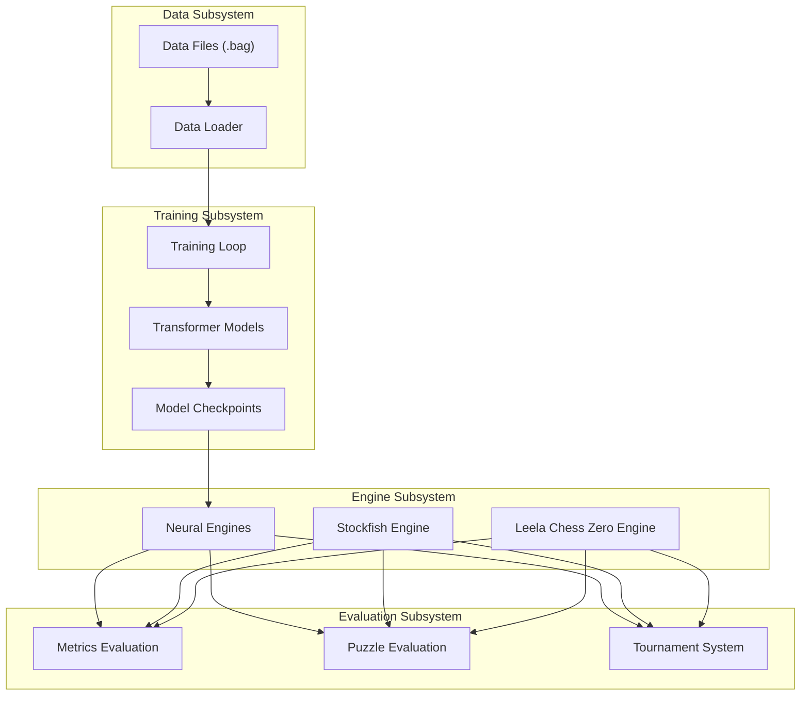

Sources: [README.md:19-66]()

## Data Flow Architecture

The SearchLess Chess system processes data through several stages, from raw chess positions to trained models and evaluation results.

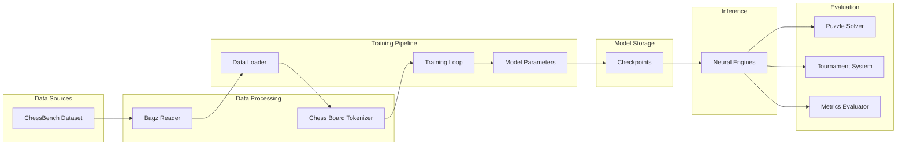

Sources: [src/bagz.py](), [src/data_loader.py](), [src/tokenizer.py](), [src/training.py](), [README.md:180-241]()

## Component Dependencies

The system relies on several external libraries and frameworks for its core functionality:

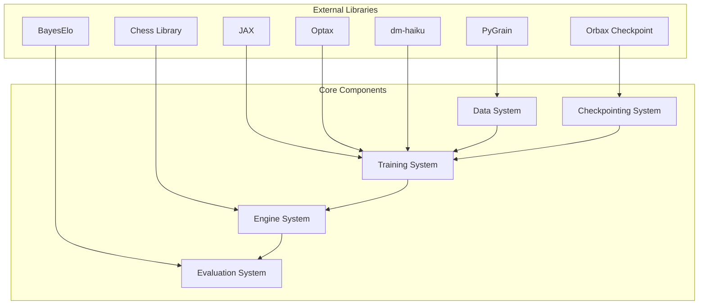

Sources: [README.md:68-146]()

## Key Interfaces

The system defines several important interfaces to enable modular design and interoperability between components.

### Engine Interface

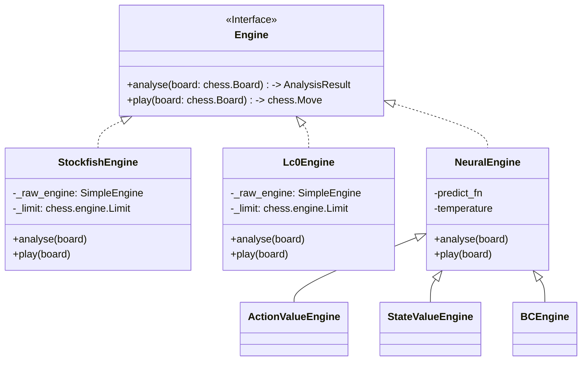

Sources: [src/engines/engine.py](), [src/engines/neural_engines.py](), [src/engines/stockfish_engine.py](), [src/engines/lc0_engine.py]()

### Data and Configuration Interfaces

The system uses structured configurations to define data loading and training parameters:

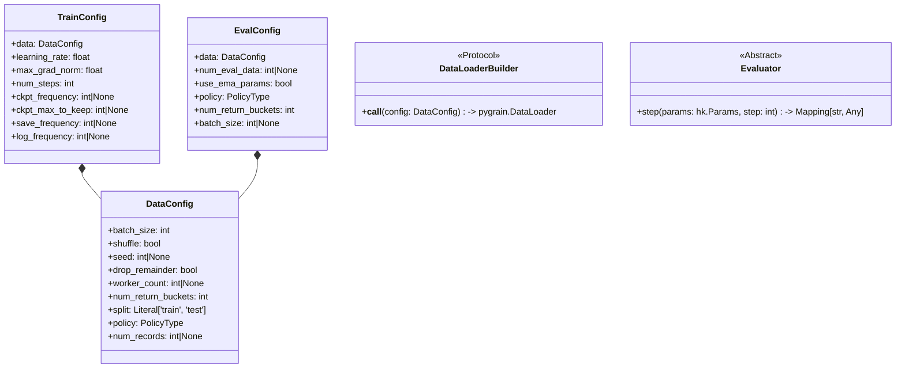

Sources: [src/config.py:16-91](), [src/constants.py:54-82]()

## Data Representation

The system uses different data types to represent chess positions and related information:

| Data Type | Structure | Purpose |
|-----------|-----------|---------|
| `ActionValueData` | `(fen: str, move: str, win_prob: float)` | Stores a position, move, and win probability |
| `StateValueData` | `(fen: str, win_prob: float)` | Stores a position and its value |
| `BehavioralCloningData` | `(fen: str, move: str)` | Stores a position and expert move |
| `Sequences` | `UInt32[Array, 'B T']` | Tokenized board representations |
| `Predictions` | `Float32[Array, '*B']` or `Float32[Array, '*B T F']` | Model predictions |

Sources: [src/constants.py:30-119]()

## System Workflow

1. **Data Preparation**: The ChessBench dataset is processed into `.bag` files for efficient loading during training
2. **Model Training**: Transformer models of various sizes (9M, 136M, 270M parameters) are trained on the processed data
3. **Model Checkpointing**: Trained models are saved as checkpoints for later use
4. **Engine Creation**: Neural engines are created using the trained models, implementing the common Engine interface
5. **Evaluation**: The neural engines are evaluated against traditional engines (Stockfish, Leela Chess Zero) through puzzle accuracy, tournament play, and metrics computation

Sources: [README.md:180-241]()

## Directory Structure

The repository is organized as follows:

```
.
|
├── BayesElo                        - Elo computation (need to be installed)
|
├── checkpoints                     - Model checkpoints (need to be downloaded)
|   ├── 136M
|   ├── 270M
|   └── 9M
|
├── data                            - Datasets (need to be downloaded)
|   ├── eco_openings.csv
|   ├── test
|   ├── train
|   └── puzzles.csv
|
├── lc0                             - Leela Chess Zero (needs to be installed)
|
├── src
|   ├── engines
|   |   ├── constants.py            - Engine constants
|   |   ├── engine.py               - Engine interface
|   |   ├── lc0_engine.py           - Leela Chess Zero engine
|   |   ├── neural_engines.py       - Neural engines
|   |   └── stockfish_engine.py     - Stockfish engine
|   |
|   ├── bagz.py                     - Readers for our .bag data files
|   ├── config.py                   - Experiment configurations
|   ├── constants.py                - Constants, interfaces, and types
|   ├── data_loader.py              - Data loader
|   ├── metrics_evaluator.py        - Metrics (e.g., Kendall's tau) evaluator
|   ├── puzzles.py                  - Puzzle evaluation script
|   ├── searchless_chess.ipynb      - Model analysis notebook
|   ├── tokenizer.py                - Chess board tokenization
|   ├── tournament.py               - Elo tournament script
|   ├── train.py                    - Example training + evaluation script
|   ├── training.py                 - Training loop
|   ├── training_utils.py           - Training utility functions
|   ├── transformer.py              - Decoder-only Transformer
|   └── utils.py                    - Utility functions
|
├── Stockfish                       - Stockfish (needs to be installed)
```

Sources: [README.md:19-66]()

---

# Page: Training System

# Training System

<details>
<summary>Relevant source files</summary>

The following files were used as context for generating this wiki page:

- [src/training.py](src/training.py)
- [src/training_utils.py](src/training_utils.py)

</details>


## Purpose and Scope

The Training System is responsible for training the transformer-based chess models in the SearchLess Chess project. It implements the complete training pipeline, including parameter initialization, loss computation, gradient updates, and checkpointing. This document explains the training loop implementation and parameter management for the transformer models.

For details about the transformer architecture itself, see [Transformer Models](#3.1).
For information about data loading, see [Data Management](#4).

## Training System Overview

The training system integrates multiple components to efficiently train large transformer models for chess position evaluation. It supports distributed training across multiple devices using JAX's parallelization capabilities.

### Training System Architecture

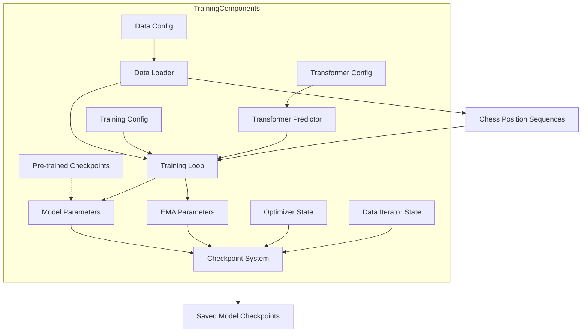

Sources: [src/training.py:16-161](), [src/training_utils.py:16-269]()

## Training Loop Implementation

The core of the training system is the training loop, implemented in the `train` function. This function orchestrates the entire training process, from initialization to final parameter output.

### Training Loop Flow

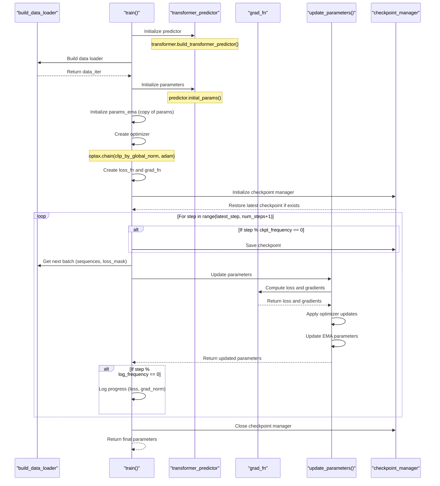

Sources: [src/training.py:36-161]()

### Parameter Update Process

The parameter update process is handled by the `update_parameters` function, which:

1. Computes the loss and gradients using the provided gradient function
2. Updates the parameters using the optimizer
3. Updates the exponential moving average (EMA) of parameters
4. Returns the updated parameters and metrics

This function is JIT-compiled for efficiency and designed to work with JAX's parallelization.

Sources: [src/training_utils.py:103-139]()

## Configuration Parameters

The training system is configured through several configuration objects:

| Configuration | Purpose | Key Parameters |
|---------------|---------|----------------|
| `TrainConfig` | Controls training loop behavior | `num_steps`, `learning_rate`, `max_grad_norm`, `log_frequency`, `ckpt_frequency` |
| `TransformerConfig` | Defines transformer model architecture | Model size, attention heads, embedding dimensions |
| `DataConfig` | Controls data loading process | `seed`, batch size, sequence length |

### Example Training Configuration Flow

```mermaid
flowchart LR
    subgraph "Configuration Flow"
        TrainConfig["TrainConfig"] --> train["train()"]
        PredictorConfig["TransformerConfig"] --> train
        DataLoaderBuilder["build_data_loader"] --> train
        train --> "Trained Parameters"
    end
```

Sources: [src/training.py:36-41]()

## Checkpointing System

The training system includes a robust checkpointing mechanism that allows for saving and restoring the complete training state, including:

- Model parameters
- EMA parameters
- Optimizer state
- Data iterator state

This enables training to resume from exactly where it left off in case of interruptions.

### Checkpoint Management

The checkpoint system uses Orbax for efficient checkpoint handling:

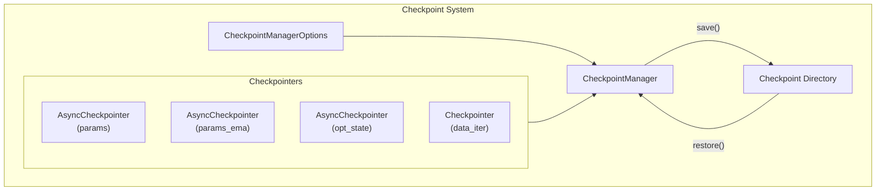

Sources: [src/training_utils.py:142-225]()

## Distributed Training

The training system supports distributed training across multiple devices and potentially multiple hosts. This is implemented using JAX's distributed computing capabilities.

### Device Sharding

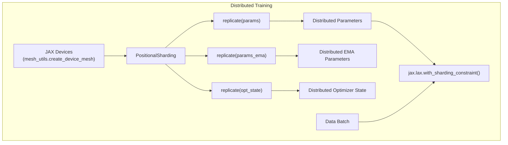

The training system uses JAX's `PositionalSharding` to distribute model parameters, optimizer state, and computation across available devices. This enables efficient training of large models by parallelizing the work.

Sources: [src/training.py:84-89](), [src/training_utils.py:33-57]()

## Loss Function

The loss function is created using `make_loss_fn`, which generates a function that computes the negative log likelihood of the target sequences:

1. The predictor outputs conditional probabilities for each position
2. The true conditional probabilities are extracted using the target sequences
3. Loss is masked according to the provided loss mask
4. The mean loss is computed across the batch

Sources: [src/training_utils.py:60-90]()

## Training Workflow

Here's how the entire training system fits together:

1. Initialize the predictor based on the transformer configuration
2. Initialize model parameters, optimizer, and EMA parameters
3. Create sharding for distributed training and replicate parameters
4. Restore from latest checkpoint if available
5. For each training step:
   - Save checkpoint if needed
   - Get the next batch of data
   - Compute loss and gradients
   - Update parameters and EMA
   - Log progress if needed
6. Return the final trained parameters

This workflow enables efficient, resumable training of large transformer models for chess position evaluation.

Sources: [src/training.py:36-161]()

---

# Page: Transformer Models

# Transformer Models

<details>
<summary>Relevant source files</summary>

The following files were used as context for generating this wiki page:

- [README.md](README.md)
- [src/engines/constants.py](src/engines/constants.py)

</details>


## Purpose and Scope

This document outlines the transformer models used in the searchless_chess project for chess position evaluation and move prediction. The transformers are decoder-only architectures trained to predict various targets including action-values, state-values, and behavioral cloning. This page focuses specifically on the model architecture, configurations, and variants. For information about training these models, see [Training System](#3), and for how they're used in chess engines, see [Neural Engines](#5.1).

Sources: [README.md:8-16]()

## Architecture Overview

The searchless_chess project uses decoder-only transformer models to process chess board positions. These transformers are configured to learn from chess positions without requiring traditional search algorithms.

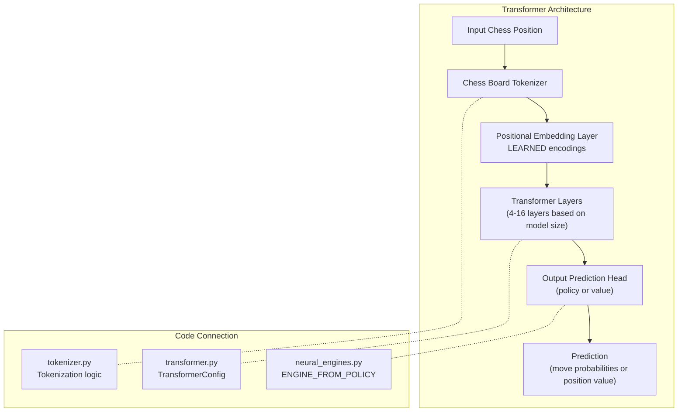

The architecture is implemented as a decoder-only transformer that takes tokenized chess positions as input and outputs either move probabilities (for behavioral cloning) or value predictions (for action-value or state-value). The configuration for all transformer models is defined through the `TransformerConfig` class in the transformer module.

Sources: [src/engines/constants.py:76-87](), [README.md:10-16]()

## Model Configuration

The transformer models share the same basic architecture but differ in size and capacity. All models use:

- Learned positional encodings
- No causal masking (since chess position evaluation doesn't require causality)
- Post-layer normalization
- Equal number of heads across all attention layers in a given model

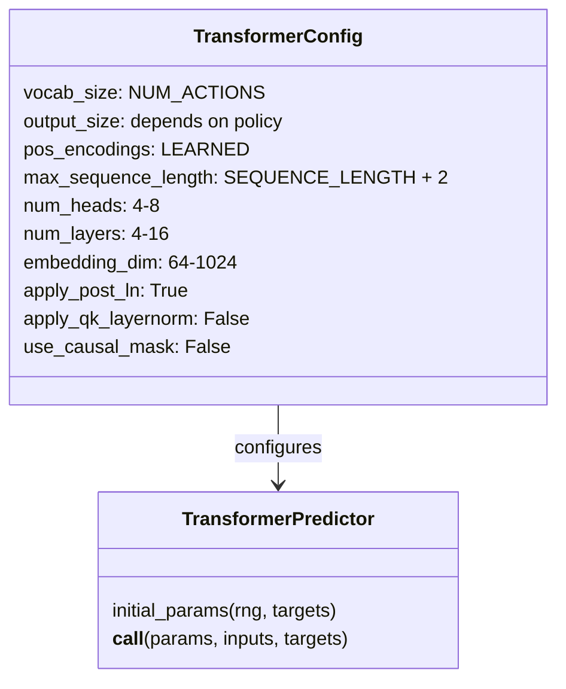

The transformer configuration is instantiated with parameters that reflect the model size and prediction type. The output size varies depending on whether the model is predicting action values (128 buckets), behavioral cloning (number of possible actions), or state values (128 buckets).

Sources: [src/engines/constants.py:76-87]()

## Model Variants

The project uses three primary model sizes for evaluation, plus a smaller local model for development. The main differentiation between models is their parameter count, which is controlled by varying the number of layers and embedding dimensions.

| Model Name | Parameters | Layers | Embedding Dim | Heads | Policy Type | Checkpoint Step |
|------------|------------|--------|---------------|-------|-------------|----------------|
| 9M         | 9 million  | 8      | 256           | 8     | action_value| 6,400,000      |
| 136M       | 136 million| 8      | 1024          | 8     | action_value| 6,400,000      |
| 270M       | 270 million| 16     | 1024          | 8     | action_value| 6,400,000      |
| local      | ~400k      | 4      | 64            | 4     | action_value| varies         |

The larger models (136M and 270M) offer better performance but require more computational resources for training and inference. The local model is primarily intended for development and experimentation.

Sources: [src/engines/constants.py:42-62](), [src/engines/constants.py:115-125]()

## Prediction Targets

The transformer models can be trained with three different prediction targets:

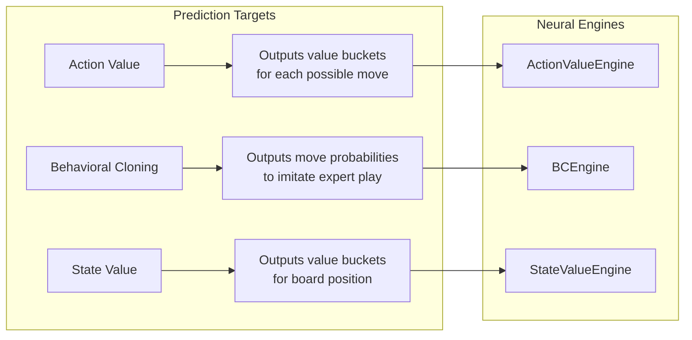

1. **Action Value** (default): Predicts the expected outcome value for each possible move, bucketed into 128 discrete value ranges. This allows the model to evaluate which moves are most promising.

2. **Behavioral Cloning**: Predicts the probability distribution over legal moves that an expert (like Stockfish) would play. This is a pure imitation learning approach.

3. **State Value**: Predicts the expected outcome value of the current board position, bucketed into 128 discrete value ranges. This evaluates the position without specifically scoring individual moves.

All variants in the repository are primarily trained on the action-value task, as this proved most effective for chess play.

Sources: [src/engines/constants.py:68-74](), [README.md:12-13]()

## Model Initialization and Loading

Models are initialized with the appropriate configuration and then loaded from checkpoints for inference. The code uses JAX and Haiku for model implementation and parameter management.

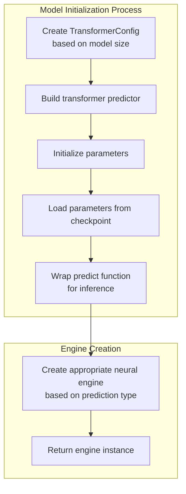

The model loading process:
1. Creates the appropriate `TransformerConfig` based on the model size
2. Builds a transformer predictor using the configuration
3. Initializes parameters with a random key
4. Loads the trained parameters from checkpoints
5. Wraps the prediction function for inference
6. Creates the appropriate neural engine based on the prediction type

Sources: [src/engines/constants.py:36-112]()

## Integration with the Engine System

The transformer models are integrated into the chess engine system through the `ENGINE_BUILDERS` dictionary, which provides factory functions for creating different types of engines.

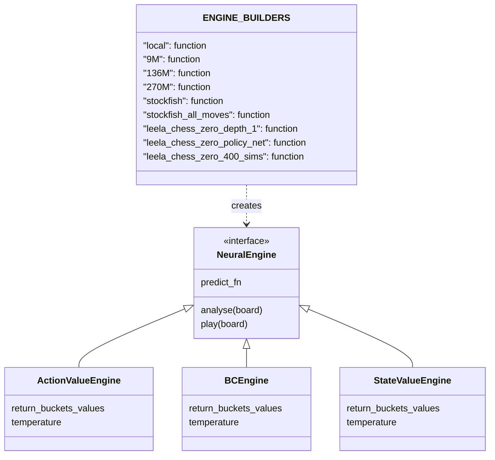

When a neural engine is requested, the `_build_neural_engine` function configures and loads the appropriate transformer model based on the specified size, and then wraps it in the appropriate engine type determined by the prediction target.

Sources: [src/engines/constants.py:115-141]()

## Performance Characteristics

The transformer models exhibit varying levels of performance depending on their size:

- **9M model**: Provides baseline performance with reasonable computational requirements
- **136M model**: Offers significantly better prediction accuracy and playing strength
- **270M model**: Provides the best performance, solving challenging chess puzzles and achieving a Lichess blitz Elo of 2895 against humans (grandmaster level)

Despite performing no explicit search, the largest transformer models achieve remarkably strong chess play by effectively learning to approximate Stockfish's search-based evaluation through supervised learning.

Sources: [README.md:10-16]()

---

# Page: Training Configuration

# Training Configuration

<details>
<summary>Relevant source files</summary>

The following files were used as context for generating this wiki page:

- [src/config.py](src/config.py)
- [src/training.py](src/training.py)
- [src/training_utils.py](src/training_utils.py)

</details>


This page details how to configure the training process for transformer models in the searchless_chess system, including hyperparameters and data settings. For information about the transformer models themselves, see [Transformer Models](#3.1). For details about pre-trained checkpoints, see [Pre-trained Checkpoints](#3.3).

The searchless_chess training system uses a configuration-based approach to control all aspects of model training. This document explains the available configuration options, their effects on the training process, and how to set them up for different training scenarios.

## Configuration Structure

The training configuration system uses dataclasses to define structured configurations for different aspects of the training process.

```mermaid
classDiagram
    class "DataConfig" {
        batch_size: int
        shuffle: bool
        seed: int
        drop_remainder: bool
        worker_count: int
        num_return_buckets: int
        split: Literal['train', 'test']
        policy: PolicyType
        num_records: int
    }
    
    class "TrainConfig" {
        data: DataConfig
        learning_rate: float
        max_grad_norm: float
        num_steps: int
        ckpt_frequency: int
        ckpt_max_to_keep: int
        save_frequency: int
        log_frequency: int
    }
    
    class "PolicyType" {
        <<Literal>>
        action_value
        state_value
        behavioral_cloning
    }
    
    TrainConfig --> DataConfig : "contains"
    DataConfig --> PolicyType : "uses"
```

Sources: [src/config.py:16-92]()

## Training Configuration Parameters

The `TrainConfig` dataclass defines the parameters for configuring the training process. Here's a detailed explanation of each parameter:

| Parameter | Type | Description |
|-----------|------|-------------|
| data | DataConfig | Configuration for the data generation pipeline |
| learning_rate | float | Learning rate for the Adam optimizer |
| max_grad_norm | float | Maximum gradient norm for gradient clipping (default: 1.0) |
| num_steps | int | Total number of training steps to perform |
| ckpt_frequency | int or None | Steps interval between checkpoint saves (None disables checkpointing) |
| ckpt_max_to_keep | int or None | Maximum number of checkpoints to keep (default: 1) |
| save_frequency | int or None | Steps interval for permanent checkpoint saves (None means all are temporary) |
| log_frequency | int or None | Steps interval for logging training progress (None disables logging) |

Sources: [src/config.py:51-73]()

The training configuration is passed to the `train` function, which is the main entry point for training:

```mermaid
flowchart TD
    subgraph "Training Process"
        A["train()"] --> B["Initialize Parameters"]
        B --> C["Create Optimizer"]
        C --> D["Setup Checkpointing"]
        D --> E["Training Loop"]
        E --> F["Update Parameters"]
        F --> G["Checkpointing"]
        G --> H["Logging"]
        H --> E
    end
    
    subgraph "Configuration Input"
        TC["TrainConfig"] --> |"Configures"| A
        PC["TransformerConfig"] --> |"Configures Model"| A
        DL["DataLoaderBuilder"] --> |"Builds Data Pipeline"| A
    end
    
    subgraph "Configuration Effects"
        TC --> |"learning_rate"| C
        TC --> |"max_grad_norm"| F
        TC --> |"ckpt_frequency"| G
        TC --> |"log_frequency"| H
        TC --> |"num_steps"| E
    end
```

Sources: [src/training.py:36-41](), [src/training.py:66-69](), [src/training.py:123-156]()

## Data Configuration Parameters

The `DataConfig` dataclass defines the parameters for configuring the data pipeline. Here's a detailed explanation of each parameter:

| Parameter | Type | Description |
|-----------|------|-------------|
| batch_size | int | Size of training batches |
| shuffle | bool | Whether to shuffle the dataset (default: False) |
| seed | int or None | Random seed for shuffling and transformations (default: 0) |
| drop_remainder | bool | Whether to drop partial batches (default: False) |
| worker_count | int or None | Number of child processes for parallelizing data transformations (default: 0) |
| num_return_buckets | int | Number of return buckets for value prediction |
| split | Literal['train', 'test'] | Dataset split to use |
| policy | PolicyType | The policy used to create the dataset ('action_value', 'state_value', or 'behavioral_cloning') |
| num_records | int or None | Maximum number of records to read from the dataset (default: None, meaning all records) |

Sources: [src/config.py:26-49]()

In the training process, the data configuration controls how data is loaded and processed before being fed to the model:

```mermaid
flowchart LR
    subgraph "Data Pipeline Configuration"
        DC["DataConfig"] --> |"policy"| PT["Policy Type Selection"]
        DC --> |"batch_size"| BS["Batch Size"]
        DC --> |"shuffle"| SH["Data Shuffling"]
        DC --> |"seed"| SD["Random Seed"]
        DC --> |"worker_count"| WC["Parallelization"]
        DC --> |"split"| SP["Dataset Split"]
    end
    
    subgraph "Data Processing"
        PT --> DL["Data Loader"]
        BS --> DL
        SH --> DL
        SD --> DL
        WC --> DL
        SP --> DL
        
        DL --> |"data_iter"| TL["Training Loop"]
    end
```

Sources: [src/training.py:53-54](), [src/config.py:26-49]()

## Training Loop and Optimization

The training loop uses the configuration to determine how long to train and how to update model parameters:

1. **Optimizer Configuration**: The system uses Optax to create an optimizer chain with gradient clipping and Adam optimization
2. **Parameter Updates**: Parameters are updated using the `update_parameters` function which applies gradients
3. **EMA Parameters**: An exponential moving average of parameters is maintained for evaluation

Here's how the optimizer is configured and how parameters are updated:

```mermaid
flowchart TD
    subgraph "Optimizer Configuration"
        TC["TrainConfig"] --> |"max_grad_norm"| GC["Gradient Clipping"]
        TC --> |"learning_rate"| LR["Adam Learning Rate"]
        GC --> |"chain"| OP["Optimizer"]
        LR --> |"chain"| OP
    end
    
    subgraph "Parameter Update Process"
        OP --> |"optimizer"| UP["update_parameters()"]
        DP["Data Point"] --> |"sequences, loss_mask"| UP
        P["Parameters"] --> UP
        PE["Parameters EMA"] --> UP
        OS["Optimizer State"] --> UP
        
        UP --> NP["New Parameters"]
        UP --> NPE["New Parameters EMA"]
        UP --> NOS["New Optimizer State"]
        UP --> L["Loss"]
        UP --> GN["Gradient Norm"]
    end
```

Sources: [src/training.py:66-69](), [src/training_utils.py:103-139]()

## Checkpointing System

The training system includes a comprehensive checkpointing mechanism that can save and restore training state:

```mermaid
flowchart TD
    subgraph "Checkpoint Configuration"
        TC["TrainConfig"] --> |"ckpt_frequency"| CF["Checkpoint Frequency"]
        TC --> |"ckpt_max_to_keep"| CMK["Max Checkpoints"]
        TC --> |"save_frequency"| SF["Save Frequency"]
    end
    
    subgraph "Checkpoint Manager"
        CF --> CM["CheckpointManager"]
        CMK --> CM
        SF --> CM
        
        CM --> |"save()"| SC["Save Checkpoint"]
        CM --> |"restore()"| RC["Restore Checkpoint"]
    end
    
    subgraph "Checkpointed Items"
        SC --> P["params"]
        SC --> PE["params_ema"]
        SC --> OS["opt_state"]
        SC --> DI["data_iter"]
    end
```

Sources: [src/training.py:94-105](), [src/training.py:124-135](), [src/training_utils.py:142-225]()

The checkpoint system uses Orbax to handle the checkpoint operations:

1. `get_checkpoint_manager` creates a checkpoint manager with the specified options
2. `save` stores the current state at the specified checkpoint frequency
3. `restore_checkpoint` can load a previous checkpoint to resume training
4. The system can be configured to keep a specified number of checkpoints and permanently save checkpoints at a certain frequency

Sources: [src/training_utils.py:142-269]()

## Policy Types

The system supports three different policy types that can be configured in the training process:

| Policy Type | Description |
|-------------|-------------|
| action_value | Training a model to predict the value of actions (moves) |
| state_value | Training a model to predict the value of board positions |
| behavioral_cloning | Training a model to imitate expert play through direct move prediction |

The policy type is specified in the `DataConfig` and affects how the data is processed and the loss function is computed.

Sources: [src/config.py:22-23]()

## Example Configuration

Below is an example of how to configure a training run for an action value model:

```python
from searchless_chess.src.config import DataConfig, TrainConfig
from searchless_chess.src.transformer import TransformerConfig

# Configure data loading
data_config = DataConfig(
    batch_size=128,
    shuffle=True,
    seed=42,
    worker_count=8,
    num_return_buckets=51,
    split='train',
    policy='action_value',
)

# Configure training
train_config = TrainConfig(
    data=data_config,
    learning_rate=1e-4,
    max_grad_norm=1.0,
    num_steps=100000,
    ckpt_frequency=1000,
    ckpt_max_to_keep=5,
    save_frequency=10000,
    log_frequency=100,
)

# Configure model architecture (complementary to train_config)
predictor_config = TransformerConfig(
    vocab_size=...,
    # other transformer parameters
    seed=42,
)
```

The configuration can then be passed to the `train` function along with a data loader builder to start training:

```python
from searchless_chess.src.training import train
from searchless_chess.src import data_loader

# Get a data loader builder
build_data_loader = data_loader.get_data_loader_builder()

# Train the model
params = train(
    train_config=train_config,
    predictor_config=predictor_config,
    build_data_loader=build_data_loader,
)
```

Sources: [src/training.py:36-161](), [src/config.py:26-73]()

## Distributed Training Configuration

The training system supports distributed training across multiple devices using JAX's distributed computing features:

```mermaid
flowchart LR
    subgraph "Distributed Training Setup"
        TC["TrainConfig"] --> TL["Training Loop"]
        
        subgraph "Device Mesh"
            D1["Device 1"]
            D2["Device 2"]
            Dn["Device n"]
        end
        
        TL --> |"replicate()"| RDM["Replicated Device Mesh"]
        RDM --> |"sharding"| D1
        RDM --> |"sharding"| D2
        RDM --> |"sharding"| Dn
    end
    
    subgraph "Distributed Parameter Updates"
        P["Parameters"] --> |"replicate()"| RP["Replicated Parameters"]
        PE["Parameters EMA"] --> |"replicate()"| RPE["Replicated Parameters EMA"]
        OS["Optimizer State"] --> |"replicate()"| ROS["Replicated Optimizer State"]
        
        D1 --> |"update()"| RP
        D2 --> |"update()"| RP
        Dn --> |"update()"| RP
    end
```

Sources: [src/training.py:84-89](), [src/training_utils.py:33-57]()

Key aspects of distributed training configuration:

1. The system detects available devices using JAX and distributes computation across them
2. Parameters, optimizer state, and data are replicated across devices using `replicate()` function
3. The training process includes sharding constraints to ensure efficient parallel computation
4. Process-specific seed modifications ensure different data is trained on across processes

Sources: [src/training.py:42-47](), [src/training.py:53](), [src/training.py:138-139]()

---

# Page: Pre-trained Checkpoints

# Pre-trained Checkpoints

<details>
<summary>Relevant source files</summary>

The following files were used as context for generating this wiki page:

- [README.md](README.md)
- [checkpoints/download.sh](checkpoints/download.sh)

</details>


## Purpose and Scope

This document describes the pre-trained transformer model checkpoints provided with the SearchLess Chess system, detailing available model sizes and variants, how to download them, their structure, and how to use them in various parts of the system. For information about training your own models from scratch, see [Training System](#3) and [Training Configuration](#3.2).

Sources: [README.md:26-29]()

## Available Pre-trained Models

The SearchLess Chess project provides several pre-trained transformer models with different parameter sizes and training objectives:

| Model Size | Parameter Count | Variants Available |
|------------|----------------|-------------------|
| 9M | 9 million | Action Value, State Value, Behavioral Cloning |
| 136M | 136 million | Action Value |
| 270M | 270 million | Action Value |

- **Action Value Models**: Predict the value of each legal move (default variant)
- **State Value Models**: Predict the value of a given chess position
- **Behavioral Cloning Models**: Imitate expert moves directly

The larger models (136M and 270M) are only available with action value prediction, which was found to be the most effective training objective in the paper.

Sources: [README.md:212-215](), [checkpoints/download.sh:20-25]()

## Model Architecture Overview

```mermaid
flowchart LR
    subgraph "Model Variants"
        ActionValue["Action Value Models"]
        StateValue["State Value Models"]
        BehavioralCloning["Behavioral Cloning Models"]
    end
    
    subgraph "Parameter Sizes"
        Model9M["9M Parameters"]
        Model136M["136M Parameters"]
        Model270M["270M Parameters"]
    end
    
    ActionValue --- Model9M
    ActionValue --- Model136M
    ActionValue --- Model270M
    StateValue --- Model9M
    BehavioralCloning --- Model9M
    
    subgraph "Usage in System"
        Evaluation["Evaluation System"]
        Puzzles["Puzzle Solving"]
        Tournament["Tournament Play"]
    end
    
    Model9M --> Evaluation
    Model136M --> Evaluation
    Model270M --> Evaluation
    
    Evaluation --> Puzzles
    Evaluation --> Tournament
```

Sources: [README.md:212-215]()

## Downloading Pre-trained Checkpoints

The pre-trained model checkpoints must be downloaded separately as they're not included in the repository due to their size. To download all checkpoints, use the provided download script:

```bash
cd checkpoints
./download.sh
cd ..
```

This script downloads the following checkpoint files:
- `9M.zip`: The 9 million parameter action value model
- `9M_state_value.zip`: The 9 million parameter state value model
- `9M_behavioral_cloning.zip`: The 9 million parameter behavioral cloning model
- `136M.zip`: The 136 million parameter action value model
- `270M.zip`: The 270 million parameter action value model

After downloading, the script automatically extracts the files to create the proper directory structure in the `checkpoints` folder.

Sources: [README.md:169-178](), [checkpoints/download.sh:1-37]()

## Checkpoint Storage Structure

```mermaid
flowchart TD
    subgraph "checkpoints/"
        subgraph "9M/"
            ActionValue9M["Action Value Checkpoint"]
        end
        
        subgraph "9M_state_value/"
            StateValue9M["State Value Checkpoint"]
        end
        
        subgraph "9M_behavioral_cloning/"
            BC9M["Behavioral Cloning Checkpoint"]
        end
        
        subgraph "136M/"
            ActionValue136M["Action Value Checkpoint"]
        end
        
        subgraph "270M/"
            ActionValue270M["Action Value Checkpoint"]
        end
        
        subgraph "local/"
            LocalModel["Locally Trained Model"]
        end
    end
```

Sources: [README.md:26-29](), [README.md:198]()

## Using Pre-trained Checkpoints

The pre-trained models can be used for various tasks within the SearchLess Chess system:

### Puzzle Evaluation

To evaluate a model's performance on chess puzzles:

```bash
cd src
python puzzles.py --num_puzzles 10 --agent=270M
```

The `--agent` parameter can be set to:
- `9M`: The 9 million parameter action value model
- `136M`: The 136 million parameter action value model
- `270M`: The 270 million parameter action value model
- `local`: A locally trained model (if available)

The puzzle evaluation system measures how well the model solves chess puzzles, providing metrics on accuracy and performance.

Sources: [README.md:200-215]()

### Tournament Evaluation

Pre-trained models can be used in tournament play to compute Elo ratings:

```bash
cd src
python tournament.py --num_games=200
```

This will run a tournament between different engines, including the pre-trained models, and generate a PGN file that can be used to compute Elo ratings using BayesElo.

Sources: [README.md:218-241]()

### Model Analysis

For detailed analysis of model behavior:

```bash
jupyter notebook
# Open src/searchless_chess.ipynb in your browser
```

The notebook allows you to investigate model predictions, such as computing win percentages for legal moves and visualizing the model's decision-making process.

Sources: [README.md:243-248]()

## Integration with Neural Engines

```mermaid
flowchart TD
    subgraph "Checkpoints"
        ActionValue9M["9M Action Value"]
        StateValue9M["9M State Value"]
        BC9M["9M Behavioral Cloning"]
        ActionValue136M["136M Action Value"]
        ActionValue270M["270M Action Value"]
    end
    
    subgraph "ENGINE_BUILDERS"
        EngineFactory["Engine Factory"]
    end
    
    subgraph "Neural Engines"
        AVEngine["ActionValueEngine"]
        SVEngine["StateValueEngine"]
        BCEngine["BCEngine"]
    end
    
    ActionValue9M --> EngineFactory
    StateValue9M --> EngineFactory
    BC9M --> EngineFactory
    ActionValue136M --> EngineFactory
    ActionValue270M --> EngineFactory
    
    EngineFactory --> AVEngine
    EngineFactory --> SVEngine
    EngineFactory --> BCEngine
    
    subgraph "Engine Interface"
        Engine["Engine Protocol"]
    end
    
    AVEngine --> Engine
    SVEngine --> Engine
    BCEngine --> Engine
```

The pre-trained model checkpoints are loaded by the engine factory system to create neural engines that implement the common chess engine interface. This allows the models to be used interchangeably with traditional chess engines like Stockfish and Leela Chess Zero for evaluation purposes.

Sources: [README.md:39-45]()

## Checkpoint License Information

The model weights in the pre-trained checkpoints are licensed under Creative Commons Attribution 4.0 (CC-BY). This means you can use, share, and adapt the models for any purpose, even commercially, as long as you give appropriate credit.

Sources: [README.md:282-284]()

## Performance Characteristics

The performance of the pre-trained models varies by size and training objective:

| Model | Parameter Count | Best For | Relative Strength |
|-------|----------------|----------|------------------|
| 9M Action Value | 9 million | Quick evaluation, baseline | Lowest |
| 9M State Value | 9 million | Position evaluation | Moderate |
| 9M Behavioral Cloning | 9 million | Move imitation | Moderate |
| 136M Action Value | 136 million | Strong play | High |
| 270M Action Value | 270 million | Strongest play | Highest |

The 270M parameter model achieves the best performance on chess puzzles and tournament play, approaching grandmaster-level play despite performing no explicit search.

Sources: [README.md:10-16]()

---

# Page: Data Management

# Data Management

<details>
<summary>Relevant source files</summary>

The following files were used as context for generating this wiki page:

- [src/bagz.py](src/bagz.py)
- [src/constants.py](src/constants.py)
- [src/data_loader.py](src/data_loader.py)

</details>


This document describes the data management system in the SearchLess Chess codebase, focusing on how chess data is stored, loaded, and processed for training transformer models. For information about the training process itself, see [Training System](#3).

## Overview

The data management system consists of several key components:

1. **Bagz File Format**: A custom file format for efficient storage and retrieval of chess data
2. **Data Types**: Structured chess data for different training objectives
3. **Data Loading Pipeline**: PyGrain-based data loading infrastructure
4. **Data Transformations**: Conversion of chess data into token sequences for transformer models

```mermaid
flowchart TD
    subgraph "Data Storage"
        ChessData["Chess Data"] --> BagzFiles["Bagz Files (.bag/.bagz)"]
    end
    
    subgraph "Data Loading"
        BagzFiles --> BagReader["BagReader"]
        BagReader --> BagDataSource["BagDataSource"]
        BagDataSource --> IndexSampler["IndexSampler"]
    end
    
    subgraph "Data Transformation"
        IndexSampler --> ConvertToSequence["ConvertToSequence"]
        ConvertToSequence --> BatchOperation["Batch Operation"]
    end
    
    BatchOperation --> DataLoader["DataLoader"] --> TrainingSystem["Training System"]
```

Sources: [src/bagz.py](), [src/data_loader.py]()

## Data Organization

The system organizes chess data in a specific directory structure, with separate files for different data types and splits:

```
data/
├── train/
│   ├── behavioral_cloning_data.bag
│   ├── action_value_data.bag
│   └── state_value_data.bag
└── test/
    ├── behavioral_cloning_data.bag
    ├── action_value_data.bag
    └── state_value_data.bag
```

Data files are referenced in code as shown below:

```python
data_source = bagz.BagDataSource(
    os.path.join(
        os.getcwd(),
        f'../data/{config.split}/{config.policy}_data.bag',
    ),
)
```

Sources: [src/data_loader.py:134-138]()

## Bagz File Format

The Bagz file format provides efficient storage and retrieval of data records with fast index-based lookup and optional compression using zstandard.

### File Structure

```mermaid
flowchart LR
    subgraph "BagzFile"
        subgraph "RecordData"
            R1["Record 1"]
            R2["Record 2"]
            Rdots["..."]
            RN["Record N"]
        end
        
        subgraph "IndexData"
            I1["Index 1: 0"]
            I2["Index 2: len(R1)"]
            Idots["..."]
            IN["Index N: len(R1+...+R(N-1))"]
        end
    end
    
    R1 --- I1
    R2 --- I2
    RN --- IN
```

The Bagz implementation consists of these key classes:

- **BagFileReader**: Reads a single Bagz file [src/bagz.py:37-110]()
- **BagShardReader**: Reads sharded Bagz files [src/bagz.py:112-155]()
- **BagReader**: Unified interface for both file types [src/bagz.py:158-200]()
- **BagWriter**: Writes data to Bagz files [src/bagz.py:203-261]()
- **BagDataSource**: PyGrain-compatible data source [src/bagz.py:263-292]()

The format supports both combined storage (records and indices in one file) and separate storage (records and indices in separate files).

Sources: [src/bagz.py:16-292]()

## Data Types

The system uses three main types of chess data, each serving a different training objective:

```mermaid
classDiagram
    class BehavioralCloningData {
        +str fen
        +str move
    }
    
    class StateValueData {
        +str fen
        +float win_prob
    }
    
    class ActionValueData {
        +str fen
        +str move
        +float win_prob
    }
```

1. **Behavioral Cloning Data**: Used to train models to imitate expert moves
   - `fen`: Chess position in FEN notation
   - `move`: Chess move in algebraic notation

2. **State Value Data**: Used to train models to evaluate chess positions
   - `fen`: Chess position in FEN notation
   - `win_prob`: Probability of winning from that position

3. **Action Value Data**: Used to train models to evaluate specific moves
   - `fen`: Chess position in FEN notation
   - `move`: Chess move in algebraic notation
   - `win_prob`: Probability of winning after making that move

The system defines Apache Beam coders for serializing and deserializing these data types:

```python
CODERS = {
    'fen': coders.StrUtf8Coder(),
    'move': coders.StrUtf8Coder(),
    'count': coders.BigIntegerCoder(),
    'win_prob': coders.FloatCoder(),
}
CODERS['state_value'] = coders.TupleCoder((CODERS['fen'], CODERS['win_prob']))
CODERS['action_value'] = coders.TupleCoder((CODERS['fen'], CODERS['move'], CODERS['win_prob']))
CODERS['behavioral_cloning'] = coders.TupleCoder((CODERS['fen'], CODERS['move']))
```

Sources: [src/constants.py:85-119]()

## Data Loading Pipeline

The data loading pipeline utilizes PyGrain for efficient data processing. The `build_data_loader` function creates a complete data loading pipeline:

```mermaid
flowchart TD
    subgraph "build_data_loader"
        Config["DataConfig"] --> CreateDataSource["Create BagDataSource"]
        CreateDataSource --> CreateSampler["Create IndexSampler"]
        CreateSampler --> SelectTransformation["Select Transformation"]
        SelectTransformation --> CreateDataLoader["Create DataLoader"]
    end
    
    subgraph "Transformation Selection"
        Policy["config.policy"] --> |"behavioral_cloning"| BC["ConvertBehavioralCloningDataToSequence"]
        Policy --> |"state_value"| SV["ConvertStateValueDataToSequence"]
        Policy --> |"action_value"| AV["ConvertActionValueDataToSequence"]
    end
    
    SelectTransformation --- Policy
```

Key parameters in the data loading pipeline:
- **Data source**: Points to the appropriate .bag file
- **Sampler options**: Control shuffling, sharding, and record selection
- **Policy type**: Determines which transformation to apply
- **Worker count**: Controls parallel processing

Sources: [src/data_loader.py:132-170]()

## Data Transformations

The data transformations convert raw chess data into token sequences suitable for training transformer models. All transformations inherit from the abstract `ConvertToSequence` class.

```mermaid
flowchart TD
    subgraph "ConvertToSequence"
        Process["map(element)"] --> Decode["Decode element"]
        Decode --> TokenizeFEN["Tokenize FEN"]
        TokenizeFEN --> |"Optional"| ProcessMove["Process Move"]
        TokenizeFEN --> |"Optional"| ProcessWinProb["Process Win Probability"]
        ProcessMove & ProcessWinProb --> Concatenate["Concatenate into sequence"]
        Concatenate --> CreateLossMask["Create Loss Mask"]
        CreateLossMask --> ReturnData["Return sequence + mask"]
    end
```

### Sequence Conversion Process

1. **FEN Tokenization**: Chess positions in FEN notation are tokenized into integer arrays using `tokenizer.tokenize`
2. **Move Conversion**: Chess moves are converted to action IDs using the `MOVE_TO_ACTION` mapping
3. **Win Probability Quantization**: Win probabilities are mapped to discrete buckets
4. **Concatenation**: These components are concatenated into a single integer sequence
5. **Loss Mask Creation**: A boolean mask indicates which positions to compute loss for during training

Each transformation produces sequences of different lengths:
- **Behavioral Cloning**: `tokenizer.SEQUENCE_LENGTH + 1` (position + move)
- **State Value**: `tokenizer.SEQUENCE_LENGTH + 1` (position + value)
- **Action Value**: `tokenizer.SEQUENCE_LENGTH + 2` (position + move + value)

Sources: [src/data_loader.py:50-121]()

## Integration with Training

The data loader provides batches of data to the training system in the form of:
1. **Sequences**: Integer arrays representing tokenized positions, moves, and/or values
2. **Loss Masks**: Boolean arrays indicating which positions to compute loss for

These batches feed directly into the training loop, where transformer models learn to predict the appropriate outputs based on the input sequences.

For details on how this data is used in training, see [Training System](#3).

Sources: [src/data_loader.py]()

---

# Page: ChessBench Dataset

# ChessBench Dataset

<details>
<summary>Relevant source files</summary>

The following files were used as context for generating this wiki page:

- [README.md](README.md)
- [data/download.sh](data/download.sh)

</details>


## Purpose and Scope

This document describes the ChessBench dataset, a large-scale chess benchmark used for training transformer-based chess models in the searchless_chess project. It covers dataset structure, content, and access instructions. For information about the data loading pipeline that processes this dataset, see [Data Management](#4), and for details about the custom Bagz file format used to store the dataset, see [Bagz File Format](#4.2).

## Dataset Overview

ChessBench is a comprehensive chess dataset containing 10 million chess games with legal move and value annotations, totaling approximately 15 billion data points. These annotations are provided by Stockfish 16, the state-of-the-art chess engine at the time of dataset creation. The dataset serves as the foundation for training transformer models to play chess without traditional search algorithms.

```mermaid
graph TD
    subgraph "ChessBench Dataset"
        data["10M Chess Games
        15B Data Points"]
        
        subgraph "Data Types"
            av["Action-Value Data
            (Move Evaluations)"]
            bc["Behavioral Cloning Data
            (Expert Moves)"]
            sv["State-Value Data
            (Position Evaluations)"]
        end
        
        data --> av
        data --> bc
        data --> sv
    end
    
    annotation["Stockfish 16
    Engine Annotations"] --> data
```

Sources: [README.md:10-16]()

## Dataset Structure

The ChessBench dataset is organized into train and test splits, with multiple file types for different learning targets.

### Organization

```mermaid
graph TD
    subgraph "ChessBench Dataset Structure"
        root["data/"] --> eco["eco_openings.pgn"]
        root --> puzzles["puzzles.csv"]
        root --> train["train/"]
        root --> test["test/"]
        
        train --> av_train["action_value-*-of-02148_data.bag
        (2148 sharded files)"]
        train --> bc_train["behavioral_cloning_data.bag"]
        train --> sv_train["state_value_data.bag"]
        
        test --> av_test["action_value_data.bag"]
        test --> bc_test["behavioral_cloning_data.bag"]
        test --> sv_test["state_value_data.bag"]
    end
```

Sources: [data/download.sh:20-38](), [README.md:31-35]()

### Dataset Size

The ChessBench dataset is quite large, with the training portion requiring significant storage space:

| Split | Data Type | Size |
|-------|-----------|------|
| Train | Action-Value | 1.1 TB (2148 sharded files) |
| Train | Behavioral Cloning | 34 GB |
| Train | State-Value | 36 GB |
| Test | Action-Value | 141 MB |
| Test | Behavioral Cloning | 4.1 MB |
| Test | State-Value | 4.4 MB |
| Test | Puzzles | 4.5 MB |

Sources: [README.md:160-167]()

## Dataset Content

The ChessBench dataset contains three primary types of data, each serving a different purpose in the training process:

### Action-Value Data

Action-value data contains evaluations for each legal move in a given chess position. These evaluations are provided by Stockfish 16 and represent how good each move is expected to be. This data is used to train models that can evaluate the value of possible chess moves.

### Behavioral Cloning Data

Behavioral cloning data contains expert moves selected by Stockfish 16. This data is used to train models to imitate expert play through supervised learning.

### State-Value Data

State-value data contains evaluations of entire board positions. These evaluations indicate how favorable a position is overall. This data is used to train models that can evaluate chess positions.

### Puzzles

In addition to the main dataset, ChessBench includes a collection of chess puzzles stored in `puzzles.csv`. These puzzles are used for evaluating trained models' ability to find the best move in tactical situations.

```mermaid
flowchart TD
    subgraph "Data Integration in Training Pipeline"
        ChessBench["ChessBench Dataset"] --> bagz["Bagz File System"]
        
        bagz --> DataLoader["data_loader.py"]
        DataLoader --> Tokenizer["tokenizer.py (Board Tokenization)"]
        Tokenizer --> Training["Training System"]
        
        subgraph "Data Representation Flow"
            chessBags[".bag Files"] --> boardReps["Board Representations"]
            boardReps --> tokens["Tokenized Positions"]
            tokens --> trainingSequences["Training Sequences"]
        end
    end
```

Sources: [README.md:47-53]()

## Accessing the Dataset

The ChessBench dataset can be downloaded using the provided script:

```bash
cd data
./download.sh
```

Alternatively, individual components can be downloaded from the following URLs:

| Split | Data Type | Download Link |
|-------|-----------|--------------|
| Train | Action-Value | https://storage.googleapis.com/searchless_chess/data/train/action_value-00000-of-02148_data.bag (first shard of 2148) |
| Train | Behavioral Cloning | https://storage.googleapis.com/searchless_chess/data/train/behavioral_cloning_data.bag |
| Train | State-Value | https://storage.googleapis.com/searchless_chess/data/train/state_value_data.bag |
| Test | Action-Value | https://storage.googleapis.com/searchless_chess/data/test/action_value_data.bag |
| Test | Behavioral Cloning | https://storage.googleapis.com/searchless_chess/data/test/behavioral_cloning_data.bag |
| Test | State-Value | https://storage.googleapis.com/searchless_chess/data/test/state_value_data.bag |
| Test | Puzzles | https://storage.googleapis.com/searchless_chess/data/puzzles.csv |

Note that the complete training dataset requires approximately 1.2 TB of disk space, with the action-value data accounting for the majority (1.1 TB).

Sources: [README.md:149-167](), [data/download.sh:1-39]()

## Dataset File Format and Processing

The ChessBench dataset is stored in a custom `.bag` file format designed for efficient storage and access of structured chess data. These files are read using the `bagz.py` module, which provides readers for extracting and processing the data.

```mermaid
flowchart LR
    subgraph "Dataset Processing Pipeline"
        bagFiles[".bag Files"] --> bagzReader["bagz.py (Bag Reader)"]
        bagzReader --> dataLoader["data_loader.py"]
        dataLoader --> tokenizer["tokenizer.py"]
        tokenizer --> transformer["transformer.py (Training)"]
    end
```

Sources: [README.md:47-53]()

## Dataset License

The ChessBench dataset has a mixed licensing structure:
- Some portions are in the public domain via Creative Commons CC0 license from lichess.org
- The remainder is licensed under Creative Commons Attribution 4.0 (CC-BY)

Sources: [README.md:286-291]()

## Integration with Training System

In the searchless_chess system, the ChessBench dataset is a critical component that feeds into the training pipeline. The dataset is used to train transformer models of various sizes (9M, 136M, and 270M parameters) to predict action values, state values, or imitate expert moves through behavioral cloning.

```mermaid
flowchart TD
    subgraph "ChessBench in System Architecture"
        chessBench["ChessBench Dataset"] --> dataTypes["Data Types"]
        
        dataTypes --> actionValue["Action-Value Data"]
        dataTypes --> behavioralCloning["Behavioral Cloning Data"]
        dataTypes --> stateValue["State-Value Data"]
        
        actionValue --> training["Training System"]
        behavioralCloning --> training
        stateValue --> training
        
        training --> models["Transformer Models"]
        models --> engines["Neural Chess Engines"]
        
        engines --> evaluation["Evaluation System"]
    end
```

Sources: [README.md:8-16]()

---

# Page: Bagz File Format

# Bagz File Format

<details>
<summary>Relevant source files</summary>

The following files were used as context for generating this wiki page:

- [src/bagz.py](src/bagz.py)

</details>


## Introduction

The Bagz file format is a specialized storage format used in the SearchLess Chess project for efficiently storing and accessing training data. It is designed to store sequences of string records (typically serialized protocol buffers) with support for fast index-based lookups. The format is particularly optimized for handling large datasets required for training transformer-based chess models.

For information about the overall data management system, see [Data Management](#4).

Sources: [src/bagz.py:16-20]()

## File Format Structure

The Bagz file format consists of two main components:

1. **Records Section**: Contains the actual record data, stored sequentially
2. **Limits Section**: Contains the byte offsets of each record, allowing fast access

In the default configuration, these two sections are stored in a single file, with the limits section appended to the end. Optionally, the limits can be stored in a separate file for specialized use cases.

```mermaid
graph TD
    subgraph "Bagz File Structure"
        Records["Records Section"] --> Limits["Limits Section"]
        Records --> |"contains"| Record1["Record 1"]
        Records --> |"contains"| Record2["Record 2"]
        Records --> |"contains"| RecordN["Record N"]
        Limits --> |"contains"| Offset1["Offset 1"]
        Limits --> |"contains"| Offset2["Offset 2"]
        Limits --> |"contains"| OffsetN["Offset N + 1"]
        Index["File Offset to Limits Section"]
    end
```

The file structure works as follows:
- Each record is stored sequentially in the file
- The limits section contains 8-byte (64-bit) integers that mark the ending offset of each record
- For a single file, the final 8 bytes contain the starting offset of the limits section
- To access record `i`, the reader reads offsets `i` and `i+1` from the limits section and extracts the bytes between those offsets from the records section

Sources: [src/bagz.py:77-93](), [src/bagz.py:99-109](), [src/bagz.py:250-260]()

## File Types

The Bagz format supports two types of files:

1. **Single Files**: A single file containing all records and limits
2. **Sharded Files**: Multiple files where data is split across shards

Sharding is particularly useful for large datasets that exceed comfortable file size limits or for distributing data processing across multiple workers.

### Sharding Naming Convention

Sharded Bagz files follow a specific naming convention:
- The base filename includes a pattern `@N` where `N` is the total number of shards
- Each individual shard is named using the pattern `-XXXXX-of-YYYYY` where:
  - `XXXXX` is the zero-padded shard index (starting from 00000)
  - `YYYYY` is the zero-padded total number of shards

For example, a base name `data@100.bagz` would result in files like:
- `data-00000-of-00100.bagz`
- `data-00001-of-00100.bagz`
- ...
- `data-00099-of-00100.bagz`

Sources: [src/bagz.py:112-155](), [src/bagz.py:178-186]()

## Reading Bagz Files

The library provides a hierarchy of reader classes:

```mermaid
classDiagram
    class "Sequence[bytes]" {
        <<Protocol>>
        +__len__() int
        +__getitem__(index) bytes
    }
    
    class "BagReader" {
        -_reader
        +__init__(filename, separate_limits, decompress)
        +__len__() int
        +__getitem__(index) bytes
    }
    
    class "BagFileReader" {
        -_records
        -_limits
        -_num_records
        -_limits_start
        -_process
        +__init__(filename, separate_limits, decompress)
        +__len__() int
        +__getitem__(index) bytes
    }
    
    class "BagShardReader" {
        -_bags
        -_accum
        +__init__(filename, separate_limits, decompress)
        +__len__() int
        +__getitem__(index) bytes
    }
    
    "Sequence[bytes]" <|.. "BagFileReader"
    "Sequence[bytes]" <|.. "BagShardReader"
    "Sequence[bytes]" <|.. "BagReader"
    "BagReader" o-- "BagFileReader"
    "BagReader" o-- "BagShardReader"
    "BagShardReader" o-- "BagFileReader"
```

### Usage Example

To read from Bagz files, use the `BagReader` class which automatically handles both single files and sharded files:

```python
from src.bagz import BagReader

# Read from a single file
reader = BagReader("data.bagz")
record = reader[0]  # Get first record

# Read from sharded files
sharded_reader = BagReader("data@100.bagz")
record = sharded_reader[42]  # Get 43rd record across all shards
```

The `BagReader` acts as a facade over `BagFileReader` and `BagShardReader`, automatically selecting the appropriate implementation based on the filename pattern.

Sources: [src/bagz.py:37-109](), [src/bagz.py:112-155](), [src/bagz.py:158-200]()

## Writing Bagz Files

The library provides a `BagWriter` class for creating Bagz files:

```mermaid
classDiagram
    class "BagWriter" {
        -_records
        -_limits
        -_separate_limits
        -_process
        +__init__(filename, separate_limits, compress, compression_level)
        +write(data)
        +flush()
        +close()
        +__enter__()
        +__exit__()
    }
```

### Usage Example

```python
from src.bagz import BagWriter

# Create a new Bagz file
with BagWriter("output.bagz") as writer:
    writer.write(b"Record 1")
    writer.write(b"Record 2")
    writer.write(b"Record 3")
    # File is automatically closed when exiting the context
```

When the file is closed, the writer automatically:
1. Completes the record section
2. Either appends the limits section to the record file (default)
3. Or keeps the limits in a separate file (if `separate_limits=True`)

Sources: [src/bagz.py:203-260]()

## Integration with PyGrain

The Bagz format includes a PyGrain-compatible data source interface through the `BagDataSource` class. [PyGrain](https://github.com/google/grain) is a data processing library for training machine learning models.

```mermaid
classDiagram
    class "BagDataSource" {
        -_path
        -_reader
        -_num_records
        +__init__(path)
        +__len__() int
        +__getitem__(record_key) bytes
        +__getstate__()
        +__setstate__(state)
        +__repr__() str
    }
    
    class "BagReader" {
        +__len__() int
        +__getitem__(index) bytes
    }
    
    "BagDataSource" o-- "BagReader"
```

The `BagDataSource` class wraps a `BagReader` and implements the necessary interface for PyGrain to use Bagz files as data sources in training pipelines.

Sources: [src/bagz.py:263-292]()

## Compression

The Bagz format supports compression of records using the Zstandard library. Compression can be controlled through:

1. **File extension**: Files with `.bagz` extension are automatically compressed/decompressed unless overridden
2. **Explicit flags**: `compress`/`decompress` parameters in the reader and writer constructors
3. **Compression level**: The `compression_level` parameter in the writer (higher values = better compression but slower)

Compression is particularly useful for storing large datasets more efficiently, especially when records contain redundant data.

Sources: [src/bagz.py:54-58](), [src/bagz.py:223-226]()

## Usage in SearchLess Chess

In the SearchLess Chess project, the Bagz format is a crucial component of the data processing pipeline, sitting between the ChessBench dataset and the training system:

```mermaid
flowchart LR
    subgraph "Data Processing Pipeline"
        ChessBench["ChessBench Dataset"] --> BagzFiles["Bagz Files"]
        BagzFiles --> DataLoader["PyGrain Data Loader"]
        DataLoader --> Training["Training System"]
    end
```

The Bagz files store different types of chess training data:
- Action Value data (for move evaluation)
- Behavioral Cloning data (for move imitation)
- State Value data (for position evaluation)

This storage format provides efficient random access to examples during training while supporting the large scale necessary for training transformer models.

Sources: [src/bagz.py:16-20]()

## Performance Considerations

The Bagz format is optimized for:

1. **Fast random access**: Using memory-mapped files and indexed offsets
2. **Efficient storage**: Optional compression with configurable levels
3. **Large datasets**: Support for sharding across multiple files
4. **Parallel processing**: Each shard can be processed independently

These characteristics make it well-suited for machine learning training workflows where efficient access to large datasets is critical.

Sources: [src/bagz.py:37-49](), [src/bagz.py:112-129]()

## Technical Implementation Details

### Memory Mapping

The Bagz reader uses memory mapping (`mmap`) to efficiently access file contents without loading the entire file into memory. This provides better performance for large files and reduces memory usage.

### Binary Format

The limits section uses 8-byte (64-bit) little-endian integers (`<q` format in `struct.pack`/`struct.unpack`) to store offsets, allowing for files up to 2^63 bytes in size.

### Error Handling

The implementation includes various checks to ensure file integrity:
- Validation of file size (must be at least 8 bytes for the index)
- Proper handling of empty files
- Index range checking during record access

Sources: [src/bagz.py:60-93](), [src/bagz.py:99-109]()

---

# Page: Chess Engines

# Chess Engines

<details>
<summary>Relevant source files</summary>

The following files were used as context for generating this wiki page:

- [src/engines/constants.py](src/engines/constants.py)
- [src/engines/engine.py](src/engines/engine.py)

</details>


This page documents the chess engine system in the searchless_chess project. It describes the engine interface, the various types of engines implemented (including neural-based and traditional engines), and how these engines are constructed and configured. For information about the neural engine architectures specifically, see [Neural Engines](#5.1).

## Engine Interface

The searchless_chess project defines a consistent protocol for all chess engines, enabling interchangeability between different engine implementations. This interface provides two key methods that all engines must implement:

```mermaid
classDiagram
    class Engine {
        <<Protocol>>
        +analyse(board: chess.Board) -> AnalysisResult
        +play(board: chess.Board) -> chess.Move
    }
```

The `Engine` protocol requires:
- `analyse()`: Returns detailed analysis results from the engine for a given position
- `play()`: Returns the best move for a given position according to the engine

The protocol also defines an `AnalysisResult` type, which is a mapping containing various analysis outputs from the engine.

Sources: [src/engines/engine.py:33-39]()

## Engine Hierarchy

The codebase implements several engine types that conform to this protocol, including neural network-based engines and wrappers for traditional chess engines:

```mermaid
classDiagram
    class Engine {
        <<Protocol>>
        +analyse(board: chess.Board) -> AnalysisResult
        +play(board: chess.Board) -> chess.Move
    }
    
    class StockfishEngine {
        -_raw_engine: SimpleEngine
        -_limit: chess.engine.Limit
        +analyse(board)
        +play(board)
    }
    
    class Lc0Engine {
        -_raw_engine: SimpleEngine
        -_limit: chess.engine.Limit
        +analyse(board)
        +play(board)
    }
    
    class NeuralEngine {
        -predict_fn
        -temperature
        +analyse(board)
        +play(board)
    }
    
    class ActionValueEngine {
        -return_buckets_values
    }
    
    class StateValueEngine {
        -return_buckets_values
    }
    
    class BCEngine {
        <<Behavioral Cloning>>
    }
    
    class AllMovesStockfishEngine {
        +analyse(board)
    }
    
    class AllMovesLc0Engine {
        +analyse(board)
    }
    
    Engine <|.. StockfishEngine
    Engine <|.. Lc0Engine
    Engine <|.. NeuralEngine
    
    NeuralEngine <|-- ActionValueEngine
    NeuralEngine <|-- StateValueEngine
    NeuralEngine <|-- BCEngine
    
    StockfishEngine <|-- AllMovesStockfishEngine
    Lc0Engine <|-- AllMovesLc0Engine
```

Sources: [src/engines/constants.py:105-141]()

## Engine Types

### Neural Engines

The neural engines use transformer models to predict chess moves without traditional search algorithms. These engines come in three flavors based on their prediction targets:

1. **Action Value Engines**: Predict the value of possible moves
2. **State Value Engines**: Predict the value of board positions
3. **Behavioral Cloning Engines**: Imitate expert play

The project includes pre-trained models of different sizes:

| Model | Parameters | Layers | Embedding Dimension | Attention Heads |
|-------|------------|--------|---------------------|-----------------|
| 9M    | 9 million  | 8      | 256                 | 8               |
| 136M  | 136 million| 8      | 1024                | 8               |
| 270M  | 270 million| 16     | 1024                | 8               |
| local | Small test | 4      | 64                  | 4               |

Sources: [src/engines/constants.py:42-58](), [src/engines/constants.py:76-87]()

### Traditional Engines

The system integrates with two popular traditional chess engines:

#### Stockfish

Stockfish is a powerful open-source chess engine that uses alpha-beta pruning and other search techniques. The system provides two Stockfish variants:

- **StockfishEngine**: Returns only the best move for a position
- **AllMovesStockfishEngine**: Analyzes all legal moves in a position

Sources: [src/engines/constants.py:126-131]()

#### Leela Chess Zero (Lc0)

Leela Chess Zero is a neural network-based chess engine that uses Monte Carlo Tree Search (MCTS). The system offers several Lc0 configurations:

- **Lc0Engine with nodes=1**: Uses only the policy network without search
- **Lc0Engine with nodes=400**: Performs 400 simulations using MCTS
- **AllMovesLc0Engine**: Analyzes all legal moves using the Lc0 policy network

Sources: [src/engines/constants.py:132-140]()

## Engine Construction

The system uses a factory pattern to instantiate various engine types. The `ENGINE_BUILDERS` dictionary maps engine names to factory functions that create engine instances:

```mermaid
flowchart TD
    subgraph "ENGINE_BUILDERS"
        Local["'local'"]
        NineM["'9M'"]
        HundredThirtySixM["'136M'"]
        TwoSeventyM["'270M'"]
        Stockfish["'stockfish'"]
        StockfishAllMoves["'stockfish_all_moves'"]
        Lc0Depth1["'leela_chess_zero_depth_1'"]
        Lc0PolicyNet["'leela_chess_zero_policy_net'"]
        Lc0400Sims["'leela_chess_zero_400_sims'"]
    end
    
    subgraph "Neural Engines"
        ActionValueEngine
        StateValueEngine
        BCEngine["Behavioral Cloning Engine"]
    end
    
    subgraph "Traditional Engines"
        StockfishEngine
        AllMovesStockfishEngine
        Lc0Engine
        AllMovesLc0Engine
    end
    
    Local --> _build_neural_engine
    NineM --> _build_neural_engine
    HundredThirtySixM --> _build_neural_engine
    TwoSeventyM --> _build_neural_engine
    
    _build_neural_engine --> ActionValueEngine
    _build_neural_engine --> StateValueEngine
    _build_neural_engine --> BCEngine
    
    Stockfish --> StockfishEngine
    StockfishAllMoves --> AllMovesStockfishEngine
    Lc0Depth1 --> AllMovesLc0Engine
    Lc0PolicyNet --> Lc0Engine
    Lc0400Sims --> Lc0Engine
```

Sources: [src/engines/constants.py:115-141]()

### Neural Engine Construction Process

The `_build_neural_engine` function constructs neural engines based on model size and policy type:

```mermaid
flowchart LR
    ModelName["Model Name\n(9M, 136M, 270M, local)"] --> ModelConfig["Model Configuration\n- num_layers\n- embedding_dim\n- num_heads"]
    ModelConfig --> TransformerConfig["TransformerConfig\n- vocab_size\n- output_size\n- pos_encodings\n- etc."]
    TransformerConfig --> Predictor["transformer.build_transformer_predictor()"]
    Predictor --> LoadParameters["training_utils.load_parameters()"]
    LoadParameters --> CreateEngine["Create NeuralEngine\n(ActionValue, BC, or StateValue)"]
```

The neural engines use a transformer-based predictor with appropriate parameters loaded from checkpoints. Model parameters are selected based on the model name, with different model sizes providing a trade-off between performance and computational requirements.

Sources: [src/engines/constants.py:36-112]()

## Using Chess Engines

To use an engine from the system, you can instantiate it from the `ENGINE_BUILDERS` dictionary:

1. Select an engine type from the available options
2. Create an instance using the corresponding builder function
3. Use the `analyse()` method to evaluate a position
4. Use the `play()` method to get the best move

Neural engines can process board positions directly, while the traditional engine wrappers manage the communication with external engine processes.

The engines provide a unified interface that makes it easy to swap different implementations for evaluation or comparison purposes. This enables testing the relative performance of the transformer-based searchless approach against traditional search-based engines.

Sources: [src/engines/engine.py:33-39](), [src/engines/constants.py:115-141]()

---

# Page: Neural Engines

# Neural Engines

<details>
<summary>Relevant source files</summary>

The following files were used as context for generating this wiki page:

- [src/engines/constants.py](src/engines/constants.py)
- [src/engines/neural_engines.py](src/engines/neural_engines.py)

</details>


## Purpose and Overview

Neural Engines are the core components of the SearchLess Chess system that enable chess playing without traditional tree search algorithms. They use trained transformer models to evaluate chess positions and select moves through amortized planning. Unlike traditional chess engines like Stockfish or Leela Chess Zero (see [Stockfish Integration](#5.2) and [Leela Chess Zero Integration](#5.3)), Neural Engines rely solely on the pattern recognition capabilities of large transformer models.

This document describes the different types of Neural Engines available in the system, their architecture, and how they function to select moves in a chess game.

Sources: [src/engines/neural_engines.py:16-17](), [src/engines/neural_engines.py:36-41]()

## Neural Engine Architecture

Neural Engines implement the standard Engine interface but use neural networks for decision-making. All Neural Engines inherit from the base `NeuralEngine` class and are specialized based on the policy they implement.

```mermaid
classDiagram
    class Engine {
        <<Protocol>>
        +analyse(board: chess.Board) -> AnalysisResult
        +play(board: chess.Board) -> chess.Move
    }
    
    class NeuralEngine {
        -_return_buckets_values: np.ndarray
        -predict_fn: PredictFn
        -temperature: float
        -_rng: RandomGenerator
        +analyse(board)
        +play(board)
    }
    
    class ActionValueEngine {
        +analyse(board)
        +play(board)
    }
    
    class StateValueEngine {
        -_get_value_log_probs()
        +analyse(board)
        +play(board)
    }
    
    class BCEngine {
        +analyse(board)
        +play(board)
    }
    
    Engine <|.. NeuralEngine
    NeuralEngine <|-- ActionValueEngine
    NeuralEngine <|-- StateValueEngine
    NeuralEngine <|-- BCEngine
```

**Neural Engine Class Hierarchy**

Sources: [src/engines/neural_engines.py:36-54](), [src/engines/neural_engines.py:70-104](), [src/engines/neural_engines.py:106-155](), [src/engines/neural_engines.py:158-189]()

## Neural Engine Types

The system implements three types of neural engines, each using a different approach to evaluate positions and select moves:

| Engine Type | Policy | Description | Prediction Target |
|-------------|--------|-------------|------------------|
| ActionValueEngine | action_value | Predicts the value of each legal move | P(r \| s, a) - probability of returns given state and action |
| StateValueEngine | state_value | Predicts the value of the position, then evaluates moves by looking one step ahead | P(r \| s) - probability of returns given state |
| BCEngine | behavioral_cloning | Directly imitates expert play by predicting move probabilities | P(a \| s) - probability of actions given state |

Sources: [src/engines/neural_engines.py:70-189](), [src/engines/neural_engines.py:230-234]()

## Neural Engine Decision Flow

Each type of neural engine follows a different process to select a move:

```mermaid
flowchart TD
    subgraph Common ["Common Process"]
        Board["Chess Board Position"]
        TokenizeBoard["Tokenize Board FEN"]
        MakeDecision["Select Move"]
        Return["Return Selected Move"]
    end
    
    subgraph ActionValue ["ActionValueEngine"]
        GetLegalMoves["Get Sorted Legal Moves"]
        TokenizeMoves["Tokenize Each Legal Move"]
        PredictValues["Predict Value for Each Move"]
        CalculateWinProbs["Calculate Win Probabilities"]
    end
    
    subgraph StateValue ["StateValueEngine"]
        GetNextPositions["Generate Next Positions"]
        TokenizePositions["Tokenize Next Positions"]
        PredictNextValues["Predict Value for Next Positions"]
        CalculateQValues["Calculate Q-Values"]
    end
    
    subgraph BC ["BCEngine"]
        GetTotalLogProbs["Predict Action Log Probabilities"]
        FilterLegalMoves["Filter & Normalize to Legal Moves"]
    end
    
    Board --> TokenizeBoard
    
    TokenizeBoard --> GetLegalMoves
    GetLegalMoves --> TokenizeMoves
    TokenizeMoves --> PredictValues
    PredictValues --> CalculateWinProbs
    CalculateWinProbs --> MakeDecision
    
    TokenizeBoard --> GetNextPositions
    GetNextPositions --> TokenizePositions
    TokenizePositions --> PredictNextValues
    PredictNextValues --> CalculateQValues
    CalculateQValues --> MakeDecision
    
    TokenizeBoard --> GetTotalLogProbs
    GetTotalLogProbs --> FilterLegalMoves
    FilterLegalMoves --> MakeDecision
    
    MakeDecision --> Return
```

**Neural Engine Decision Flow**

Sources: [src/engines/neural_engines.py:73-103](), [src/engines/neural_engines.py:109-155](), [src/engines/neural_engines.py:161-189]()

## Decision-Making Process Details

### ActionValueEngine

The `ActionValueEngine` predicts the value of each legal move directly:

1. Tokenizes the current board position
2. Gets all legal moves and tokenizes each one
3. Combines board and move tokens to create inputs for the model
4. For each (board, move) pair, predicts a probability distribution over return buckets
5. Computes expected value for each move by taking the inner product with return bucket values
6. Either selects the highest-value move (deterministic) or samples based on temperature

Sources: [src/engines/neural_engines.py:73-103]()

### StateValueEngine

The `StateValueEngine` performs a one-step lookahead:

1. Tokenizes the current board position
2. Predicts value distribution for the current position
3. For each legal move:
   - Makes the move on a copy of the board
   - Tokenizes the resulting position
   - Predicts value distribution for that position
4. Computes expected values for each resulting position
5. Selects the move leading to the best position

Sources: [src/engines/neural_engines.py:109-155]()

### BCEngine

The `BCEngine` directly predicts move probabilities:

1. Tokenizes the current board position
2. Predicts log probabilities for all possible moves
3. Filters to only legal moves and renormalizes
4. Either selects the highest-probability move or samples based on temperature

Sources: [src/engines/neural_engines.py:161-189]()

## Prediction Function Wrapping

Neural engines use a wrapped prediction function that efficiently handles batching:

```mermaid
flowchart TB
    subgraph wrap_predict_fn ["wrap_predict_fn"]
        predictor["JAX Predictor"]
        params["Model Parameters"]
        jitted["JAX JIT Compilation"]
        batching["Batch Handling Logic"]
        fn["Prediction Function"]
    end
    
    subgraph NeuralEngine ["NeuralEngine"]
        predict_fn["predict_fn"]
        analyse["analyse()"]
        play["play()"]
    end
    
    predictor --> jitted
    params --> jitted
    jitted --> batching
    batching --> fn
    fn --> predict_fn
    predict_fn --> analyse
    predict_fn --> play
```

**Prediction Function Wrapping**

Sources: [src/engines/neural_engines.py:192-227]()

## Available Pre-trained Models

The system includes several pre-trained models that can be used with the neural engines:

| Model Name | Parameters | Layers | Embedding Dim | Heads | Default Policy | Checkpoint Step |
|------------|------------|--------|---------------|-------|----------------|----------------|
| 9M | 9 million | 8 | 256 | 8 | action_value | 6,400,000 |
| 136M | 136 million | 8 | 1024 | 8 | action_value | 6,400,000 |
| 270M | 270 million | 16 | 1024 | 8 | action_value | 6,400,000 |
| local | Small test model | 4 | 64 | 4 | action_value | Latest |

Sources: [src/engines/constants.py:42-64](), [src/engines/constants.py:115-125]()

## Engine Creation Process

The engine creation process is streamlined through the `ENGINE_BUILDERS` dictionary, which maps engine names to builder functions:

```mermaid
flowchart LR
    subgraph ENGINE_BUILDERS ["ENGINE_BUILDERS Dictionary"]
        models["Model Names (9M, 136M, 270M, etc.)"]
        stockfish["Stockfish Variants"]
        lc0["Leela Chess Zero Variants"]
    end
    
    subgraph build_neural_engine ["_build_neural_engine"]
        config["Create Transformer Config"]
        predictor["Build Transformer Predictor"]
        load["Load Parameters from Checkpoint"]
        wrap["Wrap Predict Function"]
        create["Create Appropriate Engine"]
    end
    
    models --> build_neural_engine
    config --> predictor
    predictor --> load
    load --> wrap
    wrap --> create
    
    create --> ActionValueEngine["ActionValueEngine"]
    create --> StateValueEngine["StateValueEngine"]
    create --> BCEngine["BCEngine"]
```

**Engine Creation Process**

Sources: [src/engines/constants.py:36-114](), [src/engines/constants.py:115-141]()

## Implementation Details

### Return Bucket Values

The system uses a bucketing approach to represent the return (or win probability) values:

1. Return values are divided into buckets (default: 128)
2. The model predicts a probability distribution over these buckets
3. The expected return is calculated by taking the inner product of these probabilities with the bucket values

Sources: [src/engines/constants.py:102-104](), [src/engines/neural_engines.py:95-96]()

### Temperature Sampling

All neural engines support temperature-based move selection:

1. With temperature = 0 (or None): Select the highest-value move deterministically
2. With temperature > 0: Sample moves proportionally to their softmax-transformed values
   - Higher temperature → more exploration/randomness
   - Lower temperature → more exploitation/determinism

Sources: [src/engines/neural_engines.py:98-103](), [src/engines/neural_engines.py:150-155](), [src/engines/neural_engines.py:182-189]()

## Usage Example

Neural engines are typically created through the `ENGINE_BUILDERS` dictionary, which provides pre-configured builders for different model sizes:

```python
from searchless_chess.src.engines.constants import ENGINE_BUILDERS

# Create a neural engine using the 9M parameter model
engine_9m = ENGINE_BUILDERS['9M']()

# Create a neural engine using the 136M parameter model
engine_136m = ENGINE_BUILDERS['136M']()

# Use the engine to analyze a position
board = chess.Board()
analysis = engine_136m.analyse(board)

# Use the engine to play a move
move = engine_136m.play(board)
```

Sources: [src/engines/constants.py:115-125]()

---

# Page: Stockfish Integration

# Stockfish Integration

<details>
<summary>Relevant source files</summary>

The following files were used as context for generating this wiki page:

- [src/engines/stockfish_engine.py](src/engines/stockfish_engine.py)

</details>


This document details the integration of the Stockfish chess engine within the SearchLess Chess project. It explains how Stockfish is wrapped to provide a consistent interface with other engines in the system, the different Stockfish variants available, and how to configure them. For information about other chess engines, see [Neural Engines](#5.1) or [Leela Chess Zero Integration](#5.3).

## Overview

The SearchLess Chess project includes integration with Stockfish, a powerful open-source chess engine, to provide traditional search-based gameplay for comparison and evaluation purposes. Stockfish serves as a baseline against which the transformer-based neural engines can be evaluated.

```mermaid
graph TD
    subgraph "Engine Interface"
        Engine["Engine Interface"]
    end
    
    subgraph "Stockfish Integration"
        StockfishEngine["StockfishEngine"]
        AllMovesStockfishEngine["AllMovesStockfishEngine"]
        StockfishEngine --> AllMovesStockfishEngine
    end

    Engine --> StockfishEngine
    
    subgraph "External Components"
        StockfishBinary["Stockfish Binary"]
        ChessLibrary["Python-Chess Library"]
    end
    
    StockfishEngine --> StockfishBinary
    StockfishEngine --> ChessLibrary
```

Sources: [src/engines/stockfish_engine.py](). This diagram shows how the Stockfish integration fits into the engine interface hierarchy.

## StockfishEngine Class

The `StockfishEngine` class provides a wrapper around the Stockfish chess engine, implementing the common `Engine` interface used throughout the system.

### Implementation Details

The `StockfishEngine` class:
- Wraps the Stockfish engine using the Python-Chess library's `SimpleEngine` interface
- Accepts a `chess.engine.Limit` parameter to control search depth or time
- Provides methods to analyze positions and determine the best move
- Supports configuring Stockfish's skill level

```mermaid
classDiagram
    class Engine {
        <<Protocol>>
        +analyse(board: chess.Board) -> AnalysisResult
        +play(board: chess.Board) -> chess.Move
    }
    
    class StockfishEngine {
        -_raw_engine: SimpleEngine
        -_limit: chess.engine.Limit
        -_skill_level: int|None
        +limit: chess.engine.Limit
        +skill_level: int|None
        +analyse(board)
        +play(board)
    }
    
    Engine <|.. StockfishEngine
```

Sources: [src/engines/stockfish_engine.py:25-65]()

### Key Properties and Methods

- **Initialization**: The engine is initialized with a `chess.engine.Limit` object that controls search parameters
- **Skill Level**: The engine supports setting a skill level (0-20) to adjust playing strength
- **analyse()**: Returns detailed analysis results from Stockfish for a given board position
- **play()**: Returns the best move from Stockfish for a given board position

## AllMovesStockfishEngine Class

The `AllMovesStockfishEngine` is a specialized variant of `StockfishEngine` that evaluates each legal move individually. This approach provides more detailed information about all possible moves rather than just focusing on the best move.

### Implementation Details

The `AllMovesStockfishEngine` class:
- Inherits from `StockfishEngine`
- Overrides the `analyse()` method to evaluate each legal move separately
- Overrides the `play()` method to select the move with the highest score from the individual evaluations

```mermaid
sequenceDiagram
    participant Client
    participant AMEngine as "AllMovesStockfishEngine"
    participant Stockfish as "Stockfish Binary"
    
    Client->>AMEngine: analyse(board)
    loop For each legal move
        AMEngine->>Stockfish: analyse(board, move)
        Stockfish-->>AMEngine: score
        AMEngine->>AMEngine: store (move, score)
    end
    AMEngine-->>Client: {scores: [(move1, score1), ...]}
    
    Client->>AMEngine: play(board)
    AMEngine->>AMEngine: analyse(board)
    AMEngine->>AMEngine: sort moves by score
    AMEngine-->>Client: best_move
```

Sources: [src/engines/stockfish_engine.py:68-88]()

## Setup and Configuration

To use the Stockfish integration, you must have the Stockfish binary installed. By default, the system looks for the Stockfish binary at `../Stockfish/src/stockfish` relative to the current working directory.

### Search Limits

The `chess.engine.Limit` object used to initialize a Stockfish engine can be configured with various parameters:

| Parameter | Description |
|-----------|-------------|
| `time` | Total thinking time in seconds |
| `depth` | Search depth in plies |
| `nodes` | Maximum number of nodes to search |
| `mate` | Search for mate in specified number of moves |
| `white_clock` | White's remaining time in seconds |
| `black_clock` | Black's remaining time in seconds |
| `white_inc` | White's increment per move in seconds |
| `black_inc` | Black's increment per move in seconds |
| `remaining_moves` | Number of moves to the next time control |

### Skill Level Configuration

Stockfish's playing strength can be adjusted using the `skill_level` property:

```python
# Example configuration
engine = StockfishEngine(chess.engine.Limit(time=0.1))
engine.skill_level = 10  # Set to intermediate strength (range 0-20)
```

## Usage Examples

### Basic Usage

```python
# Import required modules
import chess
import chess.engine
from searchless_chess.src.engines.stockfish_engine import StockfishEngine

# Create a board and an engine
board = chess.Board()
engine = StockfishEngine(chess.engine.Limit(time=0.1))

# Get the best move
move = engine.play(board)

# Get analysis for the current position
analysis = engine.analyse(board)
```

### Using AllMovesStockfishEngine

```python
from searchless_chess.src.engines.stockfish_engine import AllMovesStockfishEngine

# Create an engine that evaluates all moves
engine = AllMovesStockfishEngine(chess.engine.Limit(depth=15))

# Get scores for all legal moves
analysis = engine.analyse(board)
move_scores = analysis['scores']  # List of (move, score) tuples
```

## Integration with Evaluation System

The Stockfish engine implementations serve as baseline comparison models in the evaluation system. They're used in:

1. Tournament play against neural engines to establish Elo ratings
2. Puzzle solving evaluations
3. Move quality metrics (like Kendall's tau) to evaluate neural engines

```mermaid
graph TD
    subgraph "Engine Factory System"
        EngineFactory["ENGINE_BUILDERS Factory"]
        StockfishBuilders["Stockfish Builders"]
    end
    
    subgraph "Evaluation Components"
        Tournament["Tournament System"]
        Puzzles["Puzzle Evaluation"]
        Metrics["Metrics Evaluation"]
    end
    
    EngineFactory --> StockfishBuilders
    StockfishBuilders --> StockfishEngine
    StockfishBuilders --> AllMovesStockfishEngine
    
    StockfishEngine --> Tournament
    StockfishEngine --> Puzzles  
    AllMovesStockfishEngine --> Metrics
```

Sources: [src/engines/stockfish_engine.py]()

## Technical Considerations

- The Stockfish engine process is automatically closed when the `StockfishEngine` instance is deleted, via the `__del__` method
- If Stockfish cannot find a best move, the `play()` method raises a `ValueError`
- The `AllMovesStockfishEngine` uses an ordered list of legal moves for consistent evaluation results

## Conclusion

The Stockfish integration provides a robust baseline for evaluating the neural engines in the SearchLess Chess project. By implementing the common `Engine` interface, Stockfish can be seamlessly integrated into the evaluation and tournament systems alongside the transformer-based neural engines.

---

# Page: Leela Chess Zero Integration

# Leela Chess Zero Integration

<details>
<summary>Relevant source files</summary>

The following files were used as context for generating this wiki page:

- [src/engines/lc0_engine.py](src/engines/lc0_engine.py)

</details>


## Purpose and Scope

This document details the integration of Leela Chess Zero (Lc0) into the searchless_chess framework. It covers the implementation of classes that wrap Lc0 functionality, allowing it to be used as a chess engine for analysis and comparison purposes. Lc0 serves as an important benchmark since it's a neural network-based engine that uses Monte Carlo Tree Search, in contrast to the project's focus on transformer-based engines without traditional search.

For information about neural network-based engines implemented in this project, see [Neural Engines](#5.1). For information about Stockfish integration, see [Stockfish Integration](#5.2).

## Engine Implementation

The Lc0 integration consists of two main classes that implement the `Engine` protocol:
- `Lc0Engine`: Provides core integration with Leela Chess Zero
- `AllMovesLc0Engine`: Extends `Lc0Engine` to evaluate all legal moves individually

```mermaid
classDiagram
    class Engine {
        <<Protocol>>
        +analyse(board: chess.Board) -> AnalysisResult
        +play(board: chess.Board) -> chess.Move
    }
    
    class Lc0Engine {
        -_raw_engine: SimpleEngine
        -_limit: chess.engine.Limit
        +analyse(board) -> AnalysisResult
        +play(board) -> chess.Move
        +limit() -> chess.engine.Limit
    }
    
    class AllMovesLc0Engine {
        +analyse(board) -> AnalysisResult
        +play(board) -> chess.Move
    }
    
    Engine <|.. Lc0Engine
    Lc0Engine <|-- AllMovesLc0Engine
```

Sources: [src/engines/lc0_engine.py:25-78](), [src/engines/lc0_engine.py:80-98]()

## Lc0Engine Class

### Initialization

The `Lc0Engine` class requires a `chess.engine.Limit` object during initialization, which controls time allocation for analysis. It has specific requirements:

- **CUDA Requirement**: Only works with Nvidia GPUs as noted in the class documentation
- **Binary Path**: Expects the Lc0 binary at `../lc0/build/release/lc0`
- **Weights File**: Uses a specific neural network weights file: `768x15x24h-t82-swa-7464000.pb`

```mermaid
flowchart TD
    A["Lc0Engine.__init__(limit)"] --> B["Store limit parameter"]
    B --> C["Set binary path to '../lc0/build/release/lc0'"]
    C --> D["Set weights path to neural network file"]
    D --> E["Create weights option string"]
    E --> F["Initialize SimpleEngine via popen_uci"]
    F --> G["Configure engine to use 1 thread"]
```

Sources: [src/engines/lc0_engine.py:31-49]()

### Analysis and Move Selection

The `Lc0Engine` implements two core methods required by the `Engine` protocol:

- **analyse(board)**: Returns analysis results for a given position
  - Handles game-over positions specially
  - Otherwise delegates to the underlying engine with the configured time limit

- **play(board)**: Returns the best move for a given position
  - Delegates to the underlying engine with the configured time limit
  - Validates that a move was found, raising an error if none is returned

```mermaid
flowchart TD
    subgraph "analyse"
        A1["analyse(board)"] --> A2{"Is game over?"}
        A2 -->|"Yes"| A3["Return appropriate score based on outcome"]
        A2 -->|"No"| A4["Call _raw_engine.analyse with limit"]
        A4 --> A5["Return analysis results"]
    end
    
    subgraph "play"
        P1["play(board)"] --> P2["Call _raw_engine.play with limit"]
        P2 --> P3{"Move is None?"}
        P3 -->|"Yes"| P4["Raise ValueError"]
        P3 -->|"No"| P5["Return best move"]
    end
```

Sources: [src/engines/lc0_engine.py:58-77]()

## AllMovesLc0Engine Class

The `AllMovesLc0Engine` extends `Lc0Engine` to provide a more thorough analysis by evaluating each legal move individually. This approach gives more granular information about move quality compared to the standard approach.

### Analysis Method

The specialized `analyse` method:

1. Gets all legal moves in the position in a standardized order
2. For each move:
   - Makes the move on the board
   - Analyzes the resulting position using the parent `Lc0Engine.analyse` method
   - Undoes the move
   - Stores the move along with the negative of the score (from opponent's perspective)
3. Returns a dictionary containing all moves and their scores

```mermaid
flowchart TD
    A1["analyse(board)"] --> A2["Initialize empty scores list"]
    A2 --> A3["Get ordered legal moves"]
    A3 --> A4["For each move"]
    A4 --> A5["Push move to board"]
    A5 --> A6["Call super().analyse(board)"]
    A6 --> A7["Pop move from board"]
    A7 --> A8["Add move and -score to scores list"]
    A4 --> A9["Return {'scores': scores}"]
```

Sources: [src/engines/lc0_engine.py:83-92]()

### Play Method

The `play` method leverages the `analyse` method's results:

1. Obtains scores for all legal moves via `analyse`
2. Sorts moves by score in descending order
3. Returns the move with the highest score

Sources: [src/engines/lc0_engine.py:94-98]()

## Configuration Options

### Time Control Parameters

The following table lists common parameters for the `chess.engine.Limit` object used to configure the engine:

| Parameter | Description | Example Value |
|-----------|-------------|---------------|
| `time` | Time in seconds for the entire move | 10.0 |
| `depth` | Search depth limit | 20 |
| `nodes` | Node count limit | 1000000 |
| `white_clock` | Time remaining for white in seconds | 60.0 |
| `black_clock` | Time remaining for black in seconds | 60.0 |
| `white_inc` | White increment per move in seconds | 1.0 |
| `black_inc` | Black increment per move in seconds | 1.0 |

Sources: [src/engines/lc0_engine.py:31-35]()

## Integration with the Evaluation System

The Lc0 engines are integrated into the overall evaluation framework, enabling comparison with other engine types:

```mermaid
flowchart TB
    subgraph "Engine System"
        E["Engine Protocol"]
        E --> LC["Lc0Engine & AllMovesLc0Engine"]
        E --> SF["StockfishEngine"]
        E --> NE["NeuralEngine (ActionValue/StateValue/BC)"]
    end
    
    subgraph "Evaluation Methods"
        EM1["Puzzle Evaluation"]
        EM2["Tournament Play"]
        EM3["Metrics Evaluation (Kendall's tau)"]
    end
    
    LC --> EM1
    LC --> EM2
    LC --> EM3
    SF --> EM1
    SF --> EM2
    SF --> EM3
    NE --> EM1
    NE --> EM2
    NE --> EM3
```

Sources: [src/engines/lc0_engine.py]()

## Limitations and Requirements

- **GPU Support**: Currently only works with CUDA (Nvidia GPUs)
- **Single-threaded Operation**: Configured to use only one thread by default
- **Fixed Neural Network**: Uses a specific neural network weights file
- **Dependencies**: Requires a pre-compiled Lc0 binary and neural network weights file in specific locations

## Comparison with Other Engine Types

| Feature | Lc0Engine | StockfishEngine | NeuralEngine |
|---------|-----------|----------------|--------------|
| Backend | Leela Chess Zero | Stockfish | Custom Transformers |
| Search Method | Monte Carlo Tree Search | Alpha-Beta Search | No search (direct prediction) |
| Neural Network | Yes (external) | No (handcrafted evaluation) | Yes (internal) |
| GPU Support | CUDA only | CPU only | TPU/GPU/CPU |
| Variants | Standard, AllMoves | Standard, AllMoves | ActionValue, StateValue, BC |

Sources: [src/engines/lc0_engine.py]()

## Summary

The Leela Chess Zero integration provides a critical benchmark for comparing the project's transformer-based, searchless engines against a state-of-the-art neural network chess engine that uses traditional search techniques. By implementing the common `Engine` protocol, Lc0 can be seamlessly used in all evaluation frameworks alongside other engine types.

---

# Page: Evaluation System

# Evaluation System

<details>
<summary>Relevant source files</summary>

The following files were used as context for generating this wiki page:

- [README.md](README.md)
- [src/constants.py](src/constants.py)

</details>


The Evaluation System provides methods for assessing the performance of chess engines in the SearchLess Chess project. This system is responsible for comparing neural transformer-based models with traditional chess engines like Stockfish and Leela Chess Zero. The evaluation approaches include metrics computation, chess puzzle solving, and tournament play to determine relative strength through Elo ratings.

## Overview

```mermaid
flowchart TD
    Models["Trained Models"] --> EngineFactory["ENGINE_BUILDERS Factory"]
    
    EngineFactory --> NeuralEngines["Neural Engines\n(9M, 136M, 270M)"]
    EngineFactory --> StockfishVariants["Stockfish Variants"]
    EngineFactory --> Lc0Variants["Leela Chess Zero Variants"]
    
    NeuralEngines --> EvaluationMethods
    StockfishVariants --> EvaluationMethods
    Lc0Variants --> EvaluationMethods
    
    subgraph EvaluationMethods ["Evaluation Methods"]
        Puzzles["Chess Puzzles"]
        Tournament["Tournament Play"]
        MetricsEval["Metrics Evaluation\n(Kendall's tau)"]
    end
    
    Tournament --> PGNFiles["PGN Files"]
    PGNFiles --> BayesElo["BayesElo"]
    BayesElo --> EloRatings["Elo Ratings"]
```

Sources: [README.md:142-241]()

## Engine Types and Factory

The Evaluation System works with multiple engine types through a factory pattern. The `ENGINE_BUILDERS` factory creates standardized engine interfaces for different model implementations:

```mermaid
classDiagram
    class Engine {
        <<Protocol>>
        +analyse(board: chess.Board) -> AnalysisResult
        +play(board: chess.Board) -> chess.Move
    }
    
    class StockfishEngine {
        -_raw_engine: SimpleEngine
        -_limit: chess.engine.Limit
        +analyse(board)
        +play(board)
    }
    
    class Lc0Engine {
        -_raw_engine: SimpleEngine
        -_limit: chess.engine.Limit
        +analyse(board)
        +play(board)
    }
    
    class NeuralEngine {
        -predict_fn
        -temperature
        +analyse(board)
        +play(board)
    }
    
    class ActionValueEngine
    class StateValueEngine
    class BCEngine
    
    Engine <|.. StockfishEngine
    Engine <|.. Lc0Engine
    Engine <|.. NeuralEngine
    
    NeuralEngine <|-- ActionValueEngine
    NeuralEngine <|-- StateValueEngine
    NeuralEngine <|-- BCEngine
```

Sources: [README.md:4-16](), [src/engines/engine.py]() (inferred)

### Supported Engine Types

The evaluation system supports the following engine types:

1. **Neural Engines**: Transformer-based models of different sizes:
   - 9M parameters 
   - 136M parameters
   - 270M parameters

2. **Stockfish Variants**:
   - Standard Stockfish
   - Stockfish All Moves

3. **Leela Chess Zero Variants**:
   - Leela Chess Zero Policy Net (no search)
   - Leela Chess Zero Depth 1
   - Leela Chess Zero 400 Simulations

Sources: [README.md:210-215]()

## Evaluation Methods

The Evaluation System utilizes three main methods to assess chess engine performance:

### 1. Metrics Evaluation

The metrics evaluator computes statistical measures to assess how well the model predicts expert moves and position evaluations. The primary metric used is Kendall's tau correlation coefficient, which measures the ordinal association between the model's move rankings and expert (Stockfish) move rankings.

The metrics evaluator is implemented in `metrics_evaluator.py` and conforms to the `Evaluator` interface defined in the constants module:

```python
class Evaluator(abc.ABC):
  """Defines the interface of the evaluator that evaluates a predictor."""

  @abc.abstractmethod
  def step(self, params: hk.Params, step: int) -> Mapping[str, Any]:
    """Returns the results of evaluating the predictor with `params`."""
```

Sources: [src/constants.py:60-66](), [README.md:52]()

### 2. Puzzle Evaluation

Puzzle evaluation tests an engine's tactical and strategic abilities by presenting it with chess puzzles that have known correct solutions. The system measures the accuracy of the engine's suggested moves against these known solutions.

The puzzle evaluation system:
- Uses puzzles from the `puzzles.csv` file
- Allows evaluation of all engine types (neural, Stockfish, and Leela Chess Zero)
- Reports puzzle solving accuracy

To run puzzle evaluation:

```bash
python puzzles.py --num_puzzles 10 --agent=agent_name
```

Where `agent_name` can be:
- `local`: A locally trained model
- `9M`, `136M`, or `270M`: Pre-trained models of different sizes
- `stockfish` or `stockfish_all_moves`: Stockfish variants
- `leela_chess_zero_depth_1`, `leela_chess_zero_policy_net`, or `leela_chess_zero_400_sims`: Leela Chess Zero variants

Sources: [README.md:200-215](), [README.md:53]()

### 3. Tournament System

The tournament system evaluates relative engine strength by having them play against each other in a round-robin format. Results are stored in PGN files, which are then processed by BayesElo to compute Elo ratings.

```mermaid
flowchart LR
    TournamentScript["tournament.py"] --> PGNFile["tournament.pgn"]
    PGNFile --> BayesElo["BayesElo Tool"]
    BayesElo --> EloRatings["Elo Ratings"]
```

To run a tournament:

```bash
python tournament.py --num_games=200
```

This generates a PGN file that can be analyzed with BayesElo:

```bash
./bayeselo
ResultSet>readpgn ../data/tournament.pgn
ResultSet>elo
ResultSet-EloRating>mm
ResultSet-EloRating>exactdist
ResultSet-EloRating>ratings
```

Sources: [README.md:218-241](), [README.md:56]()

## Integration with Other Systems

The Evaluation System integrates with other components of the SearchLess Chess project:

```mermaid
flowchart TD
    subgraph DataSystem ["Data Management System"]
        Test["Test Dataset"] --> Puzzles["Chess Puzzles"]
    end
    
    subgraph TrainingSystem ["Training System"]
        Train["Training Loop"] --> Models["Trained Models"]
    end
    
    subgraph EngineSystem ["Chess Engine System"]
        Engine["Engine Protocol"] --> EngineVariants["Engine Variants"]
    end
    
    subgraph EvaluationSystem ["Evaluation System"]
        MetricsEval["Metrics Evaluation"]
        PuzzleEval["Puzzle Evaluation"]
        TournamentEval["Tournament System"]
    end
    
    Models --> EngineVariants
    EngineVariants --> MetricsEval
    EngineVariants --> PuzzleEval
    EngineVariants --> TournamentEval
    Puzzles --> PuzzleEval
    
    TournamentEval --> PGN["PGN Files"]
    PGN --> BayesElo["BayesElo"]
    BayesElo --> EloRatings["Elo Ratings"]
```

Sources: [README.md:19-66]()

## Using the Evaluation System

### Prerequisites

Before using the evaluation system, ensure:
1. The required dependencies are installed
2. Stockfish is installed and compiled
3. Leela Chess Zero is installed with the required network weights
4. BayesElo is installed for Elo rating computation
5. The Python environment is properly set up:

```bash
conda activate searchless_chess
export PYTHONPATH=$(pwd)/..
```

Sources: [README.md:69-146](), [README.md:182-187]()

### Evaluator Configuration

The evaluation system uses the `EvaluatorBuilder` interface to create evaluators for different prediction models:

```python
class EvaluatorBuilder(Protocol):
  def __call__(
      self,
      predictor: Predictor,
      config: config_lib.EvalConfig,
  ) -> Evaluator:
    """Returns an evaluator for the `predictor` and `config`."""
```

This allows consistent evaluation of different predictor models against the same evaluation criteria.

Sources: [src/constants.py:68-82]()

### Analyzing Results

For in-depth analysis of model behavior:

1. Start a Jupyter notebook server:
   ```bash
   jupyter notebook
   ```

2. Open the `searchless_chess.ipynb` notebook to analyze move predictions, win probabilities, and other metrics for different chess positions.

Sources: [README.md:243-248]()

## Related Pages

- For details on the Chess Engine System used by the evaluator, see [Chess Engines](#5)
- For information on the Training System that produces the models being evaluated, see [Training System](#3)
- For details on the Puzzle Evaluation component, see [Puzzle Evaluation](#6.1)
- For more information on the Tournament System, see [Tournament System](#6.2)

---

# Page: Puzzle Evaluation

# Puzzle Evaluation

<details>
<summary>Relevant source files</summary>

The following files were used as context for generating this wiki page:

- [README.md](README.md)

</details>


## Purpose and Scope

This document describes the puzzle evaluation system in the SearchLess Chess project, which is used to assess the performance of different chess engines by measuring their ability to solve chess puzzles. Chess puzzles represent tactical and strategic challenges where an engine must find the best move in a given position. This system provides a standardized method for comparing the tactical strength of different engines, including the transformer-based neural engines trained in this project, as well as traditional engines like Stockfish and Leela Chess Zero.

For information about the overall evaluation system, including tournament play and metrics evaluation, see [Evaluation System](#6).

## Puzzle Dataset

The puzzle evaluation system uses a dataset of chess puzzles stored in `data/puzzles.csv`. This 4.5MB file contains positions with known best moves, serving as test cases for evaluating engine performance.

```mermaid
flowchart LR
    subgraph "Puzzle Dataset System"
        PuzzleCSV["puzzles.csv"]
        PuzzleLoader["Puzzle Loader"]
        PuzzleRepresentation["Chess Position + Expected Solution"]
    end
    
    PuzzleCSV --> PuzzleLoader
    PuzzleLoader --> PuzzleRepresentation
```

Sources: [README.md:34-36](), [README.md:166-167]()

## Evaluation Process

The puzzle evaluation process follows a systematic approach to test how well an engine can solve tactical challenges.

```mermaid
flowchart TD
    subgraph "Puzzle Evaluation Process"
        LoadPuzzle["Load Puzzle from Dataset"] --> PresentPosition["Present Position to Engine"]
        PresentPosition --> GetMove["Get Engine's Suggested Move"]
        GetMove --> CheckSolution{"Move Matches\nExpected Solution?"}
        CheckSolution -->|"Yes"| CorrectSolution["Mark as Correct"]
        CheckSolution -->|"No"| IncorrectSolution["Mark as Incorrect"]
        CorrectSolution --> NextPuzzle["Proceed to Next Puzzle"]
        IncorrectSolution --> NextPuzzle
        NextPuzzle -->|"More Puzzles"| LoadPuzzle
        NextPuzzle -->|"All Done"| CalculateAccuracy["Calculate Accuracy Metrics"]
    end
```

The evaluation process involves:

1. Loading puzzles from the dataset
2. Presenting each puzzle position to the chess engine
3. Collecting the engine's suggested move
4. Checking if the suggested move matches the expected solution
5. Calculating metrics such as accuracy (percentage of correctly solved puzzles)

Sources: [src/puzzles.py]()

## Supported Engines

The puzzle evaluation system is designed to work with multiple types of chess engines, allowing for comparative analysis across different approaches.

```mermaid
classDiagram
    class Engine {
        <<Protocol>>
        +analyse(board: chess.Board) -> AnalysisResult
        +play(board: chess.Board) -> chess.Move
    }
    
    class NeuralEngine {
        -predict_fn
        -temperature
        +analyse(board)
        +play(board)
    }
    
    class StockfishEngine {
        -_raw_engine: SimpleEngine
        -_limit: chess.engine.Limit
        +analyse(board)
        +play(board)
    }
    
    class Lc0Engine {
        -_raw_engine: SimpleEngine
        -_limit: chess.engine.Limit
        +analyse(board)
        +play(board)
    }
    
    Engine <|-- NeuralEngine
    Engine <|-- StockfishEngine
    Engine <|-- Lc0Engine
    
    NeuralEngine <|-- ActionValueEngine
    NeuralEngine <|-- StateValueEngine
    NeuralEngine <|-- BCEngine
```

Supported engines include:

| Engine Type | Variants | Description |
|-------------|----------|-------------|
| Neural Models | `local`, `9M`, `136M`, `270M` | Transformer-based models with different parameter sizes |
| Stockfish | `stockfish`, `stockfish_all_moves` | Traditional alpha-beta search engine with different configurations |
| Leela Chess Zero | `leela_chess_zero_depth_1`, `leela_chess_zero_policy_net`, `leela_chess_zero_400_sims` | Neural MCTS-based engine with different settings |

Sources: [README.md:210-215](), [src/engines/engine.py](), [src/engines/neural_engines.py](), [src/engines/stockfish_engine.py](), [src/engines/lc0_engine.py]()

## Engine Factory System

The puzzle evaluation system uses an engine factory pattern to create and configure the different types of chess engines.

```mermaid
flowchart LR
    subgraph "Engine Factory System"
        ENGINE_BUILDERS["ENGINE_BUILDERS Dictionary"]
        PuzzleScript["puzzles.py"]
        EngineInterface["Engine Interface"]
    end
    
    PuzzleScript -->|"Requests engine by name"| ENGINE_BUILDERS
    ENGINE_BUILDERS -->|"Creates appropriate engine"| EngineInterface
    EngineInterface -->|"Used for evaluation"| PuzzleScript
```

The system maintains a registry of engine builders that can instantiate different engine types based on command-line arguments.

Sources: [src/engines/constants.py](), [src/puzzles.py]()

## Running Puzzle Evaluations

To evaluate an engine's performance on chess puzzles, use the `puzzles.py` script with appropriate parameters.

Example command:
```bash
python puzzles.py --num_puzzles 10 --agent=270M
```

Key parameters:
- `--num_puzzles`: Number of puzzles to evaluate (default: all puzzles)
- `--agent`: The chess engine to evaluate (e.g., `local`, `9M`, `136M`, `270M`, `stockfish`, etc.)

```mermaid
flowchart TD
    subgraph "Puzzle Evaluation Command Flow"
        Command["puzzles.py Command"] -->|"Parse Args"| ArgParser["ArgumentParser"]
        ArgParser -->|"num_puzzles"| NumPuzzles["Number of Puzzles to Evaluate"]
        ArgParser -->|"agent"| Agent["Agent/Engine Selection"]
        NumPuzzles --> Evaluator["Puzzle Evaluator"]
        Agent --> Evaluator
        Evaluator -->|"Create Engine"| EngineFactory["ENGINE_BUILDERS Factory"]
        EngineFactory --> Engine["Chess Engine Instance"]
        Evaluator -->|"Load Puzzles"| PuzzleDataset["puzzles.csv"]
        Engine --> EvalLoop["Evaluation Loop"]
        PuzzleDataset --> EvalLoop
        EvalLoop --> Results["Accuracy Results"]
    end
```

Sources: [README.md:202-208](), [src/puzzles.py]()

## Interpreting Results

The puzzle evaluation script outputs the engine's performance, including metrics such as:

1. Number of puzzles solved correctly
2. Overall accuracy percentage
3. Time taken to evaluate all puzzles

These metrics allow for direct comparison of different engines' tactical abilities. Higher accuracy indicates better tactical performance of the engine.

| Result Type | Description |
|-------------|-------------|
| Accuracy % | Percentage of puzzles solved correctly |
| Solved Count | Number of puzzles with correct solution |
| Total Time | Total time taken to evaluate all puzzles |

The puzzle evaluation results can be used to:
1. Compare the tactical strength of different engine types (neural vs. traditional)
2. Evaluate the impact of model size on tactical performance
3. Assess how well the transformer models have learned chess tactics without explicit search

Sources: [src/puzzles.py](), [README.md:202-208]()

## Relation to Research Goals

Puzzle evaluation serves as a critical assessment tool in the project's research on amortized planning with transformers. It helps answer key questions:

1. Can transformer models learn to solve complex tactical problems without explicit search?
2. How does model size affect tactical capability?
3. How do neural models compare to traditional search-based engines in tactical scenarios?

The puzzle evaluation results in the paper show that larger transformer models (270M parameters) can solve chess puzzles with surprising accuracy, demonstrating non-trivial generalization capabilities despite performing no explicit search.

Sources: [README.md:8-16]()

---

# Page: Tournament System

# Tournament System

<details>
<summary>Relevant source files</summary>

The following files were used as context for generating this wiki page:

- [README.md](README.md)

</details>


## Purpose and Scope

The Tournament System in searchless_chess is designed to evaluate and compare the performance of different chess engines through competitive play. It orchestrates matches between various engines, records game results in PGN format, and facilitates the calculation of Elo ratings through BayesElo integration. This document explains how to use the tournament system, its architecture, and how it connects to other components of the evaluation framework.

For information about evaluating engines using chess puzzles instead of competitive play, see [Puzzle Evaluation](#6.1).

Sources: [README.md:218-241]()

## Tournament System Architecture

The Tournament System sits at the end of the evaluation pipeline, taking trained models and different chess engines as input, and producing comparative performance metrics in the form of Elo ratings.

```mermaid
flowchart TB
    subgraph "Tournament System"
        Tournament["Tournament Runner"]
        PGNGenerator["PGN Game Recorder"]
        Config["Tournament Configuration"]
    end
    
    subgraph "Chess Engine System"
        NeuralEngines["Neural Engines<br>(9M, 136M, 270M)"]
        StockfishEngines["Stockfish Engines"]
        Lc0Engines["Leela Chess Zero Engines"]
    end
    
    subgraph "BayesElo System"
        BayesElo["BayesElo Processor"]
        EloCalculator["Elo Rating Calculator"]
    end
    
    NeuralEngines --> Tournament
    StockfishEngines --> Tournament
    Lc0Engines --> Tournament
    
    Tournament --> PGNGenerator
    Config --> Tournament
    
    PGNGenerator --> |"tournament.pgn"| BayesElo
    BayesElo --> EloCalculator
```

Sources: [README.md:218-241]()

## Tournament Implementation

The tournament implementation is in the `tournament.py` script, which handles match scheduling, game execution, and result recording. The system creates pairings between different engine implementations and manages the execution of chess games.

### Supported Engines

The tournament system can evaluate several types of engines:

```mermaid
classDiagram
    class Engine {
        <<Protocol>>
        +analyse(board: chess.Board) -> AnalysisResult
        +play(board: chess.Board) -> chess.Move
    }
    
    class NeuralEngines {
        +Local Models
        +9M Parameter Model
        +136M Parameter Model
        +270M Parameter Model
    }
    
    class StockfishEngines {
        +Standard Stockfish
        +All Moves Stockfish
    }
    
    class Lc0Engines {
        +Depth 1
        +Policy Network
        +400 Simulations
    }
    
    Engine <|-- NeuralEngines
    Engine <|-- StockfishEngines
    Engine <|-- Lc0Engines
```

Sources: [README.md:210-216]()

## Tournament Workflow

The tournament system follows this general workflow:

1. Configure the tournament parameters (number of games, time control, etc.)
2. Initialize the chess engines to be evaluated
3. Schedule and play games between different engine pairs
4. Record game results in PGN format
5. Process the PGN file with BayesElo to calculate Elo ratings

```mermaid
flowchart LR
    Start["Start Tournament"] --> Config["Configure Tournament Parameters"]
    Config --> InitEngines["Initialize Chess Engines"]
    InitEngines --> ScheduleGames["Schedule Games"]
    ScheduleGames --> PlayGames["Play Games"]
    PlayGames --> RecordResults["Record Results in PGN"]
    RecordResults --> ProcessBayesElo["Process with BayesElo"]
    ProcessBayesElo --> CalculateRatings["Calculate Elo Ratings"]
    CalculateRatings --> End["End Tournament"]
```

Sources: [README.md:218-241]()

## Tournament Configuration

The tournament can be configured with several parameters through command-line arguments. The primary parameter is the number of games to play, which can be set using the `--num_games` flag.

| Parameter | Description | Default Value |
|-----------|-------------|---------------|
| `num_games` | Number of games to play in the tournament | N/A |
| Other parameters | Time controls, engine selection, etc. | Varies |

Sources: [README.md:224]()

## PGN Generation

The tournament system records all games in PGN (Portable Game Notation) format, which is the standard for chess game recording. The PGN file contains information about the players (engines), moves played, and game results.

The PGN file is saved to `../data/tournament.pgn` relative to the script's execution directory.

Sources: [README.md:230]()

## BayesElo Integration

After the tournament completes, the system integrates with BayesElo for Elo rating calculation. BayesElo is a statistical program that estimates the strength of chess players based on game results.

### Using BayesElo

The BayesElo process involves:

1. Reading the PGN file generated by the tournament
2. Running the maximum likelihood algorithm (`mm`)
3. Calculating the exact probability distribution (`exactdist`)
4. Outputting the ratings for each engine

```mermaid
sequenceDiagram
    participant Tournament as "Tournament System"
    participant PGN as "tournament.pgn"
    participant BayesElo as "BayesElo"
    participant Results as "Elo Ratings"
    
    Tournament->>PGN: Writes game results
    PGN->>BayesElo: Reads PGN file
    BayesElo->>BayesElo: Processes with "mm" algorithm
    BayesElo->>BayesElo: Calculates exact distribution
    BayesElo->>Results: Outputs engine ratings
```

Sources: [README.md:226-239]()

## Running a Tournament

To run a tournament, execute the `tournament.py` script with the desired parameters:

1. Navigate to the source directory:
   ```
   cd src
   ```

2. Run the tournament script with the desired number of games:
   ```
   python tournament.py --num_games=200
   ```

3. After the tournament completes, use BayesElo to calculate ratings:
   ```
   cd ../BayesElo
   ./bayeselo
   ```

4. In the BayesElo prompt, load and process the PGN file:
   ```
   ResultSet>readpgn ../data/tournament.pgn
   ResultSet>elo
   ResultSet-EloRating>mm
   ResultSet-EloRating>exactdist
   ResultSet-EloRating>ratings
   ```

Sources: [README.md:218-241]()

## Tournament Example Workflow

Here's a complete example workflow for running a tournament and calculating Elo ratings:

```mermaid
flowchart TB
    subgraph "Step 1: Run Tournament"
        RunScript["python tournament.py --num_games=200"]
        GeneratePGN["Generate tournament.pgn"]
    end
    
    subgraph "Step 2: Calculate Elo"
        RunBayesElo["Run BayesElo"]
        ReadPGN["Read PGN file"]
        RunMM["Run MM algorithm"]
        CalculateExactDist["Calculate exact distribution"]
        ShowRatings["Display engine ratings"]
    end
    
    RunScript --> GeneratePGN
    GeneratePGN --> RunBayesElo
    RunBayesElo --> ReadPGN
    ReadPGN --> RunMM
    RunMM --> CalculateExactDist
    CalculateExactDist --> ShowRatings
```

Sources: [README.md:218-241]()

## Integration with Other Systems

The Tournament System integrates with other components of the searchless_chess framework:

```mermaid
flowchart TB
    subgraph "Training System"
        TrainingLoop["Training Loop"]
        ModelCheckpoints["Model Checkpoints"]
    end
    
    subgraph "Engine System"
        EngineFactory["ENGINE_BUILDERS Factory"]
        NeuralEngines["Neural Engines"]
        TraditionalEngines["Traditional Engines<br>(Stockfish, Lc0)"]
    end
    
    subgraph "Tournament System"
        TournamentRunner["tournament.py"]
        PGNOutput["tournament.pgn"]
    end
    
    subgraph "Evaluation"
        BayesEloProcessor["BayesElo"]
        EloRatings["Engine Elo Ratings"]
    end
    
    TrainingLoop --> ModelCheckpoints
    ModelCheckpoints --> EngineFactory
    EngineFactory --> NeuralEngines
    EngineFactory --> TraditionalEngines
    NeuralEngines --> TournamentRunner
    TraditionalEngines --> TournamentRunner
    TournamentRunner --> PGNOutput
    PGNOutput --> BayesEloProcessor
    BayesEloProcessor --> EloRatings
```

Sources: [README.md:218-241]()

## Conclusion

The Tournament System provides a robust framework for evaluating chess engines by pitting them against each other and calculating Elo ratings. This system is crucial for benchmarking the performance of neural engines against traditional engines like Stockfish and Leela Chess Zero, allowing for quantitative comparisons of engine strength.

---

# Page: Getting Started

# Getting Started

<details>
<summary>Relevant source files</summary>

The following files were used as context for generating this wiki page:

- [README.md](README.md)
- [checkpoints/download.sh](checkpoints/download.sh)
- [data/download.sh](data/download.sh)
- [requirements.txt](requirements.txt)

</details>


This page provides step-by-step instructions for setting up and running the SearchLess Chess project. It covers environment setup, installation of external dependencies, downloading datasets and checkpoints, and basic usage instructions. For details on the system architecture, see [System Architecture](#2), or for specific components like the training system, see [Training System](#3).

## System Requirements

### Python Environment
- Python 3.10
- Conda environment (recommended)
- GPU with CUDA support (highly recommended for training)

```mermaid
flowchart LR
    A["System Requirements"] --> B["Python 3.10"]
    A --> C["Conda Environment"]
    A --> D["Dependencies"]
    A --> E["External Components"]
    D --> D1["JAX/Haiku"]
    D --> D2["Chess Libraries"]
    D --> D3["Other Libraries"]
    E --> E1["Stockfish"]
    E --> E2["Leela Chess Zero"]
    E --> E3["BayesElo"]
```

Sources: [README.md:78-102]()

## Installation Process

### 1. Clone the Repository
```bash
git clone https://github.com/google-deepmind/searchless_chess.git
cd searchless_chess
```

### 2. Create and Activate Conda Environment
```bash
conda create --name searchless_chess python=3.10
conda activate searchless_chess
conda install pip
```

### 3. Install Dependencies
```bash
pip install -r requirements.txt
```

For GPU support (recommended for training):
```bash
pip install --upgrade "jax[cuda12_pip]" -f https://storage.googleapis.com/jax-releases/jax_cuda_releases.html
```
Note: The CUDA version must match your installed CUDA version.

Sources: [README.md:69-102](), [requirements.txt:1-16]()

### 4. Install External Components

#### Stockfish
```bash
git clone https://github.com/official-stockfish/Stockfish.git
cd Stockfish/src
make -j profile-build ARCH=x86-64-avx2
cd ../..
```

#### Leela Chess Zero
```bash
git clone -b release/0.30 --recurse-submodules https://github.com/LeelaChessZero/lc0.git
```
Follow the build instructions at the [Lc0 GitHub repository](https://github.com/LeelaChessZero/lc0).

Download the large network model:
```bash
cd lc0/build/release
wget https://storage.lczero.org/files/768x15x24h-t82-swa-7464000.pb.gz
gzip -d 768x15x24h-t82-swa-7464000.pb.gz
cd ../../..
```

#### BayesElo
```bash
wget https://www.remi-coulom.fr/Bayesian-Elo/bayeselo.tar.bz2
tar -xvjf bayeselo.tar.bz2
cd BayesElo
make bayeselo
cd ..
```

Sources: [README.md:104-146]()

## Data and Model Setup

### 1. Download Datasets
The simplest way to download all datasets:
```bash
cd data
./download.sh
cd ..
```

This script will download:
- Train data (action value, behavioral cloning, state value)
- Test data (action value, behavioral cloning, state value)
- Puzzles dataset
- Opening ECO dataset

```mermaid
flowchart TD
    subgraph "Data Directory Structure"
        Data["data/"] --> Puzzles["puzzles.csv"]
        Data --> ECO["eco_openings.pgn"]
        Data --> Train["train/"]
        Data --> Test["test/"]
        
        Train --> TrainAV["action_value-*-of-02148_data.bag<br>(2148 files)"]
        Train --> TrainBC["behavioral_cloning_data.bag"]
        Train --> TrainSV["state_value_data.bag"]
        
        Test --> TestAV["action_value_data.bag"]
        Test --> TestBC["behavioral_cloning_data.bag"]
        Test --> TestSV["state_value_data.bag"]
    end
```

Sources: [README.md:149-167](), [data/download.sh:1-39]()

### 2. Download Model Checkpoints
To download pre-trained model checkpoints:
```bash
cd checkpoints
./download.sh
cd ..
```

This script downloads and extracts:
- 9M parameter model (action value, state value, behavioral cloning variants)
- 136M parameter model
- 270M parameter model

Sources: [README.md:170-179](), [checkpoints/download.sh:1-37]()

## Basic Usage

Before running any code, set up your environment:
```bash
conda activate searchless_chess
export PYTHONPATH=$(pwd)/..
```

### Training a Model
To train a model locally:
```bash
cd src
python train.py
cd ..
```
The model checkpoints will be saved to `checkpoints/local`.

### Evaluating on Puzzles
To evaluate a model's puzzle-solving accuracy:
```bash
cd src
python puzzles.py --num_puzzles 10 --agent=local
cd ..
```

Available agents:
- Locally trained model: `local`
- Pre-trained models: `9M`, `136M`, and `270M`
- Stockfish engines: `stockfish` and `stockfish_all_moves`
- Lc0 engines: `leela_chess_zero_depth_1`, `leela_chess_zero_policy_net`, and `leela_chess_zero_400_sims`

### Running Tournaments and Computing Elo
To run a tournament between different agents:
```bash
cd src
python tournament.py --num_games=200
```

To compute Elo ratings from the tournament results:
```bash
cd ../BayesElo
./bayeselo
ResultSet>readpgn ../data/tournament.pgn
ResultSet>elo
ResultSet-EloRating>mm
ResultSet-EloRating>exactdist
ResultSet-EloRating>ratings
cd ..
```

### Analysis Notebook
To explore model behavior in depth:
```bash
jupyter notebook
```
Then open `src/searchless_chess.ipynb` in your browser.

Sources: [README.md:180-251]()

## System Component Interaction

The following diagram shows how the components you've installed interact with each other in the SearchLess Chess system:

```mermaid
flowchart TB
    subgraph "Setup Components"
        Python["Python Environment"]
        ExternalEngines["External Chess Engines"]
        Datasets["Datasets"]
        Checkpoints["Model Checkpoints"]
        JAX["JAX/Haiku Libraries"]
    end
    
    subgraph "System Components"
        DataLoader["Data Loader<br>(src/data_loader.py)"]
        Training["Training Loop<br>(src/training.py)"]
        Models["Transformer Models<br>(src/transformer.py)"]
        NeuralEngines["Neural Engines<br>(src/engines/neural_engines.py)"]
        StockfishEngine["Stockfish Engine<br>(src/engines/stockfish_engine.py)"]
        Lc0Engine["Lc0 Engine<br>(src/engines/lc0_engine.py)"]
        PuzzleEval["Puzzle Evaluation<br>(src/puzzles.py)"]
        Tournament["Tournament System<br>(src/tournament.py)"]
        BayesElo["BayesElo"]
    end
    
    Python --> JAX
    JAX --> Training
    
    Datasets --> DataLoader
    DataLoader --> Training
    Training --> Models
    Checkpoints --> Models
    
    Models --> NeuralEngines
    ExternalEngines --> StockfishEngine
    ExternalEngines --> Lc0Engine
    
    NeuralEngines --> PuzzleEval
    StockfishEngine --> PuzzleEval
    Lc0Engine --> PuzzleEval
    
    NeuralEngines --> Tournament
    StockfishEngine --> Tournament
    Lc0Engine --> Tournament
    
    Tournament --> BayesElo
```

Sources: [README.md:19-66]()

## Troubleshooting Common Issues

| Issue | Solution |
|-------|----------|
| CUDA version mismatch | Ensure the JAX CUDA version matches your system's CUDA installation |
| Missing dependencies | Check that all packages in `requirements.txt` are installed |
| Stockfish/Lc0 not found | Verify path to the engine executables |
| Out of memory during training | Reduce batch size or use a smaller model |
| Tournament errors | Ensure all engines are properly installed and accessible |

Sources: [README.md:96-102]()

## Next Steps

After successfully setting up your environment, you might want to explore:

- [Training System](#3) for details on how the training loop works
- [Transformer Models](#3.1) for information about model architecture
- [Chess Engines](#5) for an overview of the different engine implementations
- [Evaluation System](#6) for methods to evaluate and compare chess engines