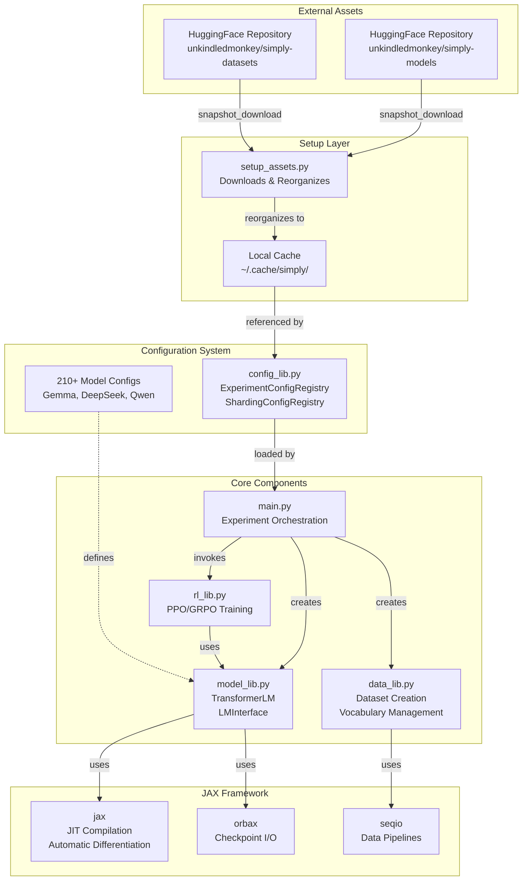
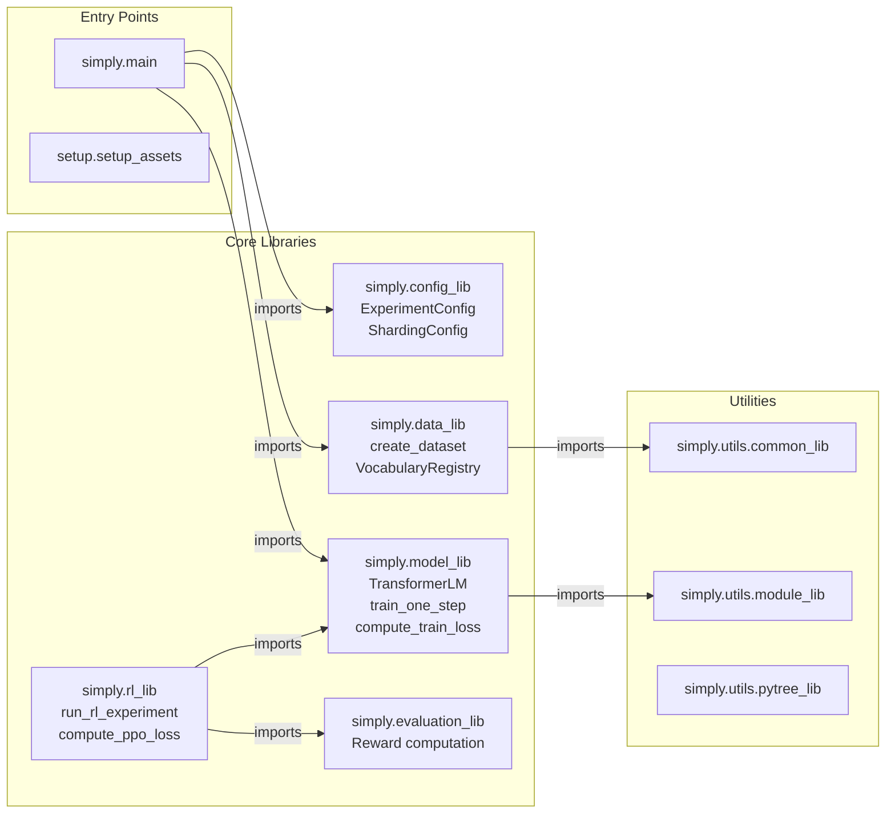
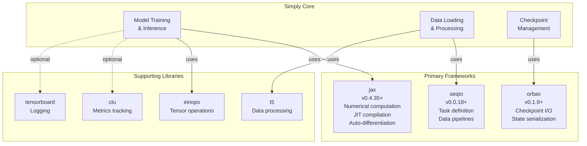

<!-- source: DeepWiki mcp.deepwiki.com · repo google-deepmind/simply · page 1 Overview · fetched 2026-10-26 -->

# Overview

<details>
<summary>Relevant source files</summary>

The following files were used as context for generating this wiki page:

- [README.md](README.md)
- [requirements.txt](requirements.txt)
- [setup/setup_assets.py](setup/setup_assets.py)

</details>


## Purpose and Scope

This document provides an introduction to the Simply research codebase, explaining its design philosophy, core capabilities, and high-level architecture. Simply is a minimal, JAX-based framework for training and evaluating large language models (LLMs) and other autoregressive models. This page covers the conceptual foundation and system-level organization. For detailed setup instructions, see [Getting Started](#2). For architecture details, see [Architecture](#4).

**Sources:** [README.md:1-91]()

## Design Philosophy

Simply follows three core principles:

1. **Minimal Abstractions**: The codebase avoids deep abstraction layers. Most research logic is implemented directly using JAX primitives (`jit`, `vmap`, `pmap`, `grad`). Researchers can read and understand the full implementation path from experiment configuration to gradient computation.

2. **Self-Contained**: Primary dependencies are JAX (computation), Orbax (checkpoints), and SeqIO (data pipelines). No custom distributed training frameworks or proprietary systems. A researcher familiar with JAX can understand the entire codebase.

3. **Rapid Iteration**: Implement research ideas (new architectures, optimizers, losses) in hours rather than days. The codebase prioritizes quick fork-and-hack workflows over feature comprehensiveness.

**Sources:** [README.md:4-8]()

## Core Capabilities

Simply supports the following research workflows:

| Capability | Description | Reference |
|-----------|-------------|-----------|
| **Model Training** | Supervised pretraining and fine-tuning of transformer language models | [Architecture: Training Systems](#4.4) |
| **Reinforcement Learning** | PPO and GRPO training for reasoning tasks (GSM8K, MATH) | [RL Training Guide](#5.2) |
| **Text Generation** | Autoregressive decoding with KV-caching and various sampling strategies | [Inference Guide](#5.3) |
| **Distributed Training** | Multi-device and multi-host training with configurable sharding | [Distributed Training](#5.5) |
| **Checkpoint Management** | Load pretrained models (Gemma, DeepSeek, Qwen) and save/restore training state | [Working with Pretrained Models](#5.4) |

**Sources:** [README.md:1-91]()

## System Architecture

The following diagram illustrates the major subsystems and their relationships:



**Key Execution Flow:**

1. **Setup Phase**: `setup_assets.py` downloads pretrained checkpoints and datasets from HuggingFace, reorganizing them into Simply's expected directory structure.

2. **Configuration Loading**: `main.py` loads an experiment configuration by name (e.g., `Gemma2BV2`) from `ExperimentConfigRegistry` or from a JSON file path.

3. **Component Initialization**: Based on the configuration, `main.py` instantiates the model (`TransformerLM`), creates datasets using `data_lib.py`, and selects a training loop (standard supervised or RL).

4. **Training Execution**: The training loop uses JAX for gradient computation, Orbax for checkpointing, and iterates until completion or early stopping.

**Sources:** [README.md:10-21](), [README.md:44-60](), [setup/setup_assets.py:1-289]()

## Code Organization

The codebase follows a flat module structure:



| Module | Primary Classes/Functions | Purpose |
|--------|---------------------------|---------|
| `main.py` | `main()` | CLI entrypoint, orchestrates experiments |
| `config_lib.py` | `ExperimentConfig`, `ShardingConfig`, registries | Defines experiment parameters and model architectures |
| `model_lib.py` | `TransformerLM`, `LMInterface`, `train_one_step()` | Model implementation and training logic |
| `data_lib.py` | `create_dataset()`, `VocabularyRegistry` | Dataset loading and tokenization |
| `rl_lib.py` | `run_rl_experiment()`, `compute_ppo_loss()` | Reinforcement learning training loops |
| `evaluation_lib` | Reward computation functions | Evaluates model outputs for RL |
| `setup/setup_assets.py` | `download_models()`, `reorganize_gemma_models()` | Asset acquisition and preparation |

**Sources:** [README.md:1-91]()

## Technology Stack

Simply depends on three primary frameworks and several supporting libraries:

### Primary Dependencies



| Dependency | Version | Purpose | Required For |
|-----------|---------|---------|--------------|
| `jax` | 0.4.35+ | Numerical computing, automatic differentiation | All model operations |
| `orbax` | 0.1.9+ | Checkpoint serialization/deserialization | Model persistence |
| `seqio` | 0.0.18+ | Data pipeline management | Dataset loading |
| `einops` | Latest | Tensor shape manipulation | Attention mechanisms |
| `absl-py` | Latest | Command-line flags, logging | Experiment configuration |
| `clu` | Latest | Metrics aggregation | Training monitoring |
| `t5` | Latest | Text preprocessing utilities | Data preparation |
| `tensorboard` | Latest | Training visualization | Optional logging |
| `sympy` | Latest | Symbolic mathematics | Math evaluation (RL tasks) |
| `pylatexenc` | Latest | LaTeX parsing | Math evaluation (RL tasks) |

**Platform-Specific Installation:**

JAX installation varies by hardware platform:

- **CPU**: `pip install -U jax`
- **GPU (CUDA 13)**: `pip install -U "jax[cuda13]"`
- **TPU**: `pip install -U "jax[tpu]"`

Other dependencies are platform-independent: `pip install -r requirements.txt`

**Sources:** [README.md:23-42](), [requirements.txt:1-12]()

## Asset Management System

Simply requires two types of external assets:

1. **Pretrained Model Checkpoints**: Downloaded from `unkindledmonkey/simply-models` on HuggingFace
2. **Training Datasets**: Downloaded from `unkindledmonkey/simply-datasets` on HuggingFace

The `setup_assets.py` script performs three operations:

### 1. Download from HuggingFace

Uses `huggingface_hub.snapshot_download()` to fetch entire repositories.

**Sources:** [setup/setup_assets.py:142-170](), [setup/setup_assets.py:172-191]()

### 2. Reorganize Checkpoint Structure

Gemma checkpoints from HuggingFace use a different directory structure than Simply expects. The script reorganizes them:

```
# HuggingFace format (downloaded)
GEMMA-2.0-2B-PT-ORBAX/
├── tokenizer.model
└── gemma2-2b/
    └── checkpoint files

# Simply format (after reorganization)
GEMMA-2.0-2B-PT-ORBAX/
├── tokenizer.model
└── 0/
    └── checkpoint files
```

This reorganization is performed by `reorganize_gemma_models()` at [setup/setup_assets.py:47-112]().

**Sources:** [setup/setup_assets.py:47-112]()

### 3. Setup Vocabulary Files

Tokenizer models are copied from checkpoint directories to a centralized vocabulary directory (`~/.cache/simply/vocabs/`) for use by `data_lib.py`.

**Sources:** [setup/setup_assets.py:114-140]()

### Default Directory Structure

```
~/.cache/simply/
├── models/
│   ├── GEMMA-2.0-2B-PT-ORBAX/
│   ├── GEMMA-2.0-9B-PT-ORBAX/
│   ├── DEEPSEEK-R1-DISTILL-QWEN-1.5B-ORBAX/
│   └── QWEN-3-0.6B-ORBAX/
├── datasets/
│   └── [training datasets]
└── vocabs/
    ├── gemma2_tokenizer.model
    └── [other tokenizers]
```

These paths can be customized via environment variables (`SIMPLY_MODELS`, `SIMPLY_DATASETS`, `SIMPLY_VOCABS`) or CLI flags.

**Sources:** [setup/setup_assets.py:37-41]()

## Configuration System

Experiments are defined through `ExperimentConfig` objects registered in `ExperimentConfigRegistry`. Simply includes 210+ predefined configurations organized by:

- **Model Family**: Gemma (2B, 9B, 27B), DeepSeek (1.5B, 7B, 14B, 32B), Qwen (0.6B, 1.7B, 4B, 8B)
- **Training Phase**: Pretraining (PT), Instruction Tuning (IT), Reinforcement Learning (RL)
- **Task Type**: Standard supervised learning, RL on GSM8K/MATH/other reasoning tasks

Configurations are loaded by name from the command line:

```bash
python -m simply.main --experiment_config Gemma2BV2 --experiment_dir /tmp/exp
```

For detailed documentation of the configuration system, see [Configuration System](#3).

**Sources:** [README.md:15-16]()

## Next Steps

To start using Simply:

1. **Install dependencies**: See [Installation and Setup](#2.1)
2. **Download assets**: See [Asset Management](#2.2)
3. **Run your first experiment**: See [Running Your First Experiment](#2.3)

For developers extending the codebase, see [Developer Guide](#7).

**Sources:** [README.md:10-60]()

---

