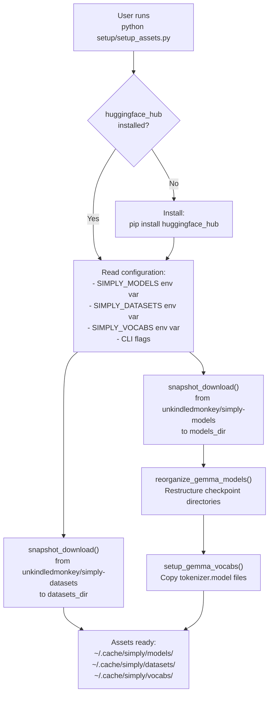
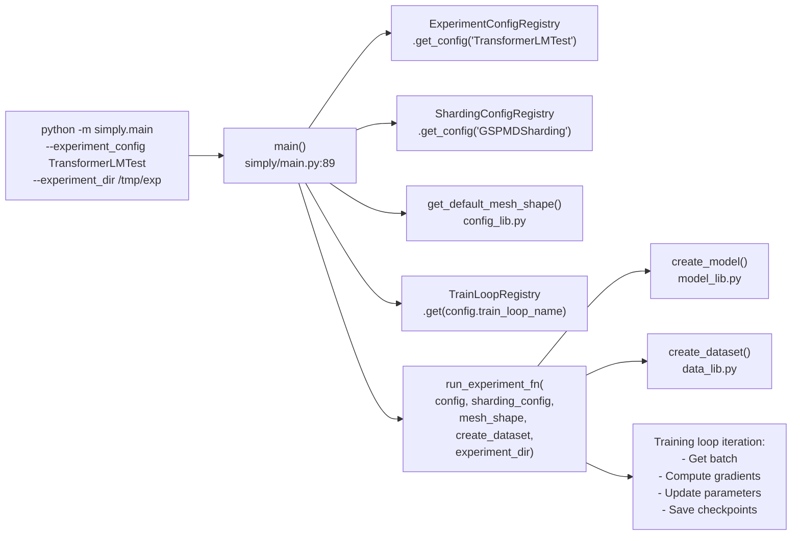

<!-- source: DeepWiki mcp.deepwiki.com · repo google-deepmind/simply · page 2 Getting Started · fetched 2026-10-26 -->

# Getting Started

<details>
<summary>Relevant source files</summary>

The following files were used as context for generating this wiki page:

- [README.md](README.md)
- [setup/setup_assets.py](setup/setup_assets.py)
- [simply/main.py](simply/main.py)

</details>


This page provides a high-level guide for setting up the Simply codebase and running your first experiment. It covers the prerequisite steps, the initialization workflow, and verification procedures. For detailed instructions on specific topics, see:

- [Installation and Setup](#2.1) - Platform-specific dependency installation
- [Asset Management](#2.2) - HuggingFace integration and cache structure
- [Running Your First Experiment](#2.3) - Step-by-step tutorial with `TransformerLMTest`

## Overview of Setup Process

Simply requires three initialization phases before you can run experiments:

| Phase | Component | Purpose | Output |
|-------|-----------|---------|--------|
| 1. Dependencies | JAX, Orbax, SeqIO | Core computational framework | Python packages installed |
| 2. Assets | Models, datasets, vocabularies | Pre-trained checkpoints and data | Files in `~/.cache/simply/` |
| 3. Verification | Test experiment | Validate installation | Successful training run |

## Prerequisites

### System Requirements

Simply supports three hardware platforms with environment-specific JAX installations:

- **CPU**: Local development and testing
- **GPU**: Single or multi-GPU workstations (CUDA 13+ required)
- **TPU**: Google Cloud TPU v3/v4/v5 pods

### Required Dependencies

The codebase depends on three primary libraries:

1. **JAX** ([jax.readthedocs.io](https://jax.readthedocs.io)): Numerical computing, JIT compilation, and automatic differentiation
2. **Orbax** ([orbax.readthedocs.io](https://orbax.readthedocs.io)): Checkpoint management and state persistence
3. **SeqIO** ([github.com/google/seqio](https://github.com/google/seqio)): Data pipeline construction and task definitions

See [Installation and Setup](#2.1) for detailed installation instructions.

Sources: [README.md:23-42]()

## Initialization Workflow

### Asset Download and Preparation

The `setup_assets.py` script handles downloading pre-trained models and datasets from HuggingFace repositories, then reorganizes them into Simply's expected directory structure.

**Initialization Flow Diagram**



Sources: [setup/setup_assets.py:1-289]()

### Directory Structure After Setup

After running `setup_assets.py`, the local cache contains the following structure:

```
~/.cache/simply/
├── models/
│   ├── GEMMA-2.0-2B-PT-ORBAX/
│   │   ├── 0/
│   │   │   └── checkpoint (Orbax format)
│   │   └── tokenizer.model
│   ├── GEMMA-2.0-9B-PT-ORBAX/
│   └── DEEPSEEK-*, QWEN-* (additional models)
├── datasets/
│   └── (training and evaluation datasets)
└── vocabs/
    ├── gemma2_tokenizer.model
    └── gemma3_cleaned_*.spiece.model
```

The reorganization step ([setup/setup_assets.py:47-112]()) is critical because HuggingFace stores Gemma checkpoints in nested subdirectories (e.g., `gemma2-2b/checkpoint`), but Simply expects step-numbered directories (`0/checkpoint`) for Orbax compatibility.

Sources: [setup/setup_assets.py:47-164]()

## Quick Start Commands

### Minimal Test Experiment

Run a fast local test to verify installation:

```bash
EXP=simply_local_test_1
rm -rf /tmp/${EXP}
python -m simply.main \
  --experiment_config TransformerLMTest \
  --experiment_dir /tmp/${EXP} \
  --alsologtostderr
```

This command invokes the `main()` function in [simply/main.py:89-148](), which:

1. Loads the `TransformerLMTest` configuration from `ExperimentConfigRegistry`
2. Resolves the `GSPMDSharding` configuration (default)
3. Creates device mesh with `get_default_mesh_shape()`
4. Invokes the training loop specified by `config.train_loop_name`

Sources: [README.md:11-21](), [simply/main.py:89-148]()

### Debug Mode (Disable JIT)

For debugging with print statements and array inspection:

```bash
export JAX_DISABLE_JIT=True
EXP=simply_local_test_1
rm -rf /tmp/${EXP}
python -m simply.main \
  --experiment_config TransformerLMTestNoScan \
  --experiment_dir /tmp/${EXP} \
  --alsologtostderr
```

The `JAX_DISABLE_JIT=True` environment variable disables JAX's just-in-time compilation, allowing normal Python debugging. The `TransformerLMTestNoScan` configuration additionally disables the `lax.scan` optimization for easier step-through debugging.

Sources: [README.md:17-21]()

## Experiment Execution Flow

**Command-Line to Training Loop**



Sources: [simply/main.py:89-148]()

## Configuration Loading Mechanisms

Simply supports two methods for loading experiment configurations:

### Method 1: Registry-Based (Recommended)

Use a registered configuration name:

```bash
python -m simply.main --experiment_config Gemma2BV2 --experiment_dir /tmp/exp
```

The `ExperimentConfigRegistry.get_config()` method ([simply/main.py:105-107]()) retrieves the configuration by name. See [Configuration System](#3) for available configurations.

### Method 2: JSON File Path

Load configuration from a JSON file:

```bash
python -m simply.main \
  --experiment_config_path /path/to/config.json \
  --experiment_dir /tmp/exp
```

The JSON deserialization process ([simply/main.py:91-103]()) supports a `code_patch` field for runtime code execution, enabling dynamic configuration modifications.

| Parameter | Registry Method | JSON File Method |
|-----------|----------------|------------------|
| Flag | `--experiment_config` | `--experiment_config_path` |
| Loading | `ExperimentConfigRegistry.get_config()` | `pytree.load_dataclasses()` |
| Source | Registered in `config_lib.py` | External JSON file |
| Mutability | Fixed at registration time | Modifiable via `code_patch` |

Sources: [simply/main.py:47-114]()

## Common Configuration Flags

The `main.py` entrypoint accepts several command-line flags:

| Flag | Purpose | Default | Example |
|------|---------|---------|---------|
| `--experiment_config` | Configuration name | None (required) | `TransformerLMTest` |
| `--experiment_dir` | Output directory | `/tmp/simply_lm/` | `/mnt/exp/run1` |
| `--sharding_config` | Sharding strategy | `GSPMDSharding` | `DataParallelSharding` |
| `--mesh_shape` | Device mesh dimensions | Auto-computed | `1,265,1` |
| `--dcn_mesh_shape` | DCN topology | None | `2,1,1` |

All flags are defined in [simply/main.py:47-87]().

Sources: [simply/main.py:47-87]()

## Verification Steps

### 1. Check Asset Download

Verify that models, datasets, and vocabularies are present:

```bash
ls ~/.cache/simply/models/
ls ~/.cache/simply/datasets/
ls ~/.cache/simply/vocabs/
```

Expected output should include `GEMMA-2.0-*` directories in models, dataset files in datasets, and `.model`/`.spiece.model` files in vocabs.

### 2. Run Test Configuration

Execute the minimal test configuration:

```bash
python -m simply.main \
  --experiment_config TransformerLMTest \
  --experiment_dir /tmp/test_exp \
  --alsologtostderr
```

Successful execution will produce log output showing:
- Configuration loading: `config: ...`
- Mesh shape: `mesh_shape: [1, 1, 1]`
- Training progress: Step numbers and loss values
- Checkpoint saves: `Saved checkpoint at step ...`

### 3. Inspect Output Directory

Check that the experiment directory contains checkpoints and logs:

```bash
ls /tmp/test_exp/
# Expected: checkpoints/, logs/, config.json
```

See [Running Your First Experiment](#2.3) for detailed output interpretation.

Sources: [README.md:11-21]()

## Troubleshooting Common Issues

| Issue | Symptom | Solution |
|-------|---------|----------|
| Missing `huggingface_hub` | `ImportError` when running `setup_assets.py` | `pip install huggingface_hub` |
| JAX device not found | `No GPU/TPU/CPU backends found` | Reinstall JAX with correct platform suffix (see [Installation and Setup](#2.1)) |
| Checkpoint format error | `Orbax checkpoint loading failed` | Re-run `setup_assets.py` to reorganize Gemma directories |
| Configuration not found | `KeyError` from `ExperimentConfigRegistry` | Verify config name spelling or use `--experiment_config_path` |

## Next Steps

After completing setup and verification:

1. Explore available configurations: See [Model Configuration Catalog](#3.2)
2. Understand the training workflow: See [Standard Training Workflow](#5.1)
3. Learn about distributed training: See [Distributed Training](#5.5)
4. Examine model architecture: See [Model Architecture](#4.2)

Sources: [README.md:1-91](), [simply/main.py:1-151](), [setup/setup_assets.py:1-289]()

---

