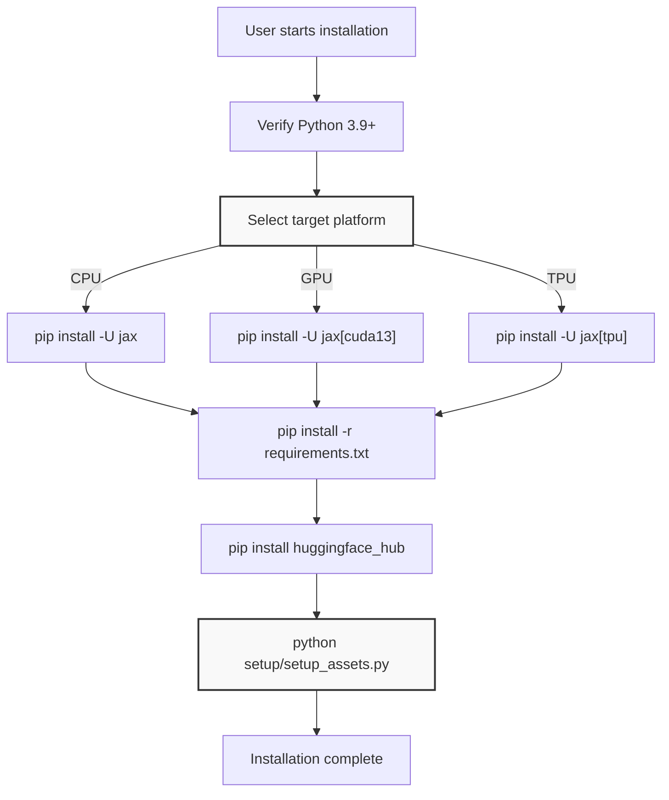
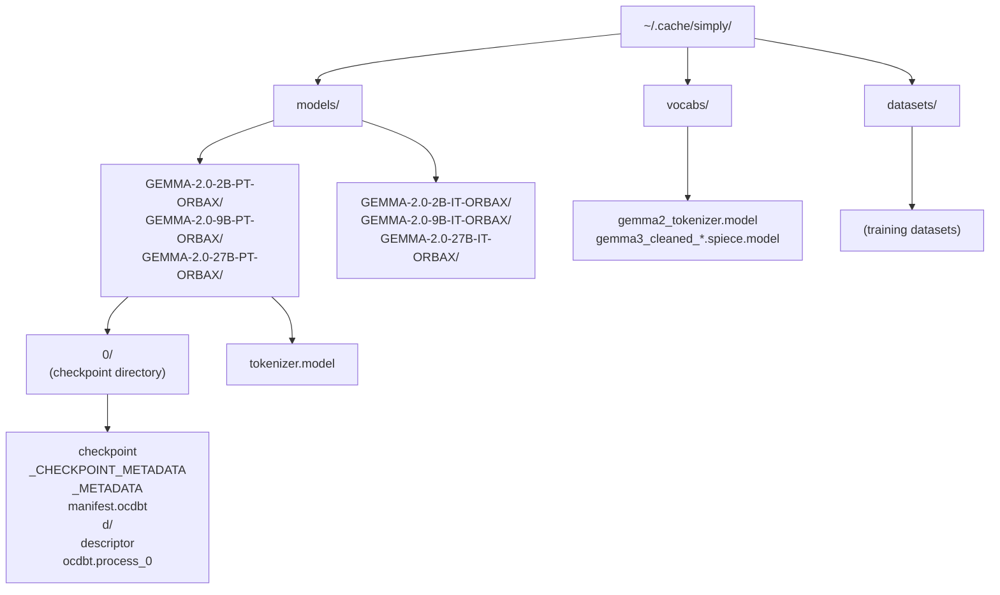
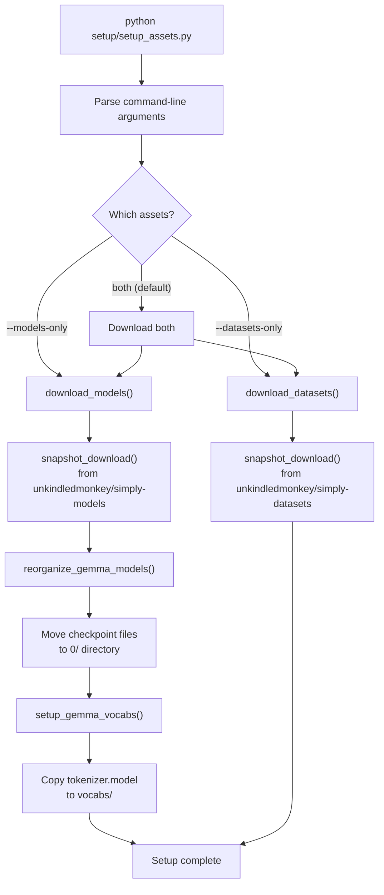
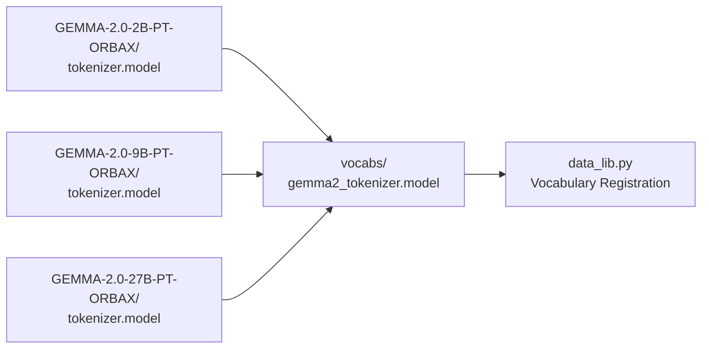

<!-- source: DeepWiki mcp.deepwiki.com · repo google-deepmind/simply · page 2.1 Installation and Setup · fetched 2026-10-26 -->

# Installation and Setup

<details>
<summary>Relevant source files</summary>

The following files were used as context for generating this wiki page:

- [README.md](README.md)
- [requirements.txt](requirements.txt)
- [setup/setup_assets.py](setup/setup_assets.py)

</details>


## Purpose and Scope

This document provides detailed instructions for installing Simply and its dependencies, configuring the local environment, and downloading pretrained models and datasets. It covers dependency installation for CPU, GPU, and TPU platforms, the execution of [setup/setup_assets.py](), and the resulting local cache structure.

For information about the asset management system architecture and HuggingFace integration details, see [Asset Management](#2.2). For running your first experiment after setup, see [Running Your First Experiment](#2.3).

## Prerequisites

Simply requires Python 3.9 or later. The codebase is built on JAX and requires platform-specific installation of JAX accelerator backends.

**Sources:** [README.md:1-10]()

## Dependency Installation

### Installation Flow



**Sources:** [README.md:23-42](), [README.md:44-60]()

### Core Dependencies

Simply's core dependencies are organized into three categories:

| Category | Package | Purpose | Source |
|----------|---------|---------|--------|
| **Computational Framework** | `jax` | Numerical computing, JIT compilation, automatic differentiation | [requirements.txt:1]() |
| **State Management** | `orbax` | Checkpoint loading and saving | [requirements.txt:2]() |
| **Data Pipeline** | `seqio` | Dataset management and preprocessing | [requirements.txt:3]() |
| **Tensor Operations** | `einops` | Tensor reshaping utilities | [requirements.txt:4]() |
| **Utilities** | `absl-py` | Command-line flags and logging | [requirements.txt:5]() |
| **Metrics** | `clu` | Training metrics and utilities | [requirements.txt:6]() |
| **Reference Models** | `t5` | Transformer reference implementations | [requirements.txt:7]() |
| **Logging** | `tensorboard` | Training visualization | [requirements.txt:8]() |

**Sources:** [README.md:23-29](), [requirements.txt:1-8]()

### Platform-Specific JAX Installation

JAX installation is hardware-dependent. The following table provides installation commands for each platform:

| Platform | Command | Documentation |
|----------|---------|---------------|
| **CPU** | `pip install -U jax` | For local development and testing |
| **GPU (CUDA 13)** | `pip install -U "jax[cuda13]"` | For NVIDIA GPU training |
| **TPU** | `pip install -U "jax[tpu]"` | For Google Cloud TPU training |

For detailed platform-specific instructions and alternative CUDA versions, refer to the [JAX installation guide](https://docs.jax.dev/en/latest/installation.html).

**Installation sequence:**

```bash
# 1. Install JAX for your platform
pip install -U jax  # or jax[cuda13] or jax[tpu]

# 2. Install core dependencies
pip install -r requirements.txt

# 3. Install HuggingFace Hub for asset downloads
pip install huggingface_hub
```

**Sources:** [README.md:32-42](), [README.md:49-50]()

### Optional Dependencies

Additional packages are required only for specific evaluation functionality:

| Package | Purpose | Required For |
|---------|---------|--------------|
| `sympy` | Symbolic mathematics | Math problem evaluation ([simply/utils/math_eval.py]()) |
| `pylatexenc` | LaTeX parsing | Math problem evaluation ([simply/utils/math_eval.py]()) |
| `pytest` | Unit testing | Running test suite |

**Sources:** [requirements.txt:9-12]()

## Local Cache Directory Structure

After completing setup, Simply creates a local cache structure at `~/.cache/simply/` with three subdirectories:



**Directory structure details:**

- **`models/`**: Contains pretrained model checkpoints in Orbax format. Each model directory follows the naming pattern `{FAMILY}-{VERSION}-{SIZE}-{TYPE}-ORBAX` (e.g., `GEMMA-2.0-2B-PT-ORBAX`).
- **`datasets/`**: Stores training datasets downloaded from HuggingFace.
- **`vocabs/`**: Centralized tokenizer model files referenced by [simply/data_lib.py]().

**Sources:** [setup/setup_assets.py:13-16](), [setup/setup_assets.py:37-40]()

## Asset Download and Setup

### Running setup_assets.py

The [setup/setup_assets.py]() script downloads pretrained models and datasets from HuggingFace repositories and reorganizes them into Simply's expected format.



**Sources:** [setup/setup_assets.py:142-170](), [setup/setup_assets.py:172-191](), [setup/setup_assets.py:201-288]()

### Command-Line Options

The [setup/setup_assets.py]() script supports the following command-line arguments:

| Argument | Type | Default | Description |
|----------|------|---------|-------------|
| `--models-only` | flag | False | Download only models, skip datasets |
| `--datasets-only` | flag | False | Download only datasets, skip models |
| `--models-repo` | string | `unkindledmonkey/simply-models` | HuggingFace models repository |
| `--datasets-repo` | string | `unkindledmonkey/simply-datasets` | HuggingFace datasets repository |
| `--models-dir` | string | `~/.cache/simply/models/` | Local models directory |
| `--datasets-dir` | string | `~/.cache/simply/datasets/` | Local datasets directory |
| `--force` | flag | False | Re-download even if directories exist |

**Usage examples:**

```bash
# Download both models and datasets (default)
python setup/setup_assets.py

# Download only models
python setup/setup_assets.py --models-only

# Download only datasets
python setup/setup_assets.py --datasets-only

# Use custom directories
python setup/setup_assets.py --models-dir /mnt/shared/models --datasets-dir /mnt/shared/datasets

# Force re-download
python setup/setup_assets.py --force
```

**Sources:** [setup/setup_assets.py:202-242](), [README.md:52-58]()

### Environment Variables

Directory locations can be customized via environment variables, which take precedence over default values but are overridden by command-line arguments:

| Variable | Default | Purpose |
|----------|---------|---------|
| `SIMPLY_MODELS` | `~/.cache/simply/models/` | Models directory location |
| `SIMPLY_DATASETS` | `~/.cache/simply/datasets/` | Datasets directory location |
| `SIMPLY_VOCABS` | `~/.cache/simply/vocabs/` | Vocabularies directory location |

**Example configuration:**

```bash
# Set custom directories
export SIMPLY_MODELS=/mnt/shared/models
export SIMPLY_DATASETS=/mnt/shared/datasets
export SIMPLY_VOCABS=/mnt/shared/vocabs

# Run setup with environment variables
python setup/setup_assets.py
```

**Sources:** [setup/setup_assets.py:37-40](), [README.md:60]()

### Gemma Checkpoint Reorganization

The [setup/setup_assets.py]() script performs critical post-processing on Gemma model checkpoints. HuggingFace stores checkpoints in a nested structure that differs from Simply's expected format. The `reorganize_gemma_models()` function transforms the directory structure:

**HuggingFace structure (downloaded):**
```
GEMMA-2.0-2B-PT-ORBAX/
├── tokenizer.model
└── gemma2-2b/
    ├── checkpoint
    ├── _CHECKPOINT_METADATA
    └── ...
```

**Simply structure (after reorganization):**
```
GEMMA-2.0-2B-PT-ORBAX/
├── 0/
│   ├── checkpoint
│   ├── _CHECKPOINT_METADATA
│   ├── _METADATA
│   ├── manifest.ocdbt
│   ├── d/
│   ├── descriptor
│   └── ocdbt.process_0
└── tokenizer.model
```

The reorganization moves checkpoint files from the nested subdirectory (e.g., `gemma2-2b/`) into a step-numbered directory (`0/`), which is the format expected by Orbax checkpoint loading in [simply/config_lib.py]().

**Sources:** [setup/setup_assets.py:47-112](), [setup/setup_assets.py:62-69](), [setup/setup_assets.py:101-108]()

### Vocabulary Setup

The `setup_gemma_vocabs()` function copies tokenizer files from model directories to the centralized `vocabs/` directory. This allows [simply/data_lib.py]() to register vocabularies by name without requiring full model checkpoint paths.

**Tokenizer mapping:**



All Gemma 2.0 models (2B, 9B, 27B) share the same tokenizer, so they are all copied to `gemma2_tokenizer.model`.

**Sources:** [setup/setup_assets.py:114-140](), [setup/setup_assets.py:124-131]()

## Verification

After completing installation and setup, verify the installation by running the test configuration:

```bash
# Run local test experiment
EXP=simply_local_test_1
rm -rf /tmp/${EXP}
python -m simply.main --experiment_config TransformerLMTest --experiment_dir /tmp/${EXP} --alsologtostderr
```

This command:
1. Creates a temporary experiment directory at `/tmp/simply_local_test_1`
2. Loads the `TransformerLMTest` configuration from [simply/config_lib.py]()
3. Runs a minimal training loop to verify JAX, Orbax, and SeqIO integration
4. Logs output to both stderr and log files

**Expected output:** The experiment should initialize a small transformer model, load a test dataset, and complete several training steps without errors. Successful execution indicates that all dependencies are correctly installed and assets are properly configured.

For debugging without JIT compilation, use:

```bash
export JAX_DISABLE_JIT=True
EXP=simply_local_test_1
rm -rf /tmp/${EXP}
python -m simply.main --experiment_config TransformerLMTestNoScan --experiment_dir /tmp/${EXP} --alsologtostderr
```

This disables JAX's just-in-time compilation and scan operations, allowing array values to be printed during execution for debugging purposes.

**Sources:** [README.md:13-21]()

---

**Next Steps:** After completing installation and setup, proceed to [Asset Management](#2.2) for detailed information about the local cache structure and asset organization, or to [Running Your First Experiment](#2.3) to begin training models.

---

