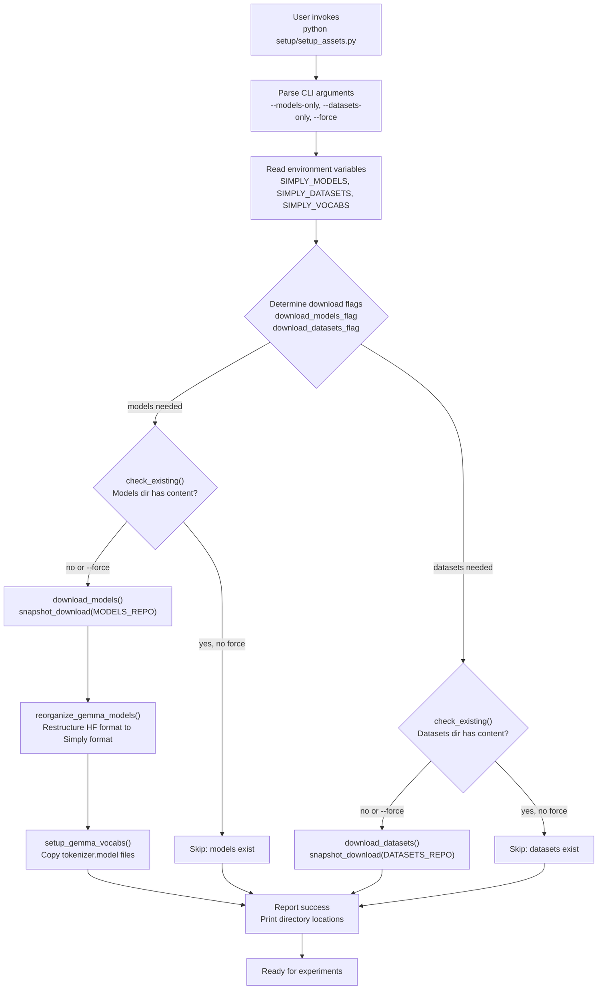
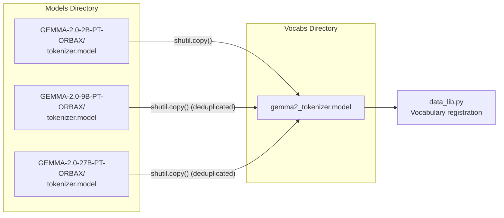

<!-- source: DeepWiki mcp.deepwiki.com · repo google-deepmind/simply · page 2.2 Asset Management · fetched 2026-10-26 -->

# Asset Management

<details>
<summary>Relevant source files</summary>

The following files were used as context for generating this wiki page:

- [README.md](README.md)
- [setup/setup_assets.py](setup/setup_assets.py)

</details>


## Purpose and Scope

This document describes Simply's asset management system, which handles downloading, organizing, and locating pretrained models, datasets, and tokenizers. The asset management system bridges external resources on HuggingFace with Simply's internal directory structure and naming conventions.

For information about installing Simply itself and its dependencies, see [Installation and Setup](#2.1). For using these downloaded assets in experiments, see [Running Your First Experiment](#2.3).

**Sources:** [setup/setup_assets.py:1-22](), [README.md:44-60]()

## Asset Types and Storage

Simply manages three types of assets, each stored in separate local cache directories:

| Asset Type | Description | Default Location | Environment Variable |
|------------|-------------|------------------|----------------------|
| **Models** | Pretrained checkpoint files in Orbax format | `~/.cache/simply/models/` | `SIMPLY_MODELS` |
| **Datasets** | Training and evaluation datasets | `~/.cache/simply/datasets/` | `SIMPLY_DATASETS` |
| **Vocabs** | Tokenizer model files (SentencePiece) | `~/.cache/simply/vocabs/` | `SIMPLY_VOCABS` |

These directories are referenced throughout the codebase:
- `config_lib.py` uses model checkpoint paths (e.g., `GEMMA2_2B_PT_CKPT_DIR`)
- `data_lib.py` uses dataset and vocabulary paths for pipeline construction

**Sources:** [setup/setup_assets.py:37-40](), [README.md:60]()

## HuggingFace Integration

Simply downloads assets from two HuggingFace repositories using the `huggingface_hub` library:

| Repository | Type | Contents |
|------------|------|----------|
| `unkindledmonkey/simply-models` | model | Pretrained checkpoints (Gemma 2.0, DeepSeek, Qwen) |
| `unkindledmonkey/simply-datasets` | dataset | Training datasets in SeqIO-compatible format |

The download mechanism uses `snapshot_download()` with `local_dir_use_symlinks=False` to create complete local copies rather than symbolic links, ensuring portability across different filesystem configurations.

**Sources:** [setup/setup_assets.py:42-44](), [setup/setup_assets.py:149-156](), [setup/setup_assets.py:179-186]()

## Local Cache Directory Structure

After running `setup_assets.py`, the local cache follows this structure:

```
~/.cache/simply/
├── models/
│   ├── GEMMA-2.0-2B-PT-ORBAX/
│   │   ├── 0/
│   │   │   ├── checkpoint
│   │   │   ├── _CHECKPOINT_METADATA
│   │   │   ├── _METADATA
│   │   │   ├── manifest.ocdbt
│   │   │   └── d/  (OCDBT data directory)
│   │   └── tokenizer.model
│   ├── GEMMA-2.0-9B-PT-ORBAX/
│   ├── GEMMA-2.0-27B-PT-ORBAX/
│   ├── GEMMA-2.0-2B-IT-ORBAX/
│   ├── GEMMA-2.0-9B-IT-ORBAX/
│   ├── GEMMA-2.0-27B-IT-ORBAX/
│   └── ... (other model families)
├── datasets/
│   └── (dataset files in SeqIO format)
└── vocabs/
    ├── gemma2_tokenizer.model
    ├── gemma3_cleaned_*.spiece.model
    └── ... (other tokenizer models)
```

**Key structural requirements:**
- Model checkpoints must be in step-numbered subdirectories (`0/`, `1/`, etc.)
- Each checkpoint step directory contains an Orbax checkpoint (OCDBT format)
- Tokenizer files remain at the model root level for vocabulary loading
- Vocabulary directory contains deduplicated tokenizer files referenced by name in `data_lib.py`

**Sources:** [setup/setup_assets.py:47-59](), [setup/setup_assets.py:114-140]()

## Download Process Workflow



**Sources:** [setup/setup_assets.py:201-288]()

## Gemma Checkpoint Reorganization

A critical post-processing step transforms Gemma checkpoints from HuggingFace's nested structure to Simply's expected format. This is necessary because Orbax checkpoint loading in Simply expects step-numbered directories.

### HuggingFace Download Format

```
GEMMA-2.0-2B-PT-ORBAX/
├── tokenizer.model
└── gemma2-2b/
    ├── checkpoint
    ├── _CHECKPOINT_METADATA
    ├── _METADATA
    ├── manifest.ocdbt
    └── d/
```

### Simply Required Format

```
GEMMA-2.0-2B-PT-ORBAX/
├── 0/
│   ├── checkpoint
│   ├── _CHECKPOINT_METADATA
│   ├── _METADATA
│   ├── manifest.ocdbt
│   └── d/
└── tokenizer.model
```

The `reorganize_gemma_models()` function performs this transformation:

1. **Creates step directory**: Makes `0/` subdirectory for checkpoint files
2. **Moves nested files**: Relocates files from `gemma2-2b/` to `0/`
3. **Moves parent-level files**: Relocates checkpoint files from root to `0/`
4. **Preserves tokenizer**: Keeps `tokenizer.model` at parent level for vocabulary loading
5. **Removes empty directories**: Cleans up now-empty nested directories

This reorganization applies to six Gemma model variants:

| Parent Directory | Original Subdirectory | Model Type |
|------------------|----------------------|------------|
| `GEMMA-2.0-2B-PT-ORBAX` | `gemma2-2b` | Pretrained 2B |
| `GEMMA-2.0-9B-PT-ORBAX` | `gemma2-9b` | Pretrained 9B |
| `GEMMA-2.0-27B-PT-ORBAX` | `gemma2-27b` | Pretrained 27B |
| `GEMMA-2.0-2B-IT-ORBAX` | `gemma2-2b-it` | Instruction-tuned 2B |
| `GEMMA-2.0-9B-IT-ORBAX` | `gemma2-9b-it` | Instruction-tuned 9B |
| `GEMMA-2.0-27B-IT-ORBAX` | `gemma2-27b-it` | Instruction-tuned 27B |

**Sources:** [setup/setup_assets.py:47-112]()

## Vocabulary File Setup

After reorganizing model checkpoints, the `setup_gemma_vocabs()` function copies tokenizer files to the centralized vocabulary directory:



The vocabulary directory serves two purposes:
1. **Deduplication**: Multiple models share the same tokenizer (e.g., all Gemma 2.0 variants use `gemma2_tokenizer.model`)
2. **Centralized reference**: `data_lib.py` registers vocabularies by name, pointing to this single location

**Sources:** [setup/setup_assets.py:114-140]()

## Configuration Options

The asset management system supports flexible configuration through environment variables and command-line flags:

### Environment Variables

Set these before running `setup_assets.py` or any Simply experiment:

```bash
export SIMPLY_MODELS=/path/to/models
export SIMPLY_DATASETS=/path/to/datasets
export SIMPLY_VOCABS=/path/to/vocabs
```

These variables are read by:
- `setup_assets.py` during download
- `config_lib.py` when constructing checkpoint paths
- `data_lib.py` when registering vocabularies

**Sources:** [setup/setup_assets.py:37-40]()

### Command-Line Flags

The `setup_assets.py` script accepts several flags:

| Flag | Type | Description |
|------|------|-------------|
| `--models-only` | boolean | Download only models, skip datasets |
| `--datasets-only` | boolean | Download only datasets, skip models |
| `--models-repo` | string | Override HuggingFace models repository |
| `--datasets-repo` | string | Override HuggingFace datasets repository |
| `--models-dir` | string | Override models directory location |
| `--datasets-dir` | string | Override datasets directory location |
| `--force` | boolean | Re-download even if directories exist |

**Example usage:**

```bash
# Download only models to custom location
python setup/setup_assets.py --models-only --models-dir /shared/simply/models

# Download from custom HuggingFace repository
python setup/setup_assets.py --models-repo myorg/my-simply-models

# Force re-download of all assets
python setup/setup_assets.py --force
```

**Sources:** [setup/setup_assets.py:202-241]()

## Asset Download Execution Flow

```mermaid
sequenceDiagram
    participant User
    participant setup_assets["setup_assets.py<br/>main()"]
    participant hf["huggingface_hub<br/>snapshot_download()"]
    participant reorg["reorganize_gemma_models()"]
    participant vocab["setup_gemma_vocabs()"]
    participant fs["Filesystem"]
    
    User->>setup_assets: "python setup/setup_assets.py"
    setup_assets->>setup_assets: "Parse args & env vars"
    
    alt Models requested
        setup_assets->>fs: "check_existing(models_dir)"
        fs-->>setup_assets: "exists and has content?"
        
        alt Not exists or --force
            setup_assets->>fs: "Path(models_dir).mkdir()"
            setup_assets->>hf: "snapshot_download(MODELS_REPO)"
            hf-->>fs: "Download to models_dir"
            
            setup_assets->>reorg: "reorganize_gemma_models(models_dir)"
            reorg->>fs: "Create 0/ directories"
            reorg->>fs: "Move checkpoint files"
            reorg->>fs: "Remove empty subdirs"
            
            setup_assets->>vocab: "setup_gemma_vocabs(models_dir, vocabs_dir)"
            vocab->>fs: "Copy tokenizer.model files"
        end
    end
    
    alt Datasets requested
        setup_assets->>fs: "check_existing(datasets_dir)"
        fs-->>setup_assets: "exists and has content?"
        
        alt Not exists or --force
            setup_assets->>fs: "Path(datasets_dir).mkdir()"
            setup_assets->>hf: "snapshot_download(DATASETS_REPO)"
            hf-->>fs: "Download to datasets_dir"
        end
    end
    
    setup_assets-->>User: "Print success & directory locations"
```

**Sources:** [setup/setup_assets.py:142-191](), [setup/setup_assets.py:201-288]()

## Integration with Experiment Configuration

The asset management system's output directories are referenced throughout Simply's codebase:

### Model Checkpoints in config_lib.py

Configuration constants point to downloaded model directories:

```python
# Example checkpoint directory constants
GEMMA2_2B_PT_CKPT_DIR = os.path.join(MODELS_DIR, 'GEMMA-2.0-2B-PT-ORBAX')
GEMMA2_9B_PT_CKPT_DIR = os.path.join(MODELS_DIR, 'GEMMA-2.0-9B-PT-ORBAX')
```

Experiment configurations use these paths in the `init_ckpt_dir` field to specify pretrained weights.

### Datasets in data_lib.py

Dataset loading functions expect files in the datasets directory:

```python
# Datasets are registered and loaded from DATASETS_DIR
# The create_dataset() function constructs paths automatically
```

### Vocabularies in data_lib.py

Vocabulary registration uses the vocabs directory:

```python
# Example vocabulary registration
register_vocabulary(
    name='gemma2',
    path=os.path.join(VOCABS_DIR, 'gemma2_tokenizer.model'),
    vocab_size=256000
)
```

**Sources:** [README.md:60](), [setup/setup_assets.py:37-40]()

## Verification and Troubleshooting

### Verifying Successful Setup

After running `setup_assets.py`, verify the installation:

```bash
# Check models directory structure
ls -R ~/.cache/simply/models/GEMMA-2.0-2B-PT-ORBAX/

# Should show:
# 0/
# 0/checkpoint
# 0/_CHECKPOINT_METADATA
# tokenizer.model

# Check vocabularies
ls ~/.cache/simply/vocabs/

# Should show:
# gemma2_tokenizer.model
```

### Common Issues

| Issue | Cause | Solution |
|-------|-------|----------|
| "checkpoint not found" error | Gemma models not reorganized | Run `setup_assets.py` again; reorganization is idempotent |
| "vocabulary not found" error | Tokenizer files not copied | Check `SIMPLY_VOCABS` directory has `.model` files |
| Permission errors | No write access to cache directory | Set environment variables to writable locations |
| Incomplete downloads | Network interruption | Use `--force` flag to re-download |

**Sources:** [setup/setup_assets.py:193-199](), [setup/setup_assets.py:80-81]()

## Summary

The asset management system provides a bridge between external HuggingFace repositories and Simply's internal structure:

1. **Downloads** pretrained models and datasets via `huggingface_hub`
2. **Reorganizes** Gemma checkpoints into step-numbered directories
3. **Centralizes** tokenizer files in a dedicated vocabulary directory
4. **Configures** locations via environment variables or CLI flags
5. **Integrates** with `config_lib.py` and `data_lib.py` for seamless experiment setup

This preprocessing step is a prerequisite for all Simply experiments, ensuring that checkpoint loading, data pipeline construction, and vocabulary management work correctly throughout the training and inference workflows.

**Sources:** [setup/setup_assets.py:1-288](), [README.md:44-60]()

---

