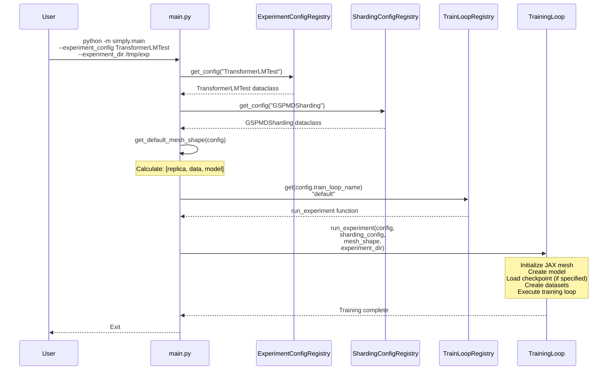
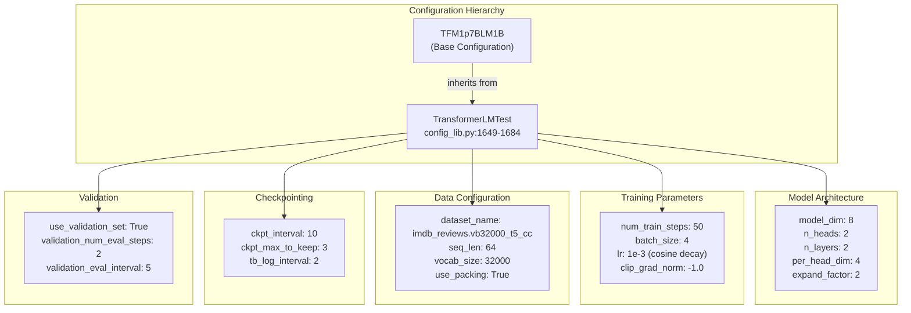
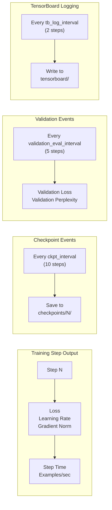
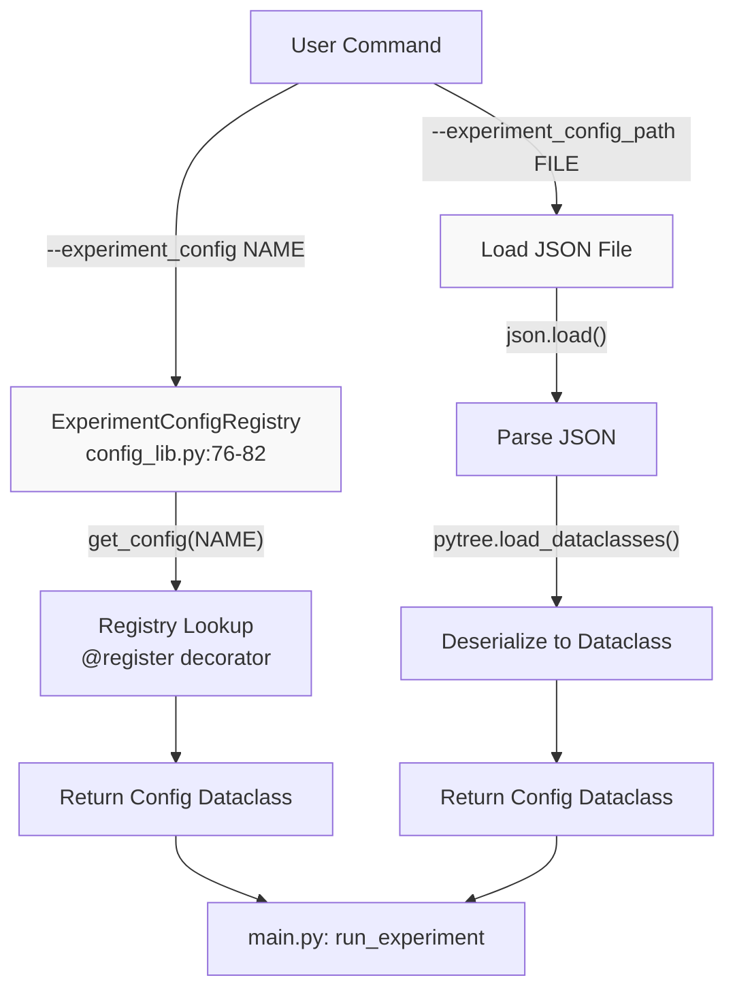

<!-- source: DeepWiki mcp.deepwiki.com · repo google-deepmind/simply · page 2.3 Running Your First Experiment · fetched 2026-10-26 -->

# Running Your First Experiment

<details>
<summary>Relevant source files</summary>

The following files were used as context for generating this wiki page:

- [README.md](README.md)
- [setup/setup_assets.py](setup/setup_assets.py)
- [simply/config_lib.py](simply/config_lib.py)
- [simply/main.py](simply/main.py)

</details>


This page provides a step-by-step tutorial for executing your first training experiment using Simply's `TransformerLMTest` configuration. This minimal test configuration trains a small transformer language model to verify your installation and familiarize you with the basic workflow.

**Prerequisites:** Complete [Installation and Setup](#2.1) and [Asset Management](#2.2) before proceeding. For production-scale training workflows, see [Standard Training Workflow](#5.1). For detailed configuration concepts, see [Understanding Configurations](#3.1).

## Verifying Prerequisites

Before running your first experiment, verify that assets are available:

```bash
# Check that models and datasets directories exist
ls ~/.cache/simply/models/
ls ~/.cache/simply/datasets/
```

If these directories are empty or missing, run the asset setup:

```bash
python setup/setup_assets.py
```

Sources: [README.md:44-60](), [setup/setup_assets.py:1-22]()

## Basic Experiment Command

The simplest way to run an experiment is with the `TransformerLMTest` configuration, which trains a minimal model for 50 steps:

```bash
EXP=simply_local_test_1
rm -rf /tmp/${EXP}
python -m simply.main \
  --experiment_config TransformerLMTest \
  --experiment_dir /tmp/${EXP} \
  --alsologtostderr
```

This command will:
- Load the `TransformerLMTest` configuration from the registry
- Create output directories under `/tmp/simply_local_test_1/`
- Train a small 2-layer transformer for 50 steps
- Save checkpoints and TensorBoard logs
- Print progress to both stderr and log files

Sources: [README.md:13-16]()

## Command-Line Argument Reference

The `main.py` module accepts the following key arguments:

| Argument | Type | Default | Description |
|----------|------|---------|-------------|
| `--experiment_config` | string | None | Name of registered configuration (e.g., `TransformerLMTest`) |
| `--experiment_config_path` | string | None | Path to JSON config file (alternative to `--experiment_config`) |
| `--sharding_config` | string | `GSPMDSharding` | Name of sharding strategy |
| `--experiment_dir` | string | `/tmp/simply_lm/` | Directory for checkpoints and logs |
| `--mesh_shape` | list[int] | Auto | Device mesh shape as `replica,data,model` |
| `--alsologtostderr` | flag | False | Print logs to stderr in addition to files |

**Configuration Selection:**
- Use `--experiment_config` with a registered name (most common)
- Use `--experiment_config_path` with a JSON file path for custom configs
- Both cannot be specified simultaneously

Sources: [simply/main.py:47-86]()

### Mesh Shape Configuration

The `--mesh_shape` argument controls parallelization strategy across devices:

```bash
# Explicitly set mesh shape for 8 devices:
--mesh_shape 1,8,1   # Full data parallelism
--mesh_shape 1,4,2   # 4-way data parallel, 2-way model parallel
--mesh_shape 2,2,2   # 2-way replica, 2-way data, 2-way model
```

If unspecified, `get_default_mesh_shape()` automatically determines optimal layout based on:
- Available device count
- Model architecture (model_dim, n_heads, n_kv_heads)
- Batch size divisibility requirements

Sources: [simply/main.py:118-129](), [simply/config_lib.py:1787-1836]()

## Execution Flow

**Diagram: Command-Line to Training Loop Execution**



Sources: [simply/main.py:89-148](), [simply/config_lib.py:76-90]()

## Understanding the TransformerLMTest Configuration

The `TransformerLMTest` configuration defines a minimal experiment for testing:

**Diagram: TransformerLMTest Configuration Structure**



Sources: [simply/config_lib.py:1647-1684]()

### Key Configuration Parameters

| Parameter | Value | Purpose |
|-----------|-------|---------|
| `model_dim` | 8 | Hidden dimension (extremely small for fast testing) |
| `n_heads` | 2 | Number of attention heads |
| `n_layers` | 2 | Number of transformer blocks |
| `num_train_steps` | 50 | Total training iterations |
| `batch_size` | 4 | Examples per batch |
| `seq_len` | 64 | Maximum sequence length |
| `ckpt_interval` | 10 | Steps between checkpoints |
| `validation_eval_interval` | 5 | Steps between validation runs |

The small model size ensures the test completes quickly (typically < 2 minutes on CPU).

Sources: [simply/config_lib.py:1651-1679]()

## Expected Output Structure

During execution, Simply creates the following directory structure:

```
/tmp/simply_local_test_1/
├── checkpoints/
│   ├── 0/              # Initial checkpoint
│   ├── 10/             # Checkpoint at step 10
│   ├── 20/             # Checkpoint at step 20
│   ├── 30/             # Checkpoint at step 30
│   ├── 40/             # Checkpoint at step 40
│   └── 50/             # Final checkpoint
├── tensorboard/
│   └── events.out.tfevents.*
└── logs/
    └── simply.log
```

Each checkpoint directory contains Orbax checkpoint files storing model parameters and optimizer state.

Sources: [simply/main.py:68]()

## Console Output Interpretation

**Diagram: Training Loop Output Flow**



Sources: [simply/config_lib.py:1680-1683]()

### Sample Console Output

```
I0000 00:00:00.000000 MainThread main.py:135] config: TransformerLMTest(...)
I0000 00:00:00.000000 MainThread main.py:136] sharding_config: GSPMDSharding(...)
I0000 00:00:00.000000 MainThread main.py:137] mesh_shape: [1, 1, 1]
...
I0000 00:00:00.000000 MainThread model_lib.py:XXX] Training step 0
I0000 00:00:00.000000 MainThread model_lib.py:XXX] Training step 10, loss: 9.234
I0000 00:00:00.000000 MainThread model_lib.py:XXX] Saving checkpoint at step 10
I0000 00:00:00.000000 MainThread model_lib.py:XXX] Validation step 5, val_loss: 8.945
...
I0000 00:00:00.000000 MainThread model_lib.py:XXX] Training complete
```

Key metrics to monitor:
- **Loss**: Should generally decrease over steps
- **Validation loss**: Indicates generalization performance
- **Step time**: Time per training iteration (useful for performance tuning)

## Debugging Mode

For debugging purposes, disable JAX JIT compilation to enable standard Python printing and debugging:

```bash
export JAX_DISABLE_JIT=True
EXP=simply_local_test_1
rm -rf /tmp/${EXP}
python -m simply.main \
  --experiment_config TransformerLMTestNoScan \
  --experiment_dir /tmp/${EXP} \
  --alsologtostderr
```

**Important:** Use `TransformerLMTestNoScan` (not `TransformerLMTest`) when disabling JIT, as it also disables scan operations that are incompatible with debugging mode.

Sources: [README.md:17-21](), [simply/config_lib.py:1695-1697]()

## Configuration Loading Mechanisms

Simply supports two methods for specifying experiment configurations:

**Diagram: Configuration Loading Paths**



**Registry-based (Recommended):**
```bash
python -m simply.main --experiment_config TransformerLMTest --experiment_dir /tmp/exp
```

**JSON file-based (Advanced):**
```bash
# First, export a config to JSON
python -c "from simply import config_lib; import json; \
  print(json.dumps(config_lib.TransformerLMTest().__dict__))" > config.json

# Then use it
python -m simply.main --experiment_config_path config.json --experiment_dir /tmp/exp
```

Sources: [simply/main.py:91-107]()

## Common Issues and Solutions

### Issue: "No module named 'simply'"

**Cause:** Python cannot find the Simply package.

**Solution:** Run from the repository root or install in development mode:
```bash
# From repository root:
python -m simply.main ...

# Or install:
pip install -e .
```

### Issue: "Dataset not found"

**Cause:** Dataset files not downloaded or incorrect path.

**Solution:** Verify dataset location and re-run setup:
```bash
ls ~/.cache/simply/datasets/
python setup/setup_assets.py --datasets-only
```

### Issue: "Out of memory" error

**Cause:** Batch size too large for available memory.

**Solution:** Use a smaller batch size or enable gradient accumulation:
```bash
# Reduce batch size (requires custom config)
# Or use gradient accumulation to simulate larger batches
```

For gradient accumulation, set `grad_accum_steps` in your configuration. See [Creating Custom Configurations](#3.4).

### Issue: Checkpoint directory already exists

**Cause:** Previous experiment output remains in `experiment_dir`.

**Solution:** Remove the directory or choose a different path:
```bash
rm -rf /tmp/simply_local_test_1
# Or use a different name:
--experiment_dir /tmp/simply_local_test_2
```

Sources: [README.md:13-21]()

## Next Steps

After successfully running `TransformerLMTest`:

1. **Explore other test configurations:**
   - `TransformerLMTestNoScan`: For debugging without scan operations
   - `TransformerLMTestC4`: Uses C4 dataset with longer sequences
   - `TransformerLMTestRL`: Tests reinforcement learning training loop

2. **Load a pretrained model:** See [Working with Pretrained Models](#5.4) to initialize from Gemma, DeepSeek, or Qwen checkpoints.

3. **Create custom configurations:** See [Creating Custom Configurations](#3.4) to define your own experiments.

4. **Scale to multiple devices:** See [Distributed Training](#5.5) for multi-GPU and multi-host setups.

5. **Run production experiments:** See [Standard Training Workflow](#5.1) for complete training pipelines.

Sources: [simply/config_lib.py:1647-1785]()

---

