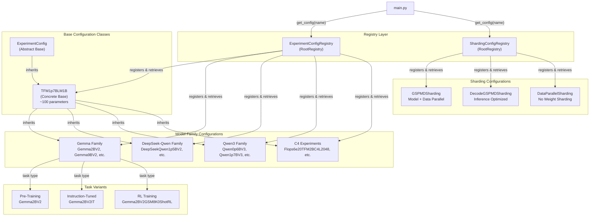
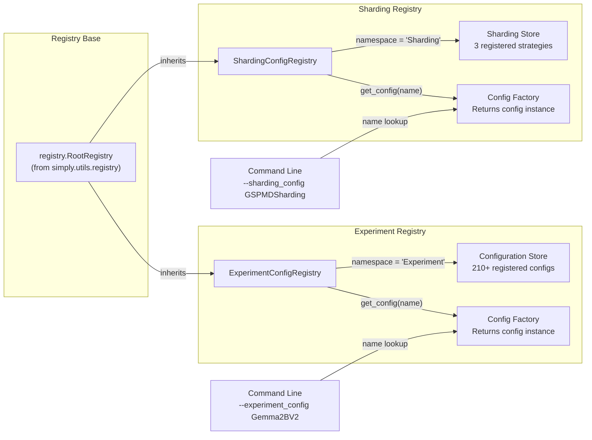
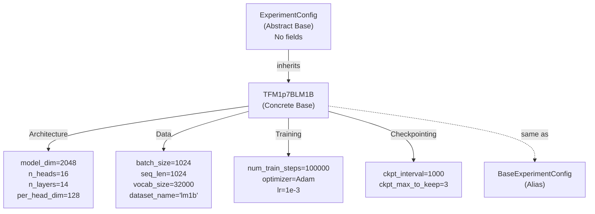
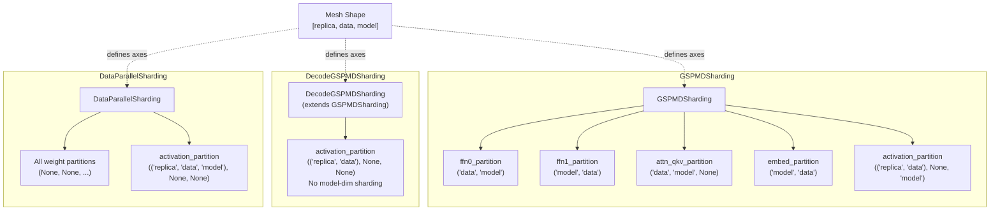
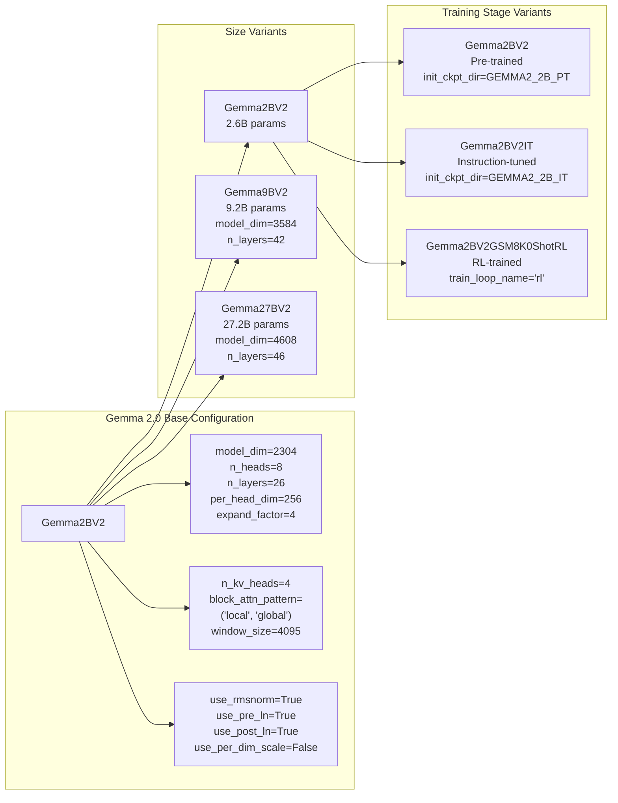
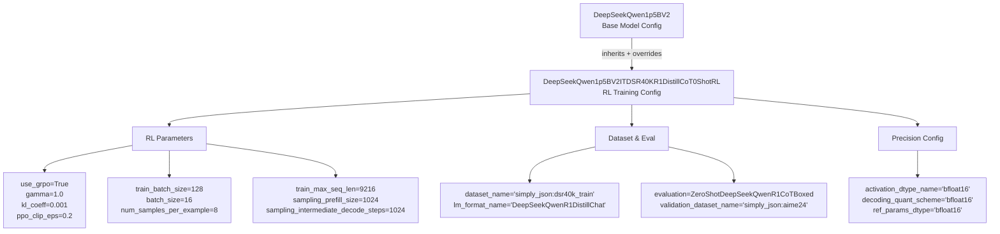
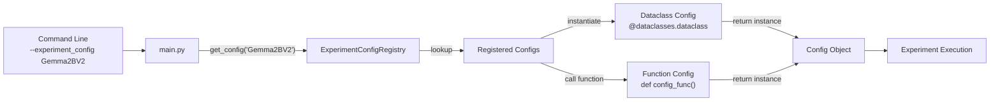
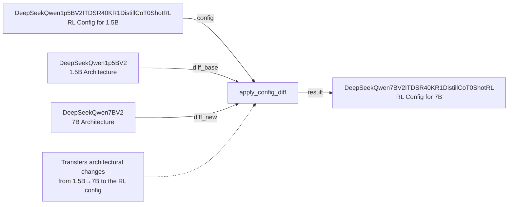
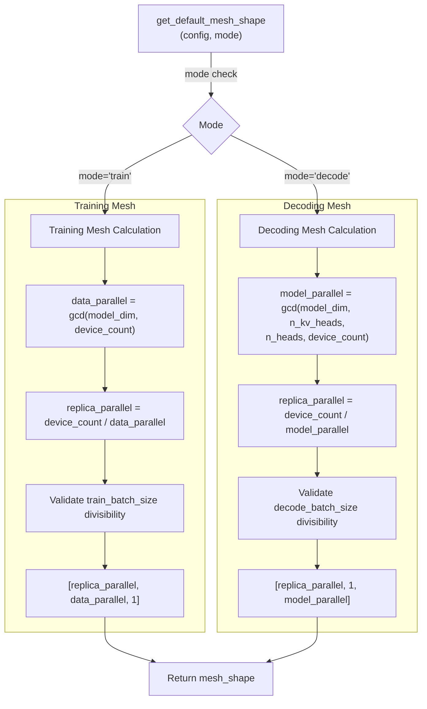

<!-- source: DeepWiki mcp.deepwiki.com · repo google-deepmind/simply · page 3 Configuration System · fetched 2026-10-26 -->

# Configuration System

<details>
<summary>Relevant source files</summary>

The following files were used as context for generating this wiki page:

- [simply/config_lib.py](simply/config_lib.py)

</details>


The Configuration System is the primary mechanism for defining and managing experiments in Simply. It provides a registry-based architecture for specifying model architectures, training parameters, data pipelines, and distributed execution strategies. This system enables researchers to define experiments declaratively through dataclass-based configurations that can be selected by name or loaded from JSON files.

For information about running experiments using these configurations, see [Running Your First Experiment](#2.3). For details on the training systems that consume these configurations, see [Training Systems](#4.4).

## Architecture Overview

The configuration system is built around three core concepts: **registries**, **configuration classes**, and **inheritance hierarchies**. The registry pattern enables string-based configuration selection, while the inheritance hierarchy minimizes duplication across related experiments.



**Diagram: Configuration System Architecture**

The system separates experiment specifications from sharding strategies, allowing any model configuration to use any sharding approach. Configurations are organized into families with shared base settings, and task-specific variants override only the necessary parameters.

Sources: [simply/config_lib.py:76-90](), [simply/config_lib.py:104-182](), [simply/config_lib.py:192-342]()

## Registry Pattern

Simply uses a registry pattern to manage configurations, enabling selection by string name at runtime. Two primary registries exist: `ExperimentConfigRegistry` for model and training configurations, and `ShardingConfigRegistry` for distributed execution strategies.

### Configuration Registries



**Diagram: Registry Architecture and Access Pattern**

### Registration Mechanism

Configurations are registered using the `@ExperimentConfigRegistry.register` or `@ShardingConfigRegistry.register` decorators:

```python
# Class-based registration
@ExperimentConfigRegistry.register
@dataclasses.dataclass(frozen=True)
class Gemma2BV2(TFM1p7BLM1B):
    # Configuration fields...
    
# Function-based registration
@ExperimentConfigRegistry.register
def Gemma12BV3_IT_DSR40K_B2K_L10K_RL():
    # Dynamic configuration construction
    config = apply_config_diff(...)
    return config

# Registration with custom name
ExperimentConfigRegistry.register(
    DeepSeekQwen7BV2ITDSR40KR1DistillCoT0ShotRL,
    name='dsqwen_v2-7b-dsr40k-R1_distill_cot0shot-rl')
```

Sources: [simply/config_lib.py:76-90](), [simply/config_lib.py:577-623](), [simply/config_lib.py:1384-1395]()

## ExperimentConfig Structure

`ExperimentConfig` is the base class for all experiment configurations. The concrete base class `TFM1p7BLM1B` defines approximately 100 parameters organized into logical groups.

### Configuration Parameter Groups

| Parameter Group | Key Parameters | Purpose |
|----------------|----------------|---------|
| **Model Architecture** | `model_dim`, `n_heads`, `n_layers`, `per_head_dim`, `expand_factor` | Define transformer architecture dimensions |
| **Attention Configuration** | `n_kv_heads`, `use_flash_attention`, `flash_attention_block_size`, `window_size` | Configure attention mechanisms |
| **Activation & Normalization** | `use_rmsnorm`, `use_pre_ln`, `use_post_ln`, `activation_dtype_name` | Layer normalization and activation settings |
| **FFN Configuration** | `ffn_expand_dim`, `ffn_activation`, `use_gated_activation_in_ffn` | Feed-forward network structure |
| **Positional Encoding** | `local_rope_max_timescale`, `global_rope_max_timescale` | RoPE (Rotary Position Embedding) parameters |
| **Softcapping** | `attn_soft_cap`, `output_logits_soft_cap` | Logit capping for stability |
| **Data Configuration** | `dataset_name`, `batch_size`, `seq_len`, `vocab_size` | Training data specification |
| **Training Loop** | `train_loop_name`, `num_train_steps`, `optimizer`, `lr` | Training procedure configuration |
| **Learning Rate** | `lr`, `lr_schedule_name`, `lr_schedule_config` | Learning rate schedule |
| **Regularization** | `weight_decay`, `clip_grad_norm`, `clip_update_norm` | Gradient clipping and regularization |
| **Checkpointing** | `init_ckpt_dir`, `ckpt_interval`, `ckpt_max_to_keep` | Checkpoint management |
| **Validation** | `use_validation_set`, `validation_eval_interval`, `validation_dataset_name` | Validation evaluation settings |
| **RL-Specific** | `gamma`, `kl_coeff`, `use_grpo`, `ppo_clip_eps` | Reinforcement learning parameters |

### Base Configuration Classes



**Diagram: ExperimentConfig Base Class Hierarchy**

Sources: [simply/config_lib.py:192-342]()

## Sharding Configurations

Sharding configurations define how model weights and activations are distributed across devices. Simply provides three strategies optimized for different use cases.

### Sharding Strategy Comparison

| Strategy | Weight Sharding | Activation Sharding | Use Case |
|----------|----------------|---------------------|----------|
| **GSPMDSharding** | FFN, Attention, Embedding sharded across `model` axis | Batch/Sequence on `data` axis, Hidden dim on `model` axis | Standard training with model + data parallelism |
| **DecodeGSPMDSharding** | Same as GSPMDSharding | Batch on `data` axis, no model-dim sharding | Inference with larger batch sizes |
| **DataParallelSharding** | No weight sharding (all replicated) | Batch sharded across all axes | Small models or debugging |

### Sharding Configuration Details



**Diagram: Sharding Strategy Partition Specifications**

### Partition Syntax

Partition specifications use tuple notation to map tensor dimensions to mesh axes:

- `('data', 'model')`: First tensor dim sharded on `data` axis, second on `model` axis
- `(None, None)`: No sharding, fully replicated
- `(('replica', 'data'), None, 'model')`: First dim sharded across both `replica` and `data` axes, third dim on `model` axis

Sources: [simply/config_lib.py:104-182]()

## Model Configuration Families

Simply provides 210+ pre-configured model architectures organized into families. Each family shares a base configuration with variants for different sizes and task types.

### Gemma Family

The Gemma family includes both Gemma 2.0 and Gemma 3.0 models with varying sizes and training stages.

#### Gemma 2.0 Architecture



**Diagram: Gemma 2.0 Configuration Hierarchy**

#### Gemma 2.0 Model Variants

| Configuration | Parameters | Checkpoint | Notes |
|--------------|------------|------------|-------|
| `Gemma2BV2` | 2.6B | `GEMMA2_2B_PT_CKPT_DIR` | Base 2B pre-trained model |
| `Gemma9BV2` | 9.2B | `GEMMA2_9B_PT_CKPT_DIR` | Base 9B pre-trained model |
| `Gemma27BV2` | 27.2B | `GEMMA2_27B_PT_CKPT_DIR` | Base 27B pre-trained model |
| `Gemma2BV2IT` | 2.6B | `GEMMA2_2B_IT_CKPT_DIR` | Instruction-tuned variant |
| `Gemma2BV2GSM8K0ShotRL` | 2.6B | (from PT) | RL training on GSM8K |
| `Gemma2BV2GSM8KCoT0ShotRL` | 2.6B | (from PT) | RL with chain-of-thought |

#### Gemma 3.0 Architecture

Gemma 3.0 introduces architectural changes including QK normalization and different attention patterns:

| Configuration | Parameters | Key Differences from Gemma 2.0 |
|--------------|------------|-------------------------------|
| `Gemma270MV3` | 270M | `use_qk_norm=True`, smaller window (512), custom FFN expansion |
| `Gemma1BV3` | 1B | 6-layer local + 1 global attention pattern |
| `Gemma4BV3` | 4B | 1024 window size, `global_rope_scale_factor=8.0` |
| `Gemma12BV3` | 12B | Increased heads (16) and KV heads (8) |
| `Gemma27BV3` | 27B | `per_head_dim=128`, 62 layers |

Sources: [simply/config_lib.py:577-776](), [simply/config_lib.py:839-1087]()

### DeepSeek-Qwen Family

The DeepSeek-Qwen family is based on Qwen2 architecture with DeepSeek R1 distillation training.

#### DeepSeek-Qwen Architecture

| Configuration | Parameters | Model Dim | Layers | Heads | KV Heads |
|--------------|------------|-----------|--------|-------|----------|
| `DeepSeekQwen1p5BV2` | 1.5B | 1536 | 28 | 12 | 2 |
| `DeepSeekQwen7BV2` | 7B | 3584 | 28 | 28 | 4 |
| `DeepSeekQwen14BV2` | 14B | 5120 | 48 | 40 | 8 |
| `DeepSeekQwen32BV2` | 32B | 5120 | 64 | 40 | 8 |

#### Key Architectural Differences

DeepSeek-Qwen models have distinct settings compared to Gemma:

- `use_post_ln=False` (no post-layer normalization)
- `use_combined_qkv=False` (separate Q, K, V projections)
- `qkv_use_bias=True` (uses bias in QKV projections)
- `use_tied_embedding=False` (separate input/output embeddings)
- `ffn_activation='silu'` (SiLU instead of GeLU)
- Custom FFN expansion dimensions (not simple multiples)

#### RL Training Configurations



**Diagram: DeepSeek-Qwen RL Configuration Structure**

Sources: [simply/config_lib.py:1094-1541]()

### Qwen3 Family

Qwen3 models feature QK normalization and architectural refinements:

| Configuration | Parameters | Model Dim | FFN Expand Dim | Layers | Heads | KV Heads |
|--------------|------------|-----------|----------------|--------|-------|----------|
| `Qwen0p6BV3` | 600M | 1024 | 3072 | 28 | 16 | 8 |
| `Qwen1p7BV3` | 1.7B | 2048 | 6144 | 28 | 16 | 8 |
| `Qwen4BV3` | 4B | 2560 | 9728 | 36 | 32 | 8 |
| `Qwen8BV3` | 8B | 4096 | 12288 | 36 | 32 | 8 |
| `Qwen14BV3` | 14B | 5120 | 17408 | 40 | 40 | 8 |
| `Qwen32BV3` | 32B | 5120 | 25600 | 64 | 64 | 8 |

#### Qwen3 Architectural Features

- `use_qk_norm=True`: Applies normalization to query and key vectors
- `use_tied_embedding=True`: Shares input/output embeddings (except 8B+)
- `global_rope_max_timescale=1000000`: Extended RoPE timescale
- No attention softcapping: `attn_soft_cap=-1.0`, `output_logits_soft_cap=-1.0`

Sources: [simply/config_lib.py:1549-1641]()

### C4 Experiments

C4 configurations are compute-budget optimized experiments following scaling laws:

| Configuration | Parameters | FLOPs Budget | Tokens/Param Ratio | Batch Size | Steps |
|--------------|------------|--------------|-------------------|------------|-------|
| `Flops2e16TFM15MC4L2048` | 15M | 2×10¹⁶ | 15.15 | 64 | 1,717 |
| `Flops2e17TFM41MC4L2048` | 41M | 2×10¹⁷ | 16.69 | 80 | 4,140 |
| `Flops1e18TFM111MC4L2048` | 111M | 1×10¹⁸ | 17.20 | 128 | 7,252 |
| `Flops1e19TFM338MC4L2048` | 338M | 1×10¹⁹ | 18.17 | 192 | 15,466 |
| `Flops1e20TFM986MC4L2048` | 986M | 1×10²⁰ | 18.67 | 256 | 35,106 |
| `Flops6e20TFM2BC4L2048` | 2.3B | 6×10²⁰ | 19.28 | 1,024 | 21,297 |

All C4 experiments share:
- `dataset_name='c4.vb100864_openmix_v1'`
- `seq_len=2048`
- `vocab_size=100864`
- Cosine decay learning rate schedule with warmup

Sources: [simply/config_lib.py:349-571]()

## Configuration Loading Mechanisms

Configurations can be loaded via string name lookup or JSON file path. The system supports both static dataclass-based and dynamic function-based configurations.

### Loading by Name



**Diagram: Configuration Loading Flow**

### Name-Based Loading

```python
# In main.py
config = ExperimentConfigRegistry.get_config('Gemma2BV2')
sharding_config = ShardingConfigRegistry.get_config('GSPMDSharding')
```

The `get_config` method:
1. Looks up the configuration by name in the registry
2. For dataclass configs: instantiates the frozen dataclass
3. For function configs: calls the function to generate the config
4. Returns the configuration object

### JSON-Based Loading

Configurations can be loaded from JSON files for dynamic experimentation:

```python
# Serialize config to JSON
config_dict = dataclasses.asdict(config)
with open('config.json', 'w') as f:
    json.dump(config_dict, f)

# Load config from JSON
with open('config.json', 'r') as f:
    config_dict = json.load(f)
config = ExperimentConfig(**config_dict)
```

Sources: [simply/config_lib.py:76-90]()

## Configuration Composition Patterns

Simply provides utilities for composing configurations through inheritance and differential updates.

### Inheritance Pattern

Most configurations inherit from `TFM1p7BLM1B` and override specific fields:

```python
@ExperimentConfigRegistry.register
@dataclasses.dataclass(frozen=True)
class Gemma2BV2(TFM1p7BLM1B):
    # Override only architecture-specific parameters
    model_dim: int = 2304
    n_heads: int = 8
    n_layers: int = 26
    # ... other overrides
```

### apply_config_diff Pattern

The `apply_config_diff` function applies architectural differences from one base config to another:



**Diagram: apply_config_diff Composition Pattern**

Example usage:

```python
@ExperimentConfigRegistry.register
def DeepSeekQwen7BV2ITDSR40KR1DistillCoT0ShotRL():
    return apply_config_diff(
        config=DeepSeekQwen1p5BV2ITDSR40KR1DistillCoT0ShotRL(),
        diff_base=DeepSeekQwen1p5BV2(),
        diff_new=DeepSeekQwen7BV2()
    )
```

This pattern:
1. Takes an existing RL configuration for 1.5B model
2. Identifies architectural differences between 1.5B and 7B base models
3. Applies those same differences to the RL configuration
4. Returns a new RL configuration for the 7B model

Sources: [simply/config_lib.py:1373-1541]()

## Checkpoint Directory Management

Configuration files define checkpoint directory constants pointing to the local cache structure:

```python
# Environment variable with default fallback
MODELS_DIR = os.getenv('SIMPLY_MODELS', 
                       os.path.expanduser('~/.cache/simply/models/'))

# Checkpoint directory constants
GEMMA2_2B_PT_CKPT_DIR = os.path.join(MODELS_DIR, 'GEMMA-2.0-2B-PT-ORBAX')
GEMMA2_9B_PT_CKPT_DIR = os.path.join(MODELS_DIR, 'GEMMA-2.0-9B-PT-ORBAX')
DEEPSEEK_QWEN_1P5B_CKPT_DIR = os.path.join(MODELS_DIR, 
                                           'DeepSeek-R1-Distill-Qwen-1.5B/ORBAX')
```

Configurations reference these constants:

```python
@dataclasses.dataclass(frozen=True)
class Gemma2BV2(TFM1p7BLM1B):
    init_ckpt_dir: str = GEMMA2_2B_PT_CKPT_DIR
    init_ckpt_format: str = 'Gemma3pLegacyFormat'
```

### Checkpoint Directory Structure

| Model Family | Directory Pattern | Format |
|-------------|------------------|---------|
| Gemma 2.0 | `GEMMA-2.0-{SIZE}-{PT\|IT}-ORBAX` | `Gemma3pLegacyFormat` or `Gemma3pFormat` |
| Gemma 3.0 | `GEMMA-3.0-{SIZE}-{PT\|IT}-ORBAX` | `Gemma3pFormat` |
| DeepSeek-Qwen | `DeepSeek-R1-Distill-Qwen-{SIZE}/ORBAX` | Default format |
| Qwen3 | `Qwen3-{SIZE}/ORBAX` | Default format |

Sources: [simply/config_lib.py:34-70]()

## Mesh Shape Determination

The `get_default_mesh_shape` function dynamically computes optimal device layout based on model architecture and available hardware:



**Diagram: Mesh Shape Computation Logic**

### Training Mesh Shape

For training (`mode='train'`):
1. Compute `data_parallel = gcd(model_dim, device_count)`
2. Compute `replica_parallel = device_count / data_parallel`
3. Account for gradient accumulation: `train_batch_size / grad_accum_steps`
4. Validate batch size is divisible by `data_parallel * replica_parallel`
5. Return `[replica_parallel, data_parallel, 1]` (no model parallelism)

### Decoding Mesh Shape

For decoding (`mode='decode'`):
1. Compute `model_parallel = gcd(model_dim, n_kv_heads, n_heads, device_count)`
2. Compute `replica_parallel = device_count / model_parallel`
3. Validate `batch_size * num_samples_per_example` divisible by `replica_parallel`
4. Return `[replica_parallel, 1, model_parallel]` (maximize model parallelism)

Sources: [simply/config_lib.py:1787-1836]()

## Creating Custom Configurations

Researchers can create custom configurations through three approaches: inheritance, functional composition, or JSON override.

### Approach 1: Dataclass Inheritance

```python
@ExperimentConfigRegistry.register
@dataclasses.dataclass(frozen=True)
class MyCustomConfig(Gemma2BV2):
    # Override specific parameters
    batch_size: int = 512
    lr_schedule_config: tuple[tuple[str, Any], ...] = (
        ('lr', 5e-4),
        ('warmup_steps', 500),
    )
    dataset_name: str = 'my_custom_dataset'
```

### Approach 2: Functional Composition

```python
@ExperimentConfigRegistry.register
def MyCustomRLConfig():
    # Start with existing config
    base = DeepSeekQwen1p5BV2ITDSR40KR1DistillCoT0ShotRL()
    
    # Apply architectural changes
    config = apply_config_diff(
        config=base,
        diff_base=DeepSeekQwen1p5BV2(),
        diff_new=MyNewArchitecture()
    )
    
    # Apply additional overrides
    config = dataclasses.replace(
        config,
        batch_size=128,
        num_train_steps=50000,
        lr_schedule_config=(('lr', 1e-5), ('warmup_steps', 1000))
    )
    
    return config
```

### Approach 3: JSON Override

Create a JSON file with desired overrides:

```json
{
  "base_config": "Gemma2BV2",
  "overrides": {
    "batch_size": 512,
    "num_train_steps": 50000,
    "dataset_name": "my_dataset"
  }
}
```

Then load via command line:
```bash
python -m simply.main --experiment_config_path my_config.json
```

### Best Practices

1. **Inherit from the closest base**: Choose the most similar existing config as your base
2. **Use descriptive names**: Follow naming conventions like `{Model}{Size}{Task}{Variant}`
3. **Document parameter changes**: Add comments explaining non-obvious overrides
4. **Register with readable names**: Use the `name` parameter for long configuration names
5. **Test on small scale first**: Create a test variant (e.g., `MyConfigTest`) with reduced parameters

Sources: [simply/config_lib.py:1647-1785]()

## Configuration Best Practices Summary

### Registry Organization

- **Namespace separation**: Use separate registries for experiment and sharding configs
- **Consistent naming**: Follow `{ModelFamily}{Size}{Variant}` pattern
- **Aliases for complex names**: Register function-based configs with readable aliases

### Inheritance Hierarchy

- **Single base class**: `TFM1p7BLM1B` serves as the common ancestor
- **Minimal overrides**: Only override parameters that differ from base
- **Frozen dataclasses**: Use `@dataclasses.dataclass(frozen=True)` for immutability

### Parameter Organization

- **Logical grouping**: Group related parameters (architecture, training, data)
- **Type hints**: Always provide type hints for all parameters
- **Default values**: Provide sensible defaults in base configurations

### Checkpoint Management

- **Environment variable support**: Use `SIMPLY_MODELS` for flexible paths
- **Constants for directories**: Define checkpoint directory constants at module level
- **Format specification**: Always specify `init_ckpt_format` when loading checkpoints

### Validation

- **Mesh shape validation**: Ensure batch sizes are compatible with mesh shapes
- **Gradient accumulation**: Validate batch size divisibility by `grad_accum_steps`
- **Device count compatibility**: Check parameter dimensions are compatible with device counts

Sources: [simply/config_lib.py:1-1836]()

---

