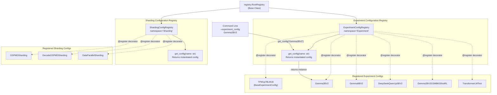
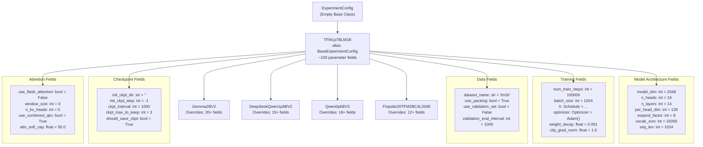
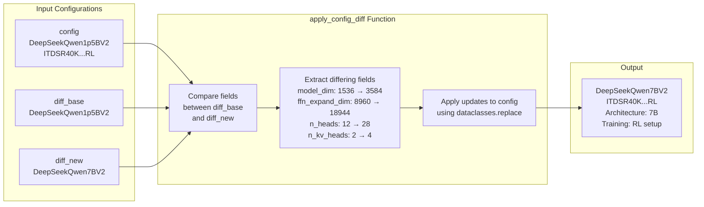
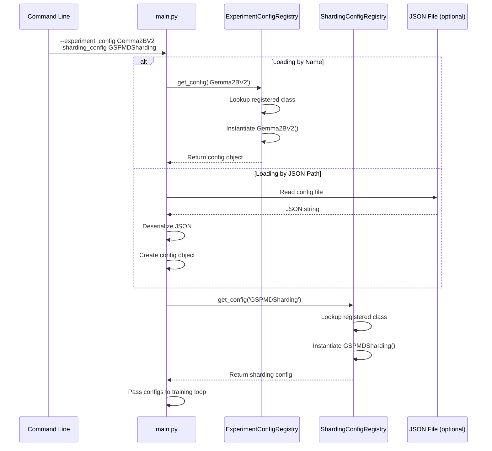

<!-- source: DeepWiki mcp.deepwiki.com · repo google-deepmind/simply · page 3.1 Understanding Configurations · fetched 2026-10-26 -->

# Understanding Configurations

<details>
<summary>Relevant source files</summary>

The following files were used as context for generating this wiki page:

- [simply/config_lib.py](simply/config_lib.py)
- [simply/config_lib_test.py](simply/config_lib_test.py)

</details>


## Purpose and Scope

This page explains the configuration system architecture in Simply, which is the primary mechanism for defining and managing experiments. The configuration system uses a registry pattern to organize over 210 pre-configured experiment definitions and provides a structured inheritance hierarchy for creating new configurations. This page covers the registry implementation, base configuration classes, inheritance patterns, and loading mechanisms.

For a catalog of available model configurations, see [Model Configuration Catalog](#3.2). For details on sharding strategies, see [Sharding Strategies](#3.3). For guidance on creating custom configurations, see [Creating Custom Configurations](#3.4).

## Registry Pattern Architecture

Simply uses a registry-based system to organize and retrieve configurations by name. This pattern enables string-based configuration selection from the command line and provides a centralized catalog of all available configurations.

### Registry Classes

The system defines two primary registry classes that inherit from `registry.RootRegistry`:

**ExperimentConfigRegistry**

```python
class ExperimentConfigRegistry(registry.RootRegistry):
  namespace: ClassVar[str] = 'Experiment'
  
  @classmethod
  def get_config(cls, name: str):
    return cls.get(name)()
```

The `ExperimentConfigRegistry` manages experiment configurations including model architecture parameters, training hyperparameters, dataset specifications, and checkpoint paths. Configurations are registered using the `@ExperimentConfigRegistry.register` decorator.

**ShardingConfigRegistry**

```python
class ShardingConfigRegistry(registry.RootRegistry):
  namespace: ClassVar[str] = 'Sharding'
  
  @classmethod
  def get_config(cls, name: str):
    return cls.get(name)()
```

The `ShardingConfigRegistry` manages sharding strategies that define how model weights and activations are distributed across accelerators.

Sources: [simply/config_lib.py:76-90]()

### Registry Diagram: Configuration Registry Architecture



Sources: [simply/config_lib.py:76-90]()

### Registration Mechanisms

Configurations are registered using two primary patterns:

**Dataclass Registration**

Most configurations are defined as frozen dataclasses and registered with a decorator:

```python
@ExperimentConfigRegistry.register
@dataclasses.dataclass(frozen=True)
class Gemma2BV2(TFM1p7BLM1B):
  seq_len: int = 4096
  vocab_size: int = 256128
  # ... additional fields
```

The `frozen=True` parameter ensures configurations are immutable after creation, preventing accidental modification during execution.

**Function Registration**

Complex configurations that require programmatic construction can be registered as functions:

```python
@ExperimentConfigRegistry.register
def DeepSeekQwen7BV2ITDSR40KR1DistillCoT0ShotRL():
  return apply_config_diff(
      config=DeepSeekQwen1p5BV2ITDSR40KR1DistillCoT0ShotRL(),
      diff_base=DeepSeekQwen1p5BV2(),
      diff_new=DeepSeekQwen7BV2())
```

This pattern enables configuration composition using the `apply_config_diff` utility.

Sources: [simply/config_lib.py:577-619](), [simply/config_lib.py:1384-1395]()

## Configuration Base Classes

### ExperimentConfig Hierarchy

The configuration system uses a three-level class hierarchy:

| Level | Class | Purpose |
|-------|-------|---------|
| 1 | `ExperimentConfig` | Empty base class for type identification |
| 2 | `TFM1p7BLM1B` | Complete base configuration with ~100 parameters |
| 3 | Model-specific configs | Override base parameters for specific models |

**ExperimentConfig**

The root base class is an empty dataclass that serves as a type marker:

```python
@dataclasses.dataclass(frozen=True)
class ExperimentConfig:
  """Base experiment config for others to inherit."""
```

**TFM1p7BLM1B (BaseExperimentConfig)**

This is the functional base configuration defining all parameters needed for experiments. It is aliased as `BaseExperimentConfig` for clarity:

```python
BaseExperimentConfig = TFM1p7BLM1B
```

The configuration contains approximately 100 fields organized into the following categories:

| Category | Fields | Example Parameters |
|----------|--------|-------------------|
| Model Architecture | ~30 fields | `model_dim`, `n_heads`, `n_layers`, `expand_factor` |
| Attention Configuration | ~15 fields | `use_flash_attention`, `window_size`, `n_kv_heads` |
| Data Configuration | ~10 fields | `batch_size`, `dataset_name`, `seq_len` |
| Training Configuration | ~15 fields | `num_train_steps`, `lr`, `optimizer`, `clip_grad_norm` |
| Checkpoint Configuration | ~10 fields | `init_ckpt_dir`, `ckpt_interval`, `ckpt_max_to_keep` |
| RL Configuration | ~10 fields | `gamma`, `kl_coeff`, `use_grpo` |
| Miscellaneous | ~10 fields | `model_name`, `train_loop_name`, `vocab_name` |

Sources: [simply/config_lib.py:192-342]()

### Configuration Class Diagram



Sources: [simply/config_lib.py:192-342]()

### ShardingConfig Classes

Sharding configurations define how tensors are partitioned across the device mesh. Three primary strategies are available:

**GSPMDSharding**

The default sharding strategy that partitions weights and activations across the `model` axis:

```python
@ShardingConfigRegistry.register
@dataclasses.dataclass(frozen=True)
class GSPMDSharding:
  ffn0_partition: Any = ('data', 'model')
  ffn1_partition: Any = ('model', 'data')
  attn_qkv_partition: Any = ('data', 'model', None)
  attn_o_partition: Any = ('data', 'model', None)
  embed_partition: Any = ('model', 'data')
  activation_partition: Any = (('replica', 'data'), None, 'model')
  # ... additional partition specifications
```

**DecodeGSPMDSharding**

Extends `GSPMDSharding` with modified activation partitioning optimized for inference:

```python
@ShardingConfigRegistry.register
@dataclasses.dataclass(frozen=True)
class DecodeGSPMDSharding(GSPMDSharding):
  activation_partition: Any = (('replica', 'data'), None, None)
```

**DataParallelSharding**

Pure data parallelism with no weight sharding:

```python
@ShardingConfigRegistry.register
@dataclasses.dataclass(frozen=True)
class DataParallelSharding:
  ffn0_partition: Any = (None, None)
  ffn1_partition: Any = (None, None)
  # All weight partitions set to None
  activation_partition: Any = (('replica', 'data', 'model'), None, None)
  # ... additional partition specifications
```

Sources: [simply/config_lib.py:104-182]()

### Sharding Configuration Comparison

| Field | GSPMDSharding | DecodeGSPMDSharding | DataParallelSharding |
|-------|---------------|---------------------|----------------------|
| `ffn0_partition` | `('data', 'model')` | `('data', 'model')` | `(None, None)` |
| `ffn1_partition` | `('model', 'data')` | `('model', 'data')` | `(None, None)` |
| `attn_qkv_partition` | `('data', 'model', None)` | `('data', 'model', None)` | `(None, None, None)` |
| `embed_partition` | `('model', 'data')` | `('model', 'data')` | `(None, None)` |
| `activation_partition` | `(('replica', 'data'), None, 'model')` | `(('replica', 'data'), None, None)` | `(('replica', 'data', 'model'), None, None)` |
| Use Case | Training & Inference | Inference-optimized | Small models, no sharding |

Sources: [simply/config_lib.py:104-182]()

## Configuration Inheritance Patterns

### Direct Inheritance

Configurations use Python dataclass inheritance to override base parameters:

```python
@ExperimentConfigRegistry.register
@dataclasses.dataclass(frozen=True)
class Gemma2BV2(TFM1p7BLM1B):
  seq_len: int = 4096              # Override base value (1024)
  vocab_size: int = 256128         # Override base value (32000)
  model_dim: int = 2304            # Override base value (2048)
  n_layers: int = 26               # Override base value (14)
  init_ckpt_dir: str = GEMMA2_2B_PT_CKPT_DIR
  # Inherits ~80 other fields from TFM1p7BLM1B
```

This pattern minimizes duplication by only specifying values that differ from the base configuration.

Sources: [simply/config_lib.py:577-623]()

### Inheritance Hierarchy Diagram

```mermaid
graph TB
    TFM["TFM1p7BLM1B<br/>(BaseExperimentConfig)<br/>~100 fields defined"]
    
    subgraph "Gemma Family"
        Gemma2B["Gemma2BV2<br/>model_dim=2304<br/>n_layers=26<br/>vocab_size=256128"]
        Gemma9B["Gemma9BV2<br/>model_dim=3584<br/>n_layers=42"]
        Gemma27B["Gemma27BV2<br/>model_dim=4608<br/>n_layers=46"]
        
        Gemma2BIT["Gemma2BV2IT<br/>init_ckpt_dir=IT_CKPT"]
        Gemma2BRL["Gemma2BV2GSM8K0ShotRL<br/>train_loop_name='rl'<br/>dataset_name='gsm8k_train'"]
    end
    
    subgraph "DeepSeek Qwen Family"
        DS1p5B["DeepSeekQwen1p5BV2<br/>model_dim=1536<br/>n_layers=28<br/>vocab_size=151936"]
        DS7B["DeepSeekQwen7BV2<br/>model_dim=3584<br/>n_layers=28"]
        DS14B["DeepSeekQwen14BV2<br/>model_dim=5120<br/>n_layers=48"]
        DS32B["DeepSeekQwen32BV2<br/>model_dim=5120<br/>n_layers=64"]
    end
    
    subgraph "Qwen3 Family"
        Qwen0p6B["Qwen0p6BV3<br/>model_dim=1024<br/>n_layers=28<br/>vocab_size=151936"]
        Qwen1p7B["Qwen1p7BV3<br/>model_dim=2048"]
        Qwen4B["Qwen4BV3<br/>model_dim=2560<br/>n_layers=36"]
        Qwen8B["Qwen8BV3<br/>model_dim=4096"]
    end
    
    subgraph "C4 Experiments"
        C4_6e20["Flops6e20TFM2BC4L2048<br/>dataset_name='c4'<br/>batch_size=1024"]
        C4_1e20["Flops1e20TFM986MC4L2048<br/>model_dim=1536<br/>n_layers=12"]
    end
    
    TFM --> Gemma2B
    TFM --> DS1p5B
    TFM --> Qwen0p6B
    TFM --> C4_6e20
    
    Gemma2B --> Gemma9B
    Gemma2B --> Gemma27B
    Gemma2B --> Gemma2BIT
    Gemma2B --> Gemma2BRL
    
    DS1p5B --> DS7B
    DS1p5B --> DS14B
    DS1p5B --> DS32B
    
    Qwen0p6B --> Qwen1p7B
    Qwen0p6B --> Qwen4B
    Qwen0p6B --> Qwen8B
    
    C4_6e20 --> C4_1e20
```



Sources: [simply/config_lib.py:577-669](), [simply/config_lib.py:1094-1335](), [simply/config_lib.py:1549-1641]()

### Programmatic Configuration Composition

For complex inheritance scenarios, the `apply_config_diff` function enables programmatic configuration composition:

```python
def apply_config_diff(config, diff_base, diff_new):
  updates = {}
  for field in dataclasses.fields(diff_base):
    name = field.name
    base_val = getattr(diff_base, name)
    new_val = getattr(diff_new, name)
    if base_val != new_val:
      updates[name] = new_val
  return dataclasses.replace(config, **updates)
```

This function identifies fields that differ between `diff_base` and `diff_new`, then applies those differences to `config`. This enables configurations to inherit model architecture changes without redefining training or dataset parameters.

**Example Usage:**

```python
@ExperimentConfigRegistry.register
def DeepSeekQwen7BV2ITDSR40KR1DistillCoT0ShotRL():
  return apply_config_diff(
      config=DeepSeekQwen1p5BV2ITDSR40KR1DistillCoT0ShotRL(),
      diff_base=DeepSeekQwen1p5BV2(),
      diff_new=DeepSeekQwen7BV2())
```

This creates a 7B RL configuration by:
1. Starting with the 1.5B RL configuration (training setup)
2. Computing the diff between 1.5B and 7B base models (architecture changes)
3. Applying the architecture diff to the RL configuration

Sources: [simply/config_lib.py:1373-1395]()

### Configuration Composition Flow



Sources: [simply/config_lib.py:1373-1395](), [simply/config_lib.py:1384-1395]()

## Configuration Loading Mechanisms

Configurations can be loaded through two primary mechanisms: by registered name or from a JSON file.

### Loading by Name

The standard method retrieves configurations from the registry:

```python
config = ExperimentConfigRegistry.get_config('Gemma2BV2')
sharding_config = ShardingConfigRegistry.get_config('GSPMDSharding')
```

When invoked from the command line:

```bash
python -m simply.main \
  --experiment_config Gemma2BV2 \
  --sharding_config GSPMDSharding \
  --experiment_dir /tmp/experiment
```

The `main.py` module resolves these strings to configuration objects by calling the respective registry's `get_config` method.

### Loading from JSON File

Configurations can also be loaded from JSON files for scenarios requiring runtime customization:

```bash
python -m simply.main \
  --experiment_config_path /path/to/config.json \
  --experiment_dir /tmp/experiment
```

The JSON file should contain a serialized representation of the configuration dataclass. The system deserializes this into a configuration object at runtime.

### Configuration Loading Flow



Sources: [simply/config_lib.py:76-90]()

## Configuration Field Categories

The `TFM1p7BLM1B` base configuration organizes fields into logical categories:

### Model Architecture Fields

| Field | Type | Default | Description |
|-------|------|---------|-------------|
| `model_dim` | `int` | 2048 | Hidden dimension size |
| `n_heads` | `int` | 16 | Number of attention heads |
| `n_layers` | `int` | 14 | Number of transformer layers |
| `per_head_dim` | `int` | 128 | Dimension per attention head |
| `expand_factor` | `int` | 8 | FFN expansion factor |
| `vocab_size` | `int` | 32000 | Vocabulary size |
| `seq_len` | `int` | 1024 | Maximum sequence length |
| `n_kv_heads` | `int` | 0 | Number of KV heads (0=same as n_heads) |

### Attention Configuration Fields

| Field | Type | Default | Description |
|-------|------|---------|-------------|
| `use_flash_attention` | `bool` | False | Enable FlashAttention |
| `flash_attention_block_size` | `int` | 512 | Block size for FlashAttention |
| `window_size` | `int` | 0 | Sliding window size (0=no window) |
| `use_combined_qkv` | `bool` | True | Use fused QKV projection |
| `attn_soft_cap` | `float` | 50.0 | Attention logit soft capping |
| `query_scale` | `float` | -1.0 | Query scaling factor |

### Training Configuration Fields

| Field | Type | Default | Description |
|-------|------|---------|-------------|
| `num_train_steps` | `int` | 100000 | Total training steps |
| `batch_size` | `int` | 1024 | Training batch size |
| `lr` | `Schedule` | LinearWarmupCosineDecay | Learning rate schedule |
| `optimizer` | `Optimizer` | Adam | Optimizer type |
| `weight_decay` | `float` | 0.001 | Weight decay coefficient |
| `clip_grad_norm` | `float` | 1.0 | Gradient clipping threshold |
| `grad_accum_steps` | `int` | -1 | Gradient accumulation steps |

### Data Configuration Fields

| Field | Type | Default | Description |
|-------|------|---------|-------------|
| `dataset_name` | `str` | 'lm1b' | Dataset identifier |
| `use_packing` | `bool` | True | Enable sequence packing |
| `use_validation_set` | `bool` | False | Enable validation evaluation |
| `validation_eval_interval` | `int` | 1000 | Validation evaluation frequency |
| `validation_num_eval_steps` | `int` | -1 | Validation steps (-1=all) |

### Checkpoint Configuration Fields

| Field | Type | Default | Description |
|-------|------|---------|-------------|
| `init_ckpt_dir` | `str` | '' | Initial checkpoint directory |
| `init_ckpt_step` | `int` | -1 | Checkpoint step to load (-1=latest) |
| `init_ckpt_opt_state` | `bool` | False | Load optimizer state |
| `should_save_ckpt` | `bool` | True | Enable checkpoint saving |
| `ckpt_interval` | `int` | 1000 | Checkpoint save frequency |
| `ckpt_max_to_keep` | `int` | 3 | Maximum checkpoints to retain |

### RL Configuration Fields

| Field | Type | Default | Description |
|-------|------|---------|-------------|
| `train_loop_name` | `str` | 'default' | Training loop type ('default' or 'rl') |
| `gamma` | `float` | 1.0 | RL discount factor |
| `kl_coeff` | `float` | 0.001 | KL divergence coefficient |
| `use_grpo` | `bool` | True | Use GRPO instead of PPO |
| `ppo_clip_eps` | `float` | 0.2 | PPO clipping epsilon |
| `normalize_reward_method` | `str` | 'ByGroup' | Reward normalization strategy |

Sources: [simply/config_lib.py:199-342]()

## Checkpoint Directory Constants

The configuration system defines constants for pretrained checkpoint locations:

```python
MODELS_DIR = os.getenv('SIMPLY_MODELS', 
                       os.path.expanduser('~/.cache/simply/models/'))

GEMMA2_2B_PT_CKPT_DIR = os.path.join(MODELS_DIR, 'GEMMA-2.0-2B-PT-ORBAX')
GEMMA2_9B_PT_CKPT_DIR = os.path.join(MODELS_DIR, 'GEMMA-2.0-9B-PT-ORBAX')
DEEPSEEK_QWEN_1P5B_CKPT_DIR = os.path.join(MODELS_DIR, 
                                           'DeepSeek-R1-Distill-Qwen-1.5B/ORBAX')
```

These constants are referenced in configuration `init_ckpt_dir` fields to specify pretrained model locations. The directory path respects the `SIMPLY_MODELS` environment variable for flexible deployment.

Sources: [simply/config_lib.py:34-70]()

## Configuration Validation and Testing

The test suite validates configuration serialization and deserialization:

```python
def test_dump_load_baseline_config(self):
  config = config_lib.ExperimentConfigRegistry.get_config('TransformerLMTest')
  sharding_config = config_lib.ShardingConfigRegistry.get_config('GSPMDSharding')
  model_cls = module.ModuleRegistry.get(config.model_name)
  model = model_cls(config, sharding_config)
  py = pytree.dump_dataclasses(model)
  loaded_model = pytree.load_dataclasses(py)
  loaded_py = pytree.dump_dataclasses(loaded_model)
  self.assertEqual(py, loaded_py)
```

This test verifies that configurations can be serialized to and deserialized from Python dictionaries while preserving all field values.

Sources: [simply/config_lib_test.py:25-38]()

## Summary

The configuration system in Simply provides a structured, registry-based approach to experiment management. Key characteristics include:

1. **Registry Pattern**: Centralized `ExperimentConfigRegistry` and `ShardingConfigRegistry` enable string-based configuration lookup
2. **Frozen Dataclasses**: Immutable configurations prevent runtime modification
3. **Inheritance Hierarchy**: Three-level hierarchy (ExperimentConfig → TFM1p7BLM1B → specific configs) minimizes duplication
4. **Composition Utilities**: `apply_config_diff` enables programmatic configuration assembly
5. **Dual Loading**: Support for both name-based registry lookup and JSON file loading
6. **Comprehensive Fields**: ~100 fields organized into model architecture, training, data, checkpoint, and RL categories

This architecture supports over 210 pre-configured experiments while enabling researchers to create custom configurations through inheritance or composition.

---

