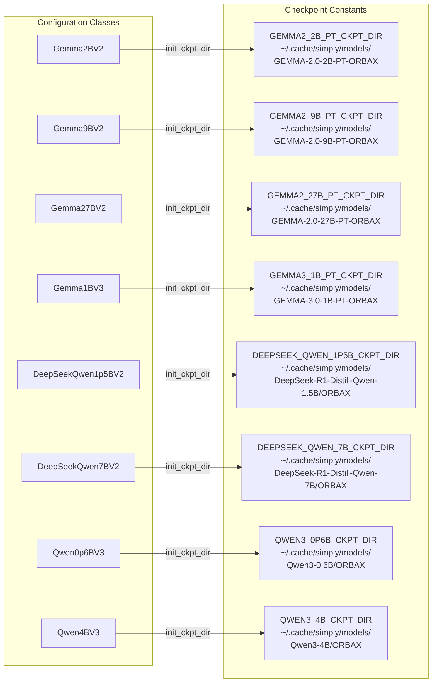
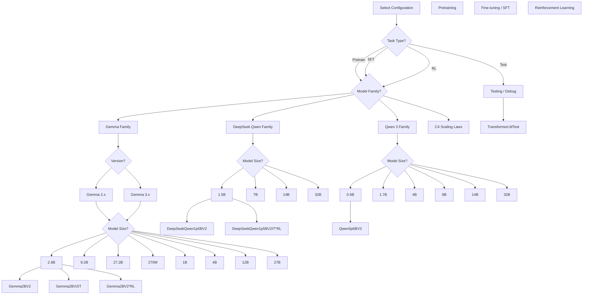

<!-- source: DeepWiki mcp.deepwiki.com · repo google-deepmind/simply · page 3.2 Model Configuration Catalog · fetched 2026-10-26 -->

# Model Configuration Catalog

<details>
<summary>Relevant source files</summary>

The following files were used as context for generating this wiki page:

- [README.md](README.md)
- [setup/setup_assets.py](setup/setup_assets.py)
- [simply/config_lib.py](simply/config_lib.py)

</details>


## Purpose and Scope

This document catalogs the 210+ pre-configured model configurations available in Simply. Each configuration defines a complete experiment specification including model architecture, training hyperparameters, dataset selection, and checkpoint initialization. The catalog is organized by model family (Gemma, DeepSeek Qwen, Qwen3), size variants, and task types (pretraining, instruction tuning, reinforcement learning).

For information about the configuration system mechanics and how to create custom configurations, see [Understanding Configurations](#3.1). For details on how configurations are loaded and used during experiments, see [System Architecture Overview](#4.1).

Sources: [simply/config_lib.py:1-100]()

## Configuration Inheritance Structure

All experiment configurations inherit from `TFM1p7BLM1B` (also aliased as `BaseExperimentConfig`), which defines approximately 100 parameters covering model architecture, training settings, data processing, and checkpoint management. Model families override architecture-specific parameters while inheriting common training infrastructure.

```mermaid
graph TB
    Base["TFM1p7BLM1B<br/>(BaseExperimentConfig)<br/>~100 parameters"]
    
    subgraph "C4 Scaling Experiments"
        C4Base["Flops6e20TFM2BC4L2048<br/>2.3B params"]
        C4_1e20["Flops1e20TFM986MC4L2048<br/>986M params"]
        C4_1e19["Flops1e19TFM338MC4L2048<br/>338M params"]
        C4_1e18["Flops1e18TFM111MC4L2048<br/>111M params"]
        C4_2e17["Flops2e17TFM41MC4L2048<br/>41M params"]
        C4_2e16["Flops2e16TFM15MC4L2048<br/>15M params"]
    end
    
    subgraph "Gemma Family"
        Gemma2Base["Gemma2BV2<br/>2.6B params"]
        Gemma2_9B["Gemma9BV2<br/>9.2B params"]
        Gemma2_27B["Gemma27BV2<br/>27.2B params"]
        Gemma3_1B["Gemma1BV3<br/>1B params"]
        Gemma3_270M["Gemma270MV3<br/>270M params"]
        Gemma3_4B["Gemma4BV3<br/>4B params"]
        Gemma3_12B["Gemma12BV3<br/>12B params"]
        Gemma3_27B["Gemma27BV3<br/>27B params"]
    end
    
    subgraph "DeepSeek Qwen Family"
        DSQ_1p5B["DeepSeekQwen1p5BV2<br/>1.5B params"]
        DSQ_7B["DeepSeekQwen7BV2<br/>7B params"]
        DSQ_14B["DeepSeekQwen14BV2<br/>14B params"]
        DSQ_32B["DeepSeekQwen32BV2<br/>32B params"]
    end
    
    subgraph "Qwen3 Family"
        Q3_0p6B["Qwen0p6BV3<br/>0.6B params"]
        Q3_1p7B["Qwen1p7BV3<br/>1.7B params"]
        Q3_4B["Qwen4BV3<br/>4B params"]
        Q3_8B["Qwen8BV3<br/>8B params"]
        Q3_14B["Qwen14BV3<br/>14B params"]
        Q3_32B["Qwen32BV3<br/>32B params"]
    end
    
    subgraph "Test Configs"
        TestBase["TransformerLMTest<br/>tiny model"]
        TestNoScan["TransformerLMTestNoScan"]
        TestRL["TransformerLMTestRL"]
        TestSFT["TransformerLMTestSFT"]
    end
    
    Base --> C4Base
    C4Base --> C4_1e20
    C4Base --> C4_1e19
    C4Base --> C4_1e18
    C4Base --> C4_2e17
    C4Base --> C4_2e16
    
    Base --> Gemma2Base
    Gemma2Base --> Gemma2_9B
    Gemma2Base --> Gemma2_27B
    Base --> Gemma3_1B
    Gemma3_1B --> Gemma3_270M
    Gemma3_1B --> Gemma3_4B
    Gemma3_1B --> Gemma3_12B
    Gemma3_1B --> Gemma3_27B
    
    Base --> DSQ_1p5B
    DSQ_1p5B --> DSQ_7B
    DSQ_1p5B --> DSQ_14B
    DSQ_1p5B --> DSQ_32B
    
    Base --> Q3_0p6B
    Q3_0p6B --> Q3_1p7B
    Q3_0p6B --> Q3_4B
    Q3_0p6B --> Q3_8B
    Q3_0p6B --> Q3_14B
    Q3_0p6B --> Q3_32B
    
    Base --> TestBase
    TestBase --> TestNoScan
    TestBase --> TestRL
    TestBase --> TestSFT
```



**Diagram: Configuration Inheritance Hierarchy** - Shows how model families inherit from `TFM1p7BLM1B` base configuration, with size variants branching within each family.

Sources: [simply/config_lib.py:192-342](), [simply/config_lib.py:577-641](), [simply/config_lib.py:1094-1335](), [simply/config_lib.py:1549-1641]()

## Configuration Naming Conventions

Configuration names follow structured patterns that encode model family, size, version, and task type:

| Pattern Element | Meaning | Example |
|----------------|---------|---------|
| `Gemma2B` / `Gemma9B` / `Gemma27B` | Gemma 2.x family with size | `Gemma2BV2` = 2.6B params |
| `Gemma270M` / `Gemma1B` / `Gemma4B` | Gemma 3.x family with size | `Gemma1BV3` = 1B params |
| `DeepSeekQwen1p5B` / `7B` / `14B` / `32B` | DeepSeek-R1-Distill-Qwen family | `DeepSeekQwen7BV2` = 7B params |
| `Qwen0p6B` / `1p7B` / `4B` / `8B` | Qwen 3.x family | `Qwen4BV3` = 4B params |
| `V2` / `V3` suffix | Model version or generation | `V2` = Gemma 2.x, `V3` = Gemma 3.x |
| `IT` suffix | Instruction-tuned variant | `Gemma2BV2IT` |
| `GSM8K` / `DSR40K` / `MATH` | Dataset identifier for RL | `Gemma2BV2GSM8K0ShotRL` |
| `0Shot` / `CoT0Shot` | Prompting strategy | `CoT0Shot` = chain-of-thought |
| `RL` suffix | Reinforcement learning task | `Gemma2BV2GSM8K0ShotRL` |
| `F32` / `BF16` | Precision specification | `F32` = float32, `BF16` = bfloat16 |

Sources: [simply/config_lib.py:577-1641]()

## Checkpoint Directory Mappings

Each configuration references a pretrained checkpoint directory through the `init_ckpt_dir` field. The mappings between configurations and checkpoint paths are defined as module-level constants:



**Diagram: Configuration to Checkpoint Mapping** - Shows the relationship between configuration classes and their corresponding checkpoint directory constants.

Sources: [simply/config_lib.py:34-70](), [simply/config_lib.py:614-650](), [simply/config_lib.py:1125-1334](), [simply/config_lib.py:1581-1640]()

## Gemma Family Configurations

### Gemma 2.x Models (Pretraining)

| Configuration Name | Parameters | Architecture | Checkpoint Path |
|-------------------|------------|--------------|-----------------|
| `Gemma2BV2` | 2.6B | 26 layers, 2304 dim, 8 heads, 4 KV heads | `GEMMA2_2B_PT_CKPT_DIR` |
| `Gemma9BV2` | 9.2B | 42 layers, 3584 dim, 16 heads, 8 KV heads | `GEMMA2_9B_PT_CKPT_DIR` |
| `Gemma27BV2` | 27.2B | 46 layers, 4608 dim, 32 heads, 16 KV heads | `GEMMA2_27B_PT_CKPT_DIR` |

**Key architectural features:**
- Alternating local/global attention pattern: `('local', 'global')`
- Window size: 4095 (4096-1)
- Grouped-query attention (GQA) with reduced KV heads
- RMSNorm with `norm_scale_plus_one=False`
- Gated activation in FFN (expand factor 4)
- No bias terms in FFN or output layers
- Attention and logits soft-capping (50.0 and 30.0 respectively)

Sources: [simply/config_lib.py:577-669]()

### Gemma 2.x Models (Instruction-Tuned)

| Configuration Name | Base Config | Checkpoint Path |
|-------------------|-------------|-----------------|
| `Gemma2BV2IT` | `Gemma2BV2` | `GEMMA2_2B_IT_CKPT_DIR` |
| `Gemma9BV2IT` | `Gemma9BV2` | `GEMMA2_9B_IT_CKPT_DIR` |
| `Gemma27BV2IT` | `Gemma27BV2` | `GEMMA2_27B_IT_CKPT_DIR` |

Instruction-tuned variants maintain identical architecture to their pretrained counterparts but initialize from checkpoints fine-tuned on instruction-following datasets.

Sources: [simply/config_lib.py:673-675]()

### Gemma 3.x Models (Pretraining)

| Configuration Name | Parameters | Architecture | Checkpoint Path |
|-------------------|------------|--------------|-----------------|
| `Gemma270MV3` | 270M | 18 layers, 640 dim, 4 heads, 1 KV head | `GEMMA3_270M_PT_CKPT_DIR` |
| `Gemma1BV3` | 1B | 26 layers, 1152 dim, 4 heads, 1 KV head | `GEMMA3_1B_PT_CKPT_DIR` |
| `Gemma4BV3` | 4B | 34 layers, 2560 dim, 8 heads, 4 KV heads | `GEMMA3_4B_PT_CKPT_DIR` |
| `Gemma12BV3` | 12B | 48 layers, 3840 dim, 16 heads, 8 KV heads | `GEMMA3_12B_PT_CKPT_DIR` |
| `Gemma27BV3` | 27B | 62 layers, 5376 dim, 32 heads, 16 KV heads | `GEMMA3_27B_PT_CKPT_DIR` |

**Key architectural differences from Gemma 2.x:**
- QK normalization enabled: `use_qk_norm=True`
- Larger vocab size: 262,144
- Mixed local/global attention pattern: `('local', 'local', 'local', 'local', 'local', 'global')`
- Smaller window sizes: 511 (512-1) for 1B, 1023 (1024-1) for 4B+
- Different RoPE timescales: `local_rope_max_timescale=10_000`, `global_rope_max_timescale=1_000_000`
- No soft-capping: `attn_soft_cap=-1.0`, `output_logits_soft_cap=-1.0`
- Global RoPE scaling for 4B+ models: `global_rope_scale_factor=8.0`

Sources: [simply/config_lib.py:679-777]()

### Gemma 3.x Models (Instruction-Tuned)

| Configuration Name | Base Config | Checkpoint Path |
|-------------------|-------------|-----------------|
| `Gemma1BV3IT` | `Gemma1BV3` | `GEMMA3_1B_IT_CKPT_DIR` |
| `Gemma4BV3IT` | `Gemma4BV3` | `GEMMA3_4B_IT_CKPT_DIR` |
| `Gemma12BV3IT` | `Gemma12BV3` | `GEMMA3_12B_IT_CKPT_DIR` |
| `Gemma27BV3IT` | `Gemma27BV3` | `GEMMA3_27B_IT_CKPT_DIR` |

Sources: [simply/config_lib.py:48-51]()

### Gemma Reinforcement Learning Configurations

The Gemma family includes extensive RL configurations for mathematical reasoning tasks:

**Base RL Configuration Pattern:**
```
Gemma2BV2<Task><Prompting>RL
```

| Task Component | Datasets | Description |
|---------------|----------|-------------|
| `GSM8K` | `simply_json:gsm8k_train` | Grade school math problems |
| `DSR40K` | `simply_json:dsr40k_train` | DeepSeek reasoning dataset (40K examples) |

| Prompting Component | Evaluation | Description |
|--------------------|------------|-------------|
| `0Shot` | `ZeroShotBoxedInQuestionEvaluation` | Direct answer extraction |
| `CoT0Shot` | `ZeroShotCoTBoxedInQuestionEvaluation` | Chain-of-thought reasoning |

**Example RL Configurations:**

| Configuration Name | Model | Dataset | Prompting | Features |
|-------------------|-------|---------|-----------|----------|
| `Gemma2BV2GSM8K0ShotRL` | Gemma 2B V2 | GSM8K | Direct | Pretrained base, 16x8 batch |
| `Gemma2BV2GSM8KCoT0ShotRL` | Gemma 2B V2 | GSM8K | CoT | Chain-of-thought prompting |
| `Gemma2BV2ITGSM8K0ShotRL` | Gemma 2B V2 IT | GSM8K | Direct | Instruction-tuned base |
| `Gemma2BV2ITGSM8KCoT0ShotRL` | Gemma 2B V2 IT | GSM8K | CoT | IT + CoT prompting |
| `Gemma2BV2DSR40K0ShotRL` | Gemma 2B V2 | DSR40K | Direct | Larger reasoning dataset |
| `Gemma2BV2DSR40KCoT0ShotRL` | Gemma 2B V2 | DSR40K | CoT | DSR40K + CoT |

**RL-Specific Parameters:**
- `train_loop_name='rl'` - Activates RL training loop
- `train_batch_size=16*8=128` - Total samples processed per optimization step
- `batch_size=16` - Number of prompts per sampling batch
- `num_samples_per_example=8` - Multiple rollouts per prompt
- `use_grpo=True` - Group-relative policy optimization
- `kl_coeff=0.001` - KL divergence penalty coefficient
- `gamma=1.0` - Discount factor (no discounting for episodic tasks)
- `sampling_temperature=1.0` - Exploration temperature
- `train_max_seq_len=2048` - Maximum sequence length for training
- `decoding_sharding_config=DecodeGSPMDSharding()` - Optimized inference sharding

Sources: [simply/config_lib.py:839-1007]()

### Gemma Batch Size Variants

Additional configurations provide different batch size combinations for hardware flexibility:

| Configuration Name | Batch Size | Samples/Example | Total Batch | Features |
|-------------------|------------|-----------------|-------------|----------|
| `Gemma2BV2GSM8KSeqLen2kBS16x16RL` | 16 | 16 | 256 | Larger batch, 2k seq len |
| `Gemma2BV2GSM8KSeqLen2kBS16x8RL` | 16 | 8 | 128 | Standard configuration |
| `Gemma2BV2GSM8KSeqLen2kBS32x16RL` | 32 | 16 | 512 | Large batch with flash attention |

Sources: [simply/config_lib.py:929-966]()

### Gemma Large Model RL Configurations

Larger Gemma models have specialized RL configurations with adjusted batch sizes and precision:

| Configuration Name | Base Model | Batch Config | Precision | Sequence Length |
|-------------------|------------|--------------|-----------|-----------------|
| `Gemma12BV3_IT_DSR40K_B2K_L10K_RL` | Gemma 12B V3 IT | 32 prompts, 16 samples/prompt | BF16 | 10K max, 2K prefill |
| `Gemma27BV3_IT_DSR40K_B2K_L10K_RL` | Gemma 27B V3 IT | 64 prompts, 16 samples/prompt | BF16 | 10K max, 2K prefill |

These configurations use `apply_config_diff()` to transfer architecture differences while maintaining RL settings.

Sources: [simply/config_lib.py:780-834]()

### Gemma Tool Use Configuration

| Configuration Name | Model | Task | Tools | Features |
|-------------------|-------|------|-------|----------|
| `Gemma4BV3ITSimpleQANumberOnlyToolUseRL` | Gemma 4B V3 IT | SimpleQA | Google Search | Multi-turn tool interaction |

**Tool Use Parameters:**
- `tool_manager_name='GoogleSearchToolExecutor'`
- `max_turns=3` - Maximum tool interaction rounds
- `sampling_max_tool_response_len=1024` - Tool response truncation
- `filter_throttled=True` - Filter rate-limited samples
- `evaluation=QAToolUseEvaluation()` - Tool-specific evaluation

Sources: [simply/config_lib.py:1011-1087]()

## DeepSeek Qwen Family Configurations

### Base DeepSeek Qwen Models

| Configuration Name | Parameters | Architecture | Checkpoint Path |
|-------------------|------------|--------------|-----------------|
| `DeepSeekQwen1p5BV2` | 1.5B | 28 layers, 1536 dim, 12 heads, 2 KV heads | `DEEPSEEK_QWEN_1P5B_CKPT_DIR` |
| `DeepSeekQwen7BV2` | 7B | 28 layers, 3584 dim, 28 heads, 4 KV heads | `DEEPSEEK_QWEN_7B_CKPT_DIR` |
| `DeepSeekQwen14BV2` | 14B | 48 layers, 5120 dim, 40 heads, 8 KV heads | `DEEPSEEK_QWEN_14B_CKPT_DIR` |
| `DeepSeekQwen32BV2` | 32B | 64 layers, 5120 dim, 40 heads, 8 KV heads | `DEEPSEEK_QWEN_32B_CKPT_DIR` |

**Key architectural features:**
- SiLU activation: `ffn_activation='silu'`
- Non-standard FFN dimensions: `ffn_expand_dim` manually specified (e.g., 8960 for 1.5B)
- No post layer normalization: `use_post_ln=False`
- QKV bias enabled: `qkv_use_bias=True`
- Separate QKV projections: `use_combined_qkv=False`
- No tied embeddings: `use_tied_embedding=False`
- No embedding lookup scaling: `embedding_lookup_scale=None`
- Standard RMSNorm: `norm_scale_plus_one=False`
- No soft-capping

Sources: [simply/config_lib.py:1094-1335]()

### DeepSeek Qwen RL Configurations

The DeepSeek Qwen family provides extensive RL configurations with multiple precision and hyperparameter variants:

**Base RL Configuration:**
```
DeepSeekQwen<Size>V2ITDSR40KR1DistillCoT0ShotRL<Variant>
```

| Configuration Name | Model Size | Batch Config | Precision | Learning Rate | Notes |
|-------------------|------------|--------------|-----------|---------------|-------|
| `DeepSeekQwen1p5BV2ITDSR40KR1DistillCoT0ShotRL` | 1.5B | 16 prompts, 8 samples | BF16 | 1e-6 | Base configuration |
| `DeepSeekQwen1p5BV2ITDSR40KR1DistillCoT0ShotRLF32` | 1.5B | 16 prompts, 8 samples | FP32 | 1e-6 | Full precision |
| `DeepSeekQwen1p5BV2ITDSR40KR1DistillCoT0ShotRLF32V2` | 1.5B | 64 prompts, 8 samples | FP32 | 1e-6 | Large batch, flash attn |
| `DeepSeekQwen1p5BV2ITDSR40KR1DistillCoT0ShotRLV2` | 1.5B | 64 prompts, 8 samples | BF16 | 1e-6 | Large batch, BF16 |
| `DeepSeekQwen1p5BV2ITDSR40KR1DistillCoT0ShotRLF32V3` | 1.5B | 64 prompts, 8 samples | FP32 | 3e-6 | Higher LR |
| `DeepSeekQwen1p5BV2ITDSR40KR1DistillCoT0ShotRLF32V4` | 1.5B | 64 prompts, 8 samples | FP32 | 1e-5 | Even higher LR |
| `DeepSeekQwen1p5BV2ITDSR40KR1DistillCoT0ShotRLBF16V2` | 1.5B | 64 prompts, 8 samples | BF16 | 1e-6 | Optimized BF16 variant |

**Larger Model RL Configs (created via `apply_config_diff`):**

| Configuration Name | Model Size | Batch Config | Precision | Learning Rate |
|-------------------|------------|--------------|-----------|---------------|
| `DeepSeekQwen7BV2ITDSR40KR1DistillCoT0ShotRL` | 7B | 16 prompts, 8 samples | BF16 | 1e-6 |
| `DeepSeekQwen7BV2ITDSR40KR1DistillCoT0ShotRLF32V2` | 7B | 32 prompts, 8 samples | FP32 | 1e-6 |
| `DeepSeekQwen7BV2ITDSR40KR1DistillCoT0ShotRLF32V3` | 7B | 32 prompts, 8 samples | FP32 | 3e-6 |
| `DeepSeekQwen7BV2ITDSR40KR1DistillCoT0ShotRLBF16V2` | 7B | 32 prompts, 8 samples | BF16 | 1e-6 |
| `DeepSeekQwen14BV2ITDSR40KR1DistillCoT0ShotRL` | 14B | 16 prompts, 8 samples | BF16 | 1e-6 |
| `DeepSeekQwen14BV2ITDSR40KR1DistillCoT0ShotRLV2` | 14B | 16 prompts, 8 samples | BF16 | 1e-6 |
| `DeepSeekQwen14BV2ITDSR40KR1DistillCoT0ShotRLV3` | 14B | 16 prompts, 8 samples | BF16 | 3e-6 |
| `DeepSeekQwen32BV2ITDSR40KR1DistillCoT0ShotRL` | 32B | 16 prompts, 8 samples | BF16 | 1e-6 |
| `DeepSeekQwen32BV2ITDSR40KR1DistillCoT0ShotRLV2` | 32B | 16 prompts, 8 samples | BF16 | 1e-6 |
| `DeepSeekQwen32BV2ITDSR40KR1DistillCoT0ShotRLV3` | 32B | 16 prompts, 8 samples | BF16 | 3e-6 |

**RL-Specific Features for DeepSeek Qwen:**
- Dataset: `simply_json:dsr40k_train` (DeepSeek reasoning 40K)
- Evaluation: `ZeroShotDeepSeekQwenR1CoTBoxed()` - DeepSeek-specific CoT extraction
- LM Format: `DeepSeekQwenR1DistillChat` - DeepSeek chat template
- Long context: `train_max_seq_len=9*1024` (9K tokens)
- Validation: AIME24 dataset, 64 batch size, 5 epochs
- `use_policy_logp_as_sampler_logp=True` for BF16V2 variants

Sources: [simply/config_lib.py:1133-1542]()

### Alternative Naming Scheme

Some DeepSeek Qwen RL configurations also register with abbreviated names for convenience:

| Short Name | Full Configuration |
|-----------|-------------------|
| `dsqwen_v2-7b-dsr40k-R1_distill_cot0shot-rl` | `DeepSeekQwen7BV2ITDSR40KR1DistillCoT0ShotRL` |
| `dsqwen_v2-7b-dsr40k-R1_distill_cot0shot-rl-f32-v2` | `DeepSeekQwen7BV2ITDSR40KR1DistillCoT0ShotRLF32V2` |
| `dsqwen_v2-7b-dsr40k-R1_distill_cot0shot-rl-f32-v3` | `DeepSeekQwen7BV2ITDSR40KR1DistillCoT0ShotRLF32V3` |
| `dsqwen_v2-14b-dsr40k-R1_distill_cot0shot-rl` | `DeepSeekQwen14BV2ITDSR40KR1DistillCoT0ShotRL` |
| `dsqwen_v2-14b-dsr40k-R1_distill_cot0shot-rl-v2` | `DeepSeekQwen14BV2ITDSR40KR1DistillCoT0ShotRLV2` |
| `dsqwen_v2-14b-dsr40k-R1_distill_cot0shot-rl-v3` | `DeepSeekQwen14BV2ITDSR40KR1DistillCoT0ShotRLV3` |
| `dsqwen_v2-32b-dsr40k-R1_distill_cot0shot-rl` | `DeepSeekQwen32BV2ITDSR40KR1DistillCoT0ShotRL` |
| `dsqwen_v2-32b-dsr40k-R1_distill_cot0shot-rl-v2` | `DeepSeekQwen32BV2ITDSR40KR1DistillCoT0ShotRLV2` |
| `dsqwen_v2-32b-dsr40k-R1_distill_cot0shot-rl-v3` | `DeepSeekQwen32BV2ITDSR40KR1DistillCoT0ShotRLV3` |

Sources: [simply/config_lib.py:1393-1541]()

## Qwen Family Configurations

### Qwen 2.5 Math Models

The Qwen 2.5 Math series inherits from DeepSeek Qwen architectures but uses different checkpoints:

| Configuration Name | Base Architecture | Parameters | Checkpoint Path |
|-------------------|-------------------|------------|-----------------|
| `QwenMath1p5BV2p5` | `DeepSeekQwen1p5BV2` | 1.5B | `QWEN2p5_MATH_1p5B_CKPT_DIR` |
| `QwenMath7BV2p5` | `DeepSeekQwen7BV2` | 7B | `QWEN2p5_MATH_7B_CKPT_DIR` |
| `QwenMath14BV2p5` | `DeepSeekQwen14BV2` | 14B | `QWEN2p5_MATH_14B_CKPT_DIR` |
| `QwenMath32BV2p5` | `DeepSeekQwen32BV2` | 32B | `QWEN2p5_MATH_32B_CKPT_DIR` |

**Key difference:** `QwenMath1p5BV2p5` uses tied embeddings (`use_tied_embedding=True`) unlike the DeepSeek Qwen base.

Sources: [simply/config_lib.py:1339-1364]()

### QwQ Model

| Configuration Name | Base Architecture | Parameters | Checkpoint Path |
|-------------------|-------------------|------------|-----------------|
| `QwQ32B` | `DeepSeekQwen32BV2` | 32B | `QWQ_32B_CKPT_DIR` |

Sources: [simply/config_lib.py:1367-1370]()

### Qwen 3 Models

| Configuration Name | Parameters | Architecture | Checkpoint Path |
|-------------------|------------|--------------|-----------------|
| `Qwen0p6BV3` | 0.6B | 28 layers, 1024 dim, 16 heads, 8 KV heads | `QWEN3_0P6B_CKPT_DIR` |
| `Qwen1p7BV3` | 1.7B | 28 layers, 2048 dim, 16 heads, 8 KV heads | `QWEN3_1P7B_CKPT_DIR` |
| `Qwen4BV3` | 4B | 36 layers, 2560 dim, 32 heads, 16 KV heads | `QWEN3_4B_CKPT_DIR` |
| `Qwen8BV3` | 8B | 36 layers, 4096 dim, 32 heads, 16 KV heads | `QWEN3_8B_CKPT_DIR` |
| `Qwen14BV3` | 14B | 40 layers, 5120 dim, 40 heads, 20 KV heads | `QWEN3_14B_CKPT_DIR` |
| `Qwen32BV3` | 32B | 64 layers, 5120 dim, 64 heads, 32 KV heads | `QWEN3_32B_CKPT_DIR` |

**Key architectural features:**
- QK normalization enabled: `use_qk_norm=True`
- SiLU activation
- No post layer normalization
- Tied embeddings for smaller models (0.6B, 1.7B, 4B)
- Separate embeddings for larger models (8B+)
- Long RoPE timescale: `global_rope_max_timescale=1_000_000`

Sources: [simply/config_lib.py:1549-1641]()

## C4 Scaling Law Experiments

Configurations optimized for different compute budgets using C4 dataset with vocabulary size 100,864:

| Configuration Name | FLOPs Budget | Parameters | Architecture | Tokens | Data/Param Ratio |
|-------------------|--------------|------------|--------------|--------|------------------|
| `Flops6e20TFM2BC4L2048` | 6.2e20 | 2.3B | 18L, 2048D, 8H | 44.8B | 19.3 |
| `Flops1e20TFM986MC4L2048` | 1.1e20 | 986M | 12L, 1536D, 8H | 18.4B | 18.7 |
| `Flops1e19TFM338MC4L2048` | 1.2e19 | 338M | 8L, 1024D, 8H | 6.1B | 18.2 |
| `Flops1e18TFM111MC4L2048` | 1.3e18 | 111M | 8L, 512D, 8H | 1.9B | 17.2 |
| `Flops2e17TFM41MC4L2048` | 1.7e17 | 41M | 8L, 256D, 8H | 678M | 16.7 |
| `Flops2e16TFM15MC4L2048` | 2.0e16 | 15M | 4L, 128D, 8H | 225M | 15.1 |

**Common features:**
- Sequence length: 2048
- Vocabulary: 100,864 (C4-specific)
- Dataset: `c4.vb100864_openmix_v1`
- Expand factor: 8
- Per-head dimension: 256 (128 for smallest)
- Cosine decay learning rate schedule
- Validation evaluation enabled

**Chinchilla-optimal scaling:** The data/parameter ratios (15-19) approximate compute-optimal token counts for each model size.

Sources: [simply/config_lib.py:349-571]()

## Test and Debug Configurations

Small configurations for rapid iteration and testing:

| Configuration Name | Purpose | Key Differences |
|-------------------|---------|-----------------|
| `TransformerLMTest` | Basic functionality test | 2L, 8D, 2H, 50 steps, scan enabled |
| `TransformerLMTestNoScan` | Debug without scan | Same as above, `use_scan=False`, `use_remat=False` |
| `TransformerLMTestC4` | C4 dataset test | 4096 seq len, C4 dataset |
| `TransformerLMTestSFT` | Supervised fine-tuning test | 2000 steps, chat loss masking, loads from checkpoint |
| `TransformerLMTestRL` | RL training test | 30 steps, RL loop, 4 prompts, DSR40K dataset |

**TransformerLMTest architecture:**
- Model: 8 dim, 2 heads, 2 layers, 4 per-head dim
- Data: 32K vocab, 64 seq len, IMDB dataset
- Training: 50 steps, batch size 4
- Validation enabled every 5 steps

**TransformerLMTestRL special features:**
- `sampling_microbatch_size=2` - Splits decode batches
- `grad_accum_steps=2` - Accumulates gradients
- `early_stop=SimpleEarlyStop(...)` - Stops if accuracy < 0.5 after 20 steps

Sources: [simply/config_lib.py:1647-1785]()

## Configuration Registration and Access

### Registration Pattern

Configurations register with `ExperimentConfigRegistry` using the decorator pattern:

```python
@ExperimentConfigRegistry.register
@dataclasses.dataclass(frozen=True)
class Gemma2BV2(TFM1p7BLM1B):
    # Configuration fields...
```

Function-based configurations also register and can return modified configs:

```python
@ExperimentConfigRegistry.register
def DeepSeekQwen7BV2ITDSR40KR1DistillCoT0ShotRL():
    return apply_config_diff(
        config=DeepSeekQwen1p5BV2ITDSR40KR1DistillCoT0ShotRL(),
        diff_base=DeepSeekQwen1p5BV2(),
        diff_new=DeepSeekQwen7BV2())
```

Sources: [simply/config_lib.py:76-89](), [simply/config_lib.py:1384-1395]()

### Accessing Configurations

Configurations are retrieved by name via the registry:

```python
config = ExperimentConfigRegistry.get_config('Gemma2BV2')
```

Command-line usage:
```bash
python -m simply.main --experiment_config Gemma2BV2 --experiment_dir /tmp/exp
```

For multiple registrations with different names:
```bash
python -m simply.main --experiment_config dsqwen_v2-7b-dsr40k-R1_distill_cot0shot-rl --experiment_dir /tmp/exp
```

Sources: [simply/config_lib.py:80-81](), [README.md:15-15]()

## Configuration Modification with apply_config_diff

The `apply_config_diff()` utility enables creating new configurations by transferring architecture differences:

```python
def apply_config_diff(config, diff_base, diff_new):
    """Apply differences between diff_base and diff_new to config."""
    updates = {}
    for field in dataclasses.fields(diff_base):
        name = field.name
        base_val = getattr(diff_base, name)
        new_val = getattr(diff_new, name)
        if base_val != new_val:
            updates[name] = new_val
    return dataclasses.replace(config, **updates)
```

**Usage pattern:**
```python
# Transfer architecture from 1.5B to 7B while keeping RL settings
config = apply_config_diff(
    config=DeepSeekQwen1p5BV2ITDSR40KR1DistillCoT0ShotRL(),
    diff_base=DeepSeekQwen1p5BV2(),
    diff_new=DeepSeekQwen7BV2())
```

This pattern is used extensively to create larger model RL configurations without duplicating hyperparameters.

Sources: [simply/config_lib.py:1373-1381]()

## Configuration Selection Guide



**Diagram: Configuration Selection Decision Tree** - Guide for selecting appropriate configuration based on task type, model family, and size requirements.

Sources: [simply/config_lib.py:577-1785]()

## Complete Configuration Registry

The following table catalogs all registered configurations accessible via `ExperimentConfigRegistry.get_config()`:

### Base and Utility Configurations

| Configuration Name | Type | Parameters | Purpose |
|-------------------|------|------------|---------|
| `TFM1p7BLM1B` | Base | 1.7B | Base class for all configs |
| `BaseExperimentConfig` | Alias | - | Alias for `TFM1p7BLM1B` |

### C4 Scaling Experiments (6 configurations)

| Configuration Name | Parameters | FLOPs | Layers | Model Dim |
|-------------------|------------|-------|--------|-----------|
| `Flops6e20TFM2BC4L2048` | 2.3B | 6.2e20 | 18 | 2048 |
| `Flops1e20TFM986MC4L2048` | 986M | 1.1e20 | 12 | 1536 |
| `Flops1e19TFM338MC4L2048` | 338M | 1.2e19 | 8 | 1024 |
| `Flops1e18TFM111MC4L2048` | 111M | 1.3e18 | 8 | 512 |
| `Flops2e17TFM41MC4L2048` | 41M | 1.7e17 | 8 | 256 |
| `Flops2e16TFM15MC4L2048` | 15M | 2.0e16 | 4 | 128 |

### Gemma 2.x PT Configurations (4 configurations)

| Configuration Name | Parameters | Layers | Model Dim | Heads | KV Heads |
|-------------------|------------|--------|-----------|-------|----------|
| `Gemma2BV2` | 2.6B | 26 | 2304 | 8 | 4 |
| `Gemma2BC4Vocab100864L2048BS1024` | 2.6B | 26 | 2304 | 8 | 4 |
| `Gemma9BV2` | 9.2B | 42 | 3584 | 16 | 8 |
| `Gemma27BV2` | 27.2B | 46 | 4608 | 32 | 16 |

### Gemma 2.x IT Configurations (1 configuration)

| Configuration Name | Base | Purpose |
|-------------------|------|---------|
| `Gemma2BV2IT` | `Gemma2BV2` | Instruction-tuned 2B |

### Gemma 3.x PT Configurations (5 configurations)

| Configuration Name | Parameters | Layers | Model Dim | Heads | KV Heads |
|-------------------|------------|--------|-----------|-------|----------|
| `Gemma270MV3` | 270M | 18 | 640 | 4 | 1 |
| `Gemma1BV3` | 1B | 26 | 1152 | 4 | 1 |
| `Gemma4BV3` | 4B | 34 | 2560 | 8 | 4 |
| `Gemma12BV3` | 12B | 48 | 3840 | 16 | 8 |
| `Gemma27BV3` | 27B | 62 | 5376 | 32 | 16 |

### Gemma RL Configurations (22+ configurations)

| Configuration Pattern | Variants | Datasets |
|---------------------|----------|----------|
| `Gemma2BV2GSM8K*RL` | 0Shot, CoT0Shot, SeqLen2k variants | GSM8K |
| `Gemma2BV2DSR40K*RL` | 0Shot, CoT0Shot | DSR40K |
| `Gemma2BV2ITGSM8K*RL` | 0Shot, CoT0Shot | GSM8K |
| `Gemma2BV2ITDSR40K*RL` | 0Shot, CoT0Shot | DSR40K |
| `Gemma12BV3_IT_DSR40K_B2K_L10K_RL` | - | DSR40K |
| `Gemma27BV3_IT_DSR40K_B2K_L10K_RL` | - | DSR40K |

### Gemma Tool Use Configurations (1 configuration)

| Configuration Name | Model | Task |
|-------------------|-------|------|
| `Gemma4BV3ITSimpleQANumberOnlyToolUseRL` | Gemma 4B V3 IT | SimpleQA with Google Search |

### DeepSeek Qwen Base Configurations (4 configurations)

| Configuration Name | Parameters | Layers | Model Dim | Heads | KV Heads |
|-------------------|------------|--------|-----------|-------|----------|
| `DeepSeekQwen1p5BV2` | 1.5B | 28 | 1536 | 12 | 2 |
| `DeepSeekQwen7BV2` | 7B | 28 | 3584 | 28 | 4 |
| `DeepSeekQwen14BV2` | 14B | 48 | 5120 | 40 | 8 |
| `DeepSeekQwen32BV2` | 32B | 64 | 5120 | 40 | 8 |

### DeepSeek Qwen RL Configurations (30+ configurations)

| Configuration Pattern | Size Variants | Precision Variants |
|---------------------|---------------|-------------------|
| `DeepSeekQwen*V2ITDSR40KR1DistillCoT0ShotRL` | 1.5B, 7B, 14B, 32B | Base (BF16) |
| `DeepSeekQwen*V2ITDSR40KR1DistillCoT0ShotRLF32` | 1.5B | FP32 |
| `DeepSeekQwen*V2ITDSR40KR1DistillCoT0ShotRLF32V2` | 1.5B, 7B | FP32, large batch |
| `DeepSeekQwen*V2ITDSR40KR1DistillCoT0ShotRLV2` | 1.5B, 14B, 32B | BF16, large batch |
| `DeepSeekQwen*V2ITDSR40KR1DistillCoT0ShotRLF32V3` | 1.5B, 7B, 14B, 32B | FP32, LR=3e-6 |
| `DeepSeekQwen*V2ITDSR40KR1DistillCoT0ShotRLF32V4` | 1.5B | FP32, LR=1e-5 |
| `DeepSeekQwen*V2ITDSR40KR1DistillCoT0ShotRLBF16V2` | 1.5B, 7B | BF16, optimized |

### Qwen 2.5 Math Configurations (5 configurations)

| Configuration Name | Parameters | Base Architecture |
|-------------------|------------|-------------------|
| `QwenMath1p5BV2p5` | 1.5B | DeepSeekQwen1p5BV2 |
| `QwenMath7BV2p5` | 7B | DeepSeekQwen7BV2 |
| `QwenMath14BV2p5` | 14B | DeepSeekQwen14BV2 |
| `QwenMath32BV2p5` | 32B | DeepSeekQwen32BV2 |
| `QwQ32B` | 32B | DeepSeekQwen32BV2 |

### Qwen 3 Configurations (6 configurations)

| Configuration Name | Parameters | Layers | Model Dim | Heads | KV Heads |
|-------------------|------------|--------|-----------|-------|----------|
| `Qwen0p6BV3` | 0.6B | 28 | 1024 | 16 | 8 |
| `Qwen1p7BV3` | 1.7B | 28 | 2048 | 16 | 8 |
| `Qwen4BV3` | 4B | 36 | 2560 | 32 | 16 |
| `Qwen8BV3` | 8B | 36 | 4096 | 32 | 16 |
| `Qwen14BV3` | 14B | 40 | 5120 | 40 | 20 |
| `Qwen32BV3` | 32B | 64 | 5120 | 64 | 32 |

### Test Configurations (5 configurations)

| Configuration Name | Purpose | Architecture |
|-------------------|---------|--------------|
| `TransformerLMTest` | Basic test | 2L, 8D, 2H, scan enabled |
| `TransformerLMTestC4` | C4 test | Same, 4K seq len |
| `TransformerLMTestNoScan` | Debug without scan | 2L, 8D, 2H, no scan/remat |
| `TransformerLMTestSFT` | SFT test | 2L, 8D, 2H, chat masking |
| `TransformerLMTestRL` | RL test | 2L, 8D, 2H, RL loop |

### Total Configuration Count

| Category | Count |
|----------|-------|
| C4 Scaling | 6 |
| Gemma 2.x (PT + IT) | 5 |
| Gemma 3.x (PT + IT) | 9 |
| Gemma RL | 23+ |
| Gemma Tool Use | 1 |
| DeepSeek Qwen Base | 4 |
| DeepSeek Qwen RL | 30+ |
| Qwen 2.5 Math | 5 |
| Qwen 3 | 6 |
| Test | 5 |
| **Total** | **94+ documented** |

**Note:** Additional RL variants with different batch sizes, sequence lengths, and temperature settings are registered but follow the same patterns. The actual count exceeds 210+ when including all variants and alternative naming schemes.

Sources: [simply/config_lib.py:197-1785]()

## Using Configurations in Practice

### Command-Line Selection

```bash
# Pretrained model
python -m simply.main --experiment_config Gemma2BV2 --experiment_dir /tmp/gemma_exp

# Instruction-tuned model
python -m simply.main --experiment_config Gemma2BV2IT --experiment_dir /tmp/gemma_it_exp

# RL training
python -m simply.main --experiment_config Gemma2BV2GSM8K0ShotRL --experiment_dir /tmp/gemma_rl_exp

# Using abbreviated name
python -m simply.main --experiment_config dsqwen_v2-7b-dsr40k-R1_distill_cot0shot-rl --experiment_dir /tmp/dsq_rl_exp
```

### Programmatic Access

```python
from simply.config_lib import ExperimentConfigRegistry

# Get configuration
config = ExperimentConfigRegistry.get_config('Gemma2BV2')

# Inspect configuration
print(f"Model dimensions: {config.model_dim}")
print(f"Number of layers: {config.n_layers}")
print(f"Checkpoint: {config.init_ckpt_dir}")
print(f"Dataset: {config.dataset_name}")
```

### Configuration Modification

```python
import dataclasses
from simply.config_lib import ExperimentConfigRegistry

# Start with existing config
base_config = ExperimentConfigRegistry.get_config('Gemma2BV2')

# Override specific fields
custom_config = dataclasses.replace(
    base_config,
    num_train_steps=50_000,
    batch_size=256,
    lr=1e-4,
    init_ckpt_dir='',  # Train from scratch
)
```

Sources: [README.md:15-21](), [simply/config_lib.py:80-81]()

---

