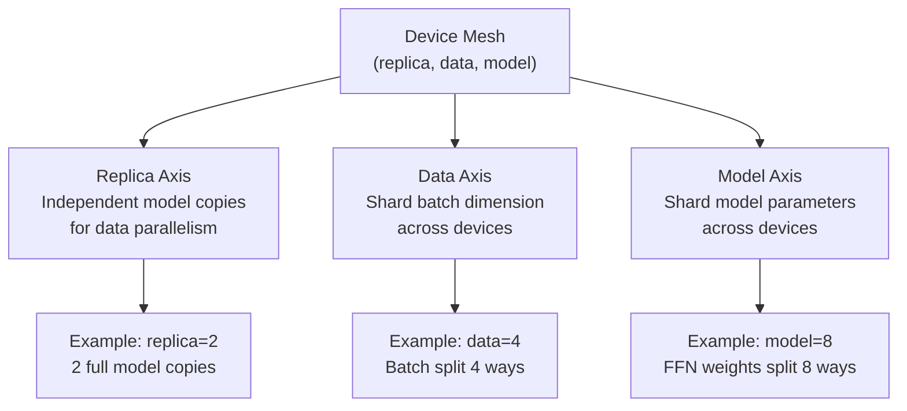
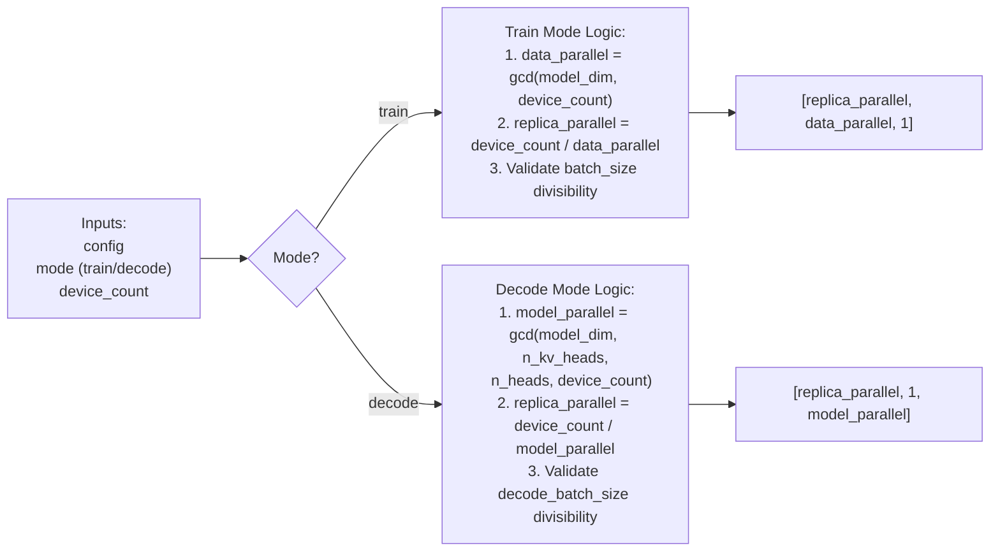
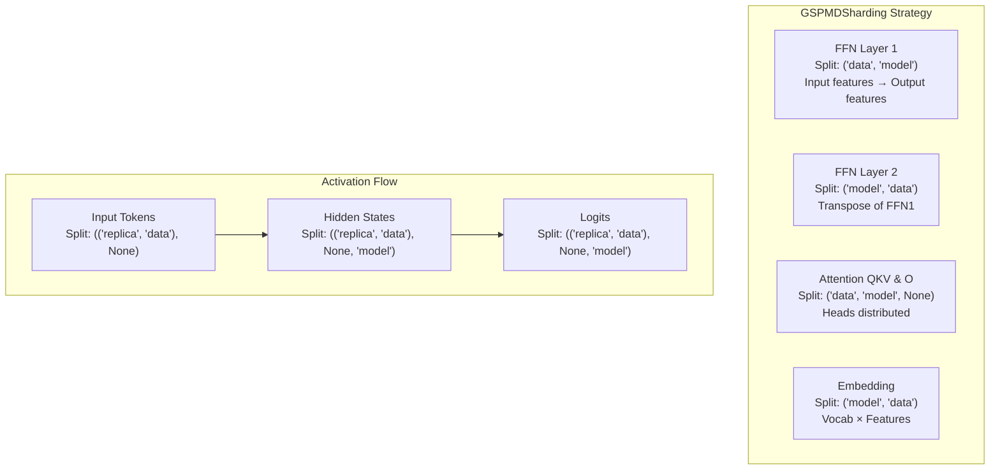
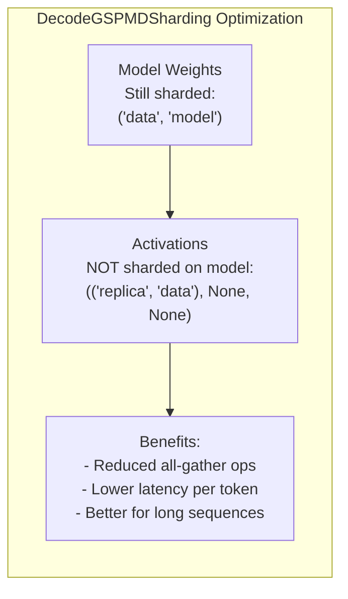
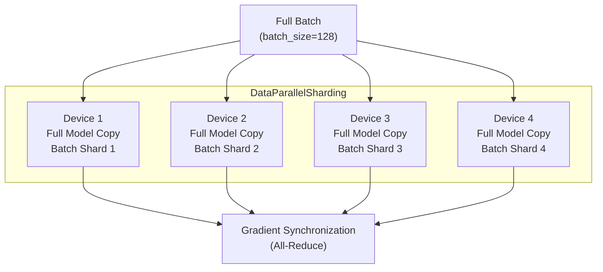
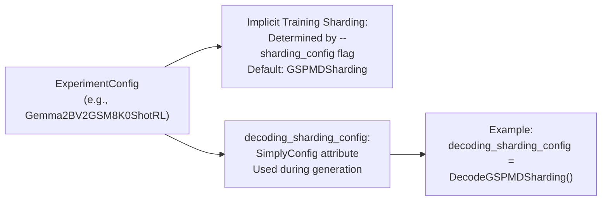
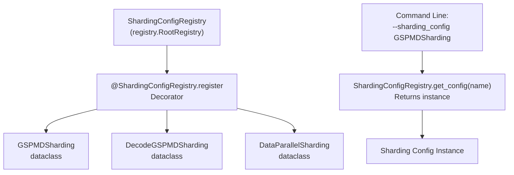
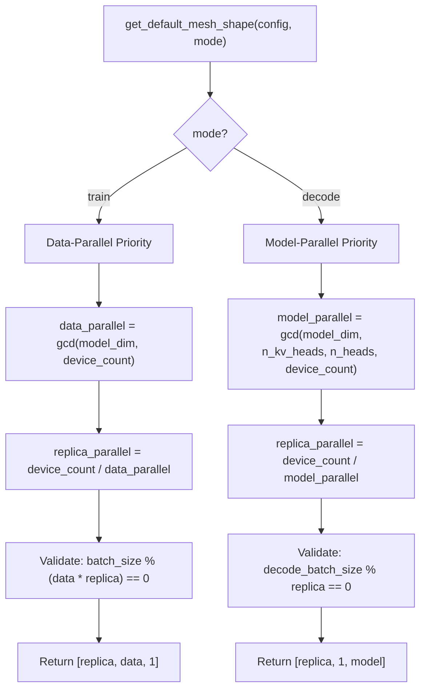

<!-- source: DeepWiki mcp.deepwiki.com · repo google-deepmind/simply · page 3.3 Sharding Strategies · fetched 2026-10-26 -->

# Sharding Strategies

<details>
<summary>Relevant source files</summary>

The following files were used as context for generating this wiki page:

- [simply/config_lib.py](simply/config_lib.py)

</details>


This page documents the three sharding strategies available in Simply and explains how to configure device mesh layouts for distributed training and inference. Sharding determines how model parameters and activations are partitioned across multiple accelerators (GPUs/TPUs).

For information about selecting model configurations, see [Model Configuration Catalog](#3.2). For details on creating custom configurations, see [Creating Custom Configurations](#3.4). For practical guidance on multi-device training, see [Distributed Training](#5.5).

## Overview

Simply uses JAX's GSPMD (General and Scalable Parallelization for ML Computations via Compiler) to automatically partition computations across devices. The sharding configuration specifies how tensors should be split along different dimensions, while the mesh configuration determines the physical device layout.

**Key Components:**

- **Sharding Config**: Defines partition specifications for weights and activations
- **Mesh**: 3D device layout with axes `(replica, data, model)`
- **Partition Specs**: Tuples mapping tensor dimensions to mesh axes

Sources: [simply/config_lib.py:104-182]()

## Mesh Configuration

The device mesh organizes accelerators into a 3D grid with three axes:



**Mesh Shape Determination**

The `get_default_mesh_shape()` function computes optimal mesh shapes based on model architecture and available devices:



Sources: [simply/config_lib.py:1787-1836]()

## GSPMDSharding

The primary sharding strategy that enables both model and data parallelism by partitioning weights and activations across the `data` and `model` mesh axes.

### Weight Partitioning

| Parameter | Shape | Partition Spec | Description |
|-----------|-------|----------------|-------------|
| `ffn0_partition` | `(model_dim, model_dim * expansion_factor)` | `('data', 'model')` | First FFN layer split along input and output dims |
| `ffn1_partition` | `(model_dim * expansion_factor, model_dim)` | `('model', 'data')` | Second FFN layer (inverse of ffn0) |
| `attn_qkv_partition` | `(model_dim, num_heads, per_head_size)` | `('data', 'model', None)` | QKV projections split along heads |
| `attn_o_partition` | `(model_dim, num_heads, per_head_size)` | `('data', 'model', None)` | Output projection split along heads |
| `embed_partition` | `(vocab_size, model_dim)` | `('model', 'data')` | Embedding table split across vocab and features |

### Activation Partitioning

| Activation | Shape | Partition Spec | Description |
|------------|-------|----------------|-------------|
| `activation_partition` | `(batch_size, seq_len, model_dim)` | `(('replica', 'data'), None, 'model')` | Primary activations split on batch and features |
| `attn_activation_partition` | `(batch_size, seq_len, num_heads, per_head_size)` | `(('replica', 'data'), None, 'model', None)` | Attention activations split on batch and heads |
| `ffn0_activation_partition` | `(batch_size, seq_len, model_dim * expansion_factor)` | `(('replica', 'data'), None, 'model')` | FFN intermediate activations |
| `logits_partition` | `(batch_size, seq_len, vocab_size)` | `(('replica', 'data'), None, 'model')` | Output logits split on batch and vocab |
| `data_partition` | `(batch_size, seq_len)` | `(('replica', 'data'), None)` | Input data split on batch |

**Note**: The `('replica', 'data')` tuple means the dimension is split first along `replica`, then `data`.



Sources: [simply/config_lib.py:104-136]()

## DecodeGSPMDSharding

Specialized variant of `GSPMDSharding` optimized for autoregressive decoding. The key difference is that activations are **not** sharded along the `model` dimension, reducing communication overhead during token-by-token generation.

### Key Difference

```python
# GSPMDSharding
activation_partition: Any = (('replica', 'data'), None, 'model')

# DecodeGSPMDSharding  
activation_partition: Any = (('replica', 'data'), None, None)
```

**Rationale**: During decoding, the sequence length dimension is typically 1 (generating one token at a time). Sharding activations along `model` would introduce all-gather operations for every token, creating bottlenecks. By keeping activations replicated across model axes, communication is reduced.

**When to Use**:
- Text generation tasks
- Inference-only workloads
- When `sampling_max_decode_steps` is large
- Typically paired with `decode` mode in `get_default_mesh_shape`



Sources: [simply/config_lib.py:138-143]()

## DataParallelSharding

Pure data parallelism with **no weight sharding**. All model parameters are replicated across devices, and only the batch dimension is partitioned.

### Weight Partitioning

All weight partitions are `None`, meaning weights are fully replicated:

```python
ffn0_partition: Any = (None, None)
ffn1_partition: Any = (None, None)
attn_qkv_partition: Any = (None, None, None)
attn_o_partition: Any = (None, None, None)
embed_partition: Any = (None, None)
```

### Activation Partitioning

Activations are sharded only along the batch dimension using all three mesh axes:

```python
activation_partition: Any = (('replica', 'data', 'model'), None, None)
attn_activation_partition: Any = (('replica', 'data', 'model'), None, None, None)
logits_partition: Any = (('replica', 'data', 'model'), None, None)
data_partition: Any = (('replica', 'data', 'model'), None)
```

**When to Use**:
- Small models that fit in single-device memory
- Maximum training throughput when memory permits
- Debugging and testing
- When communication overhead exceeds computation time



Sources: [simply/config_lib.py:145-182]()

## Sharding Strategy Comparison

| Strategy | Weight Sharding | Activation Sharding | Use Case | Memory Efficiency | Speed |
|----------|----------------|---------------------|----------|-------------------|-------|
| `GSPMDSharding` | Yes (data, model) | Yes (replica, data, model) | Training large models | High | Moderate |
| `DecodeGSPMDSharding` | Yes (data, model) | Partial (replica, data only) | Inference/generation | High | Fast decode |
| `DataParallelSharding` | No (replicated) | Batch only | Small models | Low | Fastest |

## Configuration Examples

### Specifying Sharding in ExperimentConfig

Sharding configurations are referenced in experiment configs:



**Example from config:**

[simply/config_lib.py:902-903]() - Gemma RL config specifies decode sharding:

```python
@dataclasses.dataclass(frozen=True)
class Gemma2BV2GSM8K0ShotRL(Gemma2BV2):
    # ... other config ...
    decoding_sharding_config: SimplyConfig = DecodeGSPMDSharding()
```

### Registry and Loading



**Loading mechanism:**

[simply/config_lib.py:84-90]() - Registry provides `get_config` method:

```python
class ShardingConfigRegistry(registry.RootRegistry):
    namespace: ClassVar[str] = 'Sharding'

    @classmethod
    def get_config(cls, name: str):
        return cls.get(name)()
```

Sources: [simply/config_lib.py:84-90](), [simply/config_lib.py:902-903]()

## Mesh Shape Calculation Details

### Training Mode

For `mode='train'`, the mesh prioritizes data parallelism:

1. **Calculate data_parallel**: `gcd(config.model_dim, device_count)`
   - Ensures model_dim is divisible by data axis size
   
2. **Calculate replica_parallel**: `device_count // data_parallel`
   - Remaining devices used for replication

3. **Validation**: 
   - `train_batch_size` must be divisible by `data_parallel * replica_parallel`
   - If `grad_accum_steps > 0`, `train_batch_size` adjusted first

**Example**: 32 devices, `model_dim=2048`, `batch_size=256`
- `data_parallel = gcd(2048, 32) = 32`
- `replica_parallel = 32 // 32 = 1`
- Mesh shape: `[1, 32, 1]`

### Decode Mode

For `mode='decode'`, the mesh prioritizes model parallelism:

1. **Calculate model_parallel**: `gcd(model_dim, n_kv_heads, n_heads, device_count)`
   - Finds largest factor dividing all model dimensions
   
2. **Calculate replica_parallel**: `device_count // model_parallel`
   - Enables batch parallelism for multiple samples

3. **Validation**:
   - `decode_batch_size` (= `batch_size * num_samples_per_example`) must be divisible by `replica_parallel`

**Example**: 8 devices, `model_dim=2304`, `n_heads=8`, `n_kv_heads=4`, `batch_size=16`
- `model_parallel = gcd(2304, 8, 4, 8) = 8`
- `replica_parallel = 8 // 8 = 1`
- Mesh shape: `[1, 1, 8]`



Sources: [simply/config_lib.py:1787-1836]()

## Practical Usage

### Command-Line Selection

```bash
# Use default GSPMDSharding for training
python -m simply.main --experiment_config Gemma2BV2 --sharding_config GSPMDSharding

# Use data parallel for small model
python -m simply.main --experiment_config TransformerLMTest --sharding_config DataParallelSharding
```

### Programmatic Configuration

Sharding configs can be specified in experiment dataclasses:

```python
@ExperimentConfigRegistry.register
@dataclasses.dataclass(frozen=True)
class MyRLConfig(BaseExperimentConfig):
    # Training uses default/CLI-specified sharding
    # Decoding uses optimized strategy
    decoding_sharding_config: SimplyConfig = DecodeGSPMDSharding()
```

### Gradient Accumulation Impact

When `grad_accum_steps > 0`, the effective per-device batch size is reduced:

```
effective_batch_size = train_batch_size // grad_accum_steps
```

This must still be divisible by the mesh layout. The mesh shape calculation accounts for this:

[simply/config_lib.py:1807-1813]()

```python
if config.grad_accum_steps > 0:
    if train_batch_size % config.grad_accum_steps != 0:
        raise ValueError(...)
    train_batch_size //= config.grad_accum_steps
```

Sources: [simply/config_lib.py:1787-1836]()

## Advanced: Partition Spec Tuples

JAX interprets partition specs as mappings from tensor dimensions to mesh axes:

```python
# For a tensor with shape (batch, seq_len, model_dim)
activation_partition = (('replica', 'data'), None, 'model')

# Interpretation:
# - Dimension 0 (batch): split across ('replica', 'data') axes
# - Dimension 1 (seq_len): not sharded (None)
# - Dimension 2 (model_dim): split across 'model' axis
```

**Nested Tuples**: `(('replica', 'data'), ...)` means the dimension is first split along `replica`, then further along `data`. With mesh shape `[2, 4, 8]`:
- Total devices in (replica, data) = 2 × 4 = 8
- Batch dimension of 128 → 16 per device (128 / 8)

Sources: [simply/config_lib.py:104-182]()

## Summary

| Component | Purpose | Key Functions/Classes |
|-----------|---------|----------------------|
| Sharding configs | Define partition strategies | `GSPMDSharding`, `DecodeGSPMDSharding`, `DataParallelSharding` |
| Mesh configuration | Layout physical devices | `get_default_mesh_shape()` |
| Registry | Config selection | `ShardingConfigRegistry.get_config()` |
| Partition specs | Map tensor dims to mesh axes | Tuples like `('data', 'model')` |

**Decision Guide**:
1. **Large model training**: Use `GSPMDSharding` 
2. **Inference/generation**: Use `DecodeGSPMDSharding` in `decoding_sharding_config`
3. **Small model training**: Use `DataParallelSharding`
4. **Custom needs**: Inherit from a base sharding config and override specific partitions

Sources: [simply/config_lib.py:104-182](), [simply/config_lib.py:1787-1836]()

---

