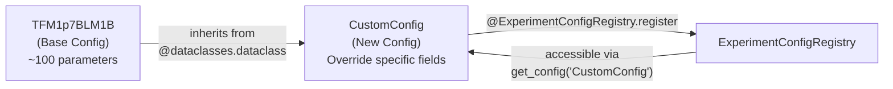
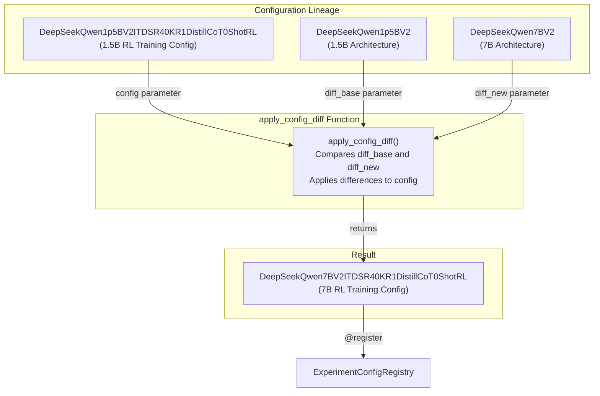
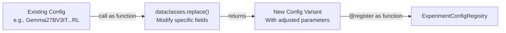
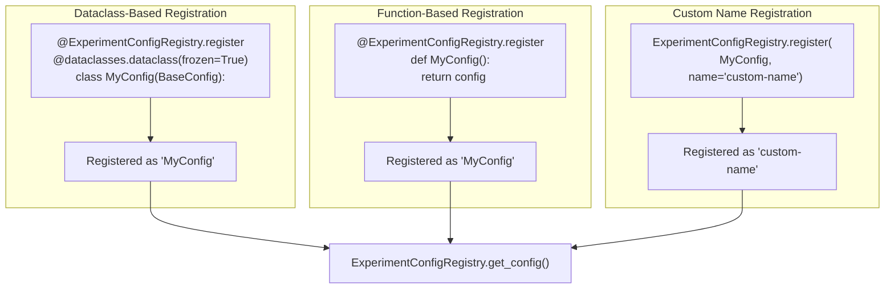
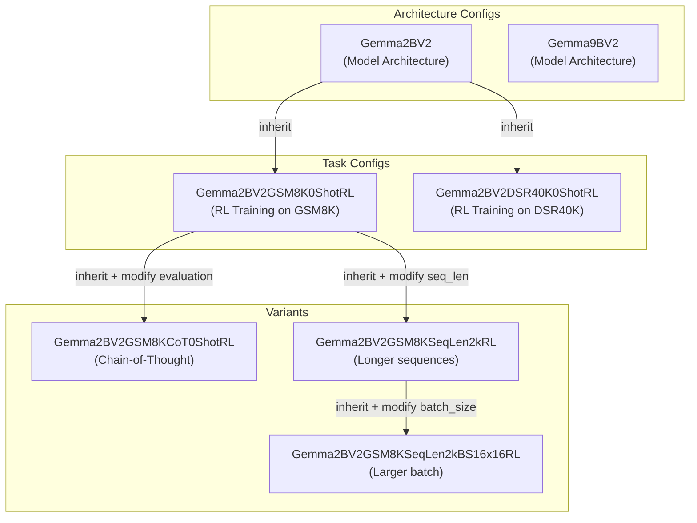
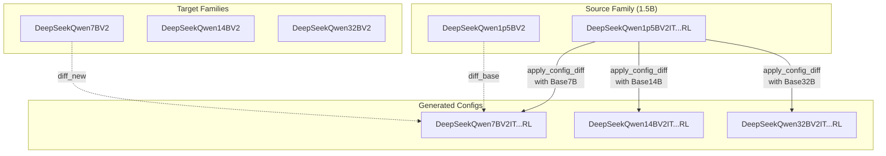

<!-- source: DeepWiki mcp.deepwiki.com · repo google-deepmind/simply · page 3.4 Creating Custom Configurations · fetched 2026-10-26 -->

# Creating Custom Configurations

<details>
<summary>Relevant source files</summary>

The following files were used as context for generating this wiki page:

- [simply/config_lib.py](simply/config_lib.py)
- [simply/config_lib_test.py](simply/config_lib_test.py)

</details>


This guide explains how to create custom experiment configurations in Simply. Custom configurations allow you to define new model architectures, training setups, and hyperparameter combinations by building on existing configurations.

For understanding the configuration system architecture and existing configurations, see [Understanding Configurations](#3.1) and [Model Configuration Catalog](#3.2).

---

## Overview

Simply provides three primary methods for creating custom configurations:

1. **Dataclass Inheritance** - Extend existing configurations by overriding specific fields
2. **Function-Based Configs with `apply_config_diff`** - Automatically transfer architectural changes between configuration variants
3. **Incremental Modifications with `dataclasses.replace`** - Make small adjustments to existing configurations

All custom configurations must be registered with `ExperimentConfigRegistry` to be accessible via command-line arguments or configuration loading.

---

## Configuration Creation Methods

### Method 1: Dataclass Inheritance

The most common pattern for creating configurations is to inherit from an existing configuration using Python dataclasses and override specific fields.



**Basic Pattern:**

The standard inheritance pattern is defined as a frozen dataclass with the `@ExperimentConfigRegistry.register` decorator:

[simply/config_lib.py:577-623]()

**Key characteristics:**
- Use `@dataclasses.dataclass(frozen=True)` to ensure immutability
- Apply `@ExperimentConfigRegistry.register` for automatic registration
- Override only the fields that differ from the parent configuration
- Inherit all other fields from the parent class

**Example: Creating a model size variant**

[simply/config_lib.py:639-651]()

This pattern creates a Gemma 9B configuration by inheriting from `Gemma2BV2` and overriding only the architectural parameters that differ (model dimensions, layer count, checkpoint path).

**Example: Creating a task variant**

[simply/config_lib.py:839-903]()

This creates a reinforcement learning configuration by inheriting from `Gemma2BV2` and overriding training-specific fields (dataset, training loop, optimizer settings) while preserving the model architecture.

**Sources:** [simply/config_lib.py:577-903]()

---

### Method 2: Function-Based Configs with `apply_config_diff`

For creating configuration families where architectural changes need to be propagated across multiple training configurations, the `apply_config_diff` pattern provides automatic field transfer.



**The `apply_config_diff` Function:**

[simply/config_lib.py:1373-1381]()

This function:
1. Iterates through all fields in `diff_base`
2. Compares each field value between `diff_base` and `diff_new`
3. Identifies fields that changed (architectural parameters)
4. Applies those changes to `config` using `dataclasses.replace`

**Example: Scaling a training config to larger models**

[simply/config_lib.py:1384-1395]()

This pattern:
- Takes the 1.5B RL training configuration as `config`
- Uses 1.5B base model as `diff_base` and 7B base model as `diff_new`
- Automatically transfers all architectural changes (model_dim, n_layers, etc.) while preserving training hyperparameters
- Can optionally include additional modifications via `dataclasses.replace`

**Example: Scaling with additional modifications**

[simply/config_lib.py:1399-1405]()

**When to use `apply_config_diff`:**
- Creating model size variants of training configurations
- Maintaining consistency between base architectures and their training configs
- Propagating architectural changes across a family of configurations

**Sources:** [simply/config_lib.py:1373-1412](), [simply/config_lib.py:780-805](), [simply/config_lib.py:809-834]()

---

### Method 3: Incremental Modifications with `dataclasses.replace`

For making small adjustments to existing configurations without creating a new inheritance hierarchy, use `dataclasses.replace` within a function-based configuration.



**Basic Pattern:**

[simply/config_lib.py:1414-1424]()

This creates a variant by:
1. Calling the existing configuration function to get a config object
2. Using `dataclasses.replace` to override specific fields
3. Returning the modified configuration

**Example: Creating hyperparameter variants**

[simply/config_lib.py:1477-1487]()

**Example: Complex modifications**

[simply/config_lib.py:786-805]()

This example shows applying both `apply_config_diff` and `dataclasses.replace` in sequence for complex configuration creation.

**When to use `dataclasses.replace`:**
- Creating hyperparameter search variants
- Adjusting batch sizes or other training parameters
- Making small modifications without full inheritance

**Sources:** [simply/config_lib.py:786-805](), [simply/config_lib.py:1414-1487](), [simply/config_lib.py:1510-1516]()

---

## Registration Patterns

### Automatic Registration with Decorators

The standard registration pattern uses the `@ExperimentConfigRegistry.register` decorator:



**Dataclass registration:**

[simply/config_lib.py:577-578]()

**Function registration:**

[simply/config_lib.py:1384-1385]()

**Custom name registration:**

For more readable or standardized naming, register with a custom name:

[simply/config_lib.py:1393-1395]()

This allows loading the configuration with a descriptive name:
```bash
--experiment_config dsqwen_v2-7b-dsr40k-R1_distill_cot0shot-rl
```

**Multiple registrations for one config:**

You can register the same configuration under multiple names:

[simply/config_lib.py:1384-1395]()

**Sources:** [simply/config_lib.py:76-90](), [simply/config_lib.py:1384-1412]()

---

## Configuration Composition Patterns

### Architecture + Training Task Composition

A common pattern is to separate base architectural configurations from training task configurations, then compose them:



**Example hierarchy:**

1. **Base architecture**: [simply/config_lib.py:577-623]()
2. **Task configuration**: [simply/config_lib.py:839-903]()
3. **Evaluation variant**: [simply/config_lib.py:907-910]()
4. **Sequence length variant**: [simply/config_lib.py:929-935]()
5. **Batch size variant**: [simply/config_lib.py:949-953]()

**Sources:** [simply/config_lib.py:577-966]()

### Cross-Family Configuration Transfer

For transferring training configurations across model families:



**Example implementations:**
- [simply/config_lib.py:1384-1395]() (7B variant)
- [simply/config_lib.py:1449-1458]() (14B variant)
- [simply/config_lib.py:1497-1506]() (32B variant)

**Sources:** [simply/config_lib.py:1373-1541]()

---

## Best Practices

### Choosing the Right Method

| Scenario | Method | Example |
|----------|--------|---------|
| New model architecture | Dataclass inheritance | [Gemma2BV2](#) inheriting from [TFM1p7BLM1B](#) |
| Model size variant | Dataclass inheritance | [Gemma9BV2](#) inheriting from [Gemma2BV2](#) |
| Training task variant | Dataclass inheritance | [Gemma2BV2GSM8K0ShotRL](#) inheriting from [Gemma2BV2](#) |
| Scaling training config across models | `apply_config_diff` | [DeepSeekQwen7BV2IT...RL()](#) |
| Hyperparameter tuning | `dataclasses.replace` | [DeepSeekQwen14BV2IT...RLV3()](#) |
| Small modifications | `dataclasses.replace` | Adjusting batch_size or learning_rate |

### Naming Conventions

**Dataclass names:**
- Include model family: `Gemma`, `DeepSeekQwen`, `Qwen`
- Include size: `2B`, `9B`, `27B`, `1p5B`, `7B`
- Include version: `V2`, `V3`
- Include variant: `IT` (instruction-tuned), `PT` (pretrained)
- Include task: `GSM8K0ShotRL`, `DSR40KCoT0ShotRL`

**Custom registration names:**
- Use lowercase with hyphens
- Include concise identifiers: `dsqwen_v2-7b-dsr40k-R1_distill_cot0shot-rl`

**Sources:** [simply/config_lib.py:577-1641]()

### Configuration Field Organization

When overriding fields in a configuration, organize them by category:

```python
@ExperimentConfigRegistry.register
@dataclasses.dataclass(frozen=True)
class MyCustomConfig(BaseConfig):
  # Model architecture
  model_dim: int = 2048
  n_layers: int = 24
  n_heads: int = 16
  
  # Data configuration
  dataset_name: str = 'my_dataset'
  batch_size: int = 128
  seq_len: int = 2048
  
  # Training configuration
  num_train_steps: int = 50_000
  lr: opt_lib.Schedule = opt_lib.LinearWarmupCosineDecay(...)
  
  # Checkpoint configuration
  init_ckpt_dir: str = '/path/to/checkpoint'
  ckpt_interval: int = 1000
```

**Sources:** [simply/config_lib.py:192-342]()

### Validation Considerations

When creating custom configurations, ensure:

1. **Batch size divisibility**: `batch_size` must be divisible by the mesh shape determined by `get_default_mesh_shape`
   - [simply/config_lib.py:1787-1836]()

2. **Gradient accumulation**: If using `grad_accum_steps > 0`, ensure `train_batch_size % grad_accum_steps == 0`
   - [simply/config_lib.py:1807-1818]()

3. **Vocabulary consistency**: Ensure `vocab_size`, `vocab_name`, and checkpoint `init_ckpt_dir` are compatible
   - [simply/config_lib.py:611-614]()

4. **Checkpoint format**: Set appropriate `init_ckpt_format` for the checkpoint source
   - [simply/config_lib.py:617-618]()

**Sources:** [simply/config_lib.py:1787-1836]()

---

## Complete Example: Creating a Custom Configuration

Here's a complete example demonstrating all patterns:

```python
# Step 1: Define base architecture (if not using existing)
@ExperimentConfigRegistry.register
@dataclasses.dataclass(frozen=True)
class MyModel2B(TFM1p7BLM1B):
  """Custom 2B parameter model architecture."""
  model_dim: int = 2048
  n_heads: int = 16
  n_layers: int = 20
  vocab_size: int = 50_000
  seq_len: int = 2048
  
  vocab_name: str = 'my_custom_vocab'
  init_ckpt_dir: str = ''  # Training from scratch

# Step 2: Create training task configuration
@ExperimentConfigRegistry.register
@dataclasses.dataclass(frozen=True)
class MyModel2BMyTaskRL(MyModel2B):
  """RL training on custom task."""
  dataset_name: str = 'simply_json:my_task_train'
  train_loop_name: str = 'rl'
  
  # Training parameters
  batch_size: int = 32
  train_batch_size: int = 256
  num_samples_per_example: int = 8
  num_train_steps: int = 10_000
  
  # RL algorithm parameters
  gamma: float = 1.0
  kl_coeff: float = 0.001
  use_grpo: bool = True
  
  # Optimizer
  lr_schedule_config: tuple[tuple[str, Any], ...] = (
      ('lr', 1e-6),
      ('warmup_steps', 100),
  )

# Step 3: Create hyperparameter variant
@ExperimentConfigRegistry.register
def MyModel2BMyTaskRL_HighLR():
  """Higher learning rate variant."""
  config = MyModel2BMyTaskRL()
  return dataclasses.replace(
      config,
      lr_schedule_config=(
          ('lr', 5e-6),
          ('warmup_steps', 100),
      ),
  )

# Step 4: Scale to larger model using apply_config_diff
@ExperimentConfigRegistry.register
@dataclasses.dataclass(frozen=True)
class MyModel5B(MyModel2B):
  """5B parameter variant."""
  model_dim: int = 3072
  n_heads: int = 24
  n_layers: int = 32

@ExperimentConfigRegistry.register
def MyModel5BMyTaskRL():
  """RL training config for 5B model."""
  return apply_config_diff(
      config=MyModel2BMyTaskRL(),
      diff_base=MyModel2B(),
      diff_new=MyModel5B(),
  )

# Register with custom name for easy access
ExperimentConfigRegistry.register(
    MyModel5BMyTaskRL,
    name='my-model-5b-my-task-rl'
)
```

This example demonstrates:
1. Dataclass inheritance for architecture definition
2. Task-specific configuration inheritance
3. Function-based hyperparameter variants
4. Cross-size configuration transfer with `apply_config_diff`
5. Custom registration names

**Sources:** [simply/config_lib.py:577-1641](), [simply/config_lib.py:1373-1541]()

---

