<!-- source: DeepWiki mcp.deepwiki.com · repo google-deepmind/simply · page 4 Architecture · fetched 2026-10-26 -->

# Architecture

Relevant source files

The following files were used as context for generating this wiki page:

- [simply/data_lib.py](simply/data_lib.py)
- [simply/main.py](simply/main.py)
- [simply/model_lib.py](simply/model_lib.py)

## Purpose and Scope

This document provides a comprehensive technical overview of Simply's internal architecture, focusing on how components interact during experiment execution, training, and inference. It covers the core systems implemented in `main.py`, `model_lib.py`, and `data_lib.py`, explaining their roles and relationships.

For configuration management and experiment setup, see [Configuration System](#3). For practical usage guides, see [User Guides](#5). For detailed API documentation of individual modules, see [API Reference](#6).

## System Architecture Overview

Simply's architecture follows a layered design where `main.py` serves as the orchestration layer, delegating to specialized subsystems for model creation, data preparation, and training/inference execution. The system is designed for distributed training on JAX with explicit sharding control.

### Core Component Interaction

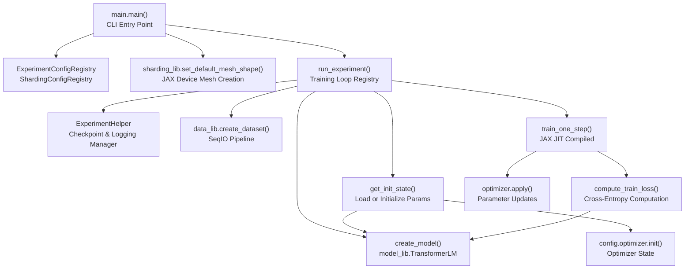

**Sources:** [simply/main.py:89-148](), [simply/model_lib.py:2094-2272]()

### Module Responsibilities

| Module | Primary Responsibility | Key Classes/Functions |
|--------|----------------------|---------------------|
| `main.py` | Experiment orchestration, CLI interface | `main()` |
| `model_lib.py` | Model architecture, training, inference | `TransformerLM`, `LMInterface`, `train_one_step()` |
| `data_lib.py` | Dataset creation, vocabulary management | `create_dataset()`, `DataSourceRegistry` |
| `config_lib.py` | Configuration definitions and loading | `ExperimentConfigRegistry`, `ShardingConfigRegistry` |
| `rl_lib.py` | Reinforcement learning training | PPO/GRPO implementations |

**Sources:** [simply/main.py:1-151](), [simply/model_lib.py:1-3548](), [simply/data_lib.py:1-890]()

## Execution Flow

### Experiment Launch Sequence

The execution begins with command-line invocation and proceeds through configuration loading, mesh setup, model initialization, and training loop execution.

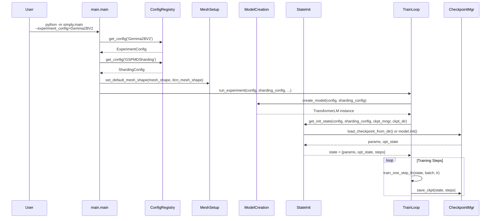

**Sources:** [simply/main.py:89-148](), [simply/model_lib.py:2094-2272](), [simply/model_lib.py:2302-2354]()

### Training Loop Structure

The `run_experiment()` function in `model_lib.py` implements the main training loop, coordinating data iteration, gradient computation, and checkpoint management.

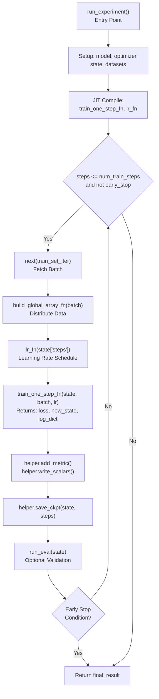

**Sources:** [simply/model_lib.py:2094-2272](), [simply/model_lib.py:2125-2270]()

## Model Architecture

### TransformerLM Structure

The `TransformerLM` class implements a decoder-only transformer with configurable layers, attention mechanisms, and feed-forward networks. The architecture is fully parameterized through configuration objects.

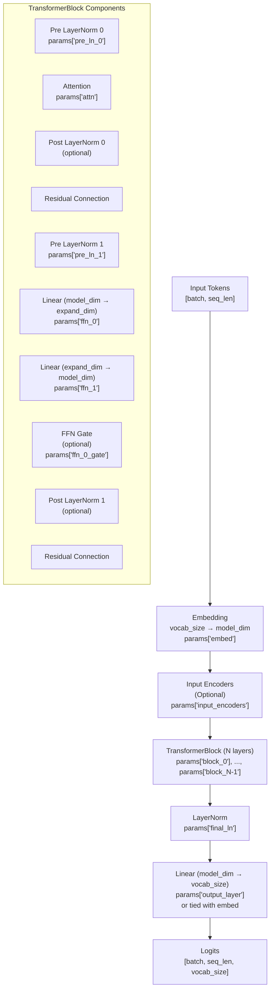

**Sources:** [simply/model_lib.py:1342-1435](), [simply/model_lib.py:1436-1456](), [simply/model_lib.py:1488-1752]()

### Attention Mechanism

The `Attention` module implements multi-head self-attention with rotary positional embeddings (RoPE), optional flash attention, and KV caching for efficient decoding.

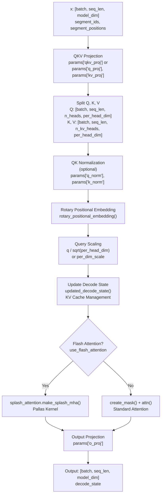

**Sources:** [simply/model_lib.py:617-1081](), [simply/model_lib.py:793-1080](), [simply/model_lib.py:330-363](), [simply/model_lib.py:365-461]()

### Core Module Classes

| Class | Purpose | Key Parameters | Init Location |
|-------|---------|----------------|---------------|
| `TransformerLM` | Top-level model | `config`, `sharding_config` | [model_lib.py:1342-1435]() |
| `TransformerBlock` | Single transformer layer | `model_dim`, `n_heads`, `expand_factor` | [model_lib.py:1083-1306]() |
| `Attention` | Multi-head attention | `model_dim`, `n_heads`, `per_head_dim`, `n_kv_heads` | [model_lib.py:617-1081]() |
| `Embedding` | Token embedding | `vocab_size`, `dim` | [model_lib.py:118-161]() |
| `Linear` | Linear transformation | `input_dim`, `output_dim` | [model_lib.py:163-221]() |
| `LayerNorm` | Layer/RMS normalization | `dim`, `use_bias` | [model_lib.py:223-290]() |

**Sources:** [simply/model_lib.py:118-1306]()

## Training Pipeline

### Gradient Computation and Update

The `train_one_step()` function orchestrates a complete training step, including forward pass, backward pass, gradient clipping, and parameter updates.

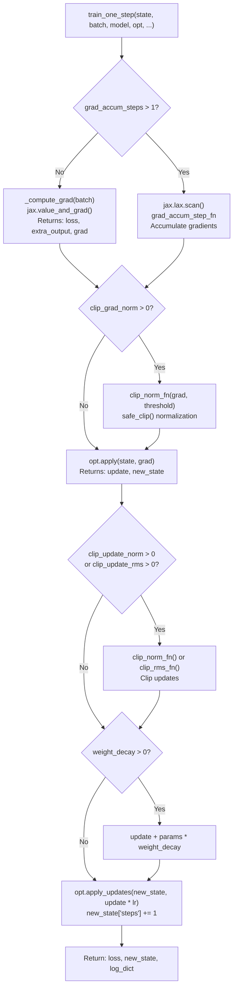

**Sources:** [simply/model_lib.py:1878-2007](), [simply/model_lib.py:1902-1966]()

### Loss Computation

The `compute_loss()` and `compute_train_loss()` functions implement cross-entropy loss with masked token positions.

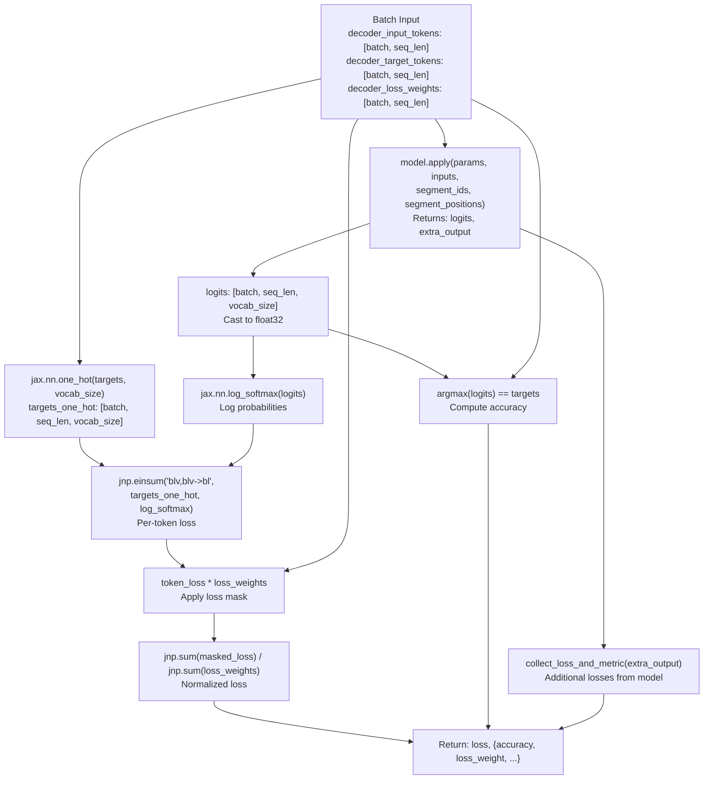

**Sources:** [simply/model_lib.py:1770-1809](), [simply/model_lib.py:1839-1845]()

### Training State Management

| State Component | Type | Purpose | Update Frequency |
|----------------|------|---------|------------------|
| `state['params']` | PyTree | Model parameters | Every step (via optimizer) |
| `state['opt_state']` | PyTree | Optimizer state (momentum, etc.) | Every step |
| `state['steps']` | Array | Training step counter | Every step |
| `state['teacher_params']` | PyTree (optional) | Teacher model parameters for distillation | Static |

**Sources:** [simply/model_lib.py:2302-2354](), [simply/model_lib.py:2094-2272]()

## Inference Pipeline

### LMInterface: High-Level Inference API

The `LMInterface` class provides a user-friendly API for text generation and scoring, managing the complexity of batching, KV caching, and sampling internally.

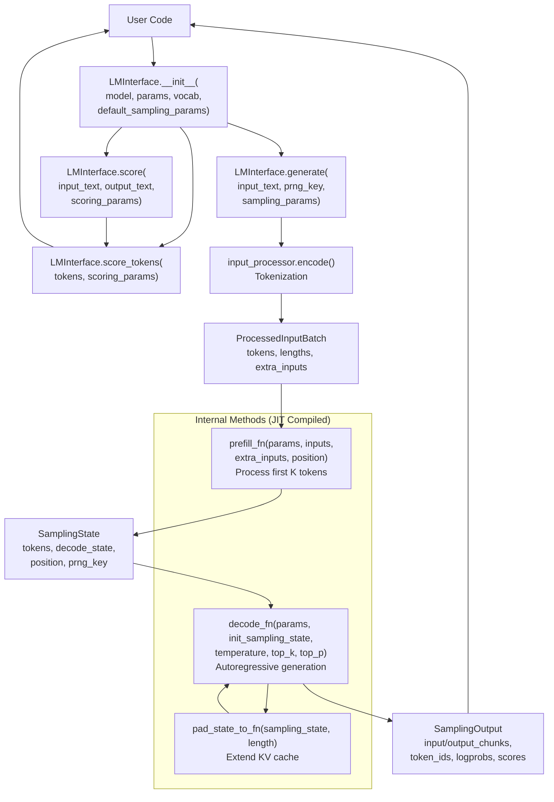

**Sources:** [simply/model_lib.py:2690-3150](), [simply/model_lib.py:2774-3050]()

### Decoding Loop: SamplingState and continue_decode

The decoding process uses a while loop with `SamplingState` to manage KV cache, token generation, and stopping conditions.

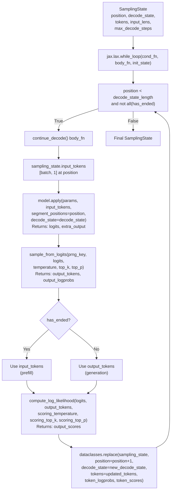

**Sources:** [simply/model_lib.py:3338-3433](), [simply/model_lib.py:2471-2572]()

### Sampling and Scoring Functions

| Function | Purpose | Key Parameters | Returns |
|----------|---------|----------------|---------|
| `sample_from_logits()` | Sample next token from logits | `logits`, `temperature`, `top_k`, `top_p` | `tokens`, `logprobs` |
| `compute_log_likelihood()` | Score given tokens under model | `logits`, `tokens`, `temperature`, `top_k`, `top_p` | `scores` [batch, seq_len] |
| `top_k_mask()` | Create top-k sampling mask | `logits`, `top_k` | Boolean mask |
| `top_p_mask()` | Create nucleus sampling mask | `logits`, `top_p` | Boolean mask |

**Sources:** [simply/model_lib.py:3171-3229](), [simply/model_lib.py:3285-3336](), [simply/model_lib.py:3152-3169]()

## Distributed Execution

### Sharding and Partitioning

Simply uses JAX's GSPMD (General SPMD) for distributed execution. The `ShardingConfig` specifies how tensors are partitioned across the device mesh.

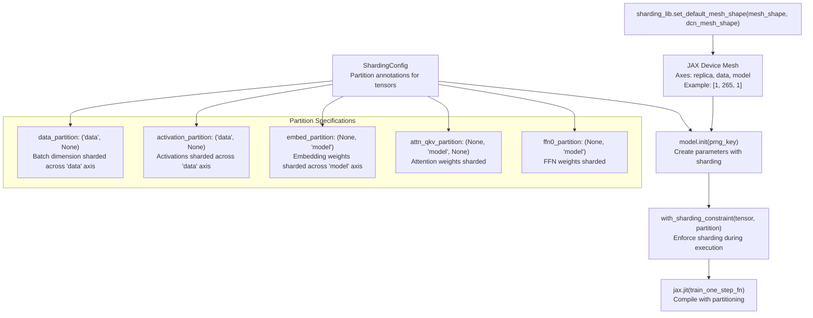

**Sources:** [simply/model_lib.py:2105-2106](), [simply/model_lib.py:138-141](), [simply/model_lib.py:867-870]()

### Data Distribution: build_global_array

The `build_global_array()` function distributes local data arrays across all devices in the mesh, creating global arrays with specified sharding.

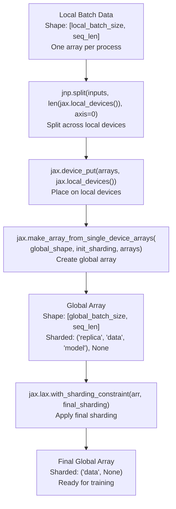

**Sources:** [simply/model_lib.py:3439-3447](), [simply/model_lib.py:2288-2300](), [simply/model_lib.py:2199-2200]()

### Key Sharding Functions

| Function | Purpose | Location |
|----------|---------|----------|
| `set_default_mesh_shape()` | Initialize JAX device mesh | `sharding_lib` (imported) |
| `mesh_sharding()` | Create PartitionSpec from annotation | `sharding_lib` (imported) |
| `with_sharding_constraint()` | Apply sharding constraint to tensor | `sharding_lib` (imported) |
| `get_default_mesh()` | Get current device mesh | `sharding_lib` (imported) |
| `build_global_array()` | Distribute local arrays across devices | [model_lib.py:3439-3447]() |

**Sources:** [simply/model_lib.py:59-62](), [simply/model_lib.py:3439-3447]()

## Data Pipeline

### Dataset Creation Flow

The `create_dataset()` function in `data_lib.py` creates training and validation datasets using SeqIO task registry.

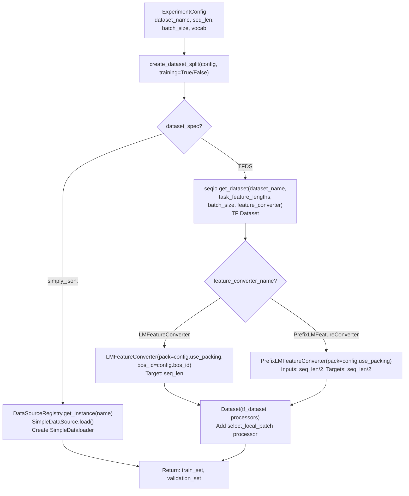

**Sources:** [simply/data_lib.py:780-849](), [simply/data_lib.py:720-734]()

### Vocabulary Registration

Simply maintains a registry of vocabularies using `TokenizerRegistry`, with 40+ registered tokenizers for different datasets and model families.

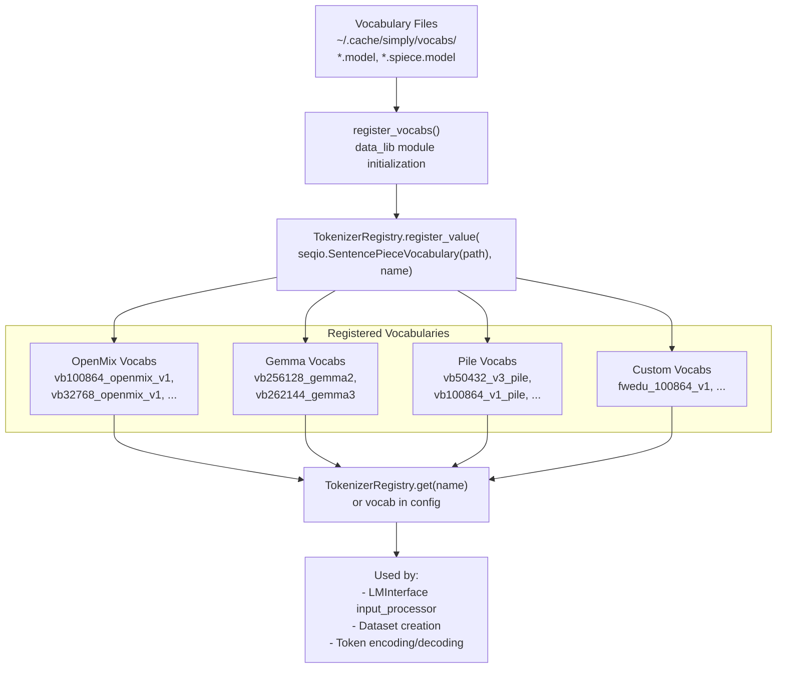

**Sources:** [simply/data_lib.py:46-82](), [simply/data_lib.py:84-95]()

### Batch Processing

| Batch Field | Shape | Description | Optional |
|-------------|-------|-------------|----------|
| `decoder_input_tokens` | [batch, seq_len] | Input token IDs | No |
| `decoder_target_tokens` | [batch, seq_len] | Target token IDs (shifted by 1) | No |
| `decoder_loss_weights` | [batch, seq_len] | Loss mask (0 or 1) | Yes (defaults to all 1s) |
| `decoder_segment_ids` | [batch, seq_len] | Segment IDs for packed sequences | Yes |
| `decoder_positions` | [batch, seq_len] | Position indices | Yes (auto-generated) |

**Sources:** [simply/model_lib.py:1770-1809](), [simply/data_lib.py:780-849]()

---

