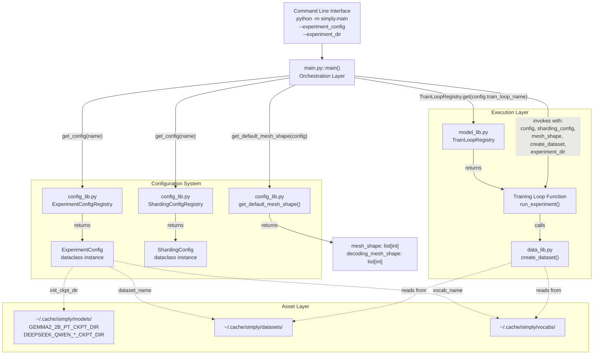
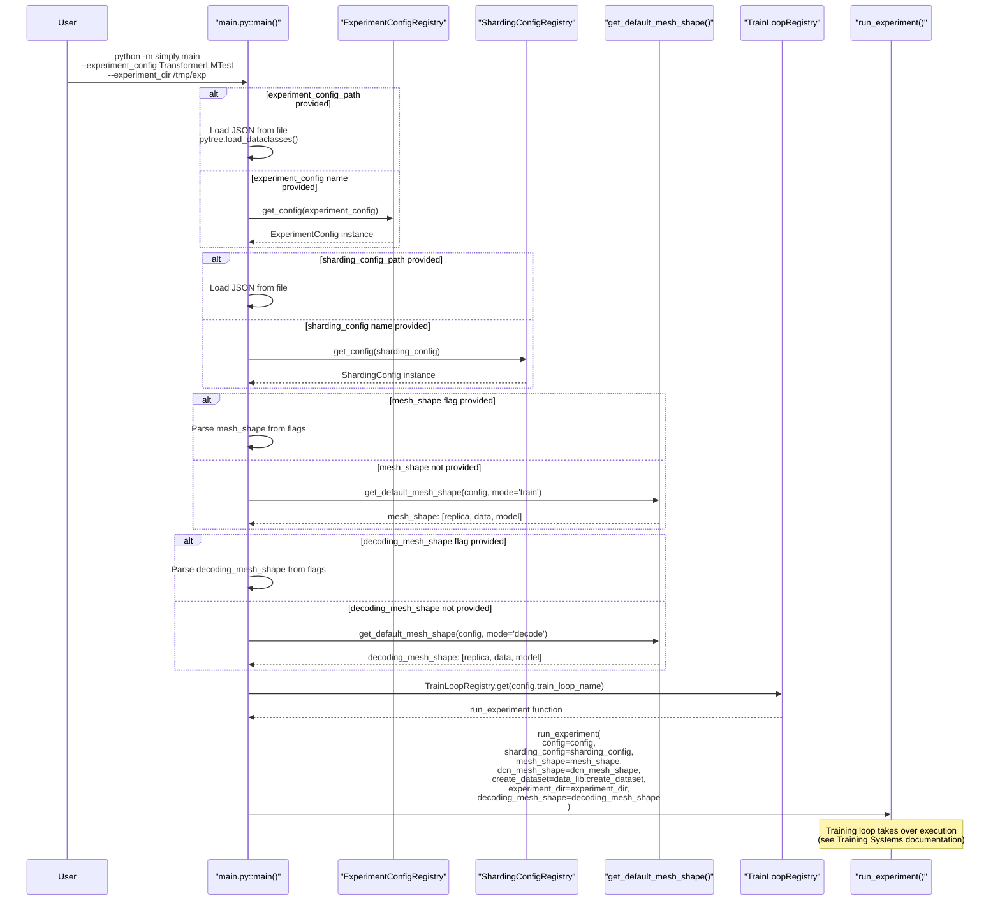

<!-- source: DeepWiki mcp.deepwiki.com · repo google-deepmind/simply · page 4.1 System Architecture Overview · fetched 2026-10-26 -->

# System Architecture Overview

<details>
<summary>Relevant source files</summary>

The following files were used as context for generating this wiki page:

- [README.md](README.md)
- [setup/setup_assets.py](setup/setup_assets.py)
- [simply/config_lib.py](simply/config_lib.py)
- [simply/main.py](simply/main.py)

</details>


## Purpose and Scope

This page describes Simply's high-level system architecture, focusing on how the main orchestration layer ([simply/main.py]()) coordinates configuration resolution, model instantiation, data pipeline setup, and training loop execution. It provides a technical overview of component interactions and control flow from program entry to training loop invocation.

For detailed information about specific subsystems, see:
- Model architecture details: [Model Architecture](#4.2)
- Data pipeline internals: [Data Pipeline](#4.3)
- Training loop implementations: [Training Systems](#4.4)
- Configuration catalog: [Model Configuration Catalog](#3.2)

---

## System Components

Simply's architecture follows a layered design where a thin orchestration layer delegates to specialized subsystems.

### Component Diagram



**Sources:** [simply/main.py:89-148](), [simply/config_lib.py:76-90](), [simply/config_lib.py:1787-1836]()

---

## Execution Flow

The following diagram maps the complete execution path from command invocation to training loop startup, showing the specific function calls and data flow.



**Sources:** [simply/main.py:89-148](), [simply/config_lib.py:76-90](), [simply/config_lib.py:1787-1836]()

---

## Component Responsibilities

### Orchestration Layer: `main.py`

The `main()` function in [simply/main.py]() serves as the program entrypoint and orchestration layer. It performs four core responsibilities:

| Responsibility | Implementation | Lines |
|---|---|---|
| Configuration Resolution | Load experiment config by name or from JSON path | [91-107]() |
| Sharding Configuration | Load sharding config by name or from JSON path | [108-114]() |
| Mesh Shape Determination | Calculate or parse device mesh topology | [115-130]() |
| Training Loop Delegation | Retrieve and invoke the appropriate training function | [139-147]() |

The orchestration layer is intentionally minimal—it resolves configuration, determines execution topology, and delegates to the training loop. It does not contain training logic, model definitions, or data pipeline code.

**Sources:** [simply/main.py:89-148]()

### Configuration System: `config_lib.py`

The configuration system provides two registry classes and a mesh calculation function:

**`ExperimentConfigRegistry`** ([simply/config_lib.py:76-82]()): Registry for experiment configurations. Supports string-based lookup of registered configurations via `get_config(name)`, which instantiates and returns the configuration dataclass.

**`ShardingConfigRegistry`** ([simply/config_lib.py:84-90]()): Registry for sharding strategies. Provides three built-in sharding configurations:
- `GSPMDSharding` ([104-136]()): Full model and data parallelism
- `DecodeGSPMDSharding` ([139-142]()): Optimized for inference workloads
- `DataParallelSharding` ([146-181]()): Pure data parallelism with no weight sharding

**`get_default_mesh_shape()`** ([simply/config_lib.py:1787-1836]()): Determines optimal device mesh layout based on model configuration and available hardware. For training mode, it maximizes data parallelism while respecting model dimension divisibility. For decode mode, it maximizes model parallelism to enable efficient inference.

**Sources:** [simply/config_lib.py:76-90](), [simply/config_lib.py:104-181](), [simply/config_lib.py:1787-1836]()

### Training Loop Registry: `model_lib.py`

The `TrainLoopRegistry` (defined in [simply/model_lib.py](), not shown in the provided files) maps training loop names to implementation functions. The `train_loop_name` field in `ExperimentConfig` specifies which training loop to use:

- `"default"`: Standard supervised training loop
- `"rl"`: Reinforcement learning training loop (PPO/GRPO)

The registry pattern allows Simply to support multiple training paradigms without modifying the orchestration code.

**Sources:** [simply/main.py:139](), [simply/config_lib.py:282]()

### Data Factory: `data_lib.py`

The `create_dataset()` function (defined in [simply/data_lib.py](), not shown in the provided files) is passed as a parameter to the training loop. This function creates training and validation datasets based on the configuration's `dataset_name`, `vocab_name`, and other data-related parameters.

**Sources:** [simply/main.py:144]()

---

## Configuration Resolution Mechanisms

Simply supports two configuration loading mechanisms:

### Registry-Based Loading

Default mechanism using string identifiers:

```
python -m simply.main \
  --experiment_config Gemma2BV2 \
  --sharding_config GSPMDSharding \
  --experiment_dir /tmp/exp
```

Implementation: [simply/main.py:105-107]() calls `ExperimentConfigRegistry.get_config()` which instantiates the registered configuration class.

### JSON File Loading

Alternative mechanism for custom or programmatically-generated configurations:

```
python -m simply.main \
  --experiment_config_path /path/to/config.json \
  --sharding_config_path /path/to/sharding.json \
  --experiment_dir /tmp/exp
```

Implementation: [simply/main.py:91-103]() loads JSON and deserializes into dataclass instances using `pytree.load_dataclasses()`.

**Sources:** [simply/main.py:91-114]()

---

## Mesh Shape Calculation

Simply uses JAX's GSPMD (General SPMD) for distributed execution across multiple devices. The mesh shape defines how devices are organized into a 3D grid: `[replica_axis, data_axis, model_axis]`.

### Mesh Shape Determination Algorithm

The `get_default_mesh_shape()` function ([simply/config_lib.py:1787-1836]()) computes mesh shapes differently for training and decoding:

**Training Mode:**
1. Calculate `data_parallel = gcd(model_dim, device_count)`
2. Calculate `replica_parallel = device_count / data_parallel`
3. Return `[replica_parallel, data_parallel, 1]`

**Decoding Mode:**
1. Calculate `model_parallel = gcd(model_dim, n_kv_heads, n_heads, device_count)`
2. Calculate `replica_parallel = device_count / model_parallel`
3. Return `[replica_parallel, 1, model_parallel]`

This algorithm maximizes data parallelism during training (for throughput) and model parallelism during inference (for memory efficiency with KV-caching).

### Override Mechanisms

Users can override the automatic mesh calculation with command-line flags:

```bash
python -m simply.main \
  --experiment_config Gemma2BV2 \
  --mesh_shape 2,4,1 \
  --decoding_mesh_shape 1,1,8 \
  --experiment_dir /tmp/exp
```

**Sources:** [simply/config_lib.py:1787-1836](), [simply/main.py:118-130]()

---

## Asset Dependencies

The system depends on three local cache directories for external assets:

### Checkpoint Directory Structure

```
~/.cache/simply/models/
├── GEMMA-2.0-2B-PT-ORBAX/
│   ├── 0/
│   │   ├── checkpoint
│   │   ├── _CHECKPOINT_METADATA
│   │   └── manifest.ocdbt
│   └── tokenizer.model
├── DeepSeek-R1-Distill-Qwen-1.5B/
│   └── ORBAX/
│       └── 0/
│           └── checkpoint
└── Qwen3-1.7B/
    └── ORBAX/
        └── 0/
            └── checkpoint
```

Checkpoint directories are referenced by configuration constants like `GEMMA2_2B_PT_CKPT_DIR` ([simply/config_lib.py:36]()) and used via the `init_ckpt_dir` field in experiment configurations ([simply/config_lib.py:614]()).

### Dataset Directory Structure

```
~/.cache/simply/datasets/
├── gsm8k/
│   ├── train.jsonl
│   └── test.jsonl
├── c4/
│   └── vb100864_openmix_v1/
└── imdb_reviews/
```

Dataset paths are referenced by the `dataset_name` field in configurations ([simply/config_lib.py:262]()).

### Vocabulary Directory Structure

```
~/.cache/simply/vocabs/
├── gemma2_tokenizer.model
├── gemma3_cleaned_v6.spiece.model
└── qwen3_tokenizer.model
```

Vocabulary paths are determined by the `vocab_name` field in configurations (e.g., [simply/config_lib.py:611]()).

**Sources:** [simply/config_lib.py:34-70](), [setup/setup_assets.py:38-40](), [setup/setup_assets.py:47-112]()

---

## Training Loop Invocation

The final step in `main()` is invoking the training loop function with all resolved parameters:

```python
run_experiment_fn = model_lib.TrainLoopRegistry.get(config.train_loop_name)
run_experiment_fn(
    config=config,
    sharding_config=sharding_config,
    mesh_shape=mesh_shape,
    dcn_mesh_shape=dcn_mesh_shape,
    create_dataset=data_lib.create_dataset,
    experiment_dir=_EXPERIMENT_DIR.value,
    decoding_mesh_shape=decoding_mesh_shape,
)
```

At this point, control transfers to the training loop implementation. The training loop is responsible for:
- Setting up the JAX device mesh
- Creating the model instance
- Loading initial checkpoints
- Creating training and validation datasets
- Executing the training loop with periodic checkpointing and evaluation

For details on training loop implementations, see [Training Systems](#4.4).

**Sources:** [simply/main.py:139-147]()

---

## Summary

Simply's architecture follows a separation of concerns principle:

1. **`main.py`**: Thin orchestration layer that resolves configurations and delegates to training loops
2. **`config_lib.py`**: Configuration management with registries for experiments and sharding strategies
3. **`model_lib.py`**: Model definitions and training loop implementations (registry-based)
4. **`data_lib.py`**: Data pipeline construction (factory pattern)
5. **Asset caches**: Pretrained checkpoints, datasets, and vocabularies in standardized locations

This design enables researchers to focus on implementing new training algorithms, model architectures, or data pipelines without modifying the orchestration logic. The registry pattern allows new components to be added by registration rather than code modification.

---

