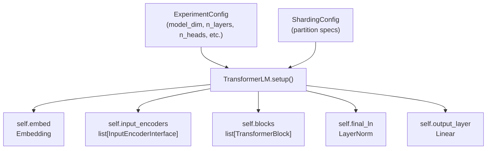
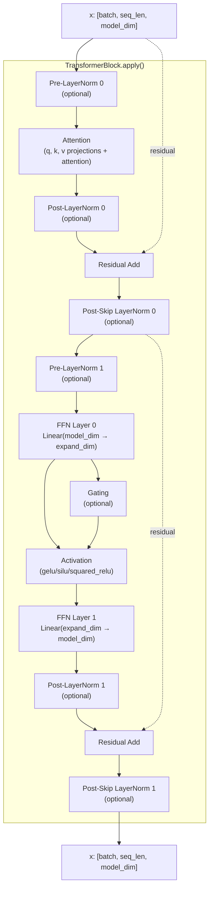
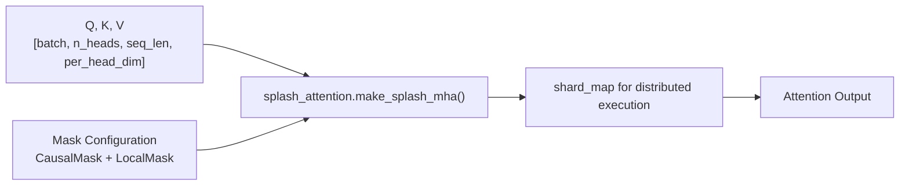
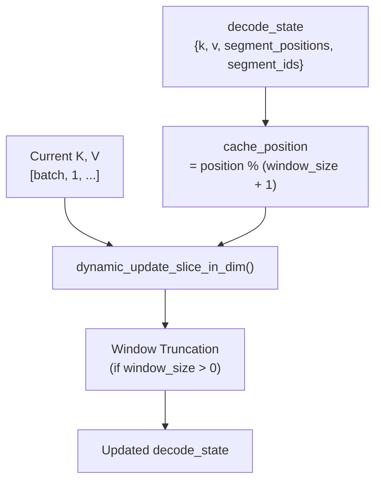
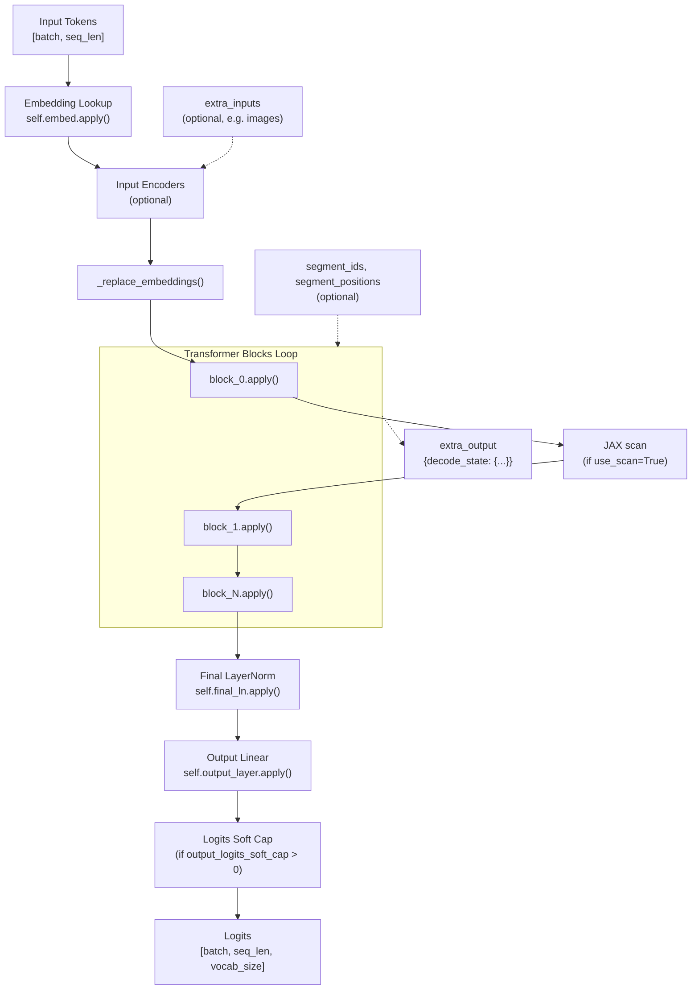

<!-- source: DeepWiki mcp.deepwiki.com · repo google-deepmind/simply · page 4.2 Model Architecture · fetched 2026-10-26 -->

# Model Architecture

<details>
<summary>Relevant source files</summary>

The following files were used as context for generating this wiki page:

- [simply/model_lib.py](simply/model_lib.py)
- [simply/model_lib_test.py](simply/model_lib_test.py)

</details>


## Purpose and Scope

This page documents the transformer model architecture implementation in Simply, including the `TransformerLM` class, attention mechanisms, feed-forward networks, and layer composition patterns. The focus is on the structural components and their interactions within a single forward pass.

For training loop integration and parameter updates, see [Training Systems](#4.4). For model inference and text generation interfaces, see [Model Inference and Generation](#5.3). For configuration of model architectures, see [Model Configuration Catalog](#3.2).

---

## TransformerLM: Main Model Class

The `TransformerLM` class [simply/model_lib.py:1342-1752]() implements a decoder-only transformer language model. It is registered in the `ModuleRegistry` and follows the `SimplyModule` interface pattern.

### Initialization and Setup



**Diagram: TransformerLM Component Initialization**

The `setup()` method [simply/model_lib.py:1349-1434]() creates all sub-components based on configuration parameters. Key configuration attributes include:

| Configuration Field | Purpose | Typical Values |
|-------------------|---------|----------------|
| `model_dim` | Hidden dimension | 2048, 4096, 8192 |
| `n_layers` | Number of transformer blocks | 24, 32, 48 |
| `n_heads` | Number of attention heads | 16, 32, 64 |
| `per_head_dim` | Dimension per attention head | 64, 128, 256 |
| `expand_factor` | FFN expansion ratio | 4, 8 |
| `vocab_size` | Vocabulary size | 32000, 128000, 256000 |

**Sources:** [simply/model_lib.py:1342-1434]()

---

## Core Components

### Embedding Layer

The `Embedding` class [simply/model_lib.py:118-161]() handles token-to-vector conversion with configurable scaling.

```python
# Initialization signature
Embedding(
    vocab_size: int,
    dim: int,
    var_scale: float = 1.0,
    lookup_scale: float | None = 1.0,
    weight_dtype: DTypeLike = 'float32',
    activation_dtype: DTypeLike = 'bfloat16',
    partition: PartitionAnnotation = None
)
```

The embedding layer performs:
1. **Initialization** [simply/model_lib.py:133-141](): Gaussian weights with variance scaling
2. **Lookup** [simply/model_lib.py:143-160](): Token ID to embedding vector via `jnp.take` or one-hot matmul
3. **Scaling** [simply/model_lib.py:155-160](): Optional rescaling based on `lookup_scale` parameter

**Sources:** [simply/model_lib.py:118-161]()

### TransformerBlock Architecture



**Diagram: TransformerBlock Forward Pass Structure**

The `TransformerBlock` [simply/model_lib.py:1083-1306]() implements the core transformer computation with flexible normalization options:

- **Pre-normalization** (`use_pre_ln=True`): LayerNorm before attention/FFN (standard for modern LLMs)
- **Post-normalization** (`use_post_ln=True`): LayerNorm after attention/FFN (original transformer)
- **Post-skip normalization** (`use_post_skip_ln=True`): LayerNorm after residual addition

**Sources:** [simply/model_lib.py:1083-1306]()

### LayerNorm and RMSNorm

The `LayerNorm` class [simply/model_lib.py:223-290]() implements both standard LayerNorm and RMSNorm (when `use_bias=False`):

```python
# RMSNorm: x / rms(x) * scale
# LayerNorm: (x - mean(x)) / std(x) * scale + bias
```

Key implementation details:
- Reduction performed in `float32` for stability [simply/model_lib.py:268-275]()
- `scale_plus_one` flag: stores `scale-1` to improve numerical precision [simply/model_lib.py:280-283]()
- Configurable epsilon for numerical stability [simply/model_lib.py:239]()

**Sources:** [simply/model_lib.py:223-290]()

---

## Attention Mechanism

### Attention Class Structure

```mermaid
graph TB
    subgraph Attention["Attention.apply()"]
        Input["x: [batch, seq_len, model_dim]"]
        
        QKVProj["QKV Projections<br/>(combined or separate)"]
        QKNorm["Q/K Normalization<br/>(optional)"]
        RoPE["Rotary Positional Embedding<br/>rotary_positional_embedding()"]
        PerDimScale["Per-Dim Scaling<br/>(optional)"]
        QueryScale["Query Scaling<br/>(1/sqrt(per_head_dim))"]
        
        subgraph KVCache["KV Cache Management"]
            UpdateCache["updated_decode_state()"]
        end
        
        subgraph AttnCompute["Attention Computation"]
            FlashPath["Flash Attention Path<br/>splash_attention"]
            StandardPath["Standard Attention Path<br/>attn() or chunked_local_attn()"]
            CreateMask["create_mask()<br/>(causal, segment, window)"]
        end
        
        OProj["Output Projection<br/>o_proj"]
        Output["output: [batch, seq_len, model_dim]"]
    end
    
    Input --> QKVProj
    QKVProj --> QKNorm
    QKNorm --> RoPE
    RoPE --> PerDimScale
    PerDimScale --> QueryScale
    QueryScale --> UpdateCache
    UpdateCache --> CreateMask
    CreateMask --> FlashPath
    CreateMask --> StandardPath
    FlashPath --> OProj
    StandardPath --> OProj
    OProj --> Output
```



**Diagram: Attention Layer Data Flow**

**Sources:** [simply/model_lib.py:617-1081]()

### QKV Projections

The attention layer supports two projection modes [simply/model_lib.py:668-768]():

**Combined QKV** (`use_combined_qkv=True`):
- When `n_heads == n_kv_heads`: Single projection tensor of shape `[3, model_dim, n_heads, per_head_dim]`
- When `n_heads != n_kv_heads` (Grouped Query Attention): Separate Q projection and combined KV projection

**Separate QKV** (`use_combined_qkv=False`):
- Three independent projection tensors: `q_proj`, `k_proj`, `v_proj`

### Rotary Positional Embeddings (RoPE)

The `rotary_positional_embedding` function [simply/model_lib.py:330-362]() applies rotary embeddings to queries and keys:

```python
# For dimension i:
# timescale_i = min_timescale * (max_timescale / min_timescale)^(2i / embedding_dims)
# angle = position / timescale_i
# Apply rotation: [cos(angle), -sin(angle); sin(angle), cos(angle)]
```

Key features:
- Applied to both Q and K independently [simply/model_lib.py:876-887]()
- Configurable timescale range via `rope_max_timescale` (default: 10,000)
- Optional scaling factor via `rope_scale_factor` for extended context [simply/model_lib.py:1373-1375]()
- Supports per-block configuration through `block_attn_pattern` [simply/model_lib.py:1411-1415]()

**Sources:** [simply/model_lib.py:330-362](), [simply/model_lib.py:876-887]()

### Attention Mask Creation

The `create_mask` function [simply/model_lib.py:463-509]() combines multiple masking strategies:

| Mask Type | Purpose | Implementation |
|-----------|---------|----------------|
| Causal | Prevent attending to future tokens | `segment_positions[i] >= segment_positions[j]` |
| Segment | Separate sequences in packed batches | `segment_ids[i] == segment_ids[j]` |
| Window | Sliding window attention | `segment_positions[i] - segment_positions[j] <= window_size` |

All masks are combined via logical AND [simply/model_lib.py:505-508]().

**Sources:** [simply/model_lib.py:463-509]()

### Flash Attention Integration

When `use_flash_attention=True` and sequence length > 1, the implementation uses Pallas Splash Attention [simply/model_lib.py:932-1017]():



**Diagram: Flash Attention Path**

Configuration parameters:
- `flash_attention_block_size`: Block size for tiling (default: 512)
- `attn_soft_cap`: Logit soft-capping value (default: 50.0)
- Automatic head sharding based on mesh topology [simply/model_lib.py:987]()

**Sources:** [simply/model_lib.py:932-1017]()

### Standard Attention Path

The `attn` function [simply/model_lib.py:593-614]() implements the standard scaled dot-product attention:

```python
# attn_logits = (Q @ K^T) / scale
# if attn_soft_cap > 0:
#     attn_logits = attn_soft_cap * tanh(attn_logits / attn_soft_cap)
# attn_probs = softmax(mask(attn_logits))
# output = attn_probs @ V
```

Grouped Query Attention support:
- Q shape: `[batch, seq_len, n_groups, n_kv_heads, per_head_dim]`
- K, V shape: `[batch, seq_len, n_kv_heads, per_head_dim]`
- Broadcast K, V across groups during einsum [simply/model_lib.py:596-613]()

**Sources:** [simply/model_lib.py:593-614]()

### Sliding Window Attention

For local attention patterns, `chunked_local_attn` [simply/model_lib.py:512-590]() optimizes computation by chunking the sequence:

1. Split sequence into chunks of size `window_size`
2. First chunk attends only to itself
3. Subsequent chunks attend to current and previous chunk
4. Reduces computation from O(n²) to O(n * window_size)

Only activated when:
- `use_window_chunk=True`
- `window_size > 0`
- `kv_seq_len > window_size + 1`
- `q_seq_len > 1` (not during token-by-token decoding)

**Sources:** [simply/model_lib.py:512-590]()

### KV Cache Management

The `updated_decode_state` function [simply/model_lib.py:365-460]() maintains cached key-value pairs for autoregressive generation:



**Diagram: KV Cache Update Flow**

Sliding window support:
- Cache size limited to `window_size + 1`
- Uses circular buffer via modulo indexing [simply/model_lib.py:413]()
- Proper truncation during prefill phase [simply/model_lib.py:431-447]()

**Sources:** [simply/model_lib.py:365-460]()

---

## Feed-Forward Network

The FFN in each `TransformerBlock` consists of two linear layers with optional gating [simply/model_lib.py:1210-1294]():

### Standard FFN
```
x → FFN0(model_dim → expand_dim) → activation → FFN1(expand_dim → model_dim)
```

### Gated FFN (when `use_gated_activation_in_ffn=True`)
```
x → FFN0(model_dim → expand_dim) → projected_x
  ↘ FFN0_gate(model_dim → expand_dim) → activation(gate) → multiply with projected_x → FFN1
```

Supported activations (registered in `FunctionRegistry`):
- `gelu` [simply/model_lib.py:99-102]()
- `silu` (Swish) [simply/model_lib.py:110]()
- `squared_relu` [simply/model_lib.py:105-107]()

**Sources:** [simply/model_lib.py:1210-1294](), [simply/model_lib.py:99-110]()

---

## Full Forward Pass

### TransformerLM.apply() Data Flow



**Diagram: Complete TransformerLM Forward Pass**

### Scan Optimization

When `use_scan=True` [simply/model_lib.py:1590-1710](), blocks matching the `block_attn_pattern` are executed via `jax.lax.scan`:

- Stacks parameters across repeated blocks [simply/model_lib.py:1592-1607]()
- Reduces compilation time for models with many layers
- Configurable remat policy via `remat_policy` [simply/model_lib.py:1644-1647]()
- Example: Pattern `('global', 'local', 'local')` repeated 8 times = 24 layers scanned as 8 iterations

**Sources:** [simply/model_lib.py:1488-1752]()

### Input Encoder Integration

The `InputEncoderInterface` [simply/model_lib.py:1308-1340]() allows custom input processing (e.g., vision encoders):

```python
class InputEncoderInterface:
    @dataclass
    class Output:
        embeddings: Array  # [batch, num_embeddings, dim]
        embedding_mask: Array  # [batch, input_seq_len]
```

The `_replace_embeddings` method [simply/model_lib.py:1457-1486]() substitutes text embeddings with encoder outputs at positions indicated by the mask.

**Sources:** [simply/model_lib.py:1308-1340](), [simply/model_lib.py:1457-1486](), [simply/model_lib.py:1552-1571]()

---

## Mixed Precision and Quantization

### Type System

The architecture supports flexible precision control:

| Parameter | Purpose | Scope |
|-----------|---------|-------|
| `weight_dtype` | Storage precision for parameters | Per-layer |
| `activation_dtype` | Computation precision | Global via `activation_dtype_name` config |

Conversion occurs at layer boundaries via `convert_or_dequantize` [simply/model_lib.py:149](), [simply/model_lib.py:210]().

### Automatic Downcasting

Parameters are automatically downcast if `activation_dtype` has lower precision than storage [simply/model_lib.py:1535-1548]():

```python
# Only convert if activation_dtype is lower bits than params
if x.dtype.itemsize > jnp.dtype(activation_dtype).itemsize:
    return jnp.asarray(x, dtype=activation_dtype)
```

This avoids unnecessary copies when both dtypes are the same precision.

### AnnotatedArray System

All model parameters are wrapped in `AnnotatedArray` [simply/model_lib.py:66-78]() to store metadata:

```python
AnnotatedArray.create(array, dim_annotation='io')
# dim_annotation: 'i' (input), 'o' (output), 'h' (hidden)
```

The `get_raw_arrays` function unwraps these before computation [simply/model_lib.py:78](), [simply/model_lib.py:144]().

**Sources:** [simply/model_lib.py:66-78](), [simply/model_lib.py:1535-1548]()

---

## Sharding Integration

### Partition Annotations

Each layer receives partition specifications from `ShardingConfig`:

```python
# Attention partitioning
qkv_partition: PartitionAnnotation  # e.g., (None, 'model', 'model')
o_partition: PartitionAnnotation    # e.g., ('model', None, None)
attn_activation_partition: PartitionAnnotation  # e.g., ('data', None, 'model', None)

# FFN partitioning  
ffn0_partition: PartitionAnnotation  # Input FFN projection
ffn1_partition: PartitionAnnotation  # Output FFN projection

# Other
embed_partition: PartitionAnnotation  # Vocabulary axis
```

Sharding constraints are applied via `sharding_lib.with_sharding_constraint` at strategic points [simply/model_lib.py:139](), [simply/model_lib.py:217](), [simply/model_lib.py:868-870]().

### Mesh Axes

The default mesh has three axes:
- `replica`: For data parallelism across replicas
- `data`: For data parallelism within replica
- `model`: For tensor/pipeline parallelism

See [Sharding Strategies](#3.3) for detailed configuration options.

**Sources:** [simply/model_lib.py:131-177](), [simply/model_lib.py:634-637](), [simply/model_lib.py:1191-1195]()

---

## Key Configuration Patterns

### Attention Variants

Different attention configurations are selected via config flags:

| Configuration | Typical Usage | Key Flags |
|--------------|---------------|-----------|
| Multi-Head Attention | Standard transformers | `n_kv_heads=n_heads` |
| Grouped Query Attention | Memory-efficient inference | `n_kv_heads < n_heads` (e.g., 8 KV heads, 32 Q heads) |
| Flash Attention | Training long sequences | `use_flash_attention=True` |
| Sliding Window | Local attention patterns | `window_size > 0`, `block_attn_pattern=['local']` |
| Full + Local Mix | Gemma-style | `block_attn_pattern=['global', 'local', 'local']` |

### Block Patterns

The `block_attn_pattern` config defines repeating patterns [simply/model_lib.py:1411-1415]():

```python
# Example: 18 layers with pattern ['global', 'local', 'local']
# Creates 6 repetitions of the 3-block pattern
# Layers 0,3,6,9,12,15: global (window_size=0)
# Layers 1,2,4,5,7,8,10,11,13,14,16,17: local (window_size from config)
```

Different RoPE configurations can be assigned per pattern type [simply/model_lib.py:1370-1375]().

**Sources:** [simply/model_lib.py:1369-1415]()

---

## Summary

The Simply model architecture provides:

1. **Modular Design**: Clear separation between Embedding, TransformerBlock, Attention, and FFN components
2. **Flexible Attention**: Support for standard, flash, grouped-query, and sliding window attention
3. **Efficient Decoding**: KV-caching with sliding window support for long-context generation
4. **Mixed Precision**: Per-layer precision control with automatic downcasting
5. **Distributed Execution**: Sharding annotations throughout for multi-device training/inference
6. **Scan Optimization**: Reduced compilation time via JAX scan for repeated blocks

All components follow the `SimplyModule` interface and are registered for configuration-based instantiation.

**Sources:** [simply/model_lib.py:1-2753]()

---

