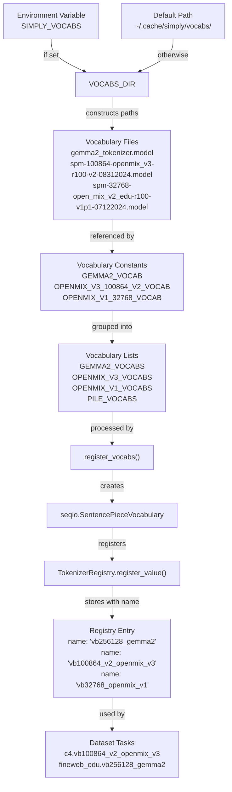
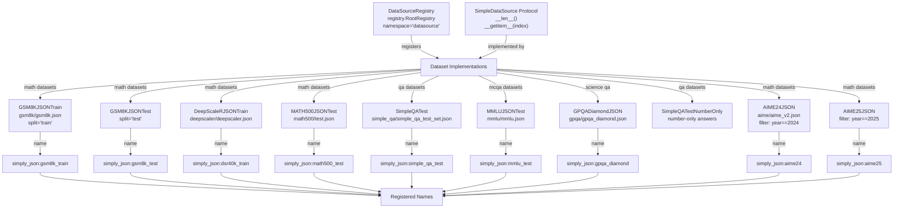
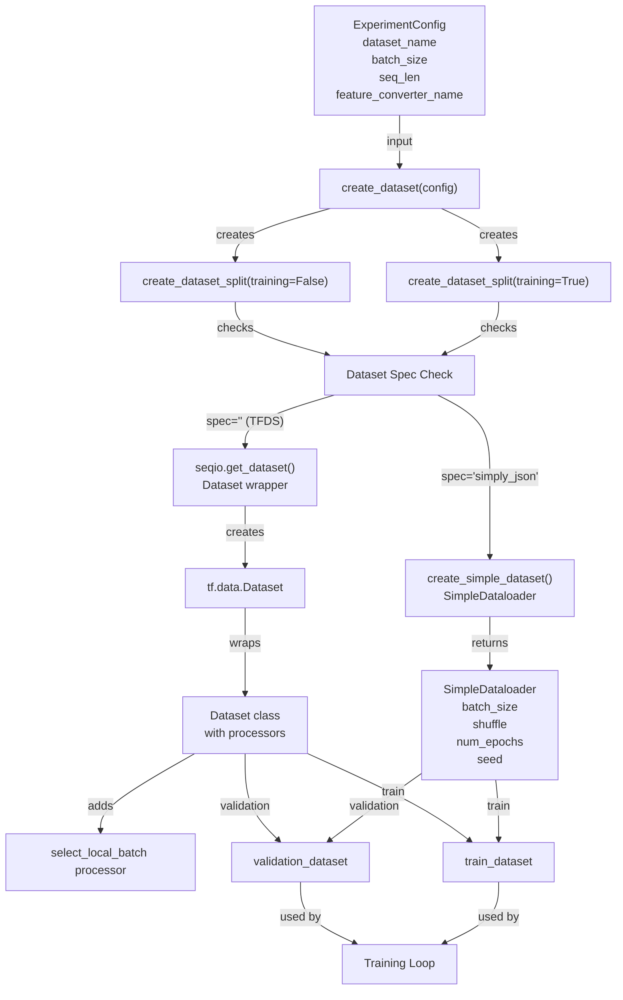
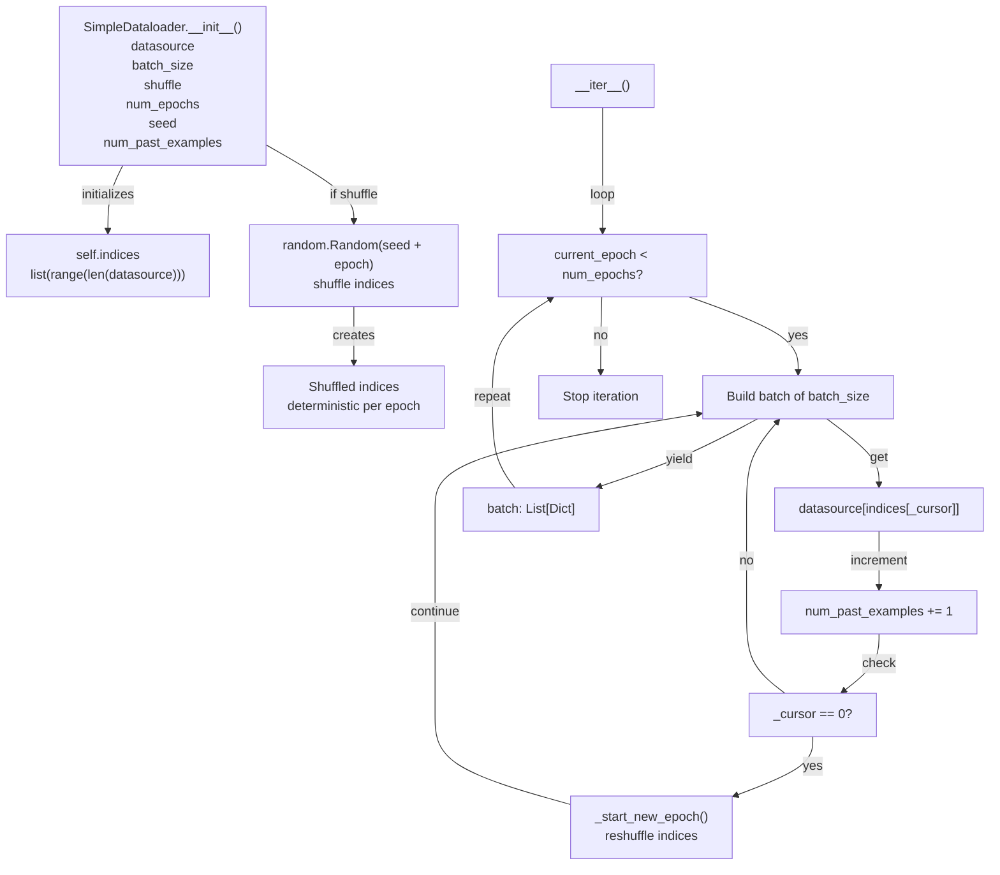
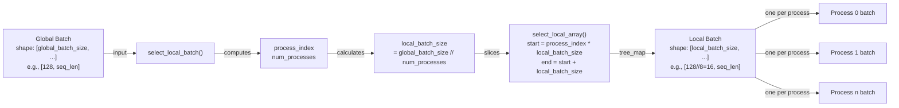
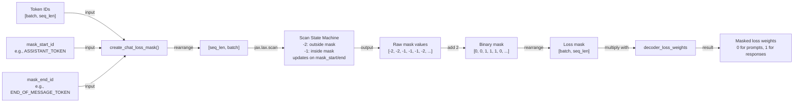

<!-- source: DeepWiki mcp.deepwiki.com · repo google-deepmind/simply · page 4.3 Data Pipeline · fetched 2026-10-26 -->

# Data Pipeline

<details>
<summary>Relevant source files</summary>

The following files were used as context for generating this wiki page:

- [README.md](README.md)
- [setup/setup_assets.py](setup/setup_assets.py)
- [simply/data_lib.py](simply/data_lib.py)
- [simply/data_lib_test.py](simply/data_lib_test.py)

</details>


## Purpose and Scope

This document describes the data pipeline infrastructure in Simply, implemented primarily in [simply/data_lib.py](). The data pipeline handles:

- **Vocabulary management**: Registration and configuration of 40+ tokenizers for different model families
- **Dataset registration**: Integration of pre-training (PT) and supervised fine-tuning (SFT) datasets via SeqIO
- **Batch creation**: Transformation of raw data into training-ready batches
- **Distributed data loading**: Batch partitioning across multiple devices and hosts

For information about configuring datasets in experiments, see [Understanding Configurations](#3.1). For details on how datasets are consumed during training, see [Training Systems](#4.4).

---

## Vocabulary System Architecture

The vocabulary system centralizes tokenizer management through a registry pattern, allowing datasets and models to reference tokenizers by name rather than file paths. All vocabularies use SentencePiece format and are stored in `~/.cache/simply/vocabs/` by default.

### Vocabulary Registration Flow



**Sources**: [simply/data_lib.py:42-83]()

### Vocabulary Categories

The system organizes vocabularies into families based on their training data and intended use:

| Vocabulary Family | Token Count | Variants | Primary Use Case |
|------------------|-------------|----------|------------------|
| **OPENMIX_V1** | 32,768 / 100,864 | 2 variants | General pre-training on open data mixtures |
| **OPENMIX_V2_EDU** | 100,864 | 1 variant (v1.1) | Educational content focus |
| **OPENMIX_V3** | 100,864 | 1 variant (v2) | Latest general-purpose tokenizer |
| **GEMMA2** | 256,128 | 1 | Gemma model family (2B, 9B, 27B) |
| **GEMMA3** | 262,144 | 1 | Gemma 3 model family |
| **PILE** | 50,432 / 100,864 / 256,000 | 3 variants | The Pile dataset training |
| **T5_CC** | 32,000 | 1 | T5 Common Crawl compatibility |

**Vocabulary Naming Convention**: All registered vocabularies follow the pattern `vb<token_count>_<source>_<version>`, for example `vb100864_v2_openmix_v3` or `vb256128_gemma2`.

**Sources**: [simply/data_lib.py:47-95]()

### Special Tokens for Chat Formatting

The system defines reserved tokens for conversation formatting in SFT tasks:

```python
USER_TOKEN = '<reserved_1>'
ASSISTANT_TOKEN = '<reserved_2>'
SYSTEM_TOKEN = '<reserved_3>'
END_OF_MESSAGE_TOKEN = '<reserved_4>'
```

These tokens structure multi-turn conversations and enable loss masking to train only on assistant responses (see [Chat Loss Masking](#chat-loss-masking)).

**Sources**: [simply/data_lib.py:97-100]()

---

## Dataset Registration System

Simply integrates with SeqIO for dataset management, registering tasks that combine data sources with preprocessing pipelines. The system supports two primary task types: pre-training (PT) tasks for language modeling and supervised fine-tuning (SFT) tasks for instruction following.

### Pre-Training Task Architecture

```mermaid
flowchart LR
    DataSource["Data Source<br/>TfdsDataSource<br/>TFExampleDataSource"]
    
    AddPTTask["add_pt_task_v1()"]
    
    PreprocessorChain["Preprocessing Chain"]
    Rekey["t5.preprocessors.rekey<br/>text → targets"]
    Tokenize["seqio.preprocessors.tokenize"]
    AppendEOS["seqio.preprocessors.append_eos"]
    ReduceConcat["t5.preprocessors.reduce_concat_tokens"]
    SplitTokens["t5.preprocessors.split_tokens_to_targets_length"]
    
    TaskRegistry["seqio.TaskRegistry"]
    
    DataSource -->|input| AddPTTask
    AddPTTask -->|creates| PreprocessorChain
    
    PreprocessorChain -->|step 1| Rekey
    Rekey -->|step 2| Tokenize
    Tokenize -->|step 3| AppendEOS
    AppendEOS -->|step 4 optional| ReduceConcat
    ReduceConcat -->|step 5 optional| SplitTokens
    
    SplitTokens -->|registered to| TaskRegistry
    
    TaskRegistry -->|stores| TaskName["Task Name<br/>c4.vb100864_openmix_v1<br/>fineweb_edu.vb256128_gemma2<br/>the_pile_lm.vb50432_v3_pile"]
```



**Sources**: [simply/data_lib.py:107-138]()

### Registered Dataset Categories

The data pipeline registers datasets across multiple domains:

#### Language Modeling Datasets

| Dataset | Source Type | Splits | Vocabularies | Use Case |
|---------|------------|--------|--------------|----------|
| **lm1b** | TFDS | train (90%), validation (10%), test | OPENMIX_V1, OPENMIX_V2 | Small-scale debugging and testing |
| **minilm1b** | TFDS | train (500), validation (500), test | OPENMIX_V1, OPENMIX_V2 | Ultra-fast iteration for development |
| **c4** | TFDS | train, validation | OPENMIX_V1, OPENMIX_V2 | Standard pre-training benchmark |

**Token Concatenation**: C4 and similar datasets use `reduce_concat_split=True`, which concatenates multiple documents and splits them into fixed-length sequences, maximizing GPU utilization.

**Sources**: [simply/data_lib.py:141-173]()

#### Large-Scale Pre-Training Datasets

| Dataset | Path Pattern | Vocabularies | Size |
|---------|--------------|--------------|------|
| **the_pile_lm** | `pile/pile_tfrecord/*.tfrecord*` | PILE vocabularies | Multi-domain corpus |
| **redpajama_1t** | `redpajama_1t/tfrecord/{category}.tfrecord*` | OPENMIX_V1/V2/V3 | 1T tokens, 4 categories (arxiv, wikipedia, book, stackexchange) |
| **starcoder** | `starcoder/tfrecord/train.tfrecord*` | OPENMIX_V1 | Code pre-training |
| **refinedweb** | `refinedweb/tfrecord/train.tfrecord*` | OPENMIX_V1 | Web text corpus |
| **fineweb_edu** | `fineweb-edu/train1.tfrecord-*` | FWEDU, OPENMIX_V1/V2 | Educational content |
| **dclm_baseline_1p0** | `dclm-baseline-1p0/tfrecords/*/*` | OPENMIX_V1/V2/V3 | DCLM baseline dataset |
| **stack_v2_smol** | `stack_v2/download/train-smol-1/*.tfrecord*` | OPENMIX_V2/V3 | Stack Overflow V2 (repo and file versions) |

All large-scale datasets reference files in `DATASETS_DIR` (default: `~/.cache/simply/datasets/`).

**Sources**: [simply/data_lib.py:193-300]()

#### Supervised Fine-Tuning Datasets

SFT datasets structure conversations as sequences of role-annotated messages:

| Dataset | Source | Format | Vocabularies |
|---------|--------|--------|--------------|
| **openhermes_2p5** | `openhermes-2p5/train.tfrecord` | JSON conversations | OPENMIX_V1/V2/V3 |
| **tulu_v2_sft** | `tulu-v2-sft-mixture/train.tfrecord` | JSON conversations | OPENMIX_V1/V2 |

**Conversation Format**: Each example contains a `conversation` field with JSON-serialized messages following this structure:

```python
[
  {"role": "user", "content": "What is 2+2?"},
  {"role": "assistant", "content": "4"}
]
```

The `converation_preprocessor` transforms this into formatted text with special tokens: `<reserved_1>What is 2+2?<reserved_4><reserved_2>4<reserved_4>`.

**Sources**: [simply/data_lib.py:307-395]()

### Task Registration Function Signature

The primary registration function for PT tasks:

```python
def add_pt_task_v1(
    name: str,              # Task name (e.g., "c4.vb100864_openmix_v1")
    source: seqio.DataSource,  # Data source instance
    vocab: str,             # Path to vocabulary file
    add_eos: bool = False,  # Whether to add EOS token
    use_reduce_concat_split: bool = True  # Enable document concatenation
)
```

The function constructs a preprocessing pipeline and registers the task with `seqio.TaskRegistry`, making it available for dataset creation.

**Sources**: [simply/data_lib.py:107-138]()

---

## JSON-Based Dataset System

For evaluation and RL training, Simply implements a custom JSON dataset system that bypasses SeqIO's TensorFlow infrastructure. This enables faster iteration and simpler debugging for smaller, structured datasets.

### DataSource Registry Architecture



**Sources**: [simply/data_lib.py:405-641]()

### SimpleDataSource Protocol

All JSON datasets implement the `SimpleDataSource` protocol:

```python
class SimpleDataSource(Protocol):
    def __len__(self):
        """Return total number of examples."""
        ...
    
    def __getitem__(self, index: int):
        """Return example at given index."""
        ...
```

Implementations are typically frozen dataclasses with a `load()` method that reads JSON files and standardizes field names:

**Sources**: [simply/data_lib.py:410-417]()

### Example: GSM8K Dataset Implementation

```mermaid
flowchart LR
    JSONFile["gsm8k.json<br/>{<br/>  'train': [...],<br/>  'test': [...]<br/>}"]
    
    LoadMethod["GSM8KJSONTrain.load()"]
    
    JSONFile -->|read| LoadMethod
    
    LoadMethod -->|parse split| Examples["Example List"]
    
    Examples -->|add uid| Enhanced["Enhanced Examples<br/>{<br/>  'uid': 'gsm8k_train-0',<br/>  'id': 0,<br/>  ...original fields...<br/>}"]
    
    Enhanced -->|slice| Filtered["Filtered Examples<br/>example_start_index:example_end_index"]
    
    Filtered -->|return| Result["List of Examples"]
    
    Registry["DataSourceRegistry"]
    Result -->|registered as| Registry
    Registry -->|name| Name["simply_json:gsm8k_train<br/>simply_json:gsm8k_train4<br/>simply_json:gsm8k_train32<br/>simply_json:gsm8k_train128"]
```



**Sources**: [simply/data_lib.py:419-452]()

### Dataset Variants

The system supports creating dataset variants through dataclass replacement:

```python
def register_gsm8k_json_variants():
    config = GSM8KJSONTrain()
    for num_examples in [4, 32, 128]:
        new_config = dataclasses.replace(
            config, 
            example_start_index=0, 
            example_end_index=num_examples
        )
        DataSourceRegistry.register_value(
            new_config, 
            name=f'simply_json:gsm8k_train{num_examples}'
        )
```

This creates small subsets useful for rapid experimentation (e.g., few-shot prompting evaluation).

**Sources**: [simply/data_lib.py:444-452]()

---

## Data Loading and Batch Processing

The data pipeline provides two parallel systems for loading data: SeqIO-based loading for large-scale pre-training and SimpleDataloader for JSON datasets.

### Dataset Creation Pipeline



**Sources**: [simply/data_lib.py:780-848]()

### Feature Converters

Feature converters transform raw tokenized sequences into model-ready formats:

| Converter | Configuration | Input Features | Output Features | Use Case |
|-----------|--------------|----------------|-----------------|----------|
| **LMFeatureConverter** | `seq_len`, `pack`, `bos_id` | `targets` | `decoder_target_tokens`, `decoder_input_tokens`, `decoder_loss_weights` | Standard language modeling (decoder-only) |
| **PrefixLMFeatureConverter** | `seq_len`, `pack` | `inputs`, `targets` | `decoder_target_tokens`, `decoder_input_tokens`, `decoder_loss_weights`, `decoder_segment_ids`, `encoder_segment_ids` | Prefix LM (separate prompt/completion) |

**Packing**: When `use_packing=True`, the feature converter concatenates multiple short sequences into fixed-length batches, improving training efficiency by eliminating padding waste.

**Sources**: [simply/data_lib.py:783-800]()

### SimpleDataloader Implementation

For JSON datasets, `SimpleDataloader` provides deterministic, resumable iteration:



**Resumability**: The `num_past_examples` parameter enables resuming from checkpoints by skipping previously seen examples. Combined with epoch-based deterministic shuffling, this ensures identical training runs can be recovered after interruption.

**Sources**: [simply/data_lib.py:650-718]()

### Distributed Batch Selection

For multi-device training, batches must be partitioned across processes:



The `select_local_batch` function uses `jax.tree_util.tree_map` to recursively partition all arrays in the batch dictionary according to the current process's index.

**Sources**: [simply/data_lib.py:851-871]()

---

## Chat Loss Masking

For SFT tasks, the system can mask loss computation to train only on assistant responses, not on user prompts. This is essential for instruction-tuning quality.

### Loss Mask Creation



**State Machine Logic**: The scan maintains a state that transitions:
- From `-2` (outside mask) to `-1` (inside mask) when encountering `mask_start_id`
- From `-1` (inside mask) to `-2` (outside mask) when encountering `mask_end_id`

Adding 2 to all states produces a binary mask where 1 indicates positions to train on.

**Sources**: [simply/data_lib.py:874-889]()

### Example: Multi-Turn Conversation

Given a formatted conversation:
```
<reserved_1>What is 2+2?<reserved_4><reserved_2>4<reserved_4><reserved_1>What about 3+3?<reserved_4><reserved_2>6<reserved_4>
```

With `mask_start_id=<reserved_2>` (assistant) and `mask_end_id=<reserved_4>`:

```
Tokens:      [USER] What is 2+2? [EOM] [ASST] 4 [EOM] [USER] What about 3+3? [EOM] [ASST] 6 [EOM]
Loss mask:   [  0     0  0  0  0    0     1    1   1     0     0     0  0  0  0    0     1    1   1  ]
```

Only tokens `4`, `6`, and the EOM tokens after them contribute to the loss.

**Sources**: [simply/data_lib.py:874-889]()

---

## Dataset Class API

The `Dataset` wrapper class provides a unified interface for both TensorFlow and NumPy/JAX processing:

### Key Methods

| Method | Signature | Purpose |
|--------|-----------|---------|
| **`__init__`** | `(tf_dataset, processors=None)` | Wraps a `tf.data.Dataset` with optional processors |
| **`add_processor`** | `(processor: Callable)` | Appends a processor to the pipeline |
| **`repeat`** | `(num_repeat: int)` | Creates a repeated dataset |
| **`copy`** | `(tf_dataset=None, processors=None)` | Creates a modified copy |
| **`__iter__`** | `()` | Iterates batches, applying processors sequentially |

**Processing Pipeline**: Each batch flows through:
1. `tf.data.Dataset` yields TensorFlow batch
2. `.as_numpy_iterator()` converts to NumPy arrays
3. Each processor in `self._processors` transforms the batch
4. Final NumPy batch is yielded

This design enables JAX-based transformations (like loss masking) to run efficiently on CPU after data loading.

**Sources**: [simply/data_lib.py:736-769]()

---

## Integration with Training

The data pipeline connects to training systems through a standardized interface:

```mermaid
flowchart TB
    Config["ExperimentConfig<br/>dataset_name='c4.vb100864_openmix_v1'<br/>batch_size=256<br/>seq_len=2048"]
    
    Config -->|input| CreateDataset["data_lib.create_dataset(config)"]
    
    CreateDataset -->|returns| Datasets["train_dataset, validation_dataset"]
    
    Datasets -->|iterate| TrainLoop["Training Loop"]
    
    TrainLoop -->|next(iter(train_dataset))| Batch["Batch Dictionary<br/>{<br/>  'decoder_target_tokens': [B, T],<br/>  'decoder_input_tokens': [B, T],<br/>  'decoder_loss_weights': [B, T]<br/>}"]
    
    Batch -->|feed to| Model["model_lib.TransformerLM.forward()"]
    
    Model -->|computes| Loss["Cross-entropy loss<br/>masked by decoder_loss_weights"]
    
    Loss -->|backprop| Gradients["Gradients"]
    
    TrainLoop -->|periodic| EvalLoop["Validation Loop"]
    
    EvalLoop -->|next(iter(validation_dataset))| ValBatch["Validation Batch"]
    
    ValBatch -->|evaluate| Model
```

**Batch Format**: All datasets produce batches with these standard fields:
- `decoder_target_tokens`: Target token IDs to predict
- `decoder_input_tokens`: Input token IDs (target tokens shifted right)
- `decoder_loss_weights`: Binary mask indicating which positions to include in loss

For prefix LM tasks, additional fields `decoder_segment_ids` and `encoder_segment_ids` separate prompt from completion.

**Sources**: [simply/data_lib.py:841-848]()

---

## Configuration Parameters

Key configuration fields that control the data pipeline:

| Parameter | Type | Purpose | Example Values |
|-----------|------|---------|----------------|
| **`dataset_name`** | `str` | Dataset task identifier | `"c4.vb100864_openmix_v1"`, `"simply_json:gsm8k_train"` |
| **`validation_dataset_name`** | `str` | Separate validation dataset | `"c4.vb100864_openmix_v1"` |
| **`batch_size`** | `int` | Global batch size | `256`, `512`, `1024` |
| **`validation_eval_batch_size`** | `int` | Validation batch size | `64` |
| **`seq_len`** | `int` | Sequence length | `1024`, `2048`, `4096` |
| **`dataset_seed`** | `int` | Random seed for shuffling | `42`, `123` |
| **`use_packing`** | `bool` | Enable sequence packing | `True`, `False` |
| **`feature_converter_name`** | `str` | Feature converter type | `"LMFeatureConverter"`, `"PrefixLMFeatureConverter"` |
| **`use_validation_set`** | `bool` | Enable validation evaluation | `True`, `False` |
| **`validation_eval_epochs`** | `int` | Validation epochs per eval | `1` |

These parameters are set in experiment configurations and accessed during dataset creation via `create_dataset()` and `create_dataset_split()`.

**Sources**: [simply/data_lib.py:780-848]()

---

## Summary

The data pipeline provides a flexible, scalable infrastructure for both pre-training and fine-tuning workloads:

- **Vocabulary system**: Centralizes tokenizer management through registry pattern
- **SeqIO integration**: Leverages mature preprocessing pipelines for large-scale datasets
- **JSON datasets**: Provides lightweight alternative for evaluation and RL training
- **Distributed loading**: Transparently partitions batches across multiple devices
- **Loss masking**: Enables precise control over training objectives in conversational tasks

The pipeline's dual-path design (SeqIO for scale, SimpleDataloader for simplicity) balances the needs of production training and rapid research iteration.

---

