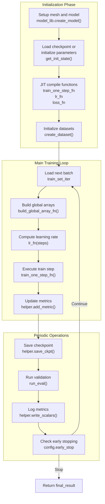
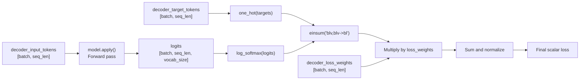
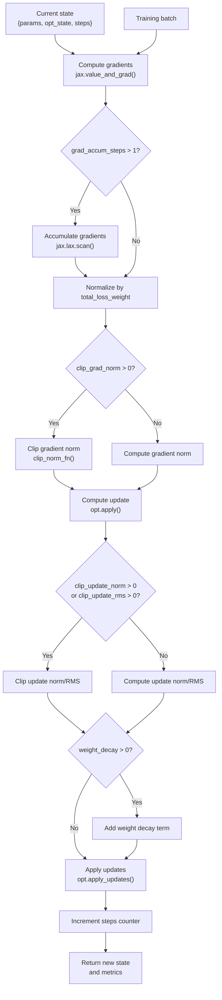
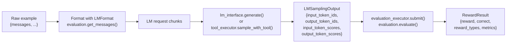
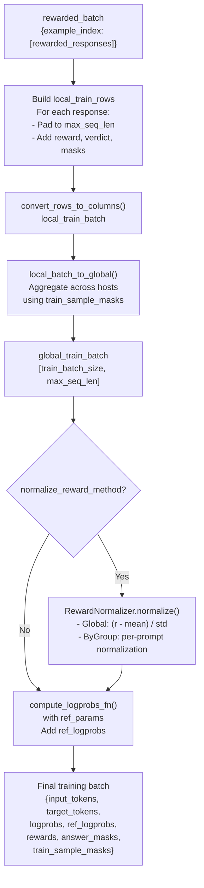
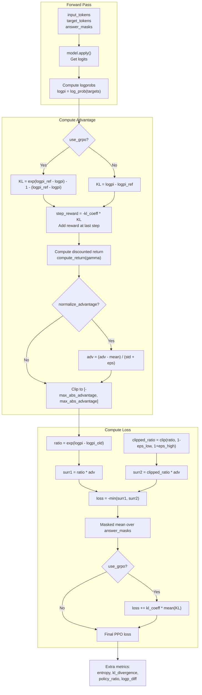
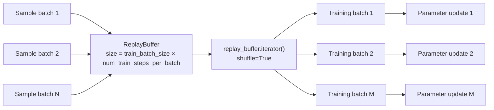
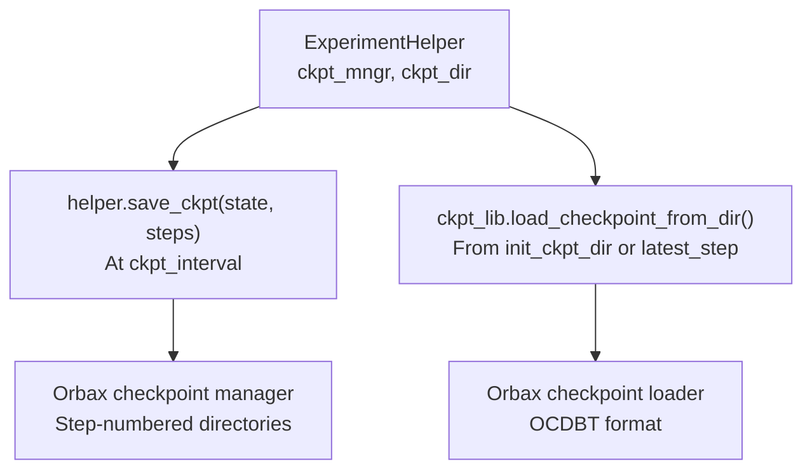

<!-- source: DeepWiki mcp.deepwiki.com · repo google-deepmind/simply · page 4.4 Training Systems · fetched 2026-10-26 -->

# Training Systems

<details>
<summary>Relevant source files</summary>

The following files were used as context for generating this wiki page:

- [simply/model_lib.py](simply/model_lib.py)
- [simply/rl_lib.py](simply/rl_lib.py)

</details>


This document describes the two training systems in Simply: the **standard supervised training loop** and the **reinforcement learning (RL) training loop**. Both systems share common infrastructure for gradient computation and parameter updates but differ significantly in their data preparation and loss computation strategies.

For practical guides on using these systems, see [Standard Training Workflow](#5.1) and [Reinforcement Learning Training](#5.2). For API-level details, see [model_lib.py](#6.3) and [rl_lib.py](#6.5).

---

## Training Loop Registry

Simply uses a registry pattern to manage different training loop implementations. Training loops are functions that orchestrate the entire training process from initialization to completion.

**Key Components:**

| Component | Location | Purpose |
|-----------|----------|---------|
| `TrainLoopRegistry` | [simply/model_lib.py:2089-2091]() | Registry class for training loop functions |
| `@TrainLoopRegistry.register(name='default')` | [simply/model_lib.py:2094]() | Standard supervised training loop |
| `@TrainLoopRegistry.register(name='rl')` | [simply/rl_lib.py:751]() | RL training loop for PPO/GRPO |

Training loops are selected via `config.train_loop_name` and invoked by `main.py`. Each training loop implements the signature:
```python
run_experiment(config, sharding_config, mesh_shape, create_dataset, 
               experiment_dir='', dcn_mesh_shape=None, decoding_mesh_shape=None)
```

Sources: [simply/model_lib.py:2089-2101](), [simply/rl_lib.py:751-762]()

---

## Standard Supervised Training Loop

The standard training loop (`'default'`) implements supervised learning with cross-entropy loss. It follows a conventional training pattern: load data batches, compute gradients, update parameters, save checkpoints, and evaluate periodically.

### Architecture Overview



**Main Training Loop Implementation**

Sources: [simply/model_lib.py:2094-2271]()

### Loss Computation

Standard supervised loss uses cross-entropy between model predictions and target tokens:



**Key Functions:**

- `compute_loss(model, params, batch)` - Base loss computation [simply/model_lib.py:1770-1808]()
- `compute_train_loss(model, params, batch)` - Training wrapper [simply/model_lib.py:1839-1840]()
- `compute_eval_loss(model, params, batch)` - Evaluation wrapper [simply/model_lib.py:1843-1844]()

The loss computation also tracks accuracy by comparing `argmax(logits)` to targets and returns it in `extra_output`.

Sources: [simply/model_lib.py:1770-1844]()

### Training Step Mechanics

The `train_one_step` function orchestrates gradient computation, clipping, and parameter updates:

**Training Step Flow Diagram**



**Key Parameters:**

| Parameter | Type | Purpose | Default |
|-----------|------|---------|---------|
| `grad_accum_steps` | int | Number of microbatches for gradient accumulation | -1 (disabled) |
| `clip_grad_norm` | float | Threshold for gradient norm clipping | -1 (disabled) |
| `clip_update_norm` | float | Threshold for update norm clipping | -1 (disabled) |
| `clip_update_rms` | float | Threshold for update RMS clipping | -1 (disabled) |
| `clip_local_update_rms` | float | Per-parameter RMS clipping | -1 (disabled) |
| `weight_decay` | float | L2 regularization coefficient | -1 (disabled) |

Sources: [simply/model_lib.py:1878-2006]()

### Gradient Accumulation

When `grad_accum_steps > 1`, the batch is split into microbatches and gradients are accumulated:

1. Reshape batch: `(batch_size, ...) → (grad_accum_steps, microbatch_size, ...)`
2. For each microbatch:
   - Compute loss and gradients
   - Weight by `minibatch_loss_weight`
   - Accumulate: `accum_grad += minibatch_grad * minibatch_loss_weight`
3. Normalize by `total_loss_weight`

This technique enables training with larger effective batch sizes than GPU memory allows.

Sources: [simply/model_lib.py:1920-1963]()

### Checkpointing and Evaluation

The training loop integrates with `ExperimentHelper` for checkpoint management:

- **Checkpoint saving**: `helper.save_ckpt(state, steps)` at intervals defined by `config.ckpt_interval`
- **Checkpoint loading**: Automatic restoration from `ckpt_mngr.latest_step()` or `config.init_ckpt_dir`
- **Validation**: Optional validation set evaluation via `run_eval()` at `config.validation_eval_interval`

The `run_eval` function computes mean loss and accuracy over validation batches, with configurable `num_eval_steps` and `validation_eval_batch_size`.

Sources: [simply/model_lib.py:2143-2180, 2356-2406]()

---

## RL Training Loop

The RL training loop implements Proximal Policy Optimization (PPO) and Group Relative Policy Optimization (GRPO) for fine-tuning language models with reward signals. It differs fundamentally from supervised learning by generating samples on-policy and optimizing a policy gradient objective.

### Architecture Overview



```mermaid
graph TB
    subgraph "Initialization"
        SetupRL["Setup mesh, model, optimizer"]
        LoadRefParams["Load reference policy params<br/>ref_params"]
        CompileRL["JIT compile<br/>train_one_step_fn<br/>compute_logprobs_fn<br/>lr_fn"]
        InitDataset["Initialize train_set, eval_set"]
        InitReplayBuffer["Initialize ReplayBuffer<br/>size = train_batch_size × num_train_steps_per_batch"]
    end
    
    subgraph "Sampling Phase [Decoding Mesh]"
        PrepareDecoding["Prepare decoding params<br/>prepare_params_for_decoding()"]
        LoadExample["Load example batch<br/>next(train_iter)"]
        FormatRequest["Format prompts<br/>lm_format.format()"]
        GenerateSamples["Generate samples<br/>lm_interface.generate()"]
        EvaluateRewards["Evaluate rewards<br/>evaluation.evaluate()"]
        CollectRewards["Wait for reward completion"]
    end
    
    subgraph "Training Batch Creation"
        FilterSamples["Filter samples<br/>train_sample_mask"]
        LocalToGlobal["Aggregate across hosts<br/>local_batch_to_global()"]
        NormalizeRewards["Normalize rewards<br/>RewardNormalizer"]
        ComputeRefLogprobs["Compute ref_logprobs<br/>compute_logprobs_fn()"]
        CreateBatch["Create training batch<br/>create_train_batch()"]
    end
    
    subgraph "Training Phase [Training Mesh]"
        AddToReplay["Add batch to replay buffer"]
        CheckBuffer{"len(replay_buffer) >= replay_buffer_size?"}
        SampleBatch["Sample batch from buffer<br/>shuffle=True"]
        TrainStepRL["Execute train step<br/>train_one_step_fn()<br/>with compute_ppo_loss"]
        SaveCkptRL["Save checkpoint"]
        ValidateRL["Optional validation"]
    end
    
    SetupRL --> LoadRefParams
    LoadRefParams --> CompileRL
    CompileRL --> InitDataset
    InitDataset --> InitReplayBuffer
    InitReplayBuffer --> PrepareDecoding
    
    PrepareDecoding --> LoadExample
    LoadExample --> FormatRequest
    FormatRequest --> GenerateSamples
    GenerateSamples --> EvaluateRewards
    EvaluateRewards --> CollectRewards
    
    CollectRewards --> FilterSamples
    FilterSamples --> LocalToGlobal
    LocalToGlobal --> NormalizeRewards
    NormalizeRewards --> ComputeRefLogprobs
    ComputeRefLogprobs --> CreateBatch
    
    CreateBatch --> AddToReplay
    AddToReplay --> CheckBuffer
    CheckBuffer -->|No| PrepareDecoding
    CheckBuffer -->|Yes| SampleBatch
    SampleBatch --> TrainStepRL
    TrainStepRL --> SaveCkptRL
    SaveCkptRL --> ValidateRL
    ValidateRL --> SampleBatch
```

**Key Distinctions from Standard Training:**

1. **Two-phase process**: Sampling (decoding mesh) → Training (training mesh)
2. **On-policy data generation**: Model generates its own training data each iteration
3. **Reward-based optimization**: Uses reward signals instead of supervised targets
4. **Reference policy**: Maintains frozen `ref_params` for KL penalty computation
5. **Replay buffer**: Stores samples for multiple training steps per batch

Sources: [simply/rl_lib.py:752-1358]()

### Sampling Phase

The sampling phase generates training data by running the current policy on prompts:

**Sampling Pipeline**



**Key Configuration:**

- `config.num_samples_per_example`: Multiple samples per prompt (for GRPO)
- `config.sampling_max_decode_steps`: Maximum response length
- `config.sampling_temperature`: Temperature for sampling
- `config.sampling_prefill_size`: Batched prefill size for efficiency
- `config.extra_eos_tokens`: Additional stop tokens beyond model EOS

The sampling phase uses `decoding_mesh_shape` (if specified) for efficient inference, separate from the training mesh.

Sources: [simply/rl_lib.py:952-1054](), [simply/rl_lib.py:880-919]()

### Training Batch Creation

After sampling and reward evaluation, samples are aggregated across hosts and formatted into a training batch:

**create_train_batch Function Flow**



**Batch Fields:**

| Field | Shape | Description |
|-------|-------|-------------|
| `input_tokens` | `[batch, max_seq_len]` | Input token sequence |
| `target_tokens` | `[batch, max_seq_len]` | Target token sequence (shifted by 1) |
| `logprobs` | `[batch, max_seq_len]` | Log probs from sampling policy |
| `ref_logprobs` | `[batch, max_seq_len]` | Log probs from reference policy |
| `answer_masks` | `[batch, max_seq_len]` | Mask for response tokens (not prompt) |
| `rewards` | `[batch, 1]` | Normalized reward per sequence |
| `train_sample_masks` | `[batch, 1]` | Valid training samples (not NaN/truncated) |

Sources: [simply/rl_lib.py:413-522]()

### PPO/GRPO Loss Computation

The `compute_ppo_loss` function implements the PPO objective with optional GRPO variant:

**PPO Loss Components**



**Key Hyperparameters:**

| Parameter | Default | Description |
|-----------|---------|-------------|
| `gamma` | 1.0 | Discount factor for returns |
| `kl_coeff` | 0.001 | KL penalty coefficient |
| `use_grpo` | False | Use GRPO (KL-3 estimator) vs standard PPO |
| `ppo_clip_eps_high` | 0.2 | Upper clipping threshold |
| `ppo_clip_eps_low` | 0.2 | Lower clipping threshold |
| `policy_ratio_cap` | 10.0 | Dual-clip PPO upper bound |
| `normalize_advantage` | True | Normalize advantages to mean=0, std=1 |
| `max_abs_advantage` | 10.0 | Clip advantages to this range |

**GRPO vs PPO:**

- **PPO**: Uses `step_reward = -kl_coeff * KL + reward_at_last_step`, where KL penalizes divergence from reference policy at each token
- **GRPO**: Uses `step_reward = reward_at_last_step` during advantage computation, but adds `kl_coeff * mean(KL)` to final loss. The KL estimator is K3 from Schulman's blog (more numerically stable).

Sources: [simply/rl_lib.py:547-701]()

### Replay Buffer and Off-Policy Learning

The RL training loop uses a replay buffer to enable multiple training steps per sampling batch:



**Key Points:**

- Buffer size: `train_batch_size * num_train_steps_per_batch`
- Buffer only fills once before training begins
- Samples are shuffled when drawing training batches
- When `num_train_steps_per_batch > 1`, training becomes off-policy (samples generated by older policy)
- `use_policy_logp_as_sampler_logp` is incompatible with off-policy learning (`num_train_steps_per_batch > 1`)

Sources: [simply/rl_lib.py:928-939](), [simply/rl_lib.py:1217-1347]()

### Reward Normalization

The `RewardNormalizer` classes standardize rewards before training:

**RewardNormalizer.Global**
- Normalizes all rewards in the batch: `(reward - global_mean) / global_std`
- Simple but doesn't account for per-prompt difficulty variation

**RewardNormalizer.ByGroup**
- Groups samples by `in_batch_example_ids` (same prompt)
- Normalizes within each group: `(reward - group_mean) / group_std`
- Better for GRPO where multiple samples per prompt are compared

Sources: [simply/rl_lib.py:256-327]()

---

## Shared Training Infrastructure

Both training loops share core infrastructure for gradient computation and parameter updates.

### The train_one_step Function

`train_one_step` is the workhorse function that executes a single training iteration:

**Function Signature:**
```python
def train_one_step(
    state, batch, model, opt,
    teacher_model=None,
    lr=1e-4, 
    grad_accum_steps=-1,
    clip_grad_norm=-1, 
    clip_update_norm=-1,
    clip_update_rms=-1,
    clip_local_update_rms=-1,
    weight_decay=-1,
    custom_loss_fn=None,
    add_log_info=False
)
```

**Returns:** `(loss, new_state, log_dict)`

Sources: [simply/model_lib.py:1878-2006]()

### Clipping Mechanisms

Simply implements multiple clipping strategies for training stability:

| Clipping Type | Applied To | Function | Purpose |
|--------------|------------|----------|---------|
| Gradient Norm | Gradients | `clip_norm_fn(grad, threshold=clip_grad_norm)` | Prevent exploding gradients |
| Update Norm | Parameter updates | `clip_norm_fn(update, threshold=clip_update_norm)` | Limit update magnitude |
| Update RMS (Global) | Parameter updates | `clip_rms_fn(update, threshold=clip_update_rms)` | Normalize by RMS across all params |
| Update RMS (Local) | Parameter updates | `clip_rms_fn(update, threshold=clip_local_update_rms, clip_local=True)` | Per-parameter RMS clipping |

**Clipping Implementation:**

```python
def safe_clip(x, val, threshold):
    return x / jnp.where(val > threshold, val / threshold, 1.0)
```

This formulation avoids NaN gradients by using `jnp.where` instead of direct division.

Sources: [simply/model_lib.py:2009-2059]()

### Optimizer Integration

Training loops integrate with optimizers defined in `config.optimizer`:

1. **Initialization**: `state = opt.init(params)` creates optimizer state
2. **Gradient computation**: `jax.value_and_grad(loss_fn)(...)`
3. **Update computation**: `update, new_state = opt.apply(state, grad)`
4. **Weight decay** (optional): `update += weight_decay * params`
5. **Parameter update**: `new_state = opt.apply_updates(new_state, lr * update)`
6. **Step increment**: `new_state['steps'] += 1`

The optimizer must implement:
- `init(params) -> state`: Initialize optimizer state
- `apply(state, grad) -> (update, new_state)`: Compute parameter updates
- `apply_updates(state, update) -> new_state`: Apply updates to parameters

Sources: [simply/model_lib.py:1980-2005]()

### Checkpoint Management Integration

Both training loops use `ExperimentHelper` for checkpointing:

**Checkpoint Operations:**



**RL-Specific Checkpointing:**

The RL training loop also saves data state:
```python
helper.save_ckpt(state, steps, data={'train_iter_state': train_iter_state})
```

This allows resuming from the exact dataset position.

Sources: [simply/model_lib.py:2302-2353](), [simply/rl_lib.py:1224-1226]()

### Learning Rate Schedules

Both training loops use `lr_fn = create_lr_schedule(config)` to compute learning rates dynamically:

```python
lr = lr_fn(state['steps'])
```

The learning rate schedule is JIT-compiled and called every training step. Common schedule types include:
- Constant
- Linear warmup + decay
- Cosine annealing
- Polynomial decay

Sources: [simply/model_lib.py:2141](), [simply/rl_lib.py:855]()

---

## Key Differences Summary

| Aspect | Standard Training | RL Training |
|--------|------------------|-------------|
| **Data Source** | Static dataset (SeqIO/TensorFlow) | On-policy generation (LMInterface) |
| **Loss Function** | Cross-entropy `compute_train_loss` | PPO/GRPO `compute_ppo_loss` |
| **Batch Preparation** | Pre-tokenized from dataset | Generated → evaluated → formatted |
| **Reference Policy** | Not used | Frozen `ref_params` for KL penalty |
| **Replay Buffer** | Not used | `ReplayBuffer` for off-policy learning |
| **Mesh Usage** | Single training mesh | Decoding mesh + training mesh |
| **Evaluation** | Supervised loss on validation set | On-policy generation + reward evaluation |
| **Typical Use Case** | Pre-training, instruction tuning | RLHF, reward optimization |

Sources: [simply/model_lib.py:2094-2271](), [simply/rl_lib.py:752-1358]()

---

