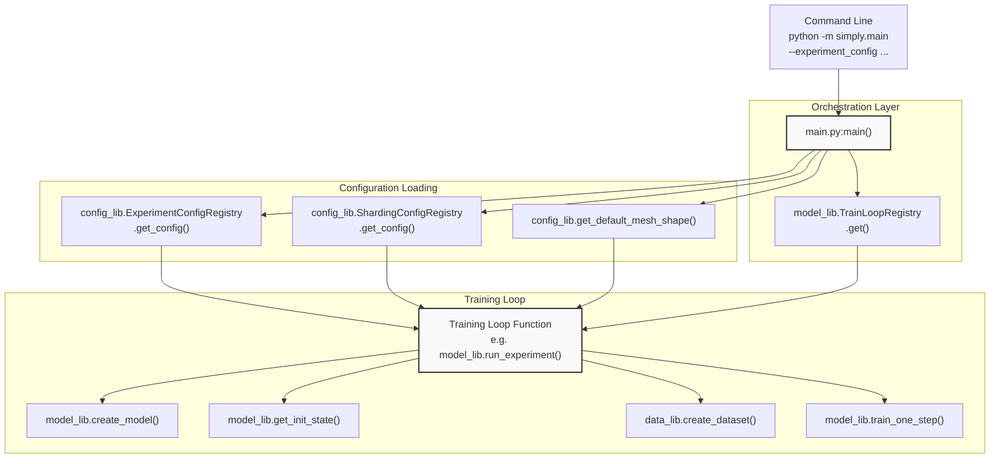
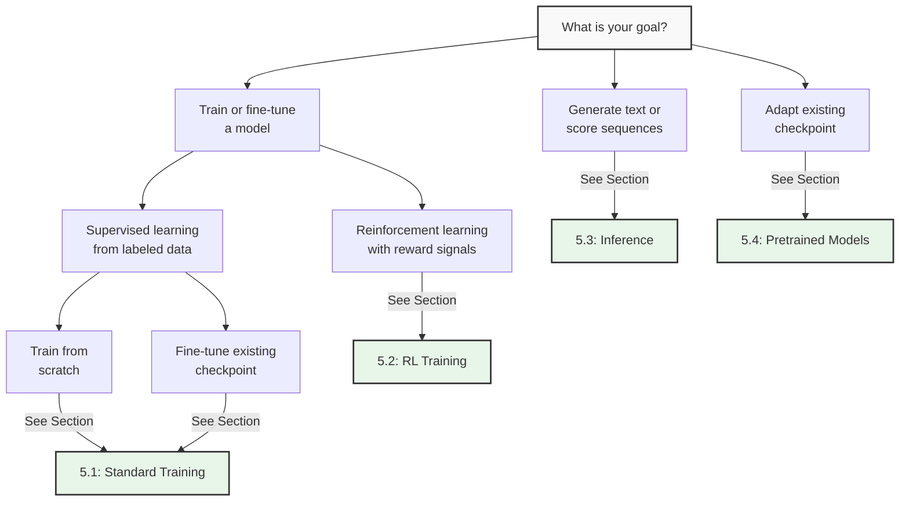
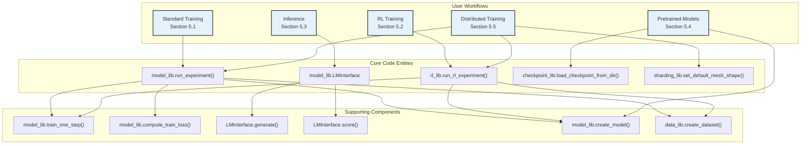

<!-- source: DeepWiki mcp.deepwiki.com · repo google-deepmind/simply · page 5 User Guides · fetched 2026-10-26 -->

# User Guides

<details>
<summary>Relevant source files</summary>

The following files were used as context for generating this wiki page:

- [simply/main.py](simply/main.py)
- [simply/model_lib.py](simply/model_lib.py)

</details>


This section provides task-oriented documentation for common workflows in the Simply codebase. Each guide walks through a specific use case from setup to execution, with practical examples and best practices.

The user guides cover five primary workflows:

- **[Standard Training](#5.1)**: Supervised training from scratch or fine-tuning
- **[Reinforcement Learning Training](#5.2)**: PPO/GRPO-based RL training loops
- **[Model Inference and Generation](#5.3)**: Text generation and sequence scoring
- **[Working with Pretrained Models](#5.4)**: Loading and adapting existing checkpoints
- **[Distributed Training](#5.5)**: Multi-device and multi-host training configurations

For system architecture details and component internals, see [Architecture](#4). For API reference documentation, see [API Reference](#6).

## Common Patterns

All Simply workflows follow a consistent pattern built around three core concepts: **configuration**, **execution**, and **asset management**.

### Experiment Execution Flow

Every Simply experiment follows this execution sequence:



**Sources:** [simply/main.py:89-148](), [simply/model_lib.py:2095-2272]()

### Configuration System

All experiments are defined by two configuration objects:

| Configuration Type | Purpose | Registry | Example Names |
|-------------------|---------|----------|---------------|
| `ExperimentConfig` | Model architecture, training hyperparameters, dataset specification | `config_lib.ExperimentConfigRegistry` | `Gemma2BV2`, `DeepSeekQwen1.5B`, `Qwen3_0.6B_PT` |
| `ShardingConfig` | Device mesh layout, weight sharding strategy | `config_lib.ShardingConfigRegistry` | `GSPMDSharding`, `DecodeGSPMDSharding`, `DataParallelSharding` |

Configurations can be loaded by name or from JSON files:

```bash
# Load by registered name
python -m simply.main --experiment_config Gemma2BV2 --sharding_config GSPMDSharding

# Load from JSON file
python -m simply.main --experiment_config_path /path/to/config.json
```

**Sources:** [simply/main.py:47-65](), [simply/main.py:91-114]()

### Command-Line Interface

The `main.py` module accepts the following core flags:

| Flag | Type | Description |
|------|------|-------------|
| `--experiment_config` | string | Name of registered experiment configuration |
| `--experiment_config_path` | string | Path to JSON configuration file (mutually exclusive with `--experiment_config`) |
| `--sharding_config` | string | Name of sharding configuration (default: `GSPMDSharding`) |
| `--experiment_dir` | string | Directory for checkpoints and logs (default: `/tmp/simply_lm/`) |
| `--mesh_shape` | list | Device mesh shape as `replica,data,model` (auto-computed if not specified) |
| `--dcn_mesh_shape` | list | DCN mesh shape for multi-host setups |
| `--decoding_mesh_shape` | list | Mesh shape for inference (auto-computed if not specified) |

**Sources:** [simply/main.py:47-86]()

### Asset Requirements

Before running any workflow, ensure assets are downloaded and cached:

```bash
python setup/setup_assets.py
```

This populates `~/.cache/simply/` with:
- **models/**: Pretrained checkpoint directories (Gemma, DeepSeek, Qwen)
- **datasets/**: Training datasets
- **vocabs/**: Tokenizer models

For detailed asset management, see [Asset Management](#2.2).

**Sources:** Based on system architecture diagrams and setup flow

## Workflow Selection Guide

Choose your workflow based on your task:



**Sources:** Derived from system capabilities and training loop registry

## Code Entity Map

The following diagram maps user workflows to their primary code entities:



**Sources:** [simply/model_lib.py:2089-2092](), [simply/model_lib.py:2094-2272](), [simply/model_lib.py:2690-3144]()

## Training Loop Registry

Simply uses a registry pattern to support multiple training paradigms. Training loops are registered functions that implement the complete training procedure:

| Registry Key | Function | Purpose |
|--------------|----------|---------|
| `default` | `model_lib.run_experiment()` | Supervised learning with cross-entropy loss |
| (RL loops) | `rl_lib.run_rl_experiment()` | PPO/GRPO reinforcement learning |

The training loop is selected via the `train_loop_name` field in the experiment configuration:

```python
# In configuration
config.train_loop_name = 'default'  # or 'rl_ppo', etc.
```

The `main()` function retrieves and invokes the appropriate training loop:

```python
run_experiment_fn = model_lib.TrainLoopRegistry.get(config.train_loop_name)
run_experiment_fn(config=config, sharding_config=sharding_config, ...)
```

**Sources:** [simply/model_lib.py:2089-2092](), [simply/main.py:139-147]()

## State Management

Training state in Simply is a dictionary containing:

| Key | Type | Description |
|-----|------|-------------|
| `params` | PyTree | Model parameters (weights and biases) |
| `steps` | Array | Current training step counter |
| Optimizer state | PyTree | Momentum, variance, etc. (optimizer-specific) |
| `teacher_params` | PyTree | Teacher model parameters (distillation only) |

State is managed through three operations:

1. **Initialization**: `model_lib.get_init_state()` creates initial state from scratch or checkpoint
2. **Updates**: `optimizer.apply()` and `optimizer.apply_updates()` compute and apply parameter updates
3. **Checkpointing**: `checkpoint_lib.save_checkpoint()` and `load_checkpoint_from_dir()` persist state

**Sources:** [simply/model_lib.py:2302-2354](), [simply/model_lib.py:1878-2007]()

## Batch Format

Training and evaluation batches follow a standard format:

| Field | Shape | Description |
|-------|-------|-------------|
| `decoder_input_tokens` | `[batch_size, seq_len]` | Input token IDs (targets shifted right) |
| `decoder_target_tokens` | `[batch_size, seq_len]` | Target token IDs for loss computation |
| `decoder_loss_weights` | `[batch_size, seq_len]` | Per-token loss weights (optional, defaults to all ones) |
| `decoder_segment_ids` | `[batch_size, seq_len]` | Segment IDs for packed sequences (optional) |
| `decoder_positions` | `[batch_size, seq_len]` | Position indices (optional, defaults to sequential) |

The loss computation uses these fields:

```python
# From model_lib.compute_loss()
logits, _ = model.apply(params, inputs, segment_ids=segment_ids, 
                        segment_positions=segment_positions)
targets_one_hot = jax.nn.one_hot(targets, logits.shape[-1])
token_loss = jnp.einsum('blv,blv->bl', targets_one_hot, 
                        jax.nn.log_softmax(logits))
total_loss = -jnp.sum(token_loss * loss_weights)
```

**Sources:** [simply/model_lib.py:1770-1809]()

## Common Troubleshooting

### Out of Memory (OOM)

If training fails with OOM errors:

1. **Reduce batch size**: Modify `config.batch_size` in your configuration
2. **Enable gradient accumulation**: Set `config.grad_accum_steps > 1` to split batch into microbatches
3. **Use activation checkpointing**: Set `config.use_remat = True` to trade compute for memory
4. **Adjust sharding**: Try `DataParallelSharding` which doesn't shard weights across devices

### Slow Training

If training is slower than expected:

1. **Check data generation time**: Monitor `data_generation_step_time` in logs
2. **Verify device utilization**: Ensure `mesh_shape` matches your hardware topology
3. **Profile with JAX profiler**: Add profiling annotations around bottlenecks
4. **Increase prefetching**: Adjust `config.dataset_num_prefetch_threads`

### Configuration Errors

If configurations fail to load:

1. **Verify registration**: Check that config name exists in registry via `config_lib.ExperimentConfigRegistry.list_configs()`
2. **Check JSON syntax**: Validate JSON files for syntax errors
3. **Inspect dependencies**: Ensure required assets exist in `~/.cache/simply/`

**Sources:** [simply/model_lib.py:2095-2272](), [simply/model_lib.py:2125-2260]()

## Next Steps

After understanding these common patterns, proceed to the specific workflow guide relevant to your task:

- **[Standard Training Workflow](#5.1)**: Complete walkthrough of supervised training
- **[Reinforcement Learning Training](#5.2)**: RL-specific training procedures
- **[Model Inference and Generation](#5.3)**: Using trained models for generation
- **[Working with Pretrained Models](#5.4)**: Loading and adapting checkpoints
- **[Distributed Training](#5.5)**: Multi-device and multi-host configurations

---

