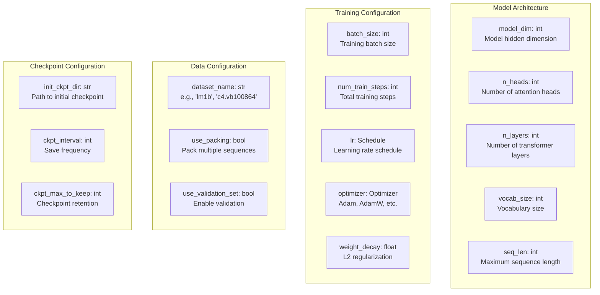
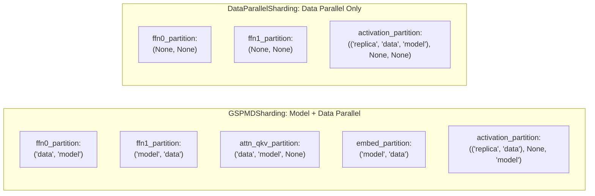
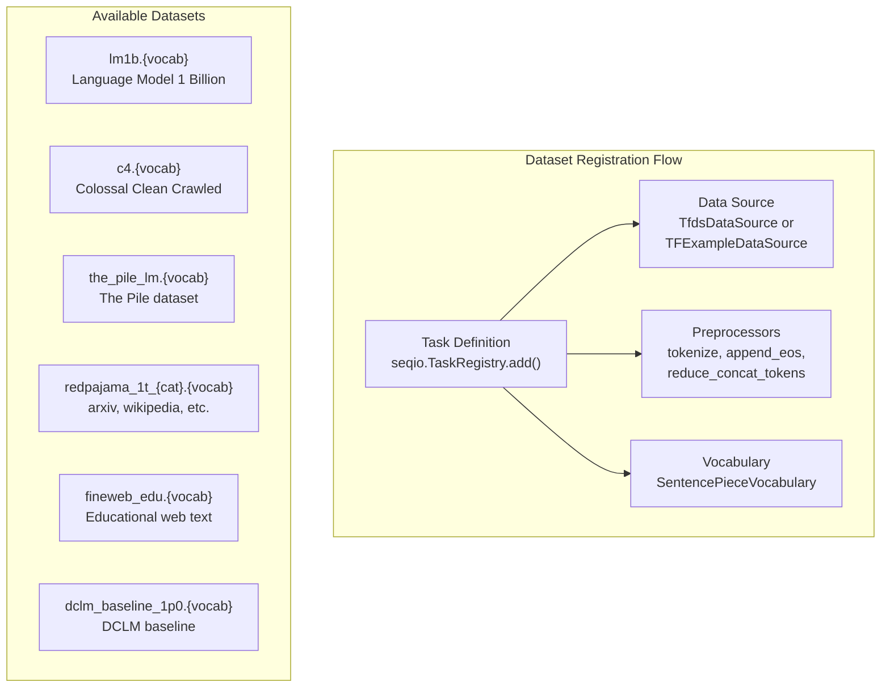
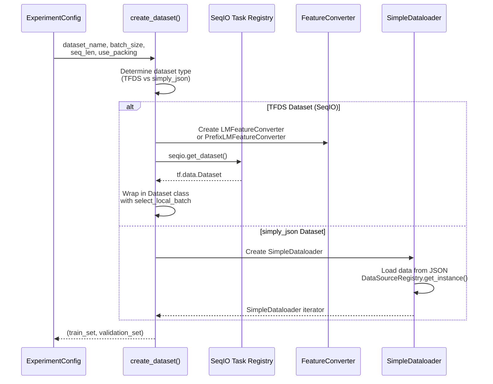
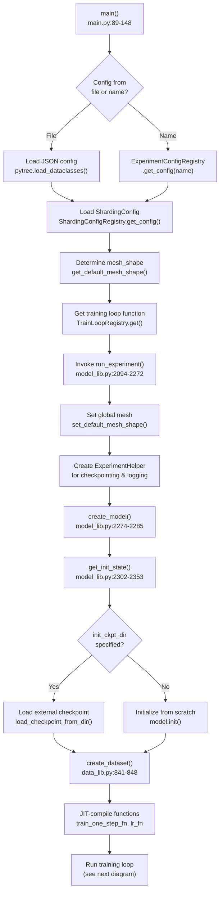
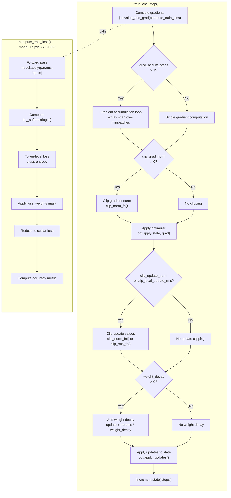
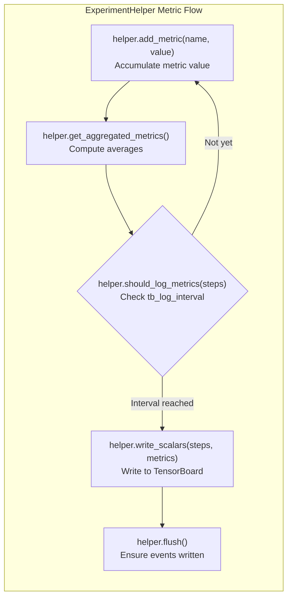
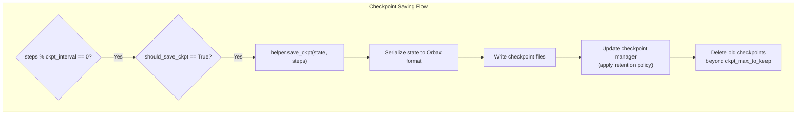

<!-- source: DeepWiki mcp.deepwiki.com · repo google-deepmind/simply · page 5.1 Standard Training Workflow · fetched 2026-10-26 -->

# Standard Training Workflow

<details>
<summary>Relevant source files</summary>

The following files were used as context for generating this wiki page:

- [simply/config_lib.py](simply/config_lib.py)
- [simply/data_lib.py](simply/data_lib.py)
- [simply/main.py](simply/main.py)
- [simply/model_lib.py](simply/model_lib.py)

</details>


## Purpose and Scope

This page provides a complete guide for supervised training in Simply, covering the end-to-end workflow from configuration selection to checkpoint evaluation. It focuses on standard language modeling training where the model learns to predict the next token given previous tokens.

For reinforcement learning training workflows, see [Reinforcement Learning Training](#5.2). For model inference and text generation, see [Model Inference and Generation](#5.3). For distributed training configurations, see [Distributed Training](#5.5).

## Prerequisites

Before starting training, ensure:

1. **Assets are downloaded**: Run `python setup/setup_assets.py` to download pretrained models, datasets, and vocabularies to `~/.cache/simply/`
2. **JAX is installed**: For your target hardware (CPU, GPU, or TPU)
3. **Dependencies are installed**: All packages from `requirements.txt`

## Training Workflow Overview

The standard training workflow follows these stages:

```mermaid
flowchart TD
    Start["User invokes main.py"] --> LoadConfig["Load ExperimentConfig<br/>from registry or JSON"]
    LoadConfig --> LoadSharding["Load ShardingConfig<br/>(e.g., GSPMDSharding)"]
    LoadSharding --> SetupMesh["Setup device mesh<br/>get_default_mesh_shape()"]
    SetupMesh --> CreateModel["Create TransformerLM model<br/>create_model()"]
    CreateModel --> InitState["Initialize or load state<br/>get_init_state()"]
    InitState --> CreateDataset["Create training dataset<br/>create_dataset()"]
    CreateDataset --> CompileJIT["JIT-compile training functions<br/>train_one_step_fn, lr_fn"]
    CompileJIT --> TrainLoop["Training loop begins"]
    
    TrainLoop --> GetBatch["Get next batch<br/>train_set_iter"]
    GetBatch --> ComputeLoss["Compute loss & gradients<br/>compute_train_loss()"]
    ComputeLoss --> ApplyUpdate["Apply optimizer update<br/>train_one_step()"]
    ApplyUpdate --> UpdateState["Update state with<br/>new params & opt_state"]
    UpdateState --> LogMetrics["Log metrics to TensorBoard<br/>if tb_log_interval reached"]
    
    LogMetrics --> CheckCkpt{"Checkpoint<br/>interval?"}
    CheckCkpt -->|Yes| SaveCkpt["Save checkpoint<br/>helper.save_ckpt()"]
    CheckCkpt -->|No| CheckVal
    SaveCkpt --> CheckVal{"Validation<br/>interval?"}
    
    CheckVal -->|Yes| RunEval["Run validation eval<br/>run_eval()"]
    CheckVal -->|No| CheckDone
    RunEval --> CheckDone{"Training<br/>complete?"}
    
    CheckDone -->|No| GetBatch
    CheckDone -->|Yes| FinalSave["Save final checkpoint<br/>& close experiment"]
    FinalSave --> End["Training complete"]
```



**Sources:** [simply/main.py:89-148](), [simply/model_lib.py:2094-2272]()

## Configuration Selection

### Experiment Configurations

Training experiments are defined by `ExperimentConfig` dataclasses registered in `ExperimentConfigRegistry`. Simply provides 210+ predefined configurations for various model families and tasks.

**Key configuration families:**

| Family | Base Config | Size Variants | Checkpoint Locations |
|--------|-------------|---------------|---------------------|
| Gemma 2 | `Gemma2BV2` | 2B, 9B, 27B | `GEMMA2_2B_PT_CKPT_DIR`, etc. |
| Gemma 3 | `Gemma1BV3` | 270M, 1B, 4B, 12B, 27B | `GEMMA3_1B_PT_CKPT_DIR`, etc. |
| DeepSeek-Qwen | `DeepSeekQwen1p5BV2` | 1.5B, 7B, 14B, 32B | `DEEPSEEK_QWEN_1P5B_CKPT_DIR`, etc. |
| Qwen3 | Various | 0.6B, 1.7B, 4B, 8B, 14B, 32B | `QWEN3_0P6B_CKPT_DIR`, etc. |
| C4 Experiments | `Flops*TFM*C4L2048` | Multiple FLOPs budgets | Created from scratch |

**Base configuration structure (`TFM1p7BLM1B`):**



**Sources:** [simply/config_lib.py:192-343]()

### Selecting a Configuration

**Option 1: Use a predefined configuration by name**

```bash
python -m simply.main \
  --experiment_config=Gemma2BV2 \
  --experiment_dir=/tmp/my_experiment
```

**Option 2: Load configuration from JSON**

```bash
python -m simply.main \
  --experiment_config_path=/path/to/config.json \
  --experiment_dir=/tmp/my_experiment
```

**Option 3: Create a custom configuration via inheritance**

Create a new configuration class inheriting from an existing one:

```python
@ExperimentConfigRegistry.register
@dataclasses.dataclass(frozen=True)
class MyCustomConfig(Gemma2BV2):
  # Override specific fields
  batch_size: int = 256
  num_train_steps: int = 10_000
  lr: opt_lib.Schedule = opt_lib.LinearWarmupCosineDecay(
      value=5e-4, warmup_steps=500, end_decay=0.1
  )
  dataset_name: str = 'c4.vb100864_openmix_v1'
```

**Sources:** [simply/config_lib.py:76-82](), [simply/config_lib.py:577-624]()

### Sharding Configurations

Sharding configurations control how model parameters and activations are distributed across devices. Three primary strategies are available:

| Strategy | Use Case | Weight Sharding | Data Sharding |
|----------|----------|-----------------|---------------|
| `GSPMDSharding` | Training large models | Yes (model parallel) | Yes |
| `DecodeGSPMDSharding` | Inference optimization | Yes | Yes |
| `DataParallelSharding` | Small models, many devices | No | Yes only |



**Sources:** [simply/config_lib.py:104-182]()

## Dataset Preparation

### Registered Datasets

Simply provides registered datasets for common benchmarks and pretraining corpora:

**Pretraining datasets:**



**Supervised fine-tuning datasets:**

- `openhermes_2p5.{vocab}`: Conversational data
- `tulu_v2_sft.{vocab}`: Instruction following data

**RL/Evaluation datasets (JSON format):**

- `simply_json:gsm8k_train`: GSM8K math problems (training split)
- `simply_json:gsm8k_test`: GSM8K math problems (test split)
- `simply_json:dsr40k_train`: DeepScaleR dataset
- `simply_json:aime24`: AIME 2024 problems
- `simply_json:mmlu_test`: MMLU benchmark

**Sources:** [simply/data_lib.py:141-301](), [simply/data_lib.py:419-641]()

### Vocabulary Management

Vocabularies are registered in `TokenizerRegistry` and referenced by name in configurations:

| Vocabulary Name | Path | Vocab Size | Use Case |
|-----------------|------|------------|----------|
| `vb256128_gemma2` | `gemma2_tokenizer.model` | 256,128 | Gemma 2 models |
| `vb262144_gemma3` | `gemma3_cleaned_262144_v2.spiece.model` | 262,144 | Gemma 3 models |
| `vb100864_openmix_v1` | `spm-100864-open_mix_v1-*.model` | 100,864 | OpenMix vocabulary |
| `DeepSeek-R1-Distill-Qwen` | From model directory | 151,936 | DeepSeek models |
| `Qwen2.5` | From model directory | 151,936 | Qwen models |

**Sources:** [simply/data_lib.py:47-83]()

### Dataset Creation

The `create_dataset()` function instantiates training and validation datasets:



**Sources:** [simply/data_lib.py:780-848]()

## Running Training

### Command-Line Invocation

The main entry point is `simply.main`. Basic usage:

```bash
# Train with predefined config
python -m simply.main \
  --experiment_config=TFM1p7BLM1B \
  --sharding_config=GSPMDSharding \
  --experiment_dir=/tmp/my_training_run

# Train with custom mesh shape
python -m simply.main \
  --experiment_config=Gemma2BV2 \
  --mesh_shape=1,8,1 \
  --experiment_dir=/tmp/gemma_training

# Train with config from file
python -m simply.main \
  --experiment_config_path=/path/to/config.json \
  --experiment_dir=/tmp/custom_training
```

**Key command-line flags:**

| Flag | Description | Example |
|------|-------------|---------|
| `--experiment_config` | Name of registered config | `Gemma2BV2` |
| `--experiment_config_path` | Path to JSON config file | `/path/to/config.json` |
| `--sharding_config` | Sharding strategy name | `GSPMDSharding` |
| `--experiment_dir` | Output directory for checkpoints/logs | `/tmp/exp` |
| `--mesh_shape` | Device mesh shape (replica, data, model) | `1,8,1` |
| `--dcn_mesh_shape` | DCN topology for multi-host | `2,1,1` |

**Sources:** [simply/main.py:47-87](), [simply/main.py:89-148]()

### Main Execution Flow



**Sources:** [simply/main.py:89-148](), [simply/model_lib.py:2094-2272]()

### Training Loop Mechanics

The core training loop in `run_experiment()` executes these steps per iteration:

```mermaid
sequenceDiagram
    participant Loop as Training Loop
    participant Dataset as Dataset Iterator
    participant BuildArray as build_global_array_fn
    participant LRSchedule as lr_fn
    participant TrainStep as train_one_step_fn
    participant Helper as ExperimentHelper
    
    loop For each training step
        Loop->>Helper: Check if checkpoint needed<br/>helper.save_ckpt(state, steps)
        
        alt Validation interval reached
            Loop->>Loop: Run validation eval<br/>run_eval(state)
            Loop->>Helper: Write validation metrics<br/>helper.write_scalars()
        end
        
        Loop->>Dataset: Get next batch<br/>next(train_set_iter)
        Dataset-->>Loop: Local batch (process-specific)
        
        Loop->>BuildArray: Convert to global arrays<br/>build_global_array_fn(batch)
        BuildArray-->>Loop: Sharded batch across devices
        
        Loop->>LRSchedule: Compute learning rate<br/>lr_fn(state['steps'])
        LRSchedule-->>Loop: lr value
        
        Loop->>TrainStep: train_one_step_fn(state, batch, lr)
        TrainStep->>TrainStep: Compute loss & gradients<br/>compute_train_loss()
        TrainStep->>TrainStep: Apply optimizer update<br/>opt.apply() + opt.apply_updates()
        TrainStep->>TrainStep: Update parameters
        TrainStep-->>Loop: (loss, new_state, log_dict)
        
        Loop->>Helper: Track metrics<br/>helper.add_metric()
        
        alt Logging interval reached
            Loop->>Helper: Write scalars to TensorBoard<br/>helper.write_scalars()
            Loop->>Helper: Flush events<br/>helper.flush()
        end
        
        Loop->>Loop: Increment steps
    end
```

**Sources:** [simply/model_lib.py:2156-2270]()

### Loss Computation and Backpropagation

The `train_one_step()` function handles gradient computation and parameter updates:



**Sources:** [simply/model_lib.py:1770-1808](), [simply/model_lib.py:1878-2007]()

## Monitoring Training

### Metrics and Logging

The `ExperimentHelper` class manages metric tracking and TensorBoard logging:

**Key metrics logged:**

| Metric Category | Metric Name | Description |
|----------------|-------------|-------------|
| Loss | `loss` | Training loss (averaged) |
| Accuracy | `accuracy` | Token prediction accuracy |
| Performance | `secs_per_step` | Wall-clock time per step |
| Performance | `steps_per_sec` | Throughput (steps/second) |
| Learning Rate | `lr` | Current learning rate value |
| Gradients | `global_grad_norm` | L2 norm of gradients |
| Gradients | `local_grad_norm` | Per-parameter gradient norms |
| Updates | `global_update_norm` | L2 norm of parameter updates |
| Updates | `local_update_norm` | Per-parameter update norms |
| Weights | `global_weights_norm` | L2 norm of all parameters |
| Validation | `eval_loss` | Validation set loss |
| Validation | `eval_accuracy` | Validation set accuracy |

**Metric aggregation:**



**Sources:** [simply/model_lib.py:2226-2259]()

### TensorBoard Integration

Training metrics are automatically logged to TensorBoard in the experiment directory:

```bash
# Launch TensorBoard to view metrics
tensorboard --logdir=/path/to/experiment_dir

# View at http://localhost:6006
```

The TensorBoard logs include:
- Scalar metrics (loss, accuracy, learning rate)
- Gradient/update statistics (if `log_additional_info=True`)
- Validation metrics (if `use_validation_set=True`)
- Timing information (data loading, training step duration)

**Sources:** [simply/model_lib.py:2111-2114]()

### Checkpointing

Checkpoints are saved automatically at intervals specified by `ckpt_interval`:

**Checkpoint directory structure:**

```
experiment_dir/
├── checkpoints/
│   ├── 0/              # Step 0 checkpoint
│   │   └── default/
│   ├── 1000/           # Step 1000 checkpoint
│   │   └── default/
│   └── 2000/           # Step 2000 checkpoint
│       └── default/
├── config.json         # Experiment configuration
├── sharding_config.json # Sharding configuration
└── events.out.tfevents.* # TensorBoard events
```

**Checkpoint retention policy:**

- `ckpt_max_to_keep`: Maximum number of recent checkpoints to retain
- `ckpt_keep_period`: Keep every Nth checkpoint permanently (optional)



**Sources:** [simply/model_lib.py:2187-2188](), [simply/config_lib.py:304-310]()

## Validation and Evaluation

### Validation Set Configuration

Enable validation by setting configuration parameters:

```python
@dataclasses.dataclass(frozen=True)
class MyConfig(TFM1p7BLM1B):
  use_validation_set: bool = True
  validation_dataset_name: str = 'lm1b.vb32768_openmix_v1'
  validation_eval_interval: int = 1000  # Evaluate every 1000 steps
  validation_num_eval_steps: int = -1  # Use entire validation set
  validation_eval_batch_size: int = 512
  validation_eval_epochs: int = 1
```

### Validation Evaluation Flow

```mermaid
sequenceDiagram
    participant Loop as Training Loop
    participant RunEval as run_eval()
    participant Dataset as Validation Dataset
    participant LossFn as compute_eval_loss()
    participant Helper as ExperimentHelper
    
    Loop->>Loop: Check if validation interval reached
    Loop->>RunEval: run_eval(eval_set, num_eval_steps,<br/>loss_fn, state, build_global_array_fn)
    
    RunEval->>Dataset: Create validation iterator<br/>eval_set.repeat(1)
    
    loop For each validation batch
        Dataset->>RunEval: Get eval batch
        RunEval->>RunEval: Convert to global arrays<br/>build_global_array_fn(eval_batch)
        
        RunEval->>LossFn: Compute eval loss<br/>loss_fn(params, batch)
        LossFn-->>RunEval: (eval_loss, extra_output)
        
        RunEval->>RunEval: Update running averages<br/>(weighted by batch size)
        
        alt num_eval_steps reached
            RunEval->>RunEval: Break evaluation loop
        end
    end
    
    RunEval->>RunEval: Compute final metrics<br/>(mean_eval_loss, mean_eval_accuracy)
    RunEval-->>Loop: eval_result dict
    
    Loop->>Helper: Write validation metrics<br/>helper.write_scalars(steps, eval_result)
```

**Sources:** [simply/model_lib.py:2356-2406](), [simply/model_lib.py:2189-2195]()

### Early Stopping

Configure early stopping to halt training when a metric plateaus:

```python
from simply.utils import optimizers as opt_lib

config = MyConfig(
  early_stop=opt_lib.EarlyStop(
    metric_name='eval_loss',
    mode='min',  # Stop if loss stops decreasing
    patience=5,  # Number of validations without improvement
    min_delta=0.001,  # Minimum change to count as improvement
  )
)
```

The training loop checks the early stopping condition after each validation:

**Sources:** [simply/config_lib.py:338](), [simply/model_lib.py:2243-2246]()

## Common Training Patterns

### Fine-Tuning from Pretrained Checkpoint

To fine-tune a pretrained model on a new dataset:

```python
@ExperimentConfigRegistry.register
@dataclasses.dataclass(frozen=True)
class Gemma2BFineTuneC4(Gemma2BV2):
  # Specify pretrained checkpoint
  init_ckpt_dir: str = GEMMA2_2B_PT_CKPT_DIR
  init_ckpt_step: int = -1  # Load latest step
  init_ckpt_opt_state: bool = False  # Don't load optimizer state
  reset_steps: bool = True  # Reset step counter to 0
  
  # Configure for new dataset
  dataset_name: str = 'c4.vb100864_openmix_v1'
  seq_len: int = 2048
  vocab_size: int = 100_864
  
  # Fine-tuning hyperparameters
  num_train_steps: int = 10_000
  batch_size: int = 256
  lr: opt_lib.Schedule = opt_lib.LinearWarmupCosineDecay(
      value=1e-4,  # Lower LR for fine-tuning
      warmup_steps=500,
      end_decay=0.1,
  )
```

**Sources:** [simply/model_lib.py:2318-2334]()

### Resuming Interrupted Training

Training automatically resumes from the latest checkpoint if the same `experiment_dir` is used:

```bash
# Initial training run
python -m simply.main \
  --experiment_config=MyConfig \
  --experiment_dir=/path/to/exp

# If interrupted, simply rerun the same command
python -m simply.main \
  --experiment_config=MyConfig \
  --experiment_dir=/path/to/exp  # Same directory
```

The checkpoint manager automatically detects and loads the latest checkpoint:

**Sources:** [simply/model_lib.py:2307-2314]()

### Gradient Accumulation

For training with larger effective batch sizes than fit in memory:

```python
@dataclasses.dataclass(frozen=True)
class LargeBatchConfig(TFM1p7BLM1B):
  batch_size: int = 64  # Physical batch size per step
  grad_accum_steps: int = 8  # Accumulate over 8 microbatches
  # Effective batch size = 64 * 8 = 512
```

The training step automatically handles gradient accumulation using `jax.lax.scan`:

```mermaid
graph TB
    subgraph "Gradient Accumulation Flow"
        SplitBatch["Split batch into microbatches<br/>einops.rearrange(batch, '(g m) ... -> g m ...')"]
        
        SplitBatch --> InitAccum["Initialize accumulators<br/>accum_loss = 0, accum_grad = zeros"]
        
        InitAccum --> ScanLoop["jax.lax.scan over microbatches"]
        
        ScanLoop --> ComputeMini["Compute minibatch loss & grad<br/>jax.value_and_grad(loss_fn)"]
        ComputeMini --> WeightGrad["Weight grad by loss_weight<br/>accum_grad += grad * loss_weight"]
        WeightGrad --> AccumLoss["Accumulate loss<br/>accum_loss += loss * loss_weight"]
        
        AccumLoss --> NextMini{"More<br/>microbatches?"}
        NextMini -->|Yes| ComputeMini
        NextMini -->|No| Normalize["Normalize by total_loss_weight<br/>final_loss = accum_loss / total_weight<br/>final_grad = accum_grad / total_weight"]
        
        Normalize --> ApplyOpt["Apply optimizer update<br/>with normalized gradients"]
    end
```



**Sources:** [simply/model_lib.py:1920-1963](), [simply/config_lib.py:301]()

### Custom Loss Functions

To implement custom loss computation:

```python
def compute_custom_loss(model, params, batch):
  """Custom loss function example."""
  inputs = batch['decoder_input_tokens']
  targets = batch['decoder_target_tokens']
  
  # Forward pass
  logits, _ = model.apply(params, inputs)
  
  # Custom loss computation
  # ... your logic here ...
  
  return loss, {'accuracy': accuracy, 'custom_metric': value}

# Use in training
@functools.partial(jax.jit, static_argnames=['add_log_info'])
def train_one_step_fn(state, batch, lr, add_log_info=False):
  return train_one_step(
      state=state,
      batch=batch,
      lr=lr,
      model=model,
      opt=opt,
      custom_loss_fn=compute_custom_loss,  # Pass custom loss
      add_log_info=add_log_info,
  )
```

**Sources:** [simply/model_lib.py:1905-1918]()

### Hyperparameter Tuning

Create configuration variants systematically:

```python
# Base configuration
base_config = TFM1p7BLM1B()

# Learning rate sweep
for lr_value in [1e-3, 5e-4, 1e-4]:
  config_name = f'TFM1p7B_LR{lr_value}'
  config = dataclasses.replace(
      base_config,
      _variant=f'lr{lr_value}',
      lr=opt_lib.LinearWarmupCosineDecay(
          value=lr_value,
          warmup_steps=1000,
      )
  )
  ExperimentConfigRegistry.register_value(config, name=config_name)

# Batch size sweep
for batch_size in [128, 256, 512]:
  config_name = f'TFM1p7B_BS{batch_size}'
  config = dataclasses.replace(
      base_config,
      _variant=f'bs{batch_size}',
      batch_size=batch_size,
  )
  ExperimentConfigRegistry.register_value(config, name=config_name)
```

**Sources:** [simply/config_lib.py:203]()

---

