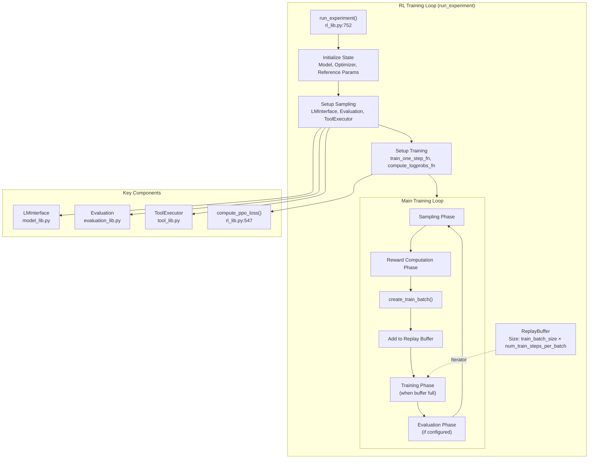
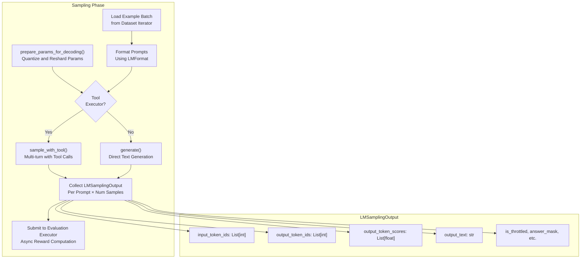
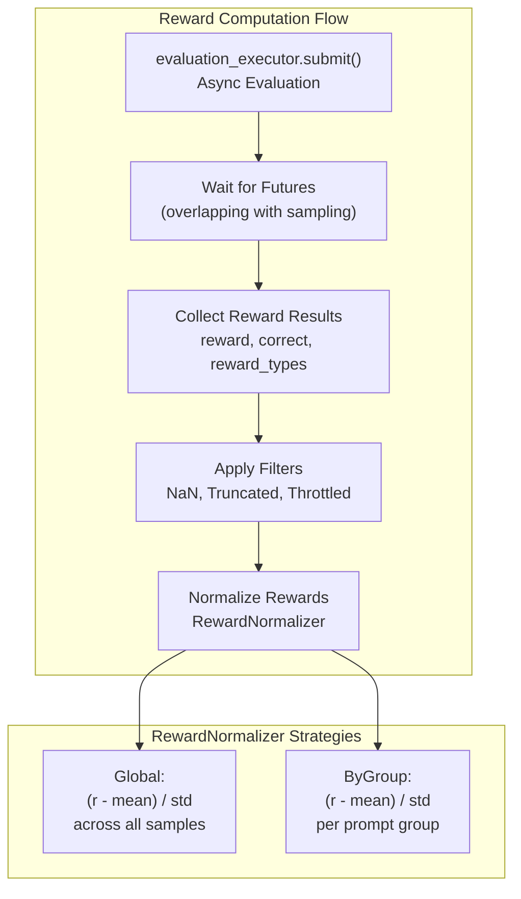
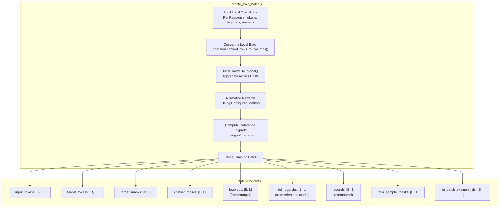
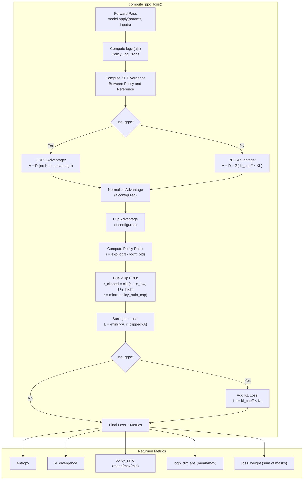
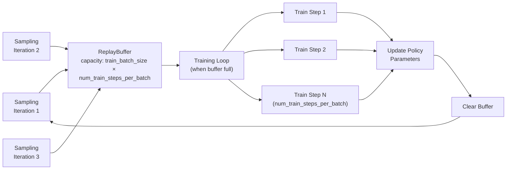
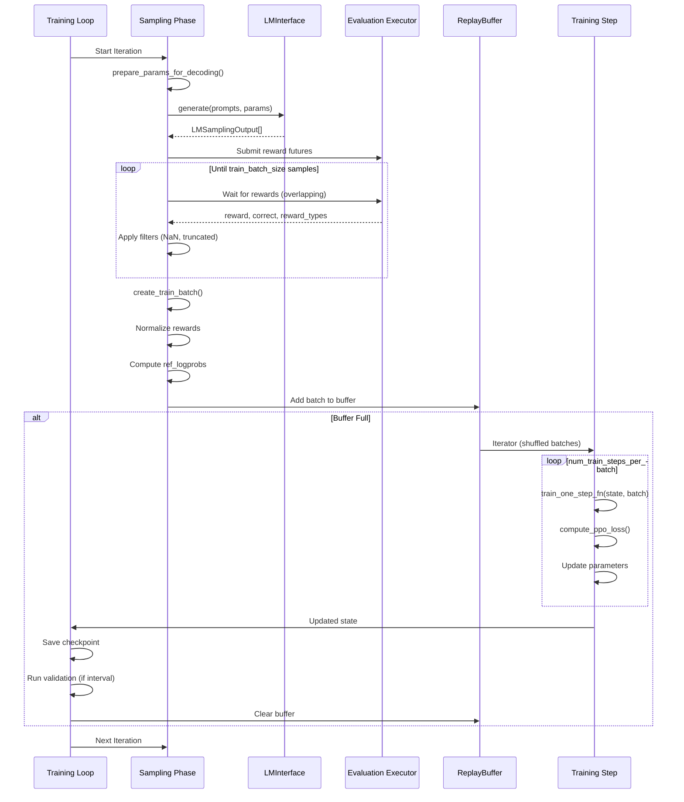

<!-- source: DeepWiki mcp.deepwiki.com · repo google-deepmind/simply · page 5.2 Reinforcement Learning Training · fetched 2026-10-26 -->

# Reinforcement Learning Training

<details>
<summary>Relevant source files</summary>

The following files were used as context for generating this wiki page:

- [simply/config_lib.py](simply/config_lib.py)
- [simply/model_lib.py](simply/model_lib.py)
- [simply/rl_lib.py](simply/rl_lib.py)
- [simply/rl_lib_test.py](simply/rl_lib_test.py)

</details>


This page documents the reinforcement learning (RL) training system in Simply, which implements PPO (Proximal Policy Optimization) and GRPO (Group Relative Policy Optimization) algorithms for fine-tuning language models on reasoning tasks. For standard supervised training, see [Standard Training Workflow](#5.1). For model inference and generation, see [Model Inference and Generation](#5.3).

## Overview

The RL training system enables policy optimization through interaction with environment evaluators. Unlike standard supervised learning where targets are fixed, RL training generates model responses, evaluates them with reward functions, and optimizes the policy to maximize expected rewards while maintaining proximity to a reference policy.

**Key Workflow:**
1. **Sampling Phase**: Generate multiple responses per prompt using the current policy
2. **Reward Computation**: Evaluate responses using task-specific evaluators
3. **Batch Creation**: Aggregate rewarded samples into training batches with normalized rewards
4. **Policy Update**: Optimize policy using PPO or GRPO loss with KL regularization

**Sources:** [simply/rl_lib.py:752-1360]()

## Training Loop Architecture



**Sources:** [simply/rl_lib.py:752-948]()

## Configuration Parameters

RL experiments require additional configuration parameters beyond standard training. These are defined in `ExperimentConfig` dataclasses and specify algorithm hyperparameters, sampling behavior, and evaluation settings.

### Core RL Algorithm Parameters

| Parameter | Type | Default | Description |
|-----------|------|---------|-------------|
| `train_loop_name` | `str` | `'rl'` | Must be `'rl'` to use RL training loop |
| `gamma` | `float` | `1.0` | Discount factor for computing returns |
| `kl_coeff` | `float` | `0.001` | KL divergence coefficient for regularization |
| `use_grpo` | `bool` | `True` | Use GRPO algorithm instead of PPO |
| `ppo_clip_eps` | `float` | `0.2` | Clipping epsilon for policy ratio |
| `ppo_clip_eps_high` | `float \| None` | `None` | Upper clip bound (defaults to `ppo_clip_eps`) |
| `ppo_clip_eps_low` | `float \| None` | `None` | Lower clip bound (defaults to `ppo_clip_eps`) |
| `policy_ratio_cap` | `float \| None` | `10.0` | Maximum policy ratio (dual-clip PPO) |
| `normalize_advantage` | `bool` | `False` | Normalize advantages before loss computation |
| `max_abs_advantage` | `float \| None` | `10.0` | Clip absolute advantage values |
| `normalize_reward_method` | `str` | `'ByGroup'` | Reward normalization: `'Global'`, `'ByGroup'`, or `''` |

### Sampling Configuration

| Parameter | Type | Description |
|-----------|------|-------------|
| `train_batch_size` | `int` | Total samples for training (across all hosts) |
| `batch_size` | `int` | Number of prompts per sampling iteration |
| `num_samples_per_example` | `int` | Responses to generate per prompt |
| `sampling_temperature` | `float` | Temperature for sampling (e.g., `1.0`) |
| `sampling_max_decode_steps` | `int` | Maximum decode steps per response |
| `sampling_prefill_size` | `int` | Prefill chunk size for efficient generation |
| `sampling_intermediate_decode_steps` | `int` | Intermediate decode steps for chunked generation |
| `train_max_seq_len` | `int` | Maximum sequence length for training batches |
| `sampling_max_input_len` | `int` | Maximum input (prompt) length |
| `num_train_steps_per_batch` | `int` | Training steps per sampling batch (off-policy learning) |
| `max_num_samples_per_train_batch` | `int \| None` | Limit on samples per batch iteration |

### Additional Parameters

| Parameter | Type | Description |
|-----------|------|-------------|
| `evaluation` | `Evaluation` | Task-specific evaluation object (e.g., `ZeroShotBoxedInQuestionEvaluation`) |
| `lm_format_name` | `str` | LM format for prompts (e.g., `'GemmaV2Chat'`, `'Pretrain'`) |
| `extra_eos_tokens` | `tuple[str, ...]` | Additional EOS tokens to stop generation |
| `filter_truncated` | `bool` | Filter truncated responses from training |
| `use_policy_logp_as_sampler_logp` | `bool` | Use policy logprobs instead of sampler logprobs (on-policy only) |
| `decoding_sharding_config` | `SimplyConfig` | Sharding config for decoding (e.g., `DecodeGSPMDSharding()`) |
| `ref_params_dtype` | `str` | Reference model dtype (e.g., `'bfloat16'`, `'float32'`) |

**Example Configuration:**

```python
@dataclasses.dataclass(frozen=True)
class Gemma2BV2GSM8K0ShotRL(Gemma2BV2):
  dataset_name: str = 'simply_json:gsm8k_train'
  train_loop_name: str = 'rl'
  evaluation: evaluation_lib.Evaluation = (
      evaluation_lib.ZeroShotBoxedInQuestionEvaluation()
  )
  
  train_batch_size: int = 16 * 8  # 128 total samples
  batch_size: int = 16  # prompts per iteration
  num_samples_per_example: int = 8  # responses per prompt
  train_max_seq_len: int = 2048
  
  gamma: float = 1.0
  kl_coeff: float = 0.001
  use_grpo: bool = True
  ppo_clip_eps: float = 0.2
  normalize_reward_method: str = 'ByGroup'
```

**Sources:** [simply/config_lib.py:839-903](), [simply/config_lib.py:1133-1206]()

## Sampling Phase

During sampling, the current policy generates multiple responses for each prompt. This phase uses the `LMInterface` to perform efficient batched generation with optional tool use.



**Key Functions:**

- **`prepare_params_for_decoding`** [simply/rl_lib.py:729-748](): Converts training parameters to decoding format by quantizing (e.g., to `bfloat16`) and resharding to decoding mesh if specified
- **`LMInterface.generate`** [simply/model_lib.py:2033-2150](): Generates responses with KV-caching and batched decoding
- **`ToolExecutor.sample_with_tool`** [simply/tool_lib.py](): Multi-turn generation with tool calls for tasks requiring external information

**Process Details:**

1. **Parameter Preparation**: Policy parameters are quantized and resharded to the decoding mesh (if different from training mesh)
2. **Prompt Formatting**: Raw examples are formatted using `LMFormat` (e.g., adding chat templates)
3. **Batch Generation**: `batch_size` prompts × `num_samples_per_example` responses are generated in parallel
4. **Async Evaluation**: Each response is submitted to an evaluation executor thread pool for reward computation

**Sources:** [simply/rl_lib.py:952-1154]()

## Reward Computation and Normalization

Rewards are computed asynchronously using task-specific `Evaluation` objects. The system supports reward normalization strategies to stabilize training.



**Reward Normalizer Classes:**

- **`RewardNormalizer.Global`** [simply/rl_lib.py:282-289](): Normalizes rewards using global mean and standard deviation across all samples
- **`RewardNormalizer.ByGroup`** [simply/rl_lib.py:292-326](): Normalizes rewards within each prompt group (recommended for stability)

**Filtering Logic:**

Training samples are filtered based on:
- `np.isnan(reward)`: Invalid reward computation
- `filter_truncated=True`: Responses that hit max length without EOS token
- `filter_throttled=True`: Tool-based responses that were throttled

**Statistics Computation:**

The `compute_stats` function [simply/rl_lib.py:121-253]() aggregates metrics across hosts:
- Mean/max/min sequence lengths (prompt, response, total)
- Reward statistics (mean, by reward type)
- Accuracy and pass@k metrics
- Truncation rate
- Eval/train sample counts

**Sources:** [simply/rl_lib.py:121-253](), [simply/rl_lib.py:256-326](), [simply/rl_lib.py:1051-1154]()

## Training Batch Creation

Rewarded samples are collected from all hosts and assembled into a global training batch with normalized rewards and reference logprobs.



**Key Functions:**

- **`create_train_batch`** [simply/rl_lib.py:413-522](): Main function that assembles training batches
- **`local_batch_to_global`** [simply/rl_lib.py:329-410](): Aggregates local batches across hosts using process_allgather
- **`compute_logprobs`** [simply/rl_lib.py:55-102](): Computes log probabilities for reference model

**Field Descriptions:**

- **`input_tokens`/`target_tokens`**: Shifted token sequences (target = input[1:])
- **`answer_masks`**: Boolean mask indicating which tokens are part of the response (not prompt)
- **`logprobs`**: Log probabilities from the sampler (used for computing policy ratios)
- **`ref_logprobs`**: Log probabilities from the frozen reference model (for KL regularization)
- **`rewards`**: Normalized scalar rewards per sequence
- **`train_sample_masks`**: Boolean mask for valid training samples (after filtering)
- **`in_batch_example_ids`**: Group ID for reward normalization (same prompt → same ID)

**Sources:** [simply/rl_lib.py:413-522](), [simply/rl_lib.py:329-410](), [simply/rl_lib.py:55-102]()

## PPO/GRPO Loss Computation

The loss function implements both PPO and GRPO algorithms with KL regularization. The choice is controlled by the `use_grpo` configuration parameter.



**Algorithm Details:**

### PPO (Proximal Policy Optimization)
- **Advantage**: `A = R + Σ(-kl_coeff × KL(π || π_ref))` (discounted rewards with KL penalty per token)
- **Loss**: Standard clipped surrogate objective
- **KL**: Computed per-token as `logπ - logπ_ref`

### GRPO (Group Relative Policy Optimization)
- **Advantage**: `A = R` (reward only, no per-token KL)
- **Loss**: Clipped surrogate + explicit KL term
- **KL**: K3 estimator: `exp(logπ_ref - logπ) - 1 - (logπ_ref - logπ)` [simply/rl_lib.py:612-614]()

### Dual-Clip PPO
When `policy_ratio_cap` is set:
```
r = exp(logπ - logπ_old)
r = min(r, policy_ratio_cap)  # Cap very large ratios
r_clipped = clip(r, 1 - ε_low, 1 + ε_high)
```

**Sources:** [simply/rl_lib.py:547-701]()

## Replay Buffer and Off-Policy Learning

The RL training loop uses a replay buffer to enable multiple training steps per sampling batch, supporting off-policy learning.



**Configuration:**

- **`num_train_steps_per_batch`**: Number of training steps per sampling batch
  - `= 1`: Pure on-policy (recommended with `use_policy_logp_as_sampler_logp=True`)
  - `> 1`: Off-policy (samples are reused across multiple updates)
- **`replay_buffer_size`**: `train_batch_size × num_train_steps_per_batch`

**Implementation:**

The `ReplayBuffer` class [simply/utils/replay_buffers.py]() provides:
- `extend(batch)`: Add training batch to buffer
- `iterator(batch_size, shuffle)`: Iterate over shuffled batches for training

**Constraint:** When `num_train_steps_per_batch > 1`, `use_policy_logp_as_sampler_logp` must be `False` to avoid incorrect logprob differences due to policy drift.

**Sources:** [simply/rl_lib.py:929-932](), [simply/rl_lib.py:1217-1226]()

## Multi-Host Coordination

RL training coordinates sampling and training across multiple hosts with careful synchronization.

| Operation | Parallelism | Synchronization Point |
|-----------|-------------|----------------------|
| **Sampling** | Each host processes `batch_size / process_count` prompts | `sync_global_devices('wait_for_sampling')` |
| **Reward Computation** | Async thread pool per host | `sync_global_devices('wait_for_reward')` |
| **Batch Aggregation** | `local_batch_to_global()` with `process_allgather` | Implicit in allgather |
| **Training** | Data parallel across hosts | Implicit in training loop |
| **Checkpointing** | Host 0 writes, all sync | `helper.save_ckpt()` |
| **Evaluation** | Each host processes subset | `process_allgather(verdicts)` |

**Key Synchronization Functions:**

- **`process_allgather(data, tiled=True)`**: Gather data from all hosts
- **`sync_global_devices(name)`**: Explicit barrier across all hosts
- **`sum_across_hosts(data)`**: Sum tensors across hosts (used in `local_batch_to_global`)

**Sources:** [simply/rl_lib.py:329-410](), [simply/rl_lib.py:1153](), [simply/rl_lib.py:1079-1081]()

## Validation During RL Training

RL training optionally runs validation at specified intervals using a separate evaluation dataset.

**Configuration:**
- `use_validation_set`: Enable validation
- `validation_dataset_name`: Dataset for validation (e.g., `'simply_json:aime24'`)
- `validation_eval_interval`: Steps between validation runs
- `validation_eval_batch_size`: Batch size for validation
- `validation_eval_epochs`: Number of epochs to evaluate
- `validation_evaluation`: Optional separate evaluation object for validation
- `validation_lm_format_name`: Optional separate LM format for validation
- `validation_max_decode_steps`: Optional max decode steps for validation

**Process:**
1. Generate single response per validation prompt (no sampling)
2. Evaluate responses using validation evaluation object
3. Aggregate verdicts across hosts
4. Log validation accuracy to TensorBoard

**Sources:** [simply/rl_lib.py:1229-1286]()

## Complete Training Step Sequence



**Sources:** [simply/rl_lib.py:752-1360]()

## Key Classes and Functions Reference

### Core Training Loop
- **`run_experiment`** [simply/rl_lib.py:752-1360](): Main RL training loop registered as `'rl'` train loop
- **`train_one_step_fn`** [simply/rl_lib.py:813-838](): JIT-compiled training step with custom PPO/GRPO loss
- **`compute_ppo_loss`** [simply/rl_lib.py:547-701](): Computes PPO or GRPO loss with metrics

### Sampling and Reward
- **`LMInterface.generate`** [simply/model_lib.py:2033-2150](): Batched text generation with KV-caching
- **`compute_logprobs`** [simply/rl_lib.py:55-102](): Computes log probabilities for sequences
- **`prepare_params_for_decoding`** [simply/rl_lib.py:729-748](): Quantizes and reshards parameters for decoding

### Batch Construction
- **`create_train_batch`** [simply/rl_lib.py:413-522](): Creates global training batch from rewarded samples
- **`local_batch_to_global`** [simply/rl_lib.py:329-410](): Aggregates local batches across hosts
- **`compute_stats`** [simply/rl_lib.py:121-253](): Computes statistics from rewarded samples

### Reward Normalization
- **`RewardNormalizer.Global`** [simply/rl_lib.py:282-289](): Global reward normalization
- **`RewardNormalizer.ByGroup`** [simply/rl_lib.py:292-326](): Per-prompt-group reward normalization

### Utilities
- **`compute_return`** [simply/rl_lib.py:525-544](): Computes discounted returns
- **`decoding_mesh_context`** [simply/rl_lib.py:704-712](): Context manager for decoding mesh
- **`tree_convert_dtype`** [simply/rl_lib.py:723-725](): JIT-compiled dtype conversion for parameter trees

**Sources:** [simply/rl_lib.py:1-1360](), [simply/model_lib.py:2033-2150]()

---

