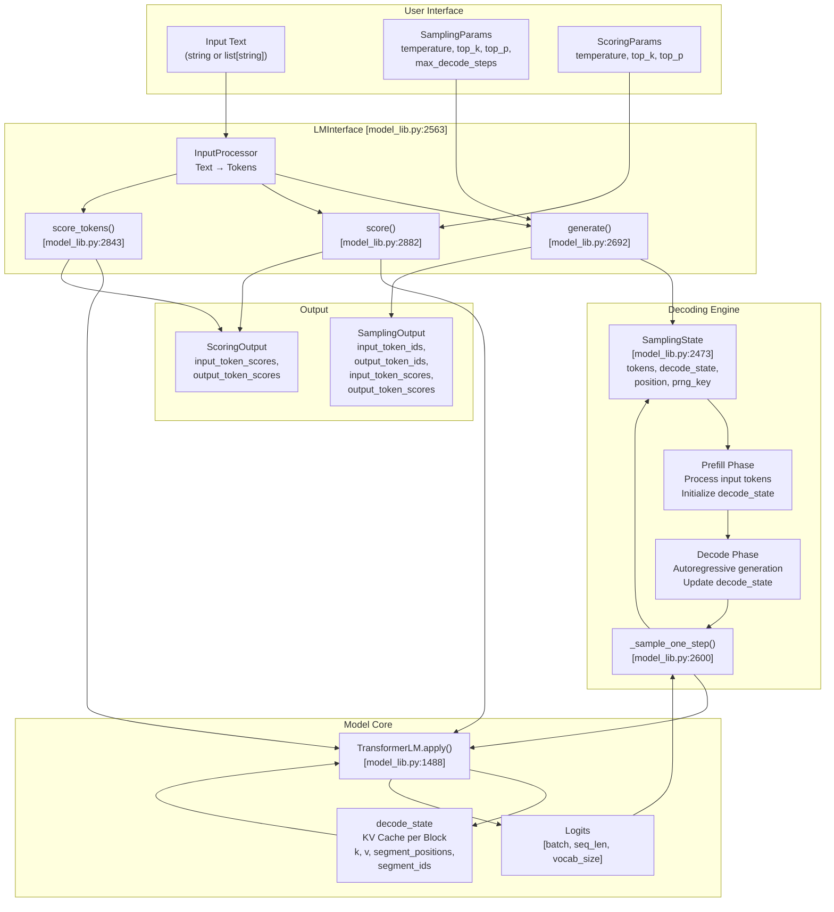
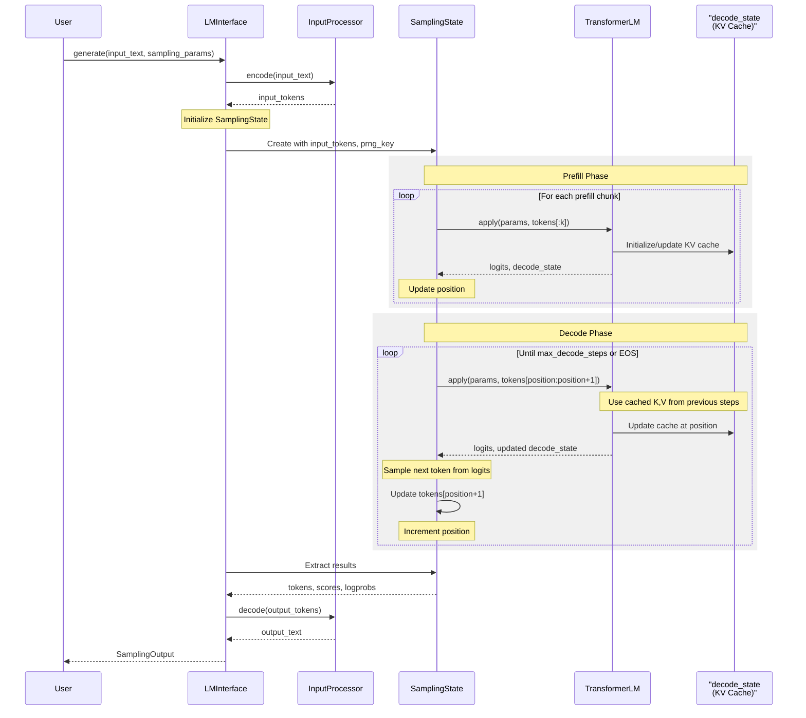
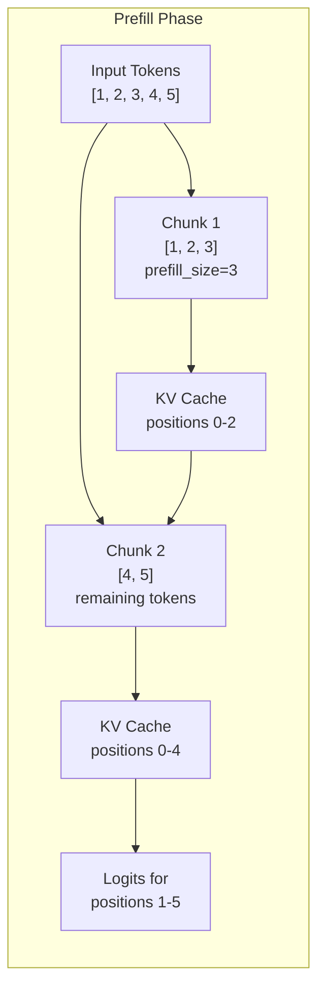
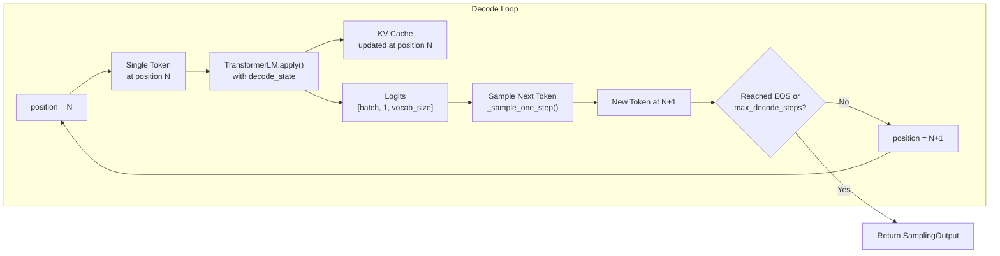
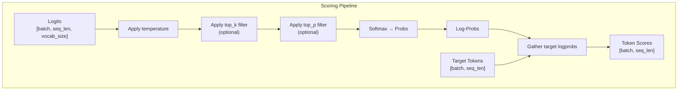
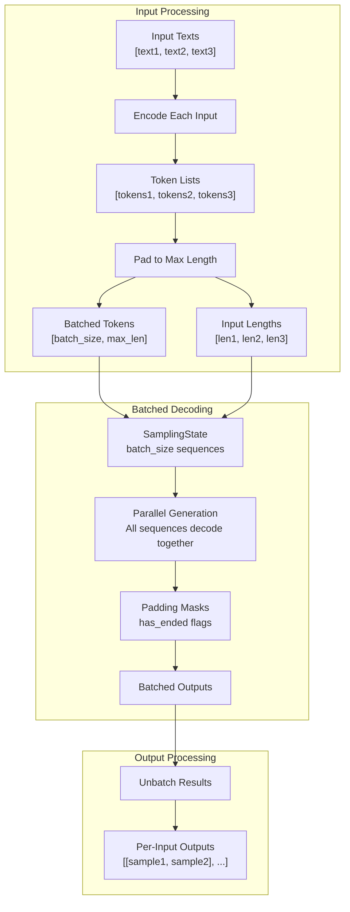

<!-- source: DeepWiki mcp.deepwiki.com · repo google-deepmind/simply · page 5.3 Model Inference and Generation · fetched 2026-10-26 -->

# Model Inference and Generation

<details>
<summary>Relevant source files</summary>

The following files were used as context for generating this wiki page:

- [simply/model_lib.py](simply/model_lib.py)
- [simply/model_lib_test.py](simply/model_lib_test.py)

</details>


## Purpose and Scope

This page documents the model inference and generation system in Simply, focusing on how to use trained models to generate text and score sequences. It covers the `LMInterface` class, sampling parameters, KV-caching mechanisms, and both single and batched inference workflows.

For information about training models, see [Standard Training Workflow](#5.1). For details on the underlying model architecture, see [Model Architecture](#4.2).

## Overview

Simply provides a high-level inference API through the `LMInterface` class, which wraps `TransformerLM` models and handles the complexity of text generation, KV-caching, and sequence scoring. The system supports:

- **Autoregressive text generation** with configurable sampling strategies
- **Sequence scoring** for likelihood computation
- **KV-caching** for efficient incremental decoding
- **Batched inference** for processing multiple inputs simultaneously
- **Flexible tokenization** through the vocabulary system

**Inference Architecture Overview**



Sources: [simply/model_lib.py:2473-2658](), [simply/model_lib.py:2563-2936]()

## LMInterface: The High-Level API

The `LMInterface` class provides the primary interface for model inference. It encapsulates a `TransformerLM` model, its parameters, and a vocabulary, providing convenient methods for generation and scoring.

### Initialization

```python
# From model_lib.py
lm_interface = LMInterface(
    model=transformer_lm,           # TransformerLM instance
    params=model_params,            # Model parameters (PyTree)
    vocab=vocabulary,               # SimplyVocab instance
    default_sampling_params=None,  # Optional default SamplingParams
)
```

**Core Components**

| Component | Type | Purpose |
|-----------|------|---------|
| `model` | `TransformerLM` | The transformer model for forward passes |
| `params` | `PyTree` | Model weights and parameters |
| `vocab` | `SimplyVocab` | Tokenizer for encoding/decoding text |
| `input_processor` | `InputProcessor` | Handles text→token conversion and batching |
| `default_sampling_params` | `SamplingParams` | Default generation configuration |

Sources: [simply/model_lib.py:2563-2591]()

### Key Methods

The `LMInterface` provides three primary methods:

1. **`generate()`** - Autoregressive text generation with sampling
2. **`score()`** - Compute likelihood scores for given text pairs
3. **`score_tokens()`** - Score pre-tokenized sequences

Sources: [simply/model_lib.py:2692-2882]()

## Text Generation Process

Text generation in Simply follows a two-phase approach: **prefill** (processing input tokens) and **decode** (autoregressive generation).

### Generation Workflow



Sources: [simply/model_lib.py:2692-2841]()

### SamplingParams Configuration

The `SamplingParams` dataclass controls generation behavior:

| Parameter | Type | Default | Description |
|-----------|------|---------|-------------|
| `temperature` | `float` | `1.0` | Sampling temperature (0.0 = greedy) |
| `top_k` | `int` | `-1` | Top-k filtering (-1 = disabled) |
| `top_p` | `float` | `1.0` | Nucleus sampling threshold |
| `max_decode_steps` | `int` | `128` | Maximum tokens to generate |
| `intermediate_decode_steps` | `int` | `0` | Steps before returning intermediate results |
| `num_samples` | `int` | `1` | Number of samples per input |
| `max_seq_len` | `int` | `-1` | Maximum total sequence length |
| `max_input_len` | `int` | `-1` | Maximum input length (truncates if exceeded) |
| `prefill_size` | `int` | `128` | Tokens processed per prefill step |
| `sort_by` | `str` | `None` | Sort multiple samples by score metric |

**Example Usage:**

```python
# Greedy decoding
greedy_params = SamplingParams(temperature=0.0, max_decode_steps=100)

# Nucleus sampling
nucleus_params = SamplingParams(temperature=1.0, top_p=0.9, max_decode_steps=50)

# Top-k sampling
topk_params = SamplingParams(temperature=0.8, top_k=40, max_decode_steps=50)

# Multiple samples
multi_params = SamplingParams(
    temperature=1.0, num_samples=5, sort_by='avg_output_logprob'
)
```

Sources: [simply/utils/sampling_lib.py]()

### Prefill and Decode Phases

**Prefill Phase** ([model_lib.py:2737-2772]())

The prefill phase processes input tokens in chunks, initializing the KV cache:



- Input tokens are split into chunks of size `prefill_size`
- Each chunk is processed through `TransformerLM.apply()` with `decode_state`
- The KV cache is progressively built up
- After prefill, `position` points to the last input token

**Decode Phase** ([model_lib.py:2775-2831]())

The decode phase generates tokens one at a time using the cached context:



- Each iteration processes a single token at the current `position`
- The KV cache contains keys/values for all previous positions
- Attention only needs to compute for the new token
- The `decode_state` is updated in-place (or creates new state for sliding windows)

Sources: [simply/model_lib.py:2737-2831]()

### KV Cache Management

The KV cache is stored in `decode_state`, a PyTree containing cache entries for each transformer block.

**Decode State Structure:**

```
decode_state = {
    'block_0': {
        'k': [batch, cache_len, n_kv_heads, per_head_dim],
        'v': [batch, cache_len, n_kv_heads, per_head_dim],
        'segment_positions': [batch, cache_len],
        'segment_ids': [batch, cache_len],
        'window_size=W': None  # metadata
    },
    'block_1': { ... },
    ...
    'prefill_position': scalar  # used for sliding window
}
```

**Cache Update Process** ([model_lib.py:365-461]())

The `updated_decode_state()` function manages cache updates:

1. **Without sliding window** (`window_size=0`):
   - New K/V are appended at `position` in the cache
   - Cache grows monotonically up to `max_seq_len`

2. **With sliding window** (`window_size>0`):
   - Cache size is fixed at `window_size + 1`
   - Cache position is computed as `position % (window_size + 1)`
   - Old entries are overwritten in a circular manner
   - During prefill, cache is truncated to window using `_windowized_array()`

**Padding for Batch Inference** ([model_lib.py:2659-2677]())

The `pad_decode_state_to()` function extends cache to a target length:
- Used when batching inputs of different lengths
- Pads with zeros to align cache dimensions
- Ensures efficient batched computation

Sources: [simply/model_lib.py:365-461](), [simply/model_lib.py:2659-2690]()

## Sequence Scoring

Sequence scoring computes log-likelihood scores for token sequences, useful for:
- Evaluating model perplexity
- Reranking generation candidates
- Computing token-level scores

### Scoring Methods

**1. `score()` - Text-based Scoring**

Scores the likelihood of `output_text` given `input_text`:

```python
scoring_output = lm_interface.score(
    input_text="The capital of France is",
    output_text="Paris",
    scoring_params=ScoringParams(temperature=1.0)
)

# scoring_output.input_token_scores: list[float]
# scoring_output.output_token_scores: list[float]
# scoring_output.sum_output_score: float
# scoring_output.avg_output_score: float
```

Sources: [simply/model_lib.py:2882-2936]()

**2. `score_tokens()` - Token-based Scoring**

Scores pre-tokenized sequences directly:

```python
tokens = np.array([[bos_id, token1, token2, token3]])  # [batch, seq_len]
token_scores = lm_interface.score_tokens(
    tokens=tokens,
    scoring_params=ScoringParams(temperature=1.0)
)
# token_scores[i] is the score for tokens[i+1] given tokens[:i+1]
```

Sources: [simply/model_lib.py:2843-2880]()

### Log-Likelihood Computation

The core scoring function is `compute_log_likelihood()` ([model_lib.py:2939-2983]()):



**Key Steps:**

1. **Temperature scaling**: `logits = logits / temperature`
2. **Top-k filtering**: Zero out all but top-k logits (if `top_k > 0`)
3. **Top-p filtering**: Zero out tokens outside nucleus (if `top_p < 1.0`)
4. **Softmax**: Convert to probabilities
5. **Log**: Compute log-probabilities
6. **Gather**: Extract log-probs for target tokens

**ScoringParams:**

| Parameter | Type | Default | Description |
|-----------|------|---------|-------------|
| `temperature` | `float` | `1.0` | Softmax temperature |
| `top_k` | `int` | `-1` | Top-k filtering (-1 = disabled) |
| `top_p` | `float` | `1.0` | Nucleus sampling threshold |

Sources: [simply/model_lib.py:2939-2983]()

## Batched Inference

`LMInterface` supports batched inference for processing multiple inputs efficiently.

### Batch Generation

```python
# Generate for multiple inputs
input_texts = [
    "Once upon a time",
    "The quick brown fox",
    "To be or not to be"
]

outputs = lm_interface.generate(
    input_text=input_texts,  # List of strings
    prng_key=jax.random.key(42),
    sampling_params=SamplingParams(max_decode_steps=20, num_samples=2)
)
# outputs: list[list[SamplingOutput]]
# outputs[i][j] is the j-th sample for the i-th input
```

**Batching Process:**



**Key Features:**

1. **Automatic Padding**: Shorter sequences are padded to match the longest
2. **Masking**: `has_ended` flags prevent further generation for finished sequences
3. **Length Tracking**: `input_lens` track actual (non-padded) lengths
4. **Efficient Computation**: All sequences processed in parallel through model

Sources: [simply/model_lib.py:2692-2841](), [simply/model_lib.py:2473-2534]()

### Input Truncation

When inputs exceed `max_input_len`, they are truncated from the left:

```python
sampling_params = SamplingParams(
    max_decode_steps=50,
    max_seq_len=100,      # Total sequence length limit
    max_input_len=40      # Truncate inputs longer than this
)

# If input has 60 tokens, only the last 40 are used
```

This is useful for:
- Handling very long contexts
- Maintaining consistent memory usage
- Focusing on recent context in conversations

Sources: [simply/model_lib.py:2699-2718]()

## SamplingOutput and ScoringOutput

### SamplingOutput

The `SamplingOutput` dataclass contains complete generation results:

```python
@dataclass
class SamplingOutput:
    input_token_ids: list[int]        # Input tokens (including BOS)
    output_token_ids: list[int]       # Generated tokens
    input_token_scores: list[float]   # Scores for input tokens
    output_token_scores: list[float]  # Scores for output tokens
    input_token_logprobs: list[float] # Log-probs for input tokens
    output_token_logprobs: list[float]# Log-probs for output tokens
    
    # Aggregated metrics
    sum_input_score: float
    avg_input_score: float
    sum_output_score: float
    avg_output_score: float
    sum_input_logprob: float
    avg_input_logprob: float
    sum_output_logprob: float
    avg_output_logprob: float
```

**Score vs. LogProb:**
- **Scores** are computed using `scoring_params` (may have different temperature/filtering)
- **LogProbs** are computed using `sampling_params` (reflect actual sampling distribution)

Sources: [simply/model_lib.py:2563-2591]()

### ScoringOutput

The `ScoringOutput` dataclass contains scoring-specific results:

```python
@dataclass
class ScoringOutput:
    input_token_ids: list[int]
    output_token_ids: list[int]
    input_token_scores: list[float]
    output_token_scores: list[float]
    sum_input_score: float
    avg_input_score: float
    sum_output_score: float
    avg_output_score: float
```

Sources: [simply/model_lib.py:2563-2591]()

## Advanced Topics

### Intermediate Decoding

Generate partial results during long generations:

```python
sampling_params = SamplingParams(
    max_decode_steps=100,
    intermediate_decode_steps=25  # Return results every 25 steps
)

outputs = lm_interface.generate(
    input_text="Once upon a time",
    prng_key=jax.random.key(42),
    sampling_params=sampling_params
)
# Returns multiple SamplingOutput with progressively longer outputs
```

Sources: [simply/model_lib.py:2775-2831]()

### Sliding Window Attention

When using models with sliding window attention (`window_size > 0`):

- KV cache maintains only `window_size + 1` recent tokens
- Memory usage is constant regardless of generation length
- Attention is computed over a local context window

The cache management automatically handles circular buffering during decode.

Sources: [simply/model_lib.py:365-461](), [simply/model_lib.py:512-591]()

### Separate Scoring and Sampling Parameters

Control scoring independently from sampling:

```python
# Sample with temperature=0.8, but score with temperature=1.0
outputs = lm_interface.generate(
    input_text="Question: What is 2+2? Answer:",
    prng_key=jax.random.key(42),
    sampling_params=SamplingParams(temperature=0.8, top_k=40),
    scoring_params=ScoringParams(temperature=1.0, top_k=-1)
)
# output_token_scores computed with temperature=1.0
# output_token_logprobs computed with temperature=0.8
```

This is useful when you want to:
- Sample with constraints but score without them
- Compare scores across different sampling strategies
- Evaluate true model probabilities independent of sampling

Sources: [simply/model_lib.py:2692-2841]()

### Custom Prefill Size

Control prefill chunk size for memory/speed tradeoff:

```python
# Smaller prefill_size: less memory, slower prefill
# Larger prefill_size: more memory, faster prefill
outputs = lm_interface.generate(
    input_text="very long input text...",
    prng_key=jax.random.key(42),
    prefill_size=64,  # Process 64 tokens at a time
    sampling_params=SamplingParams(max_decode_steps=50)
)
```

Sources: [simply/model_lib.py:2737-2772]()

### JIT Compilation Behavior

Key functions are JIT-compiled for performance:

- **`TransformerLM.apply()`**: Compiled with static model structure
- **`_sample_one_step()`**: Compiled per sampling configuration
- **Model forward pass**: Recompiled when decode_state structure changes

To avoid recompilation:
- Use consistent `prefill_size` and `max_decode_steps`
- Keep `window_size` constant across calls
- Batch inputs of similar lengths together

Sources: [simply/model_lib.py:2600-2658]()

---

