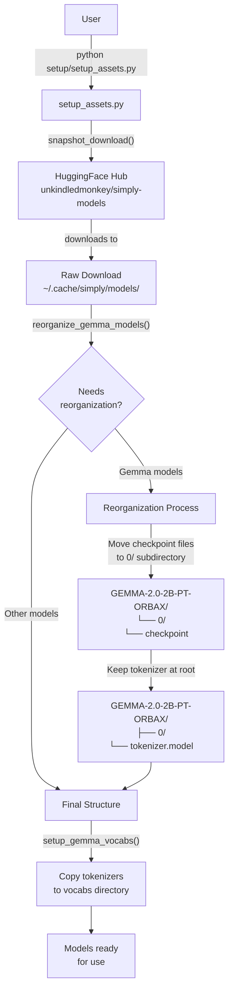
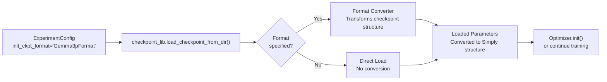
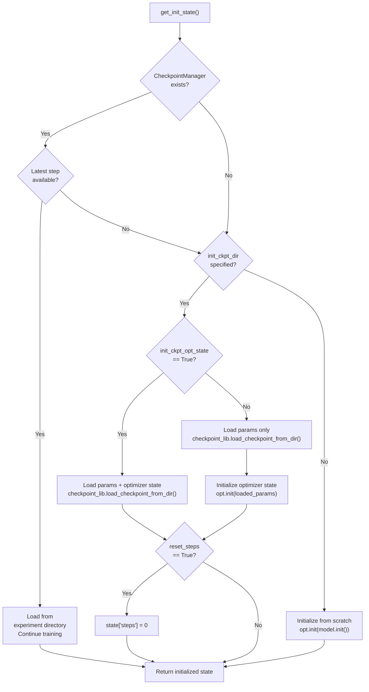

<!-- source: DeepWiki mcp.deepwiki.com · repo google-deepmind/simply · page 5.4 Working with Pretrained Models · fetched 2026-10-26 -->

# Working with Pretrained Models

<details>
<summary>Relevant source files</summary>

The following files were used as context for generating this wiki page:

- [README.md](README.md)
- [setup/setup_assets.py](setup/setup_assets.py)
- [simply/config_lib.py](simply/config_lib.py)
- [simply/model_lib.py](simply/model_lib.py)

</details>


This page documents how to download, configure, and load pretrained model checkpoints in Simply. It covers the asset management system, checkpoint formats, configuration options for initialization, and common workflows for fine-tuning and transfer learning.

For information about training models from scratch, see [Standard Training Workflow](#5.1). For inference and text generation with loaded models, see [Model Inference and Generation](#5.3).

## Overview

Simply provides a streamlined system for working with pretrained models from HuggingFace. The workflow involves:

1. **Downloading models** via `setup_assets.py` from the `unkindledmonkey/simply-models` repository
2. **Organizing checkpoints** in the local cache (`~/.cache/simply/models/`) with the required directory structure
3. **Configuring experiments** to load checkpoints by setting `init_ckpt_dir`, `init_ckpt_step`, and `init_ckpt_format` fields
4. **Loading parameters** at initialization time, with optional optimizer state restoration

The system supports multiple checkpoint formats to accommodate different model families (Gemma, Qwen, DeepSeek) and provides automatic format conversion during loading.

Sources: [simply/config_lib.py:34-70](), [setup/setup_assets.py:1-22](), [simply/model_lib.py:2302-2354]()

## Checkpoint Directory Structure

Simply expects pretrained model checkpoints in a specific directory layout:

```
~/.cache/simply/models/
├── GEMMA-2.0-2B-PT-ORBAX/
│   ├── 0/
│   │   ├── checkpoint
│   │   ├── _CHECKPOINT_METADATA
│   │   ├── _METADATA
│   │   ├── manifest.ocdbt
│   │   └── d/
│   └── tokenizer.model
├── DeepSeek-R1-Distill-Qwen-1.5B/
│   └── ORBAX/
│       └── 0/
│           └── checkpoint
└── Qwen3-1.7B/
    └── ORBAX/
        └── 0/
            └── checkpoint
```

**Key requirements:**

- Checkpoint files must be in step-numbered subdirectories (e.g., `0/`, `1000/`, etc.)
- The main checkpoint state is stored in the `checkpoint` file within the step directory
- Tokenizer files are stored at the model root level
- The MODELS_DIR location can be customized via the `SIMPLY_MODELS` environment variable

The step-numbered directory structure enables loading checkpoints from specific training steps by setting `init_ckpt_step` in the configuration. Setting `init_ckpt_step=-1` loads the latest available checkpoint.

Sources: [setup/setup_assets.py:47-112](), [simply/config_lib.py:34-70]()

## Downloading Pretrained Models

### Using setup_assets.py

The `setup_assets.py` script handles downloading and organizing pretrained models:

```bash
# Download both models and datasets
python setup/setup_assets.py

# Download only models
python setup/setup_assets.py --models-only

# Specify custom directory
python setup/setup_assets.py --models-dir /path/to/models

# Force re-download
python setup/setup_assets.py --force
```

**Environment variables:**
- `SIMPLY_MODELS`: Override default models directory (`~/.cache/simply/models/`)
- `SIMPLY_DATASETS`: Override default datasets directory
- `SIMPLY_VOCABS`: Override default vocabularies directory

### Download and Reorganization Flow



**Gemma Model Reorganization**

Gemma models downloaded from HuggingFace have a nested structure that must be flattened. The `reorganize_gemma_models` function performs this transformation:

- **Input structure:** `GEMMA-2.0-2B-PT-ORBAX/gemma2-2b/{checkpoint files}`
- **Output structure:** `GEMMA-2.0-2B-PT-ORBAX/0/{checkpoint files}`

The reorganization moves checkpoint files from the model-specific subdirectory into a step-numbered directory (`0/`) while keeping the tokenizer at the root level. This ensures compatibility with Simply's checkpoint loading system.

Sources: [setup/setup_assets.py:47-112](), [setup/setup_assets.py:142-169]()

## Configuration for Loading Checkpoints

### Core Configuration Fields

Pretrained model loading is controlled by several fields in `ExperimentConfig`:

| Field | Type | Purpose | Default |
|-------|------|---------|---------|
| `init_ckpt_dir` | `str` | Path to checkpoint directory | `''` (empty = no loading) |
| `init_ckpt_step` | `int` | Specific step to load, -1 for latest | `-1` |
| `init_ckpt_opt_state` | `bool` | Whether to load optimizer state | `False` |
| `init_ckpt_format` | `str` | Checkpoint format identifier | `''` (auto-detect) |
| `reset_steps` | `bool` | Reset step counter after loading | `False` |

### Checkpoint Directory Constants

The `config_lib` module defines constants for all available pretrained models:

```python
# Gemma 2 models
GEMMA2_2B_PT_CKPT_DIR = os.path.join(MODELS_DIR, 'GEMMA-2.0-2B-PT-ORBAX')
GEMMA2_9B_PT_CKPT_DIR = os.path.join(MODELS_DIR, 'GEMMA-2.0-9B-PT-ORBAX')
GEMMA2_2B_IT_CKPT_DIR = os.path.join(MODELS_DIR, 'GEMMA-2.0-2B-IT-ORBAX')

# Gemma 3 models
GEMMA3_1B_PT_CKPT_DIR = os.path.join(MODELS_DIR, 'GEMMA-3.0-1B-PT-ORBAX')
GEMMA3_4B_PT_CKPT_DIR = os.path.join(MODELS_DIR, 'GEMMA-3.0-4B-PT-ORBAX')

# DeepSeek-Qwen models
DEEPSEEK_QWEN_1P5B_CKPT_DIR = os.path.join(MODELS_DIR, 'DeepSeek-R1-Distill-Qwen-1.5B/ORBAX')
DEEPSEEK_QWEN_7B_CKPT_DIR = os.path.join(MODELS_DIR, 'DeepSeek-R1-Distill-Qwen-7B/ORBAX')

# Qwen3 models
QWEN3_1P7B_CKPT_DIR = os.path.join(MODELS_DIR, 'Qwen3-1.7B/ORBAX')
QWEN3_4B_CKPT_DIR = os.path.join(MODELS_DIR, 'Qwen3-4B/ORBAX')
```

These constants are used directly in model configuration classes to specify the checkpoint locations.

Sources: [simply/config_lib.py:34-70](), [simply/config_lib.py:314-326]()

### Example Configurations

**Loading a pretrained Gemma 2B model:**

```python
@ExperimentConfigRegistry.register
@dataclasses.dataclass(frozen=True)
class Gemma2BV2(TFM1p7BLM1B):
    # Architecture config
    model_dim: int = 2304
    n_heads: int = 8
    n_layers: int = 26
    
    # Checkpoint loading config
    init_ckpt_dir: str = GEMMA2_2B_PT_CKPT_DIR
    init_ckpt_step: int = -1  # Load latest
    init_ckpt_opt_state: bool = False  # Params only
    init_ckpt_format: str = 'Gemma3pLegacyFormat'
    reset_steps: bool = True  # Start from step 0
```

**Loading with optimizer state for continued training:**

```python
@ExperimentConfigRegistry.register
@dataclasses.dataclass(frozen=True)
class ContinueTraining(Gemma2BV2):
    init_ckpt_dir: str = '/path/to/my/checkpoint'
    init_ckpt_step: int = 5000
    init_ckpt_opt_state: bool = True  # Load optimizer state
    reset_steps: bool = False  # Continue from step 5000
```

Sources: [simply/config_lib.py:577-623](), [simply/config_lib.py:314-326]()

## Checkpoint Formats

Different model families use different checkpoint formats. Simply supports automatic format conversion through the `init_ckpt_format` field.

### Supported Formats

| Format | Used For | Description |
|--------|----------|-------------|
| `'Gemma3pLegacyFormat'` | Gemma 2 (2B) | Legacy Gemma 2 checkpoint structure |
| `'Gemma3pFormat'` | Gemma 2 (9B, 27B), Gemma 3 | Standard Gemma 3+ checkpoint structure |
| `''` (empty string) | Qwen, DeepSeek, custom | Default Orbax format, no conversion |

### Format Conversion Process



**Gemma Format Differences:**

- **Gemma 2 (2B):** Uses `Gemma3pLegacyFormat` with specific parameter naming conventions
- **Gemma 2 (9B, 27B):** Uses `Gemma3pFormat` with updated parameter structure
- **Gemma 3:** Uses `Gemma3pFormat` with QK normalization and different attention patterns

The format converter handles renaming and restructuring parameters to match Simply's internal `TransformerLM` structure.

Sources: [simply/config_lib.py:617](), [simply/config_lib.py:650](), [simply/config_lib.py:725]()

## Checkpoint Loading Implementation

### State Initialization Flow



The `get_init_state` function implements three distinct initialization paths:

1. **Resume from experiment checkpoint:** Loads both parameters and optimizer state from the experiment's own checkpoint directory
2. **Initialize from external pretrained checkpoint:** Loads parameters (and optionally optimizer state) from a different checkpoint directory
3. **Initialize from scratch:** Creates new random parameters when no checkpoint is specified

Sources: [simply/model_lib.py:2302-2354]()

### Loading Parameters Only vs. Full State

**Parameters Only (init_ckpt_opt_state=False):**
- Loads model weights from checkpoint
- Initializes fresh optimizer state (Adam momentum, variance, etc.)
- Use case: Fine-tuning on new task, transfer learning
- Requires `reset_steps=True` to start step counter at 0

**Full State (init_ckpt_opt_state=True):**
- Loads both model weights and optimizer state
- Preserves training dynamics from checkpoint
- Use case: Resuming interrupted training, continued pre-training
- Can use `reset_steps=False` to continue from checkpoint step

```python
# Fine-tuning: load params only
state = ckpt_lib.load_checkpoint_from_dir(
    config.init_ckpt_dir,
    {'params': abstract_params},
    config.init_ckpt_step,
    ckpt_format=config.init_ckpt_format,
)
state = opt.init(state['params'])  # Fresh optimizer
if config.reset_steps:
    state['steps'] = 0

# Continued training: load full state
state = ckpt_lib.load_checkpoint_from_dir(
    config.init_ckpt_dir,
    abstract_state,  # includes opt_state
    config.init_ckpt_step,
    ckpt_format=config.init_ckpt_format,
)
# Keeps original step count unless reset_steps=True
```

Sources: [simply/model_lib.py:2318-2336]()

## Fine-tuning Workflows

### Supervised Fine-tuning

Supervised fine-tuning (SFT) adapts a pretrained model to a specific task using labeled data:

```python
@ExperimentConfigRegistry.register
@dataclasses.dataclass(frozen=True)
class Gemma2BFineTune(Gemma2BV2):
    # Load pretrained checkpoint
    init_ckpt_dir: str = GEMMA2_2B_PT_CKPT_DIR
    init_ckpt_opt_state: bool = False  # Fresh optimizer
    reset_steps: bool = True  # Start from step 0
    
    # Task-specific dataset
    dataset_name: str = 'my_task_dataset'
    
    # Fine-tuning hyperparameters
    num_train_steps: int = 10_000
    lr: opt_lib.Schedule = opt_lib.LinearWarmupCosineDecay(
        value=1e-4,  # Lower LR for fine-tuning
        warmup_steps=500,
        steps_after_decay=0,
        end_decay=0.1,
    )
    
    # Optional: Add chat loss masking for dialogue tasks
    add_chat_loss_mask: bool = True
    mask_start_token: str = '<assistant>'
    mask_end_token: str = '</assistant>'
```

**Key considerations:**
- Use a lower learning rate (1e-4 to 1e-5) compared to pretraining (1e-3)
- Shorter training (few thousand steps) to avoid catastrophic forgetting
- Consider gradient accumulation if batch size is limited
- Use validation set to monitor overfitting

Sources: [simply/config_lib.py:1702-1721](), [simply/config_lib.py:321-325]()

### Instruction Tuning

Converting a pretrained model to follow instructions:

```python
@ExperimentConfigRegistry.register
@dataclasses.dataclass(frozen=True)
class Gemma2BV2IT(Gemma2BV2):
    # Load instruction-tuned checkpoint
    init_ckpt_dir: str = GEMMA2_2B_IT_CKPT_DIR
    
    # Or fine-tune from base model
    # init_ckpt_dir: str = GEMMA2_2B_PT_CKPT_DIR
    # dataset_name: str = 'instruction_dataset'
```

Many pretrained models already have instruction-tuned (IT) variants available (e.g., `GEMMA2_2B_IT_CKPT_DIR`). These can be used directly or further fine-tuned on domain-specific instruction data.

Sources: [simply/config_lib.py:673-675](), [simply/config_lib.py:39-41]()

### Transfer Learning Across Model Sizes

The `apply_config_diff` utility enables transferring configurations from one model size to another:

```python
def apply_config_diff(config, diff_base, diff_new):
    """Apply differences between base and new configs to target config."""
    updates = {}
    for field in dataclasses.fields(diff_base):
        name = field.name
        base_val = getattr(diff_base, name)
        new_val = getattr(diff_new, name)
        if base_val != new_val:
            updates[name] = new_val
    return dataclasses.replace(config, **updates)

# Example: Transfer 1.5B RL config to 7B model
@ExperimentConfigRegistry.register
def DeepSeekQwen7BV2ITDSR40KR1DistillCoT0ShotRL():
    return apply_config_diff(
        config=DeepSeekQwen1p5BV2ITDSR40KR1DistillCoT0ShotRL(),
        diff_base=DeepSeekQwen1p5BV2(),
        diff_new=DeepSeekQwen7BV2()
    )
```

This pattern automatically updates architecture-specific fields (model dimensions, layer counts) while preserving task-specific hyperparameters (learning rate, batch size, RL settings).

Sources: [simply/config_lib.py:1373-1382](), [simply/config_lib.py:1384-1396]()

## Reinforcement Learning from Pretrained Models

### RL Fine-tuning Configuration

Reinforcement learning builds on pretrained instruction-tuned models:

```python
@ExperimentConfigRegistry.register
@dataclasses.dataclass(frozen=True)
class Gemma2BV2ITGSM8K0ShotRL(Gemma2BV2GSM8K0ShotRL):
    # Start from instruction-tuned checkpoint
    init_ckpt_dir: str = GEMMA2_2B_IT_CKPT_DIR
    init_ckpt_opt_state: bool = False
    reset_steps: bool = True
    
    # RL-specific training loop
    train_loop_name: str = 'rl'
    
    # Dataset and evaluation
    dataset_name: str = 'simply_json:gsm8k_train'
    evaluation: evaluation_lib.Evaluation = (
        evaluation_lib.ZeroShotBoxedInQuestionEvaluation()
    )
    
    # Sampling configuration
    batch_size: int = 16
    num_samples_per_example: int = 8
    train_batch_size: int = 16 * 8
    
    # RL algorithm
    use_grpo: bool = True
    kl_coeff: float = 0.001
    gamma: float = 1.0
    
    # Low learning rate for stability
    lr_schedule_config: tuple[tuple[str, Any], ...] = (
        ('lr', 1e-7),
        ('warmup_steps', 1),
    )
```

**RL Training Requirements:**
- Must use instruction-tuned (IT) checkpoint as initialization
- Requires specialized `train_loop_name='rl'` instead of default training loop
- Uses separate decoding sharding config via `decoding_sharding_config` field
- Typically requires significantly more compute than supervised fine-tuning

Sources: [simply/config_lib.py:976-985](), [simply/config_lib.py:839-903]()

## Common Patterns and Best Practices

### Pattern: Model Family Inheritance

Model configurations inherit from base classes and override only checkpoint paths:

```python
# Base configuration with architecture
@ExperimentConfigRegistry.register
@dataclasses.dataclass(frozen=True)
class Gemma2BV2(TFM1p7BLM1B):
    model_dim: int = 2304
    n_layers: int = 26
    init_ckpt_dir: str = GEMMA2_2B_PT_CKPT_DIR  # PT checkpoint

# IT variant: only changes checkpoint
@ExperimentConfigRegistry.register
@dataclasses.dataclass(frozen=True)
class Gemma2BV2IT(Gemma2BV2):
    init_ckpt_dir: str = GEMMA2_2B_IT_CKPT_DIR  # IT checkpoint

# Task-specific: adds dataset and training config
@ExperimentConfigRegistry.register
@dataclasses.dataclass(frozen=True)
class Gemma2BV2ITGSM8K0ShotRL(Gemma2BV2IT):
    dataset_name: str = 'simply_json:gsm8k_train'
    train_loop_name: str = 'rl'
    # ... RL-specific config
```

This inheritance pattern minimizes duplication and makes configurations easy to maintain.

Sources: [simply/config_lib.py:577-623](), [simply/config_lib.py:673-675](), [simply/config_lib.py:976-985]()

### Pattern: Environment-specific Paths

Override checkpoint directories for different deployment environments:

```bash
# Development: local cache
export SIMPLY_MODELS=~/.cache/simply/models/

# Shared cluster: network storage
export SIMPLY_MODELS=/mnt/shared/simply-models/

# Container: mounted volume
export SIMPLY_MODELS=/workspace/models/
```

All checkpoint directory constants in `config_lib` respect the `SIMPLY_MODELS` environment variable, making configurations portable across environments.

Sources: [simply/config_lib.py:34](), [setup/setup_assets.py:37-40]()

### Validation Checklist

Before starting a training run with pretrained checkpoints:

1. **Verify checkpoint exists:** Check that `init_ckpt_dir` points to a valid directory with step subdirectories
2. **Check format compatibility:** Ensure `init_ckpt_format` matches the checkpoint source (Gemma vs. Qwen vs. custom)
3. **Validate architecture match:** Confirm `model_dim`, `n_layers`, `n_heads` match the checkpoint architecture
4. **Review training config:** Set appropriate `lr`, `num_train_steps`, `reset_steps` for the task
5. **Test small run:** Run a few steps to verify loading succeeds before committing to full training

Sources: [simply/model_lib.py:2302-2354](), [simply/config_lib.py:314-326]()

---

