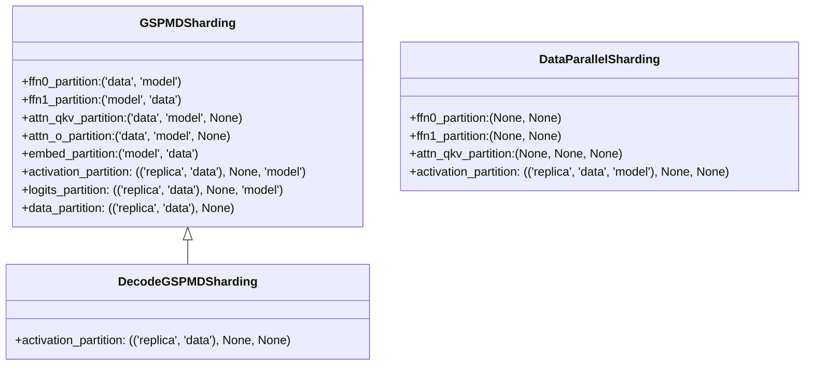
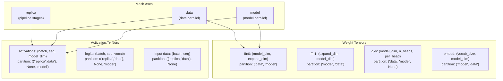
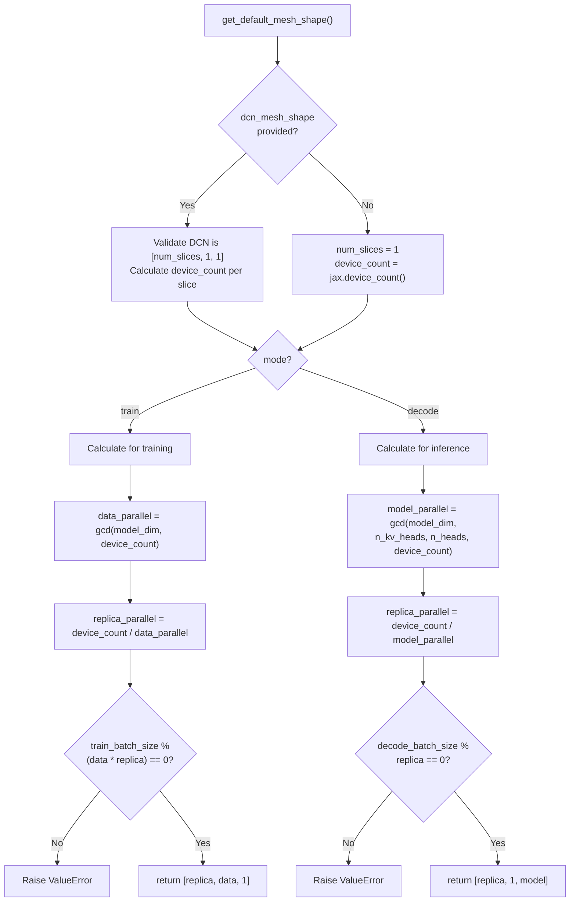
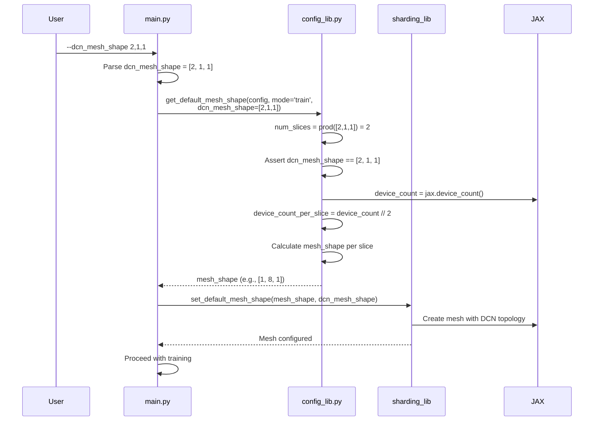
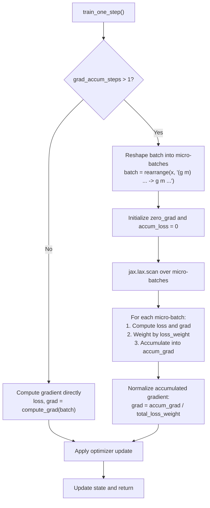
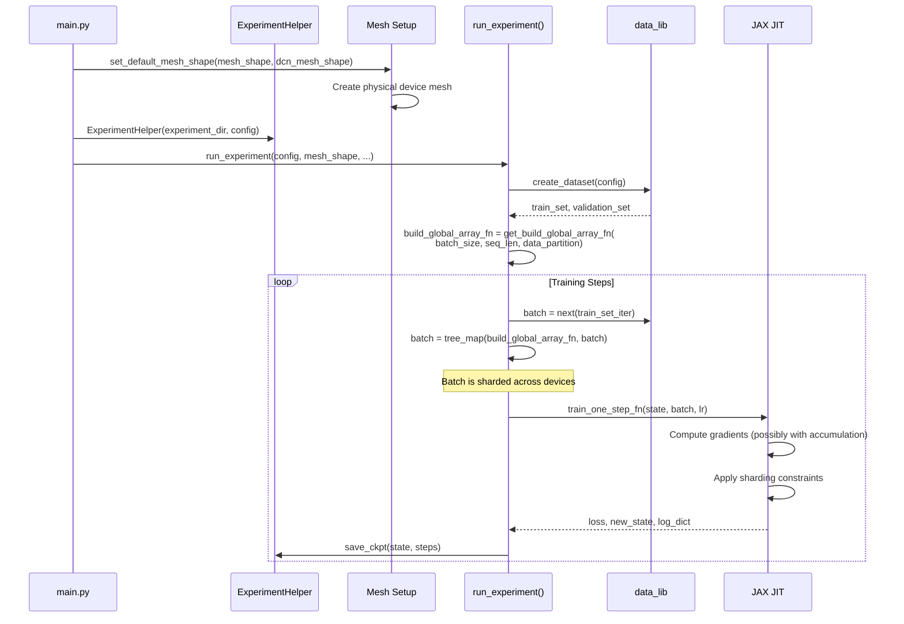

<!-- source: DeepWiki mcp.deepwiki.com · repo google-deepmind/simply · page 5.5 Distributed Training · fetched 2026-10-26 -->

# Distributed Training

<details>
<summary>Relevant source files</summary>

The following files were used as context for generating this wiki page:

- [simply/config_lib.py](simply/config_lib.py)
- [simply/main.py](simply/main.py)
- [simply/model_lib.py](simply/model_lib.py)

</details>


## Purpose and Scope

This document explains how to configure and execute distributed training across multiple devices (GPUs/TPUs) in Simply. It covers sharding strategies, mesh configuration, multi-host training, and gradient accumulation. For information about standard single-device training workflows, see [Standard Training Workflow](#5.1). For RL-specific distributed training patterns, see [Reinforcement Learning Training](#5.2).

## Overview

Simply uses JAX's GSPMD (General and Scalable Parallelization for ML Computations on Distributed memory systems) for distributed training. The system supports:

- **Model parallelism**: Sharding model weights across devices
- **Data parallelism**: Splitting batches across devices  
- **Pipeline parallelism**: Through mesh configuration (replica axis)
- **Multi-host training**: Coordinating across multiple machines via DCN topology

The distributed training configuration involves three main components:

1. **Sharding configuration**: Defines how weights and activations are partitioned
2. **Mesh shape**: Specifies the physical device layout
3. **Batch and gradient configuration**: Controls data flow and accumulation

**Sources:** [simply/config_lib.py:1-837](), [simply/main.py:1-151]()

## Sharding Strategies

Simply provides three built-in sharding configurations, each optimized for different training scenarios.

### ShardingConfig Classes



**Sources:** [simply/config_lib.py:104-182]()

### Sharding Strategy Comparison

| Strategy | Weight Sharding | Use Case | Pros | Cons |
|----------|----------------|----------|------|------|
| **GSPMDSharding** | FFN, attention, embeddings sharded across 'model' axis | Training large models | Reduces memory per device, enables larger models | Communication overhead |
| **DecodeGSPMDSharding** | Same as GSPMD but activations not sharded on model dim | Inference/generation | Lower latency for decoding | Higher memory per device |
| **DataParallelSharding** | No weight sharding | Training models that fit on single device | Simple, no cross-device weight communication | Limited to models that fit in device memory |

**Sources:** [simply/config_lib.py:104-182]()

### Partition Annotations Explained

Each sharding configuration specifies partition annotations for different tensor types:



The partition tuple maps tensor dimensions to mesh axes. For example, `('data', 'model')` means:
- Dimension 0 is sharded across the 'data' mesh axis
- Dimension 1 is sharded across the 'model' mesh axis
- `None` means no sharding for that dimension
- Nested tuples like `(('replica', 'data'), None, 'model')` mean dimension 0 is sharded across both replica and data axes

**Sources:** [simply/config_lib.py:104-182]()

## Mesh Configuration

The mesh defines how devices are organized into a 3D grid with axes: `[replica, data, model]`.

### Mesh Shape Determination



**Sources:** [simply/config_lib.py:1787-1836]()

### Mesh Shape Calculation Logic

The `get_default_mesh_shape()` function automatically determines optimal mesh configuration:

**Training Mode:**
```python
# For training, maximize data parallelism
data_parallel = gcd(config.model_dim, device_count)
replica_parallel = device_count // data_parallel
mesh_shape = [replica_parallel, data_parallel, 1]
```

**Decode Mode:**
```python
# For inference, maximize model parallelism  
model_parallel = gcd(config.model_dim, config.n_kv_heads, config.n_heads, device_count)
replica_parallel = device_count // model_parallel
mesh_shape = [replica_parallel, 1, model_parallel]
```

**Sources:** [simply/config_lib.py:1787-1836]()

### Mesh Configuration Example

For a system with 8 devices and `model_dim=2048`:

| Scenario | Devices | Model Dim | Mesh Shape | Explanation |
|----------|---------|-----------|------------|-------------|
| Training | 8 | 2048 | `[1, 8, 1]` | gcd(2048, 8) = 8, all devices for data parallel |
| Training | 16 | 2048 | `[1, 16, 1]` | gcd(2048, 16) = 16, all devices for data parallel |
| Decode | 8 | 2048 | `[1, 1, 8]` | All devices for model parallel in inference |
| Training w/ DCN | 16 (2 hosts) | 2048 | `[2, 8, 1]` | DCN `[2,1,1]`, 8 devices per host |

**Sources:** [simply/config_lib.py:1787-1836](), [simply/main.py:115-130]()

## Multi-Host and DCN Training

For training across multiple hosts (machines), Simply supports DCN (Data Center Network) mesh configuration.

### DCN Configuration Flow



**Sources:** [simply/main.py:115-129](), [simply/config_lib.py:1787-1836]()

### DCN Constraints and Requirements

The DCN mesh shape must satisfy:
- Format: `[num_slices, 1, 1]` - only replica axis can be sliced
- Each slice contains `device_count // num_slices` devices
- The resulting mesh shape must evenly divide the batch size

Example configuration for 2-host training with 16 devices per host:
```bash
python -m simply.main \
  --experiment_config=Gemma2BV2 \
  --dcn_mesh_shape=2,1,1 \
  --mesh_shape=1,16,1
```

**Sources:** [simply/config_lib.py:1791-1796](), [simply/main.py:76-80]()

## Gradient Accumulation

Gradient accumulation allows training with larger effective batch sizes by accumulating gradients over multiple micro-batches.

### Gradient Accumulation Process



**Sources:** [simply/model_lib.py:1878-2006]()

### Gradient Accumulation Configuration

Set `grad_accum_steps` in your experiment config:

```python
@dataclasses.dataclass(frozen=True)
class MyConfig(TFM1p7BLM1B):
  batch_size: int = 64          # Number of examples per training step
  grad_accum_steps: int = 4     # Split into 4 micro-batches
  # Effective: batch_size is processed, but split into 4 forward passes
  # Memory: Only batch_size//4 = 16 examples in memory at once
```

Constraints:
- `train_batch_size % grad_accum_steps == 0` must be satisfied
- After accumulation, `(train_batch_size // grad_accum_steps) % (data_parallel * replica_parallel) == 0` must hold

**Sources:** [simply/model_lib.py:1920-1964](), [simply/config_lib.py:1807-1813]()

## Configuring Distributed Training

### Command-Line Configuration

The main entry point accepts multiple flags for distributed configuration:

```bash
python -m simply.main \
  --experiment_config=Gemma9BV2 \
  --sharding_config=GSPMDSharding \
  --mesh_shape=2,4,2 \           # [replica, data, model]
  --dcn_mesh_shape=2,1,1 \        # Multi-host: 2 slices
  --decoding_mesh_shape=1,1,16 \  # Override for inference
  --experiment_dir=/path/to/exp
```

**Sources:** [simply/main.py:47-86]()

### Flag Reference

| Flag | Type | Description | Default |
|------|------|-------------|---------|
| `--mesh_shape` | list[int] | Mesh shape for training `[replica, data, model]` | Auto-computed |
| `--dcn_mesh_shape` | list[int] | DCN topology `[num_slices, 1, 1]` | None (single host) |
| `--decoding_mesh_shape` | list[int] | Mesh shape for inference | Auto-computed |
| `--sharding_config` | str | Name of sharding config | `GSPMDSharding` |

**Sources:** [simply/main.py:70-86]()

### Programmatic Configuration

You can also configure sharding in your experiment config:

```python
@ExperimentConfigRegistry.register
@dataclasses.dataclass(frozen=True)
class MyDistributedConfig(Gemma2BV2):
  # Batch configuration
  batch_size: int = 512
  grad_accum_steps: int = 8
  
  # RL-specific (if using RL training)
  train_batch_size: int = 2048
  num_samples_per_example: int = 16
  
  # Sharding for decoding (RL only)
  decoding_sharding_config: SimplyConfig = DecodeGSPMDSharding()
```

**Sources:** [simply/config_lib.py:839-903]()

## Training Loop Integration

The training loop automatically handles distributed execution:



**Sources:** [simply/model_lib.py:2094-2272](), [simply/main.py:89-148]()

### Data Sharding with build_global_array_fn

The `build_global_array_fn` ensures proper data distribution:

```python
def get_build_global_array_fn(batch_size, seq_len, data_partition=None):
  # Initial sharding: fully sharded across all devices
  init_data_sharding = mesh_sharding((('replica', 'data', 'model'), None))
  
  # Final sharding: according to data_partition spec
  data_sharding = mesh_sharding(data_partition)
  
  build_global_array_fn = functools.partial(
      build_global_array,
      global_shape=(batch_size, seq_len),
      init_sharding=init_data_sharding,
      final_sharding=data_sharding)
  
  return build_global_array_fn
```

This function:
1. Takes per-device local data arrays
2. Constructs a global array with the expected global batch size
3. Applies proper sharding according to the sharding config

**Sources:** [simply/model_lib.py:2288-2299]()

## Common Distributed Training Patterns

### Pattern 1: Large Model Training (GSPMD)

For models too large to fit on a single device:

```python
@dataclasses.dataclass(frozen=True)  
class LargeModelConfig(BaseExperimentConfig):
  model_dim: int = 4096
  n_layers: int = 48
  batch_size: int = 128
  grad_accum_steps: int = 4
```

Run with:
```bash
python -m simply.main \
  --experiment_config=LargeModelConfig \
  --sharding_config=GSPMDSharding \
  --mesh_shape=1,8,2  # 8-way data, 2-way model parallel
```

**Sources:** [simply/config_lib.py:639-668]()

### Pattern 2: Data Parallel Training

For models that fit on a single device but need data parallelism for speed:

```bash
python -m simply.main \
  --experiment_config=Gemma2BV2 \
  --sharding_config=DataParallelSharding \
  --mesh_shape=1,16,1  # 16-way data parallel
```

**Sources:** [simply/config_lib.py:145-182]()

### Pattern 3: Multi-Host RL Training

For RL training across multiple hosts with sampling and learning:

```python
@dataclasses.dataclass(frozen=True)
class MultiHostRLConfig(BaseRLConfig):
  train_batch_size: int = 2048   # Total across all devices
  batch_size: int = 64            # Prompts per device
  num_samples_per_example: int = 16
  grad_accum_steps: int = 4
  
  decoding_sharding_config: SimplyConfig = DecodeGSPMDSharding()
```

Run with:
```bash
python -m simply.main \
  --experiment_config=MultiHostRLConfig \
  --sharding_config=GSPMDSharding \
  --dcn_mesh_shape=4,1,1 \        # 4 hosts
  --mesh_shape=1,16,1 \           # Per-host mesh
  --decoding_mesh_shape=1,1,16    # Inference mesh
```

**Sources:** [simply/config_lib.py:780-805]()

### Pattern 4: Validation with Different Batch Size

The validation set can use a different batch size:

```python
@dataclasses.dataclass(frozen=True)
class MyConfig(BaseExperimentConfig):
  batch_size: int = 1024                    # Training batch
  validation_eval_batch_size: int = 256     # Validation batch
  use_validation_set: bool = True
```

The mesh shape must accommodate both batch sizes:
- Training: `batch_size % (data_parallel * replica_parallel) == 0`
- Validation: `validation_eval_batch_size % (data_parallel * replica_parallel) == 0`

**Sources:** [simply/model_lib.py:2167-2179](), [simply/config_lib.py:270-278]()

## Performance Considerations

### Memory vs Communication Trade-offs

| Configuration | Memory per Device | Communication | Best For |
|--------------|-------------------|---------------|----------|
| Data parallel only | High | Low (gradients only) | Models that fit, abundant devices |
| Model parallel only | Low | High (activations) | Very large models |
| Hybrid (data + model) | Medium | Medium | Balanced scenarios |
| Gradient accumulation | Low | Low (but slower) | Memory-constrained training |

### Batch Size Guidelines

For optimal performance:
1. **Training batch size** should be divisible by `grad_accum_steps` if used
2. After accumulation, batch must be evenly distributed: `(batch_size // grad_accum_steps) % (data_parallel * replica_parallel) == 0`
3. For RL: `train_batch_size = batch_size * num_samples_per_example`
4. Larger batches improve device utilization but may require gradient accumulation

**Sources:** [simply/config_lib.py:1800-1818]()

### Debugging Distributed Training

Common validation errors and solutions:

```python
# Error: "batch_size must be divisible by data_parallel * replica_parallel"
# Solution: Adjust batch_size or mesh_shape

# Error: "dcn_mesh_shape must be [num_slices, 1, 1]"  
# Solution: Only replica axis can be sliced across hosts

# Error: "train_batch_size must be divisible by grad_accum_steps"
# Solution: Choose grad_accum_steps that divides train_batch_size evenly
```

Enable logging to see mesh configuration:
```python
logging.info('mesh_shape: %s', mesh_shape)
logging.info('dcn_mesh_shape: %s', dcn_mesh_shape)  
logging.info('decoding_mesh_shape: %s', decoding_mesh_shape)
```

**Sources:** [simply/main.py:129-130](), [simply/config_lib.py:1809-1833]()

---

