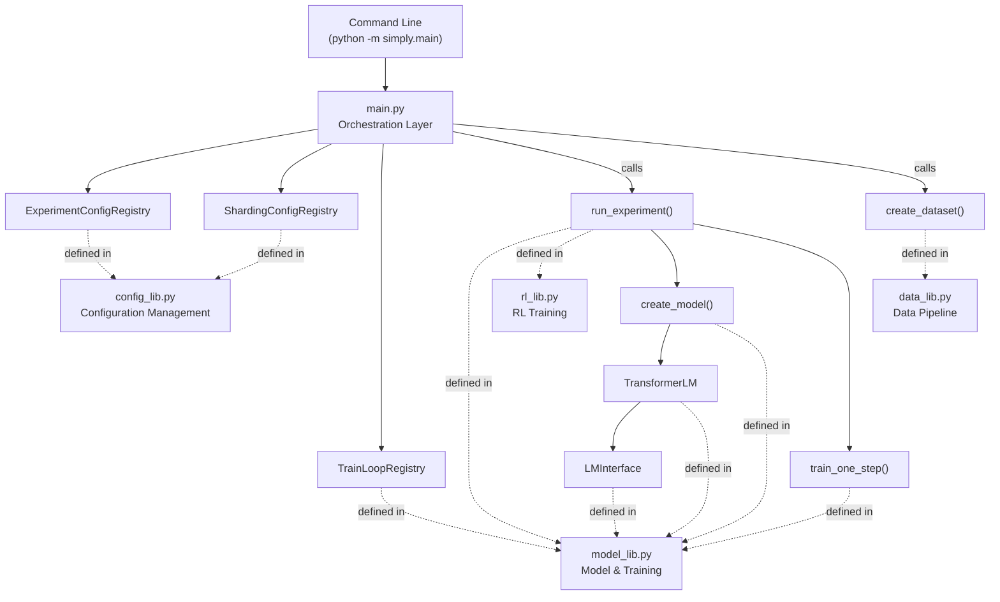
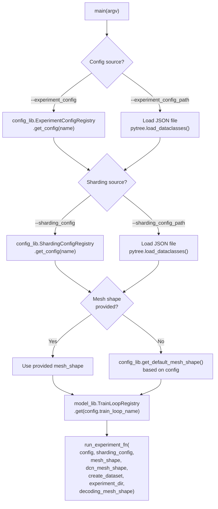
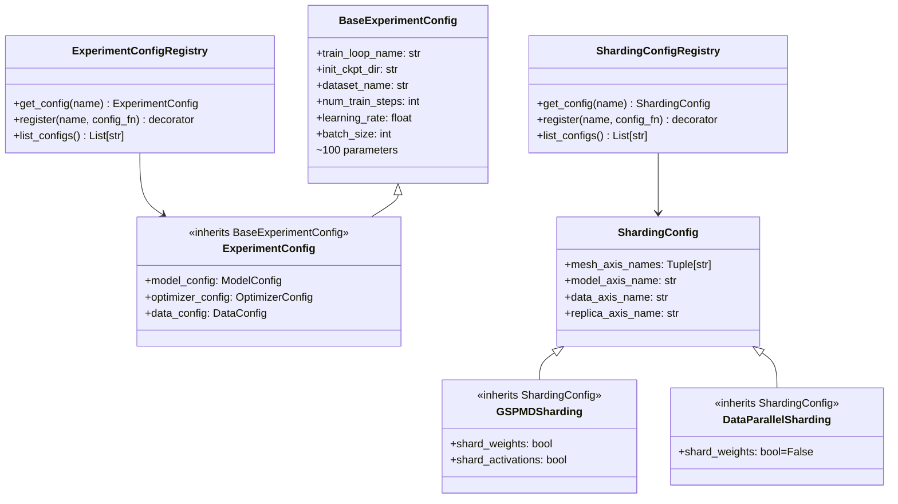
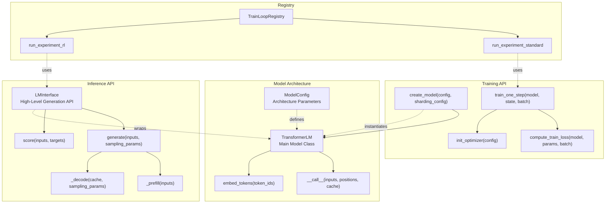
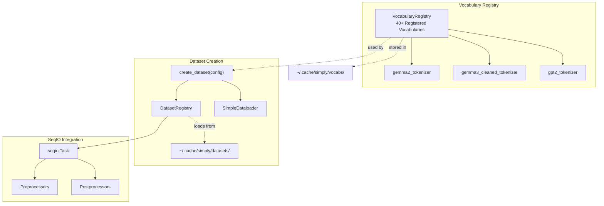
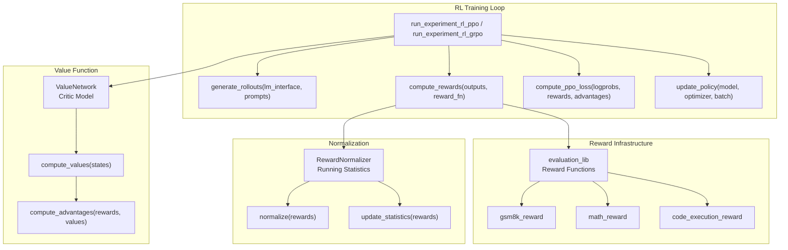

<!-- source: DeepWiki mcp.deepwiki.com · repo google-deepmind/simply · page 6 API Reference · fetched 2026-10-26 -->

# API Reference

<details>
<summary>Relevant source files</summary>

The following files were used as context for generating this wiki page:

- [simply/main.py](simply/main.py)

</details>


This page provides detailed API documentation for Simply's core modules. Each module is documented with its key classes, functions, parameters, and usage patterns. For task-specific workflows using these APIs, see the User Guides section ([#5](#5)).

**Child pages:**
- [main.py](#6.1) - Command-line interface and experiment orchestration
- [config_lib.py](#6.2) - Configuration registries and dataclasses
- [model_lib.py](#6.3) - Model architecture and training loops
- [data_lib.py](#6.4) - Dataset creation and vocabulary management
- [rl_lib.py](#6.5) - Reinforcement learning training infrastructure

---

## Module Overview

Simply is organized into five core modules that handle distinct responsibilities in the training and inference pipeline. The following diagram shows how these modules interact during a typical experiment execution.

**Module Interaction Flow**



Sources: [simply/main.py:89-147]()

---

## Command-Line Interface

The `main.py` module serves as the primary entry point for all experiments. It processes command-line flags, loads configurations, and delegates execution to the appropriate training loop.

**Command-Line Flags**

| Flag | Type | Default | Description |
|------|------|---------|-------------|
| `--experiment_config` | string | None | Name of registered experiment config (e.g., `Gemma2BV2`) |
| `--experiment_config_path` | string | None | Path to JSON config file (mutually exclusive with `experiment_config`) |
| `--sharding_config` | string | `GSPMDSharding` | Name of registered sharding config |
| `--sharding_config_path` | string | None | Path to JSON sharding config (overrides `sharding_config`) |
| `--experiment_dir` | string | `/tmp/simply_lm/` | Directory for checkpoints and logs |
| `--mesh_shape` | list | Auto-computed | Device mesh shape (replica, data, model) |
| `--dcn_mesh_shape` | list | None | DCN topology mesh shape |
| `--decoding_mesh_shape` | list | Auto-computed | Mesh shape for inference/decoding |

Sources: [simply/main.py:47-86]()

### main() Function Flow



Sources: [simply/main.py:89-147]()

### Code Patch Execution

When loading configurations from JSON files, `main.py` supports executing Python code patches to dynamically modify behavior. This advanced feature allows runtime code injection:

```python
# Example config_dict with code_patch
{
  "code_patch": [
    ["custom_code_here", "module_context"]
  ],
  # ... rest of config
}
```

The code is executed in the context of the specified global module using `exec()`. This mechanism enables advanced users to extend or modify behavior without forking the codebase.

Sources: [simply/main.py:97-102]()

---

## Configuration System API

The configuration system is built on two registry classes and several configuration dataclasses. All configurations are registered using decorator patterns.

**Configuration Type Hierarchy**



Sources: [simply/config_lib.py]()

### Key Configuration Functions

| Function | Parameters | Return Type | Description |
|----------|-----------|-------------|-------------|
| `get_config(name)` | `name: str` | `ExperimentConfig` | Retrieve registered config by name |
| `get_default_mesh_shape(config, mode, dcn_mesh_shape)` | `config: ExperimentConfig`<br/>`mode: str` (train/decode)<br/>`dcn_mesh_shape: Optional[List[int]]` | `List[int]` | Compute optimal mesh shape for config |
| `apply_config_diff(base_config, diff_dict)` | `base_config: ExperimentConfig`<br/>`diff_dict: Dict` | `ExperimentConfig` | Apply dictionary updates to config |

Sources: [simply/config_lib.py](), [simply/main.py:121-128]()

### Configuration Loading Patterns

**Pattern 1: Load by Name**
```python
config = config_lib.ExperimentConfigRegistry.get_config('Gemma2BV2')
```

**Pattern 2: Load from JSON**
```python
with open('config.json', 'r') as f:
    config_dict = json.load(f)
config = pytree.load_dataclasses(config_dict)
```

**Pattern 3: Programmatic Modification**
```python
base_config = config_lib.ExperimentConfigRegistry.get_config('Gemma2BV2')
modified_config = config_lib.apply_config_diff(base_config, {
    'learning_rate': 1e-4,
    'num_train_steps': 100000
})
```

Sources: [simply/main.py:91-107](), [simply/config_lib.py]()

---

## Model API

The `model_lib.py` module provides the core model architecture (`TransformerLM`), training functions, and inference interface (`LMInterface`).

**Model API Structure**



Sources: [simply/model_lib.py]()

### TransformerLM Class

**Constructor Parameters**

| Parameter | Type | Description |
|-----------|------|-------------|
| `num_layers` | `int` | Number of transformer blocks |
| `num_heads` | `int` | Number of attention heads |
| `model_dim` | `int` | Model hidden dimension |
| `vocab_size` | `int` | Vocabulary size |
| `ffn_dim` | `Optional[int]` | FFN hidden dimension (default: 4 × model_dim) |
| `use_gating` | `bool` | Whether to use gated FFN |
| `use_flash_attention` | `bool` | Whether to use flash attention |
| `use_rope` | `bool` | Whether to use rotary position embeddings |
| `rope_base` | `float` | RoPE base frequency |
| `max_seq_length` | `int` | Maximum sequence length |

**Key Methods**

| Method | Signature | Description |
|--------|-----------|-------------|
| `__call__` | `(inputs, positions, cache=None) → (logits, cache)` | Forward pass with optional KV-caching |
| `embed_tokens` | `(token_ids) → embeddings` | Convert token IDs to embeddings |
| `init_cache` | `(batch_size, seq_length) → cache` | Initialize KV-cache for decoding |

Sources: [simply/model_lib.py]()

### LMInterface Class

The `LMInterface` class provides a simplified API for text generation and scoring, managing KV-cache and sampling internally.

**Constructor**

```python
lm = LMInterface(
    model: TransformerLM,
    params: PyTree,
    vocab: seqio.Vocabulary
)
```

**Generation Method**

```python
outputs = lm.generate(
    inputs: jnp.ndarray,  # Shape: [batch_size, seq_length]
    sampling_params: SamplingParams,
    rng: jax.random.PRNGKey
) → GenerationOutputs
```

**SamplingParams**

| Field | Type | Default | Description |
|-------|------|---------|-------------|
| `max_decode_steps` | `int` | 512 | Maximum tokens to generate |
| `temperature` | `float` | 1.0 | Sampling temperature |
| `top_k` | `Optional[int]` | None | Top-k filtering |
| `top_p` | `Optional[float]` | None | Nucleus sampling threshold |
| `do_sample` | `bool` | True | Whether to sample (vs greedy) |

**Scoring Method**

```python
scores = lm.score(
    inputs: jnp.ndarray,   # Shape: [batch_size, seq_length]
    targets: jnp.ndarray   # Shape: [batch_size, target_length]
) → jnp.ndarray  # Shape: [batch_size]
```

Returns the log-probability of the target sequence conditioned on inputs.

Sources: [simply/model_lib.py]()

### Training Loop Registry

The `TrainLoopRegistry` maps training loop names to implementation functions. Experiments specify their training loop via `config.train_loop_name`.

**Registered Training Loops**

| Name | Function | Purpose |
|------|----------|---------|
| `standard` | `run_experiment_standard` | Supervised training with cross-entropy loss |
| `rl_ppo` | `run_experiment_rl_ppo` | PPO reinforcement learning |
| `rl_grpo` | `run_experiment_rl_grpo` | GRPO reinforcement learning |

**Training Loop Signature**

All training loops implement this interface:

```python
def run_experiment(
    config: ExperimentConfig,
    sharding_config: ShardingConfig,
    mesh_shape: List[int],
    dcn_mesh_shape: Optional[List[int]],
    create_dataset: Callable,
    experiment_dir: str,
    decoding_mesh_shape: Optional[List[int]]
) → None
```

Sources: [simply/model_lib.py](), [simply/rl_lib.py](), [simply/main.py:139-147]()

---

## Data API

The `data_lib.py` module manages dataset creation, vocabulary registration, and data preprocessing.

**Data Pipeline Components**



Sources: [simply/data_lib.py]()

### Key Functions

**create_dataset**

```python
def create_dataset(
    config: ExperimentConfig,
    mesh: Optional[jax.sharding.Mesh] = None,
    global_batch_size: Optional[int] = None
) → Tuple[SimpleDataloader, SimpleDataloader]
```

Returns `(train_dataloader, validation_dataloader)` tuples. The dataloader yields batches with the following structure:

```python
{
    'inputs': jnp.ndarray,      # Shape: [batch_size, seq_length]
    'targets': jnp.ndarray,     # Shape: [batch_size, seq_length]
    'weights': jnp.ndarray,     # Shape: [batch_size, seq_length]
    'positions': jnp.ndarray    # Shape: [batch_size, seq_length]
}
```

**Vocabulary API**

| Function | Parameters | Return Type | Description |
|----------|-----------|-------------|-------------|
| `VocabularyRegistry.get(name)` | `name: str` | `seqio.Vocabulary` | Get registered vocabulary |
| `vocab.encode(text)` | `text: str` | `List[int]` | Tokenize text to IDs |
| `vocab.decode(ids)` | `ids: List[int]` | `str` | Detokenize IDs to text |
| `vocab.vocab_size` | - | `int` | Total vocabulary size |
| `vocab.eos_id` | - | `int` | End-of-sequence token ID |
| `vocab.pad_id` | - | `int` | Padding token ID |

### SimpleDataloader

The `SimpleDataloader` class wraps SeqIO datasets and handles batching, sharding, and prefetching.

**Key Methods**

| Method | Description |
|--------|-------------|
| `__iter__()` | Returns iterator over batches |
| `__next__()` | Returns next batch dictionary |
| `reset()` | Reset iterator to beginning |
| `set_epoch(epoch)` | Set epoch for shuffling |

Sources: [simply/data_lib.py]()

---

## Reinforcement Learning API

The `rl_lib.py` module provides specialized training loops and utilities for reinforcement learning experiments.

**RL Training Components**



Sources: [simply/rl_lib.py](), [simply/evaluation_lib/]()

### PPO Training Loop

**Key Functions**

| Function | Signature | Description |
|----------|-----------|-------------|
| `run_experiment_rl_ppo` | `(config, sharding_config, ...) → None` | Main PPO training loop |
| `generate_rollouts` | `(lm, prompts, sampling_params) → Rollouts` | Generate trajectories from policy |
| `compute_ppo_loss` | `(logprobs, old_logprobs, advantages) → loss` | Clipped PPO objective |
| `compute_advantages` | `(rewards, values, gamma, lambda) → advantages` | GAE advantage estimation |

**PPO-Specific Config Parameters**

| Parameter | Type | Default | Description |
|-----------|------|---------|-------------|
| `ppo_clip_epsilon` | `float` | 0.2 | PPO clipping parameter |
| `ppo_epochs` | `int` | 4 | Number of PPO update epochs per rollout |
| `gamma` | `float` | 0.99 | Discount factor |
| `gae_lambda` | `float` | 0.95 | GAE lambda parameter |
| `value_loss_coef` | `float` | 0.5 | Value function loss coefficient |
| `entropy_coef` | `float` | 0.01 | Entropy bonus coefficient |

### GRPO Training Loop

**Key Functions**

| Function | Signature | Description |
|----------|-----------|-------------|
| `run_experiment_rl_grpo` | `(config, sharding_config, ...) → None` | Main GRPO training loop |
| `sample_multiple_responses` | `(lm, prompts, num_samples) → responses` | Generate multiple responses per prompt |
| `compute_grpo_loss` | `(logprobs, rewards, baselines) → loss` | GRPO group-relative objective |
| `compute_baseline` | `(rewards, group_size) → baseline` | Compute group-wise baseline |

**GRPO-Specific Config Parameters**

| Parameter | Type | Default | Description |
|-----------|------|---------|-------------|
| `grpo_group_size` | `int` | 8 | Number of responses per prompt |
| `grpo_beta` | `float` | 0.1 | KL penalty coefficient |
| `grpo_top_p_ratio` | `float` | 0.5 | Proportion of top responses to use |

### RewardNormalizer

The `RewardNormalizer` maintains running statistics for reward normalization across training.

```python
normalizer = RewardNormalizer()

# Update with new rewards
normalizer.update(rewards)

# Normalize rewards
normalized = normalizer.normalize(rewards)

# Get statistics
mean = normalizer.get_mean()
std = normalizer.get_std()
count = normalizer.get_count()
```

Sources: [simply/rl_lib.py]()

---

## Utility APIs

### Pytree Utilities

The `pytree` module provides serialization and deserialization for JAX pytrees and dataclasses.

| Function | Signature | Description |
|----------|-----------|-------------|
| `save_dataclasses` | `(obj, path)` | Serialize dataclass to JSON |
| `load_dataclasses` | `(dict) → obj` | Deserialize JSON to dataclass |
| `pytree_to_dict` | `(pytree) → dict` | Convert pytree to dictionary |
| `dict_to_pytree` | `(dict, template) → pytree` | Reconstruct pytree from dict |

Sources: [simply/utils/pytree.py](), [simply/main.py:44](), [simply/main.py:103](), [simply/main.py:110]()

### Module Utilities

The `module` utilities provide JAX module management helpers:

| Function | Description |
|----------|-------------|
| `init_params(module, rng, input_shapes)` | Initialize module parameters |
| `apply_fn(module, params, *args)` | Apply module with parameters |
| `shard_params(params, spec)` | Shard parameters according to spec |

Sources: [simply/utils/module.py]()

### Common Utilities

The `common` module provides general utilities:

| Class/Function | Description |
|----------------|-------------|
| `AttributeDict` | Dictionary with attribute-style access |
| `setup_logging()` | Configure logging for experiments |
| `get_device_count()` | Query available accelerator count |
| `wait_for_devices()` | Wait for all devices to be ready |

Sources: [simply/utils/common.py](), [simply/main.py:43](), [simply/main.py:133]()

---

## Complete API Usage Example

The following example demonstrates how the APIs work together in a typical workflow:

```python
from simply import main, config_lib, data_lib, model_lib

# 1. Load configuration
config = config_lib.ExperimentConfigRegistry.get_config('Gemma2BV2')
sharding_config = config_lib.ShardingConfigRegistry.get_config('GSPMDSharding')

# 2. Compute mesh shape
mesh_shape = config_lib.get_default_mesh_shape(config, mode='train')

# 3. Create datasets
train_ds, valid_ds = data_lib.create_dataset(config)

# 4. Get training loop
run_experiment = model_lib.TrainLoopRegistry.get(config.train_loop_name)

# 5. Run experiment
run_experiment(
    config=config,
    sharding_config=sharding_config,
    mesh_shape=mesh_shape,
    dcn_mesh_shape=None,
    create_dataset=data_lib.create_dataset,
    experiment_dir='/tmp/experiment',
    decoding_mesh_shape=None
)
```

This workflow mirrors the execution path in [simply/main.py:89-147]().

Sources: [simply/main.py:89-147](), [simply/config_lib.py](), [simply/data_lib.py](), [simply/model_lib.py]()

---

